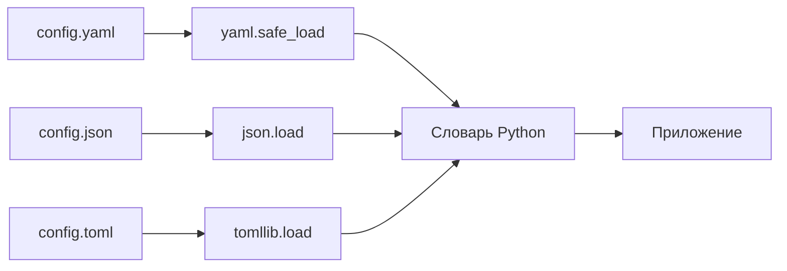

## Зачем конфигурации нужен формат

Любое серьёзное приложение имеет настройки: адрес базы данных, порт, уровни логирования, таймауты. Жёстко зашивать их в код — плохая идея: при смене окружения (локально, на тестовом сервере, в проде) пришлось бы переписывать программу. Решение — выносить настройки в отдельные файлы конфигурации, которые можно менять без правки кода.

Раньше конфиги были в стиле `key=value`, но современные приложения предпочитают структурированные форматы: **JSON**, **YAML** и **TOML**. Все три читаются человеком, поддерживают вложенность и имеют готовые библиотеки в Python. Разберём каждый.

## JSON: встроенный формат

JSON — стандарт де-факто для обмена данными между сервисами. В Python за него отвечает модуль `json`:

```python
import json

config = {
    "host": "localhost",
    "port": 5432,
    "debug": False,
}

with open("config.json", "w", encoding="utf-8") as f:
    json.dump(config, f, ensure_ascii=False, indent=2)

with open("config.json", encoding="utf-8") as f:
    loaded = json.load(f)

print(loaded["host"], loaded["port"])
```

`json.dump` записывает словарь в файл, `json.load` читает его обратно. Важный нюанс: ключи JSON — только строки, а `ensure_ascii=False` сохраняет русский текст читаемым, а не в виде `\uXXXX`.

## YAML: человекочитаемый и вложенный

YAML — это формат, в котором «приятно» писать конфиги: вместо кавычек и запятых — отступы. Чаще всего его используют с Kubernetes, CI-конфигами и Ansible. В Python нужна сторонняя библиотека PyYAML:

```python
import yaml

config = """
server:
  host: localhost
  port: 8000
logging:
  level: info
  file: app.log
"""

data = yaml.safe_load(config)
print(data["server"]["port"])   # 8000
```

Всегда используй `yaml.safe_load`, а не `yaml.load`: он безопаснее и не позволяет выполнять произвольные объекты при разборе файла из ненадёжного источника.

## TOML: встроенный в Python 3.11+

TOML появился как формат настроек для Python-пакетов (pyproject.toml). Он строже YAML, но читается так же легко. С Python 3.11 за чтение отвечает модуль `tomllib`:

```python
import tomllib

with open("config.toml", "rb") as f:
    data = tomllib.load(f)

print(data["server"]["host"])
```

Обрати внимание: `tomllib.load` требует открытия файла в бинарном режиме `"rb"`. Запись в TOML в стандартной библиотеке пока нет — для этого есть сторонние пакеты вроде `tomli-w`.

## Какой формат выбрать

Ориентируйся так: JSON — если нужна максимальная совместимость и обработка компьютером; YAML — если конфиг читают и пишут люди (и он сложный, вложенный); TOML — если нужен строгий, предсказуемый формат без «сюрпризов» YAML. Во всех трёх случаях результат один — словарь Python, с которым дальше работаешь привычным образом.

## Обработка ошибок

Конфиг — это внешние данные, они могут быть битыми. Всегда оборачивай чтение в `try/except`:

```python
import json

try:
    with open("config.json", encoding="utf-8") as f:
        config = json.load(f)
except (FileNotFoundError, json.JSONDecodeError) as e:
    print("Не удалось прочитать конфиг:", e)
```

`json.JSONDecodeError` ловит битый JSON, `FileNotFoundError` — отсутствующий файл. Хороший скрипт не падает, а ясно сообщает о проблеме.

## Один конфиг — три формата

Какой бы формат ни выбрали, путь один: файл → парсер → словарь Python. Разница только в функции чтения и режиме открытия файла.



## Итог

Мы научились читать и писать три основных формата конфигурации: JSON через `json`, YAML через `yaml.safe_load`, TOML через `tomllib.load`. Теперь закрепим навык задачами.

<!--TASK-->
### Задача 1
Создай скрипт `json_config.py`, который создаёт словарь с настройками приложения (например, `name` — название, `version` — версия, `port` — число, `features` — список строк) и сохраняет его в файл `config.json` через `json.dump` с отступами `indent=2` и `ensure_ascii=False`. Затем прочитай файл обратно через `json.load` и выведи на экран все пары «ключ: значение» верхнего уровня в формате `ключ: значение`. Проверь, что файл получился читаемым.

### Задача 2
Дан файл `servers.yaml`:

```yaml
servers:
  - name: web-1
    ip: 10.0.0.1
    role: web
  - name: db-1
    ip: 10.0.0.2
    role: database
```

Напиши скрипт `yaml_servers.py`, который читает этот файл с помощью `yaml.safe_load` и выводит IP-адреса всех серверов с ролью `database`. Если таких нет — выведи `Базы данных не найдены`. Предварительно создай файл `servers.yaml` с указанным содержимым.

### Задача 3
Создай скрипт `toml_dump.py`, который читает TOML-файл `project.toml`:

```toml
[project]
name = "my-api"
version = "1.2.3"

[server]
host = "0.0.0.0"
port = 8080
```

и выводит строку `Проект my-api v1.2.3 слушает на 0.0.0.0:8080`. Используй `tomllib.load` и учти, что файл нужно открывать в бинарном режиме `"rb"`.

### Задача 4
Напиши функцию `load_config(path)`, которая определяет формат по расширению файла (`.json` → `json.load`, `.yaml`/`.yml` → `yaml.safe_load`, `.toml` → `tomllib.load`) и возвращает словарь. Если расширение неизвестно — брось `ValueError` с сообщением `Неизвестный формат: <расширение>`. Протестируй функцию на трёх созданных тобой файлах и выведи результат для каждого.

### Задача 5
Скрипт `safe_load.py` должен читать конфиг `app.json` и обрабатывать две ошибки: отсутствие файла (`FileNotFoundError`) и битый JSON (`json.JSONDecodeError`). В обоих случаях выведитеди сообщение `Ошибка конфига: <текст ошибки>` и заверши программу с кодом `1`. Создай два тестовых файла: корректный и с ошибкой в JSON (например, с лишней запятой), чтобы проверить оба сценария.

### Задача 6
Напиши функцию `merged_config(user_cfg, defaults)`, которая рекурсивно объединяет два вложенных словаря: значения из `user_cfg` побеждают, но ключи, которых там нет, берутся из `defaults`. Вложенные словари объединяй рекурсивно, а списки и скаляры заменяй целиком. Исходные словари не мутируй — используй `copy.deepcopy`. Затем напиши `apply_env(config, prefix="APP_")`: для каждой переменной окружения вида `APP_SERVER__HOST` создай или обнови вложенный ключ (`server.host`), приводя значение к `int`, если оно состоит из цифр. Продемонстрируй на базе `{"server": {"host": "localhost", "port": 8000}, "debug": False}`, пользовательском конфиге `{"server": {"port": 9000}}` и переменной `APP_SERVER__HOST=0.0.0.0`. Ожидаемый вывод: `{'server': {'host': '0.0.0.0', 'port': 9000}, 'debug': False}`, а исходный `defaults` должен остаться прежним.

### Задача 7
Напиши скрипт `validate_convert.py`, который читает `service.yaml`, проверяет обязательные ключи и записывает результат в `service.json`. Схему опиши словарём `REQUIRED = {"name": str, "port": int, "replicas": int}`: для каждого ключа проверь наличие и тип, а при ошибке собери сообщение вида `port: ожидался int, получен str`. Собери все ошибки сразу, а не падай на первой. Если ошибок нет — запиши нормализованный словарь в JSON с `indent=2, ensure_ascii=False` и выведи `OK: service.json записан`. Если ошибки есть — напечатай каждую и заверши работу кодом `1`. Проверь на двух файлах: корректном и с `port: "8080"` в кавычках. Ожидаемый вывод для корректного: `OK: service.json записан`; для битого — строка `port: ожидался int, получен str` и код `1`.

<!--/TASK-->

<!--HINT-->
### Подсказка 1
Используй `json.dump(config, f, ensure_ascii=False, indent=2)`. Для чтения — `json.load(f)`. Перебор словаря верхнего уровня: `for key, value in config.items(): print(f"{key}: {value}")`.

### Подсказка 2
После `yaml.safe_load` у тебя будет словарь с ключом `servers` — списком словарей. Пройдись по списку циклом и проверь `server["role"] == "database"`, печатая `server["ip"]`.

### Подсказка 3
Читай так: `with open("project.toml", "rb") as f: data = tomllib.load(f)`. Затем собери строку через f-строку, беря значения из `data["project"]` и `data["server"]`.

### Подсказка 4
Определи расширение через `Path(path).suffix`. Составь словарь форматов: `{".json": json.load, ".yaml": yaml.safe_load, ".yml": yaml.safe_load, ".toml": tomllib.load}`. Для TOML не забудь открыть файл в режиме `"rb"` — удобнее всего открывать файл внутри каждого варианта.

### Подсказка 5
Оборачивай `open` и `json.load` вместе в один `try`. Перехватывай обе ошибки в `except (FileNotFoundError, json.JSONDecodeError) as e:`. Используй `sys.exit(1)` после печати сообщения.

### Подсказка 6
Начни с копии: `result = copy.deepcopy(defaults)`. Затем цикл по `user_cfg.items()`: если и в `result`, и в `user_cfg` лежат словари — вызывай `merged_config` рекурсивно, иначе присваивай `copy.deepcopy(value)`. Для переменных окружения: `path = name[len(prefix):].lower().split("__")`, затем шагай по `path[:-1]`, создавая уровни через `node.setdefault(part, {})`, и присвой последний ключ. `raw.isdigit()` отличит число от строки.

### Подсказка 7
Открой YAML через `yaml.safe_load(f) or {}` — пустой файл даст `None`. Для каждого ключа схемы проверь `if key not in data` и `isinstance(value, expected)`. Отдельно обработай ловушку: `bool` — подкласс `int`, поэтому `True` прошёл бы проверку на `int`; добавь `if expected is int and isinstance(value, bool): type_ok = False`. Собери ошибки в список и решай судьбу файла после цикла.

<!--/HINT-->

<!--SOLUTION-->
### Разбор 1
Решение:

```python
import json

config = {
    "name": "MyApp",
    "version": "2.1.0",
    "port": 8000,
    "features": ["auth", "api", "log"],
}

with open("config.json", "w", encoding="utf-8") as f:
    json.dump(config, f, ensure_ascii=False, indent=2)

with open("config.json", encoding="utf-8") as f:
    loaded = json.load(f)

for key, value in loaded.items():
    print(f"{key}: {value}")
```

Вывод:

```
name: MyApp
version: 2.1.0
port: 8000
features: ['auth', 'api', 'log']
```

Что здесь происходит? `json.dump` сериализует словарь в JSON и записывает его в файл. Параметр `indent=2` делает файл читаемым — каждый уровень вложенности сдвигается на два пробела, а `ensure_ascii=False` оставляет кириллицу в исходном виде. При чтении `json.load` выполняет обратное преобразование: JSON превращается обратно в словарь Python. Список `features` сохраняется как список — типы данных после кругосветного путешествия в JSON и обратно не теряются.

### Разбор 2
Решение:

```python
import yaml

with open("servers.yaml", encoding="utf-8") as f:
    data = yaml.safe_load(f)

found = False
for server in data["servers"]:
    if server["role"] == "database":
        print(server["ip"])
        found = True

if not found:
    print("Базы данных не найдены")
```

Вывод:

```
10.0.0.2
```

Что здесь происходит? Обрати внимание: `servers` — это список словарей. Поэтому мы обходим его циклом `for server in data["servers"]` и у каждого элемента проверяем поле `role`. Если роль равна `database`, печатаем `ip`. Флаг `found` нужен, чтобы после цикла понять, нашёлся ли хоть один подходящий сервер: если нет — печатаем сообщение. `yaml.safe_load` вернул вложенную структуру YAML именно как словари и списки Python, поэтому доступ к полям — обычные квадратные скобки.

### Разбор 3
Решение:

```python
import tomllib

with open("project.toml", "rb") as f:
    data = tomllib.load(f)

project = data["project"]
server = data["server"]
print(f"Проект {project['name']} v{project['version']} "
      f"слушает на {server['host']}:{server['port']}")
```

Вывод:

```
Проект my-api v1.2.3 слушает на 0.0.0.0:8080
```

Что здесь происходит? Ключевая деталь — режим `"rb"`: `tomllib.load` ожидает бинарный поток, поэтому обычную `"r"` использовать нельзя, иначе получишь `TypeError`. Таблицы TOML (`[project]`, `[server]`) превращаются во вложенные словари, поэтому `data["project"]["name"]` даёт имя проекта. Значения типизированы: `port = 8080` станет числом `8080`, а не строкой. Мы собрали итоговую строку через f-строку, склеив две части по строкам с помощью скобок — так строка не получается слишком длинной.

### Разбор 4
Решение:

```python
import json
import tomllib
from pathlib import Path
import yaml

def load_config(path):
    ext = Path(path).suffix.lower()
    if ext == ".json":
        with open(path, encoding="utf-8") as f:
            return json.load(f)
    if ext in (".yaml", ".yml"):
        with open(path, encoding="utf-8") as f:
            return yaml.safe_load(f)
    if ext == ".toml":
        with open(path, "rb") as f:
            return tomllib.load(f)
    raise ValueError(f"Неизвестный формат: {ext}")

print(load_config("config.json"))
print(load_config("servers.yaml"))
print(load_config("project.toml"))
```

Что здесь происходит? Функция определяет формат по расширению пути через `Path(path).suffix`. Для каждой ветки открываем файл в правильном режиме и вызываем парсер. Обрати внимание на единообразие: что бы ни лежало в файле, на выходе всегда словарь (или список) Python — дальше код не зависит от формата. Если расширение неизвестно, мы бросаем `ValueError` с понятным сообщением. Такая функция-фабрика — хороший строительный блок: скрипты, которые работают с конфигами, могут принимать любой из трёх форматов, а всё остальное не меняется.

### Разбор 5
Решение:

```python
import json
import sys

try:
    with open("app.json", encoding="utf-8") as f:
        config = json.load(f)
    print("Конфиг загружен:", config)
except (FileNotFoundError, json.JSONDecodeError) as e:
    print(f"Ошибка конфига: {e}")
    sys.exit(1)
```

Проверяем на корректном и битом файлах:

```
Конфиг загружен: {'debug': True, 'port': 8000}
Ошибка конфига: Expecting ',' delimiter: line 2 column 5 (char 12)
```

Что здесь происходит? Мы поймали сразу две возможные проблемы: файла нет (`FileNotFoundError`) и файл есть, но содержимое — не JSON (`json.JSONDecodeError`). В обоих случаях печатаем текст ошибки и завершаемся с кодом `1` — это сигнал для автоматизации, что конфиг негоден. Сообщение от `JSONDecodeError` содержит позицию ошибки (номер строки, столбца и символ), по которой легко найти проблемное место в файле. Такой защитный код — обязательная часть любого скрипта, который читает внешние данные: конфиги могут меняться независимо от кода и ломаться.

### Разбор 6
Решение:

```python
import copy
import os

def merged_config(user_cfg, defaults):
    result = copy.deepcopy(defaults)
    for key, value in user_cfg.items():
        if (key in result and isinstance(result[key], dict)
                and isinstance(value, dict)):
            result[key] = merged_config(value, result[key])
        else:
            result[key] = copy.deepcopy(value)
    return result

def apply_env(config, prefix="APP_"):
    for name, raw in os.environ.items():
        if not name.startswith(prefix):
            continue
        path = name[len(prefix):].lower().split("__")
        node = config
        for part in path[:-1]:
            node = node.setdefault(part, {})
        node[path[-1]] = int(raw) if raw.isdigit() else raw
    return config

defaults = {"server": {"host": "localhost", "port": 8000}, "debug": False}
user_cfg = {"server": {"port": 9000}}

os.environ["APP_SERVER__HOST"] = "0.0.0.0"
config = apply_env(merged_config(user_cfg, defaults))
print(config)
print(defaults)
```

Вывод:

```
{'server': {'host': '0.0.0.0', 'port': 9000}, 'debug': False}
{'server': {'host': 'localhost', 'port': 8000}, 'debug': False}
```

Что здесь происходит? Функция `merged_config` идёт по ключам пользовательского конфига и для каждого решает: если по этому ключу с обеих сторон словари — нужна рекурсия, иначе значение заменяется целиком (так ведут себя списки и скаляры). `copy.deepcopy` в начале и при присваивании гарантирует, что `defaults` не изменится: без копии вложенный словарь `server` был бы общим объектом, и правка конфига незаметно испортила бы базу. `apply_env` разбирает имя переменной: отрезает префикс, приводит к нижнему регистру и делит по `__`, превращая `APP_SERVER__HOST` в путь `["server", "host"]`. `setdefault` создаёт промежуточные уровни, если их ещё нет, а `isdigit()` даёт простой способ распознать число и сохранить порт как `int`, а не строку.

### Разбор 7
Решение:

```python
import json
import sys
import yaml

REQUIRED = {"name": str, "port": int, "replicas": int}

def validate(data, schema):
    errors = []
    for key, expected in schema.items():
        if key not in data:
            errors.append(f"{key}: отсутствует")
            continue
        value = data[key]
        type_ok = isinstance(value, expected)
        if expected is int and isinstance(value, bool):
            type_ok = False
        if not type_ok:
            errors.append(
                f"{key}: ожидался {expected.__name__}, "
                f"получен {type(value).__name__}"
            )
    return errors

with open("service.yaml", encoding="utf-8") as f:
    data = yaml.safe_load(f) or {}

errors = validate(data, REQUIRED)
if errors:
    for message in errors:
        print(message)
    sys.exit(1)

with open("service.json", "w", encoding="utf-8") as f:
    json.dump(data, f, indent=2, ensure_ascii=False)
print("OK: service.json записан")
```

Вывод для файла с `port: "8080"`:

```
port: ожидался int, получен str
```

Что здесь происходит? `yaml.safe_load` разбирает документ в словарь, а `or {}` защищает от пустого файла, который дал бы `None` и сломал проверку `key not in data`. Валидатор устроен как цикл по схеме: сначала проверяется наличие ключа, затем тип. Отдельная ветка про `bool` нужна потому, что в Python `True` является экземпляром `int`, и без неё значение `replicas: true` прошло бы как корректное число. Ошибки не бросаются исключением, а собираются в список — так пользователь видит все проблемы конфига сразу, а не по одной за запуск. Только после успешной проверки данные попадают в JSON: `indent=2` делает файл читаемым, `ensure_ascii=False` сохраняет кириллицу. Код возврата `1` сообщает вызывающему скрипту или CI, что конфиг не принят и деплой нужно остановить.

<!--/SOLUTION-->

<!--QUIZ-->
Какой модуль читает JSON-файлы?
- json
- yaml
- tomllib
* Правильный ответ: json
Модуль json содержит load и dump для чтения и записи JSON.

Что делает yaml.safe_load?
- Парсит YAML в объекты Python
- Записывает данные в YAML
- Проверяет синтаксис
* Правильный ответ: Парсит YAML в объекты Python
safe_load безопасен: он не создаёт произвольные объекты при разборе.

В каком режиме нужно открывать файл для tomllib.load?
- В бинарном "rb"
- В текстовом "r"
- В режиме добавления "a"
* Правильный ответ: В бинарном "rb"
tomllib.load принимает бинарный поток, поэтому нужен "rb".

Что вернёт json.dump(config, f, indent=2)?
- Запишет словарь в файл f с отступами в 2 пробела
- Вернёт строку JSON
- Ничего не сделает
* Правильный ответ: Запишет словарь в файл f с отступами в 2 пробела
json.dump пишет сразу в файл-объект, а indent делает вывод читаемым.

Какое расширение обычно у конфигов в стиле [section] key = value?
- .toml
- .json
- .yaml
* Правильный ответ: .toml
Таблицы [section] и пары key = value — синтаксис TOML.

Какую ошибку бросит json.load на битом файле?
- json.JSONDecodeError
- FileNotFoundError
- SyntaxError
* Правильный ответ: json.JSONDecodeError
JSONDecodeError наследуется от ValueError и сигнализирует о битом JSON.

Для чего нужен ensure_ascii=False в json.dump?
- Чтобы кириллица оставалась читаемой, а не превращалась в \uXXXX
- Чтобы ускорить запись
- Чтобы отсортировать ключи
* Правильный ответ: Чтобы кириллица оставалась читаемой, а не превращалась в \uXXXX
Без этого флага русский текст запишется как последовательность escape-последовательностей Unicode.

Какая сторонняя библиотека нужна для работы с YAML в Python?
- PyYAML
- tomllib
- requests
* Правильный ответ: PyYAML
YAML не входит в стандартную библиотеку; PyYAML даёт yaml.safe_load.

Что вернёт json.load, если в файле лежит массив верхнего уровня?
- Список Python
- Словарь Python
- Ошибку JSONDecodeError
* Правильный ответ: Список Python
JSON-массив отображается в список, объект — в словарь.

Чем yaml.safe_load отличается от yaml.load?
- Не создаёт произвольные объекты и безопасен для недоверенного ввода
- Работает быстрее
- Умеет читать только словари
* Правильный ответ: Не создаёт произвольные объекты и безопасен для недоверенного ввода
safe_load ограничен базовыми типами, поэтому файл не может выполнить код.

Что произойдёт при json.dump объекта, содержащего set?
- Возникнет TypeError: set не сериализуется
- set запишется как список
- set пропустится
* Правильный ответ: Возникнет TypeError: set не сериализуется
JSON знает только объекты, массивы, строки, числа, bool и null.

Как в TOML объявить вложенную таблицу server?
- [server]
- server:
- "server": {}
* Правильный ответ: [server]
Квадратные скобки задают таблицу, а key = value внутри — её поля.
<!--/QUIZ-->
