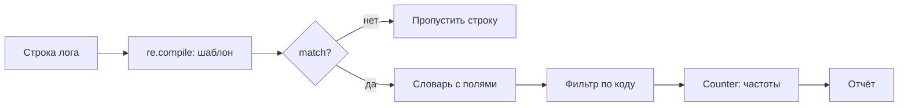

## Что такое логи и зачем их парсить

Логи (журналы) — это записи о том, что происходило в системе: кто обращался к серверу, какие ошибки случались, сколько времени занимали запросы. Каждая строка лога обычно кодирует одно событие. Когда сервисов мало, можно смотреть логи глазами. Когда их миллионы в день — нужен автоматический анализ: сколько запросов в час, какие IP-адреса самые активные, как часто возникают ошибки 500.

Парсинг логов — это превращение неструктурированного текста в структурированные данные (словари, списки), которые можно считать и агрегировать. Главный инструмент для этого — **регулярные выражения** из модуля `re`.

## Регулярные выражения: основы

Регулярное выражение (regex) — это шаблон, описывающий строку. Например, `\d+` находит последовательность цифр, а `\d{1,3}\.\d{1,3}\.\d{1,3}\.\d{1,3}` — что-то похожее на IP-адрес. Посмотрим на типичную строку лога Nginx:

```
192.168.1.10 - - [01/Nov/2026:10:15:32 +0300] "GET /api/users HTTP/1.1" 200 512
```

Здесь: IP, два дефиса (пользователь и логин), дата в квадратных скобках, запрос в кавычках, код ответа и размер ответа. Вытащим IP и код ответа:

```python
import re

line = '192.168.1.10 - - [01/Nov/2026:10:15:32 +0300] "GET /api/users HTTP/1.1" 200 512'

ip_pattern = re.compile(r"(\d{1,3}\.){3}\d{1,3}")
status_pattern = re.compile(r'" \d{3}')

print(ip_pattern.search(line).group())      # 192.168.1.10
print(status_pattern.search(line).group()[1:])  # 200
```

Метод `search` находит первое совпадение, `findall` возвращает список всех совпадений, а `group()` — сам найденный текст.

## Надёжный способ: match и группа

Проще и надёжнее распарсить строку одним выражением, захватив нужные части в группы `(...)`:

```python
import re

pattern = re.compile(
    r"^(?P<ip>[\d.]+) \S+ \S+ \[(?P<time>[^\]]+)\] "
    r'"(?P<request>[^"]+)" (?P<status>\d{3}) (?P<size>\d+)'
)

line = '192.168.1.10 - - [01/Nov/2026:10:15:32 +0300] "GET /api/users HTTP/1.1" 200 512'
m = pattern.match(line)
if m:
    print(m.group("ip"))       # 192.168.1.10
    print(m.group("status"))   # 200
```

`(?P<name>...)` даёт группе имя, и обращаться к ней можно через `m.group("name")`. Если строка не подходит под шаблон, `match` вернёт `None` — и мы видим, что запись отличается от ожидаемой.

## Подсчёт и агрегация

Когда записи распарсены, приходит время счётчиков. Идеальный инструмент — `collections.Counter`:

```python
from collections import Counter

statuses = ["200", "200", "500", "404", "200", "500"]
counter = Counter(statuses)
print(counter.most_common(2))  # [('200', 3), ('500', 2)]
```

`Counter` считает частоту элементов, а `most_common` сортирует по убыванию. Это ровно то, что нужно для анализа логов: кто чаще всего обращается, какие коды ответа преобладают.

## Фильтрация ошибок

Частая задача — найти все ошибочные записи. Коды 5xx означают проблемы на сервере, 4xx — ошибки клиента. Соберём только строки с 5xx:

```python
import re

pattern = re.compile(r"\s5\d{2}\s")
with open("access.log", encoding="utf-8") as f:
    errors = [line for line in f if pattern.search(line)]
print(f"Найдено ошибок 5xx: {len(errors)}")
```

Заметь: `f` в цикле `for line in f` отдаёт строки файла по одной — это эффективно даже для гигабайтных логов, потому что файл не загружается в память целиком.

## Путь строки лога

Любой анализ логов — это конвейер: текст превращается в поля, поля фильтруются, счётчики собирают статистику.



## Итог

Чтобы анализировать логи, нужны три приёма: регулярные выражения для извлечения полей (`re.compile`, `match`, `group`), `Counter` для подсчёта частот и чтение файла построчно. Соберём их вместе в задачах.

<!--TASK-->
### Задача 1
Напиши скрипт `count_lines.py`, который читает файл `access.log` построчно и выводит общее количество строк, количество непустых строк и количество строк, содержащих подстроку `GET`. Используй обычный `for line in f` и `in` для проверки подстроки. Создай тестовый файл `access.log` с 5–7 строками разного содержания и проверь на нём подсчёт.

### Задача 2
Создай скрипт `top_ips.py`, который находит в `access.log` все IP-адреса (шаблон `(\d{1,3}\.){3}\d{1,3}`), считает их частоту через `collections.Counter` и выводит тройку самых частых в формате `IP: количество`. Предварительно заполни файл строками с повторяющимися IP.

### Задача 3
Напиши скрипт `status_codes.py`, который для каждой строки лога определяет код ответа (последние три цифры после закрывающей кавычки запроса) и подсчитывает, сколько раз встретился каждый код. Выведи коды по убыванию частоты. Используй регулярное выражение `r'" \d{3}'` и `Counter`. Итог должен быть похож на: `200: 5`, `404: 2`.

### Задача 4
Создай скрипт `parse_line.py` с функцией `parse_line(line)`, которая принимает строку лога и возвращает словарь с ключами `ip`, `time`, `request`, `status`, `size` или `None`, если строка не подходит под шаблон. Используй `re.compile` с именованными группами `(?P<...>...)`. Продемонстрируй работу на корректной и некорректной строках.

### Задача 5
Напиши скрипт `five_xx.py`, который находит все строки лога с кодами ошибок 5xx, читает их в список и сохраняет в файл `errors.log`. В конце выведи, сколько ошибок найдено и сохранитьено. Создай лог, где есть строки с кодами 200, 404, 500 и 503, и проверь, что в `errors.log` попали только 500 и 503.

### Задача 6
Напиши скрипт `per_minute.py`, который считает нагрузку по минутам. Из каждой строки лога извлеки время в квадратных скобках (например, `01/Nov/2026:10:15:32 +0300`), отбрось часовой пояс и распарси значение через `datetime.datetime.strptime(raw, "%d/%b/%Y:%H:%M:%S")`. Приведи метку к минуте через `strftime("%Y-%m-%d %H:%M")` и посчитай частоты через `Counter`. Выведи минуты в хронологическом порядке в формате `<минута> — <количество>`. Строки, где время не найдено или не разобралось, пропускай и считай отдельно. Ожидаемый вывод на логе из шести корректных строк и одной битой: `2026-11-01 10:15 — 1`, `2026-11-01 10:16 — 2`, `2026-11-01 10:17 — 3`, затем `Пропущено строк: 1`.

### Задача 7
Напиши скрипт `endpoint_errors.py`, который строит отчёт по эндпоинтам. Возьми из строки запрос в кавычках и код ответа, раздели запрос по пробелам и возьми путь — второй элемент; query string отбрось через `path.split("?")[0]`. Для каждого пути посчитай общее число запросов и число ответов 5xx. Выведи только эндпоинты, у которых есть ошибки, по убыванию доли ошибок, в формате `/api/orders: всего 4, ошибок 2 (50.0%)`. В конце выведи `Всего эндпоинтов: N` — считая и те, где ошибок не было. Ожидаемый вывод: две строки `/api/orders` и `/api/users`, затем `Всего эндпоинтов: 2`.

<!--/TASK-->

<!--HINT-->
### Подсказка 1
Открывай файл через `with open("access.log", encoding="utf-8") as f:`. Внутри цикла `for line in f:` увеличивай общий счётчик, а для непустых строк (`if line.strip():`) и строк с `GET` (`if "GET" in line:`) — свои. В конце напечатай все три числа.

### Подсказка 2
Собери все IP через `re.findall(r"(\d{1,3}\.){3}\d{1,3}", ...)` — но осторожно: с группами `findall` вернёт только последнюю группу. Проще использовать `re.findall(r"\d{1,3}(?:\.\d{1,3}){3}", text)`, где `(?:...)` — несохраняющая группа. Затем `Counter(ips).most_common(3)`.

### Подсказка 3
Для каждой строки ищи совпадение `re.search(r'" \d{3}', line)`. Если оно есть, возьми `match.group()[1:]` — отрежь лишний пробел. Добавляй код в список и в конце посчитай `Counter(codes).most_common()`.

### Подсказка 4
Используй перед шаблон `r"^(?P<ip>[\d.]+) \S+ \S+ \[(?P<time>[^\]]+)\] \"(?P<request>[^\"]+)\" (?P<status>\d{3}) (?P<size>\d+)"`. Проверяй через `pattern.match(line)` — он вернёт `None` для неподходящих строк. Преобразуй `status` и `size` в `int` через `int(m.group("status"))`.

### Подсказка 5
Для поиска ошибок используй `re.search(r"\s5\d{2}\s", line)` — пробелы вокруг гарантируют, что мы не зацепим случайные цифры внутри запроса. Собирай подходящие строки в список и записывай их в `errors.log` через `f.write(line)` в цикле.

### Подсказка 6
Шаблон для времени: `re.compile(r"\[([^\]]+)\]")` — в первую группу попадёт `01/Nov/2026:10:15:32 +0300`. Раздели по пробелу и возьми `[0]`, чтобы убрать `+0300`. Оборачивай `strptime` в `try/except ValueError`: битая дата не должна ронять весь анализ. `Counter` пополняй прямо в цикле: `per_minute[key] += 1`, а печатай по `sorted(per_minute)`.

### Подсказка 7
Ищи запрос и код одним шаблоном: `r'"(?P<request>[^"]+)" (?P<status>\d{3})'`. Путь — `m.group("request").split()[1]`; проверь `len(parts) >= 2`, иначе строка битая. Два счётчика: `total` и `errors`; в `errors` пиши только если `status.startswith("5")`. Сортировка — `rows.sort(key=lambda r: r[2] / r[1], reverse=True)`, доля — `100 * err / cnt`.

<!--/HINT-->

<!--SOLUTION-->
### Разбор 1
Решение:

```python
total = 0
non_empty = 0
get_count = 0

with open("access.log", encoding="utf-8") as f:
    for line in f:
        total += 1
        if line.strip():
            non_empty += 1
        if "GET" in line:
            get_count += 1

print(f"Всего строк: {total}")
print(f"Непустых: {non_empty}")
print(f"С GET: {get_count}")
```

Что здесь происходит? Цикл `for line in f` читает файл построчно и не грузит его в память целиком — это важно для больших логов. `line.strip()` убирает пробелы и перевод строки, поэтому пустые строки (из `strip()` получается пустая строка) не считаются в `non_empty`. Проверка `"GET" in line` — простейший поиск подстроки, он не требует регулярных выражений. Результаты накапливаются в трёх переменных и печатаются в конце.

### Разбор 2
Решение:

```python
import re
from collections import Counter

with open("access.log", encoding="utf-8") as f:
    text = f.read()

ips = re.findall(r"\d{1,3}(?:\.\d{1,3}){3}", text)
for ip, count in Counter(ips).most_common(3):
    print(f"{ip}: {count}")
```

Что здесь происходит? Обрати внимание на разницу с явной группой: `re.findall` с группой `(...)` возвращает только содержимое группы, поэтому IP пришлось бы брать из `(?:\d{1,3}\.){3}\d{1,3}` — группа без захвата. `(?:...)` работает как `(...)`, но не сохраняет результат, и `findall` вернёт полное совпадение. Затем `Counter(ips)` подсчитывает частоту каждого адреса, а `most_common(3)` отдаёт тройку самых частых пар «IP, количество». Цикл распаковывает каждую пару в переменные `ip` и `count`.

### Разбор 3
Решение:

```python
import re
from collections import Counter

codes = []
with open("access.log", encoding="utf-8") as f:
    for line in f:
        m = re.search(r'" \d{3}', line)
        if m:
            codes.append(m.group().split()[1])

for code, count in Counter(codes).most_common():
    print(f"{code}: {count}")
```

Что здесь происходит? Выражение `r'" \d{3}'` ищет кавычку, пробел и три цифры — это конец запроса и код ответа. `m.group()` вернёт, например, строку `" 200`, содержащую кавычку, пробел и код. Нам нужен только код, поэтому разбиваем строку через `m.group().split()` — получится список `['"', '200']`, из которого берём второй элемент `[1]`. Так мы получаем чистый код без лишних символов. Дальше `Counter(codes)` считает частоты, а `most_common()` сортирует по убыванию.

### Разбор 4
Решение:

```python
import re

pattern = re.compile(
    r"^(?P<ip>[\d.]+) \S+ \S+ \[(?P<time>[^\]]+)\] "
    r'"(?P<request>[^"]+)" (?P<status>\d{3}) (?P<size>\d+)'
)

def parse_line(line):
    m = pattern.match(line)
    if not m:
        return None
    return {
        "ip": m.group("ip"),
        "time": m.group("time"),
        "request": m.group("request"),
        "status": int(m.group("status")),
        "size": int(m.group("size")),
    }

good = '192.168.1.10 - - [01/Nov/2026:10:15:32 +0300] "GET /api/users HTTP/1.1" 200 512'
bad = "Это вообще не лог"

print(parse_line(good))
print(parse_line(bad))
```

Вывод:

```python
{'ip': '192.168.1.10', 'time': '01/Nov/2026:10:15:32 +0300',
 'request': 'GET /api/users HTTP/1.1', 'status': 200, 'size': 512}
None
```

Что здесь происходит? Именованные группы `(?P<name>...)` делают шаблон читаемым: в `m.group("ip")` всегда попадёт IP, в `m.group("status")` — код ответа. `^\S+ \S+` пропускает два поля между IP и датой. `[^\]]+` внутри `[...]` означает «любые символы, кроме закрывающей скобки». `\d{3}` — ровно три цифры кода, `\d+` — размер. Если строка не подходит, `pattern.match` возвращает `None`, и мы возвращаем `None`. В конце `int(...)` превращает код и размер в числа — удобно для дальнейших вычислений.

### Разбор 5
Решение:

```python
import re

error_line = re.compile(r"\s5\d{2}\s")
errors = []

with open("access.log", encoding="utf-8") as f:
    for line in f:
        if error_line.search(line):
            errors.append(line)

with open("errors.log", "w", encoding="utf-8") as f:
    f.writelines(errors)

print(f"Найдено ошибок 5xx: {len(errors)}")
print("Сохранено в errors.log")
```

Что здесь происходит? Шаблон `\s5\d{2}\s` ищет пробел, пятёрку, ещё две цифры и снова пробел. Пробелы по краям не случайны: они не дают выражению зацепить `500` внутри какого-нибудь длинного числа или URL. Каждая подходящая строка добавляется в список `errors`. Запись в файл — через `f.writelines(errors)`, который записывает список строк за один вызов. Так мы отфильтровали только серьёзные ошибки сервера (500, 501, 502, 503...) и сохранили их отдельно для разбора.

### Разбор 6
Решение:

```python
import datetime
import re
from collections import Counter

TIME_RE = re.compile(r"\[([^\]]+)\]")

per_minute = Counter()
skipped = 0

with open("access.log", encoding="utf-8") as f:
    for line in f:
        m = TIME_RE.search(line)
        if not m:
            skipped += 1
            continue
        raw = m.group(1).split()[0]        # отбрасываем +0300
        try:
            moment = datetime.datetime.strptime(raw, "%d/%b/%Y:%H:%M:%S")
        except ValueError:
            skipped += 1
            continue
        per_minute[moment.strftime("%Y-%m-%d %H:%M")] += 1

for minute in sorted(per_minute):
    print(f"{minute} — {per_minute[minute]}")
print(f"Пропущено строк: {skipped}")
```

Вывод:

```
2026-11-01 10:15 — 1
2026-11-01 10:16 — 2
2026-11-01 10:17 — 3
Пропущено строк: 1
```

Что здесь происходит? `[^\]]+` внутри квадратных скобок захватывает всё содержимое до закрывающей скобки — это и есть временная метка с часовым поясом. `split()[0]` оставляет только `01/Nov/2026:10:15:32`: `strptime` не умеет разбирать смещение `+0300` в этом формате. Спецификатор `%b` ждёт английское сокращение месяца (`Nov`), поэтому при нестандартной локали процесса разбор может не сработать — в таких случаях локаль фиксируют в `C` или используют `email.utils.parsedate_to_datetime`. `strftime("%Y-%m-%d %H:%M")` обрезает секунды, и все запросы одной минуты попадают в один ключ. `Counter` считает их без ручных условий, а `sorted` по ключам даёт хронологический порядок — важно, что сортируем строки в формате ISO, где лексикографический порядок совпадает с временным. Битые строки не молча теряются: счётчик `skipped` показывает, сколько записей не удалось разобрать.

### Разбор 7
Решение:

```python
import re
from collections import Counter

pattern = re.compile(r'"(?P<request>[^"]+)" (?P<status>\d{3})')

total = Counter()
errors = Counter()

with open("access.log", encoding="utf-8") as f:
    for line in f:
        m = pattern.search(line)
        if not m:
            continue
        parts = m.group("request").split()
        if len(parts) < 2:
            continue
        path = parts[1].split("?")[0]
        total[path] += 1
        if m.group("status").startswith("5"):
            errors[path] += 1

rows = [(p, total[p], errors[p]) for p in errors]
rows.sort(key=lambda r: r[2] / r[1], reverse=True)

for path, cnt, err in rows:
    print(f"{path}: всего {cnt}, ошибок {err} ({100 * err / cnt:.1f}%)")
print(f"Всего эндпоинтов: {len(total)}")
```

Вывод:

```
/api/orders: всего 4, ошибок 2 (50.0%)
/api/users: всего 5, ошибок 1 (20.0%)
Всего эндпоинтов: 2
```

Что здесь происходит? Шаблон ищет запрос в кавычках и следующие за ним три цифры кода — этого достаточно, чтобы не разбирать всю строку целиком. `request` выглядит как `GET /api/orders?id=7 HTTP/1.1`, поэтому `split()` даёт метод, путь и версию; берём второй элемент. `split("?")[0]` отрезает query string: иначе `/api/orders?id=7` и `/api/orders?id=8` считались бы разными эндпоинтами, и отчёт рассыпался бы на сотни строк. Два независимых `Counter` позволяют посчитать и общее число запросов, и число ошибок, а доля вычисляется уже при печати. Сортировка по `err / cnt` ставит наверх самые проблемные эндпоинты — именно их смотрят первыми. `len(total)` показывает все пути, включая благополучные, и это полезно: если эндпоинтов внезапно стало втрое больше, возможно, в лог попали сканирующие боты.

<!--/SOLUTION-->

<!--QUIZ-->
Какой метод re находит первое совпадение?
- re.search
- re.findall
- re.split
* Правильный ответ: re.search
re.search возвращает первое совпадение или None, если его нет.

Что вернёт re.findall(r"\d+", "a1b22")?
- ['1', '22']
- '122'
- 3
* Правильный ответ: ['1', '22']
findall возвращает список всех непересекающихся совпадений.

Что означает (?:...) в регулярном выражении?
- Группу без захвата
- Именованную группу
- Обязательную группу
* Правильный ответ: Группу без захвата
(?:...) группирует, но не сохраняет совпадение для group().

Какой класс из collections удобен для подсчёта частот?
- Counter
- deque
- OrderedDict
* Правильный ответ: Counter
Counter считает количество вхождений элементов и умеет most_common().

Что вернёт pattern.match(line), если строка не подходит под шаблон?
- None
- Пустую строку
- Исключение
* Правильный ответ: None
match возвращает None, если совпадение не найдено.

Почему нужно читать файл построчно, а не через read()?
- Потому что read() не существует
- Чтобы не держать весь файл в памяти
- Чтобы строки были без пробелов
* Правильный ответ: Чтобы не держать весь файл в памяти
Построчное чтение экономит память на гигабайтных логах.

Что возвращает re.compile(pattern)?
- Объект регулярного выражения с методами search/match/findall
- Список совпадений
- Строку-шаблон
* Правильный ответ: Объект регулярного выражения с методами search/match/findall
Скомпилированный паттерн можно переиспользовать много раз без повторной компиляции.

Что делает Counter(list).most_common(3)?
- Возвращает три самых частых элемента с количеством
- Удаляет три редких элемента
- Сортирует список по алфавиту
* Правильный ответ: Возвращает три самых частых элемента с количеством
most_common сортирует по убыванию частоты и берёт первые N пар.

Что делает m.group(1) у совпадения регулярного выражения?
- Возвращает текст, захваченный первой группой
- Возвращает всё совпадение
- Возвращает номер группы
* Правильный ответ: Возвращает текст, захваченный первой группой
group() без аргумента даёт всё совпадение, group(1) — только первую скобочную группу.

Что вернёт Counter(...).most_common() без аргумента?
- Все пары «элемент, количество», отсортированные по убыванию частоты
- Только самый частый элемент
- Пустой список
* Правильный ответ: Все пары «элемент, количество», отсортированные по убыванию частоты
Аргумент ограничивает количество пар, без него возвращаются все.

Что означает + в шаблоне \d+?
- Один или более символов
- Ноль или более символов
- Ровно один символ
* Правильный ответ: Один или более символов
Квантификатор + требует хотя бы одного вхождения, * допускает ноль.

Что будет, если открыть лог без encoding="utf-8" на системе с другой кодировкой?
- Возможна ошибка декодирования или искажение кириллицы
- Файл не откроется никогда
- Python всегда сам определяет UTF-8
* Правильный ответ: Возможна ошибка декодирования или искажение кириллицы
Кодировку лучше задавать явно, иначе результат зависит от локали системы.
<!--/QUIZ-->
