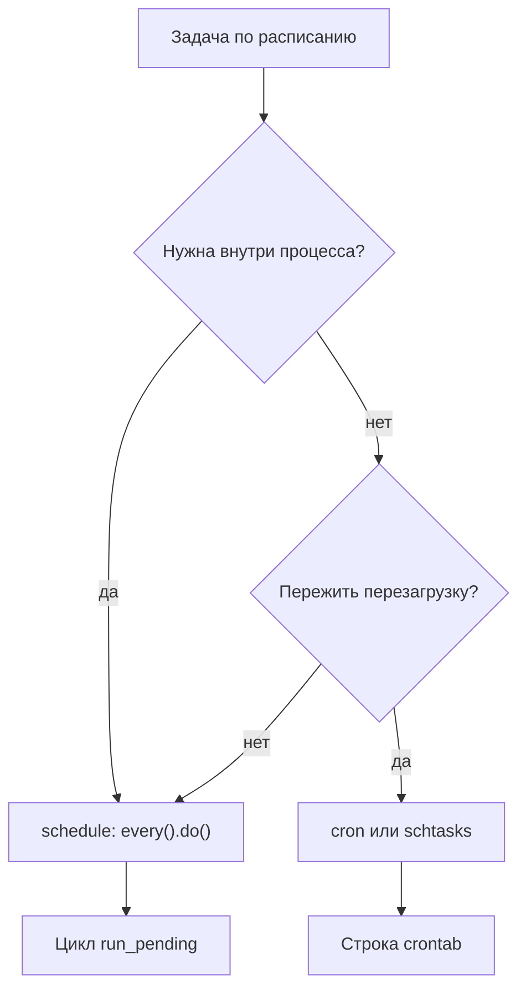

## Зачем нужны планировщики

Многие операции должны выполняться сами по себе: бекап баз данных в 3 часа ночи, ротация логов каждый понедельник, мониторинг каждые пять минут. Делать это вручную невозможно, поэтому существуют планировщики — программы, которые запускают наши скрипты по расписанию.

В мире Python и DevOps есть два уровня планирования. Первый — **внутри процесса**: библиотека `schedule` позволяет запускать функции по расписанию прямо внутри работающего Python-скрипта. Второй — **системный**: cron (в Linux/macOS) или Планировщик Windows запускают целые команды и скрипты на уровне операционной системы.

## Библиотека schedule

`schedule` — это простая и выразительная библиотека для планирования задач в Python. Устанавливается через `pip install schedule`. Посмотрим на базовый пример:

```python
import schedule
import time

def backup():
    print("Делаем бэкап...")

def ping():
    print("Пинг...")

schedule.every(10).minutes.do(ping)
schedule.every().day.at("03:00").do(backup)
schedule.every().monday.at("09:30").do(backup)

while True:
    schedule.run_pending()
    time.sleep(1)
```

Ключевая идея: `schedule.every(...)....do(функция)` регистрирует задачу, а цикл `while True` с `schedule.run_pending()` проверяет, наступило ли время, и запускает подходящие функции. Пока цикл жив — задачи выполняются. `time.sleep(1)` не даёт циклу молотить процессор впустую.

## Синтаксис в schedule

Библиотека поддерживает много сценариев:

```python
schedule.every(5).minutes.do(task)           # каждые 5 минут
schedule.every().hour.do(task)               # каждый час
schedule.every().day.at("08:30").do(task)    # ежедневно в 08:30
schedule.every().wednesday.at("14:00").do(task)  # по средам
schedule.every().minute.at(":17").do(task)   # в 17-ю секунду каждой минуты
```

Метод `at` задаёт точное время, день недели — английским названием (`monday`, `wednesday`). Задачам можно передавать аргументы: `do(fn, arg1, arg2)`. Отменить задачу можно через `schedule.cancel_job(job)` или очистить все через `schedule.clear()`.

## Системный cron

`schedule` работает только пока процесс жив. Если скрипт упал или сервер перезагрузился — планирование пропало. Для серьёзных систем используют cron. Он читает расписание из `crontab` — файла с пятью полями:

```
минута час день_месяца месяц день_недели команда
```

Пример строки crontab:

```
0 3 * * * /usr/bin/python3 /opt/scripts/backup.py
```

Это значит: в 03:00 каждый день запускать `backup.py`. Звёздочка означает «каждое значение», поэтому `* * * * *` — каждую минуту. В cron умеют и более сложные выражения: `*/10 * * * *` — каждые 10 минут, `0 9 * * 1-5` — в 9:00 по будням. В Windows аналог — Планировщик задач, задачи можно создавать через `schtasks`.

## Что выбрать

Шпаргалка: внутри скрипта с фоновыми задачами (например, веб-приложение с периодической очисткой кэша) — `schedule`. Для системных задач, которые должны жить независимо от твоего скрипта, — cron. Часто используют связку: cron каждые 5 минут запускает Python-скрипт, а уже сам скрипт решает, не пора ли что-то сделать.

## Изоляция и логирование

Скрипты, запускаемые cron, работают в чистом окружении: без твоих переменных окружения и с пустым текущим каталогом. Поэтому всегда указывай полные пути к скриптам и файлам, а вывод ошибок перенаправляй в лог. В crontab это делается так:

```
0 3 * * * cd /opt/scripts && ./backup.py >> backup.log 2>&1
```

`>> backup.log` дописывает стандартный вывод в файл, а `2>&1` направляет туда же ошибки. Иначе письма об ошибках будут падать тебе в почту.

## Как выбрать планировщик

Дерево решения короткое: важна ли живучесть после перезагрузки — и нужен ли доступ к объектам текущего процесса.



## Итог

Мы разобрали два уровня планирования: библиотеку `schedule` для задач внутри процесса и cron для системных. Главное — понять разницу и выбрать подходящий инструмент, а дальше оба используют знакомые тебе функции. Переходим к задачам.

<!--TASK-->
### Задача 1
Напиши скрипт `basic_schedule.py`, который планирует две задачи: печать `Каждые 2 секунды` каждые 2 секунды и печать `Раз в 5 секунд` каждые 5 секунд. Запусти цикл `schedule.run_pending()` с `time.sleep(0.5)` и дай программе поработать 12 секунд (например, внешним таймером или просто остановив её). Вывод должен чередоваться с правильной периодичностью. Помни: в боевом коде цикл бесконечный, но для проверки можно ограничить количество итераций.

### Задача 2
Создай скрипт `daily_at.py`, который планирует задачу `remind()` в `08:30` ежедневно. Внутри функции выведи `Пора делать зарядку!`. Продемонстрируй, что задача не выполняется сразу, а ждёт назначенного времени: для проверки задай время на несколько секунд позже текущего (через `datetime.timedelta` и `strftime`).

### Задача 3
Напиши скрипт `jobs_with_args.py`, где одна и та же функция `report(service, ok)` вызывается с разными аргументами: каждые 3 секунды `report("web", True)`, каждые 7 секунд `report("db", False)`. Функция печатает `Сервис <service> работает` или `Сервис <service> недоступен`. Проверь, что в выводе видны обе задачи с разными аргументами.

### Задача 4
Создай скрипт `cancel_job.py`, который планирует задачу `job()` каждые 2 секунды, но после пятого выполнения отменяет её через `schedule.cancel_job(job)` и выводит `Задача остановлена`. Счётчик выполнений храни в списке или глобальной переменной. После отмены программа должна продолжить крутить цикл, но задача больше не печатается.

### Задача 5
Напиши скрипт `cron_reader.py`, который читает файл `crontab.txt` (строки вида `0 3 * * * backup.py`) и выводит расписание в человекочитаемом виде: для каждой строки — «Команда backup.py выполняется в 03:00 каждый день». Для полей используй простую таблицу соответствий: число — «в HH:MM» (если минута и час заданы числами), `*` в дне недели — «каждый день», иначе — название дня. Обработай строки-комментарии, начинающиеся с `#`.

### Задача 6
Напиши функцию `check_cron(expr)`, которая проверяет строку crontab без команды. Раздели её по пробелам и проверь, что полей ровно пять. В каждом поле допустимы `*`, число, диапазон `1-5`, список `1,15,30` и шаг `*/10`. Границы полей: минута 0–59, час 0–23, день месяца 1–31, месяц 1–12, день недели 0–6. Верни список ошибок вида `поле 2 (час): 25 вне диапазона 0-23`; для корректного выражения верни пустой список. Неверный формат вроде `abc` или `*/0` тоже должен попадать в ошибки. Проверь два выражения: `"*/15 0-23 * * 1-5"` и `"0 25 * * *"`. Ожидаемый вывод: `[]` для первого и ровно одна ошибка про час для второго.

### Задача 7
Напиши функцию `should_run(now)`, которая решает, можно ли запускать задачу в момент `now` (тип `datetime.datetime`). Правило: только по будням с 09:00 до 18:00. Суббота и воскресенье — всегда `False`, в рабочие дни — `True` при `9 <= now.hour < 18`. Затем напиши `report(moments)`, которая печатает для каждого момента строку `2026-11-23 09:00 — запуск` или `... — пропуск`. Проверь три момента: суббота `2026-11-21 10:00`, понедельник `2026-11-23 08:00` и понедельник `2026-11-23 09:00`. Ожидаемый вывод: две строки `пропуск` и одна `запуск` — в этом порядке.

<!--/TASK-->

<!--HINT-->
### Подсказка 1
Зарегистрируй задачи: `schedule.every(2).seconds.do(lambda: print("Каждые 2 секунды"))` и аналогично для 5 секунд. Затем цикл: `for _ in range(24): schedule.run_pending(); time.sleep(0.5)` — 24 итерации по полсекунды = 12 секунд.

### Подсказка 2
Используй `schedule.every().day.at("08:30").do(remind)`. Для демонстрации ожидания создай время в будущем: `next_time = (datetime.datetime.now() + datetime.timedelta(seconds=5)).strftime("%H:%M:%S")` и передай его в `at()`. Крути цикл `schedule.run_pending()` с `time.sleep(1)` около 10 секунд.

### Подсказка 3
Определи функцию `def report(service, ok): ...`. Затем `schedule.every(3).seconds.do(report, "web", True)` — аргументы после функции передаются в неё при вызове. Для `ok` используй `if ok:` для выбора сообщения.

### Подсказка 4
Сохрани объект задачи: `job = schedule.every(2).seconds.do(task)`. Счётчик — `count = [0]` (список, чтобы менять его внутри функции). Внутри функции увеличивай счётчик; когда `count[0] >= 5`, вызывай `schedule.cancel_job(job)` — но не прямо внутри самой функции, а после проверки в цикле.

### Подсказка 5
Разбей строку через `line.split()` — получишь 5 полей и команду. Проверяй `line.startswith("#")`, чтобы пропустить комментарии. Для перевода полей используй словари: месяцы и дни недели — по индексу. Для времени: если минута и час — числа, форматируй `f"{hh}:{mm}"` с ведущими нулями.

### Подсказка 6
Сначала разберись с шагом: если поле начинается с `*/`, проверь, что остаток — положительное число (`step.isdigit() and int(step) > 0`). Для остальных случаев раздели поле по запятой и обработай каждый кусок: диапазон `a-b` раскрывай в `range(int(a), int(b) + 1)`, число добавляй как есть, всё остальное считай ошибкой формата. Сравнение с границами делай после разбора: `[v for v in values if not lo <= v <= hi]`. Имя поля и границы возьми из списков по индексу.

### Подсказка 7
`datetime.weekday()` возвращает 0 для понедельника и 6 для воскресенья, поэтому выходные — это `now.weekday() >= 5`. Границу вечера делай невключающей: `9 <= now.hour < 18`. В `report` не нужно ничего усложнять: цикл по списку, тернарное выражение для статуса и f-строка с форматом `{now:%Y-%m-%d %H:%M}`. Собирай моменты через `datetime.datetime(2026, 11, 23, 9, 0)` — так тест не зависит от текущего времени.

<!--/HINT-->

<!--SOLUTION-->
### Разбор 1
Решение:

```python
import schedule
import time

schedule.every(2).seconds.do(lambda: print("Каждые 2 секунды"))
schedule.every(5).seconds.do(lambda: print("Раз в 5 секунд"))

for _ in range(24):   # 24 * 0.5 с = 12 секунд
    schedule.run_pending()
    time.sleep(0.5)
```

Вывод (фрагмент):

```
Каждые 2 секунды
Каждые 2 секунды
Раз в 5 секунд
Каждые 2 секунды
Каждые 2 секунды
Раз в 5 секунд
```

Что здесь происходит? `schedule.every(2).seconds.do(...)` регистрирует задачу, которая будет выполняться каждые 2 секунды. Lambda-функции удобны для простых печатей. Цикл `for _ in range(24)` ограничивает проверку 12 секундами (24 × 0.5 с) — в реальном скрипте цикл был бы бесконечным: `while True: schedule.run_pending(); time.sleep(1)`. Важно: `run_pending()` не спит сам, он лишь запускает те задачи, чей срок наступил; паузу обеспечивает `time.sleep`. Поэтому, меняя `time.sleep`, можно контролировать точность, но не стоит делать паузу больше интервала задач.

### Разбор 2
Решение:

```python
import schedule
import time
import datetime

def remind():
    print("Пора делать зарядку!")

next_time = (datetime.datetime.now() + datetime.timedelta(seconds=5)).strftime("%H:%M:%S")
schedule.every().day.at(next_time).do(remind)
print(f"Задача запланирована на {next_time}")

for _ in range(10):
    schedule.run_pending()
    time.sleep(1)
```

Вывод:

```
Задача запланирована на 14:05:03
Пора делать зарядку!
```

Что здесь происходит? `datetime.timedelta(seconds=5)` сдвигает текущее время на 5 секунд вперёд, а `strftime("%H:%M:%S")` форматирует его в строку для `at()`. Задача регистрируется, но не выполняется немедленно — она ждёт наступления секунды. Это и демонстрирует суть планировщика: `run_pending()` в цикле проверяет, не наступил ли момент, и запускает задачу ровно когда положено. Если бы мы передали прошедшее время, библиотека могла бы выполнить задачу на следующей итерации цикла — поэтому берём время из будущего.

### Разбор 3
Решение:

```python
import schedule
import time

def report(service, ok):
    if ok:
        print(f"Сервис {service} работает")
    else:
        print(f"Сервис {service} недоступен")

schedule.every(3).seconds.do(report, "web", True)
schedule.every(7).seconds.do(report, "db", False)

for _ in range(21):
    schedule.run_pending()
    time.sleep(1)
```

Вывод (фрагмент):

```
Сервис web работает
Сервис web работает
Сервис db недоступен
...
```

Что здесь происходит? `do(report, "web", True)` передаёт дополнительные аргументы в функцию при каждом вызове — это удобно, когда у нескольких задач одна логика, но разные параметры. Так одна функция `report` обслуживает и веб-сервер, и базу данных. Цикл длится 21 секунду (21 × 1 с), чтобы оба интервала (3 и 7 секунд) уложились несколько раз. Обрати внимание: библиотека не мешает задачам с разными интервалами — каждая живёт по своему расписанию, а `run_pending()` в цикле запускает все созревшие.

### Разбор 4
Решение:

```python
import schedule
import time

count = [0]
job = schedule.every(2).seconds.do(lambda: print("Работаю..."))

for _ in range(20):
    schedule.run_pending()
    count[0] += 1
    if count[0] >= 5:
        schedule.cancel_job(job)
        print("Задача остановлена")
        break
    time.sleep(1)
```

Вывод:

```
Работаю...
Работаю...
Работаю...
Работаю...
Работаю...
Задача остановлена
```

Что здесь происходит? Объект `job`, возвращённый `schedule.every(...).do(...)`, — это идентификатор задачи. `schedule.cancel_job(job)` убирает задачу из планировщика, и она больше не выполняется. Счётчик в списке `count` — это трюк: списки изменяемы, поэтому функция (за lambda) может менять содержимое, даже если мы не используем `global` (хотя здесь счётчик меняется не внутри задачи, а в цикле). После пятого выполнения мы останавливаем задачу и выходим из цикла. В реальной системе так останавливают «злоупотребляющие» задачи или перезапускают их с новыми параметрами.

### Разбор 5
Решение:

```python
days = ["понедельник", "вторник", "среда", "четверг",
        "пятница", "суббота", "воскресенье"]

with open("crontab.txt", encoding="utf-8") as f:
    for line in f:
        line = line.strip()
        if not line or line.startswith("#"):
            continue
        parts = line.split()
        minute, hour, _, _, weekday, command = parts
        if minute == "*" and hour == "*":
            time_str = "каждую минуту"
        elif hour == "*":
            time_str = f"в {minute}-ю минуту каждого часа"
        else:
            time_str = f"в {hour.zfill(2)}:{minute.zfill(2)}"
        day_str = days[int(weekday) - 1] if weekday != "*" else "каждый день"
        print(f"Команда {command} выполняется {time_str} {day_str}")
```

Что здесь происходит? Строка crontab состоит из пяти полей: минута, час, день месяца, месяц, день недели — и команды. Мы распаковываем их в переменные и строим человекочитаемое описание. `zfill(2)` дополняет число нулями до двух цифр (`3` → `03`). Если `weekday` — число от 0 до 6 (0 = воскресенье в cron, но в нашем примере допускаем 1–7), берём название из списка, иначе — «каждый день». Комментарии и пустые строки пропускаются. Такой скрипт полезен для аудита: легко показать коллегам, что и когда запускается на сервере.

### Разбор 6
Решение:

```python
FIELD_NAMES = ["минута", "час", "день месяца", "месяц", "день недели"]
LIMITS = [(0, 59), (0, 23), (1, 31), (1, 12), (0, 6)]

def parse_part(part):
    """Возвращает список чисел или None, если часть некорректна."""
    if part == "*":
        return []
    if part.startswith("*/"):
        step = part[2:]
        if step.isdigit() and int(step) > 0:
            return [int(step)]
        return None
    values = []
    for chunk in part.split(","):
        if "-" in chunk:
            a, b = chunk.split("-", 1)
            if not (a.isdigit() and b.isdigit()):
                return None
            values.extend(range(int(a), int(b) + 1))
        elif chunk.isdigit():
            values.append(int(chunk))
        else:
            return None
    return values

def check_cron(expr):
    fields = expr.split()
    if len(fields) != 5:
        return [f"ожидалось 5 полей, получено {len(fields)}"]
    errors = []
    for i, (field, name, (lo, hi)) in enumerate(
            zip(fields, FIELD_NAMES, LIMITS), start=1):
        values = parse_part(field)
        if values is None:
            errors.append(f"поле {i} ({name}): неверный формат {field}")
            continue
        bad = [v for v in values if not lo <= v <= hi]
        if bad:
            errors.append(f"поле {i} ({name}): {bad[0]} вне диапазона {lo}-{hi}")
    return errors

print(check_cron("*/15 0-23 * * 1-5"))
print(check_cron("0 25 * * *"))
```

Вывод:

```
[]
['поле 2 (час): 25 вне диапазона 0-23']
```

Что здесь происходит? Валидатор повторяет логику самого cron: пять позиций, у каждой свой диапазон. Функция `parse_part` сначала отсекает два особых случая — звёздочку и шаг, — а затем разбирает список через запятую, где элемент может быть числом или диапазоном. Диапазон раскрывается в конкретные значения, поэтому проверка границ остаётся одной простой операцией для всех форм записи. Важная деталь: шаг проверяется отдельно, ведь `*/15` — это не значение 15, а «каждые 15 единиц»; главное убедиться, что шаг положительный, иначе cron посчитает выражение некорректным. Ошибка содержит номер поля, его человеческое имя и конкретное значение — такую строку можно сразу показать пользователю. Возврат списка, а не исключения, позволяет собрать все проблемы выражения за один вызов и объяснить их разом.

### Разбор 7
Решение:

```python
import datetime

def should_run(now):
    if now.weekday() >= 5:          # 5 — суббота, 6 — воскресенье
        return False
    return 9 <= now.hour < 18

def report(moments):
    for now in moments:
        status = "запуск" if should_run(now) else "пропуск"
        print(f"{now:%Y-%m-%d %H:%M} — {status}")

moments = [
    datetime.datetime(2026, 11, 21, 10, 0),   # суббота
    datetime.datetime(2026, 11, 23, 8, 0),    # понедельник, до открытия
    datetime.datetime(2026, 11, 23, 9, 0),    # понедельник, открытие
]
report(moments)
```

Вывод:

```
2026-11-21 10:00 — пропуск
2026-11-23 08:00 — пропуск
2026-11-23 09:00 — запуск
```

Что здесь происходит? `weekday()` даёт номер дня недели от нуля, поэтому проверка `>= 5` отсекает субботу и воскресенье без списков названий и без зависимости от локали. Второе условие описывает рабочий интервал полуоткрытым отрезком: 09:00 включается, а 18:00 уже нет — так задача не запустится ровно в момент закрытия. В реальном проекте `should_run` вызывают внутри задачи, зарегистрированной как `schedule.every().minute.do(guarded_job)`: планировщик будит функцию каждую минуту, а она сама решает, работать ли сейчас. Проверять такое поведение сном и реальными часами нельзя — тест станет медленным и нестабильным, поэтому функция принимает `now` параметром, а в тесте мы подставляем фиксированные даты. Отчёт `report` отделён от логики: его можно переиспользовать и для сухого прогона расписания на неделю вперёд.

<!--/SOLUTION-->

<!--QUIZ-->
Какой метод schedule регистрирует задачу?
- every().do()
- run_pending()
- cancel_job()
* Правильный ответ: every().do()
every(интервал).do(функция) — основной способ создать задачу.

Что делает schedule.run_pending()?
- Запускает задачи, чьё время наступило
- Останавливает все задачи
- Спит заданную секунду
* Правильный ответ: Запускает задачи, чьё время наступило
run_pending() нужно вызывать в цикле, чтобы задачи выполнялись.

Как остановить одну задачу в schedule?
- schedule.cancel_job(job)
- job.stop()
- schedule.clear()
* Правильный ответ: schedule.cancel_job(job)
cancel_job принимает объект задачи, сохранённый при регистрации.

Что означает * * * * * в crontab?
- Выполнение каждую минуту
- Выполнение раз в час
- Выполнение раз в день
* Правильный ответ: Выполнение каждую минуту
Каждая звёздочка означает «каждое значение» своего поля.

Какие поля есть у строки crontab?
- Минута, час, день месяца, месяц, день недели
- Секунда, минута, час, месяц, год
- Час, день, неделя, команда, лог
* Правильный ответ: Минута, час, день месяца, месяц, день недели
Именно эти 5 полей задают расписание, дальше — команда.

Почему для критичных задач лучше cron, а не только schedule?
- Потому что cron переживает перезагрузку и падение скрипта
- Потому что schedule не умеет в дни недели
- Потому что cron быстрее
* Правильный ответ: Потому что cron переживает перезагрузку и падение скрипта
schedule живёт внутри процесса: процесс умер — планирование пропало.

Что означает schedule.every().day.at("08:30").do(task)?
- Задачу task ежедневно в 08:30
- Задачу task каждые 8 минут 30 секунд
- Задачу task раз в день в случайное время
* Правильный ответ: Задачу task ежедневно в 08:30
at задаёт точное время суток, а every().day — ежедневный интервал.

Что означает 0 9 * * 1-5 в crontab?
- В 09:00 по будням (с понедельника по пятницу)
- Каждые 9 часов в будние дни
- В 09:00 каждое воскресенье
* Правильный ответ: В 09:00 по будням (с понедельника по пятницу)
Диапазон 1-5 в поле дня недели задаёт понедельник–пятницу.

Что вернёт datetime.weekday() для воскресенья?
- 6
- 0
- 7
* Правильный ответ: 6
Отсчёт идёт с нуля: понедельник — 0, воскресенье — 6.

Что означает */10 в поле минуты?
- Каждые 10 минут
- Запуск в 10-ю минуту каждого часа
- 10 запусков в сутки
* Правильный ответ: Каждые 10 минут
Шаг */n означает «каждые n единиц» начиная с нуля.

Что делает schedule.clear()?
- Удаляет все зарегистрированные задачи
- Очищает экран терминала
- Сбрасывает системное время
* Правильный ответ: Удаляет все зарегистрированные задачи
После clear() цикл run_pending() больше ничего не запускает.

Почему в cron-скриптах указывают полные пути?
- У cron пустой рабочий каталог и урезанное окружение
- Cron не понимает относительные пути в принципе
- Иначе скрипт не получит права на запуск
* Правильный ответ: У cron пустой рабочий каталог и урезанное окружение
Поэтому в crontab пишут cd /opt/scripts && ./backup.py и полные пути к файлам.
<!--/QUIZ-->
