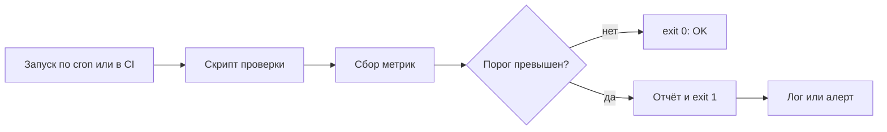

## Что такое мониторинг

Мониторинг — это наблюдение за состоянием системы: жив ли сервер, сколько места осталось на диске, не упал ли сервис, как быстро отвечает API. Без мониторинга команда узнаёт о проблемах от пользователей — а это худший способ.

Python отлично подходит для написания скриптов мониторинга: они запускаются по расписанию (из прошлого урока) или входят в состав CI-пайплайна, а результат можно отправлять в лог, файл или мессенджер.

## Скрипт-проверка: сбор данных

Типичный скрипт мониторинга собирает данные из нескольких источников. Для системных показателей часто используются внешние команды через `subprocess`:

```python
import subprocess

result = subprocess.run(
    ["df", "-h", "/"],
    capture_output=True,
    text=True,
    check=True,
)
print(result.stdout)
```

`df -h /` показывает занятость диска. `check=True` заставляет `subprocess` бросить `CalledProcessError`, если команда завершилась с ошибкой. Так скрипт не «молчит» о проблемах, а явно падает.

## Проверка здоровья сервиса

Часто нужно проверить, отвечает ли веб-сервис. Простейший способ — послать HTTP-запрос к health-эндпоинту. Стандартная библиотека `urllib` отлично справляется:

```python
import urllib.request

try:
    with urllib.request.urlopen("http://localhost:8000/health", timeout=5) as resp:
        print("Статус:", resp.status)
        print("Ответ:", resp.read().decode())
except urllib.error.URLError as e:
    print("Сервис недоступен:", e)
```

`urlopen` открывает URL, `resp.status` — код ответа, а таймаут не даёт скрипту зависнуть навсегда. Для этого примера достаточно `urllib` — он есть в стандартной библиотеке.

## Сбор отчёта

Данные мониторинга удобно собирать в словарь и сериализовать, например, в JSON — такой отчёт легко читать и отправлять дальше:

```python
import json

report = {
    "host": "web-01",
    "disk_free_gb": 42.5,
    "service": "up",
    "healthy": True,
}
print(json.dumps(report, indent=2, ensure_ascii=False))
```

## Скрипты для CI

Continuous Integration (CI) — это практика, при которой каждый коммит автоматически прогоняется через проверки: тесты, линтеры, сборку. CI-системы (GitHub Actions, GitLab CI, Jenkins) запускают команды в свежих окружениях, и Python-скрипты в этих пайплайнах решают сотни задач: прогоняют тесты, проверяют форматирование, собирают отчёты.

Главное правило для скриптов в CI: **корректный код возврата**. Если скрипт завершился с кодом 0 — пайплайн считается успешным, с ненулевым — падает. Поэтому в конце скрипта важно явно завершаться с `sys.exit(0)` или `sys.exit(1)` в зависимости от результата проверок.

## Простой CI-скрипт

Представь, что тебе нужно проверить, что в проекте нет файлов больше 1 МБ, а затем запустить тесты:

```python
import subprocess
import sys
from pathlib import Path

big_files = [p for p in Path(".").rglob("*")
             if p.is_file() and p.stat().st_size > 1_000_000]
if big_files:
    print("Найдены большие файлы:", [p.name for p in big_files])
    sys.exit(1)

result = subprocess.run(["python", "-m", "pytest", "-q"], capture_output=True, text=True)
print(result.stdout)
if result.returncode != 0:
    print(result.stderr)
    sys.exit(result.returncode)
```

Это ровно то, что происходит в настоящих CI: скрипт проверяет условия и либо проходит дальше (код 0), либо падает с сообщением.

## Конвейер проверки

Мониторинг в скрипте — это короткая цепочка: собрать метрику, сравнить с порогом, вернуть код, который поймёт CI или cron.



## Итог

Мы научились собирать данные о системе через `subprocess`, проверять здоровье сервисов через `urllib`, оформлять отчёты в JSON и строить скрипты, которые корректно сигнализируют о результате через код возврата. Это всё, что нужно для простого мониторинга и встраивания в CI. Закрепляем задачами.

<!--TASK-->
### Задача 1
Напиши скрипт `df_check.py`, который выполняет команду `df -h /` через `subprocess.run` с `capture_output=True`, `text=True` и `check=True`, а затем печатает вывод. Добавь обработку `subprocess.CalledProcessError`: если команда не удалась, выведи `Ошибка при получении данных о диске` и завершись с кодом 1.

### Задача 2
Создай скрипт `healthcheck.py`, который проверяет доступность `http://localhost:8000/health` через `urllib.request.urlopen` с таймаутом 5 секунд. Если сервис ответил — выведи `OK, код 200` (или реальный код) и завершись с кодом 0. Если сервис недоступен (перехвати `urllib.error.URLError`) — выведи `Сервис недоступен` и завершись с кодом 1.

### Задача 3
Напиши скрипт `report_json.py`, который собирает отчёт о состоянии системы в словарь: имя хоста (через `subprocess` и команду `hostname`), текущее время (модуль `datetime`), количество файлов в текущем каталоге (через `pathlib`) и сохраняет отчёт в файл `report.json` через `json.dump` с `indent=2`. Затем прочитай файл обратно и выведи его содержимое.

### Задача 4
Создай скрипт `check_large.py`, который обходит текущий каталог через `Path(".").rglob("*")` и находит все файлы размером больше 1 МБ (1_000_000 байт). Если такие есть — выведи их имена по одному на строку и завершись с кодом 1. Если нет — выведи `Всё в порядке` и завершись с кодом 0. Это классический CI-скрипт-страж.

### Задача 5
Напиши скрипт `ci_summary.py`, который «запускает» три проверки (обычные функции, возвращающие True/False: `check_tests()`, `check_lint()`, `check_build()`), собирает результаты в список, печатает сводку вида `check_tests: PASS` / `check_lint: FAIL` и в конце завершается с кодом 0, если все прошли, и с кодом 1, если хоть одна провалилась. Смоделируй одну провалившуюся проверку и убедись, что код возврата равен 1.

### Задача 6
Напиши скрипт `check_endpoints.py`, который проверяет список адресов: `["http://localhost:8000/health", "http://localhost:8000/api/items"]`. Для каждого замерь время ответа через `time.perf_counter()` до и после `urllib.request.urlopen(url, timeout=3)`, а `urllib.error.URLError` перехвати как недоступность. Выведи строку формата `http://localhost:8000/health — 200 — 0.031 c` (три знака после запятой) или `... — FAIL — 3.002 c` при ошибке. В конце заверши работу кодом `1`, если хотя бы один адрес не ответил, иначе `0`. Ожидаемый вывод при живом первом и мёртвом втором адресе: строка с кодом 200, строка с `FAIL` и код возврата `1`.

### Задача 7
Напиши скрипт `disk_threshold.py` с аргументом `--max-percent` (целое, по умолчанию 80) и функцией `parse_disk(output, max_percent)`. Функция ищет процент в выводе `df -h /` через `re.search(r"(\d+)%", output)` и возвращает `(percent, status)`, где status — `OK` или `ALERT`; если процент не найден — `(None, "UNKNOWN")`. Основная часть запускает `subprocess.run(["df", "-h", "/"], capture_output=True, text=True)`, печатает `Диск: 78% (порог 80%) — OK` и завершается кодом `1` при `ALERT`, кодом `2` при `UNKNOWN` и `0` при `OK`. Ожидаемый вывод для 78% и порога 80: строка `Диск: 78% (порог 80%) — OK` и код `0`.

<!--/TASK-->

<!--HINT-->
### Подсказка 1
Вызывай `subprocess.run(["df", "-h", "/"], capture_output=True, text=True, check=True)` внутри `try`. Перехватывай `subprocess.CalledProcessError as e:`. При ошибке — `print(...)` и `sys.exit(1)`. Не забудь `import sys`.

### Подсказка 2
Открывай URL через `with urllib.request.urlopen(url, timeout=5) as resp:` — внутри блока `try`. Код ответа — `resp.status`. В `except urllib.error.URLError:` печатай сообщение и выходи с `sys.exit(1)`.

### Подсказка 3
Хост получи так: `subprocess.run(["hostname"], capture_output=True, text=True).stdout.strip()`. Время: `datetime.datetime.now().isoformat()`. Файлы: `sum(1 for p in Path(".").rglob("*") if p.is_file())`. Запись — `json.dump(report, f, indent=2, ensure_ascii=False)`.

### Подсказка 4
Используй list comprehension: `big = [p for p in Path(".").rglob("*") if p.is_file() and p.stat().st_size > 1_000_000]`. Если `big` непустой — циклом печатай `p.name`, затем `sys.exit(1)`. Иначе — `sys.exit(0)`.

### Подсказка 5
Определи список проверок: `checks = [("check_tests", check_tests), ...]`. В цикле вызывай функцию, сравнивай с True, печатай PASS/FAIL и накапливай `all_ok = all_ok and ok`. В конце: `sys.exit(0 if all_ok else 1)`.

### Подсказка 6
Засекай время до `try`: `start = time.perf_counter()`, а после блока считай `elapsed = time.perf_counter() - start`. Статус сохраняй строкой: `str(resp.status)` при успехе и `"FAIL"` в `except`. Флаг `failed` поднимай только в `except`, а в конце — `sys.exit(1 if failed else 0)`. `perf_counter` лучше `time.time()`: он монотонный и не прыгает при смене системных часов.

### Подсказка 7
Отдели разбор от запуска: `parse_disk` не должна ничего печатать и не должна знать про subprocess — так её легко проверить на строке-образце. В основной части вызови `argparse.ArgumentParser()`, добавь `--max-percent` с `type=int`, выполни `df` и передай `result.stdout` в функцию. Три исхода — три кода: `1` для ALERT, `2` для UNKNOWN, `0` для OK.

<!--/HINT-->

<!--SOLUTION-->
### Разбор 1
Решение:

```python
import subprocess
import sys

try:
    result = subprocess.run(
        ["df", "-h", "/"],
        capture_output=True,
        text=True,
        check=True,
    )
    print(result.stdout)
except subprocess.CalledProcessError as e:
    print("Ошибка при получении данных о диске")
    print(e.stderr)
    sys.exit(1)
```

Что здесь происходит? `df -h /` выводит информацию о диске, на котором смонтирован корень. `check=True` превращает ошибку команды в исключение `CalledProcessError` — так мы не пропустим сбой. В блоке `except` печатаем человекочитаемое сообщение и stderr команды, а затем завершаемся с кодом 1. Это важный паттерн: скрипт мониторинга должен не просто «упасть», а объяснить, что случилось. В успешном случае мы печатаем вывод `df` — там видны размер, занятость и процент использования диска.

### Разбор 2
Решение:

```python
import sys
import urllib.request
import urllib.error

url = "http://localhost:8000/health"

try:
    with urllib.request.urlopen(url, timeout=5) as resp:
        print(f"OK, код {resp.status}")
    sys.exit(0)
except urllib.error.URLError:
    print("Сервис недоступен")
    sys.exit(1)
```

Что здесь происходит? `urlopen` посылает GET-запрос и открывает соединение. Контекстный менеджер `with` гарантирует закрытие соединения. `timeout=5` — критично: без него скрипт может висеть долго, ожидая ответа от мёртвого сервера. Если сервис работает, печатаем код ответа (200 — норма) и выходим с 0. Если `urlopen` бросил `URLError` (сервер не отвечает, DNS не резолвится, соединение отклонено) — сообщаем и выходим с 1. Такой healthcheck можно вешать в cron каждые пару минут: код возврата сам подскажет, всё ли в порядке.

### Разбор 3
Решение:

```python
import datetime
import json
import subprocess
from pathlib import Path

host = subprocess.run(["hostname"], capture_output=True, text=True).stdout.strip()

report = {
    "host": host,
    "time": datetime.datetime.now().isoformat(),
    "files_count": sum(1 for p in Path(".").rglob("*") if p.is_file()),
}

with open("report.json", "w", encoding="utf-8") as f:
    json.dump(report, f, indent=2, ensure_ascii=False)

with open("report.json", encoding="utf-8") as f:
    print(f.read())
```

Вывод (пример):

```json
{
  "host": "web-01",
  "time": "2026-11-01T14:25:00.123456",
  "files_count": 142
}
```

Что здесь происходит? Сбор данных разбит на независимые части: хост берём из `hostname`, время — из `datetime`, а количество файлов считаем генератором: `sum(1 for p in ... if p.is_file())` обходит дерево каталога и считает только файлы. `isoformat()` даёт время в стандартном ISO-формате, удобном для хранения. Затем отчёт сериализуется в JSON и записывается, а сразу после — читается обратно и выводится. Такой отчёт можно хранить по одному на проверку и сравнивать изменения.

### Разбор 4
Решение:

```python
import sys
from pathlib import Path

big = [
    p for p in Path(".").rglob("*")
    if p.is_file() and p.stat().st_size > 1_000_000
]

if big:
    for p in big:
        print(p.name)
    sys.exit(1)
else:
    print("Всё в порядке")
    sys.exit(0)
```

Что здесь происходит? `rglob("*")` рекурсивно обходит весь каталог, включая подпапки. В list comprehension мы сразу фильтруем: только файлы (`is_file()`) размером больше мегабайта. Если список `big` непустой — печатаем имена нарушителей и завершаемся с кодом 1. Если пустой — «Всё в порядке» и код 0. Это классический «страж» в CI: если в репозиторий закоммитили бинарник на 500 МБ, пайплайн упадёт с понятным списком файлов, и разработчик быстро поймёт причину.

### Разбор 5
Решение:

```python
import sys

def check_tests():
    return True

def check_lint():
    return False   # смоделированная провальная проверка

def check_build():
    return True

checks = [
    ("check_tests", check_tests),
    ("check_lint", check_lint),
    ("check_build", check_build),
]

all_ok = True
for name, fn in checks:
    ok = fn()
    print(f"{name}: {'PASS' if ok else 'FAIL'}")
    all_ok = all_ok and ok

sys.exit(0 if all_ok else 1)
```

Вывод:

```
check_tests: PASS
check_lint: FAIL
check_build: PASS
```

Что здесь происходит? Список `checks` хранит пары «имя, функция». Цикл вызывает каждую проверку, печатает результат и накапливает общий флаг `all_ok`. Выражение `sys.exit(0 if all_ok else 1)` — тернарный оператор: код 0 при полном успехе, 1 иначе. В реальном CI вместо заглушек были бы настоящие проверки: `pytest`, `flake8`, сборка. А этот каркас — универсален: добавил пару в список — и новая проверка уже в отчёте и влияет на результат сборки.

### Разбор 6
Решение:

```python
import sys
import time
import urllib.error
import urllib.request

URLS = [
    "http://localhost:8000/health",
    "http://localhost:8000/api/items",
]

failed = False

for url in URLS:
    start = time.perf_counter()
    try:
        with urllib.request.urlopen(url, timeout=3) as resp:
            status = str(resp.status)
    except urllib.error.URLError:
        status = "FAIL"
        failed = True
    elapsed = time.perf_counter() - start
    print(f"{url} — {status} — {elapsed:.3f} c")

sys.exit(1 if failed else 0)
```

Вывод (пример):

```
http://localhost:8000/health — 200 — 0.031 c
http://localhost:8000/api/items — FAIL — 3.002 c
```

Что здесь происходит? `perf_counter()` даёт монотонный счётчик с высоким разрешением — идеальный инструмент для замера длительности, потому что он не зависит от перевода часов. Время засекается до запроса и читается после обработки исключения, поэтому в отчёт попадает и успешный, и неуспешный вызов. `urlopen` с `timeout=3` не даёт проверке зависнуть: мёртвый адрес отваливается примерно через три секунды, и это видно в колонке времени. Флаг `failed` накапливает общий результат: скрипт проверяет все адреса до конца и показывает полную картину, а код возврата в конце сообщает CI, была ли хоть одна проблема. Такой формат удобно читать глазами и легко парсить: разделитель одинаковый, время всегда с тремя знаками.

### Разбор 7
Решение:

```python
import argparse
import re
import subprocess
import sys

def parse_disk(output, max_percent):
    m = re.search(r"(\d+)%", output)
    if not m:
        return (None, "UNKNOWN")
    percent = int(m.group(1))
    return (percent, "ALERT" if percent >= max_percent else "OK")

parser = argparse.ArgumentParser(description="Контроль занятости диска")
parser.add_argument("--max-percent", type=int, default=80)
args = parser.parse_args()

result = subprocess.run(["df", "-h", "/"], capture_output=True, text=True)
percent, status = parse_disk(result.stdout, args.max_percent)

if status == "UNKNOWN":
    print("Не удалось определить занятость диска")
    sys.exit(2)

print(f"Диск: {percent}% (порог {args.max_percent}%) — {status}")
sys.exit(1 if status == "ALERT" else 0)
```

Вывод (пример):

```
Диск: 78% (порог 80%) — OK
```

Что здесь происходит? `parse_disk` — чистая функция: на вход строка, на выходе число и статус, никаких побочных эффектов. Благодаря этому её можно проверить на любом сохранённом выводе `df`, не запуская команду. `re.search(r"(\d+)%")` находит первое число перед процентом — в типичном выводе это и есть колонка `Use%`. Сравнение нестрогое: ровно 80% при пороге 80 — уже тревога, потому что запас закончился. Основная часть отделяет три исхода: непонятный вывод (код 2), превышение (код 1) и норму (код 0). Разные коды важны в CI: по ним видно, упала ли проверка из-за реальной проблемы с диском или из-за того, что скрипт не смог разобрать вывод, — а это разные действия для дежурного.

<!--/SOLUTION-->

<!--QUIZ-->
Что делает параметр check=True в subprocess.run?
- Бросает CalledProcessError при ненулевом коде возврата
- Проверяет наличие команды
- Ждёт завершения команды
* Правильный ответ: Бросает CalledProcessError при ненулевом коде возврата
Без check=True ошибка команды осталась бы незамеченной.

Какой модуль стандартной библиотеки делает HTTP-запросы?
- urllib.request
- requests
- urllib.parse
* Правильный ответ: urllib.request
urllib.request.urlopen — простой способ получить URL из стандартной библиотеки.

Какой код возврата означает успех в CI?
- 0
- 1
- 2
* Правильный ответ: 0
CI считает пайплайн успешным, если команда вернула 0.

Что делает sys.exit(1)?
- Завершает программу с кодом возврата 1
- Печатает ошибку
- Пропускает остаток кода
* Правильный ответ: Завершает программу с кодом возврата 1
sys.exit(code) завершает процесс с указанным кодом.

Что из этого — пример CI-проверки?
- Прогон тестов pytest
- Установка шрифтов
- Настройка браузера
* Правильный ответ: Прогон тестов pytest
CI автоматически прогоняет тесты, линтеры и сборку при каждом коммите.

Какой метод pathlib обходит каталог рекурсивно?
- rglob("*")
- glob("*")
- iterdir()
* Правильный ответ: rglob("*")
rglob находит файлы во всех вложенных папках, glob — только в текущей.

Какое исключение бросит subprocess.run с check=True при ошибке команды?
- subprocess.CalledProcessError
- FileNotFoundError
- ValueError
* Правильный ответ: subprocess.CalledProcessError
check=True превращает ненулевой код возврата в исключение.

Что находится в resp.status после urlopen?
- HTTP-код ответа сервера
- Тело ответа
- Заголовки запроса
* Правильный ответ: HTTP-код ответа сервера
Например, 200 — успех, 404 — страница не найдена.

Что даёт time.perf_counter() для замера длительности?
- Монотонное время высокого разрешения, не зависящее от перевода часов
- Текущую дату и время
- Процессорное время процесса
* Правильный ответ: Монотонное время высокого разрешения, не зависящее от перевода часов
Поэтому perf_counter подходит для бенчмарков, а time.time() — для календарных меток.

Что вернёт subprocess.run с check=False, если команда завершилась с ошибкой?
- Объект CompletedProcess с ненулевым returncode
- Исключение CalledProcessError
- None
* Правильный ответ: Объект CompletedProcess с ненулевым returncode
Исключение появится только при check=True.

Зачем healthcheck нужен таймаут?
- Иначе проверка может зависнуть на недоступном сервисе
- Иначе сервер ответит слишком быстро
- Чтобы отключить логирование
* Правильный ответ: Иначе проверка может зависнуть на недоступном сервисе
Без таймаута urlopen ждёт ответа неопределённо долго.

Что означает код возврата 2 из скрипта проверки?
- Другую ошибку: например, неверное использование или неразобранный вывод
- Успех
- Предупреждение, которое CI игнорирует
* Правильный ответ: Другую ошибку: например, неверное использование или неразобранный вывод
Любой ненулевой код для CI — провал, но разные коды помогают дежурному понять причину.
<!--/QUIZ-->
