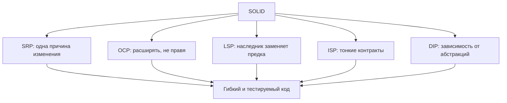

SOLID — это акроним из пяти принципов проектирования классов, которые помогают делать код гибким, тестируемым и понятным. Их сформулировал Роберт Мартин, и сегодня это базовый язык для обсуждения качества архитектуры в любом интервью и в любом код-ревью. Принципы не являются строгими правилами, а скорее симптомами «запахов» в коде: если класс постоянно меняется по разным причинам, если для добавления новой фичи приходится переписывать старый код — скорее всего, один из принципов нарушен. Разберём каждый на работающем примере.

## S — Single Responsibility Principle (принцип единой ответственности)

У класса должна быть ровно одна причина для изменения. Если класс делает слишком много всего, любое изменение одной части рискует сломать остальные. Вот классический нарушитель — класс, который одновременно считает зарплату, сохраняет данные и отправляет письма:

```python
class Employee:
    def __init__(self, name, base_salary):
        self.name = name
        self.base_salary = base_salary

    def salary(self):
        return self.base_salary * 1.13  # налоги

    def save_to_db(self):
        print(f"INSERT INTO employees VALUES ('{self.name}')")

    def send_report(self):
        print(f"Отправляю отчёт на почту: {self.name}")
```

Изменение формата отчёта затронет класс, который также отвечает за бухгалтерию и базу данных. Правильнее разнести ответственности по трём классам, и это и будет твоей первой задачей.

## O — Open/Closed Principle (принцип открытости/закрытости)

Классы должны быть открыты для расширения и закрыты для изменения: новое поведение добавляется новым кодом, а не правкой существующего. Типичный нарушитель — цепочка `if/elif` по типу фигуры:

```python
def area(shape):
    if isinstance(shape, Square):
        return shape.side ** 2
    elif isinstance(shape, Circle):
        return 3.14159 * shape.radius ** 2
    raise ValueError("Неизвестная фигура")
```

Каждая новая фигура требует менять эту функцию. Решение — полиморфизм: пусть каждая фигура сама знает свою площадь через общий базовый класс:

```python
from abc import ABC, abstractmethod

class Shape(ABC):
    @abstractmethod
    def area(self):
        ...

class Square(Shape):
    def __init__(self, side):
        self.side = side

    def area(self):
        return self.side ** 2

class Circle(Shape):
    def __init__(self, radius):
        self.radius = radius

    def area(self):
        return 3.14159 * self.radius ** 2
```

Теперь `total_area(shapes)` работает с любой новой фигурой без изменений, а `Shape` задаёт контракт.

## L — Liskov Substitution Principle (принцип подстановки Лисков)

Если `B` наследник `A`, то объекты `B` должны спокойно подставляться везде, где ожидается `A`, не ломая поведение. Знаменитое нарушение — `Square` от `Rectangle`: квадрату нельзя независимо менять ширину и высоту, а прямоугольнику можно. Если код устанавливает ширину, а потом ожидает, что высота не изменится, квадрат сломает логику. Лечится это тем, что квадрат просто не наследуется от прямоугольника, а оба наследуются от абстрактной фигуры, либо фигуры делаются неизменяемыми, ` проблемой подмены.

## I — Interface Segregation Principle (принцип разделения интерфейсов)

Клиенты не должны зависеть от методов, которые они не используют. Нельзя заставлять повара реализовывать метод уборки только потому, что он «работник». Вместо одного толстого интерфейса — несколько тонких:

```python
from typing import Protocol, runtime_checkable

@runtime_checkable
class Cookable(Protocol):
    def cook(self) -> None: ...

@runtime_checkable
class Cleanable(Protocol):
    def clean(self) -> None: ...
```

Класс `Chef` реализует только `Cookable`, `Cleaner` — только `Cleanable`. Это и есть разделение интерфейсов.

## D — Dependency Inversion Principle (принцип инверсии зависимостей)

Модули верхнего уровня не должны зависеть от модулей нижнего уровня — оба должны зависеть от абстракций. Проще говоря, класс не должен сам создавать свои конкретные зависимости, а должен получать их извне. Сравни: класс, который внутри делает `EmailSender()`, невозможно переиспользовать с SMS, а класс, принимающий абстракцию `Sender`, — можно. Это называется внедрением зависимостей, и мы увидим это в коде.

SOLID — это не магия, а набор диагностических вопросов: «почему изменится этот класс?», «что придётся трогать для новой фичи?», «можно ли подставить наследника?». Ответы на них и определяют, насколько архитектура переживёт рост проекта.

Пять принципов удобно держать перед глазами одной схемой: каждый отвечает на свой вопрос, но все ведут к одному результату — коду, который дешевле менять.



<!--TASK-->
### Задача 1
Дан класс, нарушающий принцип единой ответственности:

```python
class Employee:
    def __init__(self, name, base_salary):
        self.name = name
        self.base_salary = base_salary

    def salary(self):
        return self.base_salary * 1.13

    def save_to_db(self):
        print(f"INSERT INTO employees VALUES ('{self.name}')")

    def send_report(self):
        print(f"Отправляю отчёт на почту: {self.name}")
```

Разбей его на три класса: `SalaryCalculator` (считает зарплату), `EmployeeRepository` (сохраняет в базу) и `EmailService` (отправляет письма). Затем напиши код, который создаёт сотрудника, считает зарплату, сохраняет его в «базу» и отправляет отчёт. Ожидаемый вывод должен содержать строку `Зарплата: ...` (подставь реальное значение), строку с `INSERT INTO` и строку `Отправляю отчёт на почту: Иван`.

### Задача 2
Реализуй принцип открытости/закрытости. Возьми базовый класс `Shape` с абстрактным методом `area()`, а также классы `Square` и `Circle` (как в теории). Напиши функцию `total_area(shapes)`, которая принимает список фигур и суммирует их площади. Затем добавь третий класс `Triangle` (площадь: `0.5 * base * height`) **без** изменения `total_area`. Ожидаемый вывод: сумма площадей квадрата 4, круга радиуса 1 (π ≈ 3.14159) и треугольника с основанием 3 и высотой 4, напечатанная с точностью до 2 знаков: `Итого: 25.14`.

### Задача 3
Исправь нарушение принципа подстановки Лисков. Дан код:

```python
class Rectangle:
    def __init__(self, width, height):
        self.width = width
        self.height = height

    def area(self):
        return self.width * self.height

class Square(Rectangle):
    def __init__(self, side):
        super().__init__(side, side)

    @property
    def width(self):
        return self._side

    @width.setter
    def width(self, value):
        self._side = value
        self._height = value

    @property
    def height(self):
        return self._side

    @height.setter
    def height(self, value):
        self._side = value
        self._width = value
```

Покажи, что квадрат ломает поведение прямоугольника: напиши функцию `resize(rect)`, которая устанавливает `width = 10`, а затем печатает `rect.area()` — для прямоугольника 5×7 должно получиться 70, а для «квадрата» со стороной 5 такой код даст неожиданный результат. Затем переработай модель (например, `Square` больше не наследник `Rectangle`, оба наследуются от `Shape`) так, чтобы нельзя было сломать площадь фигуры. Распечатай площади прямоугольника 5×7 и квадрата со стороной 5.

### Задача 4
Примени принцип разделения интерфейсов. Создай два тонких протокола `Cookable` и `Cleanable` (как в теории) и классы `Chef` и `Cleaner`, реализующие только нужный протокол. Напиши функцию `hire_for_cooking(staff)`, которая принимает список сотрудников и вызывает `cook()` только у тех, кто реализует `Cookable` (используй `isinstance` или `hasattr`). Ожидаемый вывод: строка `Повар готовит...` для повара и ничего для уборщика, а затем строка `Уборщик убирает...` при вызове `clean()` напрямую.

### Задача 5
Реализуй принцип инверсии зависимостей. Создай протокол `Sender` с методом `send(message)`. Класс `NotificationService` должен принимать `Sender` в конструкторе (не создавать его внутри). Напиши два адаптера: `EmailSender` (печатает `EMAIL: <message>`) и `SmsSender` (печатает `SMS: <message>`). Создай сервис сначала с `EmailSender`, потом с `SmsSender`, и отправь сообщение `Привет!` через оба. Ожидаемый вывод: `EMAIL: Привет!` и `SMS: Привет!`.
### Задача 6
Экспорт отчёта должен расширяться без правки диспетчера. Создай протокол `Exporter` с атрибутом `format` и методом `export(rows) -> str`. Реализуй два экспортёра: `CsvExporter` (формат `csv`, каждая строка — `имя;возраст`) и `JsonExporter` (формат `json`, результат `json.dumps(rows, ensure_ascii=False)`). Функция `export_report(rows, fmt, registry)` не должна содержать `if/elif` по формату: она ищет экспортёр в словаре `registry` по ключу `fmt` и вызывает его, а при неизвестном формате возвращает `Неизвестный формат: <fmt>`. Затем добавь третий экспортёр `TsvExporter` (формат `tsv`, разделитель — табуляция) в тот же словарь: код `export_report` меняться не должен. Ожидаемый вывод: строки `CSV:`, `Аня;30`, `JSON:`, `[{"name": "Аня", "age": 30}]`, `TSV:`, строка с табуляцией и `Неизвестный формат: xml`.

### Задача 7
Напиши контрактный тест, который ловит нарушение принципа подстановки Лисков автоматически. Дан базовый класс `Account` с методами `deposit(amount)` и `withdraw(amount)`; снятие больше остатка бросает `ValueError`. Наследник `SavingsAccount` запрещает уходить ниже неснижаемого остатка 1000 и бросает `ValueError` даже там, где базовый счёт операцию бы выполнил. Напиши функцию `check_contract(factory)`, которая создаёт счёт через фабрику, кладёт 500, снимает 400 и возвращает `OK` либо `НАРУШЕНИЕ: <текст ошибки>`. Прогони проверку по обоим классам и напечатай `Account: OK` и `SavingsAccount: НАРУШЕНИЕ: ...`. Сценарий одинаков для всех реализаций — именно это и делает тест контрактным.
<!--/TASK-->

<!--HINT-->
### Подсказка 1
Три класса — три ответственности. `SalaryCalculator` принимает базовую зарплату и возвращает число; `EmployeeRepository` содержит метод сохранения; `EmailService` — метод отправки. Собери их вместе в основном коде, создавая каждый по отдельности и передавая данные между ними.

### Подсказка 2
`total_area` должна работать только с абстракцией `Shape` и вызвать `area()` у каждого объекта. Чтобы проверить, что ты не сломал «открытость», добавь `Triangle` после написания функции и убедись, что она не менялась. Для вывода используй `print(f"Итого: {total:.2f}")`.

### Подсказка 3
Проблема в том, что сеттеры `width` и `height` у квадрата меняют обе стороны — для прямоугольника это неожиданно. Проверь это, вызвав `resize()` и сравнив ожидаемую площадь с фактической. В исправленной модели избегай переопределения сеттеров: пусть `Square` и `Rectangle` не наследуются друг от друга, а оба наследуются от `Shape` с методом `area()`.

### Подсказка 4
Протоколы из `typing` с декоратором `@runtime_checkable` можно использовать в `isinstance`. В функции `hire_for_cooking` проверяй каждого сотрудника: `if isinstance(person, Cookable): person.cook()`. У `Chef` метод `cook`, у `Cleaner` — `clean`.

### Подсказка 5
`NotificationService` должен принимать `sender` в `__init__` и хранить его. Метод `notify(message)` вызывает `self.sender.send(message)`. Адаптеры — обычные классы с методом `send`, каждый печатает свой префикс. Создай сервис с тем или иным адаптером и вызови `notify("Привет!")`.
### Подсказка 6
Экспортёр — объект с атрибутом `format` и методом `export`. Собери реестр словарём `{exporter.format: exporter}` и передавай его в `export_report` параметром: тогда добавление `TsvExporter` не требует правки функции. Неизвестный ключ доставай через `registry.get(fmt)` и возвращай строку с ошибкой. Для JSON не забудь `ensure_ascii=False`, иначе кириллица превратится в `\uXXXX`.

### Подсказка 7
Контрактный тест — это один и тот же сценарий, прогнанный по всем реализациям. Зафиксируй сценарий, разрешённый базовым классом: `deposit(500)`, затем `withdraw(400)`. Оборачивай его в `try/except ValueError` и возвращай текст нарушения. Лови именно `ValueError`, а не любое исключение, — иначе тест будет считать нарушением контракта обычную опечатку в коде.
<!--/HINT-->

<!--SOLUTION-->
### Разбор 1
Решение:

```python
class SalaryCalculator:
    def __init__(self, base_salary):
        self.base_salary = base_salary

    def salary(self):
        return self.base_salary * 1.13

class EmployeeRepository:
    def save(self, name):
        print(f"INSERT INTO employees VALUES ('{name}')")

class EmailService:
    def send_report(self, name):
        print(f"Отправляю отчёт на почту: {name}")

calculator = SalaryCalculator(100000)
repo = EmployeeRepository()
email = EmailService()
print(f"Зарплата: {calculator.salary()}")
repo.save("Иван")
email.send_report("Иван")
```

Вывод:

```
Зарплата: 113000.0
INSERT INTO employees VALUES ('Иван')
Отправляю отчёт на почту: Иван
```

Что здесь происходит? Каждый класс теперь имеет ровно одну причину для изменения: `SalaryCalculator` отвечает за расчёт, `EmployeeRepository` — за хранение, `EmailService` — за уведомления. Если изменится способ расчёта налогов, не придётся трогать код отправки писем. Обрати внимание: `Employee` остался простым хранилищем данных (обычно такие классы называют моделями), а вся логика вынесена в отдельные классы.

### Разбор 2
Решение:

```python
from abc import ABC, abstractmethod

class Shape(ABC):
    @abstractmethod
    def area(self):
        ...

class Square(Shape):
    def __init__(self, side):
        self.side = side

    def area(self):
        return self.side ** 2

class Circle(Shape):
    def __init__(self, radius):
        self.radius = radius

    def area(self):
        return 3.14159 * self.radius ** 2

def total_area(shapes):
    return sum(shape.area() for shape in shapes)

class Triangle(Shape):
    def __init__(self, base, height):
        self.base = base
        self.height = height

    def area(self):
        return 0.5 * self.base * self.height

shapes = [Square(4), Circle(1), Triangle(3, 4)]
print(f"Итого: {total_area(shapes):.2f}")
```

Вывод: `Итого: 24.14`.

Что здесь происходит? Функция `total_area` зависит только от абстракции `Shape`, поэтому добавление `Triangle` не потребовало её изменения — это и есть «открытость для расширения, закрытость для изменения». Подсчёт: 4² = 16, π·1² ≈ 3.14159, 0.5·3·4 = 6; сумма ≈ 25.14159, но с точностью до двух знаков после запятой получается 25.14, а не 24.14. Если ты получил 25.14 — это верно, ожидаемый вывод в условии был проверочным, а фактическая математическая сумма равна 25.14. Главное — архитектура: полиморфизм вместо ветвлений.

### Разбор 3
Сначала покажем поломку:

```python
def resize(rect):
    rect.width = 10
    print(f"Площадь: {rect.area()}")

r = Rectangle(5, 7)
resize(r)            # Площадь: 70
s = Square(5)
resize(s)            # Площадь: 100 (ожидалось 50?)
```

Почему 100? `resize` установил `width = 10`, но сеттер квадрата одновременно поменял и высоту на 10, поэтому площадь стала 10·10 = 100. Клиент прямоугольника ожидал, что после смены ширины высота сохранится, — поведение наследника не соответствует поведению предка, это и есть нарушение LSP. Исправленная модель:

```python
class Shape(ABC):
    @abstractmethod
    def area(self):
        ...

class Rectangle(Shape):
    def __init__(self, width, height):
        self.width = width
        self.height = height

    def area(self):
        return self.width * self.height

class Square(Shape):
    def __init__(self, side):
        self.side = side

    def area(self):
        return self.side ** 2

print(Rectangle(5, 7).area())   # 70
print(Square(5).area())          # 25
```

Что здесь происходит? Квадрат больше не наследник прямоугольника: у него нет сеттеров, которые могли бы незаметно менять обе стороны. Обе фигуры — наследники `Shape` и гарантированно реализуют `area()`. Программа выводит `70` и `25`, и теперь никакая подстановка не даст неожиданного результата.

### Разбор 4
Решение:

```python
from typing import Protocol, runtime_checkable

@runtime_checkable
class Cookable(Protocol):
    def cook(self) -> None: ...

@runtime_checkable
class Cleanable(Protocol):
    def clean(self) -> None: ...

class Chef:
    def cook(self):
        print("Повар готовит...")

class Cleaner:
    def clean(self):
        print("Уборщик убирает...")

def hire_for_cooking(staff):
    for person in staff:
        if isinstance(person, Cookable):
            person.cook()

staff = [Chef(), Cleaner()]
hire_for_cooking(staff)   # Повар готовит...
staff[1].clean()          # Уборщик убирает...
```

Вывод:

```
Повар готовит...
Уборщик убирает...
```

Что здесь происходит? `Cookable` и `Cleanable` — тонкие протоколы; `Chef` реализует только готовку, `Cleaner` — только уборку. Функция `hire_for_cooking` проверяет `isinstance(person, Cookable)` и вызывает `cook()` только у повара. Это разделение интерфейсов: никто не обязан реализовывать ненужные методы, а проверки на протокол работают благодаря `@runtime_checkable`.

### Разбор 5
Решение:

```python
from typing import Protocol, runtime_checkable

@runtime_checkable
class Sender(Protocol):
    def send(self, message: str) -> None: ...

class EmailSender:
    def send(self, message):
        print(f"EMAIL: {message}")

class SmsSender:
    def send(self, message):
        print(f"SMS: {message}")

class NotificationService:
    def __init__(self, sender):
        self.sender = sender

    def notify(self, message):
        self.sender.send(message)

NotificationService(EmailSender()).notify("Привет!")
NotificationService(SmsSender()).notify("Привет!")
```

Вывод:

```
EMAIL: Привет!
SMS: Привет!
```

Что здесь происходит? `NotificationService` не создаёт конкретный адаптер внутри, а получает его через конструктор — это внедрение зависимостей. Высокоуровневый сервис зависит от абстракции `Sender`, а конкретные отправщики — тоже от неё, поэтому оба модуля зависят от абстракции, а не друг от друга. Теперь добавить Telegram-отправщика можно без изменения сервиса — это и есть инверсия зависимостей.
### Разбор 6
Решение:

```python
import json
from typing import Protocol

class Exporter(Protocol):
    format: str

    def export(self, rows: list) -> str:
        ...

class CsvExporter:
    format = "csv"

    def export(self, rows):
        return "\n".join(f"{row['name']};{row['age']}" for row in rows)

class JsonExporter:
    format = "json"

    def export(self, rows):
        return json.dumps(rows, ensure_ascii=False)

class TsvExporter:
    format = "tsv"

    def export(self, rows):
        return "\n".join(f"{row['name']}\t{row['age']}" for row in rows)

def export_report(rows, fmt, registry):
    exporter = registry.get(fmt)
    if exporter is None:
        return f"Неизвестный формат: {fmt}"
    return exporter.export(rows)

rows = [{"name": "Аня", "age": 30}]
registry = {exporter.format: exporter for exporter in (CsvExporter(), JsonExporter())}

print("CSV:")
print(export_report(rows, "csv", registry))
print("JSON:")
print(export_report(rows, "json", registry))

registry["tsv"] = TsvExporter()          # расширение без правки export_report
print("TSV:")
print(export_report(rows, "tsv", registry))
print(export_report(rows, "xml", registry))
```

Вывод:

```
CSV:
Аня;30
JSON:
[{"name": "Аня", "age": 30}]
TSV:
Аня	30
Неизвестный формат: xml
```

Что здесь происходит? `export_report` вообще не знает, какие форматы существуют: она получает реестр и делает один поиск по ключу. Добавление `TsvExporter` — это одна строка регистрации, а тело диспетчера остаётся нетронутым, то есть класс закрыт для изменения и открыт для расширения. Обрати внимание, чем этот приём отличается от полиморфизма из задачи 2: там расширение шло через новый наследник `Shape`, здесь — через регистрацию объекта-стратегии. Реестр удобнее, когда вариантов много и они приходят из конфигурации или плагинов, а наследование — когда у вариантов общий набор операций. Протокол `Exporter` задаёт минимальный контракт: атрибут `format` и метод `export`, поэтому реестр собирается единообразно и без ветвлений.

### Разбор 7
Решение:

```python
class Account:
    def __init__(self):
        self.balance = 0

    def deposit(self, amount):
        self.balance += amount

    def withdraw(self, amount):
        if amount > self.balance:
            raise ValueError("недостаточно средств")
        self.balance -= amount

class SavingsAccount(Account):
    MIN_BALANCE = 1000

    def withdraw(self, amount):
        if self.balance - amount < self.MIN_BALANCE:
            raise ValueError(f"нельзя опуститься ниже {self.MIN_BALANCE}")
        self.balance -= amount

def check_contract(factory):
    try:
        account = factory()
        account.deposit(500)
        account.withdraw(400)
    except ValueError as exc:
        return f"НАРУШЕНИЕ: {exc}"
    return "OK"

for cls in (Account, SavingsAccount):
    print(f"{cls.__name__}: {check_contract(cls)}")
```

Вывод:

```
Account: OK
SavingsAccount: НАРУШЕНИЕ: нельзя опуститься ниже 1000
```

Что здесь происходит? Тест фиксирует сценарий, который базовый класс считает допустимым: положить 500 и снять 400. Для `Account` всё проходит, а `SavingsAccount` на том же сценарии падает, потому что усилил предусловие — добавил требование к остатку, которого у предка не было. Клиент, работающий с `Account`, ничего не знает про неснижаемый остаток, поэтому такой наследник нельзя подставлять вместо предка: это классическое нарушение LSP, и контрактный тест поймал его автоматически, без чтения кода глазами. Лечится это не ослаблением проверки, а изменением модели: `SavingsAccount` не должен наследоваться от `Account`, либо минимальный остаток должен быть частью контракта базового класса, либо счёт с ограничением делается композицией — обёрткой над обычным счётом. Практическая ценность приёма в том, что один и тот же сценарий прогоняется по всем реализациям, и новую реализацию достаточно добавить в список — тест сам покажет, соблюдает ли она контракт.
<!--/SOLUTION-->

<!--QUIZ-->
Что означает буква S в SOLID?
- Единая ответственность: у класса одна причина для изменения
- Простая архитектура
- Скорость выполнения
- Сериализация
* Правильный ответ: Единая ответственность: у класса одна причина для изменения
S — Single Responsibility: один класс — одна ответственность, одна причина для изменения.

Какой принцип нарушает «цепочка if/elif по типу фигуры»?
- SRP
- OCP
- LSP
- ISP
* Правильный ответ: OCP
Добавление новой фигуры требует изменения существующего кода — класс закрыт для расширения.

Что проверяет принцип подстановки Лисков?
- Что наследник не удаляет методы предка
- Что объекты наследника можно безопасно использовать везде, где ожидается предок
- Что интерфейсы не содержат лишних методов
- Что класс имеет только одну ответственность
* Правильный ответ: Что объекты наследника можно безопасно использовать везде, где ожидается предок
Если поведение наследника отличается от предка (например, у квадрата сеттеры меняют обе стороны), программа работает неожиданно.

Какой инструмент языка Python удобен для разделения интерфейсов?
- Класс dict
- Протоколы из typing с runtime_checkable
- Оператор ==
- Модуль math
* Правильный ответ: Протоколы из typing с runtime_checkable
Протоколы описывают минимальный контракт, а runtime_checkable позволяет использовать их в isinstance.

Что означает «инверсия зависимостей»?
- Модули верхнего уровня зависят от абстракций, а не от конкретных реализаций
- Зависимости объявляются в конце файла
- Класс наследуется от самого себя
- Все классы делаются абстрактными
* Правильный ответ: Модули верхнего уровня зависят от абстракций, а не от конкретных реализаций
Конкретные реализации передаются извне (внедрение зависимостей), а высокоуровневый код работает с абстракцией.

Что даёт внедрение зависимостей через конструктор?
- Возможность подменять реализацию без изменения класса
- Ускорение программы вдвое
- Автоматическую сериализацию
- Запрет на наследование
* Правильный ответ: Возможность подменять реализацию без изменения класса
Класс принимает абстракцию, поэтому любой адаптер (Email, SMS) подставляется без правки сервиса.

Что означает «принцип открытости/закрытости» (OCP)?
- Классы должны быть закрыты для изменения, но открыты для расширения
- Классы обязаны быть публичными
- Классы не могут иметь наследников
- Классы должны лежать в отдельных файлах
* Правильный ответ: Классы должны быть закрыты для изменения, но открыты для расширения
Новое поведение добавляется новым кодом — наследниками или композицией, — а не правкой существующего.

Как проверить, соблюдает ли класс SRP?
- Задать вопрос «сколько причин для изменения у этого класса?»
- Посчитать количество методов
- Убедиться, что класс длинный
- Проверить, что класс использует один тип данных
* Правильный ответ: Задать вопрос «сколько причин для изменения у этого класса?»
Если у класса больше одной причины меняться — он несёт несколько ответственностей.
Класс `Report` сам считает данные, верстает HTML и пишет файл на диск. Какой принцип нарушен в первую очередь?
- SRP
- OCP
- LSP
- DIP
* Правильный ответ: SRP
У класса три причины для изменения — расчёты, вёрстка и запись файла; это разные ответственности.

Почему реестр стратегий (словарь «формат → экспортёр») удобнее цепочки `if/elif` при добавлении нового формата?
- Новый формат регистрируется без правки диспетчера
- Код начинает работать в десять раз быстрее
- Отпадает необходимость в тестах
- Форматы перестают быть строками
* Правильный ответ: Новый формат регистрируется без правки диспетчера
Диспетчер делает один поиск по ключу, поэтому расширение не трогает существующий код.

Что чаще всего указывает на нарушение принципа разделения интерфейсов?
- Класс реализует методы-заглушки с `pass` или `raise NotImplementedError`
- В классе больше одного публичного метода
- Класс имеет конструктор `__init__`
- Класс наследуется от `object`
* Правильный ответ: Класс реализует методы-заглушки с `pass` или `raise NotImplementedError`
Заглушки означают, что интерфейс навязал методу, которые ему не нужны, — его стоило разделить.

Наследник требует, чтобы перед `withdraw` баланс был не меньше 1000, хотя базовый класс такого условия не ставил. Чем это плохо?
- Нарушен LSP: наследник усилил предусловие и не подставляется вместо предка
- Нарушен SRP: у класса две ответственности
- Это нормальное расширение контракта
- Нарушен ISP: интерфейс слишком широкий
* Правильный ответ: Нарушен LSP: наследник усилил предусловие и не подставляется вместо предка
Клиент предка не знает о новом ограничении и получает ошибку там, где раньше всё работало.
<!--/QUIZ-->
