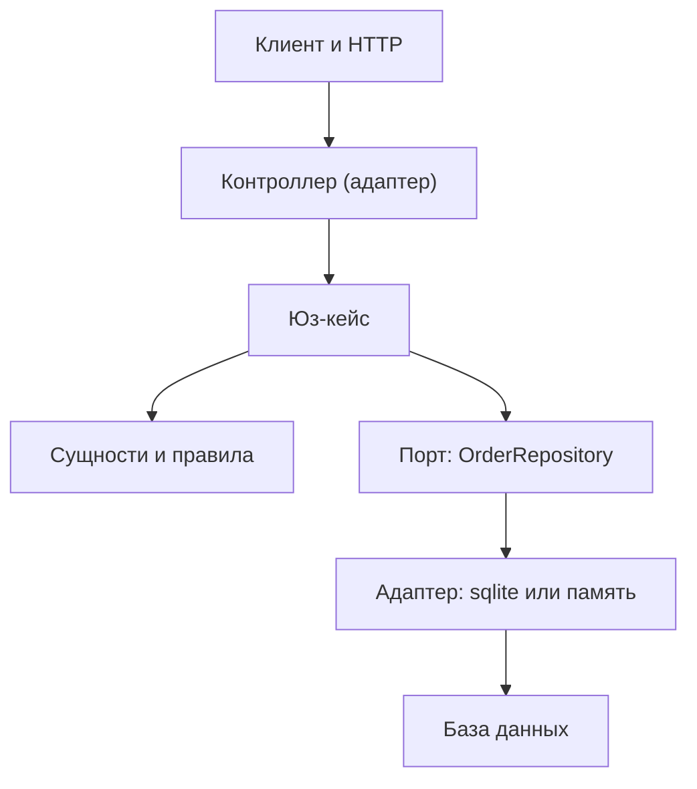

Чистая архитектура (Clean Architecture) — это подход, который отвечает на вопрос «как организовать код, чтобы бизнес-логика не зависела от фреймворков, баз данных и UI». Идея в том, что самые важные вещи — правила бизнеса — должны быть в центре, а всё остальное (база данных, HTTP, интерфейс) крутится вокруг как взаимозаменяемые детали.

## Слои и направление зависимостей

Нарисуем концентрические круги: внутри — сущности (entities) и юз-кейсы (use cases), снаружи — адаптеры интерфейсов (контроллеры, презентеры), а на самом внешнем кольце — фреймворки и драйверы (FastAPI, sqlite3, почта). Главное правило: **зависимости направлены внутрь** — внутренние слои ничего не знают о внешних. Внешний слой может зависеть от внутреннего, но не наоборот. Домен не импортирует sqlite3, потому что база данных — это деталь, которую можно поменять.

Практически это значит: бизнес-логика должна компилироваться и работать даже без базы данных и без веб-сервера. Проверка простая — представь, что ты выкинул все импорты FastAPI и sqlite3. Если код всё ещё осмыслен, слои разделены правильно.

## Порты и адаптеры

Чтобы внутренний слой не зависел от конкретной базы, мы объявляем **порт** — абстракцию (в Python — протокол), которую реализует **адаптер** снаружи. Домен говорит: «мне нужен репозиторий, который умеет сохранять заказ». Конкретную реализацию — в памяти, в sqlite, в PostgreSQL — подставляем извне.

```python
from abc import ABC, abstractmethod

class OrderRepository(ABC):
    @abstractmethod
    def save(self, order):
        ...

class InMemoryOrderRepository(OrderRepository):
    def __init__(self):
        self.orders = []

    def save(self, order):
        self.orders.append(order)
        print(f"Сохранено в памяти: {order}")
```

Теперь юз-кейс зависит от `OrderRepository`, а не от конкретного хранилища.

## Юз-кейс

Юз-кейс — это сценарий использования системы: «оформить заказ», «изменить профиль». Он содержит оркестрацию: подтянуть данные, применить правила, сохранить результат. Взгляни на простой юз-кейс оформления заказа:

```python
class OrderUseCase:
    def __init__(self, repo: OrderRepository):
        self.repo = repo

    def place(self, items):
        total = sum(price for _, price in items)
        order = {"items": items, "total": total}
        self.repo.save(order)
        return order
```

Здесь нет ни HTTP, ни SQL — только чистая логика. Контроллер FastAPI лишь вызывает `place()` и отдаёт результат клиенту.

## Почему это работает

Такая архитектура даёт три практических выгоды. Во-первых, **тестируемость**: юз-кейс проверяется без базы — подставляем фейковый репозиторий. Во-вторых, **возможность менять внешние детали**: переезд с SQLite на PostgreSQL не трогает домен. В-третьих, **ясность**: глядя на юз-кейсы, ты видишь, что система вообще делает, не отвлекаясь на фреймворки.

Важно не перестараться: для простого скрипта из 50 строк чистая архитектура избыточна. Она окупается, когда проект живёт годами, у него много разработчиков и внешние технологии меняются чаще, чем бизнес-правила. Признак «правильного» объёма слоёв: ты можешь объяснить, какая выгода от каждого слоя, иначе слой лишний.

Направление зависимостей и место порта видно на одной схеме:



Стрелки идут только внутрь: контроллер знает про юз-кейс, юз-кейс — про порт, но ни один внутренний элемент не знает про sqlite и HTTP.

<!--TASK-->
### Задача 1
Создай порт `Catalog` (протокол) с методом `price_of(sku) -> float`, юз-кейс `cart_total(catalog, items)`, который суммирует цены товаров, и два адаптера: `DictCatalog` (цены в словаре) и `SqliteCatalog` (цены в базе sqlite3 через стандартный модуль). Подставь оба адаптера по очереди и напечатай стоимость корзины из двух товаров. Ожидаемый вывод: `Стоимость корзины: 110.0` в обоих случаях.

### Задача 2
Дан код, нарушающий направление зависимостей — домен напрямую импортирует sqlite3:

```python
import sqlite3

def list_products():
    conn = sqlite3.connect("shop.db")
    return conn.execute("SELECT name FROM products").fetchall()
```

Переработай его: создай протокол `ProductRepository` с методом `list_products()`, реализацию `SqliteProductRepository` (внешний слой) и юз-кейс, который вызывает `list_products()` через протокол. В коде юз-кейса не должно быть импорта sqlite3. Программа должна напечатать список товаров из базы (для проверки предварительно создай файл `shop.db` с таблицей `products` и несколькими строками).

### Задача 3
Добавь новый адаптер для доставки. Домен объявляет порт `Notifier` с методом `send(message)`. Напиши два адаптера: `ConsoleNotifier` (печатает `Уведомление: <message>`) и `EmailNotifier` (печатает `EMAIL: <message>`). Создай юз-кейс `order_delivered(order_id, notifier)`, который отправляет сообщение `Заказ {order_id} доставлен`. Запусти оба варианта. Ожидаемый вывод: строки `Уведомление: Заказ 42 доставлен` и `EMAIL: Заказ 42 доставлен`.

### Задача 4
Вынеси бизнес-правило в домен. Создай класс `Cart` (сущность) с методом `shipping_cost()`, который возвращает `0.0`, если сумма товаров ≥ 3000, иначе `199.0`. Напиши юз-кейс, который принимает корзину, считает итог (`сумма товаров + доставка`) и возвращает его. Протестируй на двух корзинах: на 2500 (итог 2699.0) и на 3000 (итог 3000.0). Программа печатает оба итога.

### Задача 5
Собери вертикальный срез: «контроллер» (обычная функция `cli`) принимает имя файла и вызывает юз-кейс `load_and_report(repo, path)`, который читает строки файла через репозиторий и возвращает их количество, а затем печатает `Файл <path>: N строк`. Порт `FileReader` с методом `read_lines(path)`. Реализуй `RealFileReader` (обёртка над `open`). Создай временный файл с тремя строками и проверь, что программа печатает `Файл data.txt: 3 строк`.
### Задача 6
Докажи тестируемость чистой архитектуры. Дан юз-кейс `place_order(repo, items)`: пустую корзину он отклоняет (возвращает `None` и ничего не сохраняет), а непустую сохраняет через порт `OrderRepository` со статусом `new`. Напиши фейковый репозиторий `FakeRepo`, который запоминает вызовы `save` в списке `saved`, но ничего не пишет в базу. Затем напиши две проверки: пустая корзина не должна вызывать `save`, а корзина из двух позиций на 100 и 150 должна дать заказ с суммой 250 и ровно один вызов `save`. Каждая проверка печатает `Тест 1: OK` или `Тест 1: FAIL` (аналогично для второй). В конце напечатай `Пройдено: 2 из 2`. Ожидаемый вывод — три строки, обе проверки зелёные.

### Задача 7
Напиши архитектурный тест — проверку, что домен не тянет инфраструктуру. Функция `check_imports(source)` разбирает исходник через `ast.parse`, обходит дерево и собирает имена всех импортируемых модулей (для `import a.b` и `from a.b import c` берётся первый сегмент — `a`). Запрещённые модули задай множеством `{"sqlite3", "fastapi", "requests", "redis"}`. Проверь два исходника: чистый домен (импортирует только `typing` и `dataclasses`) и грязный, где есть `import sqlite3` и `import fastapi`. Для каждого напечатай `<путь>: чисто` либо `<путь>: запрещённые импорты: <список>`. Ожидаемый вывод: одна строка «чисто» и одна строка с двумя нарушителями в алфавитном порядке.
<!--/TASK-->

<!--HINT-->
### Подсказка 1
Порт объявляй через `Protocol` из `typing`. `cart_total` принимает `catalog` и список `(sku, количество)`. `DictCatalog` хранит словарь `{sku: цена}`; `SqliteCatalog` выполняет `SELECT price FROM products WHERE sku = ?`. Код юз-кейса не должен знать, какой адаптер подставлен.

### Подсказка 2
Разнеси код по слоям: `SqliteProductRepository` живёт во внешнем слое и содержит импорт sqlite3, а юз-кейс и протокол — во внутреннем, без импорта sqlite3. Внутренний код вызывает только `repo.list_products()`.

### Подсказка 3
`Notifier` — протокол с методом `send`. Оба адаптера — обычные классы. Юз-кейс `order_delivered` принимает `notifier` как параметр и вызывает `notifier.send(...)`. Создай два экземпляра сервиса с разными адаптерами.

### Подсказка 4
`Cart` хранит список цен товаров и имеет метод `subtotal()`. `shipping_cost()` — чистая логика с условием. Юз-кейс `checkout(cart)` возвращает `cart.subtotal() + cart.shipping_cost()`. Для проверки создай корзины списками цен.

### Подсказка 5
`FileReader` — протокол с `read_lines(path)`. `RealFileReader` использует `with open(path, encoding="utf-8")` и возвращает список строк. Юз-кейс считает `len(lines)`. В `cli` создай репозиторий и вызови юз-кейс. Не забудь создать тестовый файл перед запуском.

### Подсказка 6
Порт объявляется через `Protocol` с методом `save`. `FakeRepo` хранит список `saved` и в `save` просто делает `append` — никакой базы. Проверку пиши отдельной функцией `check(name, condition)`, которая печатает `OK` или `FAIL`. Для второй проверки сравни `order["total"]` с 250 и `len(repo.saved)` с 1; для первой — `result is None` и пустой `saved`.

### Подсказка 7
`ast.parse(source)` даёт дерево; обойди его через `ast.walk` и обрабатывай два типа узлов: `ast.Import` (список `node.names`, у каждого есть `alias.name`) и `ast.ImportFrom` (поле `node.module`). Имя модуля режь по точке: `name.split(".")[0]`. Собери нарушения в список и напечатай их через `sorted(set(...))`, чтобы порядок был предсказуем.
<!--/HINT-->

<!--SOLUTION-->
### Разбор 1
Решение:

```python
from typing import Protocol
import sqlite3

class Catalog(Protocol):
    def price_of(self, sku: str) -> float:
        ...

def cart_total(catalog, items):
    return sum(catalog.price_of(sku) * qty for sku, qty in items)

class DictCatalog:
    def __init__(self, prices):
        self.prices = prices

    def price_of(self, sku):
        return self.prices[sku]

class SqliteCatalog:
    def __init__(self, db_path):
        self.conn = sqlite3.connect(db_path)

    def price_of(self, sku):
        row = self.conn.execute("SELECT price FROM products WHERE sku = ?", (sku,)).fetchone()
        return row[0]

# подготовка базы
conn = sqlite3.connect("shop.db")
conn.execute("CREATE TABLE IF NOT EXISTS products (sku TEXT, price REAL)")
conn.execute("INSERT OR REPLACE INTO products VALUES ('молоко', 50.0)")
conn.execute("INSERT OR REPLACE INTO products VALUES ('хлеб', 60.0)")
conn.commit()

items = [("молоко", 1), ("хлеб", 1)]
print(f"Стоимость корзины: {cart_total(DictCatalog({'молоко': 50.0, 'хлеб': 60.0}), items)}")
print(f"Стоимость корзины: {cart_total(SqliteCatalog('shop.db'), items)}")
```

Вывод: `Стоимость корзины: 110.0` дважды. Что здесь происходит? `cart_total` зависит от абстракции `Catalog`, а конкретные источники данных подставляются извне. Один и тот же юз-кейс работает и со словарём, и с базой — это и есть порт и адаптер.

### Разбор 2
Решение:

```python
from typing import Protocol
import sqlite3

class ProductRepository(Protocol):
    def list_products(self):
        ...

class SqliteProductRepository:
    def __init__(self, db_path):
        self.conn = sqlite3.connect(db_path)

    def list_products(self):
        return [row[0] for row in self.conn.execute("SELECT name FROM products")]

def list_all_products(repo: ProductRepository):
    return repo.list_products()

repo = SqliteProductRepository("shop.db")
for name in list_all_products(repo):
    print(name)
```

Что здесь происходит? Внутренний слой (протокол и юз-кейс `list_all_products`) не знает о sqlite3 — импорт живёт только в адаптере. Направление зависимости: внешний `SqliteProductRepository` зависит от внутреннего протокола, а не наоборот. Заменить базу на другую можно без изменения юз-кейса.

### Разбор 3
Решение:

```python
from typing import Protocol

class Notifier(Protocol):
    def send(self, message: str) -> None:
        ...

class ConsoleNotifier:
    def send(self, message):
        print(f"Уведомление: {message}")

class EmailNotifier:
    def send(self, message):
        print(f"EMAIL: {message}")

def order_delivered(order_id, notifier: Notifier):
    notifier.send(f"Заказ {order_id} доставлен")

order_delivered(42, ConsoleNotifier())
order_delivered(42, EmailNotifier())
```

Вывод:

```
Уведомление: Заказ 42 доставлен
EMAIL: Заказ 42 доставлен
```

Что здесь происходит? Юз-кейс `order_delivered` не знает, каким каналом доставлять сообщение — он работает с портом `Notifier`. Адаптеры взаимозаменяемы, а домен остаётся чистым.

### Разбор 4
Решение:

```python
class Cart:
    def __init__(self, prices):
        self.prices = prices

    def subtotal(self):
        return sum(self.prices)

    def shipping_cost(self):
        return 0.0 if self.subtotal() >= 3000 else 199.0

def checkout(cart):
    return cart.subtotal() + cart.shipping_cost()

print(checkout(Cart([2500.0])))   # 2699.0
print(checkout(Cart([3000.0])))   # 3000.0
```

Вывод:

```
2699.0
3000.0
```

Что здесь происходит? Правило доставки живёт в сущности `Cart` — это чистая бизнес-логика без зависимостей от внешнего мира. Юз-кейс `checkout` лишь комбинирует методы сущности. Оба итога выводятся корректно: 2500 + 199 = 2699, а 3000 ≥ 3000, поэтому доставка бесплатная.

### Разбор 5
Решение:

```python
from typing import Protocol

class FileReader(Protocol):
    def read_lines(self, path: str) -> list:
        ...

class RealFileReader:
    def read_lines(self, path):
        with open(path, encoding="utf-8") as f:
            return f.readlines()

def load_and_report(repo: FileReader, path):
    lines = repo.read_lines(path)
    return len(lines)

def cli(path):
    count = load_and_report(RealFileReader(), path)
    print(f"Файл {path}: {count} строк")

with open("data.txt", "w", encoding="utf-8") as f:
    f.write("одна\nдве\nтри\n")

cli("data.txt")
```

Вывод: `Файл data.txt: 3 строк`. Что здесь происходит? Контроллер `cli` вызывает юз-кейс `load_and_report`, который через порт `FileReader` читает строки. Внутренний слой не зависит от конкретного способа чтения. Такой вертикальный срез — от контроллера через юз-кейс до адаптера — показывает, как слои соединяются в работающее приложение.
### Разбор 6
Решение:

```python
from typing import Protocol

class OrderRepository(Protocol):
    def save(self, order) -> None:
        ...

class FakeRepo:
    def __init__(self):
        self.saved = []

    def save(self, order):
        self.saved.append(order)

def place_order(repo, items):
    if not items:
        return None
    total = sum(price for _, price in items)
    order = {"items": items, "total": total, "status": "new"}
    repo.save(order)
    return order

def check(name, condition):
    print(f"{name}: {'OK' if condition else 'FAIL'}")
    return condition

repo = FakeRepo()
check("Тест 1", place_order(repo, []) is None and repo.saved == [])

repo2 = FakeRepo()
order = place_order(repo2, [("хлеб", 100), ("сыр", 150)])
check("Тест 2", order is not None and order["total"] == 250 and len(repo2.saved) == 1)
print("Пройдено: 2 из 2")
```

Вывод:

```
Тест 1: OK
Тест 2: OK
Пройдено: 2 из 2
```

Что здесь происходит? Юз-кейс проверяется без базы данных, без миграций и без поднятия процесса — потому что он зависит от протокола, а не от `sqlite3`. `FakeRepo` реализует тот же контракт `save`, но вместо записи в файл складывает заказы в список, и тест может заглянуть в этот список, чтобы убедиться, что отклонённая корзина ничего не сохранила. Это главная практическая выгода слоёв: тест на логику выполняется за миллисекунды и не требует инфраструктуры. Обрати внимание на две вещи. Первое: тест проверяет поведение (пустая корзина → `None` и ноль вызовов), а не устройство класса, поэтому рефакторинг внутри юз-кейса его не сломает. Второе: фейк не мокает методы через библиотеку, а просто реализует порт — такой подход устойчивее, потому что мок привязан к конкретным вызовам, а фейк — к контракту.

### Разбор 7
Решение:

```python
import ast

FORBIDDEN = {"sqlite3", "fastapi", "requests", "redis"}

def check_imports(source):
    tree = ast.parse(source)
    found = []
    for node in ast.walk(tree):
        if isinstance(node, ast.Import):
            for alias in node.names:
                name = alias.name.split(".")[0]
                if name in FORBIDDEN:
                    found.append(name)
        elif isinstance(node, ast.ImportFrom):
            if node.module:
                name = node.module.split(".")[0]
                if name in FORBIDDEN:
                    found.append(name)
    return sorted(set(found))

CLEAN = '''
from typing import Protocol
from dataclasses import dataclass
'''

DIRTY = '''
import sqlite3
import fastapi
from typing import Protocol
'''

for path, source in (("domain/orders.py", CLEAN), ("domain/reports.py", DIRTY)):
    bad = check_imports(source)
    if bad:
        print(f"{path}: запрещённые импорты: {', '.join(bad)}")
    else:
        print(f"{path}: чисто")
```

Вывод:

```
domain/orders.py: чисто
domain/reports.py: запрещённые импорты: fastapi, sqlite3
```

Что здесь происходит? Правило «домен не импортирует инфраструктуру» перестаёт быть договорённостью в голове и становится исполняемой проверкой — такие проверки называют архитектурными тестами или fitness functions. Разбор через `ast` надёжнее поиска подстроки по тексту: он видит настоящие инструкции импорта и не срабатывает на слово `sqlite3` в комментарии или в строке документации. `ast.ImportFrom` нужно обрабатывать отдельно, потому что там модуль лежит в поле `node.module`, а не в `names`; проверка `if node.module` защищает от относительных импортов без модуля. На практике такой скрипт запускают в CI: если кто-то добавит `import fastapi` в папку домена, сборка упадёт до ревью. Естественное развитие идеи — задавать правила в конфиге (какому слою что можно) и проверять не один файл, а всё дерево пакета.
<!--/SOLUTION-->

<!--QUIZ-->
Куда направлены зависимости в чистой архитектуре?
- От внешних слоёв к внутренним
- От внутренних к внешним
- Везде одинаково
- Циклически
* Правильный ответ: От внешних слоёв к внутренним
Внешние слои (базы, фреймворки) зависят от внутренних, но домен не знает о внешних деталях.

Что такое порт в терминах чистой архитектуры?
- Сетевой порт сервера
- Абстракция (например, протокол), которую реализуют адаптеры
- Конфигурационный файл
- Класс контроллера
* Правильный ответ: Абстракция (например, протокол), которую реализуют адаптеры
Порт описывает, что нужно домену, а адаптер — как это сделать конкретной технологией.

Что из перечисленного должно жить во внутреннем слое?
- sqlite3.connect
- FastAPI-маршруты
- Юз-кейсы и сущности
- Шаблоны HTML
* Правильный ответ: Юз-кейсы и сущности
Бизнес-правила — в центре; технологии — снаружи.

Зачем подставлять фейковый репозиторий в тестах?
- Чтобы ускорить продакшен
- Чтобы проверять юз-кейс без реальной базы данных
- Чтобы скрыть данные от пользователя
- Чтобы обойтись без протоколов
* Правильный ответ: Чтобы проверять юз-кейс без реальной базы данных
Порт позволяет тестировать логику в изоляции от инфраструктуры.

Какой признак того, что слоёв слишком много?
- Слой нельзя объяснить конкретной выгодой
- Код компилируется
- Есть протоколы
- Проект маленький
* Правильный ответ: Слой нельзя объяснить конкретной выгодой
Каждый слой должен оправдывать своё существование; иначе он лишний.

Что означает «домен не импортирует sqlite3»?
- Домен не хранит данные в базе
- Бизнес-логика не зависит от конкретной базы данных
- sqlite3 не используется в проекте
- База данных запрещена законом
* Правильный ответ: Бизнес-логика не зависит от конкретной базы данных
База данных — деталь, её можно заменить без изменения домена.

Что такое адаптер в чистой архитектуре?
- Конкретная реализация порта под технологию (SQLAlchemy, FastAPI)
- Внутренний слой домена
- Автоматический тест
- Таблица в базе данных
* Правильный ответ: Конкретная реализация порта под технологию (SQLAlchemy, FastAPI)
Адаптер реализует порт и знает детали технологии; домен про них не знает.

Почему фреймворки выносятся во внешний слой?
- Чтобы домен оставался переиспользуемым и независимым от технологий
- Потому что так быстрее работает код
- Потому что иначе не будет базы данных
- Это не обязательно
* Правильный ответ: Чтобы домен оставался переиспользуемым и независимым от технологий
Технологии меняются чаще бизнес-правил, поэтому зависимость направлена только внутрь.
Кто в паре «контроллер и юз-кейс» должен импортировать кого?
- Контроллер импортирует юз-кейс
- Юз-кейс импортирует контроллер
- Оба импортируют друг друга
- Импорты запрещены в обоих направлениях
* Правильный ответ: Контроллер импортирует юз-кейс
Зависимость идёт снаружи внутрь: транспорт знает про сценарий, а сценарий про транспорт — нет.

Зачем проверять импорты домена автоматически, архитектурным тестом?
- Чтобы правило зависимости не держалось только на дисциплине разработчиков
- Чтобы ускорить выполнение программы
- Чтобы заменить типизацию
- Чтобы уменьшить размер файлов
* Правильный ответ: Чтобы правило зависимости не держалось только на дисциплине разработчиков
Проверка в CI ловит нарушение сразу, пока оно не превратилось в зависимость домена от фреймворка.

Что произойдёт, если сущность начнёт разбирать HTTP-запрос?
- Домен привяжется к транспорту и перестанет тестироваться без сервера
- Программа будет работать быстрее
- Слоёв станет меньше
- Ничего не изменится
* Правильный ответ: Домен привяжется к транспорту и перестанет тестироваться без сервера
Разбор запроса — работа адаптера; в домене он тянет за собой веб-фреймворк и его объекты.

Почему порт объявляют в домене, а не в адаптере?
- Контракт диктует тот, кому услуга нужна, а адаптер подстраивается под него
- Так короче код
- Чтобы адаптер мог меняться без тестов
- Потому что протоколы нельзя объявлять снаружи
* Правильный ответ: Контракт диктует тот, кому услуга нужна, а адаптер подстраивается под него
Если порт объявит адаптер, домен начнёт зависеть от удобства конкретной технологии.
<!--/QUIZ-->
