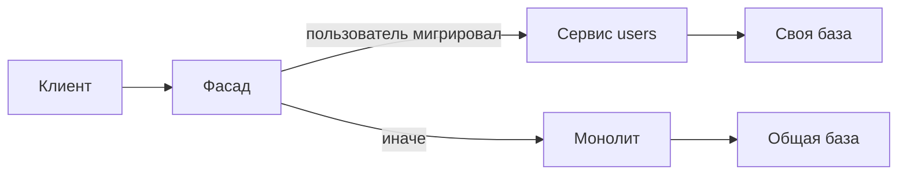

Выбор между монолитом и микросервисами — одно из самых обсуждаемых архитектурных решений. Важно понимать: это не «хорошо/плохо», а «что подходит под конкретные обстоятельства».

## Монолит

Монолит — одно приложение, в котором все функции (заказы, пользователи, платежи) живут в одном деплое. Его сильные стороны: простота разработки (один репозиторий, одна сборка), простота транзакций (одна база данных, ACID работает из коробки), простота отладки и тестирования (всё локально), низкие операционные расходы. Слабые стороны: любое изменение требует перезапуска всего приложения, масштабировать можно только целиком, команды вынуждены синхронизироваться, а код со временем превращается в «большой ком грязи».

## Микросервисы

Микросервис — маленький независимый сервис, отвечающий за одну бизнес-способность: `orders`, `users`, `payments`. Сервис владеет своими данными (своя база, свой словарь) и общается с другими через сеть по явному контракту. Плюсы: независимое развёртывание и масштабирование (нагруженный сервис реплицируется отдельно), границы контекстов видны в коде, команды могут работать независимо. Минусы серьёзны:

- **Распределённые транзакции** — ACID между сервисами не работает; нужны саги и компенсации.
- **Сетевые сбои** — любой вызов может упасть или зависнуть; нужны retry, таймауты, circuit breaker.
- **Сложность эксплуатации** — десятки сервисов, логирование, трассировка, обнаружение сервисов.
- **Консистентность данных** — события приходят с задержкой.

## Декомпозиция

Резать монолит на сервисы нужно по **границам бизнес-контекстов** (bounded context): сервис должен соответствовать одной доменной способности, а не одной технической функции. Например, «заказ» и «склад» — разные контексты: склад меняет остатки, заказ собирает корзину. Если сервис «создаёт пользователя» и «считает аналитику» — это два разных мира, и их лучше разнести.

## Контракты

Между сервисами — явный контракт: схема сообщения (например, Pydantic-модель или JSON Schema), формат версии, семантика ошибок. Контракт — это публичный API между командами:

```python
from pydantic import BaseModel

class OrderCreated(BaseModel):
    order_id: int
    user_id: int
    total: float
    version: int = 1
```

Если контракт меняется, это ломающее изменение, и оно требует версионирования (как в уроке про API).

## Стратегия перехода

Популярный паттерн — **strangler fig** (удушающий фикус): монолит постепенно обрастает сервисами, и новый функционал маршрутизируется на новые сервисы через фасад, пока монолит не «высыхает». Фасад по-прежнему выглядит для клиента единым API. Так риск снижается: каждый сервис вводится небольшими шагами.

```python
# Фасад: сначала монолит, потом прокси на сервис
def get_order(order_id):
    if order_id in MIGRATED_ORDERS:
        return orders_service_client.fetch(order_id)   # микросервис
    return monolith_db.fetch_order(order_id)          # старый монолит
```

Вывод: монолит — отличный старт почти для любого продукта; переходить на микросервисы стоит, когда боль начинается от масштаба и скорости (а не от «модности»). Для многих компаний «модульный монолит» — золотая середина: один деплой, но чёткие внутренние границы.

Постепенный переход по паттерну «удушающий фикус» выглядит так:



Фасад остаётся единой точкой входа, поэтому клиент не знает, что часть запросов уже ушла в новый сервис.

<!--TASK-->
### Задача 1
Дан список функций компании. Разбей их на кандидатов в микросервисы по границам бизнес-контекстов: «регистрация и вход пользователей», «корзина и оформление заказа», «обработка платежей», «отслеживание доставки», «отправка уведомлений», «аналитика продаж». Предложи 4–5 сервисов, явно указав, какие функции к какому сервису относятся, и объясни, почему «аналитика» не должна жить в сервисе заказов. Ответ оформи списком: для каждого сервиса — название и функции.

### Задача 2
Спроектируй контракт между сервисами «заказы» и «склад». Напиши Pydantic-модели: `ReserveRequest` (order_id, sku, quantity) и `ReserveResponse` (order_id, success: bool, reason: str | None). Сервис заказов вызывает склад, чтобы зарезервировать товары. Напиши код, который показывает, как заказ формирует запрос и печатает ответ склада. Используй `from pydantic import BaseModel`. Ожидаемый вывод: `Резерв заказа 101: успех=True, причина=None`.

### Задача 3
Реализуй фасад по паттерну «удушающий фикус». Функция `get_user(user_id)` должна возвращать пользователя: если `user_id` входит в множество `MIGRATED_USERS` (например, `{2, 5}`), вызывать `new_users_service(user_id)` — имитацию микросервиса (функция, возвращающая словарь `{"id": id, "name": "Новый сервис"}`), иначе — `monolith_get_user(user_id)` (возвращает `{"id": id, "name": "Монолит"}`). Программа печатает имена для пользователей 1, 2 и 5. Ожидаемый вывод: `Монолит`, `Новый сервис`, `Новый сервис` по строкам.

### Задача 4
Напиши функцию `call_with_retry(func, attempts=3, base_delay=0.1)`, которая вызывает `func()` и при исключении повторяет вызов с экспоненциальной задержкой (`base_delay * 2 ** attempt`), а после исчерпания попыток возвращает строку `"Сервис недоступен"`. Протестируй на функции, которая падает первые два раза, а на третий успех. Ожидаемый вывод: число попыток и `"Успех"` или `"Сервис недоступен"` в зависимости от исхода. Программа должна напечатать `Попыток: 3` и `Успех`.

### Задача 5
Реализуй мини circuit breaker. Класс `CircuitBreaker` имеет состояние `closed` (начальное), `open` (после 3 ошибок подряд) и `half_open` (после таймаута 0.2 c). Метод `call(func)` пытается вызвать `func`, при ошибке увеличивает счётчик, а при достижении 3 ошибок переходит в `open` и сразу возвращает `"Открыто"`, не вызывая `func`. Напиши демонстрацию: функция всегда падает; три вызова — `"Ошибка"`, затем четвертый — `"Открыто"`. Ожидаемый вывод: `Ошибка`, `Ошибка`, `Ошибка`, `Открыто` по строкам.
### Задача 6
Реализуй сагу оформления заказа с компенсациями. Сага проходит три шага: `reserve_stock(order_id)` печатает `Шаг 1: резерв товара`, `charge_payment(order_id)` — `Шаг 2: оплата`, `create_shipment(order_id)` — `Шаг 3: доставка`. Если шаг падает, выполняются компенсации уже пройденных шагов в обратном порядке: `release_stock(order_id)` печатает `Компенсация: резерв снят`, `refund(order_id)` — `Компенсация: деньги возвращены`. Смоделируй сбой оплаты (функция бросает `RuntimeError("банк отклонил платёж")`). Функция `run_saga(order_id)` возвращает `True` при успехе и `False` при откате. Ожидаемый вывод: оба шага до сбоя, строка `Компенсация: резерв снят`, строка `Сага отменена: банк отклонил платёж` и `False`. Объясни, почему компенсация — не то же самое, что откат транзакции.

### Задача 7
Межсервисный вызов обязан иметь таймаут, иначе зависший сосед утащит за собой весь сервис. Напиши функцию `call_with_timeout(func, timeout)`, которая запускает `func` в отдельном потоке через `concurrent.futures.ThreadPoolExecutor` и ждёт результат не дольше `timeout` секунд. При превышении верни строку `Таймаут: сервис не ответил за <timeout> с`, при успехе — результат функции, при исключении — `Ошибка: <текст>`. Проверь на трёх функциях: быстрой (возвращает `данные`), медленной (`time.sleep(0.5)`) и падающей (`RuntimeError("500")`). Вызови их с таймаутом 0.2 с и напечатай три результата. Ожидаемый вывод: `данные`, `Таймаут: сервис не ответил за 0.2 с`, `Ошибка: 500`.
<!--/TASK-->

<!--HINT-->
### Подсказка 1
Подумай, где данные и смысл образуют единый владелец. Регистрация и вход — один «идентичность» сервис. Корзина и оформление — один «заказы». Платежи — отдельный, доставка — отдельный, уведомления — отдельный, аналитика — отдельный (она читает факты, а не владеет ими).

### Подсказка 2
Поле `reason` обязано иметь значение по умолчанию `None`, чтобы `ReserveResponse(order_id=101, success=True)` работало без него. Формируй `ReserveRequest` из данных заказа, «вызывай» склад простой функцией, которая возвращает `ReserveResponse`.

### Подсказка 3
Напиши обе функции-источника и условие: `if user_id in MIGRATED_USERS: return new_users_service(user_id)`. Список `user_ids = [1, 2, 5]` и цикл с `print(get_user(uid)["name"])`.

### Подсказка 4
Используй `time.sleep(base_delay * 2 ** attempt)`. Счётчик попыток увеличивай в начале каждой итерации. Чтобы функция падала первые два раза, используй замыкание со счётчиком, которое бросает `RuntimeError`, пока счётчик < 2.

### Подсказка 5
Храни `failures`, `failure_limit=3`, `state`. В `call`: если `state == "open"`, верни `"Открыто"`. Иначе `try: func(); failures = 0; return "Ошибка"`? Нет — при успехе сбрось и верни `"Успех"`, при исключении увеличь `failures`; если `failures >= failure_limit`, поставь `state = "open"`; верни `"Ошибка"`. Для имитации всегда падающей функции используй `lambda: (_ for _ in ()).throw(RuntimeError("boom"))`.
### Подсказка 6
Опиши шаги как список пар `(действие, компенсация)` и иди по нему в цикле, складывая компенсации уже выполненных шагов в стек (например, в список `done`). При исключении пройди по `reversed(done)` и вызови каждую компенсацию, затем напечатай причину и верни `False`. Компенсация для последнего шага может быть `None` — такие записи пропускай.

### Подсказка 7
Создай `pool = ThreadPoolExecutor(max_workers=1)`, отправь задачу через `pool.submit(func)` и вызови `future.result(timeout=timeout)`. Превышение ждёт `concurrent.futures.TimeoutError` — импортируй его как `TimeoutError as FutureTimeout`, чтобы не спутать со встроенным. В `finally` вызови `pool.shutdown(wait=False)`, иначе выход из блока будет ждать медленную функцию до конца.
<!--/HINT-->

<!--SOLUTION-->
### Разбор 1
Пример разбиения:

- **Сервис идентичности**: регистрация, вход, профиль.
- **Сервис заказов**: корзина, оформление заказа.
- **Сервис платежей**: обработка транзакций, возвраты.
- **Сервис доставки**: отслеживание, статусы доставки.
- **Сервис уведомлений**: отправка писем и push.
- **Сервис аналитики**: сбор фактов и отчёты.

Почему аналитика не в сервисе заказов? Потому что у неё другой владелец и другой цикл жизни: она читает снимки событий, а не владеет заказами. Если аналитика живёт внутри заказов, любой релиз аналитики перезапускает критичный сервис продаж, а запросы к БД заказов со стороны тяжёлых отчётов деградируют продажи. Разные контексты — разные сервисы.

### Разбор 2
Решение:

```python
from pydantic import BaseModel

class ReserveRequest(BaseModel):
    order_id: int
    sku: str
    quantity: int

class ReserveResponse(BaseModel):
    order_id: int
    success: bool
    reason: str | None = None

def warehouse_reserve(req: ReserveRequest) -> ReserveResponse:
    if req.quantity > 10:
        return ReserveResponse(order_id=req.order_id, success=False, reason="недостаточно на складе")
    return ReserveResponse(order_id=req.order_id, success=True)

req = ReserveRequest(order_id=101, sku="SKU-1", quantity=3)
resp = warehouse_reserve(req)
print(f"Резерв заказа {resp.order_id}: успех={resp.success}, причина={resp.reason}")
```

Вывод: `Резерв заказа 101: успех=True, причина=None`. Что здесь происходит? Модели — явный контракт между сервисами: поля, типы, обязательность зафиксированы. `reason` необязателен, поэтому успешный ответ не требует его указывать. При изменении контракта меняется только схема и обе стороны обновляются согласованно.

### Разбор 3
Решение:

```python
MIGRATED_USERS = {2, 5}

def new_users_service(user_id):
    return {"id": user_id, "name": "Новый сервис"}

def monolith_get_user(user_id):
    return {"id": user_id, "name": "Монолит"}

def get_user(user_id):
    if user_id in MIGRATED_USERS:
        return new_users_service(user_id)
    return monolith_get_user(user_id)

for uid in [1, 2, 5]:
    print(get_user(uid)["name"])
```

Вывод:

```
Монолит
Новый сервис
Новый сервис
```

Что здесь происходит? Фасад `get_user` выглядит для клиента единой точкой входа, но внутри маршрутизирует запросы: часть пользователей уже обслуживается новым сервисом, часть — старым монолитом. Так миграция идёт постепенно, без «большого взрыва».

### Разбор 4
Решение:

```python
import time

def call_with_retry(func, attempts=3, base_delay=0.1):
    for attempt in range(attempts):
        try:
            return func()
        except Exception:
            if attempt == attempts - 1:
                return "Сервис недоступен"
            time.sleep(base_delay * 2 ** attempt)
    return "Сервис недоступен"

state = {"calls": 0}

def flaky():
    state["calls"] += 1
    if state["calls"] < 3:
        raise RuntimeError("boom")
    return "Успех"

print(f"Попыток: {state['calls'] + 1}")  # будет 3
print(call_with_retry(flaky))
```

Вывод:

```
Попыток: 3
Успех
```

Что здесь происходит? Функция падает первые два вызова, а третий успех. `call_with_retry` повторяет вызов с растущей задержкой: 0.1 c, затем 0.2 c. Обрати внимание: счётчик в `print` показывает 1 до вызова, поэтому строка «Попыток: 3» имеет смысл «вызовов будет 3». На практике retry с backoff — стандартная защита от временных сбоев сети, но он не спасает, если сервис лежит долго, — для этого нужен circuit breaker.

### Разбор 5
Решение:

```python
import time

class CircuitBreaker:
    def __init__(self, failure_limit=3, timeout=0.2):
        self.failure_limit = failure_limit
        self.timeout = timeout
        self.failures = 0
        self.state = "closed"
        self.opened_at = None

    def call(self, func):
        if self.state == "open":
            if time.time() - self.opened_at >= self.timeout:
                self.state = "half_open"
            else:
                return "Открыто"
        try:
            result = func()
            self.failures = 0
            self.state = "closed"
            return result
        except Exception:
            self.failures += 1
            if self.failures >= self.failure_limit:
                self.state = "open"
                self.opened_at = time.time()
            return "Ошибка"

breaker = CircuitBreaker()
boom = lambda: (_ for _ in ()).throw(RuntimeError("boom"))

for _ in range(4):
    print(breaker.call(boom))
```

Вывод:

```
Ошибка
Ошибка
Ошибка
Открыто
```

Что здесь происходит? После трёх ошибок подряд breaker открывается и четвёртый вызов сразу возвращает `"Открыто"`, не трогая падающую функцию. После таймаута он перейдёт в `half_open` и попробует ещё раз. Circuit breaker защищает систему от каскадных отказов: неисправный сервис не заставляет всех клиентов ждать таймауты.
### Разбор 6
Решение:

```python
def reserve_stock(order_id):
    print("Шаг 1: резерв товара")

def release_stock(order_id):
    print("Компенсация: резерв снят")

def charge_payment(order_id):
    print("Шаг 2: оплата")
    raise RuntimeError("банк отклонил платёж")

def refund(order_id):
    print("Компенсация: деньги возвращены")

def create_shipment(order_id):
    print("Шаг 3: доставка")

STEPS = [
    (reserve_stock, release_stock),
    (charge_payment, refund),
    (create_shipment, None),
]

def run_saga(order_id):
    done = []
    for action, compensation in STEPS:
        try:
            action(order_id)
            done.append(compensation)
        except Exception as exc:
            for comp in reversed([c for c in done if c is not None]):
                comp(order_id)
            print(f"Сага отменена: {exc}")
            return False
    return True

print(run_saga(101))
```

Вывод:

```
Шаг 1: резерв товара
Шаг 2: оплата
Компенсация: резерв снят
Сага отменена: банк отклонил платёж
False
```

Что здесь происходит? Сага — это последовательность локальных транзакций, каждая из которых уже зафиксирована в своей базе, поэтому «откатить всё» нельзя: деньги в платёжном сервисе и резерв на складе живут в разных хранилищах, и общей транзакции между ними не существует. Вместо отката выполняется компенсация — новое действие с противоположным эффектом: резерв снимается отдельной операцией, которая тоже может упасть. Отсюда два следствия, важных на интервью. Первое: компенсации должны быть идемпотентными, потому что сагу могут перезапустить после сбоя координатора. Второе: система проходит через промежуточные состояния (заказ создан, но не оплачен), и это нормально — их надо явно моделировать статусами, а не прятать. Если компенсация не удалась, нужен ручной разбор или повтор с backoff: сага даёт согласованность в конечном счёте, а не мгновенную атомарность.

### Разбор 7
Решение:

```python
import time
from concurrent.futures import ThreadPoolExecutor, TimeoutError as FutureTimeout

def call_with_timeout(func, timeout):
    pool = ThreadPoolExecutor(max_workers=1)
    future = pool.submit(func)
    try:
        return future.result(timeout=timeout)
    except FutureTimeout:
        return f"Таймаут: сервис не ответил за {timeout} с"
    except Exception as exc:
        return f"Ошибка: {exc}"
    finally:
        pool.shutdown(wait=False)

def fast():
    return "данные"

def slow():
    time.sleep(0.5)
    return "поздно"

def broken():
    raise RuntimeError("500")

print(call_with_timeout(fast, 0.2))
print(call_with_timeout(slow, 0.2))
print(call_with_timeout(broken, 0.2))
```

Вывод:

```
данные
Таймаут: сервис не ответил за 0.2 с
Ошибка: 500
```

Что здесь происходит? `future.result(timeout=...)` ждёт не дольше указанного времени и бросает `TimeoutError` из `concurrent.futures`, не дожидаясь функции. Клиент получает быстрый и предсказуемый отказ вместо зависания, а вызывающий код освобождает поток обработки запроса. Таймаут — это не «оптимизация», а обязательное условие живучести: если сервис-сосед завис без таймаута, ваши потоки кончатся раньше, чем вы заметите проблему, и отказ распространится вверх по цепочке вызовов. Два ограничения примера стоит знать. Первое: `shutdown(wait=False)` не убивает уже запущенный поток — Python не умеет прерывать поток снаружи, поэтому медленная функция доработает в фоне, и для настоящей отмены нужен клиент с поддержкой отмены (asyncio, httpx) или deadline в протоколе. Второе: таймаут на каждом шаге надо уменьшать остатком общего бюджета запроса, иначе три вызова по секунде дадут три секунды вместо одной.
<!--/SOLUTION-->

<!--QUIZ-->
Что является главным плюсом монолита?
- Простота транзакций и разработки
- Полная независимость команд
- Мгновенное масштабирование одного сервиса
- Отсутствие базы данных
* Правильный ответ: Простота транзакций и разработки
В монолите одна база и ACID-транзакции работают внутри процесса.

Почему распределённые транзакции — боль микросервисов?
- Потому что сеть всегда быстрая
- Потому что ACID между сервисами не работает, нужны саги и компенсации
- Потому что нет баз данных
- Потому что сервисы не умеют отправлять HTTP
* Правильный ответ: Потому что ACID между сервисами не работает, нужны саги и компенсации
Данные раскиданы по разным базам, поэтому атомарность «всё или ничего» недостижима без координации.

По каким границам нужно резать монолит на сервисы?
- По техническим функциям (модели, контроллеры)
- По границам бизнес-контекстов
- По алфавиту
- По количеству строк кода
* Правильный ответ: По границам бизнес-контекстов
Сервис соответствует одной доменной способности, а не техническому слою.

Что делает паттерн «удушающий фикус»?
- Резко останавливает все сервисы
- Постепенно заменяет куски монолита микросервисами через фасад
- Удваивает нагрузку
- Отключает мониторинг
* Правильный ответ: Постепенно заменяет куски монолита микросервисами через фасад
Фасад скрывает переход, клиент видит единый API.

Что такое контракт между сервисами?
- Договор между разработчиками
- Схема сообщения (например, Pydantic-модель) и правила обмена
- Логин и пароль
- URL монолита
* Правильный ответ: Схема сообщения (например, Pydantic-модель) и правила обмена
Контракт — публичный API, и его изменения требуют версионирования.

Когда стоит выбирать микросервисы?
- Когда продукт маленький и один разработчик
- Когда боль вызвана масштабом и независимостью команд, а не модой
- Никогда
- Только для игр
* Правильный ответ: Когда боль вызвана масштабом и независимостью команд, а не модой
Издержки распределённых систем должны окупаться.

Что такое сага (saga)?
- Последовательность локальных транзакций с компенсациями при сбое
- Единая ACID-транзакция между сервисами
- Резервная копия базы данных
- Очередь сообщений
* Правильный ответ: Последовательность локальных транзакций с компенсациями при сбое
Сага координирует шаги между сервисами, а неудача откатывается компенсационными действиями.

Что такое service discovery?
- Механизм, который позволяет сервисам находить адреса друг друга без ручной настройки
- Балансировщик нагрузки
- Система мониторинга
- Сервис логирования
* Правильный ответ: Механизм, который позволяет сервисам находить адреса друг друга без ручной настройки
Адреса меняются при масштабировании, поэтому реестр сервисов обновляется автоматически.
Что такое bounded context (ограниченный контекст)?
- Граница, внутри которой термины и модель имеют одно значение
- Максимальный размер сервиса в строках кода
- Набор серверов в одном дата-центре
- Список разрешённых библиотек
* Правильный ответ: Граница, внутри которой термины и модель имеют одно значение
В разных контекстах «заказ» может значить разное, поэтому режут по смыслу, а не по слоям.

Что такое модульный монолит?
- Один деплой с чёткими внутренними границами модулей
- Несколько независимых деплоев без общих данных
- Монолит без тестов
- Набор микросервисов в одном репозитории
* Правильный ответ: Один деплой с чёткими внутренними границами модулей
Он сохраняет простоту эксплуатации, но дисциплинирует границы и готовит почву для распила.

Что такое компенсация в саге?
- Действие с противоположным эффектом, отменяющее результат уже выполненного шага
- Откат транзакции базы данных
- Повторная попытка выполнить шаг
- Резервная копия базы
* Правильный ответ: Действие с противоположным эффектом, отменяющее результат уже выполненного шага
Шаг уже зафиксирован, поэтому его нельзя «откатить» — можно только скомпенсировать.

Чем опасен «распределённый монолит»?
- Сервисы деплоятся отдельно, но связаны синхронными вызовами и общими релизами
- Он всегда падает при первом релизе
- В нём нельзя использовать базы данных
- Он не поддерживает HTTP
* Правильный ответ: Сервисы деплоятся отдельно, но связаны синхронными вызовами и общими релизами
Формально это микросервисы, но независимость команд и деплоя потеряна — остались только издержки.
<!--/QUIZ-->
