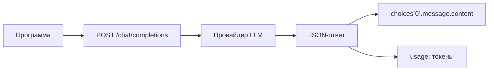

Современные языковые модели — это не только чат-боты в браузере. Для разработчика главное — API: интерфейс, через который твоя программа отправляет текст модели и получает ответ. Этот урок научит тебя работать с LLM API на чистом Python с библиотекой `requests`.

## Что такое LLM API

LLM (Large Language Model) — большая языковая модель, обученная на огромных объёмах текста. Такие модели живут на серверах компании-провайдера, а ты обращаешься к ним по HTTP. Это и есть API (Application Programming Interface) — программный интерфейс.

Самый популярный формат — **chat completions**. Его поддерживают OpenAI, а также многие другие провайдеры (DeepSeek, Qwen, локальные серверы вроде vLLM или Ollama), потому что он стал де-факто стандартом. Освоив один API, ты почти без изменений переключишься на другой.

Запрос — это `POST`-запрос на эндпоинт `/v1/chat/completions`. В теле — JSON с полями:

- `model` — имя модели (например, `gpt-4o-mini`);
- `messages` — список сообщений диалога;
- `temperature`, `max_tokens`, `top_p` — параметры генерации.

Ключ API передаётся в заголовке `Authorization: Bearer <ключ>`. Никогда не вставляй ключ прямо в код — храни его в переменной окружения.

## Первый запрос

Вот минимальная программа, которая спрашивает модель о словарях Python:

```python
import os
import requests

API_KEY = os.environ["OPENAI_API_KEY"]  # задай переменную окружения заранее

resp = requests.post(
    "https://api.openai.com/v1/chat/completions",
    headers={"Authorization": f"Bearer {API_KEY}"},
    json={
        "model": "gpt-4o-mini",
        "messages": [
            {"role": "system", "content": "Ты — опытный Python-наставник."},
            {"role": "user", "content": "Что такое словарь в Python?"},
        ],
        "temperature": 0.7,
        "max_tokens": 300,
    },
    timeout=60,
)
resp.raise_for_status()

data = resp.json()
answer = data["choices"][0]["message"]["content"]
print(answer)
print("Токенов потрачено:", data["usage"]["total_tokens"])
```

Разберём по шагам:

- `requests.post` отправляет запрос; `json=` превращает словарь в тело запроса;
- заголовок `Authorization` несёт API-ключ;
- `messages` — список ролевых сообщений;
- `timeout=60` защищает от бесконечного ожидания;
- `resp.raise_for_status()` бросит исключение при HTTP-ошибке;
- ответ лежит в `data["choices"][0]["message"]["content"]`, а статистика расхода — в `data["usage"]`.

## Роли сообщений

Каждое сообщение имеет роль:

- `system` — задаёт поведение модели (тон, правила, рамки);
- `user` — то, что пишет пользователь;
- `assistant` — предыдущие ответы модели (нужны для истории диалога).

Хороший системный промпт часто важнее самого вопроса. Например: «Ты — переводчик с русского на английский. Отвечай только переводом, без пояснений». Мы подробно займёмся промптами в следующем уроке.

## Параметры генерации

- `temperature` (0–2) — уровень «креативности». `0` — почти детерминированные ответы, высокие значения — больше разнообразия.
- `max_tokens` — максимум токенов в ответе (учитывай, что это не символы!).
- `top_p` — ядерная выборка, альтернативный способ контроля случайности.
- `presence_penalty` / `frequency_penalty` — штрафы за повторения.

Считай токены: они тарифицируются, поэтому экономь — не проси длинные ответы без необходимости.

## Ошибки и надёжность

Типичные коды состояния:

- `401 Unauthorized` — неверный или отсутствующий ключ;
- `429 Too Many Requests` — превышен лимит запросов (обычно стоит подождать и повторить);
- `500`/`503` — временная проблема на стороне провайдера;
- `400 Bad Request` — неверное тело запроса (например, перепутано имя модели).

В сети случаются сбои, поэтому профессиональный код всегда обрабатывает ошибки: перехватывает `requests.exceptions.Timeout`, повторяет запрос при `429` с задержкой (экспоненциальный бэкофф) и логирует проблемы.

## Стриминг

Для длинных ответов используют потоковую передачу: `stream=True` в `requests` позволяет получать и печатать ответ по кусочкам, как это делают чат-боты. Разбор SSE-событий мы опустим, но знай: такой режим существует и заметно улучшает ощущение скорости.

Схема одного запроса к LLM API:



## Итог

Ты узнал: что такое LLM API и формат chat completions; как отправлять запросы через `requests`; какие бывают роли сообщений; как управлять генерацией через `temperature` и `max_tokens`; как обрабатывать ошибки. Теперь закрепим практикой.

<!--TASK-->
### Задача 1
Напиши функцию `send_chat(messages)`, которая принимает список сообщений, отправляет его в эндпоинт chat completions модели `gpt-4o-mini` и возвращает текст ответа ассистента. Используй параметры `temperature=0.5` и `max_tokens=200`. Вызови функцию с двумя сообщениями: системное «Отвечай кратко, максимум два предложения» и пользовательское «Что такое GIL в Python?». Распечатай ответ. Ожидаемый результат: на экране появляется короткий осмысленный ответ о GIL.

### Задача 2
Напиши программу-переводчик. Системное сообщение: «Ты — переводчик с русского на английский. Отвечай только переводом, одно предложение, без пояснений». Пользователь задаёт три фразы по очереди: «Мне нравится изучать Python», «Сегодня хорошая погода», «Где ближайшая станция метро?». Каждый перевод должен печататься с новой строки. Ожидаемый результат: три строки на английском языке, без дополнительных комментариев модели.

### Задача 3
Проведи эксперимент с температурой. Один и тот же вопрос «Придумай короткую идею стартапа» отправь четыре раза: дважды с `temperature=0` и дважды с `temperature=1.2`. Каждый раз печатай ответ и количество потраченных токенов (`total_tokens`). После запуска сравни ответы: при нулевой температуре они должны быть почти одинаковыми, при высокой — заметно различаться.

### Задача 4
Напиши устойчивую функцию `ask_with_retry(messages, max_attempts=3)`, которая отправляет запрос с `timeout=30` и повторяет попытки при ошибках. Если сервер вернул статус `429`, подожди `2 ** attempt` секунд (attempt — номер попытки) и попробуй снова. При любом другом статусе, кроме `200`, напечатай код ошибки. Если все попытки исчерпаны, верни `None`. Проверь функцию на рабочем ключе — она должна вернуть ответ модели.

### Задача 5
Создай класс `Conversation` для поддержания диалога. В `__init__` положи в `self.messages` системное сообщение «Ты — полезный ассистент, отвечай кратко». Метод `say(text)` добавляет сообщение пользователя, отправляет весь диалог, добавляет ответ ассистента в `self.messages` и возвращает его текст. Разверни диалог минимум из двух реплик пользователя, например: «Объясни, что такое цикл for» и затем «А чем for отличается от while?». Ожидаемый результат: два осмысленных ответа, причём во втором модель помнит первую часть диалога.

### Задача 6
Напиши функцию `chat_with_usage(messages)`, которая отправляет запрос к `gpt-4o-mini` с `temperature=0.3` и возвращает кортеж из текста ответа и словаря `usage` из поля `data["usage"]`. Запусти функцию на трёх запросах разной длины: «Что такое PEP 8?», «Перечисли три отличия списка от кортежа и кратко объясни каждое» и «Объясни в пяти предложениях, как работает сборщик мусора в Python». Для каждого запуска напечатай `prompt_tokens`, `completion_tokens` и `total_tokens`. В конце просуммируй токены и оцени стоимость при условных ценах 0.15 $ за миллион входных и 0.60 $ за миллион выходных токенов. Ожидаемый результат: три строки статистики и итоговая стоимость, выведенная с шестью знаками после запятой.

### Задача 7
Напиши функцию `safe_chat(messages, max_tokens=300)`, которая проверяет входные данные до отправки запроса. Требования: `messages` — непустой список; роль каждого сообщения входит в набор `system`, `user`, `assistant`; `content` — непустая строка. При нарушении функция выбрасывает `ValueError` с понятным текстом и не делает сетевой запрос. Если сообщений больше десяти, оставь системное (при его наличии) и последние девять. При HTTP-статусе `400` напечатай `resp.text` и верни `None`. Проверь функцию на корректном диалоге, на пустом списке и на сообщении с ролью `tool`. Ожидаемый результат: осмысленный ответ в первом случае и два `ValueError` без лишних запросов — в остальных.

<!--/TASK-->

<!--HINT-->
### Подсказка 1
Функция должна делать `requests.post` на `https://api.openai.com/v1/chat/completions` с заголовком `Authorization: Bearer <ключ>` и телом `{"model": ..., "messages": messages, "temperature": 0.5, "max_tokens": 200}`. Ответ — в `data["choices"][0]["message"]["content"]`.

### Подсказка 2
Переиспользуй функцию `send_chat` из задачи 1. Системное сообщение передавай первым элементом списка, а пользовательскую фразу — вторым. Запусти цикл по трём фразам и печатай результат каждого вызова.

### Подсказка 3
Параметры температуры можно перебирать циклом: `for temp in (0, 0, 1.2, 1.2):`. Тело запроса каждый раз собирай заново с текущим `temp`. Не забудь печатать `data["usage"]["total_tokens"]` из ответа.

### Подсказка 4
Оборачивай `requests.post` в блок `try/except requests.exceptions.Timeout`. Проверяй `resp.status_code`: если `429` — `time.sleep(2 ** attempt)` и `continue`; если `200` — возвращай `resp.json()["choices"][0]["message"]["content"]`; иначе печатай код и пробуй дальше.

### Подсказка 5
В `say()` сначала сделай `self.messages.append({"role": "user", "content": text})`, затем отправь весь список, после чего добавь `{"role": "assistant", "content": answer}` и верни `answer`. Хранение истории — ключ к связному диалогу.

### Подсказка 6
Верни из функции два значения: `content` и `data["usage"]`. Суммы считай в цикле, складывая `prompt_tokens` и `completion_tokens` отдельно. Стоимость — это `prompt_tokens / 1_000_000 * 0.15 + completion_tokens / 1_000_000 * 0.60`; печатай через `f"{cost:.6f}"`.

### Подсказка 7
Сначала прогони валидацию по списку сообщений и только потом собирай тело запроса. Для проверки истории используй срез: системное сообщение плюс `messages[-9:]`. `ValueError` удобно бросать с текстом, где указан индекс проблемного сообщения. Статус `400` проверяй до `raise_for_status()`.

<!--/HINT-->

<!--SOLUTION-->
### Разбор 1
```python
import os
import requests

def send_chat(messages):
    resp = requests.post(
        "https://api.openai.com/v1/chat/completions",
        headers={"Authorization": f"Bearer {os.environ['OPENAI_API_KEY']}"},
        json={
            "model": "gpt-4o-mini",
            "messages": messages,
            "temperature": 0.5,
            "max_tokens": 200,
        },
        timeout=60,
    )
    resp.raise_for_status()
    return resp.json()["choices"][0]["message"]["content"]

print(send_chat([
    {"role": "system", "content": "Отвечай кратко, максимум два предложения."},
    {"role": "user", "content": "Что такое GIL в Python?"},
]))
```

Здесь главное — аккуратная сборка запроса. `messages` передаётся как есть, а роль каждого сообщения задана в словаре. После запроса мы сразу проверяем статус через `raise_for_status()`: если что-то не так, программа упадёт с понятной ошибкой. Ответ извлекается из цепочки `choices[0].message.content` — именно там модель кладёт сгенерированный текст. Обрати внимание на `.env`-переменную: ключ читается из окружения, а не зашит в код.

### Разбор 2
```python
import os
import requests

def translate(phrase):
    resp = requests.post(
        "https://api.openai.com/v1/chat/completions",
        headers={"Authorization": f"Bearer {os.environ['OPENAI_API_KEY']}"},
        json={
            "model": "gpt-4o-mini",
            "messages": [
                {"role": "system",
                 "content": "Ты — переводчик с русского на английский. "
                            "Отвечай только переводом, одно предложение, без пояснений."},
                {"role": "user", "content": phrase},
            ],
            "temperature": 0.2,
        },
        timeout=60,
    )
    resp.raise_for_status()
    return resp.json()["choices"][0]["message"]["content"]

phrases = [
    "Мне нравится изучать Python",
    "Сегодня хорошая погода",
    "Где ближайшая станция метро?",
]
for p in phrases:
    print(translate(p))
```

Системное сообщение — главный инструмент контроля: мы явно запретили пояснения и потребовали ровно один перевод. Благодаря этому ответы будут чистыми строками без «Конечно! Вот перевод: ...». Мы также снизили температуру до `0.2`, чтобы модель не фантазировала. Такой приём — «жёсткая спецификация формата в системном промпте» — ты будешь использовать постоянно.

### Разбор 3
```python
import os
import requests

def ask(temperature):
    resp = requests.post(
        "https://api.openai.com/v1/chat/completions",
        headers={"Authorization": f"Bearer {os.environ['OPENAI_API_KEY']}"},
        json={
            "model": "gpt-4o-mini",
            "messages": [
                {"role": "user", "content": "Придумай короткую идею стартапа."}
            ],
            "temperature": temperature,
            "max_tokens": 100,
        },
        timeout=60,
    )
    resp.raise_for_status()
    data = resp.json()
    return data["choices"][0]["message"]["content"], data["usage"]["total_tokens"]

for temp in (0, 0, 1.2, 1.2):
    text, tokens = ask(temp)
    print(f"temperature={temp} | токенов={tokens}")
    print(text)
    print("-" * 40)
```

При `temperature=0` модель практически всегда выбирает наиболее вероятный следующий токен — поэтому два запуска дадут почти одинаковый текст. При `temperature=1.2` распределение вероятностей «сглаживается», и модель чаще берёт менее вероятные продолжения — ответы разойдутся. Это не баг, а фича: нулевая температура нужна для извлечения фактов, высокая — для генерации идей. Расход токенов может немного отличаться из-за разной длины ответов.

### Разбор 4
```python
import os
import time
import requests

def ask_with_retry(messages, max_attempts=3):
    for attempt in range(max_attempts):
        try:
            resp = requests.post(
                "https://api.openai.com/v1/chat/completions",
                headers={"Authorization": f"Bearer {os.environ['OPENAI_API_KEY']}"},
                json={"model": "gpt-4o-mini", "messages": messages},
                timeout=30,
            )
            if resp.status_code == 429:
                wait = 2 ** attempt
                print(f"429: жду {wait} с")
                time.sleep(wait)
                continue
            resp.raise_for_status()
            return resp.json()["choices"][0]["message"]["content"]
        except requests.exceptions.Timeout:
            print(f"Таймаут, попытка {attempt + 1}")
    return None

print(ask_with_retry([
    {"role": "user", "content": "Скажи \"привет\"."}
]))
```

Ключевой момент — **экспоненциальный бэкофф**: после первого `429` ждём 1 секунду, после второго — 2, после третьего — 4. Это стандартная практика: сервер чаще всего сам подскажет, когда можно повторить (заголовок `Retry-After`). Таймаут защищает от зависания, а `return None` после неудач позволяет вызывающему коду решить, что делать дальше. Такой каркас — база любого продакшн-интеграции с LLM API.

### Разбор 5
```python
import os
import requests

class Conversation:
    def __init__(self):
        self.messages = [
            {"role": "system", "content": "Ты — полезный ассистент, отвечай кратко."}
        ]

    def say(self, text):
        self.messages.append({"role": "user", "content": text})
        resp = requests.post(
            "https://api.openai.com/v1/chat/completions",
            headers={"Authorization": f"Bearer {os.environ['OPENAI_API_KEY']}"},
            json={
                "model": "gpt-4o-mini",
                "messages": self.messages,
                "temperature": 0.3,
            },
            timeout=60,
        )
        resp.raise_for_status()
        answer = resp.json()["choices"][0]["message"]["content"]
        self.messages.append({"role": "assistant", "content": answer})
        return answer

conv = Conversation()
print(conv.say("Объясни, что такое цикл for"))
print(conv.say("А чем for отличается от while?"))
```

Модель не помнит прошлых запросов — контекст даётся каждый раз заново. Поэтому мы храним всю историю в `self.messages` и отправляем её целиком. Второй вопрос «А чем for отличается от while?» понятен модели именно потому, что в истории есть первое сообщение и ответ ассистента. Внимание: с ростом диалога растёт и число токенов — в продакшне историю усекают или пересказывают, чтобы не переплачивать.

### Разбор 6
```python
import os
import requests

INPUT_PRICE = 0.15 / 1_000_000   # условная цена за входной токен
OUTPUT_PRICE = 0.60 / 1_000_000  # условная цена за выходной токен

def chat_with_usage(messages):
    resp = requests.post(
        "https://api.openai.com/v1/chat/completions",
        headers={"Authorization": f"Bearer {os.environ['OPENAI_API_KEY']}"},
        json={
            "model": "gpt-4o-mini",
            "messages": messages,
            "temperature": 0.3,
        },
        timeout=60,
    )
    resp.raise_for_status()
    data = resp.json()
    return data["choices"][0]["message"]["content"], data["usage"]

prompts = [
    "Что такое PEP 8?",
    "Перечисли три отличия списка от кортежа и кратко объясни каждое.",
    "Объясни в пяти предложениях, как работает сборщик мусора в Python.",
]

total_in = total_out = 0
for text in prompts:
    answer, usage = chat_with_usage([{"role": "user", "content": text}])
    print(f"prompt={usage['prompt_tokens']} "
          f"completion={usage['completion_tokens']} "
          f"total={usage['total_tokens']}")
    print(answer[:80], "...")
    total_in += usage["prompt_tokens"]
    total_out += usage["completion_tokens"]

cost = total_in * INPUT_PRICE + total_out * OUTPUT_PRICE
print(f"Итого токенов: {total_in + total_out}, стоимость: {cost:.6f} $")
```

`usage` — это единственный честный источник данных о расходе: провайдер считает токены по своей токенизации, и оценка «на глаз» по символам почти всегда врёт. Обрати внимание, что входные и выходные токены тарифицируются по-разному, поэтому мы суммируем их отдельно, а не берём `total_tokens` для обеих ставок. Три запроса разной длины показывают главное: `prompt_tokens` растёт вместе с формулировкой и историей диалога, а `completion_tokens` — вместе с длиной ответа. Такой замер полезен перед продакшном: умножив средний расход на число запросов, ты оценишь бюджет. Не забудь, что цены в задаче условные — актуальные ставки смотри в тарифах провайдера.

### Разбор 7
```python
import os
import requests

ALLOWED_ROLES = {"system", "user", "assistant"}

def safe_chat(messages, max_tokens=300):
    if not messages:
        raise ValueError("messages не может быть пустым")

    for index, message in enumerate(messages):
        role = message.get("role")
        content = message.get("content")
        if role not in ALLOWED_ROLES:
            raise ValueError(f"Сообщение {index}: недопустимая роль {role!r}")
        if not isinstance(content, str) or not content.strip():
            raise ValueError(f"Сообщение {index}: пустой content")

    if len(messages) > 10:
        system = [m for m in messages if m["role"] == "system"][:1]
        messages = system + messages[-9:]

    resp = requests.post(
        "https://api.openai.com/v1/chat/completions",
        headers={"Authorization": f"Bearer {os.environ['OPENAI_API_KEY']}"},
        json={
            "model": "gpt-4o-mini",
            "messages": messages,
            "max_tokens": max_tokens,
            "temperature": 0.3,
        },
        timeout=60,
    )
    if resp.status_code == 400:
        print("Ошибка запроса:", resp.text)
        return None
    resp.raise_for_status()
    return resp.json()["choices"][0]["message"]["content"]

print(safe_chat([{"role": "user", "content": "Что такое виртуальное окружение?"}]))

for bad in ([], [{"role": "tool", "content": "x"}]):
    try:
        safe_chat(bad)
    except ValueError as error:
        print("ValueError:", error)
```

Валидация до сети — это не бюрократия, а экономия: каждый отклонённый запрос не тратит токены и не занимает квоту. Набор ролей ограничен намеренно: роль `tool` допустима только вместе с `tool_call_id`, и без него API вернёт `400`, поэтому такой диалог лучше отсечь самим. Срез истории решает другую проблему — контекстное окно и стоимость: длинный диалог дорожает с каждым ходом, а системное сообщение при усечении терять нельзя, иначе модель забудет правила. Отдельная ветка для `400` важна потому, что это ошибка данных, а не сбой сети: повторять её бессмысленно, нужно показать тело ответа и исправить запрос.

<!--/SOLUTION-->

<!--QUIZ-->
Какой метод HTTP используется для отправки запроса к эндпоинту chat completions?
- GET
- POST
- PUT
* Правильный ответ: POST
Новые сообщения отправляются методом POST, так как создают генерацию на стороне сервера.

Где передаётся API-ключ?
- В теле JSON под полем key
- В заголовке Authorization
- В URL адресе
* Правильный ответ: В заголовке Authorization
Ключ передаётся в заголовке Authorization: Bearer <ключ>.

Что управляет «креативностью» ответов модели?
- max_tokens
- temperature
- model
* Правильный ответ: temperature
Чем выше temperature, тем разнообразнее и «случайнее» выбор токенов.

Какая роль сообщения задаёт поведение модели?
- user
- system
- assistant
* Правильный ответ: system
Системное сообщение описывает правила, тон и рамки ответов модели.

Что означает HTTP-статус 429?
- Неверный ключ
- Превышение лимита запросов
- Ошибка в JSON
* Правильный ответ: Превышение лимита запросов
429 Too Many Requests означает, что нужно подождать и повторить запрос.

Где в ответе лежит текст сгенерированного сообщения?
- data["message"]["content"]
- data["choices"][0]["message"]["content"]
- data["text"]
* Правильный ответ: data["choices"][0]["message"]["content"]
Ответ — список choices; в первом элементе лежит message, у которого есть поле content.

Что произойдёт с запросом, если не указать параметр timeout в requests.post()?
- Запрос будет выполняться только ночью
- Запрос может «висеть» бесконечно, ожидая ответ сервера
- Запрос станет быстрее в два раза
* Правильный ответ: Запрос может «висеть» бесконечно, ожидая ответ сервера
Без таймаута программа может зависнуть навсегда, если сервер не ответит.

Зачем API-ключ хранят в переменной окружения, а не прямо в коде?
- Так ключ работает быстрее
- Чтобы не зашивать секрет в код: код может попасть в git или на публичные ресурсы
- Переменная окружения сама генерирует ключ
* Правильный ответ: Чтобы не зашивать секрет в код: код может попасть в git или на публичные ресурсы
Секреты нельзя хранить в коде — их читают из окружения или секрет-хранилища.

Что означает HTTP-статус 401?
- Неверный или отсутствующий API-ключ
- Превышение лимита запросов
- Слишком длинный промпт
* Правильный ответ: Неверный или отсутствующий API-ключ
401 Unauthorized сообщает, что ключ не принят: его нужно проверить или обновить.

Какой префикс обычно ставится перед ключом в заголовке Authorization?
- Bearer
- Basic
- Token
* Правильный ответ: Bearer
Схема Bearer означает «предъявитель токена»; после этого слова идёт сам ключ.

Что включает режим stream=True?
- Потоковую передачу ответа частями по мере генерации
- Отключение проверки статуса
- Автоматический повтор запроса
* Правильный ответ: Потоковую передачу ответа частями по мере генерации
Сервер присылает события по мере появления токенов, поэтому ответ печатается постепенно.

Что показывает поле completion_tokens в объекте usage?
- Число токенов, потраченных на сгенерированный ответ
- Число символов в запросе
- Количество сообщений в диалоге
* Правильный ответ: Число токенов, потраченных на сгенерированный ответ
usage разделяет входные и выходные токены, которые тарифицируются по-разному.

<!--/QUIZ-->
