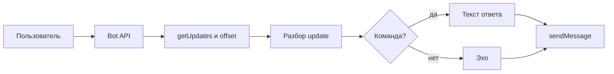

Telegram-бот — это программа, которая общается с пользователями через серверы Telegram. Тебе не нужен ни свой сервер, ни публичный IP-адрес: Telegram сам доставляет события, а бот лишь отвечает на запросы по HTTP. В этом уроке мы напишем работающего бота, используя официальный Bot API и библиотеку `requests`, которая тебе уже знакома.

## Получаем токен

Управляет ботом токен — секретная строка вида `123456:ABC-DEF...`. Чтобы его получить, напиши в Telegram @BotFather команду `/newbot`, придумай имя и username — и получишь токен. Храни токен в переменной окружения или в отдельном файле, но никогда не публикуй его в коде.

## Первая проверка: getMe

Любой метод Bot API вызывается по адресу `https://api.telegram.org/bot<TOKEN>/<method>`. Самый простой метод — `getMe`: он рассказывает о самом боте:

```python
import requests

TOKEN = "ЗДЕСЬ_ТВОЙ_ТОКЕН"
url = f"https://api.telegram.org/bot{TOKEN}/getMe"
response = requests.get(url).json()
print(response["result"]["username"])
```

Если всё верно, увидишь username своего бота.

## Получаем сообщения: getUpdates

Любое событие (сообщение, нажатие кнопки) попадает в «обновления». Метод `getUpdates` возвращает их списком:

```python
updates = requests.get(url.replace("getMe", "getUpdates")).json()
for u in updates["result"]:
    message = u.get("message", {})
    print(u["update_id"], message.get("chat", {}).get("first_name"),
          message.get("text"))
```

У каждого обновления есть `update_id`, а внутри — `message` с полями `chat.id` и `text`. Важный момент: чтобы Telegram считал обновление прочитанным, нужно передавать параметр `offset`, равный последнему обработанному `update_id` плюс один.

## Отвечаем: sendMessage

Чтобы отправить текст, вызываем метод `sendMessage` с параметрами `chat_id` и `text`:

```python
def send_message(chat_id, text):
    url = f"https://api.telegram.org/bot{TOKEN}/sendMessage"
    payload = {"chat_id": chat_id, "text": text}
    requests.post(url, data=payload)
```

## Цикл бота

Собираем всё вместе: бот бесконечно опрашивает `getUpdates` с `offset` и отвечает на каждое сообщение. Именно такой цикл работает в миллионах ботов:

```python
offset = 0
while True:
    r = requests.get(base_url + "getUpdates",
                     params={"offset": offset}).json()
    for u in r["result"]:
        offset = u["update_id"] + 1
        chat_id = u["message"]["chat"]["id"]
        text = u["message"].get("text", "")
        send_message(chat_id, f"Ты написал: {text}")
```

Такой бот называется «эхо»: он повторяет слова собеседника. Не забывай про паузы: опрашивать сервер сотню раз в секунду не нужно — добавь `time.sleep(1)` в конец цикла, и Telegram будет доволен. Ещё один совет: перед ответом всегда проверяй, что в сообщении есть текст (фото или стикер текста не имеют), иначе бот упадёт с `KeyError`. Схема готова — теперь соберём бота по-настоящему.

Полный путь сообщения через бота выглядит так:



<!--TASK-->
### Задача 1
Напиши программу, которая обращается к методу `getMe` Bot API и печатает две строки: `Имя: <first_name>` и `Username: <username>`. Токен положи в переменную `TOKEN` (подставь свой или заглушку для тренировки). Используй `requests.get(...).json()` и обратись к ключу `["result"]`. Ожидаемый результат: две строки с именем и username твоего бота без ошибок.

### Задача 2
Получи список обновлений методом `getUpdates` и для каждого обновления, в котором есть текст сообщения, напечатай строку вида `update_id: текст`. Обновления без текста (например, от фото) пропускай. Ожидаемый результат: строки вида `123456789: Привет!` — по одной на каждое текстовое сообщение, которое ты отправил боту.

### Задача 3
Напиши функцию `send_message(chat_id, text)`, которая отправляет сообщение через `sendMessage`. Затем возьми `chat_id` из последнего обновления (`updates[-1]["message"]["chat"]["id"]`) и отправь в этот чат сообщение `Привет! Я бот.`. Ожидаемый результат: в чате с ботом появляется это сообщение, а программа печатает `Отправлено в чат <id>`.

### Задача 4
Собери полноценного эхо-бота: цикл `while True`, `getUpdates` с параметром `offset`, ответ на каждое сообщение через `send_message`, продвижение `offset` и пауза `time.sleep(1)`. Ожидаемый результат: каждое сообщение, которое ты напишешь боту, возвращается в виде `Эхо: <твой текст>`, и ни одно сообщение не обрабатывается дважды.

### Задача 5
Добавь в эхо-бота обработку команд. На `/start` бот отвечает `Привет! Я учебный бот. Напиши /help`, на `/help` — `Команды: /start, /help. Остальное я повторяю как эхо.`, на любой другой текст — эхо. Используй `if`/`elif`, чтобы маршрутизировать текст сообщения. Ожидаемый результат: бот правильно реагирует на команды и повторяет обычные сообщения.

### Задача 6
Добавь в бота inline-кнопки. На команду `/menu` отправь сообщение `Выбери действие:` с клавиатурой из двух кнопок — `Погода` и `Время` (параметр `reply_markup` с полем `inline_keyboard`). Обработай нажатие: оно придёт не в `message`, а в объекте `callback_query` с полем `data` (`weather` или `time`). На нажатие ответь методом `answerCallbackQuery`, а затем отправь текст `Сегодня солнечно` или текущее время. Ожидаемый результат: по `/menu` приходит сообщение с двумя кнопками, а нажатие на каждую присылает соответствующий ответ.

### Задача 7
Научи бота вести статистику. При каждом текстовом сообщении увеличивай счётчик в словаре «имя пользователя → число сообщений», а по команде `/stats` присылай отчёт: строку `Всего сообщений: N` и по строке на каждого пользователя. Статистику сохраняй в файл `stats.json` после каждого сообщения и загружай при старте (модули `json` и `pathlib`), чтобы данные не терялись при перезапуске. Ожидаемый результат: после перезапуска бота команда `/stats` показывает те же числа, что и до него.
<!--/TASK-->

<!--HINT-->
### Подсказка 1
Заведи `base_url = f"https://api.telegram.org/bot{TOKEN}/"` и добавляй имя метода: `requests.get(base_url + "getMe")`. Ответ парсится через `.json()`, а нужные поля лежат в `["result"]`: `first_name` и `username`.

### Подсказка 2
`updates = requests.get(base_url + "getUpdates").json()["result"]` — список обновлений. У каждого проверяй `u.get("message", {}).get("text")`: если текст есть — печатай `u["update_id"]` и текст. Метод `.get()` с дефолтом защищает от обновлений без message.

### Подсказка 3
В `send_message` отправляй POST-запрос: `requests.post(base_url + "sendMessage", data={"chat_id": chat_id, "text": text})`. Чтобы взять последний чат, сначала получи `updates`, затем `chat_id = updates[-1]["message"]["chat"]["id"]`.

### Подсказка 4
Держи переменную `offset = 0` вне цикла. Внутри: `requests.get(base_url + "getUpdates", params={"offset": offset})`, затем для каждого обновления сразу обновляй `offset = u["update_id"] + 1`. Паузу ставь в конце тела цикла: `time.sleep(1)` — импортируй `time`.

### Подсказка 5
Сначала получи `text`, затем `if text == "/start": ... elif text == "/help": ... else: ...`. В каждом случае вызывай `send_message(chat_id, ответ)`. Логика команд живёт прямо внутри цикла, перед эхо-веткой.

### Подсказка 6
Клавиатура — это обычный словарь: `{"inline_keyboard": [[{"text": "Погода", "callback_data": "weather"}, {"text": "Время", "callback_data": "time"}]]}`. Отправляй его через `requests.post(base_url + "sendMessage", json={"chat_id": chat_id, "text": "Выбери действие:", "reply_markup": keyboard})`. Нажатие лежит в `u.get("callback_query")`: там есть `id`, `data` и `message.chat.id`.

### Подсказка 7
Загружай статистику так: `stats = json.loads(Path("stats.json").read_text(encoding="utf-8")) if Path("stats.json").exists() else {}`. После изменения вызывай `Path("stats.json").write_text(json.dumps(stats, ensure_ascii=False), encoding="utf-8")`. Для отчёта отсортируй словарь: `sorted(stats.items(), key=lambda kv: -kv[1])`.
<!--/HINT-->

<!--SOLUTION-->
### Разбор 1
Решение:

```python
import requests

TOKEN = "ЗДЕСЬ_ТВОЙ_ТОКЕН"
base_url = f"https://api.telegram.org/bot{TOKEN}/"

data = requests.get(base_url + "getMe").json()["result"]
print("Имя:", data["first_name"])
print("Username:", data["username"])
```

Результат (пример):

```
Имя: MyFirstBot
Username: my_first_bot_bot
```

Что здесь происходит? Мы собираем URL из базового адреса, токена и имени метода. `requests.get(...)` выполняет HTTP-запрос, `.json()` превращает ответ из JSON в словарь Python. Ключ `["result"]` содержит данные о боте: `first_name` и `username`. Если токен неверный, API вернёт поле `ok: false` и описание ошибки — это хорошая проверка, что токен подходит.

### Разбор 2
Решение:

```python
import requests

TOKEN = "ЗДЕСЬ_ТВОЙ_ТОКЕН"
base_url = f"https://api.telegram.org/bot{TOKEN}/"

updates = requests.get(base_url + "getUpdates").json()["result"]
for u in updates:
    message = u.get("message", {})
    text = message.get("text")
    if text:
        print(u["update_id"], ":", text)
```

Результат (пример):

```
123456789 : Привет!
123456790 : Как дела?
```

Что здесь происходит? `getUpdates` возвращает все накопленные обновления. Мы идём по ним циклом, но не все содержат `message` (например, обновление о редактировании), поэтому `u.get("message", {})` даёт пустой словарь вместо ошибки. `message.get("text")` возвращает `None`, если текста нет, — а в `if text:` пустая строка и `None` трактуются как ложь, так что пропускаются автоматически. Так надёжно избегаем `KeyError`.

### Разбор 3
Решение:

```python
import requests

TOKEN = "ЗДЕСЬ_ТВОЙ_ТОКЕН"
base_url = f"https://api.telegram.org/bot{TOKEN}/"

def send_message(chat_id, text):
    payload = {"chat_id": chat_id, "text": text}
    requests.post(base_url + "sendMessage", data=payload)

updates = requests.get(base_url + "getUpdates").json()["result"]
chat_id = updates[-1]["message"]["chat"]["id"]
send_message(chat_id, "Привет! Я бот.")
print("Отправлено в чат", chat_id)
```

Что здесь происходит? Функция `send_message` принимает id чата и текст, отправляет POST-запрос с этими параметрами. POST, а не GET, потому что мы создаём сообщение, а не читаем данные. `updates[-1]` — последнее обновление, оттуда берём `chat.id`. Обрати внимание: если обновлений ещё нет (ты не писал боту), `updates` будет пустым — перед запуском напиши боту хотя бы одно сообщение.

### Разбор 4
Решение:

```python
import time
import requests

TOKEN = "ЗДЕСЬ_ТВОЙ_ТОКЕН"
base_url = f"https://api.telegram.org/bot{TOKEN}/"
offset = 0

def send_message(chat_id, text):
    requests.post(base_url + "sendMessage",
                  data={"chat_id": chat_id, "text": text})

while True:
    r = requests.get(base_url + "getUpdates",
                     params={"offset": offset}).json()
    for u in r["result"]:
        offset = u["update_id"] + 1
        chat_id = u["message"]["chat"]["id"]
        text = u["message"].get("text", "")
        send_message(chat_id, f"Эхо: {text}")
    time.sleep(1)
```

Что здесь происходит? Параметр `offset` — ключ к корректной работе. Мы передаём его в запрос, и Telegram сразу помечает полученные обновления прочитанными, а при следующем запросе не пришлёт их снова. После обработки каждого обновления мы сразу сдвигаем `offset`, чтобы даже при ошибке в середине цикла не обработать одно сообщение дважды. `time.sleep(1)` даёт серверу передышку. Запусти и напиши боту пару сообщений — каждое вернётся с префиксом «Эхо:».

### Разбор 5
Решение:

```python
import time
import requests

TOKEN = "ЗДЕСЬ_ТВОЙ_ТОКЕН"
base_url = f"https://api.telegram.org/bot{TOKEN}/"
offset = 0

def send_message(chat_id, text):
    requests.post(base_url + "sendMessage",
                  data={"chat_id": chat_id, "text": text})

while True:
    r = requests.get(base_url + "getUpdates",
                     params={"offset": offset}).json()
    for u in r["result"]:
        offset = u["update_id"] + 1
        chat_id = u["message"]["chat"]["id"]
        text = u["message"].get("text", "")

        if text == "/start":
            reply = "Привет! Я учебный бот. Напиши /help"
        elif text == "/help":
            reply = "Команды: /start, /help. Остальное я повторяю как эхо."
        else:
            reply = f"Эхо: {text}"

        send_message(chat_id, reply)
    time.sleep(1)
```

Что здесь происходит? Перед отправкой мы выбираем ответ через `if`/`elif`/`else`: команды обрабатываются специальными текстами, а всё остальное уходит в эхо. Это простейшая маршрутизация сообщений — ровно так работают куда более сложные боты, только с большим числом веток и обёртками. Обрати внимание, что `offset` обновляется до отправки ответа: даже если `send_message` упадёт, бот не зациклится на том же сообщении. Запусти бота и проверь все три реакции.

### Разбор 6
Решение:

```python
import time
import requests

TOKEN = "123456:ABC"
base_url = f"https://api.telegram.org/bot{TOKEN}/"

MENU = {"inline_keyboard": [[
    {"text": "Погода", "callback_data": "weather"},
    {"text": "Время", "callback_data": "time"},
]]}

def send_message(chat_id, text, markup=None):
    payload = {"chat_id": chat_id, "text": text}
    if markup:
        payload["reply_markup"] = markup
    requests.post(base_url + "sendMessage", json=payload)

offset = 0
while True:
    r = requests.get(base_url + "getUpdates", params={"offset": offset}).json()
    for u in r["result"]:
        offset = u["update_id"] + 1

        if "callback_query" in u:
            cb = u["callback_query"]
            chat_id = cb["message"]["chat"]["id"]
            requests.post(base_url + "answerCallbackQuery",
                          data={"callback_query_id": cb["id"]})
            if cb["data"] == "weather":
                send_message(chat_id, "Сегодня солнечно")
            else:
                send_message(chat_id, "Сейчас " + time.strftime("%H:%M"))
            continue

        msg = u.get("message", {})
        chat_id = msg.get("chat", {}).get("id")
        text = msg.get("text", "")
        if chat_id is None or not text:
            continue
        if text == "/menu":
            send_message(chat_id, "Выбери действие:", MENU)
        else:
            send_message(chat_id, f"Эхо: {text}")

    time.sleep(1)
```

Что здесь происходит? Inline-кнопки не отправляются отдельным методом: они едут вместе с сообщением в параметре `reply_markup`. Здесь важно, что мы отправляем POST с `json=payload`, а не с `data=`: вложенный словарь клавиатуры нужно сериализовать в JSON целиком, иначе Telegram не разберёт структуру. Нажатие приходит как отдельный тип обновления — `callback_query`, у которого нет поля `text`, зато есть `data` и `id`. Пока бот не вызовет `answerCallbackQuery`, на кнопке крутится индикатор загрузки, поэтому этот вызов идёт первым. `continue` не даёт нажатию провалиться в обработку обычных сообщений, где `msg.get("text")` вернул бы пустую строку.

### Разбор 7
Решение:

```python
import json
import time
import requests
from pathlib import Path

TOKEN = "123456:ABC"
base_url = f"https://api.telegram.org/bot{TOKEN}/"
STATS = Path("stats.json")

def load_stats():
    if STATS.exists():
        return json.loads(STATS.read_text(encoding="utf-8"))
    return {}

def save_stats(stats):
    STATS.write_text(json.dumps(stats, ensure_ascii=False, indent=2),
                     encoding="utf-8")

def send_message(chat_id, text):
    requests.post(base_url + "sendMessage",
                  data={"chat_id": chat_id, "text": text})

stats = load_stats()
offset = 0

while True:
    r = requests.get(base_url + "getUpdates", params={"offset": offset}).json()
    for u in r["result"]:
        offset = u["update_id"] + 1
        msg = u.get("message", {})
        text = msg.get("text", "")
        chat_id = msg.get("chat", {}).get("id")
        if not text or chat_id is None:
            continue

        if text == "/stats":
            lines = [f"Всего сообщений: {sum(stats.values())}"]
            for name, count in sorted(stats.items(), key=lambda kv: -kv[1]):
                lines.append(f"{name}: {count}")
            send_message(chat_id, "\n".join(lines))
            continue

        name = msg["from"].get("first_name", "гость")
        stats[name] = stats.get(name, 0) + 1
        save_stats(stats)
        send_message(chat_id, f"Записал, {name}. Всего: {stats[name]}")

    time.sleep(1)
```

Результат (пример ответа на `/stats`):

```
Всего сообщений: 7
Аня: 5
Игорь: 2
```

Что здесь происходит? Счётчик живёт в обычном словаре, но словарь исчезает при перезапуске — поэтому после каждого изменения он записывается в `stats.json`. Функция `load_stats` при старте проверяет, есть ли файл: `Path.exists()` защищает от падения на первом запуске, когда файла ещё нет. `ensure_ascii=False` сохраняет русские имена читаемыми, а `indent=2` делает файл удобным для глаза. Команда `/stats` обрабатывается до инкремента, и `continue` гарантирует, что сама команда не попадёт в статистику. Сортировка по `-kv[1]` ставит самых активных сверху, а `sum(stats.values())` даёт общий итог. Такой файл легко открыть, поправить руками и перенести на другую плату — это простейшая база данных бота.
<!--/SOLUTION-->

<!--QUIZ-->
Как получить токен для Telegram-бота?
- Написать боту /start
- Создать бота через @BotFather и получить токен
- Скачать его из настроек Telegram
- Токен не нужен
* Правильный ответ: Создать бота через @BotFather и получить токен
@BotFather выдаёт токен при создании нового бота командой /newbot.

Какой метод Bot API возвращает входящие сообщения?
- getMessages
- getUpdates
- receiveMessage
- getChat
* Правильный ответ: getUpdates
getUpdates возвращает список обновлений, включая новые сообщения.

Зачем в getUpdates передают параметр offset?
- Чтобы задать язык сообщений
- Чтобы отметить обновления прочитанными и не получать их повторно
- Чтобы ограничить длину текста
- Чтобы выбрать чат
* Правильный ответ: Чтобы отметить обновления прочитанными и не получать их повторно
offset = последний обработанный update_id + 1, и Telegram больше не пришлёт эти обновления.

Какой метод отправляет текст пользователю?
- sendMessage
- sendText
- replyMessage
- pushMessage
* Правильный ответ: sendMessage
sendMessage принимает chat_id и text и доставляет сообщение в чат.

Где взять id чата, которому надо отвечать?
- В токене бота
- В поле message.chat.id обновления
- В имени пользователя
- Его передаёт сервер сам
* Правильный ответ: В поле message.chat.id обновления
Каждое сообщение содержит chat.id — адрес чата для ответа.

Что будет, если опрашивать Telegram без пауз?
- Ничего страшного
- Можно упереться в лимиты и получить блокировку за флуд
- Ответы станут быстрее
- Сообщения будут приходить дважды
* Правильный ответ: Можно упереться в лимиты и получить блокировку за флуд
Разумная пауза time.sleep(1) между опросами — хороший тон и защита от блокировки.

Где нужно хранить токен бота?
- В переменной окружения или отдельном файле, не публикуя его в коде
- Прямо в тексте программы
- В username бота
- В адресе страницы
* Правильный ответ: В переменной окружения или отдельном файле, не публикуя его в коде
Попавший в открытый доступ токен позволит посторонним управлять твоим ботом.

Почему перед обращением к u["message"]["text"] нужно проверять наличие текста?
- У фото и стикеров текста нет, и без проверки можно поймать KeyError
- Чтобы ускорить обработку сообщений
- Потому что поле text есть всегда
- Чтобы сэкономить трафик Telegram
* Правильный ответ: У фото и стикеров текста нет, и без проверки можно поймать KeyError
Используй message.get("text", "") или проверку if text: — тогда бот не упадёт на служебных событиях.

Каким HTTP-методом отправляют сообщение через Bot API?
- GET
- POST
- PUT
- DELETE
* Правильный ответ: POST
sendMessage создаёт сообщение на стороне Telegram, поэтому используется POST с параметрами chat_id и text.

Что означает поле "ok": false в ответе Bot API?
- Сообщение доставлено
- Запрос не выполнен, причина описана в поле description
- Бот заблокирован навсегда
- Нужно повторить запрос без токена
* Правильный ответ: Запрос не выполнен, причина описана в поле description
Bot API всегда возвращает ok, и при false полезно печатать description — иначе ошибка выглядит как «пустой» ответ.

Где в обновлении лежит нажатие inline-кнопки?
- В поле message.text
- В объекте callback_query
- В поле offset
- В поле result
* Правильный ответ: В объекте callback_query
Нажатие приходит как callback_query с полями id, data и message.chat.id — на него отвечают answerCallbackQuery.

Чем вебхук отличается от getUpdates?
- Вебхук сам присылает обновления на указанный URL, а getUpdates требует постоянного опроса
- Вебхук работает только в браузере
- getUpdates быстрее и не имеет лимитов
- Это одно и то же
* Правильный ответ: Вебхук сам присылает обновления на указанный URL, а getUpdates требует постоянного опроса
setWebhook избавляет от цикла опроса, но требует публичный HTTPS-адрес, доступный из интернета.
<!--/QUIZ-->
