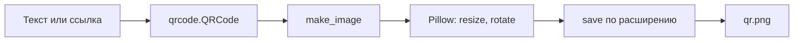

QR-код — это квадратная картинка из чёрных и белых модулей, в которую зашита информация: ссылка, текст, контакты. Мир вокруг заполнен QR-кодами: меню кафе, билеты, оплата. Сегодня мы научимся генерировать их сами, а заодно освоим базовые операции обработки изображений.

## Установка библиотек

Нам понадобятся две библиотеки:

```bash
pip install qrcode pillow
```

`qrcode` отвечает за QR, а Pillow (PIL) — за работу с изображениями.

## Генерация QR-кода

Самое простое — функция `make()`, которая сразу возвращает готовую картинку:

```python
import qrcode

img = qrcode.make("https://example.com")
img.save("qr.png")
```

Всё! Файл `qr.png` появится рядом со скриптом. Он уже сканируется телефоном — попробуй.

## Кастомизация

Библиотека позволяет управлять размером, рамкой, цветами и степенью защиты от повреждений:

```python
qr = qrcode.QRCode(
    version=1,            # размер (1–40), 1 — самый маленький
    box_size=10,          # размер одного модуля в пикселях
    border=4,             # ширина белой рамки
    error_correction=qrcode.constants.ERROR_CORRECT_H,  # высокая надёжность
)
qr.add_data("https://example.com")
qr.make(fit=True)

img = qr.make_image(fill_color="darkblue", back_color="white")
img.save("qr_styled.png")
```

## Осваиваем Pillow

Библиотека Pillow — стандарт де-факто для «тяжёлых» операций с изображениями. Открываем картинку и смотрим её свойства:

```python
from PIL import Image

img = Image.open("qr.png")
print(img.format, img.size, img.mode)   # PNG (290, 290) RGB
```

- `format` — формат файла (PNG, JPEG...);
- `size` — размер в пикселях (ширина, высота);
- `mode` — цветовая модель (RGB, L — чёрно-белая и т.д.).

Меняем размер и сохраняем в другом формате:

```python
small = img.resize((150, 150))
small.save("qr_small.jpg")
```

А вот умный способ уменьшить картинку с сохранением пропорций — `thumbnail()`:

```python
thumb = img.copy()
thumb.thumbnail((100, 100))
thumb.save("qr_thumb.png")
```

Отличие: `resize()` растягивает точно под указанный размер, а `thumbnail()` уменьшает, сохраняя пропорции, и никогда не увеличивает. Ещё мы можем перевести изображение в оттенки серого и повернуть:

```python
gray = img.convert("L")
gray.save("qr_gray.png")

rotated = img.rotate(90, expand=True)
rotated.save("qr_rotated.png")
```

Так выглядит минимальный набор операций, который покрывает большинство бытовых задач с картинками.

Маршрут картинки от строки до файла на диске:



<!--TASK-->
### Задача 1
Сгенерируй QR-код с любым текстом или ссылкой (например, `https://python.org`) и сохрани его в файл `qr.png` через `qrcode.make(...).save(...)`. Проверь, что файл появился рядом со скриптом. Ожидаемый результат: успешно созданный `qr.png`, который сканируется телефоном.

### Задача 2
Создай стилизованный QR-код: объект `QRCode` с `box_size=12`, `border=6`, `error_correction=ERROR_CORRECT_H`, данными `https://example.com`. Сделай изображение с `fill_color="darkblue"` и `back_color="white"`, сохрани как `qr_styled.png`. Ожидаемый результат: новый файл с синим кодом и широкой рамкой, заметно отличающийся от обычного.

### Задача 3
Открой `qr.png` через `PIL.Image.open` и выведи его формат, размер и режим, а также абсолютный путь к файлу через `Path("qr.png").resolve()`. Ожидаемый результат: строки вида `Формат: PNG`, `Размер: (290, 290)`, `Режим: RGB` и полный путь.

### Задача 4
Сделай миниатюру QR-кода: открой `qr.png`, скопируй изображение через `copy()`, примени `thumbnail((150, 150))` и сохрани как `qr_thumb.png`. Проверь, что пропорции сохранены. Ожидаемый результат: новый файл размером не больше 150×150 пикселей, код по-прежнему читается.

### Задача 5
Создай преобразованный QR-код: открой `qr.png`, переведи в оттенки серого через `convert("L")`, поверни на 45° с `expand=True` и сохрани результат как `qr_gray_rotated.png`. Ожидаемый результат: чёрно-белый наклонённый код, углы которого не обрезаны.

### Задача 6
Вставь логотип в центр QR-кода. Сгенерируй код с `error_correction=ERROR_CORRECT_H` и размером не меньше 400×400 пикселей, открой картинку `logo.png`, уменьши её до 80×80 и вставь по центру через `img.paste(logo, (x, y), logo)`, используя саму картинку как маску прозрачности. Координаты центра посчитай из размеров, а не вписывай числами. Сохрани результат как `qr_logo.png`. Ожидаемый результат: код с логотипом в центре по-прежнему сканируется телефоном, а логотип не выходит за границы.

### Задача 7
Сделай пакетный обработчик: пройди по всем файлам `*.png` в папке `source`, для каждого создай миниатюру с максимальной стороной 128 пикселей и сохрани её в подпапку `thumbs` с тем же именем. Файлы, которые не удалось открыть, пропускай и печатай `Пропуск: <имя>`. В конце выведи `Обработано: N, пропущено: M`. Ожидаемый результат: в `thumbs` появляются уменьшенные копии всех нормальных картинок, а битый файл не роняет программу.
<!--/TASK-->

<!--HINT-->
### Подсказка 1
В одну строку: `qrcode.make("https://python.org").save("qr.png")`. Не забудь `import qrcode`. Если файл создался, но открывать его нечем — просто загляни в папку со скриптом.

### Подсказка 2
Создай объект `QRCode` с параметрами: `qr = qrcode.QRCode(version=1, box_size=12, border=6, error_correction=qrcode.constants.ERROR_CORRECT_H)`. Затем `qr.add_data("https://example.com")`, `qr.make(fit=True)` и `img = qr.make_image(fill_color="darkblue", back_color="white")`, затем `img.save("qr_styled.png")`.

### Подсказка 3
`img = Image.open("qr.png")` — дальше читай три атрибута: `img.format`, `img.size`, `img.mode`. Путь: `from pathlib import Path; print(Path("qr.png").resolve())`.

### Подсказка 4
Важно: `thumbnail()` меняет объект на месте и ничего не возвращает, поэтому сначала сделай копию: `thumb = img.copy()`, затем `thumb.thumbnail((150, 150))` и `thumb.save("qr_thumb.png")`. Не вызывай thumbnail на оригинале, если он ещё нужен.

### Подсказка 5
Работай цепочкой: `img = Image.open("qr.png").convert("L")`, затем `gray = img.rotate(45, expand=True)` и `gray.save("qr_gray_rotated.png")`. `expand=True` увеличивает холст, чтобы при повороте углы не обрезались.

### Подсказка 6
Сначала приведи код к нужному размеру: `img = qr.make_image(...).convert("RGB")`, затем `img = img.resize((400, 400), Image.NEAREST)` — `NEAREST` не размывает границы модулей. Логотип: `logo = Image.open("logo.png")`, `logo.thumbnail((80, 80))`. Координаты центра: `((400 - logo.width) // 2, (400 - logo.height) // 2)`. Третий аргумент `paste` — маска; для PNG с прозрачностью подойдёт сам `logo`.

### Подсказка 7
`for path in Path("source").glob("*.png")` — обход файлов. Внутри `try: img = Image.open(path); img.load()`, а в `except (OSError, ValueError)` — пропуск. Копию делай через `img.copy()`, потому что `thumbnail()` меняет объект на месте. Папку создай заранее: `Path("thumbs").mkdir(exist_ok=True)`.
<!--/HINT-->

<!--SOLUTION-->
### Разбор 1
Решение:

```python
import qrcode

qrcode.make("https://python.org").save("qr.png")
```

Что здесь происходит? `qrcode.make(data)` — удобная функция-сокращение: она создаёт объект `QRCode` с параметрами по умолчанию, добавляет данные, строит код и возвращает готовое изображение (объект Pillow). Дальше метод `save()` записывает его в файл, а формат определяется расширением: `qr.png` — PNG. Ты можешь передать любую строку: URL, текст, визитку vCard. Заметь: `make_img` — это реальная функция библиотеки qrcode, и именно такой однострочник используют в тысячах проектов.

### Разбор 2
Решение:

```python
import qrcode

qr = qrcode.QRCode(
    version=1,
    box_size=12,
    border=6,
    error_correction=qrcode.constants.ERROR_CORRECT_H,
)
qr.add_data("https://example.com")
qr.make(fit=True)

img = qr.make_image(fill_color="darkblue", back_color="white")
img.save("qr_styled.png")
```

Что здесь происходит? Параметры конструктора управляют внешним видом: `box_size` — размер одного модуля (квадратика) в пикселях, `border` — ширина белой рамки вокруг кода, `error_correction` — количество служебной информации для восстановления при повреждении (H — максимальная надёжность). `make(fit=True)` автоматически подбирает версию кода под объём данных. `make_image` принимает цвета: `fill_color` — цвет самих модулей, `back_color` — фон. Так можно подогнать QR под фирменный стиль.

### Разбор 3
Решение:

```python
from pathlib import Path
from PIL import Image

img = Image.open("qr.png")
print("Формат:", img.format)
print("Размер:", img.size)
print("Режим:", img.mode)
print("Путь:", Path("qr.png").resolve())
```

Результат (пример):

```
Формат: PNG
Размер: (290, 290)
Режим: RGB
Путь: D:\projects\qr.png
```

Что здесь происходит? `Image.open()` не загружает всё изображение в память сразу — он лишь открывает файл и читает заголовок, поэтому узнать формат и размер можно мгновенно даже для огромных фотографий. `size` — кортеж `(ширина, высота)`. `mode` сообщает цветовую модель: `RGB` — цветное, `L` — оттенки серого. А `Path.resolve()` превращает относительный путь в абсолютный, убирая `..` и символьные ссылки.

### Разбор 4
Решение:

```python
from PIL import Image

img = Image.open("qr.png")
thumb = img.copy()
thumb.thumbnail((150, 150))
thumb.save("qr_thumb.png")

print("Оригинал:", img.size)
print("Миниатюра:", thumb.size)
```

Результат (пример):

```
Оригинал: (290, 290)
Миниатюра: (150, 150)
```

Что здесь происходит? `copy()` создаёт независимую копию, чтобы не испортить оригинал, ведь `thumbnail()` изменяет объект на месте и ничего не возвращает. Параметр `(150, 150)` — максимальные габариты: метод уменьшит изображение до 150×150, сохранив пропорции, а если исходник уже меньше — просто ничего не сделает. В отличие от `resize()`, он никогда не растягивает и не искажает. QR-код отлично переносит такое уменьшение и остаётся считываемым.

### Разбор 5
Решение:

```python
from PIL import Image

img = Image.open("qr.png").convert("L")
rotated = img.rotate(45, expand=True)
rotated.save("qr_gray_rotated.png")
print("Новый файл сохранён:", rotated.size)
```

Что здесь происходит? `convert("L")` переводит изображение в оттенки серого: каждый пиксель получает один канал яркости от 0 (чёрный) до 255 (белый). `rotate(45, expand=True)` поворачивает картинку на 45° против часовой стрелки; с `expand=True` холст увеличивается так, чтобы повёрнутое изображение полностью поместилось, не обрезая углы. Без `expand` размер остался бы прежним, и углы кода исчезли бы. Сохраняем результат под новым именем — оригинальный `qr.png` не тронут.

### Разбор 6
Решение:

```python
import qrcode
from PIL import Image

qr = qrcode.QRCode(
    box_size=10,
    border=4,
    error_correction=qrcode.constants.ERROR_CORRECT_H,
)
qr.add_data("https://python.org")
qr.make(fit=True)

img = qr.make_image(fill_color="black", back_color="white").convert("RGB")
img = img.resize((400, 400), Image.NEAREST)

logo = Image.open("logo.png")
logo.thumbnail((80, 80))

x = (img.width - logo.width) // 2
y = (img.height - logo.height) // 2
img.paste(logo, (x, y), logo)
img.save("qr_logo.png")
print("Готово:", img.size)
```

Что здесь происходит? Уровень `ERROR_CORRECT_H` резервирует около 30 % площади под данные восстановления — именно этот запас позволяет закрыть центр логотипом и не потерять читаемость. `convert("RGB")` нужен потому, что `make_image` возвращает палитровое изображение, а `paste` с маской требует RGB или RGBA. `resize(..., Image.NEAREST)` увеличивает картинку методом «ближайшего соседа»: границы модулей остаются резкими, тогда как сглаживание размыло бы квадратики и сканер запутался бы. `thumbnail((80, 80))` вписывает логотип в квадрат 80×80, сохраняя пропорции. Координаты считаются из размеров, поэтому код работает при любой величине картинки. Третий аргумент `paste` — маска: прозрачные пиксели логотипа не затирают код под ними.

### Разбор 7
Решение:

```python
from pathlib import Path
from PIL import Image

source = Path("source")
thumbs = Path("thumbs")
thumbs.mkdir(exist_ok=True)

done = 0
skipped = 0

for path in sorted(source.glob("*.png")):
    try:
        img = Image.open(path)
        img.load()          # принудительно декодируем файл
    except (OSError, ValueError):
        print("Пропуск:", path.name)
        skipped += 1
        continue

    small = img.copy()
    small.thumbnail((128, 128))
    small.save(thumbs / path.name)
    done += 1
    print("Готово:", path.name, small.size)

print(f"Обработано: {done}, пропущено: {skipped}")
```

Результат (пример):

```
Готово: qr.png (128, 128)
Пропуск: broken.png
Обработано: 1, пропущено: 1
```

Что здесь происходит? `Image.open` ленив: он читает только заголовок и не проверяет всё содержимое, поэтому битый файл может «открыться» без ошибки. Вызов `img.load()` заставляет Pillow декодировать пиксели — именно здесь битый файл и выдаёт `OSError`. `glob("*.png")` берёт только файлы этого типа, а `sorted` даёт предсказуемый порядок вывода. `copy()` обязателен: `thumbnail()` меняет объект на месте и возвращает `None`. Сохранение в `thumbs / path.name` сохраняет имена, поэтому результат легко сопоставить с исходником. Счётчики `done` и `skipped` дают короткий отчёт, по которому сразу видно, всё ли прошло гладко.
<!--/SOLUTION-->

<!--QUIZ-->
Что делает qrcode.make("текст")?
- Печатает текст в консоль
- Возвращает изображение QR-кода
- Создаёт текстовый файл
- Проверяет ссылку
* Правильный ответ: Возвращает изображение QR-кода
make() строит код и возвращает объект изображения, который можно сохранить через save().

Что означает version=1 в QRCode?
- Самый маленький размер кода
- Самый большой размер кода
- Версию библиотеки
- Количество цветов
* Правильный ответ: Самый маленький размер кода
version задаёт размер кода от 1 (маленький) до 40 (большой).

Чем thumbnail() отличается от resize() в Pillow?
- thumbnail() сохраняет пропорции и не увеличивает изображение
- thumbnail() только увеличивает изображение
- resize() сохраняет пропорции
- Ничем
* Правильный ответ: thumbnail() сохраняет пропорции и не увеличивает изображение
resize() растягивает ровно под указанные размеры, а thumbnail() вписывается в максимум, сохраняя пропорции.

Что вернёт img.size?
- Строку с именем файла
- Кортеж (ширина, высота)
- Количество цветов
- Формат файла
* Правильный ответ: Кортеж (ширина, высота)
size — кортеж из двух чисел: ширина и высота в пикселях.

Что делает convert("L")?
- Переводит изображение в оттенки серого
- Поворачивает изображение
- Увеличивает изображение
- Меняет формат файла
* Правильный ответ: Переводит изображение в оттенки серого
Режим L означает яркость: один канал от 0 до 255.

Зачем в rotate() нужен параметр expand=True?
- Чтобы повернуть по часовой стрелке
- Чтобы холст увеличился и углы не обрезались
- Чтобы сохранить в JPEG
- Чтобы ускорить работу
* Правильный ответ: Чтобы холст увеличился и углы не обрезались
С expand=True размер холста подстраивается под повёрнутое изображение.

Что означает error_correction=ERROR_CORRECT_H?
- Высокая степень защиты кода от повреждений
- Максимально большой размер кода
- Цветное изображение кода
- Автоматический подбор версии
* Правильный ответ: Высокая степень защиты кода от повреждений
Чем выше уровень коррекции, тем больше служебных данных и тем устойчивее QR к повреждениям.

Почему после img.resize((150, 150)) и сохранения в qr_small.jpg формат станет JPEG?
- Потому что save() выбирает формат по расширению файла
- Потому что resize() меняет формат изображения
- Потому что Pillow всегда сохраняет JPEG
- Потому что формат задаётся в Image.open()
* Правильный ответ: Потому что save() выбирает формат по расширению файла
Расширение .jpg и .jpeg указывает на JPEG, .png — на PNG; формат файла определяется именно им.

Что делает img.copy() в Pillow?
- Создаёт независимую копию изображения
- Копирует файл на диск
- Меняет размер изображения
- Открывает файл заново
* Правильный ответ: Создаёт независимую копию изображения
Копия нужна потому, что thumbnail() и paste() меняют объект на месте, а оригинал часто ещё пригодится.

Что произойдёт при попытке сохранить изображение в режиме RGBA как JPEG?
- Файл сохранится с прозрачностью
- Pillow выдаст ошибку, потому что JPEG не поддерживает альфа-канал
- Изображение станет чёрно-белым
- Ничего, формат определится автоматически
* Правильный ответ: Pillow выдаст ошибку, потому что JPEG не поддерживает альфа-канал
Перед сохранением в JPEG прозрачность убирают: img.convert("RGB") или вставка на белый фон.

За что отвечает параметр box_size в qrcode.QRCode?
- За размер одного модуля кода в пикселях
- За ширину белой рамки
- За уровень коррекции
- За количество символов
* Правильный ответ: За размер одного модуля кода в пикселях
Итоговый размер — это число модулей, умноженное на box_size, плюс рамка border.

Зачем в img.paste(logo, (x, y), logo) передают третий аргумент?
- Чтобы задать маску прозрачности
- Чтобы указать формат файла
- Чтобы повернуть логотип
- Чтобы изменить размер логотипа
* Правильный ответ: Чтобы задать маску прозрачности
Маска решает, какие пиксели логотипа накладываются, а какие остаются прозрачными.
<!--/QUIZ-->
