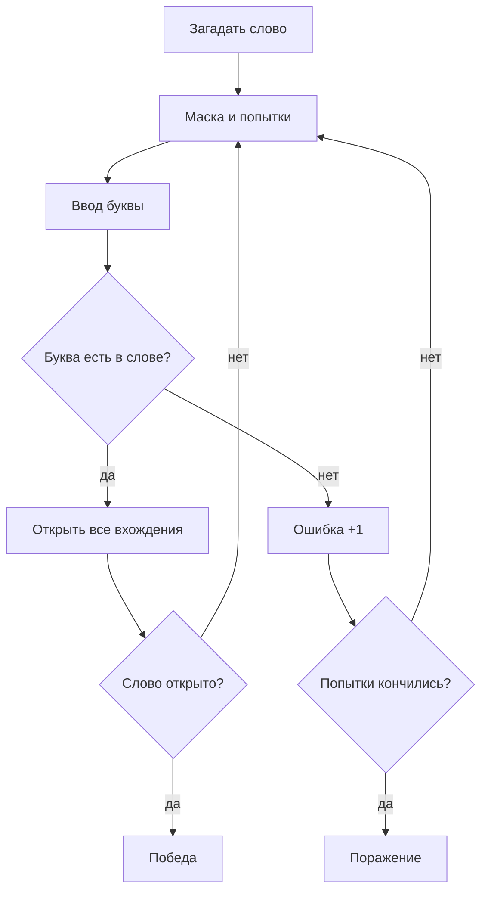

В этом уроке нет обычной подачи материала — перед тобой самостоятельная работа. Ты уже владеешь основами: переменные и типы, условия, циклы, списки и строки, функции, модуль `random`. Теперь нужно собрать всё это в одну настоящую программу — игру «Виселица». Задача работы — пройти пять этапов, и на каждом этапе ты получаешь маленькую законченную и проверяемую часть программы. Не переходи к следующему этапу, пока текущий не работает: так ты никогда не утонешь в отладке большой системы целиком.

## Постановка задачи

Классическая «Виселица»: компьютер загадывает слово, игрок называет буквы. Если буква есть в слове — она открывается во всех своих позициях; если нет — игрок теряет попытку. Партия заканчивается, когда открыты все буквы (победа) или когда попытки закончились (поражение). Название игры пошло от традиционного рисунка, который дополняется с каждой ошибкой; нам не обязательно рисовать человечка — достаточно считать ошибки и показывать их количество.

Чему ты научишься. Во-первых, декомпозиции: большая задача разбивается на независимые функции, каждую из которых легко проверить отдельно. Во-вторых, аккуратному обращению с пользовательским вводом: игрок может ввести цифру, пустую строку, букву в другом регистре или букву, которую уже называл. Хорошая программа вежливо обрабатывает все эти случаи. В-третьих, ты потренируешься проверять собственный код: после каждого этапа запускай программу и сознательно пробуй «сломать» её неожиданными вводами.

## Требования к программе

- Список слов — минимум 20 существительных в именительном падеже; загаданное слово выбирается случайно при каждом запуске.
- Игрок вводит по одной букве. Регистр значения не имеет: «а» и «А» — одна и та же буква. Ожидаются только буквы русского алфавита.
- После каждого хода на экране: текущая маска слова (открытые буквы на своих местах, остальные — нижнее подчёркивание), список уже названных букв, число оставшихся попыток.
- Повторная буква не отнимает попытку — игра лишь сообщает, что такая буква уже была.
- Попыток всего 7. Потеряны все 7 — поражение и показ загаданного слова; все буквы открыты — победа.
- После окончания партии программа предлагает сыграть ещё раз (д/н) и корректно завершается при «н».
- Программа обязана быть разбита на функции: минимум выбор слова, вывод состояния, обработка буквы и главный игровой цикл. Это требование проверяется при оценке.

Схема игрового цикла — по ней удобно сверять код:



## Как работать с заданием

Выполняй этапы по порядку в одном файле `hangman.py`, постепенно дописывая его. Сохраняй рабочую версию после каждого этапа. Если что-то сломалось — вернись к последней рабочей версии и найди изменение, которое всё сломало. Перед сдачей прогони полный набор сценариев: победу, поражение, повтор буквы, ввод цифры и пустой строки.

## Критерии оценки (10 баллов)

| Критерий | Баллы |
|---|---|
| Программа запускается без ошибок и корректно завершается | 2 |
| Случайный выбор из списка минимум 20 слов | 1 |
| Маска и её обновление, список названных букв, счётчик попыток | 2 |
| Обработка повторов, недопустимого и пустого ввода | 2 |
| Условия победы и поражения, показ слова, повторная игра | 2 |
| Код разбит на функции, читаемый, с комментариями | 1 |

Зачтено — от 7 баллов.

## Что сдать

- Файл `hangman.py` (полная рабочая версия после 5-го этапа).
- Комментарий в начале файла: как запустить программу, какие функции в ней есть, что бы ты улучшил.
- Пример вывода двух партий (текстом в файле `examples.txt` или комментарии): одна победа и одно поражение.
- Викторина по уроку на платформе (8 вопросов).

<!--TASK-->
### Задача 1

Начни с фундамента. Создай список `words` из минимум 20 русских существительных (например, «питон», «окно», «гора», «лампа», «река»). Напиши функцию `choose_word(words)`, которая возвращает случайное слово с помощью `random.choice`. В главной части программы выведи загаданное слово и его маску: `N` нижних подчёркиваний, разделённых пробелами. Запусти программу несколько раз и убедись, что слово меняется. Ожидаемый вывод: `Слово из 5 букв: _ _ _ _ _`.

### Задача 2

Реализуй две функции отображения. `word_to_mask(word, guessed)` возвращает строку вида `п и _ _ _`: открытые буквы стоят на своих местах, остальные заменены на `_`. `show_status(word, guessed, mistakes, max_mistakes)` печатает маску, отсортированные названные буквы и число оставшихся попыток. Буквы храни во множестве `guessed` (тип `set`) — это избавит от дубликатов. Проверь вручную: для слова «питон» и множества `{"п", "и"}` маска должна быть `п и _ _ _`, при `mistakes=2` и `max_mistakes=7` остаток попыток — 5.

### Задача 3

Сделай обработку ввода. Функция `process_input(raw)` возвращает кортеж `(ok, letter)`: убирает пробелы, приводит к нижнему регистру, проверяет, что это ровно одна буква русского алфавита (`'а' <= ch <= 'я'`); иначе возвращает `(False, "")` с сообщением об ошибке. Функция `apply_letter(letter, word, guessed)` возвращает `False`, если буква уже в `guessed` (сообщение «Такая буква уже была»), иначе добавляет её и возвращает `True`. Проверь вводы: `"А"`, `"а"`, `"0"`, `""`, `"аб"`.

### Задача 4

Добавь логику партии: пока не победа и `mistakes < max_mistakes`, выводи статус, получай букву, обрабатывай ввод (недопустимый — переспроси), при повторе просто продолжай, если буквы нет в слове — увеличивай `mistakes`. Победа наступает, когда все буквы слова есть в `guessed` (проверка `set(word) <= guessed`). После выхода из цикла выведи результат и загаданное слово. Проверь обе ветки: угадай все буквы; сделай 7 ошибок.

### Задача 5

Собери всё в единую программу. Функция `play_game()` проводит одну партию и возвращает `(won, attempts)`. Главный блок в цикле спрашивает «Сыграем ещё раз? (д/н)»: «д» — новая партия, «н» — выход, любой другой ответ — переспросить. В конце выведи статистику сессии: сколько партий сыграно, сколько побед и среднее число ходов на партию. Убедись, что программа не падает ни на каком вводе.
### Задача 6

Покажи игроку, сколько он уже потерял. Создай список `GALLOWS` из восьми кадров — от пустого столба до полностью нарисованного человечка. Каждый кадр — список строк, из которых `draw_gallows(mistakes)` собирает многострочный рисунок через `"\n".join(...)`: при `mistakes=0` видны только столб и основание, при `mistakes=3` добавлены перекладина, верёвка и голова, при `mistakes=7` — руки и ноги. Вызывай функцию из `show_status` перед маской слова. Ожидаемый вывод при трёх ошибках: рисунок из шести строк, затем `Слово: п и _ _ _` и `Осталось попыток: 4`.

### Задача 7

Сделай результаты партий постоянными. После каждой игры сохраняй запись `{"word": ..., "won": ..., "attempts": ..., "date": ...}` в `stats.json` со структурой `{"games": [...]}`. Напиши `load_stats(path)` (нет файла или битый JSON — пустая статистика), `save_stats(stats, path)` (запись с `ensure_ascii=False` и `indent=2`) и `best_games(stats, n=3)` — три лучших победы по возрастанию числа ходов. В конце сессии печатай таблицу рекордов с местом, словом, ходами и датой. Ожидаемый вывод: `1. гора — 4 хода (12.11.2026)`, ниже ещё две строки; при следующем запуске прошлые партии уже учтены.

<!--/TASK-->

<!--HINT-->
### Подсказка 1

Список создаётся обычным литералом: `words = ["питон", "окно", ...]`. Для случайного выбора импортируй модуль: `import random`, затем `random.choice(words)`. Маску удобно собрать генератором списка: `"_" if letter not in guessed else letter for letter in word` и склеить через `" ".join(...)`.

### Подсказка 2

Множество объявляется так: `guessed = set()`, добавление — `guessed.add("п")`. Для сортировки букв при выводе используй `sorted(guessed)`. Остаток попыток считается как `max_mistakes - mistakes`. Не забудь: `word_to_mask` должна возвращать строку, а `show_status` — печатать её.

### Подсказка 3

Сначала нормализуй ввод: `raw.strip().lower()`. Затем проверь длину: `len(ch) != 1` — ошибка. Для кириллицы сравнивай с диапазоном: `'а' <= ch <= 'я'` — это работает, потому что у букв одинаковые кодовые позиции. Проверку повтора делай через оператор `in` с множеством.

### Подсказка 4

Цикл партии: `while not won and mistakes < max_mistakes:`. Проверка победы — `set(word) <= guessed` (все буквы слова содержатся в множестве названных). Не забудь вывести итог после цикла, например: `"Вы выиграли! Слово: ..."` или `"Вы проиграли. Было загадано: ..."`.

### Подсказка 5

Главный цикл: `while True:` с запросом «Сыграем ещё раз? (д/н)» и `break` при «н». Статистику собирай в переменные вне цикла: `games += 1`, `wins += int(won)`, `total_attempts += attempts`. Среднее число ходов — `total_attempts / games`.
### Подсказка 6

Кадр удобно хранить списком строк, а не одной длинной строкой: `GALLOWS = [[...], [...]]`, тогда `"\n".join(GALLOWS[i])` даёт готовый рисунок без ручных переводов строк. Индекс кадра — это число ошибок: `GALLOWS[min(mistakes, len(GALLOWS) - 1)]`. `min` защищает от выхода за границы, если позже изменишь число попыток. Печатай рисунок отдельным `print(draw_gallows(mistakes))` — строки уже разделены переводами.

### Подсказка 7

Чтение с дефолтом: `try: json.load(f) except (FileNotFoundError, json.JSONDecodeError): return {"games": []}`. Победы фильтруй списком: `wins = [g for g in stats["games"] if g["won"]]`, затем `sorted(wins, key=lambda g: g["attempts"])[:n]`. Дату бери `datetime.now().strftime("%d.%m.%Y")`. Запись — `json.dump(stats, f, ensure_ascii=False, indent=2)`; файл открывай в режиме `"w"`, чтобы не дописывать второй JSON в тот же файл.

<!--/HINT-->

<!--SOLUTION-->
### Разбор 1

```python
import random

words = [
    "питон", "окно", "гора", "лампа", "река",
    "берёза", "океан", "город", "зима", "книга",
    "луна", "молоко", "песок", "радуга", "солнце",
    "туман", "фонарь", "холод", "цветок", "школа",
]

def choose_word(words):
    return random.choice(words)

word = choose_word(words)
print(f"Слово из {len(word)} букв: {'_ ' * len(word)}")
```

Список из 20 слов гарантирует разнообразие партий. `random.choice` возвращает один случайный элемент — это и есть загаданное слово. Маска на этом этапе — просто строка из `_`, повторённая столько раз, сколько букв в слове: `"_ " * len(word)` даёт `_ _ _ _ _` с пробелом в конце.

### Разбор 2

```python
def word_to_mask(word, guessed):
    return " ".join("_" if letter not in guessed else letter for letter in word)

def show_status(word, guessed, mistakes, max_mistakes):
    print("Слово:", word_to_mask(word, guessed))
    print("Буквы:", " ".join(sorted(guessed)))
    print(f"Осталось попыток: {max_mistakes - mistakes}")

# Проверка
guessed = {"п", "и"}
show_status("питон", guessed, 2, 7)
```

Генератор списка проходит по каждой букве слова и подставляет её, если она есть в `guessed`, иначе — `_`. `" ".join(...)` склеивает символы пробелами. `sorted(guessed)` сортирует названные буквы по алфавиту, чтобы в списке был порядок. `show_status` собирает весь вывод в одном месте — это пригодится в цикле игры.

### Разбор 3

```python
def process_input(raw):
    ch = raw.strip().lower()
    if len(ch) != 1 or not ('а' <= ch <= 'я'):
        print("Введи одну букву русского алфавита.")
        return False, ""
    return True, ch

def apply_letter(letter, word, guessed):
    if letter in guessed:
        print("Такая буква уже была.")
        return False
    guessed.add(letter)
    return True
```

`strip()` убирает случайные пробелы, `lower()` — регистр, поэтому «А» и «а» считаются одинаково. Проверка `len(ch) != 1` отсекает пустую строку и многосимвольные вводы вроде «аб», а диапазон `'а' <= ch <= 'я'` — цифры и латиницу. `apply_letter` сначала проверяет повтор: если буква уже есть во множестве, возвращаем `False` и не меняем состояние; иначе добавляем букву.

### Разбор 4

```python
def play_game():
    word = choose_word(words)
    guessed = set()
    mistakes = 0
    max_mistakes = 7

    while set(word) > guessed and mistakes < max_mistakes:
        show_status(word, guessed, mistakes, max_mistakes)
        ok, letter = process_input(input("Твоя буква: "))
        if not ok:
            continue
        if not apply_letter(letter, word, guessed):
            continue
        if letter not in word:
            mistakes += 1

    if set(word) <= guessed:
        print(f"Победа! Слово: {word}")
    else:
        print(f"Поражение. Было загадано: {word}")
```

Условие цикла: играем, пока не открыты все буквы и есть попытки. `process_input` возвращает `(False, "")` при плохом вводе — просто `continue`, без наказания. Если буква повторная — тоже `continue`. И только если буквы нет в слове, растёт `mistakes`. Проверка `set(word) <= guessed` — строгое включение: победа, когда каждая буква слова есть среди названных.

### Разбор 5

```python
def play_game():
    # ... код из предыдущего этапа, только добавим подсчёт ходов
    attempts = 0
    while set(word) > guessed and mistakes < max_mistakes:
        attempts += 1
        # ...
    return set(word) <= guessed, attempts

games = 0
wins = 0
total_attempts = 0

while True:
    won, attempts = play_game()
    games += 1
    wins += int(won)
    total_attempts += attempts
    answer = input("Сыграем ещё раз? (д/н) ").strip().lower()
    if answer == "н":
        break
    if answer != "д":
        print("Ответь д или н.")

print(f"Сыграно партий: {games}, побед: {wins}, среднее число ходов: {total_attempts / games:.1f}")
```

`play_game()` теперь возвращает результат партии и число ходов — это делает функцию чистой и тестируемой. Главный цикл обрабатывает любые ответы: строго «н» завершает игру, «д» — новую партию, всё остальное — переспрос. Итоговая статистика подводит черту: видно и результат последней сессии, и твоё мастерство в целом.
### Разбор 6

```python
GALLOWS = [
    ["  |", "  |", "  |", "  |", "  |", "====="],
    ["  +---+", "  |", "  |", "  |", "  |", "====="],
    ["  +---+", "  |   |", "  |", "  |", "  |", "====="],
    ["  +---+", "  |   |", "  O   |", "  |", "  |", "====="],
    ["  +---+", "  |   |", "  O   |", "  |   |", "  |", "====="],
    ["  +---+", "  |   |", "  O   |", " -|-  |", "  |", "====="],
    ["  +---+", "  |   |", "  O   |", " -|-  |", "  |   |", "====="],
    ["  +---+", "  |   |", "  O   |", " -|-  |", "  | | |", "====="],
]


def draw_gallows(mistakes):
    frame = GALLOWS[min(mistakes, len(GALLOWS) - 1)]
    return "\n".join(frame)


def show_status(word, guessed, mistakes, max_mistakes):
    print(draw_gallows(mistakes))
    print("Слово:", word_to_mask(word, guessed))
    print("Буквы:", " ".join(sorted(guessed)))
    print(f"Осталось попыток: {max_mistakes - mistakes}")


show_status("питон", {"п", "и"}, 3, 7)
```

Восемь кадров — ровно под правило «семь попыток»: индекс 0 соответствует началу партии, индекс 7 — последней ошибке. Хранить кадр списком строк удобнее, чем одной строкой с переводами строк: легче править отдельные элементы рисунка, а `"\n".join(...)` собирает их в готовый блок. `min(...)` — страховка: если правил станет больше, чем кадров, функция вернёт последний кадр вместо `IndexError`. Вызов внутри `show_status` даёт игроку обратную связь: он видит, что каждая ошибка что-то добавляет, и рисунок сам работает счётчиком. Обрати внимание на одинаковую ширину строк: рисунок не «дрожит» при смене кадра. Проверь все восемь значений в цикле `for m in range(8)` — на экране должна пройти вся последовательность от столба до человечка.

### Разбор 7

```python
import json
from datetime import datetime

STATS_PATH = "stats.json"


def load_stats(path=STATS_PATH):
    try:
        with open(path, encoding="utf-8") as f:
            return json.load(f)
    except (FileNotFoundError, json.JSONDecodeError):
        return {"games": []}


def save_stats(stats, path=STATS_PATH):
    with open(path, "w", encoding="utf-8") as f:
        json.dump(stats, f, ensure_ascii=False, indent=2)


def plural(n, one, few, many):
    if n % 10 == 1 and n % 100 != 11:
        return one
    if 2 <= n % 10 <= 4 and not 12 <= n % 100 <= 14:
        return few
    return many


def best_games(stats, n=3):
    wins = [g for g in stats["games"] if g["won"]]
    return sorted(wins, key=lambda g: g["attempts"])[:n]


def record_game(word, won, attempts, path=STATS_PATH):
    stats = load_stats(path)
    stats["games"].append({
        "word": word,
        "won": won,
        "attempts": attempts,
        "date": datetime.now().strftime("%d.%m.%Y"),
    })
    save_stats(stats, path)


def print_records(stats):
    print("Таблица рекордов:")
    for i, game in enumerate(best_games(stats), 1):
        word = plural(game["attempts"], "ход", "хода", "ходов")
        print(f"{i}. {game['word']} — {game['attempts']} {word} ({game['date']})")


record_game("гора", True, 4)
record_game("лампа", True, 6)
record_game("окно", False, 7)
print_records(load_stats())
```

`stats.json` хранит один объект с ключом `games`, а не голый список: так позже можно добавить настройки или счётчик сессий, не ломая формат. `load_stats` возвращает статистику по умолчанию при отсутствии файла и при повреждённом JSON — первый запуск не должен падать. `save_stats` открывает файл в режиме `"w"`: мы каждый раз записываем весь объект целиком, иначе в файле оказались бы два JSON подряд. `record_game` сначала читает, потом дописывает запись и сохраняет — данные переживают закрытие программы. `best_games` отбирает только победы и сортирует по числу ходов: рекорд — это быстрое угадывание, а не долгая партия. Функция `plural` подбирает форму слова, чтобы таблица читалась по-русски: «4 хода», «6 ходов».

<!--/SOLUTION-->

<!--QUIZ-->
Что вернёт random.choice(["питон", "окно"])?
- «питон»
- «окно»
- Любой один элемент списка
- Оба слова списком
* Правильный ответ: Любой один элемент списка
random.choice возвращает один случайный элемент последовательности — какой именно, заранее неизвестно.

Что делает выражение "Питон".lower()?
- Возвращает «питон»
- Возвращает «ПИТОН»
- Ошибку: такого метода нет
- Меняет строку на месте
* Правильный ответ: Возвращает «питон»
Метод lower() возвращает копию строки в нижнем регистре; исходная строка не меняется, ведь строки в Python неизменяемы.

Каким условием проверить, что строка ch — ровно одна буква русского алфавита?
- len(ch) == 1 and 'а' <= ch <= 'я'
- ch.isalpha()
- ord(ch) > 1000
- len(ch) >= 1
* Правильный ответ: len(ch) == 1 and 'а' <= ch <= 'я'
isalpha() пропустит и «яя», и латиницу; только комбинация длины и диапазона даёт точную проверку.

Зачем хранить названные буквы во множестве set, а не в списке?
- Множество автоматически отбрасывает дубликаты
- Множество сохраняет порядок добавления
- Во множестве быстрее перебор
- Это не имеет значения
* Правильный ответ: Множество автоматически отбрасывает дубликаты
Повторное добавление уже существующей буквы в set ничего не меняет, поэтому проверка повторов становится тривиальной.

Как проверить, что все буквы слова угаданы?
- all(b in guessed for b in word)
- any(b in guessed for b in word)
- len(word) == len(guessed)
- word == ''.join(sorted(guessed))
* Правильный ответ: all(b in guessed for b in word)
all() вернёт True, только если каждая буква слова присутствует во множестве названных букв.

Что выведет print("питон".count("н"))?
- 1
- 2
- 0
- Ошибку
* Правильный ответ: 1
Буква «н» встречается в слове «питон» ровно один раз, и именно это число возвращает count().

Что произойдёт при вводе буквы «б», которой нет в слове «питон»?
- Ошибка программы
- Буква добавится в названные, ошибка увеличится
- Ничего не произойдёт
- Игра мгновенно закончится
* Правильный ответ: Буква добавится в названные, ошибка увеличится
Буква фиксируется среди названных, а счётчик ошибок растёт — игрок видит свои неудачные попытки.

Как организовать завершение программы после ответа «н» на вопрос «Сыграем ещё раз?»?
- break из игрового цикла
- sys.exit(0)
- exit()
- quit()
* Правильный ответ: break из игрового цикла
Ответ «н» — обычное условие выхода из цикла while; exit() здесь не нужен, программа просто доходит до конца.

Что выведет print("п" + "и" + "__")?
- "пи__"
- "п и __"
- Ошибку
- "пи_"
* Правильный ответ: "пи__"
Конкатенация склеивает строки без пробелов, поэтому получится «пи__».

Сколько попыток даётся игроку по требованиям этой работы?
- 5
- 6
- 7
- 10
* Правильный ответ: 7
По условиям постановки задачи игроку даётся 7 попыток.
Сколько кадров нужно в списке `GALLOWS`, если игроку даётся 7 попыток?
- 6
- 7
- 8
- 10
* Правильный ответ: 8
Кадры нужны для 0, 1, 2, …, 7 ошибок — это восемь состояний, индекс последнего равен 7.

Какой индекс кадра вернёт `draw_gallows(7)`, если в `GALLOWS` восемь элементов?
- 6
- 7
- 8
- Ошибку IndexError
* Правильный ответ: 7
Индексы идут с нуля, поэтому восьмой кадр — это индекс 7; выход за границы начался бы только с 8.

Зачем в `draw_gallows` вызывают `min(mistakes, len(GALLOWS) - 1)`?
- Чтобы рисунок всегда был последним кадром
- Чтобы не выйти за границы списка, если ошибок больше, чем кадров
- Чтобы округлить число ошибок
- Чтобы ускорить печать
* Правильный ответ: Чтобы не выйти за границы списка, если ошибок больше, чем кадров
`min` возвращает последний допустимый индекс вместо ошибки IndexError.

Что вернёт `sorted(wins, key=lambda g: g["attempts"])[0]`?
- Партию с наибольшим числом ходов
- Партию с наименьшим числом ходов
- Слово с наибольшей длиной
- Список всех побед
* Правильный ответ: Партию с наименьшим числом ходов
Сортировка по возрастанию ставит первым самое быстрое угадывание — это и есть рекорд.

Как прочитать `stats.json`, если файла может ещё не быть?
- Открыть файл и не обрабатывать ошибку
- Обернуть чтение в `try/except FileNotFoundError` и вернуть статистику по умолчанию
- Удалить файл перед чтением
- Записать файл перед чтением
* Правильный ответ: Обернуть чтение в `try/except FileNotFoundError` и вернуть статистику по умолчанию
Первый запуск не должен падать: отсутствие файла — нормальная ситуация, а не ошибка.
<!--/QUIZ-->
