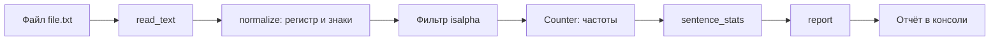

Эта самостоятельная работа научит тебя работать с текстовыми данными: читать файлы, чистить текст, считать частотность слов и составлять аккуратные отчёты. Ты уже знаком с циклами, строками, словарями и функциями; сейчас ты соберёшь из них законченный инструмент — анализатор текста, который пригодится и в учёбе, и в реальных задачах обработки данных.

## Постановка задачи

Нужно написать программу `text_analyzer.py`, которая принимает путь к текстовому файлу, читает его и печатает отчёт: количество слов, число уникальных слов, количество предложений, среднюю длину слова, среднюю длину предложения, самое длинное слово и топ-10 самых частых слов с количеством вхождений. Программа должна работать с русскими текстами любой длины — от пары абзацев до целой книги.

Чему ты научишься. Во-первых, работе с файлами: открытие, чтение, закрытие (лучше — через контекстный менеджер `with`). Во-вторых, нормализации текста: приведение к нижнему регистру и удаление знаков препинания — без этого «Слово», «слово» и «слово,» считались бы разными словами. В-третьих, ты познакомишься с классом `collections.Counter` — удобным инструментом для подсчёта частотностей, который заменяет ручные циклы со словарями.

## Требования к программе

- Программа запускается как `python text_analyzer.py file.txt`, где `file.txt` — путь к анализируемому файлу (используй `sys.argv`).
- Если файл не найден — вежливое сообщение об ошибке, без краха программы.
- Текст нормализуется: всё к нижнему регистру, знаки препинания (как стандартные, так и типографские: кавычки, тире) не попадают в слова.
- Слова — это последовательности букв; числа «2026» словом не считаются.
- Отчёт печатается единым блоком, выровненным по столбцам.
- Частотность считается через `collections.Counter`.
- Программа обязана быть разбита на функции: чтение файла, нормализация, подсчёт статистики, вывод отчёта. Это проверяется при оценке.

Схема обработки текста — от файла до отчёта:



## Как работать с заданием

Выполняй этапы по порядку в одном файле `text_analyzer.py`, проверяя работу после каждого этапа. Для тестов создай небольшой текстовый файл (например, `sample.txt`) с 5–10 предложениями, включая знаки препинания, заглавные буквы и повторяющиеся слова. Перед сдачей прогони программу на этом файле, на пустом файле и на несуществующем пути.

## Критерии оценки (10 баллов)

| Критерий | Баллы |
|---|---|
| Программа запускается из командной строки без ошибок | 2 |
| Корректное чтение файла и обработка отсутствующего файла | 2 |
| Нормализация текста: регистр, пунктуация, исключение чисел | 2 |
| Верный подсчёт всех метрик и топ-10 через Counter | 3 |
| Код разбит на функции, читаемый, с комментариями | 1 |

Зачтено — от 7 баллов.

## Что сдать

- Файл `text_analyzer.py` (полная рабочая версия после 5-го этапа).
- Тестовый файл `sample.txt`, на котором программа проверялась.
- Пример вывода отчёта для `sample.txt` (в файле `report.txt` или в комментарии).
- Комментарий в начале файла: как запустить, какие функции есть, что бы ты улучшил.
- Викторина по уроку на платформе (8 вопросов).

<!--TASK-->
### Задача 1

Реализуй функцию `read_text(path)`, которая открывает файл в кодировке UTF-8 и возвращает его содержимое строкой. Если файл не найден или не читается — перехвати `FileNotFoundError` (и при желании `PermissionError`) и верни `None`, напечатав понятное сообщение. Проверь на существующем файле и на несуществующем пути: во втором случае программа не должна падать. Ожидаемый вывод для существующего файла — строка с текстом, для отсутствующего — «Файл не найден: D:/...» и возврат `None`.

### Задача 2

Напиши функцию `normalize(text)`, которая приводит текст к нижнему регистру и заменяет все знаки препинания на пробелы. Используй `import string` и `string.punctuation` как основу; дополни её типографскими символами: «» „ “ — … (тире и кавычки). Затем разбей текст на слова через `text.split()`. Проверь на фразе «Привет, мир! Это — тест.»: должно получиться `["привет", "мир", "это", "тест"]` — без запятых, восклицательного знака и тире.

### Задача 3

Проверь, что в слова не попадают числа. Измени `normalize`, чтобы слово засчитывалось, только если оно состоит из букв: проверяй `word.isalpha()`. Затем напиши функцию `count_words(words)`, которая возвращает `collections.Counter(words)`. Выведи три самых частых слова через `counter.most_common(3)`. Ожидаемый вывод: `[('и', 5), ('в', 3), ('на', 3)]` (числа зависят от твоего тестового файла).

### Задача 4

Добавь статистику предложений. Функция `sentence_stats(text)` делит текст на предложения по знакам `. ! ?` (можно через `re.split(r'[.!?]+', text)`), отбрасывает пустые куски и считает: число предложений, среднюю длину предложения в словах (сумма длин всех предложений делится на их количество) и среднюю длину слова. Отдельно найди самое длинное слово через `max(words, key=len)`. Выведи результаты.

### Задача 5

Собери итоговый отчёт в функции `report(stats)`: единый блок с выравниванием по столбцам (используй f-строки с шириной поля, например `f"{label:<25}{value:>8}"`). В главной части программы возьми путь из `sys.argv[1]`, считай файл, вычисли все метрики и напечатай отчёт целиком. Проверь: пустой файл должен давать осмысленный отчёт с нулями, а не ошибку деления на ноль.
### Задача 6

Убери из топа служебные слова. В любом русском тексте первые места занимают «и», «в», «на» — они ничего не говорят о содержании. Заведи `STOPWORDS` (минимум 15 предлогов, союзов и местоимений) и функцию `top_words(counter, n=10, min_len=4, stopwords=STOPWORDS)`, которая возвращает список пар `(слово, количество)`, пропуская стоп-слова и всё короче `min_len`. Сортировка — по убыванию количества, при равенстве — по алфавиту. Ожидаемый вывод для `sample.txt`: `[('книга', 7), ('текст', 5), ('герой', 4)]` — без «и», «в», «на».

### Задача 7

Сравни два текста. Напиши `compare_texts(path_a, path_b)`: прочитай оба файла, нормализуй их тем же `normalize`, собери множества слов и посчитай `common` (пересечение), `only_a`, `only_b` и `jaccard` = |A ∩ B| / |A ∪ B|, округлённый до трёх знаков. Функция возвращает словарь и печатает отчёт: `Общих слов: 120, только в A: 34, только в B: 51, Жаккар: 0.585`. Пустой текст не должен приводить к делению на ноль, а отсутствующий файл — к падению: верни `None` и сообщение.

<!--/TASK-->

<!--HINT-->
### Подсказка 1

Используй контекстный менеджер: `with open(path, encoding="utf-8") as f: return f.read()`. Оберни его в `try/except FileNotFoundError`. `sys.argv` ещё не нужен — на этом этапе путь можно передавать аргументом функции или просто записать в переменную.

### Подсказка 2

Собери таблицу замен: `table = str.maketrans("", "", string.punctuation + "«»„“—…")`, затем `text.translate(table)`. Это заменит каждый знак препинания на пробел. После этого `text.split()` даст чистый список слов.

### Подсказка 3

`str.isalpha()` возвращает `True` только для строк, целиком состоящих из букв, — числа и смешанные токены отсеиваются. `Counter` создаётся от списка и сразу умеет считать: `Counter(words)` — это словарь, где ключ — слово, значение — количество. `most_common(n)` возвращает список пар `(слово, количество)`.

### Подсказка 4

`re.split(r'[.!?]+', text)` разбивает текст по любому сочетанию этих знаков; пустые строки отфильтруй: `[s for s in parts if s.strip()]`. Средняя длина предложения — это `sum(len(s.split()) for s in sentences) / len(sentences)`. Будь внимателен: при нуле предложений делить нельзя — проверь `if sentences`.

### Подсказка 5

Выравнивание: `print(f"{'Слов в тексте':<28}{stats['words']:>8}")` — `<` прижимает влево, `>` вправо. Для защиты от пустого текста добавь условие: если слов нет, выведи «Текст пуст» и заверши работу до вычисления средних значений.
### Подсказка 6

`Counter.most_common()` без аргумента возвращает все пары, уже отсортированные по убыванию. Отфильтруй их списком: `[(w, c) for w, c in counter.most_common() if w not in stopwords and len(w) >= min_len][:n]`. Для сортировки при равных частотах используй ключ `key=lambda p: (-p[1], p[0])` — минус превращает убывание по числу в возрастание. `min_len` по умолчанию 4 отсекает «но», «или», «как».

### Подсказка 7

Множества: `a = set(words_a)`, `b = set(words_b)`. Пересечение — `a & b`, разности — `a - b` и `b - a`, объединение — `a | b`. Жаккар: `len(a & b) / len(a | b)`, но сначала проверь `if not (a | b): return 0.0`. Округление — `round(value, 3)`. Не забудь переиспользовать `read_text` и `normalize`, а не писать чтение заново: так поведение обоих сценариев останется одинаковым.

<!--/HINT-->

<!--SOLUTION-->
### Разбор 1

```python
def read_text(path):
    try:
        with open(path, encoding="utf-8") as f:
            return f.read()
    except FileNotFoundError:
        print(f"Файл не найден: {path}")
        return None
```

Контекстный менеджер `with` сам закрывает файл, даже если внутри произойдёт ошибка, — так не появляются «утечки» открытых файловых дескрипторов. Кодировка `utf-8` обязательна для русских текстов: без неё Windows может попытаться прочитать файл в cp1251 и исказить буквы. `FileNotFoundError` ловится отдельно, программа печатает понятное сообщение и возвращает `None`, а не падает с трейсбеком.

### Разбор 2

```python
import string

def normalize(text):
    text = text.lower()
    extra = "«»„“—…"
    table = str.maketrans("", "", string.punctuation + extra)
    return text.translate(table).split()
```

`str.maketrans("", "", chars)` строит таблицу, которая заменяет каждый символ из третьего аргумента на `None` — то есть удаляет его. Но удалять знаки препинания нельзя: иначе слова «склеятся», как в «Привет,мир». Поэтому сначала заменяем каждый знак на пробел — это делает `translate` с таблицей, где символу соответствует пробел: `str.maketrans(chars, " " * len(chars))`. Впрочем, надёжнее всего пройти по символам и собрать только буквы и пробелы. Простой вариант:

```python
def normalize(text):
    text = text.lower()
    cleaned = []
    for ch in text:
        if ch.isalpha() or ch.isspace():
            cleaned.append(ch)
        else:
            cleaned.append(" ")
    return "".join(cleaned).split()
```

Такой цикл понятен и легко расширяется, а `split()` разбивает строку по произвольным пробелам.

### Разбор 3

```python
from collections import Counter

def count_words(words):
    return Counter(words)

def filter_alpha(words):
    return [w for w in words if w.isalpha()]

words = filter_alpha(normalize(text))
counter = count_words(words)
print(counter.most_common(3))
```

`word.isalpha()` возвращает `True` только для слов, состоящих из букв, — «2026» и «привет123» отсеиваются. `Counter` — это подкласс словаря: `Counter(words)` за один проход считает все вхождения. `most_common(3)` возвращает список трёх самых частых пар `(слово, количество)` — именно то, что нужно для топа.

### Разбор 4

```python
import re

def sentence_stats(text):
    parts = re.split(r'[.!?]+', text)
    sentences = [s.strip() for s in parts if s.strip()]
    if not sentences:
        return {"sentences": 0, "avg_sentence": 0.0}

    lengths = [len(s.split()) for s in sentences]
    avg_sentence = sum(lengths) / len(sentences)
    words = []
    for s in sentences:
        words.extend(s.split())
    avg_word = sum(len(w) for w in words) / len(words)
    longest = max(words, key=len)

    return {
        "sentences": len(sentences),
        "avg_sentence": avg_sentence,
        "avg_word": avg_word,
        "longest": longest,
    }
```

`re.split(r'[.!?]+', text)` разрезает текст по любым сочетаниям точки, восклицательного и вопросительного знаков. Пустые куски (например, после точки в конце текста) отфильтровываются. Средняя длина предложения считается в словах, средняя длина слова — в буквах, а самое длинное слово находит `max(..., key=len)`. Проверка `if not sentences` защищает от деления на ноль.

### Разбор 5

```python
import sys

def report(stats):
    print("=" * 40)
    print(f"{'Слов в тексте':<28}{stats['words']:>8}")
    print(f"{'Уникальных слов':<28}{stats['unique']:>8}")
    print(f"{'Предложений':<28}{stats['sentences']:>8}")
    print(f"{'Средняя длина слова':<28}{stats['avg_word']:>8.2f}")
    print(f"{'Средняя длина предложения':<28}{stats['avg_sentence']:>8.2f}")
    print(f"{'Самое длинное слово':<28}{stats['longest']:>8}")
    print("=" * 40)
    print("Топ-10 самых частых слов:")
    for i, (word, count) in enumerate(stats["top"], 1):
        print(f"{i:>2}. {word:<20}{count:>4}")

if __name__ == "__main__":
    path = sys.argv[1] if len(sys.argv) > 1 else "sample.txt"
    text = read_text(path)
    if text is None:
        sys.exit(1)
    words = filter_alpha(normalize(text))
    if not words:
        print("Текст пуст.")
        sys.exit(0)
    # сбор stats: топ, уникальные и т.д.
    ...
```

`sys.argv[1]` — первый аргумент командной строки после имени скрипта; если его нет, берём `sample.txt` по умолчанию. Выравнивание по столбцам делает отчёт читаемым. Пустой текст обрабатывается отдельно — программа печатает «Текст пуст» и завершается без деления на ноль.
### Разбор 6

```python
STOPWORDS = {
    "и", "в", "во", "на", "не", "что", "с", "со", "а", "но",
    "по", "это", "как", "к", "у", "из", "за", "для", "же", "ли",
}


def top_words(counter, n=10, min_len=4, stopwords=STOPWORDS):
    pairs = [
        (word, count)
        for word, count in counter.most_common()
        if word not in stopwords and len(word) >= min_len
    ]
    return sorted(pairs, key=lambda p: (-p[1], p[0]))[:n]


print(top_words(Counter(words), n=3))
```

`most_common()` без числа отдаёт весь словарь частот, уже упорядоченный по убыванию, — фильтрация списком сохраняет этот порядок. Проверка `word not in stopwords` работает за константное время, потому что `STOPWORDS` — множество, а не список. `min_len=4` убирает короткие служебные слова, которые не попали в стоп-лист. Дополнительная сортировка с ключом `(-p[1], p[0])` нужна для предсказуемости: при одинаковой частоте слова идут по алфавиту, и отчёт не «прыгает» между запусками. Вернуть список пар, а не готовую строку, — правильное разделение обязанностей: печать остаётся в `report`, а функцию можно проверить в тесте.

### Разбор 7

```python
def compare_texts(path_a, path_b):
    text_a = read_text(path_a)
    text_b = read_text(path_b)
    if text_a is None or text_b is None:
        return None

    a = set(filter_alpha(normalize(text_a)))
    b = set(filter_alpha(normalize(text_b)))
    union = a | b
    jaccard = round(len(a & b) / len(union), 3) if union else 0.0

    result = {
        "common": len(a & b),
        "only_a": len(a - b),
        "only_b": len(b - a),
        "jaccard": jaccard,
    }
    print(f"Общих слов: {result['common']}, только в A: {result['only_a']}, "
          f"только в B: {result['only_b']}, Жаккар: {result['jaccard']}")
    return result


compare_texts("a.txt", "b.txt")
```

Множества отбрасывают повторы, поэтому сравнение идёт по словарю, а не по частотам: текст с тысячей «и» не перевесит содержательное совпадение. Операторы `&`, `-` и `|` дают пересечение, разности и объединение за один проход. Коэффициент Жаккара — доля общих слов среди всех встреченных: 1.0 означает полное совпадение словарей, 0.0 — что общих слов нет. Проверка `if union` защищает от деления на ноль на двух пустых файлах; `read_text` уже вернул `None` при отсутствии файла, поэтому до множеств дело не дойдёт. Такой отчёт полезен, например, для сравнения двух редакций статьи или двух версий документа.

<!--/SOLUTION-->

<!--QUIZ-->
Какой менеджер контекста используют для корректного закрытия файла?
- with open(path, encoding="utf-8") as f:
- f = open(path); f.close()
- file(path).read()
- open(path).read()
* Правильный ответ: with open(path, encoding="utf-8") as f:
Контекстный менеджер with сам закрывает файл даже при ошибке внутри блока.

Что делает метод "Привет".lower()?
- Возвращает «привет»
- Возвращает «ПРИВЕТ»
- Изменяет строку
- Возвращает длину
* Правильный ответ: Возвращает «привет»
lower() возвращает новую строку в нижнем регистре, исходная не меняется.

Что вернёт "Привет, мир!".split()?
- ["Привет,", "мир!"]
- ["Привет", "мир"]
- ["Привет, мир!"]
- Ошибку
* Правильный ответ: ["Привет,", "мир!"]
split() без аргументов разбивает по пробелам, сохраняя приставленные знаки препинания.

Какой метод проверит, что строка состоит только из букв?
- isalpha()
- isdigit()
- isalnum()
- isspace()
* Правильный ответ: isalpha()
isalpha() возвращает True только для строк, целиком состоящих из букв.

Какой класс в collections считает частотность элементов одной командой?
- Counter
- defaultdict
- OrderedDict
- deque
* Правильный ответ: Counter
Counter(list) за один проход считает все вхождения элементов.

Что вернёт Counter(["а", "б", "а"]).most_common(1)?
- [("а", 2)]
- {"а": 2}
- ("а", 2)
- [("а", 1)]
* Правильный ответ: [("а", 2)]
most_common возвращает список пар (элемент, количество), отсортированный по убыванию.

Чем опасен пустой текст в счётчике средней длины?
- Деление на ноль
- Ошибка кодировки
- Бесконечный цикл
- Ничем не опасен
* Правильный ответ: Деление на ноль
Если предложений или слов ноль, sum(...) / 0 приведёт к ZeroDivisionError — нужна проверка.

Какой regex разобьёт текст на предложения по . ! ?
- re.split(r'[.!?]+', text)
- text.split(".!?")
- re.split(".!?", text)
- text.split(" ")
* Правильный ответ: re.split(r'[.!?]+', text)
Символьный класс [.!?] с плюсом захватывает любые сочетания знаков конца предложения.

Что вернёт max(["река", "океан"], key=len)?
- "океан"
- "река"
- 6
- ["океан"]
* Правильный ответ: "океан"
max с key=len выбирает элемент с максимальной длиной — само слово, а не длину.

Зачем программа использует sys.argv?
- Чтобы получить аргументы командной строки
- Чтобы завершить программу
- Чтобы импортировать модули
- Чтобы читать файлы
* Правильный ответ: Чтобы получить аргументы командной строки
sys.argv — список аргументов: sys.argv[0] — имя скрипта, sys.argv[1] — первый переданный путь.
Что вернёт `Counter("ааб") - Counter("аб")`?
- `Counter({'а': 1})`
- `Counter({'а': 2})`
- `Counter({'б': 1})`
- Пустой `Counter()`
* Правильный ответ: `Counter({'а': 1})`
Вычитание счётчиков убирает по одному вхождению и выбрасывает нулевые и отрицательные значения.

Что даст `set("абв") & set("бвг")`?
- `{'б', 'в'}`
- `{'а', 'г'}`
- `{'а', 'б', 'в', 'г'}`
- Пустое множество
* Правильный ответ: `{'б', 'в'}`
Оператор `&` оставляет только элементы, которые есть в обоих множествах.

Как считается коэффициент Жаккара для двух множеств слов?
- `len(a & b) / len(a | b)`
- `len(a) + len(b)`
- `len(a - b) / len(a)`
- `len(a & b) * 2`
* Правильный ответ: `len(a & b) / len(a | b)`
Числитель — общие слова, знаменатель — все слова объединения; результат от 0 до 1.

Зачем в `top_words` параметр `min_len`?
- Чтобы отсечь короткие служебные слова, не попавшие в стоп-лист
- Чтобы ускорить чтение файла
- Чтобы считать буквы, а не слова
- Чтобы отсортировать слова по длине
* Правильный ответ: Чтобы отсечь короткие служебные слова, не попавшие в стоп-лист
Предлоги и союзы часто короче четырёх букв, поэтому порог длины дополняет стоп-лист.
<!--/QUIZ-->
