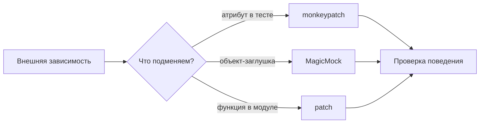

Когда код обращается к сети, к часам, к случайным числам или к файловой системе, тесты становятся непредсказуемыми: сегодня API отвечает быстро, а завтра его нет. Решение — **мокинг**: подмена настоящего «внешнего» объекта на заглушку, которая ведёт себя так, как нам нужно для теста. В этом уроке разберём два главных инструмента: фикстуру `monkeypatch` из pytest и модуль `unittest.mock`.

## monkeypatch: подмена атрибутов

`monkeypatch` — встроенная фикстура pytest. Она умеет заменять атрибуты объектов (в том числе встроенных модулей) на время теста, а после теста автоматически возвращает всё на место.

Классический пример — функция, которая кидает игральную кость:

```python
import random

def roll_dice():
    return random.randint(1, 6)

def test_roll_dice(monkeypatch):
    monkeypatch.setattr(random, "randint", lambda a, b: 3)
    assert roll_dice() == 3
```

Тест теперь не зависит от случайности: мы гарантированно получаем 3. После теста `randint` станет прежним. У `monkeypatch` есть и `delattr` (удалить атрибут) и `setenv` / `delenv` (подмена переменных окружения).

## unittest.mock: Mock и MagicMock

Модуль `unittest.mock` даёт полноценные мок-объекты. `MagicMock` — универсальный заглушечный объект: **любой** его атрибут или метод тоже является моком, поэтому можно строить цепочки сколько угодно глубоко:

```python
from unittest.mock import MagicMock

def test_mock():
    api = MagicMock()
    api.get_data.return_value = [1, 2, 3]
    assert api.get_data() == [1, 2, 3]
```

Ключевые настройки:

- `return_value` — что вернёт вызов;
- `side_effect` — последовательность возвращаемых значений или вызываемое, которое выполнится вместо мока; если передать класс исключения или сам объект исключения — вызов его бросит;
- `call_count` — сколько раз вызывали;
- `assert_called_once_with(...)`, `assert_called_with(...)`, `assert_called()` — проверки того, как вызывали.

Пример с `side_effect`:

```python
mock = MagicMock()
mock.roll.side_effect = [1, 2, 3]  # три вызова вернут 1, 2, 3
assert mock.roll() == 1
assert mock.roll() == 2
assert mock.roll() == 3
```

Если `side_effect` — исключение, каждый вызов его бросит:

```python
mock.fetch.side_effect = TimeoutError("net is down")
```

## patch: патчинг кода

Когда нужно заменить функцию внутри другого модуля, используют `patch` из `unittest.mock`. Он работает и как декоратор, и как контекстный менеджер:

```python
from unittest.mock import patch

# пример модуля app.py:  import requests
#  def get_rate():
#      resp = requests.get("https://api.example.com/rate")
#      return resp.json()["rate"]

@patch("app.requests.get")
def test_get_rate(mock_get):
    mock_get.return_value.json.return_value = {"rate": 90}
    from app import get_rate
    assert get_rate() == 90
    mock_get.assert_called_once_with("https://api.example.com/rate")
```

Контекстный менеджер удобен, когда мок нужен только на время одного куска:

```python
def test_with_patch():
    with patch("app.requests.get") as mock_get:
        mock_get.return_value.json.return_value = {"rate": 90}
        # ... код, который использует requests.get
```

Важно: патчим **место использования**, а не источник. Если `app` написал `from requests import get`, патчить надо `app.get`, а не `requests.get`.

## Проверка вызовов

Моки помогают не только подменять поведение, но и проверять, что код позвал зависимость правильно:

```python
def send_report(api, data):
    api.post(data)

def test_send_report():
    api = MagicMock()
    send_report(api, {"ok": True})
    api.post.assert_called_once_with({"ok": True})
    assert api.post.call_count == 1
```



## Итог

`monkeypatch` — для быстрой подмены атрибутов в тесте, `MagicMock` — для создания заглушечных объектов с настраиваемым поведением, `patch` — для подмены функций в целевых модулях, а проверки вызовов позволяют убедиться, что код пользуется зависимостями правильно.

Теперь закрепим всё практикой.

<!--TASK-->
### Задача 1
Напиши функцию `get_rate()` в файле `app.py`, которая получает курс валют: `resp = requests.get("https://api.example.com/rate")`, `return resp.json()["rate"]`. Затем напиши тест `test_get_rate` в `test_app.py`, используя фикстуру `monkeypatch`: подмени `requests.get` на функцию, которая возвращает объект с методом `.json()`, отдающим словарь `{"rate": 75}`. Проверь, что `get_rate()` возвращает 75. Запусти pytest — должно быть `1 passed`.

### Задача 2
Создай тест, в котором `MagicMock` имитирует HTTP-клиент: назначь `client.get` свойство.return_value` на строку `"ok"`, затем вызови `client.get("https://api.example.com/health")` и проверь, что результат равен `"ok"`. Добавь проверку `assert_called_once_with("https://api.example.com/health")`. Запусти — должно быть `1 passed`.

### Задача 3
Перепиши тест из Задачи 1 на `patch` из `unittest.mock` как контекстный менеджер: `with patch("app.requests.get") as mock_get:`. Назначь `mock_get.return_value.json.return_value = {"rate": 90}`, проверь, что `get_rate()` вернёт 90, и что `mock_get` был вызван ровно один раз с правильным URL. Запусти — `1 passed`.

### Задача 4
Напиши функцию `get_with_retry(fetch, tries=2)`, которая вызывает `fetch()`; если он бросил `TimeoutError`, повторяет попытку, а если попытки кончились — пробрасывает исключение. Затем напиши тест: `MagicMock` с `side_effect = [TimeoutError(), {"ok": True}]`, передай его в `get_with_retry` и проверь: результат равен `{"ok": True}`, а `fetch.call_count == 2`. Запусти — `1 passed`.

### Задача 5
Представь компонент, который шлёт отчёт: функция `send_report(api, data)` вызывает `api.post(data)`. Напиши тест с `MagicMock`, который проверяет: `post` вызван ровно один раз, с переданным словарём, и возвращаемое значение содержит ключ `"status"` со значением `"sent"` (назначь `api.post.return_value = {"status": "sent"}`). Запусти — `1 passed`.
### Задача 6
Напиши функцию `is_weekend()`, которая возвращает `True`, если сегодня суббота или воскресенье: используй `datetime.now().weekday()` и проверку `>= 5`. Создай тест `test_is_weekend_true` с фикстурой `monkeypatch`: подмени `datetime` в модуле с функцией на класс-заглушку `FakeSaturday`, у которого классовый метод `now()` возвращает фиксированную субботу — `datetime(2026, 11, 21, 12, 0)`. Второй тест подменяет дату на среду и ожидает `False`. Запусти pytest — ожидаемый вывод `2 passed`, и ни один тест не зависит от реального дня недели.

### Задача 7
Напиши функцию `notify(user, email_service, sms_service)`, которая сначала вызывает `email_service.send(user, "Добро пожаловать")`, затем `sms_service.send(user, "Код 1234")`, а в конце возвращает `{"sent": 2}`. Напиши тест с `MagicMock`: проверь результат и порядок вызовов. Для порядка используй родительский мок `services = MagicMock()`, передай в функцию `services.email` и `services.sms`, а затем сравни `services.mock_calls` со списком из `call(...)`. Дополнительно проверь, что `services.push.send` не вызывался вовсе (`assert_not_called()`). Запусти pytest — ожидаемый вывод `1 passed`.
<!--/TASK-->

<!--HINT-->
### Подсказка 1
Фикстура `monkeypatch` передаётся параметром в тест. Подмена: `monkeypatch.setattr(requests, "get", lambda url: FakeResponse())`. `FakeResponse` — маленький класс с методом `json(self)`, возвращающим `{"rate": 75}`. Не забудь `import requests` в `app.py`.

### Подсказка 2
`MagicMock()` создаёт мок. Настройка: `client.get.return_value = "ok"`. Проверка вызова: `client.get.assert_called_once_with("https://api.example.com/health")`. Сначала вызови мок, потом проверяй.

### Подсказка 3
Внутри `with patch("app.requests.get") as mock_get:` патчится имя `requests.get` в пространстве имён модуля `app`. Настрой `mock_get.return_value.json.return_value = {"rate": 90}` и вызови `app.get_rate()`. Проверь, что `mock_get.assert_called_once_with("https://api.example.com/rate")`.

### Подсказка 4
`side_effect` со списком раздаёт значения по одному на вызов: первый вызов бросит `TimeoutError()`, второй вернёт `{"ok": True}`. Внутри `get_with_retry` оберни вызов в `try/except TimeoutError` и продолжи цикл. Проверь `fetch.call_count == 2`.

### Подсказка 5
`api` — это `MagicMock()`. Назначь `api.post.return_value = {"status": "sent"}`. После вызова `send_report(api, {"text": "hello"})` проверь `api.post.assert_called_once_with({"text": "hello"})` и что возвращённый словарь содержит `"status"` со значением `"sent"`.
### Подсказка 6
Подменяй не `datetime.now` напрямую, а весь класс в модуле: `monkeypatch.setattr(app, "datetime", FakeSaturday)`. Заглушка выглядит так: `class FakeSaturday: @classmethod def now(cls): return real_datetime(2026, 11, 21, 12, 0)`. Суббота — `weekday() == 5`, воскресенье — `6`. Импортируй настоящий класс отдельно: `from datetime import datetime as real_datetime`, иначе заглушка будет ссылаться сама на себя.

### Подсказка 7
Импорты: `from unittest.mock import MagicMock, call`. При дочерних моках родитель записывает вызовы в `mock_calls` в формате `call.email.send(...)`. Сравнивай список целиком: `assert services.mock_calls == [call.email.send("anna", "Добро пожаловать"), call.sms.send("anna", "Код 1234")]` — тогда проверяется и состав, и порядок. Для отсутствия вызовов — `services.push.send.assert_not_called()`.
<!--/HINT-->

<!--SOLUTION-->
### Разбор 1
Решение:

```python
# app.py
import requests

def get_rate():
    resp = requests.get("https://api.example.com/rate")
    return resp.json()["rate"]
```

```python
# test_app.py
import requests
from app import get_rate

class FakeResponse:
    def json(self):
        return {"rate": 75}

def test_get_rate(monkeypatch):
    monkeypatch.setattr(requests, "get", lambda url: FakeResponse())
    assert get_rate() == 75
```

Запуск: `python -m pytest`. Результат: `1 passed`.

Что здесь происходит? Тест подменяет `requests.get` на лямбду, которая всегда возвращает `FakeResponse` с методом `.json()`. Поскольку реальный `get_rate` вызывает `resp.json()["rate"]`, подмена полностью изолирует тест от сети: ни одного запроса в интернет не уходит, скорость и стабильность зависят только от нас. После теста `monkeypatch` автоматически вернёт оригинальный `requests.get`. Это главное преимущество фикстуры: не нужно вручную запоминать и восстанавливать оригиналы.

### Разбор 2
Решение:

```python
from unittest.mock import MagicMock

def test_client():
    client = MagicMock()
    client.get.return_value = "ok"
    result = client.get("https://api.example.com/health")
    assert result == "ok"
    client.get.assert_called_once_with("https://api.example.com/health")
```

Запуск: `python -m pytest`. Результат: `1 passed`.

Что здесь происходит? `MagicMock` — это объект-хамелеон: любые его атрибуты и методы создаются на лету и тоже являются моками. `client.get.return_value = "ok"` настраивает, что вернёт вызов `client.get(...)`. Затем мы совершаем вызов и проверяем результат. Метод `assert_called_once_with` удостоверяется, что `get` был вызван ровно один раз и именно с тем URL, который мы указали, — такая проверка защищает от того, что код молча позовёт не тот адрес.

### Разбор 3
Решение:

```python
from unittest.mock import patch
from app import get_rate

def test_get_rate_with_patch():
    with patch("app.requests.get") as mock_get:
        mock_get.return_value.json.return_value = {"rate": 90}
        assert get_rate() == 90
        mock_get.assert_called_once_with("https://api.example.com/rate")
```

Запуск: `python -m pytest`. Результат: `1 passed`.

Что здесь происходит? `patch("app.requests.get")` во время входа в контекст заменяет `requests.get` внутри модуля `app` на мок, а при выходе — восстанавливает оригинал. Обрати внимание: мы патчим именно `app.requests.get`, а не `requests.get`, потому что заменить нужно то имя, которое реально использует код модуля `app`. Цепочка `mock_get.return_value.json.return_value` означает: вызов `mock_get(...)` вернёт объект, у которого метод `.json()` вернёт `{"rate": 90}` — ровно то, чего ждёт функция `get_rate`. Контекстный менеджер удобен, когда мок нужен только на несколько строк кода.

### Разбор 4
Решение:

```python
from unittest.mock import MagicMock

def get_with_retry(fetch, tries=2):
    for _ in range(tries):
        try:
            return fetch()
        except TimeoutError:
            continue
    raise TimeoutError("all attempts failed")

def test_retry():
    fetch = MagicMock()
    fetch.side_effect = [TimeoutError(), {"ok": True}]
    assert get_with_retry(fetch) == {"ok": True}
    assert fetch.call_count == 2
```

Запуск: `python -m pytest`. Результат: `1 passed`.

Что здесь происходит? `side_effect` со списком раздаёт значения по одному на каждый вызов: первый вызов `fetch()` бросит `TimeoutError`, второй вернёт `{"ok": True}`. Функция `get_with_retry` ловит `TimeoutError` и продолжает цикл, поэтому вторая попытка оказывается успешной. Проверка `fetch.call_count == 2` подтверждает, что повторные попытки действительно имели место. Такой тест моделирует реальный сценарий: временный сбой сети, а затем успешный ответ. Если бы `side_effect` содержал только исключения, функция бы исчерпала попытки и пробросила ошибку — этот случай тоже стоит проверить самостоятельно.

### Разбор 5
Решение:

```python
from unittest.mock import MagicMock

def send_report(api, data):
    return api.post(data)

def test_send_report():
    api = MagicMock()
    api.post.return_value = {"status": "sent"}
    result = send_report(api, {"text": "hello"})
    assert result["status"] == "sent"
    api.post.assert_called_once_with({"text": "hello"})
```

Запуск: `python -m pytest`. Результат: `1 passed`.

Что здесь происходит? Компонент `send_report` не знает, что такое настоящий API, — он работает с любым объектом, у которого есть метод `post`. В тесте мы передаём `MagicMock`, настраиваем `api.post.return_value = {"status": "sent"}` и проверяем две вещи: возвращаемое значение корректно и `post` вызван ровно один раз с правильным аргументом. Это и есть суть мокинга: мы проверяем *поведение* нашего кода — что он обращается к зависимости с тем, что нужно, и правильно использует результат, — не завися от реализации зависимости.
### Разбор 6
Решение:

```python
# app.py
from datetime import datetime

def is_weekend():
    return datetime.now().weekday() >= 5
```

```python
# test_app.py
from datetime import datetime as real_datetime
import app


class FakeSaturday:
    @classmethod
    def now(cls):
        return real_datetime(2026, 11, 21, 12, 0)  # суббота


class FakeWednesday:
    @classmethod
    def now(cls):
        return real_datetime(2026, 11, 18, 12, 0)  # среда


def test_is_weekend_true(monkeypatch):
    monkeypatch.setattr(app, "datetime", FakeSaturday)
    assert app.is_weekend() is True


def test_is_weekend_false(monkeypatch):
    monkeypatch.setattr(app, "datetime", FakeWednesday)
    assert app.is_weekend() is False
```

Запуск: `python -m pytest`. Результат: `2 passed`.

Что здесь происходит? Функция `is_weekend` берёт текущее время у класса `datetime`, импортированного в модуль `app`. Поэтому подменять надо не `datetime.now` глобально, а именно имя `datetime` в пространстве имён `app` — ровно так же, как в теории мы патчили место использования, а не источник. Заглушка обязана уметь только одно: вернуть объект с методом `weekday()`, и настоящий `datetime` для этого подходит идеально. Первый тест закрепляет субботу и получает `True`, второй — среду и `False`. Monkeypatch после каждого теста возвращает оригинальный класс, поэтому тесты не влияют друг на друга и не зависят от дня, когда их запустили.

### Разбор 7
Решение:

```python
from unittest.mock import MagicMock, call

def notify(user, email_service, sms_service):
    email_service.send(user, "Добро пожаловать")
    sms_service.send(user, "Код 1234")
    return {"sent": 2}

def test_notify_order():
    services = MagicMock()
    result = notify("anna", services.email, services.sms)
    assert result == {"sent": 2}
    assert services.mock_calls == [
        call.email.send("anna", "Добро пожаловать"),
        call.sms.send("anna", "Код 1234"),
    ]
    services.push.send.assert_not_called()
```

Запуск: `python -m pytest`. Результат: `1 passed`.

Что здесь происходит? Один родительский `MagicMock` создаёт дочерние моки `email`, `sms` и `push` автоматически, а сам записывает все обращения к ним в `mock_calls`. Сравнение с точным списком `call(...)` проверяет сразу три вещи: что вызваны именно эти методы, что аргументы совпадают и что порядок правильный. Если бы функция сначала отправила SMS, а потом письмо, тест упал бы, хотя `assert_called_once_with` на каждом моке по отдельности остался бы зелёным — в этом и ценность проверки порядка. `assert_not_called()` на `push` страхует от лишней побочной рассылки. Такой тест фиксирует контракт взаимодействия: не только «что вернулось», но и «как именно мы обошлись с зависимостями».
<!--/SOLUTION-->

<!--QUIZ-->
Что делает фикстура monkeypatch из pytest?
- Запускает тест в отдельном процессе
- Подменяет атрибуты объектов на время теста и возвращает их обратно
- Ускоряет выполнение тестов
* Правильный ответ: Подменяет атрибуты объектов на время теста и возвращает их обратно
monkeypatch заменяет, например, requests.get на заглушку, а после теста автоматически восстанавливает оригинал.

Что вернёт вызов метода MagicMock, если задать mock.get.return_value = 42?
- 42
- Новый MagicMock
- None
* Правильный ответ: 42
return_value задаёт значение, которое вернёт вызов мока.

Что делает side_effect со списком значений?
- Возвращает случайное значение из списка
- Раздаёт значения по одному на каждый вызов
- Подменяет все методы мока
* Правильный ответ: Раздаёт значения по одному на каждый вызов
Первый вызов вернёт первый элемент, второй — второй и так далее.

Как задать, чтобы вызов мока бросал исключение?
- Передать класс исключения в side_effect
- Передать строку с именем исключения
- Никак, моки не умеют бросать исключения
* Правильный ответ: Передать класс исключения в side_effect
Если side_effect — класс исключения или объект исключения, каждый вызов будет бросать его.

Что проверяет assert_called_once_with(arg)?
- Что мок вызывался хотя бы раз
- Что мок вызывался ровно один раз именно с arg
- Что мок никогда не вызывался
* Правильный ответ: Что мок вызывался ровно один раз именно с arg
Эта проверка совмещает подсчёт вызовов и сравнение аргументов.

Что именно нужно патчить при использовании patch?
- Место, где функция создана и определена
- Место, где функция используется, в пространстве имён целевого модуля
- Любое место, patch сам разберётся
* Правильный ответ: Место, где функция используется
Если модуль app написал from requests import get, патчить надо app.get, а не requests.get.

Зачем нужен мокинг в тестах?
- Чтобы тесты работали быстрее за счёт пропуска проверок
- Чтобы изолировать тесты от внешних зависимостей: сети, времени, случайности
- Чтобы обойти все assert в коде
* Правильный ответ: Чтобы изолировать тесты от внешних зависимостей
Подмена нестабильных внешних объектов делает тесты детерминированными.

Что делает unittest.mock.patch как контекстный менеджер?
- Заменяет объект только внутри блока with, а после — восстанавливает
- Создаёт временную папку
- Запускает патч в отдельном потоке
* Правильный ответ: Заменяет объект только внутри блока with, а после — восстанавливает
При входе в with объект заменяется моком, при выходе — возвращается оригинал.
Что делает patch.object(obj, "attr")?
- Подменяет атрибут конкретного объекта, а после — восстанавливает его
- Создаёт копию объекта
- Удаляет объект из памяти
* Правильный ответ: Подменяет атрибут конкретного объекта, а после — восстанавливает его
patch.object удобен, когда нужно заменить метод у уже созданного экземпляра.

Что проверяет assert_not_called()?
- Что мок не вызывался ни разу
- Что мок вернул None
- Что мок создан без аргументов
* Правильный ответ: Что мок не вызывался ни разу
Проверка падает, если был хотя бы один вызов.

Что произойдёт, если в side_effect передать функцию?
- Она будет вызвана с аргументами мока, а её результат станет возвращаемым значением
- Мок вернёт саму функцию
- Функция выполнится только один раз при создании мока
* Правильный ответ: Она будет вызвана с аргументами мока, а её результат станет возвращаемым значением
Так side_effect позволяет вычислять ответ динамически или бросать исключение из функции.

Зачем нужен autospec=True при патчинге?
- Мок повторяет сигнатуру оригинала и ловит неверные аргументы
- Ускоряет тест
- Запрещает любые вызовы мока
* Правильный ответ: Мок повторяет сигнатуру оригинала и ловит неверные аргументы
С autospec вызов с неправильным числом или именами аргументов сразу даёт ошибку.
<!--/QUIZ-->
