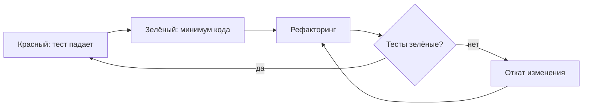

**TDD** (Test-Driven Development, разработка через тестирование) — это методика, в которой тесты пишутся **до** реализации, а не после. Звучит странно, но именно такой порядок заставляет думать о поведении кода до того, как он написан.

## Цикл «красный — зелёный — рефакторинг»

TDD состоит из трёх фаз, которые повторяются в цикле:

1. **Красный.** Пишем тест, отражающий желаемое поведение, и запускаем его. Он должен **упасть** — либо из-за того, что функции ещё нет, либо из-за неверного результата. Красный цвет — это сигнал, что тест действительно что-то проверяет.
2. **Зелёный.** Пишем минимальную реализацию, которая делает тест зелёным. Здесь не нужно «красивого» кода — только чтобы тест прошёл.
3. **Рефакторинг.** Улучшаем код: убираем дублирование, меняем имена, выносим логику. При этом тесты остаются зелёными — они страхуют нас от того, что рефакторинг что-то сломает.

Посмотрим на примере. Нам нужна функция, которая по числу возвращает «Fizz», если число делится на 3, «Buzz», если на 5, «FizzBuzz», если на оба, и само число строкой в остальных случаях. Начинаем с теста:

```python
def test_fizz_buzz():
    assert fizz_buzz(3) == "Fizz"
    assert fizz_buzz(5) == "Buzz"
    assert fizz_buzz(15) == "FizzBuzz"
    assert fizz_buzz(7) == "7"
```

Запускаем — получаем красный: `NameError: name 'fizz_buzz' is not defined`. Это нормально: тест честно показывает, что функции нет. Теперь минимальная реализация:

```python
def fizz_buzz(n):
    if n % 15 == 0:
        return "FizzBuzz"
    if n % 3 == 0:
        return "Fizz"
    if n % 5 == 0:
        return "Buzz"
    return str(n)
```

Запускаем — зелёный. Дальше — рефакторинг: например, можно вынести проверку делимости в отдельную функцию или заменить магическое число 15 на комментарий (лучше — на явную проверку `n % 3 == 0 and n % 5 == 0`). После каждого изменения запускаем тесты: они должны оставаться зелёными.

## Почему это работает

- **Тест — это спецификация.** Записывая поведение до кода, ты фиксируешь контракт: что принимает функция и что возвращает.
- **Минимальная реализация** не даёт писать лишний код. Ты делаешь ровно столько, сколько просит тест.
- **Безопасный рефакторинг.** Изменять внутренности можно смело: если тесты зелёные, поведение сохранено.
- **Параметризация помогает TDD.** Один тест с `@pytest.mark.parametrize` покрывает множество примеров сразу.

## Когда TDD неудобен

TDD отлично работает для бизнес-логики, алгоритмов, парсеров. Но для UI, вёрстки и интеграций с внешними сервисами он часто слишком дорог — там важнее смоук-тесты и ручная проверка. Это нормально: TDD — инструмент, а не догма.



## Итог

Цикл «красный → зелёный → рефакторинг» — это дисциплина: сначала тест, потом минимальная реализация, потом чистка. Тесты при этом всегда зелёные, кроме момента, когда ты честно пишешь новый тест.

Теперь закрепим всё практикой.

<!--TASK-->
### Задача 1
Начни разрабатывать функцию `fizz_buzz(n)` по TDD. Первый шаг — красный тест. Создай файл `test_fizz_buzz.py` с тестом, который проверяет: `fizz_buzz(3) == "Fizz"`, `fizz_buzz(5) == "Buzz"`, `fizz_buzz(15) == "FizzBuzz"`, `fizz_buzz(7) == "7"`. Запусти pytest и убедись, что тест падает с `NameError`, потому что функции ещё нет. Запиши, какое имя отсутствует в ошибке.

### Задача 2
Теперь сделай тест зелёным: реализуй `fizz_buzz(n)` в файле `test_fizz_buzz.py` (или в отдельном модуле и импортируй). Реализация должна быть минимальной, но корректной. Запусти pytest — все проверки должны пройти (`1 passed`). Обрати внимание на порядок проверок: сначала делимость на 15 (или на 3 и 5 одновременно), иначе 15 вернёт неверный результат.

### Задача 3
Расширь поведение через параметризацию. Замени четыре отдельных проверки на один тест `test_fizz_buzz` с `@pytest.mark.parametrize`, который покрывает как минимум пять примеров: 3, 5, 15, 7 и 30 (30 должно дать `"FizzBuzz"`). Запусти pytest — в отчёте должно быть видно пять прогонов.

### Задача 4
Отрефактори реализации `fizz_buzz`. Вынеси проверку делимости в отдельную функцию `is_divisible(n, divisor)` (верни `n % divisor == 0`) и используй её в `fizz_buzz`. При этом замени проверку `n % 15 == 0` на комбинацию `is_divisible(n, 3) and is_divisible(n, 5)` — так код читается понятнее. После рефакторинга все тесты должны остаться зелёными.

### Задача 5
Примени полный цикл TDD к классу `Calculator`. Сначала напиши тесты: `add(2, 3) == 5`, `subtract(10, 4) == 6`, `multiply(3, 4) == 12`, а `divide(10, 2)` возвращает `5.0` и бросает `ValueError` при делении на ноль. Убедись, что тесты падают (класс ещё не создан). Затем реализуй класс так, чтобы тесты прошли. Запусти pytest — должно быть `1 passed` (все проверки внутри одного теста или несколько тестов).
### Задача 6
Пройди полный цикл TDD для функции `parse_duration(text)`, которая переводит строку вида `"1h 30m"` в минуты. Сначала напиши тесты и убедись, что они падают с `NameError`: `"90m"` → `90`, `"2h"` → `120`, `"1h 30m"` → `90`, `"0m"` → `0`. Затем напиши минимальную реализацию: найди части строки регуляркой `re.findall(r"(\d+)([hm])", text)` и сложи часы и минуты. После зелёного прогона добавь тест на некорректный ввод `"abc"` — функция должна бросить `ValueError`. Запусти pytest: ожидаемый вывод `5 passed`.

### Задача 7
Разработай через TDD класс `BankAccount` с балансом. Начни с красных тестов: новый счёт имеет баланс `0`; `deposit(500)` увеличивает баланс до `500`; `withdraw(200)` уменьшает его до `300`; `withdraw(1000)` бросает `ValueError`; после неудачной попытки `balance` остаётся прежним. Только после падения тестов реализуй класс с атрибутом `balance` и методами `deposit` и `withdraw`. Запусти pytest — ожидаемый вывод `5 passed`, и ни один тест не меняет данные другого.
<!--/TASK-->

<!--HINT-->
### Подсказка 1
Не пиши функцию до запуска теста — в этом суть красной фазы. Ошибка будет вида `NameError: name 'fizz_buzz' is not defined`. Именно этого мы и добиваемся: тест показывает, что поведение ещё не реализовано.

### Подсказка 2
Начни с самой простой реализации, которая проходит тест: проверь делимость на 15 первой (или `n % 3 == 0 and n % 5 == 0`), затем на 3, затем на 5, иначе верни `str(n)`. Порядок проверок критичен: если сначала проверять делимость на 3, то 15 вернёт «Fizz» вместо «FizzBuzz».

### Подсказка 3
Декоратор: `@pytest.mark.parametrize("n,expected", [(3, "Fizz"), (5, "Buzz"), (15, "FizzBuzz"), (7, "7"), (30, "FizzBuzz")])`. Функция теста: `def test_fizz_buzz(n, expected):` с одним `assert fizz_buzz(n) == expected`.

### Подсказка 4
Вспомогательная функция: `def is_divisible(n, divisor): return n % divisor == 0`. В `fizz_buzz` замени все `n % X == 0` на вызовы `is_divisible(n, X)`, а проверку 15 — на `is_divisible(n, 3) and is_divisible(n, 5)`. После изменений обязательно перезапусти pytest.

### Подсказка 5
Класс можно описать в отдельном файле `calculator.py` и импортировать в тест: `from calculator import Calculator`. Для деления напиши: `if divisor == 0: raise ValueError("division by zero")`. Помни порядок: сначала красный (тесты без класса), потом реализация.
### Подсказка 6
Сначала запусти тесты без функции — увидишь `NameError`, это красная фаза. Для разбора строки хватит `re.findall`: он вернёт список пар вида `[("1", "h"), ("30", "m")]`. Переведи значение в `int` и умножь на 60 для часов. Если список пуст — бросай `ValueError`. Не забудь `import re` и `import pytest`.

### Подсказка 7
Сначала напиши тесты в `test_bank.py` и запусти — получишь `NameError` или `ImportError`, это нормально. Класс: `class BankAccount: def __init__(self): self.balance = 0`. В `withdraw` сначала сравни сумму с балансом и только потом вычитай — иначе при ошибке баланс успеет измениться. Для проверки исключения — `with pytest.raises(ValueError): account.withdraw(1000)`.
<!--/HINT-->

<!--SOLUTION-->
### Разбор 1
Создаём файл `test_fizz_buzz.py`:

```python
def test_fizz_buzz():
    assert fizz_buzz(3) == "Fizz"
    assert fizz_buzz(5) == "Buzz"
    assert fizz_buzz(15) == "FizzBuzz"
    assert fizz_buzz(7) == "7"
```

Запуск: `python -m pytest`. Результат: `1 failed`, ошибка `NameError: name 'fizz_buzz' is not defined`.

Что здесь происходит? Это красная фаза. Мы ещё не писали функцию, поэтому pytest падает на самой первой проверке, сообщая, что имя `fizz_buzz` не определено. Это не «плохой» результат — наоборот, он подтверждает, что тест живой: он реально проверяет существование функции и её поведение. Если бы тест прошёл без реализации, мы бы не знали, проверяет ли он вообще что-то. В TDD красный цвет — это обязательная отправная точка для каждого нового поведения.

### Разбор 2
Добавляем реализацию в тот же файл:

```python
def fizz_buzz(n):
    if n % 15 == 0:
        return "FizzBuzz"
    if n % 3 == 0:
        return "Fizz"
    if n % 5 == 0:
        return "Buzz"
    return str(n)

def test_fizz_buzz():
    assert fizz_buzz(3) == "Fizz"
    assert fizz_buzz(5) == "Buzz"
    assert fizz_buzz(15) == "FizzBuzz"
    assert fizz_buzz(7) == "7"
```

Запуск: `python -m pytest`. Результат: `1 passed`.

Что здесь происходит? Это зелёная фаза. Реализация минимальна и проходит тест. Ключевой момент — порядок проверок: сначала `n % 15 == 0`. Если бы мы начали с `n % 3 == 0`, то 15 попало бы под первую проверку и вернуло «Fizz» — тест бы упал. Заметь: `str(n)` нужен, потому что функция обещала возвращать строку даже для обычных чисел. Минимальная реализация решает ровно поставленную задачу, без украшательств.

### Разбор 3
Параметризация:

```python
import pytest

def fizz_buzz(n):
    if n % 15 == 0:
        return "FizzBuzz"
    if n % 3 == 0:
        return "Fizz"
    if n % 5 == 0:
        return "Buzz"
    return str(n)

@pytest.mark.parametrize("n,expected", [
    (3, "Fizz"),
    (5, "Buzz"),
    (15, "FizzBuzz"),
    (7, "7"),
    (30, "FizzBuzz"),
])
def test_fizz_buzz(n, expected):
    assert fizz_buzz(n) == expected
```

Запуск: `python -m pytest`. Результат: `5 passed` (пять прогонов одного теста).

Что здесь происходит? Мы расширили поведение, не меняя реализацию, — всего лишь добавили данные. Параметризация превращает один тест в пять прогонов, каждый с собственным именем в отчёте. Пример с 30 — хорошая страховка: он проверяет, что «FizzBuzz» возвращается не только для 15, но и для других чисел, кратных и трём, и пяти. Если в будущем реализация изменится, все пять примеров защитят её от регрессий.

### Разбор 4
Рефакторинг:

```python
import pytest

def is_divisible(n, divisor):
    return n % divisor == 0

def fizz_buzz(n):
    if is_divisible(n, 3) and is_divisible(n, 5):
        return "FizzBuzz"
    if is_divisible(n, 3):
        return "Fizz"
    if is_divisible(n, 5):
        return "Buzz"
    return str(n)

@pytest.mark.parametrize("n,expected", [
    (3, "Fizz"),
    (5, "Buzz"),
    (15, "FizzBuzz"),
    (7, "7"),
    (30, "FizzBuzz"),
])
def test_fizz_buzz(n, expected):
    assert fizz_buzz(n) == expected
```

Запуск: `python -m pytest`. Результат: `5 passed`.

Что здесь происходит? Вспомогательная функция `is_divisible` делает код самодокументирующимся. Проверка `n % 15 == 0` заменена на явную комбинацию `is_divisible(n, 3) and is_divisible(n, 5)` — теперь не нужно помнить, что 15 — это произведение 3 и 5. Поведение не изменилось, поэтому все тесты остались зелёными. В этом сила TDD: рефакторинг без страха, потому что тесты мгновенно поймают любую случайную поломку.

### Разбор 5
Решение:

```python
# calculator.py
class Calculator:
    def add(self, a, b):
        return a + b

    def subtract(self, a, b):
        return a - b

    def multiply(self, a, b):
        return a * b

    def divide(self, a, b):
        if b == 0:
            raise ValueError("division by zero")
        return a / b
```

```python
# test_calculator.py
import pytest
from calculator import Calculator

def test_calculator():
    calc = Calculator()
    assert calc.add(2, 3) == 5
    assert calc.subtract(10, 4) == 6
    assert calc.multiply(3, 4) == 12
    assert calc.divide(10, 2) == 5.0
    with pytest.raises(ValueError):
        calc.divide(10, 0)
```

Запуск: `python -m pytest`. Результат: `1 passed`.

Что здесь происходит? Сначала мы написали тесты и убедились, что они падают (класс отсутствует) — красная фаза. Затем реализовали `Calculator` — зелёная фаза. Внимание на делеление: тест требует, чтобы деление на ноль бросало `ValueError`, поэтому реализация явно его поднимает. Возвращаемое значение `10 / 2` — `5.0`, потому что `/` в Python всегда даёт float. В TDD тест диктует поведение, включая обработку ошибок: если бы мы забыли про ноль, тест остался бы красным.
### Разбор 6
Решение:

```python
import re
import pytest

def parse_duration(text):
    parts = re.findall(r"(\d+)([hm])", text)
    if not parts:
        raise ValueError("Некорректная длительность")
    minutes = 0
    for value, unit in parts:
        minutes += int(value) * (60 if unit == "h" else 1)
    return minutes

@pytest.mark.parametrize("text,expected", [
    ("90m", 90),
    ("2h", 120),
    ("1h 30m", 90),
    ("0m", 0),
])
def test_parse_duration(text, expected):
    assert parse_duration(text) == expected

def test_parse_duration_invalid():
    with pytest.raises(ValueError):
        parse_duration("abc")
```

Запуск: `python -m pytest`. Результат: `5 passed`.

Что здесь происходит? Мы прошли все три фазы. В красной тесты падали с `NameError`, потому что функции ещё не было. В зелёной появилась минимальная реализация: регулярка вытаскивает все пары «число + единица», пустой список означает мусор на входе и даёт `ValueError`. В рефакторинге можно вынести разбор одной пары в отдельную функцию или заменить магическое `60` константой `MINUTES_IN_HOUR`. Обрати внимание на `"1h 30m"`: `findall` находит обе пары независимо от пробела между ними, поэтому формат можно не разбирать вручную. Параметризация разворачивает четыре примера в четыре прогона, а пятый тест проверяет контракт ошибки — его полезно написать до реализации, чтобы не забыть про невалидный ввод.

### Разбор 7
Решение:

```python
# bank.py
class BankAccount:
    def __init__(self):
        self.balance = 0

    def deposit(self, amount):
        if amount <= 0:
            raise ValueError("Сумма должна быть положительной")
        self.balance += amount
        return self.balance

    def withdraw(self, amount):
        if amount > self.balance:
            raise ValueError("Недостаточно средств")
        self.balance -= amount
        return self.balance
```

```python
# test_bank.py
import pytest
from bank import BankAccount

def test_new_account_is_empty():
    assert BankAccount().balance == 0

def test_deposit():
    account = BankAccount()
    account.deposit(500)
    assert account.balance == 500

def test_withdraw():
    account = BankAccount()
    account.deposit(500)
    account.withdraw(200)
    assert account.balance == 300

def test_withdraw_too_much():
    account = BankAccount()
    account.deposit(100)
    with pytest.raises(ValueError):
        account.withdraw(1000)

def test_balance_unchanged_after_error():
    account = BankAccount()
    account.deposit(100)
    with pytest.raises(ValueError):
        account.withdraw(500)
    assert account.balance == 100
```

Запуск: `python -m pytest`. Результат: `5 passed`.

Что здесь происходит? Пять тестов описывают контракт до появления класса: начальное состояние, две успешные операции и две ситуации ошибки. Реализация выросла из этих требований, а не наоборот. Ключевая деталь — порядок действий в `withdraw`: проверка `amount > self.balance` стоит до вычитания, поэтому при исключении баланс остаётся нетронутым. Если поменять строки местами, четыре теста продолжат проходить, а пятый упадёт — и это ровно тот баг, который легко пропустить без TDD. Последний тест важен ещё и методически: он фиксирует не только факт исключения, но и отсутствие побочного эффекта, то есть атомарность операции.
<!--/SOLUTION-->

<!--QUIZ-->
Какая фаза TDD идёт первой?
- Рефакторинг
- Написание падающего теста
- Реализация функции
* Правильный ответ: Написание падающего теста
Сначала пишем тест и убеждаемся, что он падает (красный), — только потом реализация.

Что означает «красная» фаза в TDD?
- Тест падает, потому что поведение ещё не реализовано
- Тест проходит успешно
- Код содержит синтаксическую ошибку
* Правильный ответ: Тест падает, потому что поведение ещё не реализовано
Красный цвет показывает, что тест живой и реально проверяет отсутствующее поведение.

Что нужно сделать в зелёной фазе?
- Написать красивый и полный код
- Написать минимальную реализацию, чтобы тест прошёл
- Удалить тест
* Правильный ответ: Написать минимальную реализацию, чтобы тест прошёл
Зелёная фаза требует ровно столько кода, сколько нужно для прохождения теста.

Зачем нужна фаза рефакторинга в TDD?
- Чтобы ускорить тесты
- Чтобы улучшить код, сохранив зелёные тесты
- Чтобы добавить новые функции
* Правильный ответ: Чтобы улучшить код, сохранив зелёные тесты
Тесты страхуют: если рефакторинг что-то сломает, они сразу упадут.

Почему тест пишется до реализации?
- Так быстрее писать код
- Тест фиксирует контракт поведения и диктует дизайн API
- Чтобы тест не мог упасть
* Правильный ответ: Тест фиксирует контракт поведения и диктует дизайн API
Записанное поведение до кода определяет, что функция принимает и возвращает.

Что будет, если в fizz_buzz сначала проверять делимость на 3, а потом на 15?
- Число 15 вернёт «Fizz» вместо «FizzBuzz»
- Число 15 вернёт «FizzBuzz» всё равно
- Тест продолжит работать без ошибок
* Правильный ответ: Число 15 вернёт «Fizz» вместо «FizzBuzz»
Проверка 15 должна идти первой, иначе первое же подходящее условие перехватит число.

Что делает pytest.raises(ValueError) в тесте?
- Проверяет, что код бросает исключение ValueError
- Игнорирует ошибку
- Останавливает тест
* Правильный ответ: Проверяет, что код бросает исключение ValueError
Контекст pytest.raises считается успешным, только если внутри него возникло указанное исключение.

Какие задачи лучше всего подходят под TDD?
- Бизнес-логика, алгоритмы, парсеры
- Вёрстка и оформление интерфейсов
- Ручная проверка дизайна
* Правильный ответ: Бизнес-логика, алгоритмы, парсеры
Там поведение можно чётко описать тестами; для UI и внешних интеграций TDD часто слишком дорог.
Что делать, если только что написанный тест сразу стал зелёным?
- Усомниться в тесте: возможно, он не проверяет новое поведение
- Сразу переходить к следующей функции
- Удалить тест как лишний
* Правильный ответ: Усомниться в тесте: возможно, он не проверяет новое поведение
В TDD новый тест должен сначала падать; мгновенный зелёный цвет — повод проверить сам тест.

Почему в TDD тесты запускают после каждого маленького шага?
- Чтобы сразу видеть, какой именно шаг сломал поведение
- Чтобы тесты работали быстрее
- Чтобы не писать реализацию
* Правильный ответ: Чтобы сразу видеть, какой именно шаг сломал поведение
Частый прогон сужает поиск ошибки до последнего изменения.

Как TDD предлагает исправлять баг?
- Сначала написать тест, воспроизводящий баг, потом исправить код
- Сначала исправить код, потом добавить тест
- Исправить баг без теста
* Правильный ответ: Сначала написать тест, воспроизводящий баг, потом исправить код
Воспроизводящий тест подтверждает причину и защищает от повторного появления бага.

Что остаётся после TDD-цикла и защищает код от регрессий?
- Набор автоматических тестов
- Только итоговая реализация
- Диаграмма классов
* Правильный ответ: Набор автоматических тестов
Тесты накапливаются и продолжают проверять поведение при каждом изменении.
<!--/QUIZ-->
