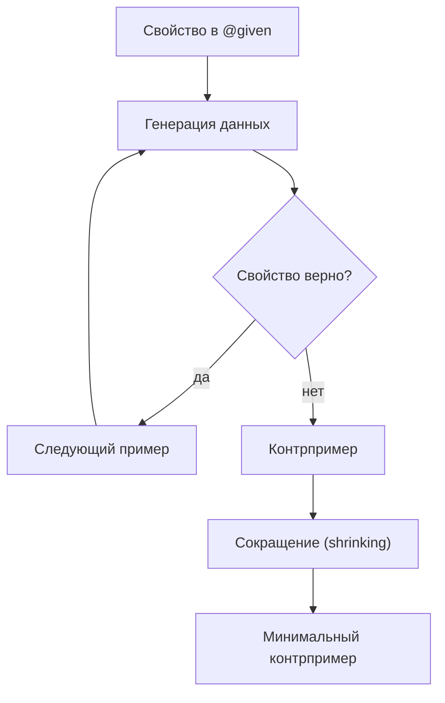

Обычные тесты проверяют код на конкретных примерах: `add(2, 3) == 5`. Но что если баг прячется в `add(-0.001, 0.001)` или в огромной строке? Писать примеры на все случаи невозможно. **Property-based тестирование** решает эту проблему иначе: мы описываем *свойство*, которое должно выполняться всегда, а библиотека сама генерирует сотни входных данных и проверяет его.

## Библиотека hypothesis

Установка:

```bash
pip install hypothesis
```

Базовый приём — декоратор `@given` и стратегии из `hypothesis.strategies`:

```python
from hypothesis import given
from hypothesis import strategies as st

@given(st.integers(), st.integers())
def test_add_commutative(a, b):
    assert a + b == b + a
```

Hypothesis сгенерирует сотни пар целых чисел (включая ноль, отрицательные, экстремально большие) и для каждой проверит свойство: `a + b == b + a`. Если свойство нарушится, hypothesis найдет минимальный контрпример.

## Стратегии

Стратегии — это генераторы данных:

- `st.integers()` — целые числа (можно ограничить: `st.integers(min_value=1, max_value=1000)`);
- `st.floats()` — дробные числа;
- `st.text()` — строки (есть `st.text(alphabet="abc")`);
- `st.lists(st.integers())` — списки чисел;
- `st.booleans()`, `st.dictionaries(st.text(), st.integers())`, `st.sampled_from([...])`.

Стратегии можно комбинировать и строить сложные структуры:

```python
@given(st.lists(st.integers()))
def test_sorted_idempotent(lst):
    assert sorted(sorted(lst)) == sorted(lst)
```

## assume: фильтрация

Иногда свойство осмысленно не для всех входов. Например, деление определено не при нулевом знаменателе. Функция `assume` отбрасывает неинтересные примеры:

```python
@given(st.integers(), st.integers())
def test_division(a, b):
    assume(b != 0)
    result = a / b
    assert isinstance(result, float)
```

Если `assume` слишком часто отбрасывает входы, hypothesis сообщит об этом — это сигнал, что стратегия слишком широкая для свойства.

## Поиск минимального контрпримера

Допустим, свойство ложно. Напишем «почти правильную» функцию и свойство для неё:

```python
def bad_reverse(s):
    return s[:-1][::-1] if s else ""

@given(st.text())
def test_reverse_identity(s):
    assert bad_reverse(bad_reverse(s)) == s
```

Hypothesis быстро найдёт контрпример: например, `s = "a"`. Но главное — она **сократит** (shrinking) его до минимального: вместо длинной строки покажет `"a"`, с которым проще думать. Автоматическое сокращение — одна из главных ценностей hypothesis.

## Порядок: сначала свойство, потом примеры

Property-based тесты не заменяют обычные — они их дополняют. Обычные примеры фиксируют известные случаи, а property-тесты ищут неизвестные ломки. Начинай с простых свойств (идемпотентность, коммутативность, инвариантность), а затем комбинируй стратегии.



## Итог

Property-based тестирование — это сдвиг мышления: не «проверь этот пример», а «проверь, что это свойство держится для всех данных такого рода». Hypothesis берёт на себя генерацию и сокращение контрпримеров.

Теперь закрепим всё практикой.

<!--TASK-->
### Задача 1
Напиши свойство коммутативности сложения: `a + b == b + a` для любых целых чисел через `@given(st.integers(), st.integers())`. Добавь второе свойство: ассоциативность `(a + b) + c == a + (b + c)`. Запусти тесты и убедись, что оба свойства проходят на сотнях сгенерированных примеров.

### Задача 2
Напиши свойство для функции `sorted()`: список, отсортированный дважды, равен отсортированному один раз: `sorted(sorted(lst)) == sorted(lst)` — для любых списков целых чисел. Добавь второе свойство: после сортировки длина не меняется: `len(sorted(lst)) == len(lst)`. Запусти — оба свойства должны пройти.

### Задача 3
Напиши функцию `reverse_str(s)`, которая переворачивает строку (через срез `s[::-1]`), и два свойства: `reverse_str(reverse_str(s)) == s` (двойной разворот возвращает оригинал) и `len(reverse_str(s)) == len(s)` для любых строк. Запусти тесты — свойства должны пройти.

### Задача 4
Напиши функцию `divide(a, b)`, возвращающую `a / b`, и свойство с `assume`: для любых целых `a`, `b`, где `b != 0`, результат `divide(a, b)` — это `float`, и умножение результата обратно на `b` равно `a` (в пределах погрешности: используй `pytest.approx`). Запусти — свойство должно пройти.

### Задача 5
Найди контрпример. Напиши «сломанную» функцию `mystery(x)`, которая возвращает `x * 2` для нечётных и `x * 3` для чётных, и свойство: `mystery(x) % 2 == x % 2` для любых целых `x`. Запусти тест и посмотри, какой контрпример найдёт hypothesis и до какого минимального значения он его сократит. Объясни, почему свойство нарушается.
### Задача 6
Напиши два свойства для встроенных `min` и `max` на непустых списках целых чисел. Стратегия — `st.lists(st.integers(), min_size=1)`, иначе на пустом списке обе функции бросят `ValueError`. Первое свойство: `min(lst) <= max(lst)`. Второе: каждое из значений `min(lst)` и `max(lst)` действительно присутствует в списке — проверь через `in lst`. Запусти pytest — ожидаемый вывод `2 passed`, каждый тест прогоняется на сотнях списков разной длины.

### Задача 7
Напиши рекурсивную функцию `factorial(n)` и два свойства: `factorial(n) >= 1` для `n >= 0` и `factorial(n) == n * factorial(n - 1)` для `n >= 1`. Ограничь стратегию через `st.integers(min_value=0, max_value=10)`. Добавь `@settings(max_examples=200)` и зафиксируй граничный случай декоратором `@example(0)` — ноль должен давать `1`. Запусти pytest: ожидаемый вывод `2 passed`, причём пример 0 проверяется в каждом прогоне независимо от генератора.
<!--/TASK-->

<!--HINT-->
### Подсказка 1
Импорты: `from hypothesis import given` и `from hypothesis import strategies as st`. Декоратор `@given(st.integers(), st.integers())` над функцией с параметрами `(a, b)`. Для ассоциативности нужен третий параметр: `@given(st.integers(), st.integers(), st.integers())`.

### Подсказка 2
Стратегия списков — `st.lists(st.integers())`, она генерирует и пустые, и большие списки. Функция теста принимает один параметр `lst`. Сравнение `sorted(sorted(lst)) == sorted(lst)` — классическое свойство идемпотентности.

### Подсказка 3
Стратегия строк — `st.text()`. Для двойного разворота просто вызови `reverse_str` дважды: `reverse_str(reverse_str(s))`. Следи, чтобы функция корректно работала с пустой строкой.

### Подсказка 4
`from math import isclose` или `import pytest` и `pytest.approx`. Внутри теста: `assume(b != 0)` обязательно до вычислений. Проверь `isinstance(divide(a, b), float)` и `divide(a, b) * b == pytest.approx(a)`.

### Подсказка 5
Свойство нарушается для чётных чисел: для них `mystery(x) = x * 3`, что меняет чётность. Подумай, при каком минимальном чётном `x` это видно. Hypothesis покажет сокращённый контрпример в сообщении о падении.
### Подсказка 6
`min_size=1` — ключевой параметр: без него hypothesis сгенерирует пустой список и `min()` упадёт с `ValueError`, хотя свойство тут ни при чём. Второе свойство формулируется как два `assert`: `assert min(lst) in lst` и `assert max(lst) in lst`. Оба теста принимают один параметр `lst`.

### Подсказка 7
`@settings` импортируется из `hypothesis`: `from hypothesis import given, settings, example`. Декоратор `@example(0)` ставится рядом с `@given` и добавляет конкретный пример к сгенерированным. В рекурсивной функции не забудь базу: `if n == 0: return 1`. Для второго свойства ограничь стратегию снизу единицей, иначе при `n = 0` получится `factorial(-1)`.
<!--/HINT-->

<!--SOLUTION-->
### Разбор 1
Решение:

```python
from hypothesis import given
from hypothesis import strategies as st

@given(st.integers(), st.integers())
def test_add_commutative(a, b):
    assert a + b == b + a

@given(st.integers(), st.integers(), st.integers())
def test_add_associative(a, b, c):
    assert (a + b) + c == a + (b + c)
```

Запуск: `python -m pytest`. Результат: `2 passed` (каждый — на сотнях сгенерированных примеров).

Что здесь происходит? `st.integers()` генерирует целые числа от очень маленьких до очень больших, включая ноль и отрицательные. Hypothesis подбирает для каждого свойства сотни примеров и прогоняет тест на каждом. Коммутативность и ассоциативность — базовые свойства, которые обязаны выполняться для любых целых; если бы `add` (здесь — встроенный `+`) работала неверно на каких-то экстремальных значениях, hypothesis нашла бы это. Обрати внимание: тест описывает *правило*, а не конкретные числа, — поэтому он не устаревает при изменении данных.

### Разбор 2
Решение:

```python
from hypothesis import given
from hypothesis import strategies as st

@given(st.lists(st.integers()))
def test_sorted_idempotent(lst):
    assert sorted(sorted(lst)) == sorted(lst)

@given(st.lists(st.integers()))
def test_sorted_len(lst):
    assert len(sorted(lst)) == len(lst)
```

Запуск: `python -m pytest`. Результат: `2 passed`.

Что здесь происходит? `st.lists(st.integers())` генерирует списки целых чисел: пустые, короткие, длинные, с повторяющимися элементами. Свойство идемпотентности говорит: повторная сортировка не меняет результат — сортировка уже отсортированного списка даёт тот же список. Свойство с длиной защищает от ситуаций, когда «сортировка» вдруг теряет элементы. Оба свойства проверяются на сотнях различных списков. Именно так property-тесты ловят тонкие ошибки: например, если бы `sorted` случайно отбрасывала дубликаты, свойство длины мгновенно бы это обнаружило.

### Разбор 3
Решение:

```python
from hypothesis import given
from hypothesis import strategies as st

def reverse_str(s):
    return s[::-1]

@given(st.text())
def test_reverse_twice(s):
    assert reverse_str(reverse_str(s)) == s

@given(st.text())
def test_reverse_len(s):
    assert len(reverse_str(s)) == len(s)
```

Запуск: `python -m pytest`. Результат: `2 passed`.

Что здесь происходит? `st.text()` генерирует строки: пустые, из одного символа, длинные, с юникод-символами. Двойной разворот должен возвращать оригинал — это сильное свойство: если бы `reverse_str` теряла символ или меняла порядок, оно бы мгновенно показало контрпример. Свойство длины проверяет, что ни один символ не теряется. Обрати внимание: `s[::-1]` работает и с пустой строкой — свойство это охватывает. Если бы ты написал `reverse_str` вручную и ошибся на граничных случаях, hypothesis нашла бы минимальный контрпример.

### Разбор 4
Решение:

```python
import pytest
from hypothesis import given, assume
from hypothesis import strategies as st

def divide(a, b):
    return a / b

@given(st.integers(), st.integers())
def test_divide(a, b):
    assume(b != 0)
    result = divide(a, b)
    assert isinstance(result, float)
    assert result * b == pytest.approx(a)
```

Запуск: `python -m pytest`. Результат: `1 passed`.

Что здесь происходит? `assume(b != 0)` отбрасывает примеры с нулевым знаменателем — свойство деления не определено при `b == 0`. Если бы такого фильтра не было, hypothesis генерировала бы и ноль, и деление падало бы с `ZeroDivisionError`. Проверка `isinstance(result, float)` фиксирует, что `/` возвращает дробное число, а `result * b == pytest.approx(a)` — что деление обратно умножению (с учётом погрешности плавающей точки). Это сильное свойство: оно проверяет не конкретное значение, а *взаимосвязь* операций.

### Разбор 5
Решение:

```python
from hypothesis import given
from hypothesis import strategies as st

def mystery(x):
    if x % 2 == 0:
        return x * 3
    return x * 2

@given(st.integers())
def test_mystery_parity(x):
    assert mystery(x) % 2 == x % 2
```

Запуск: `python -m pytest`. Результат: тест падает, hypothesis находит и сокращает контрпример.

Что здесь происходит? Для нечётных `x` `mystery(x) = x * 2` — чётное, а `x % 2 == 1`, свойство нарушается уже для нечётных. Для чётных `mystery(x) = x * 3` — тоже чётное, и `x % 2 == 0`, тут свойство выполняется. Hypothesis найдёт контрпример (например, `x = 1`) и **сократит** его до минимального: `1`. В сообщении о падении ты увидишь сокращённый пример и объяснение. Главный урок: свойство было сформулировано неверно (оно не отражает реальное поведение), и property-тест это доказал. Так hypothesis помогает находить ошибки и в коде, и в самих тестах.
### Разбор 6
Решение:

```python
from hypothesis import given
from hypothesis import strategies as st

@given(st.lists(st.integers(), min_size=1))
def test_min_not_greater_than_max(lst):
    assert min(lst) <= max(lst)

@given(st.lists(st.integers(), min_size=1))
def test_extremes_belong_to_list(lst):
    assert min(lst) in lst
    assert max(lst) in lst
```

Запуск: `python -m pytest`. Результат: `2 passed`.

Что здесь происходит? Стратегия генерирует списки целых чисел длиной от одного элемента до нескольких десятков, включая отрицательные числа и дубликаты. Первое свойство — базовая согласованность: минимум не может быть больше максимума. Второе сильнее: оно требует, чтобы экстремум был реальным элементом списка, а не вычисленным значением «из воздуха». Если бы реализация `max` возвращала, например, сумму, второе свойство упало бы мгновенно, а первое могло бы остаться зелёным. Параметр `min_size=1` убирает пустой список: без него hypothesis честно нашла бы `[]` как контрпример, но падение было бы связано с предусловием функции, а не с нарушением свойства. Это типичная ошибка новичков — путать границы домена с багом.

### Разбор 7
Решение:

```python
from hypothesis import given, settings, example
from hypothesis import strategies as st

def factorial(n):
    if n == 0:
        return 1
    return n * factorial(n - 1)

@settings(max_examples=200)
@given(st.integers(min_value=0, max_value=10))
@example(0)
def test_factorial_positive(n):
    assert factorial(n) >= 1

@settings(max_examples=200)
@given(st.integers(min_value=1, max_value=10))
@example(1)
def test_factorial_recurrence(n):
    assert factorial(n) == n * factorial(n - 1)
```

Запуск: `python -m pytest`. Результат: `2 passed`.

Что здесь происходит? `st.integers(min_value=0, max_value=10)` сужает домен до значений, где рекурсия гарантированно завершается: на больших числах функция быстро упрётся в предел рекурсии, и это было бы проблемой реализации, а не свойства. `@settings(max_examples=200)` задаёт количество генерируемых примеров — по умолчанию их сто, двести дают больше шансов задеть редкую комбинацию при небольшом времени прогона. `@example(0)` добавляет фиксированный пример поверх случайных: ноль — единственный случай, где срабатывает база рекурсии, и генератор может его не выбрать. Второе свойство проверяет рекуррентное соотношение, то есть связь между соседними значениями, — такое свойство ловит ошибку в множителе или в базе, даже если отдельные значения выглядят правдоподобно.
<!--/SOLUTION-->

<!--QUIZ-->
Что такое property-based тестирование?
- Проверка свойств кода на сотнях сгенерированных входных данных
- Проверка только конкретных примеров
- Тестирование свойств классов
* Правильный ответ: Проверка свойств кода на сотнях сгенерированных входных данных
Мы описываем правило, а hypothesis генерирует данные и проверяет его.

Что делает декоратор @given?
- Помечает тест как медленный
- Передаёт в тест сгенерированные данные по стратегиям
- Пропускает тест
* Правильный ответ: Передаёт в тест сгенерированные данные по стратегиям
@given(st.integers()) сгенерирует сотни целых чисел и прогонит тест на каждом.

Что генерирует st.lists(st.integers())?
- Список из случайных чисел фиксированной длины
- Списки целых чисел: пустые, короткие, длинные
- Только пустые списки
* Правильный ответ: Списки целых чисел: пустые, короткие, длинные
Стратегия покрывает широкий класс списков, включая граничные случаи.

Для чего используется assume(b != 0)?
- Чтобы округлить результат деления
- Чтобы отбросить примеры, где свойство не определено
- Чтобы ускорить генерацию
* Правильный ответ: Чтобы отбросить примеры, где свойство не определено
assume фильтрует входные данные, для которых свойство не имеет смысла.

Что произойдёт, если свойство нарушится?
- Тест молча пропустится
- Hypothesis найдёт контрпример и сократит его до минимального
- Тест перестанет работать навсегда
* Правильный ответ: Hypothesis найдёт контрпример и сократит его до минимального
Автоматическое сокращение (shrinking) — ключевая функция hypothesis: она показывает самый простой пример, ломающий свойство.

Какую стратегию использовать для строк?
- st.text()
- st.str()
- st.strings()
* Правильный ответ: st.text()
st.text() генерирует строки, включая пустые и с юникод-символами.

Какой символ переворачивает строку в Python?
- s[::-1]
- s[-1]
- s.reverse()
* Правильный ответ: s[::-1]
Срез с шагом -1 возвращает перевёрнутую строку.

Чем property-тесты отличаются от обычных?
- Они не используют assert
- Они проверяют правила на множестве данных, а не отдельные примеры
- Они работают только с числами
* Правильный ответ: Они проверяют правила на множестве данных, а не отдельные примеры
Обычные тесты фиксируют известные случаи, property-тесты ищут неизвестные ломки.
Что делает стратегия st.sampled_from(["a", "b", "c"])?
- Выбирает значения из заданного списка
- Генерирует случайные строки любой длины
- Возвращает весь список целиком
* Правильный ответ: Выбирает значения из заданного списка
Стратегия полезна, когда домен — небольшой известный набор вариантов.

Зачем нужен декоратор @example(0)?
- Добавляет фиксированный пример к сгенерированным данным
- Отключает генерацию
- Ограничивает число примеров одним
* Правильный ответ: Добавляет фиксированный пример к сгенерированным данным
Так закрепляют важный граничный случай, который генератор может пропустить.

Как ограничить количество генерируемых примеров?
- @settings(max_examples=200)
- @given(count=200)
- @example(200)
* Правильный ответ: @settings(max_examples=200)
Параметр max_examples задаёт число прогонов на одно свойство.

Что означает st.integers(min_value=1)?
- Стратегия не генерирует числа меньше 1
- Генерирует только число 1
- Генерирует ровно одно значение
* Правильный ответ: Стратегия не генерирует числа меньше 1
Границы задают домен, внутри которого hypothesis ищет примеры.
<!--/QUIZ-->
