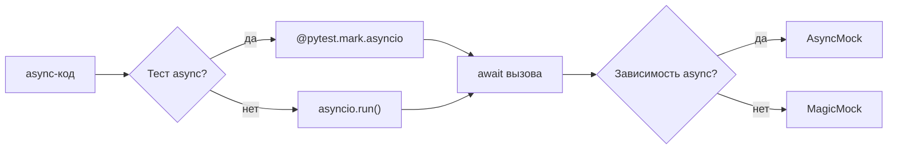

Код на `async`/`await` нельзя тестировать как обычный: тестовая функция тоже должна быть асинхронной, а событийный цикл нужно подготовить заранее. В этом уроке разберём, как это делать с помощью `pytest-asyncio` и `AsyncMock`.

## pytest-asyncio: асинхронные тесты

Установка:

```bash
pip install pytest-asyncio
```

После этого можно писать тесты, которые объявляются как `async def` и помечаются `@pytest.mark.asyncio`:

```python
import asyncio
import pytest

async def slow_add(a, b):
    await asyncio.sleep(0.01)
    return a + b

@pytest.mark.asyncio
async def test_slow_add():
    assert await slow_add(1, 2) == 3
```

pytest-asyncio сам создаёт событийный цикл, запускает в нём корутину-тест и убирает цикл после. Параметр `loop_scope` в маркере позволяет управлять временем жизни цикла: `@pytest.mark.asyncio(loop_scope="session")` переиспользует один цикл на все тесты сессии (удобно для медленных фикстур).

## async-функции без маркера

Если тест синхронный, но нужно вызвать одну async-функцию, используй `asyncio.run()`:

```python
def test_slow_add_sync():
    assert asyncio.run(slow_add(1, 2)) == 3
```

`asyncio.run()` создаёт новый цикл, выполняет корутину и закрывает цикл. Это простой приём для точечных проверок.

## AsyncMock

Для асинхронных зависимостей (например, `client.get` из HTTP-клиента) обычный `MagicMock` не подходит: `await mock.get(url)` упадёт, потому что `MagicMock` возвращает не корутину. Решение — `AsyncMock` из `unittest.mock`:

```python
from unittest.mock import AsyncMock

async def fetch_data(client, url):
    return await client.get(url)

def test_fetch_data():
    client = AsyncMock()
    client.get.return_value = "ok"
    assert asyncio.run(fetch_data(client, "/data")) == "ok"
```

`AsyncMock` возвращает awaitable, поэтому `await client.get(url)` работает. Можно даже задавать `side_effect` с исключениями — например, чтобы протестировать обработку сбоя сети.

## Асинхронные фикстуры

Фикстуры тоже могут быть асинхронными — `async def` с `@pytest.fixture`, и pytest-asyncio корректно их запустит:

```python
@pytest.fixture
async def client():
    c = make_client()
    yield c
    await c.close()
```

Тест-корутина получает такую фикстуру как обычный параметр.

## Таймауты

Асинхронный код часто работает с сетью, и важно проверять поведение при зависаниях. Контекстный менеджер `asyncio.timeout` (Python 3.11+) ограничивает время выполнения и бросает `asyncio.TimeoutError`:

```python
async def hang():
    await asyncio.sleep(10)

@pytest.mark.asyncio
async def test_hang_timeout():
    with pytest.raises(asyncio.TimeoutError):
        async with asyncio.timeout(0.01):
            await hang()
```

Если код не уложился в таймаут — тест это фиксирует. Это основа проверки «не зависает ли наш код».

## Параллельность: asyncio.gather

`asyncio.gather` выполняет корутины параллельно. Свойство для проверки: результат собирается в том же порядке, что и переданные корутины:

```python
async def collect(ids):
    return await asyncio.gather(*(fetch(i) for i in ids))
```

Тест проверяет, что порядок результатов совпадает с порядком `ids` — это контракт `gather`.



## Итог

Для асинхронных тестов нужен `pytest-asyncio` с маркером `@pytest.mark.asyncio`, для подмены асинхронных зависимостей — `AsyncMock`, а для проверки таймаутов — `asyncio.timeout`.

Теперь закрепим всё практикой.

<!--TASK-->
### Задача 1
Напиши async-функцию `greet_async(name)`, которая делает `await asyncio.sleep(0.01)` и возвращает `f"Привет, {name}!"`. Создай тест `test_greet_async` с `@pytest.mark.asyncio`, который проверяет, что `await greet_async("Аня") == "Привет, Аня!"`. Установи `pytest-asyncio`, запусти pytest — должно быть `1 passed`.

### Задача 2
Напиши синхронный тест `test_greet_sync`, который вызывает `greet_async` через `asyncio.run()`, без маркера `@pytest.mark.asyncio`. Проверь тот же результат. Запусти — должно быть `2 passed` (два теста из задач 1 и 2).

### Задача 3
Напиши async-функцию `fetch_data(client, url)`, которая возвращает `await client.get(url)`. Создай тест с `AsyncMock`: назначь `client.get.return_value = "ok"`, вызови `fetch_data` через `asyncio.run` и проверь, что результат равен `"ok"`, а `client.get.assert_called_once_with("/data")`. Запусти — `3 passed` (все три теста).

### Задача 4
Напиши async-функцию `fetch_with_timeout(client, url, timeout)`, которая оборачивает вызов `await client.get(url)` в `async with asyncio.timeout(timeout)`. Создай тест: `AsyncMock` с `client.get.side_effect = asyncio.TimeoutError()`, и проверь через `pytest.raises(asyncio.TimeoutError)`, что вызов `fetch_with_timeout(client, "/data", 1)` бросает таймаут. Запусти — `4 passed`.

### Задача 5
Напиши async-функцию `fetch_all(ids)`, которая собирает результаты через `asyncio.gather(*(fetch(i) for i in ids))`, где `fetch(i)` — это `async` функция, возвращающая `f"data-{i}"`. Напиши тест: передай `[1, 2, 3]` и проверь, что результат равен `["data-1", "data-2", "data-3"]` — порядок сохраняется. Запусти — `5 passed`.
### Задача 6
Напиши асинхронную фикстуру `api_client`, которая создаёт `AsyncMock`, настраивает `client.get.return_value = {"status": "ok"}`, отдаёт клиент через `yield`, а после теста выставляет `client.closed = True`. Тест `test_ping` с маркером `@pytest.mark.asyncio` принимает фикстуру, делает `await api_client.get("/ping")` и проверяет результат, а также `assert_awaited_once_with("/ping")`. Запусти pytest — ожидаемый вывод `1 passed`; убедись, что очистка выполняется даже при падении теста.

### Задача 7
Напиши async-функцию `fetch_safe(ids)`, которая параллельно вызывает `fetch(i)` и собирает результаты через `asyncio.gather(..., return_exceptions=True)`. Функция `fetch(i)` возвращает `f"data-{i}"`, но для `i == 2` бросает `ValueError("bad id")`. Напиши тест с `@pytest.mark.asyncio`: для `[1, 2, 3]` результат должен содержать `"data-1"`, объект `ValueError` и `"data-3"` — проверь типы элементов и то, что остальные значения не потерялись. Запусти pytest — ожидаемый вывод `1 passed`.
<!--/TASK-->

<!--HINT-->
### Подсказка 1
Не забудь `pip install pytest-asyncio`. Тест объявляется `async def test_greet_async():` с декоратором `@pytest.mark.asyncio`. Внутри — `assert await greet_async("Аня") == "Привет, Аня!"`. Событийный цикл создаст pytest-asyncio автоматически.

### Подсказка 2
Синхронный тест — обычная `def` без декоратора. Внутри вызови `asyncio.run(greet_async("Аня"))`. Обрати внимание: `asyncio.run` создаёт новый цикл и закрывает его после выполнения.

### Подсказка 3
`from unittest.mock import AsyncMock`. Создай `client = AsyncMock()`, назначь `client.get.return_value = "ok"`. Вызов `fetch_data` — через `asyncio.run(fetch_data(client, "/data"))`, так как тест синхронный. После вызова проверь `client.get.assert_called_once_with("/data")`.

### Подсказка 4
`asyncio.timeout(timeout)` — контекстный менеджер: `async with asyncio.timeout(timeout):`. Он бросает `asyncio.TimeoutError`, если внутренний код не успел. Для проверки используй `with pytest.raises(asyncio.TimeoutError):` вокруг вызова через `asyncio.run`.

### Подсказка 5
`fetch` — вспомогательная async-функция: `async def fetch(i): return f"data-{i}"`. `asyncio.gather(*(fetch(i) for i in ids))` принимает корутины через распаковку `*`. В тесте сравни `asyncio.run(fetch_all([1, 2, 3]))` с `["data-1", "data-2", "data-3"]`.
### Подсказка 6
Фикстура объявляется как `async def` с `@pytest.fixture`. Внутри: `client = AsyncMock()`, `client.get.return_value = {"status": "ok"}`, `yield client`, `client.closed = True`. Фикстура и тест должны быть async — иначе `yield` в асинхронной функции не сработает как ожидание. У `AsyncMock` есть проверка `assert_awaited_once_with(...)`.

### Подсказка 7
`asyncio.gather(*(fetch(i) for i in ids), return_exceptions=True)` — флаг передаётся именованным аргументом после распаковки. При `return_exceptions=True` исключение попадает в результат как объект, а не выбрасывается наружу. Сравнивать исключения по значению не стоит — проверь `isinstance(result[1], ValueError)`.
<!--/HINT-->

<!--SOLUTION-->
### Разбор 1
Решение:

```python
import asyncio
import pytest

async def greet_async(name):
    await asyncio.sleep(0.01)
    return f"Привет, {name}!"

@pytest.mark.asyncio
async def test_greet_async():
    assert await greet_async("Аня") == "Привет, Аня!"
```

Запуск: `python -m pytest`. Результат: `1 passed`.

Что здесь происходит? Маркер `@pytest.mark.asyncio` сообщает pytest-asyncio, что тест — корутину и её нужно выполнить в событийном цикле. pytest-asyncio создаёт цикл, запускает в нём тест и после завершения убирает его. Функция `greet_async` имитирует реальную асинхронную работу через `asyncio.sleep(0.01)` — настоящий ввод-вывод (сеть, диск) ведёт себя похоже: код ждёт, не блокируя основной поток. Тест корректно `await`-ит вызов и сравнивает результат.

### Разбор 2
Решение:

```python
import asyncio
import pytest

async def greet_async(name):
    await asyncio.sleep(0.01)
    return f"Привет, {name}!"

@pytest.mark.asyncio
async def test_greet_async():
    assert await greet_async("Аня") == "Привет, Аня!"

def test_greet_sync():
    assert asyncio.run(greet_async("Аня")) == "Привет, Аня!"
```

Запуск: `python -m pytest`. Результат: `2 passed`.

Что здесь происходит? Синхронный тест `test_greet_sync` не требует маркера: `asyncio.run()` создаёт новый событийный цикл, выполняет корутину `greet_async("Аня")` и закрывает цикл. Это удобно, когда async-функцию нужно проверить точечно из обычного теста. Обрати внимание на разницу: `pytest.mark.asyncio` работает с уже созданным pytest-asyncio циклом, а `asyncio.run` сам управляет жизнью цикла. В одном файле можно смешивать оба подхода — как здесь.

### Разбор 3
Решение:

```python
import asyncio
from unittest.mock import AsyncMock

async def fetch_data(client, url):
    return await client.get(url)

def test_fetch_data():
    client = AsyncMock()
    client.get.return_value = "ok"
    result = asyncio.run(fetch_data(client, "/data"))
    assert result == "ok"
    client.get.assert_called_once_with("/data")
```

Запуск: `python -m pytest`. Результат: `3 passed`.

Что здесь происходит? `AsyncMock` — это асинхронный аналог `MagicMock`: его методы возвращают awaitable, поэтому `await client.get(url)` работает. Обычный `MagicMock` здесь не подошёл бы: `await` на результате `MagicMock` упал бы с ошибкой «object is not awaitable». `client.get.return_value = "ok"` настраивает результат вызова, а `assert_called_once_with("/data")` проверяет, что метод вызван ровно один раз с правильным URL. Так мы изолируем тест от настоящего сетевого клиента.

### Разбор 4
Решение:

```python
import asyncio
import pytest
from unittest.mock import AsyncMock

async def fetch_with_timeout(client, url, timeout):
    async with asyncio.timeout(timeout):
        return await client.get(url)

def test_fetch_timeout():
    client = AsyncMock()
    client.get.side_effect = asyncio.TimeoutError()
    with pytest.raises(asyncio.TimeoutError):
        asyncio.run(fetch_with_timeout(client, "/data", 1))
```

Запуск: `python -m pytest`. Результат: `4 passed`.

Что здесь происходит? `asyncio.timeout(timeout)` — контекстный менеджер: если внутренний код не завершился за отведённое время, он бросает `asyncio.TimeoutError`. В тесте мы имитируем зависание сети: `client.get.side_effect = asyncio.TimeoutError()` заставляет каждый вызов бросать таймаут. Обёртка `pytest.raises(asyncio.TimeoutError)` проверяет, что `fetch_with_timeout` пробрасывает исключение наружу — значит, вызывающий код сможет его обработать. Это классическая проверка устойчивости к зависаниям.

### Разбор 5
Решение:

```python
import asyncio
import pytest

async def fetch(i):
    return f"data-{i}"

async def fetch_all(ids):
    return await asyncio.gather(*(fetch(i) for i in ids))

@pytest.mark.asyncio
async def test_fetch_all():
    result = await fetch_all([1, 2, 3])
    assert result == ["data-1", "data-2", "data-3"]
```

Запуск: `python -m pytest`. Результат: `5 passed`.

Что здесь происходит? `asyncio.gather` принимает корутины и запускает их параллельно. Распаковка `*(fetch(i) for i in ids)` превращает генератор в отдельные аргументы. Важное свойство `gather`: результаты собираются в том же порядке, в котором были переданы корутины, — независимо от того, какая завершилась первой. Тест проверяет именно этот контракт: список `["data-1", "data-2", "data-3"]` соответствует порядку `ids`. Если бы ты написал свою версию параллельной обработки, такое свойство поймало бы ошибку с порядком.
### Разбор 6
Решение:

```python
import pytest
from unittest.mock import AsyncMock

@pytest.fixture
async def api_client():
    client = AsyncMock()
    client.get.return_value = {"status": "ok"}
    yield client
    client.closed = True

@pytest.mark.asyncio
async def test_ping(api_client):
    result = await api_client.get("/ping")
    assert result == {"status": "ok"}
    api_client.get.assert_awaited_once_with("/ping")
    assert api_client.closed is False
```

Запуск: `python -m pytest`. Результат: `1 passed`.

Что здесь происходит? Асинхронная фикстура устроена как обычная yield-фикстура, но её тело выполняется в событийном цикле: pytest-asyncio дожидается настройки перед тестом и очистки после. В настройке создаётся `AsyncMock` с заранее заданным ответом — реальный HTTP-клиент не нужен. Тест проверяет и результат, и сам факт `await`: `assert_awaited_once_with` удостоверяет, что корутину действительно дождались ровно один раз с нужным путём. Строка `assert api_client.closed is False` стоит внутри теста, то есть до очистки, — после `yield` фикстура выставит `closed = True`, и это уже не увидит ни один assert. Очистка выполнится даже при падении теста — то же преимущество yield-фикстур, что и в синхронном pytest.

### Разбор 7
Решение:

```python
import asyncio
import pytest

async def fetch(i):
    if i == 2:
        raise ValueError("bad id")
    return f"data-{i}"

async def fetch_safe(ids):
    return await asyncio.gather(
        *(fetch(i) for i in ids), return_exceptions=True)

@pytest.mark.asyncio
async def test_fetch_safe():
    result = await fetch_safe([1, 2, 3])
    assert len(result) == 3
    assert result[0] == "data-1"
    assert isinstance(result[1], ValueError)
    assert str(result[1]) == "bad id"
    assert result[2] == "data-3"
```

Запуск: `python -m pytest`. Результат: `1 passed`.

Что здесь происходит? Без флага `return_exceptions` первый же `ValueError` отменил бы `gather`, и два других результата потерялись бы. С флагом `True` каждая корутина завершается независимо: успешные значения возвращаются как обычно, а исключение — как объект в соответствующей позиции списка. Поэтому длина результата всегда равна длине `ids`, и порядок сохраняется. Тест проверяет три вещи: что ошибка не прервала остальные запросы, что на её месте именно `ValueError` с нужным сообщением, и что соседние значения уцелели. Такой шаблон полезен для массовых операций, где один сбойный элемент не должен ронять всю пачку, — например, при синхронизации списка товаров с внешним сервисом.
<!--/SOLUTION-->

<!--QUIZ-->
Какой маркер нужен для асинхронного теста в pytest-asyncio?
- @pytest.mark.asyncio
- @pytest.mark.async
- @pytest.mark.coro
* Правильный ответ: @pytest.mark.asyncio
Маркер указывает pytest-asyncio, что тест — это корутину, которую нужно выполнить в событийном цикле.

Как вызвать async-функцию из синхронного теста?
- Через asyncio.run()
- Через await без подготовки
- Через asyncio.sleep()
* Правильный ответ: Через asyncio.run()
asyncio.run() создаёт цикл, выполняет корутину и закрывает цикл.

Почему для асинхронных зависимостей нужен AsyncMock, а не MagicMock?
- MagicMock не существует в Python
- Результат MagicMock не является awaitable, и await упадёт
- AsyncMock быстрее
* Правильный ответ: Результат MagicMock не является awaitable, и await упадёт
AsyncMock возвращает awaitable, поэтому await client.get(url) работает.

Что бросает asyncio.timeout при превышении времени?
- TimeoutError из asyncio
- RuntimeError
- KeyboardInterrupt
* Правильный ответ: TimeoutError из asyncio
Контекстный менеджер asyncio.timeout отменяет выполнение и бросает asyncio.TimeoutError.

В каком порядке asyncio.gather возвращает результаты?
- В порядке завершения корутин
- В порядке передачи корутин
- В случайном порядке
* Правильный ответ: В порядке передачи корутин
gather собирает результаты в том же порядке, в котором переданны корутины.

Что произойдёт с обычным тестом (def), содержащим await?
- Он выполнится корректно
- Произойдёт синтаксическая ошибка, потому что await допустим только внутри async-функции
- Ошибка не возникнет, но await проигнорируется
* Правильный ответ: Произойдёт синтаксическая ошибка
await можно использовать только внутри функций, объявленных с async.

Что делает pytest-asyncio под капотом?
- Создаёт событийный цикл, выполняет тест-корутину и убирает цикл
- Конвертирует async в sync
- Ускоряет тесты
* Правильный ответ: Создаёт событийный цикл, выполняет тест-корутину и убирает цикл
Маркер @pytest.mark.asyncio управляет жизнью цикла вокруг теста.

Как проверить, что async-функция бросает исключение?
- Обернуть вызов в with pytest.raises(...)
- Добавить try/except внутри теста
- Проверить код возврата
* Правильный ответ: Обернуть вызов в with pytest.raises(...)
pytest.raises перехватывает исключение и считает тест успешным, только если оно возникло.
Что проверяет assert_awaited_once_with("/ping") у AsyncMock?
- Что корутину дождались ровно один раз с аргументом "/ping"
- Что метод вернул строку "/ping"
- Что мок создан с аргументом "/ping"
* Правильный ответ: Что корутину дождались ровно один раз с аргументом "/ping"
Проверка учитывает именно await-вызовы, а не обычные обращения.

Что делает return_exceptions=True в asyncio.gather?
- Возвращает исключения как элементы результата, не прерывая остальные корутины
- Пробрасывает первое исключение наружу
- Игнорирует все исключения
* Правильный ответ: Возвращает исключения как элементы результата, не прерывая остальные корутины
Список результатов сохраняет длину и порядок исходных корутин.

Зачем указывать loop_scope="session" в маркере asyncio?
- Чтобы все тесты сессии работали в одном событийном цикле
- Чтобы тесты выполнялись параллельно
- Чтобы отключить таймауты
* Правильный ответ: Чтобы все тесты сессии работали в одном событийном цикле
Это удобно для тяжёлых фикстур, созданных один раз на сессию.

Что произойдёт, если забыть await перед вызовом корутины?
- Вернётся объект coroutine, а код внутри не выполнится
- Функция выполнится синхронно
- Возникнет NameError
* Правильный ответ: Вернётся объект coroutine, а код внутри не выполнится
Python лишь создаст корутину; для запуска нужен await или asyncio.run.
<!--/QUIZ-->
