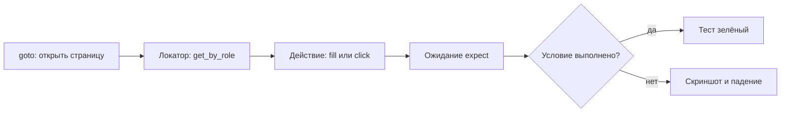

Юнит-тесты проверяют отдельные функции, но пользователь работает с готовым интерфейсом. Чтобы убедиться, что приложение целиком работает «как задумано» — от загрузки страницы до клика по кнопке — нужны E2E-тесты (end-to-end). Playwright — современная библиотека от Microsoft: она управляет настоящими браузерами (Chromium, Firefox, WebKit) и стабильна там, где старые инструменты падали.

```bash
pip install playwright
playwright install chromium
```

## Первый сценарий

```python
from playwright.sync_api import sync_playwright

with sync_playwright() as p:
    browser = p.chromium.launch(headless=True)
    page = browser.new_page()
    page.goto("https://example.com")
    print(page.title())          # Example Domain
    browser.close()
```

`page` — это вкладка. Все команды синхронные и ждут нужного состояния сами: `goto` дожидается загрузки, `click` — готовности элемента.

## Локаторы: как находить элементы

Устаревший способ — CSS-селекторы вроде `#submit`. Playwright предлагает семантические локаторы, которые читаются как человеческая инструкция:

```python
page.get_by_text("Войти")                  # текст на странице
page.get_by_role("button", name="Отправить")  # по роли и имени
page.get_by_label("Email")                 # по подписи поля
page.get_by_placeholder("Введите имя")     # по placeholder
```

`get_by_role` — самый надёжный: он использует дерево доступности, то есть видит элемент так же, как скринридер.

## Взаимодействие и проверки

```python
page.goto("https://example.com")
page.get_by_label("Имя").fill("Аня")
page.get_by_role("button", name="Отправить").click()
page.wait_for_timeout(500)  # не рекомендуется; лучше ждать события
```

Вместо жёстких пауз Playwright сам ожидает элемент перед действием: перед `fill` — что поле доступно, перед `click` — что кнопка кликабельна. Если элемент не появился за таймаут (по умолчанию 30 секунд) — тест упадёт с понятной ошибкой.

Проверки делаются через библиотеку ожиданий:

```python
from playwright.sync_api import expect

expect(page).to_have_title("Главная")
expect(page.get_by_text("Спасибо за заказ!")).to_be_visible()
```

## Скриншоты

```python
page.screenshot(path="home.png", full_page=True)
```

Скриншоты — лучший способ увидеть, что реально отображается: вёрстка, шрифты, перекрытия. В CI они становятся артефактами упавшего теста.

## Перехват сети

Иногда внешний API недоступен или медленный. Playwright умеет подменять ответы сети через `page.route`:

```python
def fake_api(route):
    route.fulfill(json={"balance": 999})

page.route("**/api/balance", fake_api)
page.goto("https://my-app.example")
```

Тест проверяет интерфейс в изоляции от внешних зависимостей.

## Тесты в pytest

С `pytest-playwright` фикстура `page` создаётся автоматически:

```python
# test_app.py
def test_header(page):
    page.goto("https://example.com")
    expect(page).to_have_title("Example Domain")
```

Запуск: `pytest --headed` (с окном браузера) или `pytest --browser firefox` (другой браузер). Каждый тест получает свежий контекст — между тестами ничего не протекает.



## Итог

- Playwright управляет настоящими браузерами; локаторы `get_by_role`/`get_by_text` читаются как инструкции.
- Действия ждут готовности элемента автоматически; проверки — через `expect`.
- `page.route` изолирует тесты от внешних API; скриншоты документируют состояние.
- `pytest-playwright` даёт фикстуру `page` для E2E-набора.

<!--TASK-->
### Задача 1
Напиши сценарий, который открывает `https://example.com`, выводит заголовок страницы через `page.title()`, проверяет, что виден текст «Example Domain», и делает скриншот страницы в файл `example.png`. Закрой браузер корректно через `with sync_playwright()` и `browser.close()`.

### Задача 2
Напиши функцию `login(page)`, которая заполняет форму логина: поле с label «Email» — значением `user@example.com`, поле с label «Пароль» — `secret`, и кликает по кнопке с ролью `button` и именем «Войти». После этого проверь через `expect`, что появилось сообщение «Добро пожаловать!». Используй `get_by_label` и `get_by_role`.

### Задача 3
Реализуй тест с `page.route`: подмени ответ на `**/api/balance`, вернув `{"balance": 999}`, затем открой страницу и проверь, что на странице виден текст «999». Обработчик маршрута должен использовать `route.fulfill(json=...)`. Проверь также, что текст «0» не виден.

### Задача 4
Напиши тест-сценарий проверки корзины: открой страницу, добавь товар кликом по кнопке «В корзину», перейди в корзину по ссылке с текстом «Корзина», и проверь, что товар виден в списке. Используй `get_by_text` для ссылок и кнопок. Добавь `page.wait_for_selector` для ожидания загрузки списка.

### Задача 5
Напиши pytest-тест с фикстурой `page`, который проверяет заголовок страницы и наличие кнопки «Отправить», а затем делает скриншот. Подготовь тест так, чтобы он запускался командой `pytest` без дополнительных флагов, и укажи в комментарии, как выполнить его с открытым окном браузера.
### Задача 6
Напиши тест `test_product_cards`, который открывает страницу каталога, ждёт появления списка и проверяет количество карточек товаров. Используй `page.get_by_role("listitem")` и `expect(...).to_have_count(3)`. Дополнительно проверь, что первая карточка содержит название «Питон для начинающих» через `to_contain_text`, а кнопок «В корзину» ровно три — `expect(page.get_by_role("button", name="В корзину")).to_have_count(3)`. Запусти pytest — ожидаемый вывод `1 passed`.

### Задача 7
Смоделируй сетевую ошибку: в тесте перехвати `**/api/balance` через `page.route` и вызови `route.abort()` вместо `fulfill`. Открой страницу и проверь, что интерфейс показывает сообщение «Не удалось загрузить баланс» и не показывает число. Проверь также, что запрос действительно был прерван: сохрани отметку в списке внутри обработчика и убедись, что получился `["aborted"]`. Запусти pytest — ожидаемый вывод `1 passed`.
<!--/TASK-->

<!--HINT-->
### Подсказка 1
`with sync_playwright() as p:` — контекстный менеджер; внутри запусти `p.chromium.launch(headless=True)`. Проверка видимости: `expect(page.get_by_text("Example Domain")).to_be_visible()`.

### Подсказка 2
`page.get_by_label("Email").fill("user@example.com")` — по подписи поля. Кнопка: `page.get_by_role("button", name="Войти").click()`. Проверка: `expect(page.get_by_text("Добро пожаловать!")).to_be_visible()`.

### Подсказка 3
`def fake_balance(route): route.fulfill(json={"balance": 999})` затем `page.route("**/api/balance", fake_balance)` до `goto`. Текст «999» ищи через `page.get_by_text("999")`. Проверка отсутствия: `expect(page.get_by_text("0")).not_to_be_visible()` (убедись, что «0» действительно нет на странице).

### Подсказка 4
`page.get_by_text("В корзину").click()` — если это кнопка, добавь `.first` при нескольких совпадениях. Ожидание: `page.wait_for_selector("text=Список товаров")` либо жди появления конкретного товара через expect.

### Подсказка 5
Фикстура приходит аргументом: `def test_main(page):`. `page.goto(...)`, затем `expect(page).to_have_title(...)` и `expect(page.get_by_role("button", name="Отправить")).to_be_visible()`. Запуск с окном: `pytest --headed`.
### Подсказка 6
`page.get_by_role("listitem")` возвращает локатор на все элементы списка сразу — его можно передать в `expect` с матчером `to_have_count`. Для первой карточки возьми `cards.first` и проверь `to_contain_text("Питон для начинающих")`. Матчеры `expect` сами ждут выполнения условия, поэтому `wait_for_timeout` не нужен.

### Подсказка 7
Обработчик маршрута: `def abort_balance(route): calls.append("aborted"); route.abort()`. `route.abort()` обрывает запрос без ответа — для страницы это выглядит как сетевая ошибка. Регистрируй маршрут до `page.goto`. Проверка отсутствия числа: `expect(page.get_by_text("999")).to_have_count(0)`.
<!--/HINT-->

<!--SOLUTION-->
### Разбор 1
```python
from playwright.sync_api import sync_playwright, expect

with sync_playwright() as p:
    browser = p.chromium.launch(headless=True)
    page = browser.new_page()
    page.goto("https://example.com")
    print(page.title())  # Example Domain
    expect(page.get_by_text("Example Domain")).to_be_visible()
    page.screenshot(path="example.png")
    browser.close()
```

`sync_playwright()` — контекстный менеджер: он корректно завершает процессы браузера даже при ошибке. `launch(headless=True)` запускает Chromium без окна — так можно гонять тесты на CI. `page.title()` возвращает `<title>`; проверка через `expect` падает с понятным сообщением, если текст не виден. Скриншот сохраняется в файл.

### Разбор 2
```python
from playwright.sync_api import expect

def login(page):
    page.get_by_label("Email").fill("user@example.com")
    page.get_by_label("Пароль").fill("secret")
    page.get_by_role("button", name="Войти").click()

def test_login_flow(page):
    login(page)
    expect(page.get_by_text("Добро пожаловать!")).to_be_visible()
```

`get_by_label` ищет поле по связанной подписи `<label>` — это учитывает и `placeholder`, и `aria-label`. `get_by_role("button", name="Войти")` находит кнопку по доступному имени. `click()` дожидается кликабельности: если кнопка перекрыта или заблокирована, Playwright будет ждать и в итоге упадёт с объяснением, что именно помешало.

### Разбор 3
```python
from playwright.sync_api import expect

def fake_balance(route):
    route.fulfill(json={"balance": 999})

def test_balance_mock(page):
    page.route("**/api/balance", fake_balance)
    page.goto("https://example.com")  # адрес любой: сеть перехвачена
    expect(page.get_by_text("999")).to_be_visible()
```

`page.route` перехватывает запросы, подходящие под шаблон `**/api/balance`. Обработчик вызывает `route.fulfill(json=...)` — ответ формируется прямо в тесте, без сети. Это позволяет проверять интерфейс при любом состоянии API: баланс 999, ошибка сервера, пустой список. Такой тест не зависит от внешних сервисов и не «зеленеет» из-за их сбоев.

### Разбор 4
```python
from playwright.sync_api import expect

def test_cart(page):
    page.goto("https://example.com/shop")
    page.get_by_text("В корзину").first.click()
    page.get_by_text("Корзина").click()
    page.wait_for_selector("text=Питон для начинающих")
    expect(page.get_by_text("Питон для начинающих")).to_be_visible()
```

`.first` берёт первый элемент из нескольких совпадений (например, на карточке товара кнопка «В корзину» повторяется). После клика по ссылке «Корзина» `wait_for_selector` ждёт появления строки товара — это надёжнее, чем фиксированная пауза. Затем `expect` окончательно подтверждает видимость. Такой сценарий повторяет путь реального пользователя: выбор, переход, проверка.

### Разбор 5
```python
# test_e2e.py
from playwright.sync_api import expect

def test_main_page(page):
    page.goto("https://example.com")
    expect(page).to_have_title("Example Domain")
    expect(page.get_by_role("button", name="Отправить")).to_be_visible()
    page.screenshot(path="report.png")

# Запуск:
#   pytest                      — без окна (headless)
#   pytest --headed             — с окном браузера
#   pytest --browser firefox    — в Firefox
```

Фикстура `page` из `pytest-playwright` создаёт свежий браузерный контекст для каждого теста: между тестами не остаётся cookies и состояния. `to_have_title` проверяет заголовок, `get_by_role` — доступность кнопки, скриншот сохраняет доказательство. Команда `pytest` запускает всё без флагов; `--headed` показывает браузер, что удобно при локальной отладке.
### Разбор 6
Решение:

```python
from playwright.sync_api import expect

def test_product_cards(page):
    page.goto("https://example.com/shop")
    cards = page.get_by_role("listitem")
    expect(cards).to_have_count(3)
    expect(cards.first).to_contain_text("Питон для начинающих")
    expect(page.get_by_role("button", name="В корзину")).to_have_count(3)
```

Запуск: `pytest`. Результат: `1 passed`.

Что здесь происходит? Локатор `get_by_role("listitem")` описывает не конкретный элемент, а правило поиска, поэтому `expect(cards).to_have_count(3)` умеет ждать: Playwright повторяет проверку, пока количество не станет равным трём или не истечёт таймаут. Это принципиально отличается от `len(cards.all())`, который сработал бы один раз и упал на медленной загрузке. `cards.first` — тот же локатор, суженный до первого совпадения; `to_contain_text` проверяет подстроку, а не точное равенство, поэтому название может соседствовать с ценой или рейтингом. Отдельная проверка количества кнопок ловит случай, когда карточки отрисовались, а кнопка «В корзину» пропала из-за ошибки в шаблоне.

### Разбор 7
Решение:

```python
from playwright.sync_api import expect

def test_balance_network_error(page):
    calls = []

    def abort_balance(route):
        calls.append("aborted")
        route.abort()

    page.route("**/api/balance", abort_balance)
    page.goto("https://example.com")
    expect(page.get_by_text("Не удалось загрузить баланс")).to_be_visible()
    expect(page.get_by_text("999")).to_have_count(0)
    assert calls == ["aborted"]
```

Запуск: `pytest`. Результат: `1 passed`.

Что здесь происходит? `page.route` перехватывает запросы, подходящие под шаблон, и передаёт управление нашему обработчику. В отличие от `fulfill`, метод `route.abort()` не отдаёт ответ: браузер видит сетевой сбой, и приложение обязано показать сообщение об ошибке вместо числа. Список `calls` — простая доказательная база: он подтверждает, что перехват действительно произошёл, а не что страница просто не запросила баланс. Проверка `to_have_count(0)` убеждается, что старое или подставное значение не просочилось в интерфейс. Такой тест проверяет именно ветку обработки ошибок — ту, которую при обычном «зелёном» API никто не видит, хотя в продакшене она срабатывает чаще, чем хотелось бы.
<!--/SOLUTION-->

<!--QUIZ-->
Что делает sync_playwright()?
- Устанавливает браузер
- Создаёт контекстный менеджер для управления браузерами
- Открывает окно браузера
- Запускает тесты
* Правильный ответ: Создаёт контекстный менеджер для управления браузерами
sync_playwright() используется как with-блок и корректно завершает процессы браузера.

Какой локатор находит кнопку по её роли и имени?
- page.get_by_role("button", name="Войти")
- page.get_by_text("Войти")
- page.css("button")
- page.find("Войти")
* Правильный ответ: page.get_by_role("button", name="Войти")
get_by_role использует дерево доступности: роль button + доступное имя.

Что делает page.goto(url)?
- Открывает новую вкладку
- Переходит по адресу и дожидается загрузки страницы
- Возвращает HTML
- Сохраняет скриншот
* Правильный ответ: Переходит по адресу и дожидается загрузки страницы
goto открывает страницу и ждёт события загрузки перед продолжением.

Чем проверяются ожидания в Playwright?
- Утверждениями assert
- Библиотекой expect
- Функцией wait
- Локаторами
* Правильный ответ: Библиотекой expect
expect(...).to_be_visible(), to_have_title() и другие матчеры ожидают выполнения условия в течение таймаута.

Что делает page.fill("...", "текст")?
- Кликает по полю
- Вводит текст в поле, предварительно очистив его
- Читает значение поля
- Устанавливает фокус
* Правильный ответ: Вводит текст в поле, предварительно очистив его
fill очищает поле и вводит новое значение, дожидаясь его доступности.

Как подменить ответ API в тесте?
- Через page.route и route.fulfill
- Через page.goto
- Через expect
- Через browser.close
* Правильный ответ: Через page.route и route.fulfill
page.route перехватывает запрос, а route.fulfill формирует ответ прямо в тесте.

Что вернёт page.title()?
- URL страницы
- Текст из тега <title>
- HTML страницы
- Скриншот
* Правильный ответ: Текст из тега <title>
page.title() возвращает заголовок документа — удобно для проверки to_have_title.

Что делает page.screenshot(path="a.png")?
- Открывает изображение
- Сохраняет снимок страницы в файл
- Печатает страницу
- Загружает скриншот
* Правильный ответ: Сохраняет снимок страницы в файл
screenshot сохраняет текущее состояние страницы в PNG-файл по указанному пути.

Как запустить pytest-тесты Playwright с видимым окном браузера?
- pytest --headed
- pytest --visible
- pytest --browser
- pytest --window
* Правильный ответ: pytest --headed
Флаг --headed отключает headless-режим — браузер виден на экране.

Зачем нужна фикстура page в pytest-playwright?
- Чтобы установить браузер
- Чтобы каждый тест получал свежий браузерный контекст
- Чтобы ускорить тесты
- Чтобы отключить сеть
* Правильный ответ: Чтобы каждый тест получал свежий браузерный контекст
Фикстура создаёт новый контекст на каждый тест: между тестами не остаётся cookies и состояния.
Что делает expect(locator).to_have_count(3)?
- Ждёт, пока количество подходящих элементов станет равным 3
- Считает элементы ровно один раз и сразу падает
- Ограничивает выборку тремя элементами
* Правильный ответ: Ждёт, пока количество подходящих элементов станет равным 3
Матчер повторяет проверку до таймаута, поэтому устойчив к медленной отрисовке.

Что делает route.abort() в обработчике page.route?
- Прерывает запрос, имитируя сетевую ошибку
- Возвращает пустой JSON
- Перенаправляет запрос на другой адрес
* Правильный ответ: Прерывает запрос, имитируя сетевую ошибку
Страница получает сбой вместо ответа — так проверяют ветку обработки ошибок.

Какой локатор ищет поле ввода по тексту связанного <label>?
- page.get_by_label("Email")
- page.get_by_text("Email")
- page.get_by_role("input")
* Правильный ответ: page.get_by_label("Email")
get_by_label учитывает label, aria-label и подпись поля.

Зачем создавать новый контекст через browser.new_context()?
- Чтобы получить изолированные cookies, storage и настройки окна
- Чтобы ускорить браузер
- Чтобы отключить JavaScript
* Правильный ответ: Чтобы получить изолированные cookies, storage и настройки окна
Каждый контекст — как отдельный профиль браузера, поэтому тесты не влияют друг на друга.
<!--/QUIZ-->
