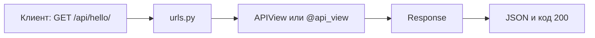

В этом модуле мы научимся строить бэкенд-API на **Django REST Framework** (сокращённо DRF). Это самый популярный инструмент для создания REST API на Python: на нём работает огромное количество современных сервисов. К концу урока ты сделаешь свой первый рабочий эндпоинт, который вернёт JSON-ответ.

## Что такое API и REST

**API** (Application Programming Interface) — это интерфейс, через который программы общаются друг с другом. Веб-API — это набор адресов (URL), по которым клиент (сайт, мобильное приложение, бот) может запросить данные или выполнить действие.

**REST** — набор принципов проектирования таких API. Главные идеи:

- ресурсы — это существительные: `/books`, `/users`, `/orders`;
- действия выражаются HTTP-методами: `GET` (получить), `POST` (создать), `PUT`/`PATCH` (обновить), `DELETE` (удалить);
- ответы обычно в формате JSON;
- API не хранит состояние между запросами (stateless).

Пример: `GET /api/books/` — список книг, `POST /api/books/` — создать книгу, `GET /api/books/3/` — книга с id 3.

## Установка и настройка

Установим DRF и добавим его в приложение:

```bash
pip install djangorestframework
```

```python
# settings.py
INSTALLED_APPS = [
    "django.contrib.admin",
    "django.contrib.auth",
    ...
    "rest_framework",
    "books",  # наше приложение
]
```

Теперь создадим приложение `books` с моделью для книг:

```bash
python manage.py startapp books
```

```python
# books/models.py
from django.db import models


class Book(models.Model):
    title = models.CharField(max_length=200)
    author = models.CharField(max_length=100)
    published = models.IntegerField(default=2000)

    def __str__(self):
        return self.title
```

Не забудь выполнить миграции:

```bash
python manage.py makemigrations books
python manage.py migrate
```

## Первый эндпоинт: APIView

DRF даёт готовые классы-вьюхи. Начнём с **`APIView`** — класса, который повторяет логику Django-вьюх, но понимает JSON и методы HTTP:

```python
# books/views.py
from rest_framework.views import APIView
from rest_framework.response import Response
from rest_framework import status


class HelloView(APIView):
    def get(self, request):
        return Response({"message": "Привет, мир!"})
```

Класс `Response` формирует JSON-ответ и сам выставляет правильный `Content-Type: application/json`. Это удобно: нам не нужно вручную сериализовать словарь.

Пропишем маршрут в `urls.py` проекта:

```python
# urls.py
from django.urls import path, include
from books.views import HelloView

urlpatterns = [
    path("admin/", admin.site.urls),
    path("api/hello/", HelloView.as_view()),
]
```

Запусти сервер и открой `http://127.0.0.1:8000/api/hello/` — увидишь JSON:

```json
{"message": "Привет, мир!"}
```

DRF даже рисует красивую браузерную страницу для API — это удобно для отладки.

## Декоратор @api_view

Если тебе не нужен класс целиком, DRF предлагает функциональный стиль через декоратор **`@api_view`**:

```python
# books/views.py
from rest_framework.decorators import api_view
from rest_framework.response import Response
from rest_framework import status


@api_view(["GET", "POST"])
def books_count(request):
    if request.method == "GET":
        return Response({"count": 0})
    return Response({"error": "Метод не поддерживается"},
                    status=status.HTTP_405_METHOD_NOT_ALLOWED)
```

Декоратор принимает список разрешённых методов. Если клиент пошлёт, например, `DELETE`, DRF сам вернёт `405 Method Not Allowed` — без твоего участия.

## Код состояния (status)

HTTP-ответы всегда имеют **код состояния**. DRF оборачивает их в константы:

- `status.HTTP_200_OK` — успех;
- `status.HTTP_201_CREATED` — ресурс создан;
- `status.HTTP_400_BAD_REQUEST` — невалидные данные;
- `status.HTTP_401_UNAUTHORIZED` — не авторизован;
- `status.HTTP_404_NOT_FOUND` — не найдено;
- `status.HTTP_500_INTERNAL_SERVER_ERROR` — ошибка сервера.

Пример: при создании объекта принято возвращать `201`, а не `200`:

```python
@api_view(["POST"])
def create_book(request):
    # здесь мы обработаем данные
    return Response({"id": 1, "title": request.data.get("title")},
                    status=status.HTTP_201_CREATED)
```

Данные запроса лежат в `request.data` (для JSON, формы, `multipart`) и в `request.query_params` (для GET-параметров из URL).



## Итог

Сегодня мы разобрались, что такое REST API, установили DRF, создали модель, написали первую вьюху на `APIView` и с декоратором `@api_view`, а также узнали про коды состояния. В следующем уроке ты познакомишься с сериализаторами — сердцем DRF, которое превращает объекты моделей в JSON и обратно.

<!--TASK-->
### Задача 1
Создай новое приложение `hello` в проекте Django (`python manage.py startapp hello`). В `views.py` этого приложения напиши вьюху на базе класса `APIView`, которая в ответ на `GET`-запрос возвращает JSON вида `{"message": "Hello, DRF!"}`. Пропиши маршрут в `urls.py` проекта, чтобы вьюха была доступна по адресу `/api/hello/`. Запусти сервер и проверь, что по этому адресу открывается JSON-ответ. Убедись, что `rest_framework` добавлен в `INSTALLED_APPS`.

### Задача 2
Напиши вьюху на базе `APIView`, которая возвращает текущее время сервера в JSON. Используй модуль `datetime` (`datetime.now()`), а также `request` и `Response`. Ответ должен быть вида `{"time": "2026-11-01 12:30:00"}`. Пропиши маршрут `/api/time/`, запусти сервер и проверь, что время приходит в ответе.

### Задача 3
Напиши функцию-вьюху с декоратором `@api_view`, которая принимает только `GET` и `POST`. На `GET` возвращает `{"method": "GET"}`, на `POST` — `{"method": "POST"}`. Пропиши маршрут `/api/method/` и проверь оба метода (можно через curl: `curl -X POST http://127.0.0.1:8000/api/method/`). Убедись, что `DELETE`-запрос вернёт 405.

### Задача 4
Создай модель `Quote` (цитата) с полями `text` (TextField) и `author` (CharField). Выполни миграции. Напиши вьюху на базе `APIView`, которая на `GET` возвращает `{"count": N}`, где N — количество записей в таблице `Quote` (используй `Quote.objects.count()`). Пропиши маршрут `/api/quotes/count/`.

### Задача 5
Напиши вьюху на базе `APIView` с методом `post`, которая создаёт запись в модели `Quote` из данных запроса (`request.data["text"]` и `request.data["author"]`) и возвращает `201 Created` вместе с данными созданной записи. Если поля `text` или `author` отсутствуют, верни `400 Bad Request` с сообщением об ошибке. Проверь оба сценария.
### Задача 6
Напиши функцию-вьюху с `@api_view(["GET"])`, которая читает имя из query-параметра: `name = request.query_params.get("name", "мир")`. Ответ должен быть `{"message": f"Привет, {name}!"}`. Пропиши маршрут `/api/greet/`, запусти сервер и проверь два запроса: `/api/greet/?name=Аня` вернёт `{"message": "Привет, Аня!"}`, а `/api/greet/` без параметра — `{"message": "Привет, мир!"}`. Обрати внимание: `request.query_params` — это DRF-аналог `request.GET`.

### Задача 7
Добавь вьюху `QuoteDetailView(APIView)` с методами `get` и `delete` для одной цитаты по id. В `get` получи объект через `get_object_or_404(Quote, pk=pk)` и верни словарь с `id`, `text` и `author`; в `delete` удали объект и верни `204 No Content` с пустым телом. Пропиши маршрут `/api/quotes/<int:pk>/`. Проверь три сценария: существующий id → `200`, удаление → `204`, повторный GET → `404`.
<!--/TASK-->

<!--HINT-->
### Подсказка 1
Вьюха на базе `APIView` — это класс с методом `get(self, request)`, который возвращает `Response({...})`. В `urls.py` используй `path("api/hello/", HelloView.as_view())`. Не забудь добавить `hello` в `INSTALLED_APPS`.

### Подсказка 2
Импортируй `datetime`: `from datetime import datetime`. Внутри `get` вызови `datetime.now()` и верни `Response({"time": str(now)})`. Обрати внимание, что объект времени нужно превратить в строку, иначе JSON не сможет его сериализовать.

### Подсказка 3
Декоратор применяется так: `@api_view(["GET", "POST"])` над функцией. Проверка метода — через `if request.method == "GET":` и `elif request.method == "POST":`. Для проверки 405 используй curl или браузерное API от DRF.

### Подсказка 4
Модель объявляется в `models.py`, после чего обязательны `makemigrations` и `migrate`. Количество записей — `Quote.objects.count()`. Не забудь добавить приложение в `INSTALLED_APPS`, если ещё не добавил.

### Подсказка 5
Данные из запроса лежат в `request.data` — это словарь. Проверяй наличие ключа через `if "text" not in request.data:`. Для ошибки верни `Response({"error": "..."}, status=status.HTTP_400_BAD_REQUEST)`.
### Подсказка 6
`request.query_params` — это словарь GET-параметров. Метод `.get("name", "мир")` возвращает значение или запасной вариант, если ключа нет. Декоратор `@api_view(["GET"])` ставится над функцией, а возвращать нужно `Response({...})`. Маршрут — `path("api/greet/", greet)` без `as_view()`, потому что это функция.

### Подсказка 7
`get_object_or_404` импортируется из `django.shortcuts`. В `delete` после `quote.delete()` верни `Response(status=status.HTTP_204_NO_CONTENT)` — тело пустое. Не забудь, что методы класса получают `self, request, pk`. При повторном GET `get_object_or_404` сам бросит `Http404`, а DRF превратит его в JSON-ответ `404`.
<!--/HINT-->

<!--SOLUTION-->
### Разбор 1
Решение:

```python
# hello/views.py
from rest_framework.views import APIView
from rest_framework.response import Response


class HelloView(APIView):
    def get(self, request):
        return Response({"message": "Hello, DRF!"})
```

```python
# urls.py
from django.urls import path
from hello.views import HelloView

urlpatterns = [
    path("api/hello/", HelloView.as_view()),
]
```

Что здесь происходит? Класс `HelloView` наследуется от `APIView`, а метод `get` обрабатывает GET-запросы. `Response({"message": ...})` превращает словарь в JSON и ставит правильные заголовки. В `urls.py` мы передаём вьюху через `as_view()` — это стандартный способ подключения классовых вьюх. Теперь можно запустить сервер и открыть `http://127.0.0.1:8000/api/hello/`, чтобы увидеть JSON-ответ.

### Разбор 2
Решение:

```python
from datetime import datetime
from rest_framework.views import APIView
from rest_framework.response import Response


class TimeView(APIView):
    def get(self, request):
        now = datetime.now()
        return Response({"time": str(now)})
```

Что здесь происходит? `datetime.now()` возвращает объект `datetime`. JSON не умеет напрямую сериализовать этот объект, поэтому мы преобразуем его в строку через `str(now)`. В ответе получится, например, `{"time": "2026-11-01 12:30:00"}`. Если бы мы попробовали вернуть объект `datetime` напрямую, DRF выбросил бы ошибку о том, что тип не поддерживается.

### Разбор 3
Решение:

```python
from rest_framework.decorators import api_view
from rest_framework.response import Response


@api_view(["GET", "POST"])
def method_view(request):
    if request.method == "GET":
        return Response({"method": "GET"})
    return Response({"method": "POST"})
```

Что здесь происходит? Декоратор `@api_view(["GET", "POST"])` ограничивает вьюху двумя методами. Внутри мы проверяем `request.method` и возвращаем соответствующий ответ. Если клиент пошлёт `DELETE`, DRF сам вернёт `405 Method Not Allowed` — нам не нужно писать этот код вручную. Это одно из главных преимуществ DRF перед чистыми Django-вьюхами.

### Разбор 4
Решение:

```python
# books/models.py
from django.db import models


class Quote(models.Model):
    text = models.TextField()
    author = models.CharField(max_length=100)

    def __str__(self):
        return self.text
```

```python
# books/views.py
from rest_framework.views import APIView
from rest_framework.response import Response
from .models import Quote


class QuoteCountView(APIView):
    def get(self, request):
        return Response({"count": Quote.objects.count()})
```

Что здесь происходит? Модель `Quote` описывает таблицу в базе данных: `text` для самой цитаты, `author` для автора. После создания модели нужно выполнить `python manage.py makemigrations books` и `python manage.py migrate`. Вьюха на GET-запрос возвращает количество записей через `Quote.objects.count()` — это посчитает строки прямо в БД, не загружая их в память.

### Разбор 5
Решение:

```python
from rest_framework.views import APIView
from rest_framework.response import Response
from rest_framework import status
from .models import Quote


class QuoteCreateView(APIView):
    def post(self, request):
        if "text" not in request.data or "author" not in request.data:
            return Response({"error": "Поля text и author обязательны"},
                            status=status.HTTP_400_BAD_REQUEST)
        quote = Quote.objects.create(
            text=request.data["text"],
            author=request.data["author"],
        )
        return Response(
            {"id": quote.id, "text": quote.text, "author": quote.author},
            status=status.HTTP_201_CREATED,
        )
```

Что здесь происходит? Метод `post` читает данные из `request.data`. Мы проверяем наличие обязательных ключей: если их нет, возвращаем `400 Bad Request`. Если всё на месте — создаём запись через `Quote.objects.create(...)` и возвращаем `201 Created` с данными созданной цитаты. Код 201 — стандартный ответ на создание ресурса, в отличие от 200, который означает просто успешный запрос.
### Разбор 6
Решение:

```python
# books/views.py
from rest_framework.decorators import api_view
from rest_framework.response import Response


@api_view(["GET"])
def greet(request):
    name = request.query_params.get("name", "мир")
    return Response({"message": f"Привет, {name}!"})
```

```python
# urls.py
from django.urls import path
from books.views import greet

urlpatterns = [
    path("api/greet/", greet),
]
```

Запуск: `python manage.py runserver`. Результат: `GET /api/greet/?name=Аня` → `{"message": "Привет, Аня!"}`, `GET /api/greet/` → `{"message": "Привет, мир!"}`.

Что здесь происходит? `request.query_params` в DRF — это обёртка над `request.GET`, которая всегда возвращает строки и умеет работать с разными парсерами. Метод `.get` с вторым аргументом задаёт значение по умолчанию, поэтому отсутствие параметра не приводит к `None` в строке приветствия. `@api_view(["GET"])` не только ограничивает метод, но и подготавливает `request` к работе с DRF: без декоратора у обычной Django-вьюхи не было бы `query_params` и `Response` не получил бы контекст для рендеринга. Обрати внимание на кодировку: кириллица в URL передаётся процентным кодированием, но DRF декодирует значение автоматически, поэтому в ответе ты видишь нормальный текст.

### Разбор 7
Решение:

```python
# books/views.py
from django.shortcuts import get_object_or_404
from rest_framework.views import APIView
from rest_framework.response import Response
from rest_framework import status
from .models import Quote


class QuoteDetailView(APIView):
    def get(self, request, pk):
        quote = get_object_or_404(Quote, pk=pk)
        return Response({
            "id": quote.id,
            "text": quote.text,
            "author": quote.author,
        })

    def delete(self, request, pk):
        quote = get_object_or_404(Quote, pk=pk)
        quote.delete()
        return Response(status=status.HTTP_204_NO_CONTENT)
```

```python
# urls.py
from django.urls import path
from books.views import QuoteDetailView

urlpatterns = [
    path("api/quotes/<int:pk>/", QuoteDetailView.as_view()),
]
```

Что здесь происходит? `APIView` вызывает метод, совпадающий с HTTP-методом запроса, и передаёт в него именованные аргументы из URL — здесь `pk`. `get_object_or_404` пытается найти запись и, если её нет, бросает `Http404`; DRF перехватывает его и отдаёт клиенту JSON с кодом `404` вместо HTML-страницы. В `delete` мы сначала получаем объект, чтобы не удалять «вслепую» несуществующую запись, а затем возвращаем `204 No Content` — успех без тела ответа. Повторный GET после удаления снова проходит через `get_object_or_404` и даёт `404`, что и подтверждает фактическое удаление. Разделение на методы делает контракт явным: один URL — два разных действия с разными кодами ответа.
<!--/SOLUTION-->

<!--QUIZ-->
Для чего нужен класс Response в DRF?
- Для формирования HTML-страниц
- Для формирования JSON-ответа с правильными заголовками
- Для подключения к базе данных
* Правильный ответ: Для формирования JSON-ответа с правильными заголовками
Response превращает словарь или другой объект в JSON и выставляет корректные HTTP-заголовки.

Какой метод HTTP используется для создания ресурса?
- GET
- POST
- DELETE
* Правильный ответ: POST
POST отправляет данные на сервер для создания нового ресурса.

Что делает декоратор @api_view(["GET"])?
- Ограничивает вьюху только методом GET
- Ускоряет выполнение вьюхи
- Добавляет авторизацию
* Правильный ответ: Ограничивает вьюху только методом GET
Декоратор указывает, какие HTTP-методы разрешены; остальные возвращают 405.

Какой код состояния означает «ресурс успешно создан»?
- 200 OK
- 201 Created
- 404 Not Found
* Правильный ответ: 201 Created
201 Created — стандартный ответ на успешное создание нового ресурса.

Что вернёт вьюха с @api_view(["GET"]) на POST-запрос?
- 200 OK
- 400 Bad Request
- 405 Method Not Allowed
* Правильный ответ: 405 Method Not Allowed
DRF сам отклоняет неразрешённые методы кодом 405.

Где лежат данные POST-запроса в DRF?
- В request.data
- В request.args
- В request.body_str
* Правильный ответ: В request.data
request.data содержит распарсенные данные запроса (JSON, форму и т.д.).

Что не является принципом REST?
- Использование существительных для ресурсов
- Использование HTTP-методов для действий
- Хранение состояния между запросами
* Правильный ответ: Хранение состояния между запросами
REST — stateless: сервер не хранит состояние клиента между запросами.

Как подключить вьюху-класс в urls.py?
- path("api/", HelloView.as_view())
- path("api/", HelloView)
- url("api/", HelloView.run)
* Правильный ответ: path("api/", HelloView.as_view())
Классовые вьюхи подключаются через метод as_view().

Что произойдёт, если вернуть объект datetime в Response напрямую?
- Он сериализуется автоматически
- DRF выбросит ошибку сериализации
- Он превратится в строку
* Правильный ответ: DRF выбросит ошибку сериализации
JSON не поддерживает тип datetime, поэтому нужно превратить его в строку заранее.

Какое расширение файла обычно имеют проекты на Django?
- .py
- .js
- .json
* Правильный ответ: .py
Django-проекты пишутся на Python и имеют расширение .py.
Где в DRF лежат GET-параметры из адресной строки?
- В request.query_params
- В request.data
- В request.body
* Правильный ответ: В request.query_params
request.query_params — DRF-обёртка над GET-параметрами, например ?name=Аня.

Что сделает get_object_or_404(Quote, pk=5), если записи нет?
- Бросит Http404, который DRF вернёт как JSON-ответ 404
- Вернёт None
- Создаст новую запись
* Правильный ответ: Бросит Http404, который DRF вернёт как JSON-ответ 404
DRF перехватывает Http404 и отдаёт клиенту корректный ответ 404.

Что вернёт APIView, если в классе определён только метод get, а пришёл POST?
- 405 Method Not Allowed
- 200 OK с пустым телом
- 500 Internal Server Error
* Правильный ответ: 405 Method Not Allowed
APIView сопоставляет HTTP-метод с методом класса и возвращает 405, если его нет.

Что означает код ответа 204 No Content?
- Запрос успешен, тело ответа пустое
- Ресурс не найден
- Данные невалидны
* Правильный ответ: Запрос успешен, тело ответа пустое
204 часто возвращают после успешного DELETE.
<!--/QUIZ-->
