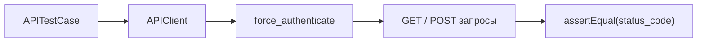

Разрабатывать API без тестов опасно: легко случайно сломать маршрут, валидацию или права доступа. DRF предоставляет готовые инструменты для тестирования: **`APITestCase`**, **`APIClient`** и вспомогательные утилиты. В этом уроке мы напишем полноценные тесты для нашего API.

## Зачем тестировать API

Представь, что ты изменил валидацию сериализатора и случайно разрешил пустой заголовок. Без тестов ты узнаешь об этом только когда клиент начнёт жаловаться. Тесты проверяют поведение автоматически: запускаешь `python manage.py test` и сразу видишь, что сломалось. Тесты — это не «лишняя работа», а страховка и живая документация API.

## Базовый тест на APITestCase

```python
# books/tests.py
from rest_framework.test import APITestCase
from rest_framework import status
from django.urls import reverse
from .models import Book


class BookAPITests(APITestCase):
    def setUp(self):
        Book.objects.create(title="Война и мир", author="Толстой", published=1869)

    def test_list_books(self):
        url = reverse("book-list")
        response = self.client.get(url)
        self.assertEqual(response.status_code, status.HTTP_200_OK)
        self.assertEqual(len(response.data["results"]), 1)
```

Что здесь происходит?

- `APITestCase` — специальный класс тестов, который понимает DRF;
- `self.client` — это `APIClient`, расширение стандартного Django-клиента: он умеет отправлять JSON и работать с DRF-ответами;
- `reverse("book-list")` — строит URL по имени маршрута (имя дал Router через `basename`);
- `response.data` — уже распарсенный JSON, с ним удобно работать;
- `status.HTTP_200_OK` — код состояния в виде константы.

Важно: каждый тест работает с **чистой базой данных** — Django сам создаёт временную БД и откатывает изменения после каждого теста.

## setUpTestData против setUp

Данные можно создавать двумя способами:

```python
class BookAPITests(APITestCase):
    @classmethod
    def setUpTestData(cls):
        cls.book = Book.objects.create(
            title="Война и мир", author="Толстой", published=1869)
```

`setUpTestData` вызывается один раз на весь класс и работает быстрее. `setUp` вызывается перед каждым тестом — используй его, если каждый тест должен получить свежие данные.

## Проверяем создание и удаление

```python
class BookAPITests(APITestCase):
    def setUp(self):
        self.url = reverse("book-list")

    def test_create_book(self):
        response = self.client.post(
            self.url,
            {"title": "Анна Каренина", "author": "Толстой",
             "published": 1877},
            format="json",
        )
        self.assertEqual(response.status_code, status.HTTP_201_CREATED)
        self.assertEqual(Book.objects.count(), 1)

    def test_delete_book(self):
        book = Book.objects.create(title="X", author="Y")
        url = reverse("book-detail", args=[book.id])
        response = self.client.delete(url)
        self.assertEqual(response.status_code, status.HTTP_204_NO_CONTENT)
        self.assertEqual(Book.objects.count(), 0)
```

Параметр `format="json"` говорит клиенту отправлять данные как JSON.

## Тестируем валидацию и права

```python
def test_invalid_year(self):
    response = self.client.post(
        self.url,
        {"title": "Плохая книга", "author": "Z", "published": 3000},
        format="json",
    )
    self.assertEqual(response.status_code, status.HTTP_400_BAD_REQUEST)
    self.assertIn("published", response.data)
```

Проверка аутентификации:

```python
from django.contrib.auth.models import User

def test_unauthorized(self):
    response = self.client.get(self.url)
    self.assertEqual(response.status_code, status.HTTP_401_UNAUTHORIZED)

def test_authorized(self):
    user = User.objects.create_user("anna", password="secret")
    self.client.force_authenticate(user=user)
    response = self.client.get(self.url)
    self.assertEqual(response.status_code, status.HTTP_200_OK)
```

`force_authenticate` — удобный способ «залогинить» клиента без реального запроса к эндпоинту логина.

## Common assert-ы

- `assertEqual(response.status_code, 200)` — код ответа;
- `assertIn("title", response.data)` — поле в JSON;
- `assertContains(response, "текст")` — подстрока в теле ответа;
- `assertNotIn(...)` — отсутствие значения;
- `assertIsNone(response.data["next"])` — проверка на None.

## Как запускать

```bash
python manage.py test books
```

Если нужно запустить конкретный класс или метод:

```bash
python manage.py test books.tests.BookAPITests
python manage.py test books.tests.BookAPITests.test_create_book
```



## Итог

`APITestCase` + `APIClient` позволяют покрывать тестами все сценарии: списки, создание, валидацию, права, пагинацию, фильтрацию. Тесты запускаются одной командой и работают на временной базе данных. Это обязательная часть профессионального API.

<!--TASK-->
### Задача 1
Напиши тест-класс `BookAPITests(APITestCase)` с `setUpTestData`, которая создаёт книгу «Война и мир». Добавь тест `test_list_books`: GET на `reverse("book-list")` должен вернуть `200` и хотя бы одну книгу в `response.data`.

### Задача 2
Добавь тест `test_create_book`: POST с JSON-данными (`format="json"`) на `reverse("book-list")` должен вернуть `201 Created`, а `Book.objects.count()` должен стать равен 1 после создания.

### Задача 3
Создай тест `test_invalid_year`: POST с `published=3000` должен вернуть `400 Bad Request`, а в `response.data` должен присутствовать ключ `published`. Это проверка валидации из урока 2.

### Задача 4
Напиши тесты `test_unauthorized` и `test_authorized` для вьюхи с `IsAuthenticated`: без пользователя — `401`, после `self.client.force_authenticate(user=user)` — `200`. Создай пользователя через `User.objects.create_user`.

### Задача 5
Напиши тест `test_delete_book`: создай книгу, отправь DELETE на `reverse("book-detail", args=[book.id])`, проверь, что ответ `204 No Content`, а `Book.objects.count()` равен 0. Также проверь, что повторный GET этой книги вернёт `404`.
### Задача 6 — Тест со статусами
Напиши тест: анонимный GET `/api/books/` возвращает 200; анонимный POST — 401 (если настроено разрешение). Используй `APITestCase` и `self.client`.
### Задача 7 — force_authenticate
Авторизуй пользователя через `self.client.force_authenticate(user=user)` и проверь, что POST `/api/books/` создаёт объект (201). Убедись, что объект появился в базе.

<!--/TASK-->

<!--HINT-->
### Подсказка 1
Импорты: `from rest_framework.test import APITestCase`, `from rest_framework import status`, `from django.urls import reverse`. Имя маршрута для списка — `book-list` (если `basename="book"` в router). `response.data` — уже JSON.

### Подсказка 2
`self.client.post(url, {...}, format="json")`. Проверяй `status.HTTP_201_CREATED` и количество записей через `Book.objects.count()`.

### Подсказка 3
Создай книгу с `published=3000` — валидатор `validate_published` должен сработать. В `response.data` ищи ключ `published`. Не забудь проверить `status.HTTP_400_BAD_REQUEST`.

### Подсказка 4
Без токена `self.client.get(url)` должен вернуть `401`. Потом: `user = User.objects.create_user("anna", password="secret"); self.client.force_authenticate(user=user)` — и GET вернёт `200`.

### Подсказка 5
`reverse("book-detail", args=[book.id])` строит URL конкретной книги. DELETE возвращает `204 No Content`. После удаления `Book.objects.count()` равен 0, а GET по тому же URL — `404`.
### Подсказка 6
`from rest_framework.test import APITestCase`; `self.client.get(url)` и `self.client.post(url, data)`.
### Подсказка 7
force_authenticate выставляет пользователя в тестовом клиенте без реального токена.

<!--/HINT-->

<!--SOLUTION-->
### Разбор 1
Решение:

```python
# books/tests.py
from rest_framework.test import APITestCase
from rest_framework import status
from django.urls import reverse
from .models import Book


class BookAPITests(APITestCase):
    @classmethod
    def setUpTestData(cls):
        Book.objects.create(
            title="Война и мир", author="Толстой", published=1869)

    def test_list_books(self):
        url = reverse("book-list")
        response = self.client.get(url)
        self.assertEqual(response.status_code, status.HTTP_200_OK)
        self.assertEqual(len(response.data["results"]), 1)
```

Что здесь происходит? `setUpTestData` создаёт книгу один раз для всех тестов класса. `reverse("book-list")` строит URL по имени из Router. `self.client.get` возвращает ответ, у которого `status_code` — код HTTP, а `data` — распарсенный JSON. Если пагинация включена, книги лежат в `response.data["results"]`; если нет — `response.data` будет списком напрямую.

### Разбор 2
Решение:

```python
def test_create_book(self):
    url = reverse("book-list")
    response = self.client.post(
        url,
        {"title": "Анна Каренина", "author": "Толстой",
         "published": 1877},
        format="json",
    )
    self.assertEqual(response.status_code, status.HTTP_201_CREATED)
    self.assertEqual(Book.objects.count(), 1)
```

Что здесь происходит? `format="json"` заставляет `APIClient` отправить данные как JSON с правильным заголовком. Если бы мы не указали формат, клиент отправил бы данные как форму, что тоже работает, но менее точно повторяет реального клиента API. После создания проверяем, что в базе ровно одна книга.

### Разбор 3
Решение:

```python
def test_invalid_year(self):
    url = reverse("book-list")
    response = self.client.post(
        url,
        {"title": "Плохая книга", "author": "Z", "published": 3000},
        format="json",
    )
    self.assertEqual(response.status_code, status.HTTP_400_BAD_REQUEST)
    self.assertIn("published", response.data)
```

Что здесь происходит? Валидатор `validate_published` из урока 2 отклоняет год 3000. Сериализатор кладёт ошибку в `response.data["published"]`, поэтому `assertIn("published", response.data)` проверяет, что ошибка действительно появилась. Такой тест защищает валидацию от случайной поломки.

### Разбор 4
Решение:

```python
def test_unauthorized(self):
    url = reverse("book-list")
    response = self.client.get(url)
    self.assertEqual(response.status_code, status.HTTP_401_UNAUTHORIZED)

def test_authorized(self):
    from django.contrib.auth.models import User
    user = User.objects.create_user("anna", password="secret")
    self.client.force_authenticate(user=user)
    url = reverse("book-list")
    response = self.client.get(url)
    self.assertEqual(response.status_code, status.HTTP_200_OK)
```

Что здесь происходит? Без аутентификации `IsAuthenticated` отклоняет запрос с `401`. `force_authenticate` напрямую вставляет пользователя в клиент — это быстрее, чем проходить настоящий логин, и не требует токенов. После этого запрос проходит как от залогиненного пользователя.

### Разбор 5
Решение:

```python
def test_delete_book(self):
    book = Book.objects.create(
        title="X", author="Y", published=2000)
    url = reverse("book-detail", args=[book.id])
    response = self.client.delete(url)
    self.assertEqual(response.status_code, status.HTTP_204_NO_CONTENT)
    self.assertEqual(Book.objects.count(), 0)

    get_response = self.client.get(url)
    self.assertEqual(get_response.status_code, status.HTTP_404_NOT_FOUND)
```

Что здесь происходит? `args=[book.id]` подставляет id в URL. DELETE на `RetrieveUpdateDestroyAPIView` удаляет книгу и возвращает `204 No Content`. Тот факт, что после этого GET даёт `404`, подтверждает, что запись действительно удалена из базы.
### Разбор 6
```python
from rest_framework.test import APITestCase
from rest_framework import status

class BookApiTests(APITestCase):
    def test_anon_get_ok(self):
        r = self.client.get("/api/books/")
        self.assertEqual(r.status_code, status.HTTP_200_OK)

    def test_anon_post_denied(self):
        r = self.client.post("/api/books/", {"title": "X"})
        self.assertEqual(r.status_code, status.HTTP_401_UNAUTHORIZED)
```
Анонимный доступ проверяется прямыми запросами.
### Разбор 7
```python
class BookApiTests(APITestCase):
    def setUp(self):
        self.user = User.objects.create_user(username="u", password="12345")
        self.client.force_authenticate(user=self.user)

    def test_create_book(self):
        r = self.client.post("/api/books/", {"title": "Книга", "author": "Автор", "year": 2020})
        self.assertEqual(r.status_code, status.HTTP_201_CREATED)
        self.assertEqual(Book.objects.count(), 1)
```
force_authenticate упрощает тесты: не нужен настоящий токен.

<!--/SOLUTION-->

<!--QUIZ-->
Какой класс наследуют тесты для DRF?
- APITestCase
- TestCase
- DjangoTestCase
* Правильный ответ: APITestCase
APITestCase из rest_framework.test понимает DRF-особенности.

Что такое self.client в APITestCase?
- APIClient
- Обычный браузер
- Мок-сервер
* Правильный ответ: APIClient
APIClient умеет отправлять JSON и понимает DRF-ответы.

Как построить URL по имени маршрута?
- reverse("book-list")
- path("book-list")
- url("book-list")
* Правильный ответ: reverse("book-list")
reverse() строит URL по имени, которое дал Router через basename.

Что означает параметр format="json" в post()?
- Отправить данные как JSON
- Получить ответ в JSON
- Включить логирование
* Правильный ответ: Отправить данные как JSON
format="json" сериализует данные в JSON и ставит Content-Type.

Что делает setUpTestData?
- Создаёт данные один раз для всего класса
- Вызывается перед каждым тестом
- Чистит базу данных
* Правильный ответ: Создаёт данные один раз для всего класса
setUpTestData — классовый метод, выполняется один раз.

Как залогинить клиента без реального запроса?
- client.force_authenticate(user=user)
- client.login(user)
- client.auth(user)
* Правильный ответ: client.force_authenticate(user=user)
force_authenticate напрямую вставляет пользователя в клиент.

Какой код ожидаем при успешном создании?
- 201
- 200
- 204
* Правильный ответ: 201
201 Created — ответ на успешное создание ресурса.

Что вернёт DELETE успешно удалённой книги?
- 204 No Content
- 200 OK
- 404 Not Found
* Правильный ответ: 204 No Content
DELETE без тела ответа возвращает 204.

Какая команда запускает тесты приложения books?
- python manage.py test books
- python manage.py runserver books
- pytest books/views.py
* Правильный ответ: python manage.py test books
manage.py test запускает тесты указанного приложения.

Что проверяет assertIn("published", response.data)?
- Что в ответе есть ключ published
- Что книга опубликована
- Что ответ содержит 200
* Правильный ответ: Что в ответе есть ключ published
assertIn проверяет наличие ключа в словаре response.data.
Что делает force_authenticate?
- Устанавливает пользователя в тестовом клиенте
- Создаёт токен
- Удаляет пользователя
- Логинит запросы
* Правильный ответ: Устанавливает пользователя в тестовом клиенте
Тесты проходят без реальной аутентификации.

Какой класс использовать для тестов API?
- APITestCase
- TestCase
- SimpleTestCase
- LiveServerTestCase
* Правильный ответ: APITestCase
Он включает APIClient и поддержку запросов DRF.

Какой статус ожидается при успешном создании?
- 201
- 200
- 302
- 404
* Правильный ответ: 201
201 Created — стандарт для успешного создания.

Как проверить, что объект создан в базе?
- Book.objects.count() == 1
- r.data
- r.content
- len(r)
* Правильный ответ: Book.objects.count() == 1
Запрос к базе подтверждает создание.

# 
<!--/QUIZ-->
