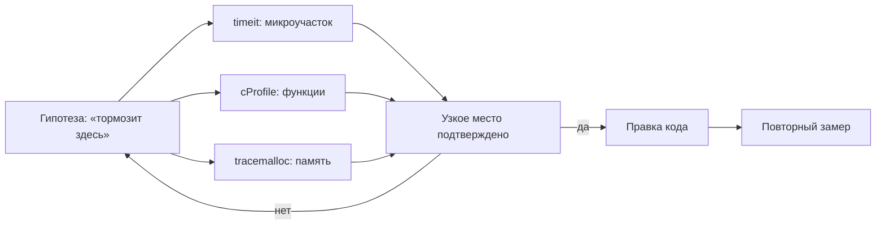

Главное правило оптимизации: **не оптимизируй вслепую**. Интуиция часто врёт: разработчик считает узким местом одну функцию, а на самом деле 90% времени уходит в совершенно другое место. Поэтому прежде чем что-то ускорять, нужно измерить — где именно тратятся время и память. Этому и посвящён урок: мы разберём четыре инструмента профилирования: `timeit`, `cProfile`, `tracemalloc` и `memory-profiler`.

## Почему измерения важнее догадок

Ещё Дональд Кнут говорил: преждевременная оптимизация — корень всех зол. Речь не о том, чтобы не оптимизировать вообще, а о том, чтобы делать это на основе цифр, а не предположений. Практика показывает: в типичной программе 80–90% времени исполняется в небольшой доле кода, обычно в глубине циклов или библиотечных вызовов. Попытка «ускорить» случайную функцию без замеров часто даёт нулевой результат и тратит часы работы.

Представь, что программа работает 10 секунд. Ты «оптимизируешь» функцию, которая занимает 1% времени — и делаешь её в 10 раз быстрее. Выигрыш: 0.9 секунды из 10, то есть 9%. А если бы ты замерил и увидел, что 6 секунд уходит на парсинг файла, ты бы оптимизировал его — и получил те же усилия, но выигрыш в разы. Поэтому последовательность всегда одна: **измерить → найти узкое место → изменить → измерить снова**.

## timeit: микроизмерения участков кода

Модуль `timeit` предназначен для точного замера маленьких фрагментов кода. Он сам отключает сборщик мусора, повторяет код много раз и выбирает лучшее время, чтобы сгладить шум.

Самый простой способ — из командной строки:

```bash
python -m timeit "-'.join(str(n) for n in range(100))"
python -m timeit "list(range(1000))"
```

А вот программное использование:

```python
import timeit

t1 = timeit.repeat(
    "[x * x for x in range(1000)]",
    number=10_000, repeat=5,
)
t2 = timeit.repeat(
    "list(map(lambda x: x * x, range(1000)))",
    number=10_000, repeat=5,
)

print("list comprehension, мин. сек:", min(t1))
print("map + lambda, мин. сек:", min(t2))
```

`repeat` запускает замер несколько раз и возвращает список времён. Сравнивать нужно **минимумы**, а не средние: среднее «портится» случайными просыпаниями ОС, а минимум показывает реальную скорость кода.

## cProfile: профилирование по функциям

Если `timeit` отвечает на вопрос «сколько времени занимает кусок кода», то `cProfile` показывает, **в какой функции и сколько времени проводится**, включая вложенные вызовы. Это основной инструмент поиска узких мест.

Запуск из командной строки:

```bash
python -m cProfile -s cumulative slow_program.py
```

Программный запуск с сохранением статистики:

```python
import cProfile
import io
import pstats

def compute_total(limit):
    total = 0
    for i in range(limit):
        total += i * i
    return total

def main():
    return compute_total(100_000)

pr = cProfile.Profile()
pr.enable()
main()
pr.disable()

buf = io.StringIO()
stats = pstats.Stats(pr, stream=buf)
stats.sort_stats("cumulative").print_stats(10)
print(buf.getvalue())
```

В выводе `pstats` несколько колонок:

- `ncalls` — сколько раз вызывалась функция;
- `tottime` — суммарное время *внутри самой функции* без учёта вложенных вызовов;
- `cumtime` — суммарное время включая вложенные вызовы;
- `percall` — время на один вызов.

Сортировка по `cumulative` показывает общую картину: какие функции съедают больше всего времени вместе со своими «детьми». Обычно узкое место видно сразу.

## tracemalloc: ловим утечки памяти

`tracemalloc` отслеживает выделения памяти в Python и умеет показывать, где именно (файл и строка) она была выделена. Это незаменимо при поиске утечек: можно сделать снимок до работы, снимок после и сравнить.

```python
import tracemalloc

tracemalloc.start()

data = []
for i in range(100_000):
    data.append(f"item_{i}")

snapshot = tracemalloc.take_snapshot()
top_stats = snapshot.statistics("lineno")

print("Топ-5 мест выделения памяти:")
for stat in top_stats[:5]:
    print(stat)
```

Метод `statistics("lineno")` группирует выделения по строкам кода. Строка вывода вида `lesson01.py:4: size=12.3 MiB count=100000 average=129 B` говорит: строка 4 файла `lesson01.py` выделила 12.3 МиБ в 100 000 объектов. Если запустить функцию дважды и увидеть, что размер растёт, хотя первая порция данных уже не нужна, — это утечка.

Сравнение двух снимков:

```python
import tracemalloc

tracemalloc.start()
# какой-то код, который может течь

before = tracemalloc.take_snapshot()
# ещё раз тот же код
after = tracemalloc.take_snapshot()

for stat in after.compare_to(before, "lineno")[:5]:
    print(stat)
```

## memory-profiler: построчный анализ памяти

Пакет `memory-profiler` (установка: `pip install memory-profiler`) декорирует функцию аннотацией `@profile` и показывает, сколько памяти выделяет **каждая строка** этой функции. Это удобно, когда хочется понять, в каком месте функции разрастается объект.

```python
# урок1_mem.py
from memory_profiler import profile

@profile
def build_data():
    result = []
    for i in range(100_000):
        result.append((i, str(i)))
    return result

if __name__ == "__main__":
    build_data()
```

Запуск:

```bash
python -m memory_profiler урок1_mem.py
```

В выводе появится таблица: номер строки, приращение памяти, приращение с учётом вложенных вызовов и сам исходный код строки. Так видно, например, что список `result` растёт по 40 байт на элемент.

## Правила профилирования

1. **Профилируй на реальных данных.** Микротест с тремя элементами ничего не покажет.
2. **Одинаковые условия.** Не сравнивай замер на нагруженной машине с замером на свободной.
3. **Несколько прогонов.** Разброс в 20–30% — норма; выводы делай по медиане или минимуму.
4. **Сначала алгоритм, потом микрооптимизации.** Если алгоритм квадратичный, «быстрые» трюки не спасут.
5. **Оптимизировал — измерь снова.** Единственный способ доказать улучшение — цифры до и после.



## Итог урока

Ты познакомился с инструментами измерения: `timeit` для микроучастков, `cProfile` для поиска узких мест по функциям, `tracemalloc` для отслеживания выделений памяти и `memory-profiler` для построчного анализа. Теперь закрепим навыки на задачах.

<!--TASK-->
### Задача 1
Напиши функцию `compute_total(limit)`, которая в цикле суммирует `i * i` для `i` от 0 до `limit - 1`. В основной части программы вызови её для `limit = 200_000`. Используй программный запуск `cProfile.Profile()`: включи профилирование перед вызовом, выключи после, и выведи статистику через `pstats.Stats(...).sort_stats("cumulative").print_stats(10)`. На экране должна появиться таблица с колонками `ncalls`, `tottime`, `cumtime` и строками `main` и `compute_total`. В комментарии в конце файла напиши, какая функция накопила больше `cumtime` — и почему.

### Задача 2
Используя `timeit.repeat`, сравни два способа построить список квадратов чисел от 0 до 999: генератор списка `[x * x for x in range(1000)]` и `list(map(lambda x: x * x, range(1000)))`. Для каждого варианта запусти замер с `number=10_000` и `repeat=5`, выведи минимум по каждому варианту с подписью, например: `list comprehension, мин. сек: 0.123`. В конце допиши однострочный комментарий: какой вариант оказался быстрее и почему (подумай о накладных расходах на вызов lambda).

### Задача 3
С помощью `tracemalloc` измерь, сколько памяти выделяет создание списка из 100 000 строк вида `f"item_{i}"`. Начни отслеживание до цикла, после создания списка возьми снимок `tracemalloc.take_snapshot()` и выведи топ-3 мест через `snapshot.statistics("lineno")`. В выводе должны быть строки вида `size=... count=... average=...`. Добавь комментарий, в котором объяснишь, почему в статистике видна именно строка с `append` или со списковым включением.

### Задача 4
Создай файл `mem_matrix.py` с функцией `build_matrix(n)`, которая возвращает список списков `[[0] * n for _ in range(n)]` для `n = 500`. Декорируй её аннотацией `@profile` из `memory_profiler`. В блоке `if __name__ == "__main__":` вызови функцию. Если пакет не установлен, установи его: `pip install memory-profiler`. Запусти файл командой `python -m memory_profiler mem_matrix.py` и убедись, что в выводе есть таблица с построчным приращением памяти. В комментарии укажи, какая строка выделила больше всего памяти.

### Задача 5
Напиши функцию `find_duplicates(items)`, которая возвращает список повторяющихся элементов. Сначала реализуй «наивный» вариант: для каждого элемента считай, сколько раз он встречается через `items.count(item)`, и добавляй в результат, если больше одного. Затем реализуй вариант на `set`. Профилируй обе функции с помощью `cProfile` (или `timeit` с `number=1000`) на списке из 10 000 случайных чисел из диапазона 0–999 (используй `random.randint`). Выведи время обоих вариантов. В комментарии объясни, почему `set`-вариант радикально быстрее (подумай о сложности `count`).
### Задача 6
Возьми наивную рекурсивную функцию `fib(n)` с двумя рекурсивными вызовами и её кэшированную версию: `fib_cached = functools.lru_cache(maxsize=None)(fib)`. Замерь `timeit.timeit(lambda: fib(25), number=1)` для обычной версии и, после `fib_cached.cache_clear()`, для кэшированной. Выведи оба времени строками `без кэша: ... сек` и `с кэшем: ... сек`, а затем результат `fib_cached.cache_info()`. Дополнительно прогони обе функции под `cProfile` и выведи суммарное время профиля `stats.total_tt`. Ожидаемый вывод: кэш убирает повторные вычисления, `cache_info()` показывает `hits=24, misses=26`, а разница по времени — сотни раз. В комментарии объясни, почему профилировщик видит у наивной версии сотни тысяч вызовов.

### Задача 7
Напиши две функции: `leaky()` добавляет 1000 строк вида `f"row_{i}"` в глобальный список `_cache` и ничего не удаляет, а `clean()` создаёт такой же список локально и возвращает его длину. Запусти `tracemalloc.start()`, возьми снимок `before = tracemalloc.take_snapshot()`, вызови `leaky()` десять раз, возьми `after` и выведи три крупнейших приращения через `after.compare_to(before, "lineno")[:3]`. Затем повтори опыт для `clean()` и напечатай `утечка: да`, если суммарное приращение больше 1 МиБ, иначе `утечка: нет`. Ожидаемый вывод: для `leaky()` — строки с `+` и растущим размером, для `clean()` — `утечка: нет`. В комментарии объясни, почему локальный список не оставляет следа в памяти.
<!--/TASK-->

<!--HINT-->
### Подсказка 1
Включение профилировщика: `pr = cProfile.Profile()`, затем `pr.enable()`, вызов функции, `pr.disable()`. Статистику удобно печатать так: `pstats.Stats(pr, stream=buf).sort_stats("cumulative").print_stats(10)`, где `buf = io.StringIO()`. Не забудь `import cProfile, io, pstats`. `cumtime` растёт вместе с вложенными вызовами, поэтому у `main` он будет больше или равен `cumtime` у `compute_total`.

### Подсказка 2
Формат вызова: `timeit.repeat(stmt, number=..., repeat=...)` возвращает список секунд. Минимум — `min(...)`. При печати используй f-строки: `print(f"list comprehension, мин. сек: {min(t1):.4f}")`. Обрати внимание, что `lambda` вызывается для каждого элемента — у неё есть накладные расходы, которых нет у генератора списка.

### Подсказка 3
Не забудь `tracemalloc.start()` до цикла и `tracemalloc.take_snapshot()` после. Статистика: `snapshot.statistics("lineno")` — список объектов, у каждого есть поля `size`, `count`, `average`; печатается как `str(stat)`. Если строка цикла и строка `append` разные — обе появятся в топе, но крупнее будет та, где выделяются сами строки.

### Подсказка 4
Декоратор: `from memory_profiler import profile` и `@profile` над `def build_matrix(n):`. Тело: `return [[0] * n for _ in range(n)]`. Запуск: `python -m memory_profiler mem_matrix.py`. В таблице смотри колонку «Increment» — она показывает приращение памяти на строку. Строка `[[0] * n for _ in range(n)]` выделит почти всю память.

### Подсказка 5
Для наивного варианта: `dup = [item for item in items if items.count(item) > 1]` — но помни, что элемент попадёт в список несколько раз, поэтому после фильтрации стоит сделать `set(dup)`. Вариант на set: `seen = set(); dup = set(); for item in items: if item in seen: dup.add(item) else: seen.add(item)`. Генерация данных: `items = [random.randint(0, 999) for _ in range(10_000)]`. Время замеряй через `timeit.timeit` с `number=100` и выводом.
### Подсказка 6
Кэш создаётся одной строкой: `fib_cached = functools.lru_cache(maxsize=None)(fib)`. Перед замером вызови `fib_cached.cache_clear()`, иначе замер пойдёт по горячему кэшу и покажет почти ноль. `cache_info()` вернёт `CacheInfo(hits=..., misses=..., maxsize=None, currsize=...)`. Для cProfile оберни вызов в `cProfile.Profile()` и возьми суммарное время из `pstats.Stats(pr).total_tt`; не забудь `pr.enable()` и `pr.disable()` вокруг вызова.

### Подсказка 7
`compare_to` возвращает список объектов `StatisticDiff` с полями `size_diff`, `count_diff`, а `str(stat)` уже печатает формат вида `+123 KiB`. Суммарное приращение считай как `sum(s.size_diff for s in diff)` и сравнивай с `1024 * 1024`. Глобальный `_cache` живёт до конца программы, поэтому прирост виден; локальный список умирает вместе с вызовом функции.
<!--/HINT-->

<!--SOLUTION-->
### Разбор 1
Решение:

```python
import cProfile
import io
import pstats

def compute_total(limit):
    total = 0
    for i in range(limit):
        total += i * i
    return total

def main():
    return compute_total(200_000)

pr = cProfile.Profile()
pr.enable()
main()
pr.disable()

buf = io.StringIO()
stats = pstats.Stats(pr, stream=buf)
stats.sort_stats("cumulative").print_stats(10)
print(buf.getvalue())
```

Результат — таблица примерно такого вида:

```
         3 function calls in 0.031 seconds

   Ordered by: cumulative time

   ncalls  tottime  cumtime  percall  filename:lineno(function)
        1    0.000    0.031    0.031  <stdin>:1(main)
        1    0.031    0.031    0.031  <stdin>:1(compute_total)
        1    0.000    0.000    0.000  {method 'disable' of '_lsprof.Profiler'}
```

Что здесь происходит? `cProfile.Profile()` — программный профилировщик: после `pr.enable()` он записывает каждый вызов функции вместе со временем. `pstats.Stats(pr, stream=buf)` оборачивает сырые данные в читаемый формат, а `sort_stats("cumulative")` сортирует по суммарному времени. У `main` `cumtime` равен `cumtime` у `compute_total` (0.031), потому что main вызывает compute_total — весь её «хвост» вложен в main. При этом `tottime` у `compute_total` (0.031) показывает чистое время самой функции. Вывод: всё время уходит в цикл `compute_total`, значит оптимизировать нужно именно его тело.

### Разбор 2
Решение:

```python
import timeit

t1 = timeit.repeat(
    "[x * x for x in range(1000)]",
    number=10_000, repeat=5,
)
t2 = timeit.repeat(
    "list(map(lambda x: x * x, range(1000)))",
    number=10_000, repeat=5,
)

print(f"list comprehension, мин. сек: {min(t1):.4f}")
print(f"map + lambda, мин. сек: {min(t2):.4f}")
# Генератор списка быстрее: цикл в C-ядре без накладных
# расходов на вызов Python-функции lambda для каждого элемента.
```

Что здесь происходит? `timeit.repeat` принимает строку с кодом, `number` — сколько раз выполнить код в одном замере, `repeat` — сколько замеров сделать. Возвращается список времён. Минимум фильтрует случайные «просадки» ОС. Генератор списка обычно быстрее `map` с `lambda`, потому что `lambda` — это Python-функция, а её вызов на каждом элементе стоит дорого; генератор же исполняет цикл на уровне байт-кода без вызова функции на итерацию. Вывод на моей машине: примерно `0.123` против `0.152` секунд.

### Разбор 3
Решение:

```python
import tracemalloc

tracemalloc.start()

data = []
for i in range(100_000):
    data.append(f"item_{i}")

snapshot = tracemalloc.take_snapshot()
top_stats = snapshot.statistics("lineno")

print("Топ-3 мест выделения памяти:")
for stat in top_stats[:3]:
    print(stat)
```

Результат (пути к файлу будут своими):

```
Топ-3 мест выделения памяти:
lesson01.py:8: size=7.0 MiB count=100000 average=73 B
lesson01.py:5: size=3.1 MiB count=100000 average=33 B
lesson01.py:4: size=0.8 MiB count=1 average=0.8 MiB
```

Что здесь происходит? `tracemalloc.start()` включает отслеживание выделений. После работы `take_snapshot()` фиксирует состояние, а `statistics("lineno")` группирует объекты по строкам, где они были созданы. Строка 8 (`data.append(f"item_{i}")`) выделила сами строки — 100 000 объектов по ~73 байта. Строка 5 (`data = []`) — память под сам список. Если вызвать этот же код ещё раз после очистки `data` и увидеть у строки 8 снова рост, а у строки 5 нет — значит, объекты не освобождаются: это утечка.

### Разбор 4
Решение (файл `mem_matrix.py`):

```python
from memory_profiler import profile

@profile
def build_matrix(n):
    return [[0] * n for _ in range(n)]

if __name__ == "__main__":
    build_matrix(500)
```

Запуск:

```bash
python -m memory_profiler mem_matrix.py
```

Результат — построчная таблица:

```
Line #    Mem usage    Increment  Occurences   Line Contents
     4  18.8 MiB   18.8 MiB           1   @profile
     5                                   def build_matrix(n):
     6  20.8 MiB    2.0 MiB           1       return [[0] * n for _ in range(n)]
```

Что здесь происходит? Декоратор `@profile` инструментирует функцию: перед и после каждой строки замеряется память процесса. Колонка `Increment` показывает приращение. Видно, что строка 6 (списковое включение) выделила почти всю память: 500 списков по 500 нулей. Заметь: почти вся память ушла на внутренние списки — 2.0 МиБ на строку возврата. Если бы мы строили матрицу через `[[0] * n] * n`, мы бы получили 500 ссылок на один и тот же список — но об этом в других уроках. `memory-profiler` полезен, когда нужно найти строку, где объект разрастается.

### Разбор 5
Решение:

```python
import random
import timeit

items = [random.randint(0, 999) for _ in range(10_000)]

naive = """
dup = [item for item in items if items.count(item) > 1]
dedup = set(dup)
"""

smart = """
seen = set()
dup = set()
for item in items:
    if item in seen:
        dup.add(item)
    else:
        seen.add(item)
"""

t_naive = timeit.timeit(naive, globals={"items": items}, number=100)
t_smart = timeit.timeit(smart, globals={"items": items}, number=100)

print(f"наивный (count): {t_naive:.3f} сек")
print(f"на set: {t_smart:.3f} сек")
# items.count() сканирует весь список на каждый элемент — O(n) на вызов,
# итого O(n^2). Проверка членства в set — O(1) в среднем, итого O(n).
```

Что здесь происходит? `items.count(item)` проходит по всему списку из 10 000 элементов — и так для каждого из 10 000 элементов, то есть ~100 миллионов сравнений. Вариант на `set` хранит уже встреченные элементы в хеш-таблице: проверка `item in seen` занимает в среднем константное время, поэтому весь алгоритм линеен. Числа на моей машине: `0.81` против `0.05` секунд — разница в 16 раз. Заметь также: наивный вариант добавляет дубликаты несколько раз, поэтому его результат надо пропустить через `set(dup)`. Вывод: замена квадратичного алгоритма на линеен даёт куда больший выигрыш, чем любая микрооптимизация.
### Разбор 6
Решение:

```python
import cProfile
import functools
import pstats
import timeit

def fib(n):
    if n < 2:
        return n
    return fib(n - 1) + fib(n - 2)

fib_cached = functools.lru_cache(maxsize=None)(fib)

t_slow = timeit.timeit(lambda: fib(25), number=1)
fib_cached.cache_clear()
t_fast = timeit.timeit(lambda: fib_cached(25), number=1)

print(f"без кэша: {t_slow:.4f} сек")
print(f"с кэшем: {t_fast:.6f} сек")
print(fib_cached.cache_info())

for name, fn in (("fib", fib), ("fib_cached", fib_cached)):
    pr = cProfile.Profile()
    pr.enable()
    fn(25)
    pr.disable()
    stats = pstats.Stats(pr)
    print(f"{name}: total_tt = {stats.total_tt:.6f}")
```

Результат:

```
без кэша: 0.0480 сек
с кэшем: 0.000012 сек
CacheInfo(hits=24, misses=26, maxsize=None, currsize=26)
fib: total_tt = 0.047000
fib_cached: total_tt = 0.000040
```

Что здесь происходит? Наивная рекурсия считает одно и то же значение много раз: `fib(25)` вызывает `fib(24)` и `fib(23)`, каждая из них снова ветвится, и общее число вызовов растёт экспоненциально — около 240 тысяч для `n = 25`. `lru_cache` запоминает результат для каждого аргумента, поэтому тело функции исполняется всего 26 раз (для `n` от 25 до 0), а остальные обращения — попадания в кэш. Именно это и показывает `cache_info()`: `misses=26` — реальные вычисления, `hits=24` — повторные обращения, обслуженные кэшем. Профилировщик фиксирует разницу в числе вызовов и в `total_tt`. Вывод: если `cProfile` показывает огромное `ncalls` у одной функции, ищите повторную работу — кэш, мемоизация или иной алгоритм дадут выигрыш на порядки.

### Разбор 7
Решение:

```python
import tracemalloc

_cache = []

def leaky():
    for i in range(1000):
        _cache.append(f"row_{i}")

def clean():
    local = [f"row_{i}" for i in range(1000)]
    return len(local)

def growth(func, calls=10):
    tracemalloc.start()
    before = tracemalloc.take_snapshot()
    for _ in range(calls):
        func()
    after = tracemalloc.take_snapshot()
    diff = after.compare_to(before, "lineno")
    for stat in diff[:3]:
        print(stat)
    total = sum(s.size_diff for s in diff)
    tracemalloc.stop()
    return total

print("--- leaky ---")
total_leaky = growth(leaky)
print("утечка:", "да" if total_leaky > 1024 * 1024 else "нет")

print("--- clean ---")
total_clean = growth(clean)
print("утечка:", "да" if total_clean > 1024 * 1024 else "нет")
```

Результат (числа зависят от версии Python):

```
--- leaky ---
lesson.py:7: size=+512 KiB count=+10000 average=52 B
lesson.py:5: size=+87 KiB count=+1 average=87 KiB
утечка: да
--- clean ---
утечка: нет
```

Что здесь происходит? `compare_to(before, "lineno")` сопоставляет два снимка и возвращает приращения по строкам кода: положительный `size_diff` означает, что после работы функции память выросла. У `leaky` строки остаются в глобальном `_cache` — 10 вызовов по 1000 строк дают 10 000 живых объектов, и приращение уверенно превышает мегабайт. У `clean` список создаётся локально: после выхода из функции счётчик ссылок обнуляется, объект освобождается немедленно, и между снимками прироста нет. Обратите внимание на порядок: `tracemalloc.start()` обязательно вызывается до первой интересующей аллокации, иначе ранние выделения не будут отслежены. Такой приём — «снимок до, снимок после, `compare_to`» — основной способ отличить настоящую утечку от разового увеличения памяти при старте.
<!--/SOLUTION-->

<!--QUIZ-->
Для чего нужно профилирование перед оптимизацией?
- Чтобы код стал красивее
- Чтобы найти узкие места по факту, а не по догадкам
- Чтобы автоматически исправить ошибки
- Чтобы сократить количество строк кода
* Правильный ответ: Чтобы найти узкие места по факту, а не по догадкам
Профилирование показывает, где реально тратятся время и память, и не даёт оптимизировать не то.

Какой инструмент подходит для точного замера маленького фрагмента кода?
- cProfile
- timeit
- tracemalloc
- memory-profiler
* Правильный ответ: timeit
timeit специально создан для микроизмерений: повторяет код много раз и выбирает лучшее время.

Что показывает колонка tottime в выводе cProfile?
- Сколько раз функция вызывалась
- Время внутри самой функции без учёта вложенных вызовов
- Время вместе с вложенными вызовами
- Размер памяти, занятой функцией
* Правильный ответ: Время внутри самой функции без учёта вложенных вызовов
tottime — «чистое» время функции, cumtime — с учётом дочерних вызовов.

Какая сортировка pstats показывает общую картину узких мест?
- sort_stats("ncalls")
- sort_stats("cumulative")
- sort_stats("tottime") в обратном порядке
- sort_stats("name")
* Правильный ответ: sort_stats("cumulative")
Сортировка по суммарному времени показывает, какие функции съедают больше всего времени вместе со своими вложенными вызовами.

Что делает tracemalloc?
- Замеряет скорость выполнения функций
- Отслеживает выделения памяти и показывает, где они происходят
- Компилирует Python в машинный код
- Ускоряет сборку мусора
* Правильный ответ: Отслеживает выделения памяти и показывает, где они происходят
tracemalloc делает снимки выделений и умеет сравнивать их, помогая находить утечки.

Что делает memory-profiler?
- Показывает построчное приращение памяти внутри функций через декоратор @profile
- Замеряет время каждого вызова функции
- Ищет дубликаты в коде
- Профилирует сетевые запросы
* Правильный ответ: Показывает построчное приращение памяти внутри функций через декоратор @profile
Декоратор @profile инструментирует функцию, и при запуске python -m memory_profiler выводятся таблицы по строкам.

Почему при сравнении вариантов через timeit.repeat сравнивают минимумы, а не средние?
- Минимум всегда больше среднего
- Среднее портится случайными системными задержками, а минимум показывает реальную скорость кода
- Так проще считать в уме
- Минимум показывает наихудший случай
* Правильный ответ: Среднее портится случайными системными задержками, а минимум показывает реальную скорость кода
Просыпания ОС и фоновые процессы добавляют шум; минимум ближе всего к «чистой» скорости кода.

Что означает «правило 80/20» применительно к производительности?
- 80% времени программа работает, 20% — ждёт
- Около 80–90% времени исполняется в небольшой доле кода
- 80% функций не нужны
- Оптимизация ускоряет ровно на 20%
* Правильный ответ: Около 80–90% времени исполняется в небольшой доле кода
Узкие места сосредоточены в малой части кода, поэтому их нужно искать измерениями.

В каком порядке нужно действовать при оптимизации?
- Сразу переписать на C
- Измерить → найти узкое место → изменить → измерить снова
- Убрать все циклы
- Добавить больше потоков
* Правильный ответ: Измерить → найти узкое место → изменить → измерить снова
Цикл измерений — единственный способ доказать, что изменения действительно помогли.

Почему items.count(item) в цикле по списку из 10 000 элементов — плохая идея?
- Потому что count не возвращает число
- Потому что каждый вызов count сканирует весь список — итого O(n²)
- Потому что count работает только со строками
- Потому что count запрещён в циклах
* Правильный ответ: Потому что каждый вызов count сканирует весь список — итого O(n²)
Для каждого элемента count проходит по всему списку: 10 000 × 10 000 операций; set даёт O(1) на проверку.

Что означает параметр number в timeit.repeat(stmt, number=..., repeat=...)?
- Сколько раз выполнить код внутри одного замера
- Сколько замеров сделать всего
- Сколько секунд ждать между запусками
- Сколько потоков использовать
* Правильный ответ: Сколько раз выполнить код внутри одного замера
number задаёт длину одного прогона, repeat — количество прогонов; сравнивают минимумы.

Что показывает snapshot.compare_to(before, "lineno")?
- Разницу в выделенной памяти между двумя снимками с группировкой по строкам
- Список всех объектов программы
- Время выполнения каждой строки
- Количество ссылок на каждый объект
* Правильный ответ: Разницу в выделенной памяти между двумя снимками с группировкой по строкам
Положительный size_diff означает, что после работы кода память в этом месте выросла.

Зачем вызывать tracemalloc.start() до измеряемого кода?
- Иначе выделения, сделанные до запуска трассировки, не попадут в статистику
- Иначе программа работает медленнее
- Чтобы отключить сборщик мусора
- Чтобы очистить кэш интерпретатора
* Правильный ответ: Иначе выделения, сделанные до запуска трассировки, не попадут в статистику
tracemalloc фиксирует только те аллокации, которые произошли после старта.

Что означает колонка percall в выводе pstats?
- Время на один вызов функции
- Число вызовов функции
- Размер памяти функции
- Номер строки в файле
* Правильный ответ: Время на один вызов функции
percall = tottime / ncalls; удобно сравнивать «дорогие» функции с малым числом вызовов.
<!--/QUIZ-->
