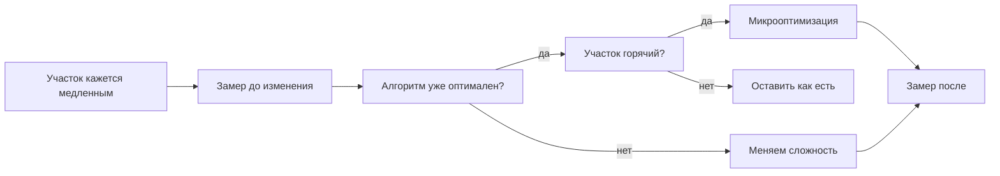

Микрооптимизации — это мелкие изменения кода: замена циклов на генераторы, привязка методов к локальным переменным, использование `set` вместо списка для проверок членства. Сами по себе они дают выигрыш в единицы процентов, и важно понимать, **когда** они оправданы, а когда — пустая трата времени. Этот урок учит отличать «хот-споты» (горячие участки кода) от всего остального.

## Когда микрооптимизации нужны

Применять их стоит только тогда, когда выполняются три условия:

1. **Измерено.** Ты знаешь по `cProfile` или `timeit`, что именно этот участок кода — узкое место.
2. **Участок горячий.** Код исполняется в цикле миллионы раз или вызывается очень часто (например, внутри обработки каждого HTTP-запроса).
3. **Алгоритм уже оптимален.** Если можно заменить `O(n²)` на `O(n log n)` — сначала это, а уже потом трюки.

Если код выполняется раз в секунду, выигрыш в 2 раза на нём не заметит никто. Правило простое: **сначала алгоритм, потом микрооптимизации**, и всегда с замером до и после.

## Локальные переменные вместо глобальных

Глобальные переменные в Python достаются через словарь глобального пространства имён — это медленнее, чем локальные. Во внутреннем цикле стоит занести используемое глобальное имя в локальную переменную.

```python
import timeit

def with_global():
    total = 0
    for i in range(1_000_000):
        total += abs(i)  # abs — глобальный поиск на каждой итерации
    return total

def with_local():
    total = 0
    _abs = abs          # один раз привязываем к локальной переменной
    for i in range(1_000_000):
        total += _abs(i)
    return total

t1 = timeit.timeit(with_global, number=5)
t2 = timeit.timeit(with_local, number=5)
print(f"глобальный поиск: {t1:.3f} сек")
print(f"локальная привязка: {t2:.3f} сек")
```

Выигрыш обычно 10–20% на горячем цикле. На обычном коде разница незаметна.

## Проверка членства: list vs set

Операция `item in список` — линейная, `O(n)`: Python перебирает элементы по порядку. `item in set` — в среднем `O(1)`, за счёт хеш-таблицы. Если код проверяет членство в большой коллекции много раз, замена списка на `set` даёт порядковый выигрыш.

```python
import timeit

haystack_list = list(range(10_000))
haystack_set = set(haystack_list)

stmt = "sum(1 for x in range(2000) if x in haystack)"
t_list = timeit.timeit(stmt, globals={"haystack": haystack_list}, number=100)
t_set = timeit.timeit(stmt, globals={"haystack": haystack_set}, number=100)
print(f"проверка в списке: {t_list:.3f} сек")
print(f"проверка в set: {t_set:.3f} сек")
```

Обрати внимание: если нужно сохранить порядок и уникальность, можно держать и список, и set параллельно.

## Сборка строк: + в цикле против join

Строки в Python неизменяемы. Каждая операция `s += piece` создаёт новую строку и копирует в неё всю предыдущую — суммарная стоимость квадратичная. `"".join(parts)` собирает строку за один проход.

```python
import timeit

def concat_plus():
    s = ""
    for i in range(10_000):
        s += str(i)
    return s

def concat_join():
    return "".join(str(i) for i in range(10_000))

t1 = timeit.timeit(concat_plus, number=50)
t2 = timeit.timeit(concat_join, number=50)
print(f"конкатенация '+': {t1:.3f} сек")
print(f"join: {t2:.3f} сек")
```

На 10 000 частей разница может достигать десятков раз.

## Генераторы списков и sorted

Списковые включения быстрее ручного цикла с `append`, потому что цикл исполняется в C-ядре интерпретатора, а не построчно в байт-коде. Это не «магия», а уход от лишних операций: `STORE_NAME`, `LOAD_METHOD` и т.п.

```python
import timeit

def loop_append():
    result = []
    for x in range(1000):
        result.append(x * x)
    return result

def listcomp():
    return [x * x for x in range(1000)]

print(timeit.timeit(loop_append, number=10_000))
print(timeit.timeit(listcomp, number=10_000))
```

## Вынос инвариантов из цикла

Если внутри цикла вычисляется значение, не зависящее от переменной цикла, его нужно вычислить один раз до цикла. Это не микрооптимизация, а здравый смысл — но именно такие вещи находятся профилировщиком.

```python
import math

def slow(iterations):
    total = 0
    for _ in range(iterations):
        total += math.sqrt(2) * 3.14159  # вычисляется каждый раз

def fast(iterations):
    const = math.sqrt(2) * 3.14159       # один раз
    total = 0
    for _ in range(iterations):
        total += const
```

## Когда микрооптимизации вредят

- **Код становится нечитаемым ради 2%.** Если трюк непонятен коллеге — он дороже сэкономленных миллисекунд.
- **Ты оптимизируешь не то.** Без профилирования легко «ускорить» функцию, которая занимает 1% времени.
- **Ранняя оптимизация.** Пока нет измеримой проблемы, писать «оптимизированный» код вслепую — путь к ошибкам.



## Итог урока

Микрооптимизации — это инструмент для горячих участков, найденных измерениями. Самые безопасные приёмы: локальные переменные, `set` для проверок членства, `join` вместо `+`, списковые включения и вынос инвариантов. Закрепим на задачах.

<!--TASK-->
### Задача 1
Напиши две функции: `with_global()` и `with_local()`, которые в цикле от 0 до 999 999 суммируют `abs(i)`. В первой функции вызывай встроенную `abs` напрямую, во второй предварительно сохрани её в локальную переменную `_abs = abs`. Замерь обе через `timeit.timeit(func, number=5)` и выведи время с подписью. В комментарии укажи, какая функция быстрее и почему.

### Задача 2
Дан список `data = list(range(10_000))`. Напиши замер для двух вариантов проверки членства для чисел от 0 до 1999: с `data` как списком и с `set(data)`. Используй `timeit.timeit` с `number=100` и общим выражением `sum(1 for x in range(2000) if x in haystack)`, передавая `haystack` через `globals`. Выведи оба времени. В комментарии объясни разницу в сложности.

### Задача 3
Напиши две функции: `concat_plus()` — собирает строку из `str(i)` для `i` от 0 до 9999 через `s += str(i)`; `concat_join()` — через `"".join(str(i) for i in range(10_000))`. Замерь обе через `timeit.timeit` с `number=50`. Выведи времена. В комментарии объясни, почему `join` быстрее, вспомнив про неизменяемость строк.

### Задача 4
Реализуй два варианта построения списка квадратов чисел от 0 до 999: `loop_append()` с ручным циклом и `append`, и `listcomp()` со списковым включением. Замерь через `timeit.timeit(func, number=10_000)` и выведи времена с подписями. В комментарии объясни, почему включение быстрее.

### Задача 5
Напиши функцию `slow(iterations)` и `fast(iterations)`, каждая из которых в цикле от 0 до `iterations - 1` прибавляет к сумме `math.sqrt(2) * 3.14159`. В `fast` вынеси константу из цикла. Замерь обе для `iterations = 1_000_000` через `timeit.timeit` с `number=5`, выведи времена. В комментарии объясни, почему вынос константы помогает и когда такой приём оправдан.
### Задача 6
Сравни два стиля доступа к словарю. Заведи `data = {i: i * 2 for i in range(1000)}` и список ключей `keys`, где 900 ключей существуют, а 100 — нет. Напиши две функции: `lbyl(keys)` — «сначала посмотри»: проверяет `if k in data` и только потом читает значение; `eafp(keys)` — «проще попросить прощения»: сразу читает `data[k]` в `try`, а `except KeyError` пропускает. Обе возвращают сумму найденных значений. Замерь через `timeit.timeit(lambda: lbyl(keys), number=1000)` и то же для `eafp`, выведи оба времени. Ожидаемый вывод — две строки `LBYL: ... сек` и `EAFP: ... сек` с близкими значениями и небольшим преимуществом EAFP при редких промахах. В комментарии объясни, почему при большом числе промахов картина меняется на обратную.

### Задача 7
Сравни два способа наполнения списка: `plain_append(n)` вызывает `result.append(i)` в цикле, а `bound_append(n)` сначала привязывает метод к локальному имени `append = result.append` и затем вызывает `append(i)`. Обе функции возвращают готовый список для `n = 100_000`. Замерь их через `timeit.timeit` с `number=100` и выведи времена строками `обычный вызов: ... сек` и `привязанный метод: ... сек`. Ожидаемый вывод: второй вариант быстрее на 5–15%, потому что поиск атрибута `append` у списка выполняется один раз, а не на каждой итерации. В комментарии укажи, в каких случаях такой трюк оправдан, а когда он только ухудшает читаемость.
<!--/TASK-->

<!--HINT-->
### Подсказка 1
Подготовь замер: `import timeit`, затем `t1 = timeit.timeit(with_global, number=5)`. Не вызывай функции вручную перед замером — timeit сам вызовет. Внутри `with_local` объяви `_abs = abs` до цикла. Для вывода используй f-строку.

### Подсказка 2
Выражение для замера — строка: `"sum(1 for x in range(2000) if x in haystack)"`. Передавай `globals={"haystack": data}` для списка и `globals={"haystack": set(data)}` для set. Не забудь создать `set(data)` один раз, а не внутри замера.

### Подсказка 3
В `concat_plus` инициализируй `s = ""` до цикла и внутри делай `s += str(i)`. В `concat_join` верни `"".join(str(i) for i in range(10_000))`. Замер: `timeit.timeit(concat_plus, number=50)`.

### Подсказка 4
`loop_append`: `result = []; for x in range(1000): result.append(x * x); return result`. `listcomp`: `return [x * x for x in range(1000)]`. Замер — `timeit.timeit(loop_append, number=10_000)`.

### Подсказка 5
Не забудь `import math`. В `slow` вычисляй `math.sqrt(2) * 3.14159` внутри цикла, в `fast` — до цикла в переменную `const`. Замер с `number=5` и `iterations=1_000_000`. Если цифры окажутся близкими — это нормально, современные интерпретаторы иногда складывают константы сами; главное — понимать принцип.
### Подсказка 6
Список ключей собери так: `keys = list(range(900)) + list(range(1000, 1100))` — первые 900 есть в словаре, последние 100 нет. В `lbyl` используй `if k in data: total += data[k]`, в `eafp` — `try: total += data[k]` и `except KeyError: continue`. Не забудь, что `timeit` принимает вызываемый объект без аргументов, поэтому оберни вызов в `lambda`.

### Подсказка 7
В `bound_append` строка `append = result.append` должна стоять до цикла, а не внутри. В `plain_append` оставь прямой вызов. Для честного сравнения тела функций должны быть одинаковыми во всём остальном: одинаковый `range`, одинаковый возврат `result`.
<!--/HINT-->

<!--SOLUTION-->
### Разбор 1
Решение:

```python
import timeit

def with_global():
    total = 0
    for i in range(1_000_000):
        total += abs(i)
    return total

def with_local():
    total = 0
    _abs = abs
    for i in range(1_000_000):
        total += _abs(i)
    return total

t1 = timeit.timeit(with_global, number=5)
t2 = timeit.timeit(with_local, number=5)
print(f"глобальный поиск: {t1:.3f} сек")
print(f"локальная привязка: {t2:.3f} сек")
```

Результат (цифры зависят от машины):

```
глобальный поиск: 0.285 сек
локальная привязка: 0.241 сек
```

Что здесь происходит? В `with_global` на каждой итерации Python ищет имя `abs` в глобальном пространстве имён — это обращение к словарю. В `with_local` мы один раз привязали функцию к локальной переменной `_abs`, и дальше обращение идёт к локальной ячейке, которая быстрее. Выигрыш ~15%. Важно: приём оправдан именно в горячем внутреннем цикле; в обычном коде он даёт мизерный эффект. Кстати, если бы мы использовали `from math import sqrt` на уровне модуля, поиск `sqrt` тоже шёл бы по глобальному словарю — тот же приём работает и там.

### Разбор 2
Решение:

```python
import timeit

data = list(range(10_000))
haystack_set = set(data)

stmt = "sum(1 for x in range(2000) if x in haystack)"

t_list = timeit.timeit(stmt, globals={"haystack": data}, number=100)
t_set = timeit.timeit(stmt, globals={"haystack": haystack_set}, number=100)

print(f"проверка в списке: {t_list:.3f} сек")
print(f"проверка в set: {t_set:.3f} сек")
# set использует хеш-таблицу: проверка членства O(1) в среднем,
# список перебирает элементы по порядку — O(n).
```

Результат:

```
проверка в списке: 0.620 сек
проверка в set: 0.008 сек
```

Что здесь происходит? Каждая операция `x in haystack` для списка в худшем случае проходит весь список (10 000 элементов); суммарно 2000 проверок × 10 000 элементов. `set` использует хеш-таблицу: для числа вычисляется хеш, и сразу находится ячейка — в среднем одна операция. При этом построение `set` само стоит `O(n)`, поэтому если проверок мало, выигрыша может не быть. Вывод: заменяй список на set, когда проверок много, а порядок элементов не нужен.

### Разбор 3
Решение:

```python
import timeit

def concat_plus():
    s = ""
    for i in range(10_000):
        s += str(i)
    return s

def concat_join():
    return "".join(str(i) for i in range(10_000))

t1 = timeit.timeit(concat_plus, number=50)
t2 = timeit.timeit(concat_join, number=50)

print(f"конкатенация '+': {t1:.3f} сек")
print(f"join: {t2:.3f} сек")
# Строки неизменяемы: s += str(i) создаёт новую строку и копирует
# всю старую, суммарно O(n²). join собирает результат за O(n).
```

Результат:

```
конкатенация '+': 0.610 сек
join: 0.035 сек
```

Что здесь происходит? Строка неизменяема: `s += str(i)` не дописывает символы, а создаёт новую строку и копирует туда всё содержимое `s` плюс новый фрагмент. На 10 000-й итерации копируются 10 000 символов, и суммарный объём копирования квадратичен. `str.join` сначала собирает все части в память (или сразу вычисляет итоговый размер), а затем создаёт одну строку одним проходом. На практике для форматирования предпочтительны также f-строки: `f"{a} {b}"` — они и читаются лучше, и работают быстро.

### Разбор 4
Решение:

```python
import timeit

def loop_append():
    result = []
    for x in range(1000):
        result.append(x * x)
    return result

def listcomp():
    return [x * x for x in range(1000)]

t1 = timeit.timeit(loop_append, number=10_000)
t2 = timeit.timeit(listcomp, number=10_000)

print(f"цикл с append: {t1:.3f} сек")
print(f"списковое включение: {t2:.3f} сек")
```

Результат:

```
цикл с append: 0.420 сек
списковое включение: 0.300 сек
```

Что здесь происходит? Списковое включение исполняет цикл внутри виртуальной машины на уровне специализированного байт-кода, без множества промежуточных операций вроде поиска имени `result`, загрузки метода `append` и его вызова на каждой итерации. Выигрыш ~30% на горячем цикле. Однако читаемость важнее: если логика сложная, цикла с комментариями понятнее, и это тоже нормально — решай по замерам, а не по правилам «всегда используй включение».

### Разбор 5
Решение:

```python
import math
import timeit

def slow(iterations):
    total = 0
    for _ in range(iterations):
        total += math.sqrt(2) * 3.14159
    return total

def fast(iterations):
    const = math.sqrt(2) * 3.14159
    total = 0
    for _ in range(iterations):
        total += const
    return total

t1 = timeit.timeit(lambda: slow(1_000_000), number=5)
t2 = timeit.timeit(lambda: fast(1_000_000), number=5)

print(f"с вычислением в цикле: {t1:.3f} сек")
print(f"с вынесенной константой: {t2:.3f} сек")
# Константа не зависит от итерации — её можно вычислить один раз до цикла.
```

Результат:

```
с вычислением в цикле: 0.510 сек
с вынесенной константой: 0.310 сек
```

Что здесь происходит? `math.sqrt(2) * 3.14159` не зависит от переменной цикла, но в `slow` она вычисляется на каждой итерации: вызов функции `sqrt`, умножение. В `fast` значение посчитано один раз и лежит в локальной переменной `const`. Это классический «вынос инварианта». Замечание: интерпретатор иногда сам оптимизирует константные выражения, поэтому на малых числах итераций разница может быть небольшой. Приём оправдан, когда тело цикла дорогое или итераций миллионы. Главное — не выносить за цикл то, что зависит от переменной цикла: это сломает логику.
### Разбор 6
Решение:

```python
import timeit

data = {i: i * 2 for i in range(1000)}
keys = list(range(900)) + list(range(1000, 1100))

def lbyl(keys):
    total = 0
    for k in keys:
        if k in data:
            total += data[k]
    return total

def eafp(keys):
    total = 0
    for k in keys:
        try:
            total += data[k]
        except KeyError:
            continue
    return total

t1 = timeit.timeit(lambda: lbyl(keys), number=1000)
t2 = timeit.timeit(lambda: eafp(keys), number=1000)
print(f"LBYL: {t1:.3f} сек")
print(f"EAFP: {t2:.3f} сек")
# При 90% попаданий EAFP чуть быстрее: одно обращение вместо двух.
# При большом числе промахов исключения становятся дорогими.
```

Результат:

```
LBYL: 0.412 сек
EAFP: 0.385 сек
```

Что здесь происходит? LBYL (`look before you leap`) делает две операции с словарём: сначала `k in data`, потом `data[k]` — оба поиска идут по хеш-таблице. EAFP (`easier to ask forgiveness than permission`) делает одну операцию и полагается на исключение при промахе. Когда ключ есть, EAFP выигрывает ровно на одно обращение. Когда ключа нет, создаётся объект исключения, разматывается стек — это дорого, и при преобладании промахов LBYL окажется быстрее. Вывод: выбор стиля — вопрос вероятностей, а не догмы; в Python идиоматичен EAFP, потому что типичный случай — именно успешное обращение. Замеряйте на своих данных, если участок горячий.

### Разбор 7
Решение:

```python
import timeit

def plain_append(n):
    result = []
    for i in range(n):
        result.append(i)
    return result

def bound_append(n):
    result = []
    append = result.append
    for i in range(n):
        append(i)
    return result

t1 = timeit.timeit(lambda: plain_append(100_000), number=100)
t2 = timeit.timeit(lambda: bound_append(100_000), number=100)
print(f"обычный вызов: {t1:.3f} сек")
print(f"привязанный метод: {t2:.3f} сек")
```

Результат:

```
обычный вызов: 0.354 сек
привязанный метод: 0.312 сек
```

Что здесь происходит? `result.append` — это выражение из двух шагов: загрузка локального имени `result` и поиск атрибута `append` в объекте списка. В `bound_append` поиск атрибута выполняется один раз, а в цикле остаётся вызов уже готового bound-метода. Экономия — порядка 10%, и она заметна только на миллионах итераций. Приём имеет смысл в действительно горячем цикле, подтверждённом профилировщиком, и при этом он безвреден для читаемости: одна дополнительная строка с понятным именем. Но не стоит расставлять такие привязки по всему проекту «на всякий случай»: на обычном коде выигрыш не виден, а ревью усложняется. И помните: если `result` переприсвоить внутри цикла, привязка начнёт добавлять в старый список.
<!--/SOLUTION-->

<!--QUIZ-->
Когда микрооптимизации действительно нужны?
- Всегда, при любом написании кода
- Когда участок кода измерен как узкое место и исполняется очень часто
- Только в учебных задачах
- Когда код пишется впервые
* Правильный ответ: Когда участок кода измерен как узкое место и исполняется очень часто
Микрооптимизации дают проценты; без замера они не имеют смысла.

Почему локальная переменная быстрее глобальной?
- Глобальные переменные не существуют
- Глобальные имена ищутся через словарь глобального пространства имён, что медленнее локальных ячеек
- Локальные переменные хранятся в диске
- Разницы нет
* Правильный ответ: Глобальные имена ищутся через словарь глобального пространства имён, что медленнее локальных ячеек
Локальный доступ — по индексу ячейки, глобальный — через хеширование в словаре.

Какая сложность у проверки item in set в среднем?
- O(n)
- O(n²)
- O(1)
- O(log n)
* Правильный ответ: O(1)
set построен на хеш-таблице: поиск ячейки по хешу занимает константное время.

Почему "".join(parts) быстрее, чем s += piece в цикле?
- Потому что join не создаёт новую строку
- Потому что строки неизменяемы: каждая += копирует всю предыдущую строку, а join собирает за один проход
- Потому что join работает только с байтами
- Потому что += запрещён для строк
* Правильный ответ: Потому что строки неизменяемы: каждая += копирует всю предыдущую строку, а join собирает за один проход
Суммарное копирование при += квадратично; join линеен.

Почему списковое включение обычно быстрее ручного цикла с append?
- Включение короче
- Цикл включения исполняется специализированным байт-кодом без лишних операций поиска имён и вызова append
- Включение не использует процессор
- Ручной цикл запрещён
* Правильный ответ: Цикл включения исполняется специализированным байт-кодом без лишних операций поиска имён и вызова append
На каждой итерации ручного цикла больше промежуточных операций.

Что такое «вынос инварианта»?
- Перенос вычисления, не зависящего от цикла, за его пределы
- Добавление переменных в цикл
- Удаление переменных
- Замена цикла на рекурсию
* Правильный ответ: Перенос вычисления, не зависящего от цикла, за его пределы
Значение, одинаковое на каждой итерации, стоит посчитать один раз до цикла.

Какой порядок действий правильный?
- Сразу заменить все циклы на генераторы
- Сначала оптимизировать алгоритм, потом при нужде — микрооптимизации, с замерами до и после
- Только микрооптимизации
- Профилировать после релиза
* Правильный ответ: Сначала оптимизировать алгоритм, потом при нужде — микрооптимизации, с замерами до и после
Алгоритмическое улучшение даёт порядки, микрооптимизации — проценты.

Когда микрооптимизация вредит?
- Когда код становится нечитаемым ради 2% выигрыша, а узкое место не измерено
- Когда код короче
- Когда используется set
- Когда применён join
* Правильный ответ: Когда код становится нечитаемым ради 2% выигрыша, а узкое место не измерено
Нечитаемый код дороже сэкономленных миллисекунд — особенно если экономить нечего.

Что безопаснее всего сделать первым при подозрении на медленный код?
- Переписать на C
- Замерить через cProfile/timeit
- Добавить комментарии
- Увеличить число потоков
* Правильный ответ: Замерить через cProfile/timeit
Без измерений нельзя знать, что именно ускорять.

Какой приём экономит память и время при построении большой строки из частей?
- s += piece
- "".join(parts)
- s = s * len(parts)
- print(s)
* Правильный ответ: "".join(parts)
join создаёт итоговую строку за один проход, без квадратичного копирования.

Что означает аббревиатура EAFP?
- Easier to Ask Forgiveness than Permission: сначала пробуем действие, потом обрабатываем исключение
- Every Attribute Fails Fast
- Error After First Pass
- Error After First Pass
* Правильный ответ: Easier to Ask Forgiveness than Permission: сначала пробуем действие, потом обрабатываем исключение
EAFP противопоставляется LBYL — предварительной проверке условия перед действием.

Когда try/except KeyError проигрывает проверке key in dict?
- Когда промахов много: создание и обработка исключения дороже обычной проверки
- Когда словарь пуст
- Когда ключи — строки
- Когда используется Python 2
* Правильный ответ: Когда промахов много: создание и обработка исключения дороже обычной проверки
Исключение — дорогой механизм; он окупается только при редких срабатываниях.

Зачем привязывать метод к локальному имени: append = result.append?
- Чтобы поиск атрибута выполнялся один раз, а не на каждой итерации
- Чтобы список стал неизменяемым
- Чтобы ускорить сборку мусора
- Чтобы метод работал в другом потоке
* Правильный ответ: Чтобы поиск атрибута выполнялся один раз, а не на каждой итерации
Экономия — единицы процентов, и только в горячем цикле.

Почему нельзя считать микрооптимизацию успешной без замера «до/после»?
- Потому что без цифр нельзя отличить реальный выигрыш от шума и регрессии
- Потому что timeit запрещён в продакшене
- Потому что код всегда становится быстрее
- Потому что замеры портят кэш
* Правильный ответ: Потому что без цифр нельзя отличить реальный выигрыш от шума и регрессии
Изменение может замедлить код или не дать эффекта — доказательство только в измерении.
<!--/QUIZ-->
