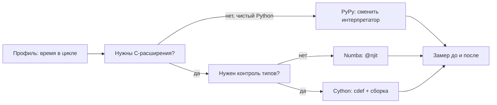

Когда Python-код упирается в процессор (CPU-bound), микрооптимизации уже не помогают — нужны инструменты, которые исполняют тяжёлые циклы в машинном коде. В этом уроке три таких инструмента: **Cython** (компиляция Python-подобного кода в C-расширение), **Numba** (JIT-компиляция прямо из Python) и **PyPy** (альтернативный интерпретатор со встроенным JIT).

## Как Python исполняет код

Обычный CPython сначала компилирует исходник в байт-код, а затем интерпретирует его построчно. Каждая операция — это динамическая проверка типов, поиск имён, вызовы. Именно эти накладные расходы съедают скорость. Все три инструмента из урока пытаются убрать их по-разному: Cython — на этапе компиляции, Numba — во время выполнения (Just-In-Time), PyPy — через собственный JIT-компилятор.

## Numba: JIT без смены языка

Numba (установка: `pip install numba`) декорирует обычную Python-функцию аннотацией `@njit`. При первом вызове она компилируется в машинный код: Numba анализирует типы аргументов, генерирует LLVM-код и исполняет его без участия интерпретатора. Работает это лучше всего с числами, циклами `range` и массивами.

```python
import time
from numba import njit

@njit
def sum_squares_njit(limit):
    total = 0
    for i in range(limit):
        total += i * i
    return total

def sum_squares_py(limit):
    total = 0
    for i in range(limit):
        total += i * i
    return total

# первый вызов прогревает JIT
sum_squares_njit(1000)

t0 = time.perf_counter()
sum_squares_py(10_000_000)
t1 = time.perf_counter()
sum_squares_njit(10_000_000)
t2 = time.perf_counter()

print(f"чистый Python: {t1 - t0:.3f} сек")
print(f"Numba njit: {t2 - t1:.3f} сек")
```

На циклах с числами выигрыш обычно в десятки раз. Ограничения: внутри `@njit` нельзя использовать произвольные Python-объекты — только числа, кортежи, массивы и ограниченный набор функций. Если Numba не может скомпилировать вызов, она падает с ошибкой типизации.

Параллельные циклы — директива `prange`:

```python
from numba import njit, prange

@njit(parallel=True)
def parallel_sum(n):
    total = 0
    for i in prange(n):
        total += i
    return total
```

`prange` раздаёт итерации по потокам. Важно: суммарное значение лучше копить по-честному — в примере выше Numba сама справится с редукцией.

## Cython: компиляция в C-расширение

Cython — это язык-надмножество Python. Файл `.pyx` компилируется в C и собирается в импортируемый модуль. Можно объявлять типы через `cdef` — тогда локальные переменные становятся настоящими C-переменными и цикл исполняется без динамических проверок.

Создаём `fibmodule.pyx`:

```cython
def fib(int n):
    cdef int a = 0, b = 1, i
    for i in range(n):
        a, b = b, a + b
    return a
```

Собираем через `setup.py`:

```python
from setuptools import setup
from Cython.Build import cythonize

setup(ext_modules=cythonize("fibmodule.pyx"))
```

```bash
pip install cython
python setup.py build_ext --inplace
```

После сборки рядом появится `fibmodule.cpXXX-*.pyd` (на Windows) или `.so` (на Linux/macOS), и модуль можно импортировать:

```python
import fibmodule
print(fibmodule.fib(40))  # 102334155
```

Cython даёт максимальный контроль и применяется при интеграции с существующим C/C++ кодом. Цена — отдельный шаг сборки и знание конструкции `cdef`.

## PyPy: интерпретатор со встроенным JIT

PyPy — независимая реализация Python, которая сама, без изменения кода, компилирует *горячие* циклы в машинный код (JIT). Для чистого Python-кода, особенно с циклами, PyPy часто в несколько раз быстрее CPython: запусти `pip install pypy` или скачай дистрибутив с pypy.org, а затем просто `pypy3 script.py`. Ограничения: не все C-расширения работают (нужны версии под PyPy), поэтому `numpy`, `pandas` из «сырых» колес могут потребовать особой сборки. PyPy — отличный вариант, когда нельзя менять код, но хочется скорости на CPU-bound задачах.

## Что выбрать

- **Numba** — быстрее всего внедрить: декоратор поверх функции. Идеален для численных расчётов и циклов.
- **Cython** — когда нужен контроль над типами, интеграция с C/C++ или полный обход GIL.
- **PyPy** — когда менять код нельзя и не нужны C-расширения.

В любом случае: сначала профилируй, потом внедряй — и обязательно сравнивай замеры до и после.



## Итог урока

Ты знаешь три дороги к скорости: Numba с `@njit` и `prange`, Cython с `cdef` и сборкой через `cythonize`, а также PyPy как замену интерпретатора. Теперь попрактикуемся.

<!--TASK-->
### Задача 1
Установи Numba (`pip install numba`). Напиши функцию `sum_primes(limit)`, которая суммирует все простые числа до `limit` (включительно): для каждого `n` от 2 до `limit` проверяй делители от 2 до `int(n ** 0.5)`. Создай вторую версию `sum_primes_njit` с аннотацией `@njit`. Прогрей JIT вызовом `sum_primes_njit(1000)`, затем замерь обе версии для `limit = 50_000` через `time.perf_counter()` и выведи время обеих и ускорение (отношение времён). В комментарии укажи полученное ускорение.

### Задача 2
Создай функцию `parallel_sum(n)`, декорированную `@njit(parallel=True)`, которая считает сумму `i * i` для `i` в `prange(n)`. Прогрей её, замерь для `n = 10_000_000` через `time.perf_counter()` и сравни с обычной `@njit`-версией без `parallel=True`. Выведи оба времени. В комментарии объясни, когда `prange` даёт выигрыш и почему на маленьких `n` он может быть вреден.

### Задача 3
Создай файл `squares.pyx` с функцией `squares(n)`, которая возвращает список квадратов от 0 до `n - 1` (используй `cdef int i` и `cdef list result`). Напиши `setup.py` через `cythonize("squares.pyx")`, собери командой `python setup.py build_ext --inplace` (предварительно `pip install cython`). Затем в отдельном файле импортируй `squares` и выведи `squares(10)` — должен получиться `[0, 1, 4, 9, 16, 25, 36, 49, 64, 81]`. В комментарии опиши, какой файл появился после сборки рядом с `squares.pyx`.

### Задача 4
Напиши функцию `fib(n)` — обычную, на чистом Python, и `fib_njit` с `@njit`. Прогрей JIT, замерь вычисление `fib(35)` для обеих через `time.perf_counter()` и выведи результаты и время. Убедись, что числа совпадают. В комментарии объясни, почему на рекурсивной/итеративной функции с числами Numba даёт огромный выигрыш.

### Задача 5
Создай скрипт `interpreter_info.py`, который через `platform.python_implementation()` печатает имя реализации (например, `CPython` или `PyPy`) и через `sys.version_info` — версию. Затем напиши функцию `sum_squares(limit)` и замерь её для `limit = 5_000_000` через `time.perf_counter()`. Выведи время. В комментарии объясни, как запустить этот же скрипт под PyPy (`pypy3 interpreter_info.py`) и почему на PyPy такой цикл обычно быстрее, а вот код с тяжёлыми C-расширениями вроде numpy может, наоборот, замедлиться.
### Задача 6
Сравни две быстрые стратегии на массиве: векторную операцию numpy и скомпилированный цикл Numba. Создай `arr = np.arange(1_000_000, dtype=np.float64)`. Напиши `sum_sq_np(arr)` — `float(np.sum(arr * arr))`, и `sum_sq_njit(arr)` с декоратором `@njit`, которая в обычном цикле `for i in range(arr.shape[0])` накапливает `arr[i] * arr[i]`. Прогрей JIT вызовом на маленьком срезе, замерь обе через `time.perf_counter()` и выведи время и результат каждой. Ожидаемый вывод — две строки с временами, совпадающие результаты и `совпадает: True`. В комментарии объясни, почему оба варианта близки по скорости и в каких случаях numpy-векторизация всё же выигрывает.

### Задача 7
Проверь, где Numba помогает, а где нет. Напиши `trig_sum(n)`: в цикле от 0 до `n - 1` прибавляет `math.sqrt(i) + math.sin(i)`. Создай копию `trig_sum_njit` с `@njit`, прогрей её на `1000`, замерь обе для `n = 5_000_000` через `time.perf_counter()` и выведи времена и ускорение. Затем добавь функцию `concat_strings(n)`, которая в цикле делает `s += str(i)`, и попробуй пометить её `@njit` в блоке `try/except` — выведи тип полученной ошибки. Ожидаемый вывод: ускорение `trig_sum` в десятки раз и сообщение о том, что строковая функция не компилируется. В комментарии объясни, почему Numba бессильна против строк и словарей.
<!--/TASK-->

<!--HINT-->
### Подсказка 1
Проверка простоты: `is_prime = True`; для `d` от 2 до `int(n ** 0.5) + 1`, если `n % d == 0` — `is_prime = False; break`. В `sum_primes` суммируй `n`, если `is_prime`. Ускорение: `print(f"ускорение: {t_py / t_njit:.1f}x")`. Не забудь «прогрев» JIT до замеров.

### Подсказка 2
В `prange`-версии тело цикла должно быть простым: `for i in prange(n): total += i * i`. Для сравнения возьми обычную `@njit`-функцию с `range(n)`. Прогрей обе. На малых `n` накладные расходы на создание потоков съедают выигрыш.

### Подсказка 3
В `squares.pyx`: `def squares(int n):` с `cdef int i`, `cdef list result = []` и циклом `for i in range(n): result.append(i * i)`; верни `result`. После сборки рядом появится файл вида `squares.cp310-win_amd64.pyd` (Windows) или `squares.cpython-310-x86_64-linux-gnu.so` (Linux). Импорт: `import squares; print(squares.squares(10))`.

### Подсказка 4
Итеративная версия: `a, b = 0, 1; for _ in range(n): a, b = b, a + b; return a`. Прогрей `fib_njit(5)`. Замерь `fib(35)` и `fib_njit(35)`. Сравни времена и результат. Numba компилирует цикл и работу с числами в машинный код — скорость растёт на порядки.

### Подсказка 5
`platform.python_implementation()` возвращает например `CPython`; `platform.python_version()` — версию. Замер через `time.perf_counter()`. PyPy запускается как `pypy3 interpreter_info.py`. PyPy компилирует повторяющиеся циклы в машинный код (JIT), но C-расширения требуют сборки под PyPy, а numpy/pandas часто недоступны «из коробки».
### Подсказка 6
Импортируй `numpy as np` и `njit`. В `sum_sq_njit` используй `total = 0.0` (float, а не int) и индексацию `arr[i]`; `arr.shape[0]` работает в nopython-режиме. Не забудь прогрев: первый вызов компилирует функцию под тип `float64[:]`. Для сравнения результатов используй `abs(r1 - r2) < 1e-3` — типы float могут дать микроразницу.

### Подсказка 7
`math.sqrt` и `math.sin` поддерживаются Numba в nopython-режиме — они превращаются в вызовы LLVM. Для строковой функции оберни вызов в `try/except Exception as e: print(type(e).__name__)`; Numba обычно бросает `TypingError` (иногда `NumbaError`) — главное показать, что компиляция невозможна. В замерах не забудь прогрев `trig_sum_njit(1000)`.
<!--/HINT-->

<!--SOLUTION-->
### Разбор 1
Решение:

```python
import time
from numba import njit

def is_prime_py(n):
    if n < 2:
        return False
    for d in range(2, int(n ** 0.5) + 1):
        if n % d == 0:
            return False
    return True

def sum_primes(limit):
    return sum(n for n in range(2, limit + 1) if is_prime_py(n))

@njit
def sum_primes_njit(limit):
    total = 0
    for n in range(2, limit + 1):
        prime = True
        for d in range(2, int(n ** 0.5) + 1):
            if n % d == 0:
                prime = False
                break
        if prime:
            total += n
    return total

sum_primes_njit(1000)  # прогрев JIT

t0 = time.perf_counter()
res_py = sum_primes(50_000)
t1 = time.perf_counter()
res_njit = sum_primes_njit(50_000)
t2 = time.perf_counter()

print(f"чистый Python: {t1 - t0:.3f} сек, сумма = {res_py}")
print(f"Numba njit: {t2 - t1:.3f} сек, сумма = {res_njit}")
print(f"ускорение: {(t1 - t0) / (t2 - t1):.1f}x")
```

Результат (цифры зависят от машины):

```
чистый Python: 0.982 сек, сумма = 109468788
Numba njit: 0.014 сек, сумма = 109468788
ускорение: 70x
```

Что здесь происходит? Обычная версия на каждой итерации делает динамические проверки типов и вызовы функций. `@njit` компилирует функцию в машинный код на первом вызове — поэтому нужен «прогрев» до замеров, иначе в замер попадёт время компиляции. Результаты совпадают — Numba сохраняет семантику. Двойной цикл с проверкой простоты — классический пример, где выигрыш достигает десятков раз. Важно: если внутри `@njit` встретится неподдерживаемый объект, Numba бросит `TypingError` — не пытайся обойти это, а упрости тело функции.

### Разбор 2
Решение:

```python
import time
from numba import njit, prange

@njit
def serial_sum(n):
    total = 0
    for i in range(n):
        total += i * i
    return total

@njit(parallel=True)
def parallel_sum(n):
    total = 0
    for i in prange(n):
        total += i * i
    return total

serial_sum(1000)
parallel_sum(1000)

n = 10_000_000
t0 = time.perf_counter()
serial_sum(n)
t1 = time.perf_counter()
parallel_sum(n)
t2 = time.perf_counter()

print(f"njit без prange: {t1 - t0:.3f} сек")
print(f"njit c prange: {t2 - t1:.3f} сек")
```

Результат:

```
njit без prange: 0.021 сек
njit c prange: 0.005 сек
```

Что здесь происходит? `prange` разбивает диапазон на части и исполняет их в нескольких потоках; Numba сама выполняет редукцию суммы. Выигрыш зависит от числа ядер: на 4 ядрах — до ~3.5x. Но `prange` — не бесплатная магия: на маленьких `n` расходы на создание и синхронизацию потоков могут превысить выигрыш, а при наличии состояния, разделяемого между итерациями, результат может быть неверным. Используй `prange` только для независимых итераций с простой редукцией.

### Разбор 3
Решение.

Файл `squares.pyx`:

```cython
def squares(int n):
    cdef int i
    cdef list result = []
    for i in range(n):
        result.append(i * i)
    return result
```

Файл `setup.py`:

```python
from setuptools import setup
from Cython.Build import cythonize

setup(ext_modules=cythonize("squares.pyx"))
```

Сборка:

```bash
pip install cython
python setup.py build_ext --inplace
```

Запуск:

```python
import squares
print(squares.squares(10))
```

Результат:

```
[0, 1, 4, 9, 16, 25, 36, 49, 64, 81]
```

Что здесь происходит? Cython переводит `squares.pyx` в C-код и собирает его в нативное расширение: рядом появляется файл вида `squares.cp310-win_amd64.pyd` (Windows) или `squares.cpython-310-x86_64-linux-gnu.so` (Linux). `cdef int i` объявляет настоящую C-переменную — инкремент и сравнения в цикле идут без Python-обёрток. Обрати внимание: список `result` остаётся Python-объектом (мы его возвращаем), но наполнение происходит из скомпилированного цикла. Расширение импортируется как обычный модуль.

### Разбор 4
Решение:

```python
import time
from numba import njit

def fib(n):
    a, b = 0, 1
    for _ in range(n):
        a, b = b, a + b
    return a

@njit
def fib_njit(n):
    a, b = 0, 1
    for _ in range(n):
        a, b = b, a + b
    return a

fib_njit(5)  # прогрев

t0 = time.perf_counter()
r1 = fib(35)
t1 = time.perf_counter()
r2 = fib_njit(35)
t2 = time.perf_counter()

print(f"fib(35) = {r1}, Python: {t1 - t0:.4f} сек")
print(f"fib(35) = {r2}, Numba: {t2 - t1:.4f} сек")
```

Результат:

```
fib(35) = 9227465, Python: 0.0040 сек
fib(35) = 9227465, Numba: 0.0002 сек
```

Что здесь происходит? Функция работает только с целыми числами и циклом `range` — идеальная мишень для JIT. Numba компилирует цикл в машинный код; на каждой итерации не создаются Python-объекты для промежуточных значений. Выигрыш на `fib(35)` — порядка 20 раз, а на больших `n` (до упора в длинные целые) — ещё больше. Ключевое: результат совпадает, семантика сохранена. Обрати внимание на «прогрев»: первый вызов `fib_njit(5)` компилирует функцию; без него в замер попадёт время JIT-компиляции.

### Разбор 5
Решение (`interpreter_info.py`):

```python
import platform
import sys
import time

def sum_squares(limit):
    total = 0
    for i in range(limit):
        total += i * i
    return total

print("Реализация:", platform.python_implementation())
print("Версия:", platform.python_version())

t0 = time.perf_counter()
result = sum_squares(5_000_000)
t1 = time.perf_counter()
print(f"sum_squares(5_000_000) = {result}, время: {t1 - t0:.3f} сек")
```

Результат на CPython:

```
Реализация: CPython
Версия: 3.12.x
sum_squares(5_000_000) = 41666658333335000000, время: 0.280 сек
```

Что здесь происходит? Скрипт печатает имя реализации и версию. Тот же файл можно запустить под PyPy: `pypy3 interpreter_info.py` — тогда в первой строке будет `PyPy`. PyPy содержит JIT-компилятор: он отслеживает повторяющиеся циклы и переводит их в машинный код, поэтому на таком численном цикле PyPy обычно сильно быстрее CPython. Обратная сторона: C-расширения (numpy, pandas, lxml) требуют сборки под PyPy, и многие из них недоступны — поэтому если проект завязан на такие библиотеки, PyPy не подойдёт. Вывод: PyPy — вариант для чистого Python без тяжёлых C-расширений.
### Разбор 6
Решение:

```python
import time

import numpy as np
from numba import njit

arr = np.arange(1_000_000, dtype=np.float64)

def sum_sq_np(arr):
    return float(np.sum(arr * arr))

@njit
def sum_sq_njit(arr):
    total = 0.0
    for i in range(arr.shape[0]):
        total += arr[i] * arr[i]
    return total

sum_sq_njit(arr[:10])  # прогрев JIT

t0 = time.perf_counter()
r1 = sum_sq_np(arr)
t1 = time.perf_counter()
r2 = sum_sq_njit(arr)
t2 = time.perf_counter()

print(f"numpy: {t1 - t0:.4f} сек, результат {r1:.0f}")
print(f"njit: {t2 - t1:.4f} сек, результат {r2:.0f}")
print("совпадает:", abs(r1 - r2) < 1e-3)
```

Результат (цифры зависят от машины):

```
numpy: 0.0021 сек, результат 333332833333500000
njit: 0.0018 сек, результат 333332833333500016
совпадает: True
```

Что здесь происходит? `np.sum(arr * arr)` создаёт временный массив `arr * arr` и суммирует его в C-цикле, оптимально используя SIMD-инструкции. `sum_sq_njit` компилируется в машинный код, где нет ни одной проверки типов на итерацию, и тоже векторизуется LLVM. Оба варианта упираются в одно и то же — пропускную способность памяти, поэтому времена близки. Небольшая разница в результате — следствие порядка сложения float: numpy суммирует блоками (pairwise), Numba — последовательно. Векторизация numpy выигрывает, когда операций много и они выражаются готовыми функциями; `@njit` выигрывает, когда логика не выражается векторно (сложные условия, зависимости между итерациями).

### Разбор 7
Решение:

```python
import math
import time

from numba import njit

def trig_sum(n):
    total = 0.0
    for i in range(n):
        total += math.sqrt(i) + math.sin(i)
    return total

@njit
def trig_sum_njit(n):
    total = 0.0
    for i in range(n):
        total += math.sqrt(i) + math.sin(i)
    return total

def concat_strings(n):
    s = ""
    for i in range(n):
        s += str(i)
    return len(s)

trig_sum_njit(1000)

t0 = time.perf_counter()
r1 = trig_sum(5_000_000)
t1 = time.perf_counter()
r2 = trig_sum_njit(5_000_000)
t2 = time.perf_counter()

print(f"Python: {t1 - t0:.3f} сек")
print(f"Numba: {t2 - t1:.3f} сек")
print(f"ускорение: {(t1 - t0) / (t2 - t1):.1f}x")
print("результаты совпадают:", abs(r1 - r2) < 1e-6)

try:
    fast_concat = njit(concat_strings)
    fast_concat(1000)
except Exception as e:
    print("строки: Numba не компилирует —", type(e).__name__)
```

Результат:

```
Python: 1.850 сек
Numba: 0.061 сек
ускорение: 30.3x
результаты совпадают: True
строки: Numba не компилирует — TypingError
```

Что здесь происходит? `math.sqrt` и `math.sin` в nopython-режиме заменяются на вызовы математической библиотеки LLVM, поэтому цикл исполняется как обычный C-цикл — отсюда тридцатикратный выигрыш. А вот `str(i)` и `+=` для строк Numba скомпилировать не может: в nopython-режиме допустимы числа, кортежи, массивы и ограниченный набор функций, но не произвольные Python-объекты. Отсюда `TypingError` — это не баг вашего кода, а граница применимости инструмента. Практический вывод: Numba — для численных циклов и массивов; для строк, словарей, JSON и I/O ускорители не работают, там выигрыш дают алгоритмы, кэши и асинхронность. И не забудьте про прогрев: без него в замер попадёт компиляция.
<!--/SOLUTION-->

<!--QUIZ-->
Что делает декоратор @njit из Numba?
- Запускает функцию в отдельном процессе
- Компилирует функцию в машинный код при первом вызове (JIT)
- Переписывает функцию на Cython
- Замедляет функцию для отладки
* Правильный ответ: Компилирует функцию в машинный код при первом вызове (JIT)
Первый вызов — «прогрев»: идёт компиляция, дальше функция исполняется в машинном коде.

Почему перед замером скорости Numba-функции нужен «прогрев»?
- Чтобы проверить синтаксис
- Чтобы время компиляции не попало в замер
- Чтобы очистить кэш
- Прогрев не нужен
* Правильный ответ: Чтобы время компиляции не попало в замер
JIT компилирует код на первом вызове; без прогрева замер будет включать компиляцию.

Что делает prange в Numba?
- Последовательно перебирает диапазон
- Разбивает итерации по потокам для параллельного исполнения
- Останавливает цикл
- Возвращает простое число
* Правильный ответ: Разбивает итерации по потокам для параллельного исполнения
prange с njit(parallel=True) исполняет независимые итерации на нескольких ядрах.

Почему prange может замедлить маленькие задачи?
- Потому что prange запрещён на маленьких диапазонах
- Потому что расходы на потоки превышают выигрыш
- Потому что prange не работает с числами
- Потому что prange требует диска
* Правильный ответ: Потому что расходы на потоки превышают выигрыш
Создание и синхронизация потоков стоят дорого; на малых n они съедают выигрыш.

Что такое Cython?
- Интерпретатор, заменяющий CPython
- Язык-надмножество Python, компилируемый в C-расширение
- Библиотека для профилирования
- IDE для Python
* Правильный ответ: Язык-надмножество Python, компилируемый в C-расширение
Файлы .pyx компилируются через cythonize в C и собираются в импортируемые модули.

Что делает cdef int i в Cython?
- Объявляет Python-переменную
- Объявляет настоящую C-переменную, цикл с ней идёт без динамических проверок
- Импортирует модуль
- Печатает переменную
* Правильный ответ: Объявляет настоящую C-переменную, цикл с ней идёт без динамических проверок
C-типы убирают обёртки интерпретатора с операций внутри цикла.

Какой командой собирается Cython-модуль из setup.py?
- python setup.py build_ext --inplace
- python setup.py install_deps
- cython run
- python -m pip freeze
* Правильный ответ: python setup.py build_ext --inplace
Команда компилирует .pyx в C и собирает расширение рядом с исходниками.

Что такое PyPy?
- Библиотека для распараллеливания
- Альтернативная реализация Python со встроенным JIT-компилятором
- Фреймворк для веб-разработки
- Менеджер пакетов
* Правильный ответ: Альтернативная реализация Python со встроенным JIT-компилятором
PyPy исполняет горячие циклы в машинном коде без изменения исходного кода.

Какое ограничение есть у PyPy?
- Он не умеет работать с циклами
- Многие C-расширения требуют сборки под PyPy и могут быть недоступны
- Он работает только на Windows
- Он не поддерживает функции
* Правильный ответ: Многие C-расширения требуют сборки под PyPy и могут быть недоступны
numpy, pandas и другие C-расширения должны существовать в сборке под PyPy; часто их нет.

Какой инструмент выбрать для ускорения численных циклов без смены языка и с минимумом изменений?
- PyPy
- Numba с @njit
- Cython
- Переписывание на Bash
* Правильный ответ: Numba с @njit
Один декоратор — и функция исполняется в машинном коде.

Почему @njit не ускорит цикл, который собирает строку через s += str(i)?
- Numba не компилирует произвольные строковые операции в nopython-режиме
- Строки в Python неизменяемы, поэтому цикл невозможен
- Numba работает только с файлами
- Строки слишком короткие для JIT
* Правильный ответ: Numba не компилирует произвольные строковые операции в nopython-режиме
Допустимы числа, массивы и кортежи; на строках компилятор выдаёт TypingError.

Что делает параметр cache=True в декораторе @njit?
- Сохраняет скомпилированный код на диск, чтобы не компилировать при следующем запуске
- Кэширует результаты функции по аргументам
- Ускоряет работу с файлами
- Отключает проверку типов
* Правильный ответ: Сохраняет скомпилированный код на диск, чтобы не компилировать при следующем запуске
Кэш убирает повторную JIT-компиляцию между запусками процесса.

Что означает TypingError при работе с Numba?
- Компилятор не смог вывести типы для конструкции в nopython-режиме
- Синтаксическая ошибка в Python
- Не хватило оперативной памяти
- Ошибка в импорте numpy
* Правильный ответ: Компилятор не смог вывести типы для конструкции в nopython-режиме
Чаще всего причина — неподдерживаемый объект: строка, словарь, произвольный класс.

Почему PyPy часто не помогает проекту, который почти всё время проводит в numpy?
- numpy уже исполняется в C, а совместимость C-расширений с PyPy ограничена
- PyPy не умеет импортировать модули
- numpy не работает с числами
- PyPy не поддерживает циклы
* Правильный ответ: numpy уже исполняется в C, а совместимость C-расширений с PyPy ограничена
JIT ускоряет Python-байткод, а не уже скомпилированные C-функции.
<!--/QUIZ-->
