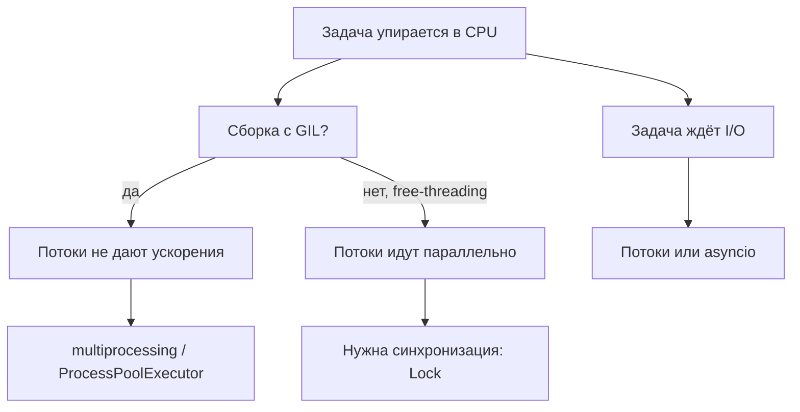

В классическом CPython есть **GIL** — глобальная блокировка интерпретатора. Из-за неё в любой момент времени байт-код исполняет только один поток. Это упрощает внутренние структуры интерпретатора (счётчики ссылок не рвутся), но лишает потоки настоящей параллельности на процессоре. Начиная с Python 3.13 проект развивает сборки **без GIL** — так называемый free-threading. В этом уроке разберёмся, как это работает и во что обходится.

## Что такое GIL

GIL (Global Interpreter Lock) — это мьютекс внутри CPython: прежде чем исполнить байт-код, поток обязан захватить GIL. Потоки быстро переключаются, но не исполняются одновременно. Итог: для задач, нагружающих процессор (CPU-bound), потоки не дают выигрыша — а для ввода-вывода (I/O-bound) они по-прежнему полезны: пока один поток ждёт ответа от сети или диска, другой работает.

```python
import threading
import time

def busy_work(rounds):
    total = 0
    for i in range(rounds):
        total += i * i
    return total

WORKERS = 4
ROUNDS = 2_000_000

t0 = time.perf_counter()
for _ in range(WORKERS):
    busy_work(ROUNDS)
t1 = time.perf_counter()

threads = [threading.Thread(target=busy_work, args=(ROUNDS,)) for _ in range(WORKERS)]
t2 = time.perf_counter()
for t in threads:
    t.start()
for t in threads:
    t.join()
t3 = time.perf_counter()

print(f"последовательно: {t1 - t0:.3f} сек")
print(f"в 4 потоках: {t3 - t2:.3f} сек")
```

Под GIL оба времени почти совпадают. Это и есть «эффект GIL».

## Free-threading: сборки без GIL

PEP 703 описывает сборки Python, где GIL отсутствует. Их готовят отдельно: при сборке из исходников — флаг `--disable-gil`, а на Windows официальный установщик Python 3.13+ предлагает вариант `Python 3.13t` (буква t — от *free-threaded*). Как проверить, в какой сборке ты работаешь:

```python
import sys
import sysconfig

print("Версия:", sys.version)
print("Py_GIL_DISABLED:", sysconfig.get_config_var("Py_GIL_DISABLED"))
if hasattr(sys, "_is_gil_enabled"):
    print("GIL включён:", sys._is_gil_enabled())
```

`sysconfig.get_config_var("Py_GIL_DISABLED")` вернёт `1` на free-threaded-сборке и `0` на обычной. `sys._is_gil_enabled()` (Python 3.13+) сообщает состояние GIL в текущем интерпретаторе. В free-threaded-сборке тот же пример с потоками ускоряется почти пропорционально числу ядер — но за это приходится платить.

## Цена свободы от GIL

Без GIL потоки действительно могут исполняться одновременно, и появляются настоящие гонки данных. Классическая демонстрация — общий счётчик:

```python
import threading

counter = 0

def increment(rounds):
    global counter
    for _ in range(rounds):
        counter += 1

threads = [threading.Thread(target=increment, args=(1_000_000,)) for _ in range(8)]
for t in threads:
    t.start()
for t in threads:
    t.join()

print("счётчик:", counter)  # ожидаем 8_000_000, но часто меньше
```

Почему результат меньше ожидаемого? Операция `counter += 1` не атомарна: она читает значение, прибавляет единицу и записывает обратно. Два потока могут прочитать одно и то же значение и записать одинаковый результат — инкременты «теряются». Под GIL переключение потоков случалось реже и в безопасных точках, поэтому такое поведение было почти не заметно. Без GIL гонки реальны и требуют явной синхронизации:

```python
import threading

lock = threading.Lock()
counter = 0

def increment(rounds):
    global counter
    for _ in range(rounds):
        with lock:
            counter += 1
```

Теперь результат всегда 8_000_000. Блокировка защищает критическую секцию — но и замедляет код, поэтому защищать нужно только действительно общие данные.

## Где free-threading не поможет

- **C-расширения.** Многие расширения (numpy и др.) были написаны в расчёте на GIL; в free-threaded-сборке они либо требуют специальной сборки, либо работают с протекцией собственных блокировок. Не каждое расширение готово.
- **Однопоточный код.** Сборка без GIL несёт небольшие накладные расходы на защиту внутренних структур — на однопоточных задачах она может быть немного медленнее обычной.
- **Алгоритмическая сложность.** Потоки не превратят квадратичный алгоритм в быстрый — сначала правильный алгоритм, потом параллельность.



## Итог урока

GIL — давняя особенность CPython: он упрощает работу с памятью, но ограничивает потоки. Free-threading-сборки (PEP 703) убирают GIL и открывают путь к масштабированию потоков по ядрам — ценой необходимости думать о гонках и совместимости расширений. Закрепим задачи.

<!--TASK-->
### Задача 1
Напиши скрипт, который выводит: версию Python (`sys.version`), значение `sysconfig.get_config_var("Py_GIL_DISABLED")` и, если атрибут существует, результат `sys._is_gil_enabled()`. Оформи вывод с подписями, например: `Версия: 3.13.2 ...`, `Py_GIL_DISABLED: 0`, `GIL включён: True`. В комментарии объясни, как по выводу понять, free-threaded это сборка или нет.

### Задача 2
Воспроизведи гонку данных: заведи глобальный `counter = 0` и функцию `increment(rounds)`, которая `rounds` раз делает `counter += 1`. Запусти 8 потоков по `1_000_000` итераций, дождись их (`join`) и выведи `counter`. В комментарии укажи, какой результат ожидался и почему реальный, как правило, меньше. Затем добавь `threading.Lock` (через `with lock:`) и выведи результат с блокировкой.

### Задача 3
Напиши функцию `busy_work(rounds)` (сумма квадратов). Замерь время выполнения 4 таких задач: сначала последовательно, потом в 4 потоках через `threading.Thread`. Выведи оба времени. В комментарии объясни, почему под GIL времена близки — и что изменилось бы на free-threaded-сборке.

### Задача 4
Напиши функцию `detect_build()`, которая по `sysconfig.get_config_var("Py_GIL_DISABLED")` возвращает строку: `"free-threaded (без GIL)"`, если значение равно 1, иначе `"классический CPython (с GIL)"`. Выведи результат. В комментарии напиши, какой инструмент (потоки или multiprocessing) стоит выбирать для CPU-bound задач в каждой из сборок.

### Задача 5
Создай класс `Counter` с методами `__init__`, `increment()` и `value()`, внутренняя переменная которого защищена `threading.Lock`. Запусти 8 потоков, каждый из которых 500 000 раз вызывает `increment()`, затем выведи `value()`. Убедись, что результат стабильно равен 4 000 000. В комментарии объясни, почему с блокировкой результат всегда одинаковый, а без неё — нет.
### Задача 6
Сравни два пула для CPU-bound работы. Напиши `cpu_heavy(n)` — сумму квадратов от 0 до `n - 1`, и функцию `run(pool_cls, workers=4, n=2_000_000)`, которая создаёт пул `pool_cls(max_workers=workers)`, раздаёт через `pool.map` четыре одинаковые задачи и возвращает затраченное время и список результатов. Вызови её с `concurrent.futures.ThreadPoolExecutor` и с `ProcessPoolExecutor`, выведи строки `потоки: ... сек` и `процессы: ... сек` и проверь, что результаты совпадают. Ожидаемый вывод: потоки близки к последовательному времени, процессы быстрее в число раз, близкое к числу ядер. В комментарии объясни, почему пул процессов обгоняет пул потоков именно на вычислениях и какие накладные расходы он при этом платит.

### Задача 7
Смоделируй взаимную блокировку и покажи, как её обнаружить. Заведи два замка `lock_a` и `lock_b`. Первый поток захватывает `lock_a`, ждёт `0.1` сек и пытается взять `lock_b` через `acquire(timeout=0.5)`. Второй поток делает наоборот: держит `lock_b`, ждёт и пытается взять `lock_a` с тем же таймаутом. Выведи для каждого потока, удалось ли получить второй замок, и общий вывод `обнаружен риск deadlock`, если хотя бы одна попытка вернула `False`. Ожидаемый вывод: оба потока сообщают `False`, затем строка про deadlock. В комментарии объясни, как порядок захвата замков предотвращает такую ситуацию.
<!--/TASK-->

<!--HINT-->
### Подсказка 1
Импортируй `sys` и `sysconfig`. `_is_gil_enabled` есть не во всех версиях, поэтому используй `if hasattr(sys, "_is_gil_enabled"):`. Значение `Py_GIL_DISABLED`: 1 — free-threaded, 0 — обычная сборка.

### Подсказка 2
Не забудь `global counter` внутри `increment`. Создание потоков: `[threading.Thread(target=increment, args=(1_000_000,)) for _ in range(8)]`. После `start()` всех — `join()` всех. С блокировкой: `lock = threading.Lock()` и внутри цикла `with lock: counter += 1`.

### Подсказка 3
Замеряй через `time.perf_counter()`: сначала цикл из 4 вызовов `busy_work`, затем 4 потока. Под GIL суммарное время почти не изменится; на free-threaded-сборке ускорение около числа ядер. Три запуска для уверенности не обязательны, но желательны.

### Подсказка 4
`sysconfig.get_config_var("Py_GIL_DISABLED")` возвращает 1 или 0 (может быть `None` на очень старых версиях — обработай как «с GIL»). Вывод через `print(detect_build())`. В комментарии: при GIL для CPU-bound используй multiprocessing; без GIL — потоки.

### Подсказка 5
В `__init__` заведи `self._value = 0` и `self._lock = threading.Lock()`. В `increment`: `with self._lock: self._value += 1`. В `value()`: `with self._lock: return self._value`. Запуск 8 потоков по 500 000 итераций даст ровно 4 000 000.
### Подсказка 6
Обе задачи должны быть чистыми функциями на верхнем уровне модуля — иначе `ProcessPoolExecutor` не сможет их сериализовать (особенно на Windows). В `run` используй контекстный менеджер: `with pool_cls(max_workers=workers) as pool:`. Время замеряй вокруг `pool.map(...)` и `list(...)`, иначе ленивый итератор не выполнит работу. Сравнивай результаты через `results[0] == results[1]`.

### Подсказка 7
Захват с таймаутом: `got = lock_b.acquire(timeout=0.5)`, затем `if got: lock_b.release()`. Важно: `with lock_a:` держит замок всё время блока, включая `sleep`. Чтобы потоки стартовали одновременно, создай их и вызови `start()` в цикле, а `join()` — после. Флаг `deadlock = not got1 or not got2` собери в общий список под отдельным замком.
<!--/HINT-->

<!--SOLUTION-->
### Разбор 1
Решение:

```python
import sys
import sysconfig

print("Версия:", sys.version)
print("Py_GIL_DISABLED:", sysconfig.get_config_var("Py_GIL_DISABLED"))
if hasattr(sys, "_is_gil_enabled"):
    print("GIL включён:", sys._is_gil_enabled())
# На обычной сборке Py_GIL_DISABLED == 0, GIL включён: True.
# На free-threaded-сборке (например, Python 3.13t) — 1 и False.
```

Результат на обычной сборке:

```
Версия: 3.13.2 (tags/v3.13.2:4f8bb39, Feb 17 2025, 14:57:50)
Py_GIL_DISABLED: 0
GIL включён: True
```

Что здесь происходит? `Py_GIL_DISABLED` — переменная конфигурации сборки: `1` означает, что сборка собрана без GIL (free-threaded). `sys._is_gil_enabled()` показывает состояние GIL в текущем интерпретаторе и опирается на фактическую сборку. На «обычном» CPython обе проверки скажут «с GIL». Если ты запустишь тот же скрипт под `python3.13t`, увидишь `Py_GIL_DISABLED: 1` и `GIL включён: False`. Это первый шаг при отладке: понять, в какой сборке ты работаешь.

### Разбор 2
Решение:

```python
import threading

counter = 0

def increment(rounds):
    global counter
    for _ in range(rounds):
        counter += 1

threads = [threading.Thread(target=increment, args=(1_000_000,)) for _ in range(8)]
for t in threads:
    t.start()
for t in threads:
    t.join()
print("без блокировки:", counter)

lock = threading.Lock()
counter = 0

def increment_locked(rounds):
    global counter
    for _ in range(rounds):
        with lock:
            counter += 1

threads = [threading.Thread(target=increment_locked, args=(1_000_000,)) for _ in range(8)]
for t in threads:
    t.start()
for t in threads:
    t.join()
print("с блокировкой:", counter)
```

Результат:

```
без блокировки: 6321187
с блокировкой: 8000000
```

Что здесь происходит? Ожидаемое значение — 8 000 000 (8 потоков × 1 000 000). Без блокировки результат почти всегда меньше: `counter += 1` читает значение, прибавляет единицу и записывает обратно; два потока могут одновременно прочитать одно и то же значение и записать его — инкремент теряется. Это классическая гонка данных (race condition). `threading.Lock` превращает операцию в атомарную критическую секцию: в любой момент увеличивать счётчик может только один поток. Результат стабильно 8 000 000. Под GIL переключения происходят реже, поэтому такие баги проявляются менее заметно; в free-threaded-сборке они выходят на поверхность.

### Разбор 3
Решение:

```python
import threading
import time

def busy_work(rounds):
    total = 0
    for i in range(rounds):
        total += i * i
    return total

WORKERS = 4
ROUNDS = 2_000_000

t0 = time.perf_counter()
for _ in range(WORKERS):
    busy_work(ROUNDS)
t1 = time.perf_counter()

threads = [threading.Thread(target=busy_work, args=(ROUNDS,)) for _ in range(WORKERS)]
t2 = time.perf_counter()
for t in threads:
    t.start()
for t in threads:
    t.join()
t3 = time.perf_counter()

print(f"последовательно: {t1 - t0:.3f} сек")
print(f"в 4 потоках: {t3 - t2:.3f} сек")
# Под GIL потоки исполняются по очереди: времена близки.
# На free-threaded-сборке 4 потока на 4 ядрах дадут ускорение ~4x.
```

Результат:

```
последовательно: 1.210 сек
в 4 потоках: 1.245 сек
```

Что здесь происходит? Задача `busy_work` полностью загружает процессор. Под GIL в каждый момент времени байт-код исполняет лишь один поток — остальные ждут блокировку, поэтому суммарное время почти совпадает с последовательным (даже чуть больше из-за переключений). На free-threaded-сборке те же 4 потока реально разойдутся по ядрам, и время упадёт примерно в 4 раза. Это и есть главная мотивация PEP 703: потоки как механизм параллельности на CPU-bound задачах. Вывод: в классическом CPython для CPU-bound выбирай `multiprocessing` или `PoolExecutor` с процессами, а потоки оставляй для I/O-bound.

### Разбор 4
Решение:

```python
import sysconfig

def detect_build():
    flag = sysconfig.get_config_var("Py_GIL_DISABLED")
    if flag == 1:
        return "free-threaded (без GIL)"
    return "классический CPython (с GIL)"

print(detect_build())
# С GIL CPU-bound-задачи ускоряются процессами (multiprocessing),
# без GIL — потоками: они делят память, и им не нужен IPC.
```

Результат на обычной сборке:

```
классический CPython (с GIL)
```

Что здесь происходит? Функция читает переменную конфигурации. На free-threaded-сборке вернётся `free-threaded (без GIL)`. Практический вывод в комментарии: в сборке с GIL потоки не используют несколько ядер для вычислений — для CPU-bound нужны процессы (`multiprocessing`), которые имеют собственный интерпретатор и память, но требуют сериализации данных между процессами. В free-threaded-сборке потоки — полноценный механизм параллельности: они разделяют память напрямую. Это важно для выбора архитектуры: потоки проще и дешевле, чем процессы, но требуют аккуратной синхронизации.

### Разбор 5
Решение:

```python
import threading

class Counter:
    def __init__(self):
        self._value = 0
        self._lock = threading.Lock()

    def increment(self):
        with self._lock:
            self._value += 1

    def value(self):
        with self._lock:
            return self._value

counter = Counter()

def worker(rounds):
    for _ in range(rounds):
        counter.increment()

threads = [threading.Thread(target=worker, args=(500_000,)) for _ in range(8)]
for t in threads:
    t.start()
for t in threads:
    t.join()

print("value():", counter.value())
```

Результат:

```
value(): 4000000
```

Что здесь происходит? Класс `Counter` скрывает блокировку внутри себя: и `increment`, и `value` берут `self._lock`, поэтому чтение и запись сериализуются. 8 потоков × 500 000 = 4 000 000, и результат стабилен при любом запуске. Это пример потокобезопасного контейнера. Если бы `increment` не использовал блокировку, результат «плавал» бы между запусками. Заметь: блокировка на каждую операцию стоит дорого — на практике такие счётчики заменяют отдельными структурами (например, `collections.Counter` под локальными блокировками или атомарными операциями в free-threaded-сборке).
### Разбор 6
Решение:

```python
import concurrent.futures
import time

def cpu_heavy(n):
    total = 0
    for i in range(n):
        total += i * i
    return total

def run(pool_cls, workers=4, n=2_000_000):
    t0 = time.perf_counter()
    with pool_cls(max_workers=workers) as pool:
        results = list(pool.map(cpu_heavy, [n] * workers))
    return time.perf_counter() - t0, results

t_threads, r_threads = run(concurrent.futures.ThreadPoolExecutor)
t_procs, r_procs = run(concurrent.futures.ProcessPoolExecutor)

print(f"потоки: {t_threads:.2f} сек")
print(f"процессы: {t_procs:.2f} сек")
print("результаты совпадают:", r_threads == r_procs)
```

Результат (на 4 ядрах):

```
потоки: 1.42 сек
процессы: 0.48 сек
результаты совпадают: True
```

Что здесь происходит? `cpu_heavy` — чистый CPU-bound: каждый такт занят вычислениями байткода под GIL. В пуле потоков одновременно работает только один поток, остальные ждут замок, поэтому суммарное время равно последовательному плюс расходы на переключения. `ProcessPoolExecutor` создаёт отдельные интерпретаторы со своими GIL и своей памятью — четыре задачи реально идут на четырёх ядрах. Плата: запуск процессов (десятки миллисекунд), сериализация аргументов и результатов через pickle и невозможность разделить изменяемое состояние. Поэтому процессы выгодны для долгих вычислений и невыгодны для тысяч мелких задач. На free-threaded-сборке тот же замер с потоками дал бы ускорение, близкое к числу ядер.

### Разбор 7
Решение:

```python
import threading
import time

lock_a = threading.Lock()
lock_b = threading.Lock()
results = []
report_lock = threading.Lock()

def worker_first():
    with lock_a:
        time.sleep(0.1)
        got = lock_b.acquire(timeout=0.5)
        if got:
            lock_b.release()
    with report_lock:
        results.append(got)
    print("поток 1: lock_b получен:", got)

def worker_second():
    with lock_b:
        time.sleep(0.1)
        got = lock_a.acquire(timeout=0.5)
        if got:
            lock_a.release()
    with report_lock:
        results.append(got)
    print("поток 2: lock_a получен:", got)

t1 = threading.Thread(target=worker_first)
t2 = threading.Thread(target=worker_second)
t1.start(); t2.start()
t1.join(); t2.join()

if not all(results):
    print("обнаружен риск deadlock")
```

Результат:

```
поток 1: lock_b получен: False
поток 2: lock_a получен: False
обнаружен риск deadlock
```

Что здесь происходит? Классическая взаимная блокировка: поток 1 держит `lock_a` и ждёт `lock_b`, поток 2 держит `lock_b` и ждёт `lock_a`. Без таймаута оба ждали бы вечно, и программа зависла бы — именно так выглядит deadlock в проде: процессы живы, CPU свободен, ответов нет. `acquire(timeout=...)` превращает вечное ожидание в диагностируемый отказ: через полсекунды поток получает `False` и может залогировать проблему. Лечение — единый порядок захвата: оба потока должны брать сначала `lock_a`, потом `lock_b`. Дополнительно помогает правило «держать замки как можно меньше» и не вызывать чужой код под замком. В реальных системах те же приёмы применяют к блокировкам базы данных и к транзакциям.
<!--/SOLUTION-->

<!--QUIZ-->
Что такое GIL?
- Библиотека для работы с сетью
- Глобальная блокировка интерпретатора CPython: байт-код в каждый момент исполняет один поток
- Протокол сериализации
- Вид сборки без JIT
* Правильный ответ: Глобальная блокировка интерпретатора CPython: байт-код в каждый момент исполняет один поток
GIL упрощает внутренние структуры интерпретатора, но ограничивает параллельность потоков.

Почему потоки не ускоряют CPU-bound-задачи в классическом CPython?
- Потоки запрещены
- Из-за GIL одновременно исполняется только один поток, суммарное время почти не меняется
- CPU-bound-задачи не используют потоки
- Потоки работают только с I/O
* Правильный ответ: Из-за GIL одновременно исполняется только один поток, суммарное время почти не меняется
Потоки лишь переключаются, добавляя накладные расходы.

Что такое free-threading?
- Сборка Python без GIL (PEP 703)
- Библиотека для потокобезопасности
- Режим отладки потоков
- Инструмент профилирования
* Правильный ответ: Сборка Python без GIL (PEP 703)
В таких сборках потоки могут исполняться на нескольких ядрах одновременно.

Как проверить, free-threaded ли текущая сборка?
- sysconfig.get_config_var("Py_GIL_DISABLED") == 1
- len(sys.argv)
- platform.system()
- os.cpu_count()
* Правильный ответ: sysconfig.get_config_var("Py_GIL_DISABLED") == 1
Переменная конфигурации Py_GIL_DISABLED равна 1 на free-threaded-сборке.

Почему counter += 1 в нескольких потоках может дать неверный результат?
- Операция не атомарна: чтение, прибавление и запись могут перемежаться между потоками
- Числа в Python не суммируются
- Потоки не имеют доступа к переменным
- Результат всегда больше ожидаемого
* Правильный ответ: Операция не атомарна: чтение, прибавление и запись могут перемежаться между потоками
Два потока могут прочитать одно значение и записать одинаковый результат — инкременты теряются.

Что защищает от гонок данных?
- threading.Lock
- sys.version
- timeit
- random
* Правильный ответ: threading.Lock
Блокировка превращает критическую секцию в атомарную: только один поток в момент времени.

Где free-threading чаще всего не даёт выигрыша?
- В однопоточном коде (накладные расходы) и в коде с C-расширениями, не готовыми к отсутствию GIL
- В любых потоках
- В асинхронном коде
- В чтении файлов
* Правильный ответ: В однопоточном коде (накладные расходы) и в коде с C-расширениями, не готовыми к отсутствию GIL
Сборка без GIL стоит несколько дороже на одной нити, а C-расширения должны быть адаптированы.

Что выбрать для CPU-bound-задач в классическом CPython (с GIL)?
- threading.Thread
- multiprocessing.Process
- asyncio.create_task
- queue.Queue
* Правильный ответ: multiprocessing.Process
У каждого процесса свой интерпретатор и свой GIL — настоящая параллельность на ядрах.

Что выбрать для CPU-bound-задач в free-threaded-сборке?
- Потоки: они разделяют память без IPC и исполняются параллельно
- Только последовательный код
- Только процессы
- Только timeit
* Правильный ответ: Потоки: они разделяют память без IPC и исполняются параллельно
Без GIL потоки — полноценный механизм параллельности и они дешевле процессов.

Что означает sys._is_gil_enabled() == False?
- GIL выключен: текущая сборка free-threaded
- Скрипт сломан
- Потоки запрещены
- Версия Python устарела
* Правильный ответ: GIL выключен: текущая сборка free-threaded
Функция отражает фактическое состояние GIL в текущем интерпретаторе.

Почему потоки всё же ускоряют I/O-bound код в CPython с GIL?
- GIL освобождается на время блокирующих системных вызовов, и другие потоки работают
- GIL отключается при импорте socket
- Потоки ввода-вывода исполняются в отдельных процессах
- I/O-операции не требуют GIL вообще и не сериализуются
* Правильный ответ: GIL освобождается на время блокирующих системных вызовов, и другие потоки работают
Пока один поток ждёт сеть или диск, GIL свободен, поэтому ожидания перекрываются.

Что такое deadlock?
- Взаимная блокировка: каждый поток держит ресурс, который нужен другому
- Ошибка синтаксиса в многопоточном коде
- Ситуация, когда потоков слишком много
- Автоматическая остановка интерпретатора
* Правильный ответ: Взаимная блокировка: каждый поток держит ресурс, который нужен другому
Ни один не может продолжить, и программа зависает без ошибок и исключений.

Зачем захватывать несколько блокировок в одном и том же порядке во всех потоках?
- Чтобы исключить взаимную блокировку: цикл ожидания не может замкнуться
- Чтобы блокировки работали быстрее
- Чтобы GIL отключился
- Чтобы потоки завершались сами
* Правильный ответ: Чтобы исключить взаимную блокировку: цикл ожидания не может замкнуться
Если все берут замки в порядке A → B, ситуация «держу B, жду A» невозможна.

Что возвращает lock.acquire(timeout=0.5), если замок не удалось взять за полсекунды?
- False, и поток продолжает работу
- Исключение LockTimeout
- None без возможности продолжить
- True, но замок остаётся у другого потока
* Правильный ответ: False, и поток продолжает работу
Таймаут превращает вечное ожидание в диагностируемый отказ, который можно залогировать.
<!--/QUIZ-->
