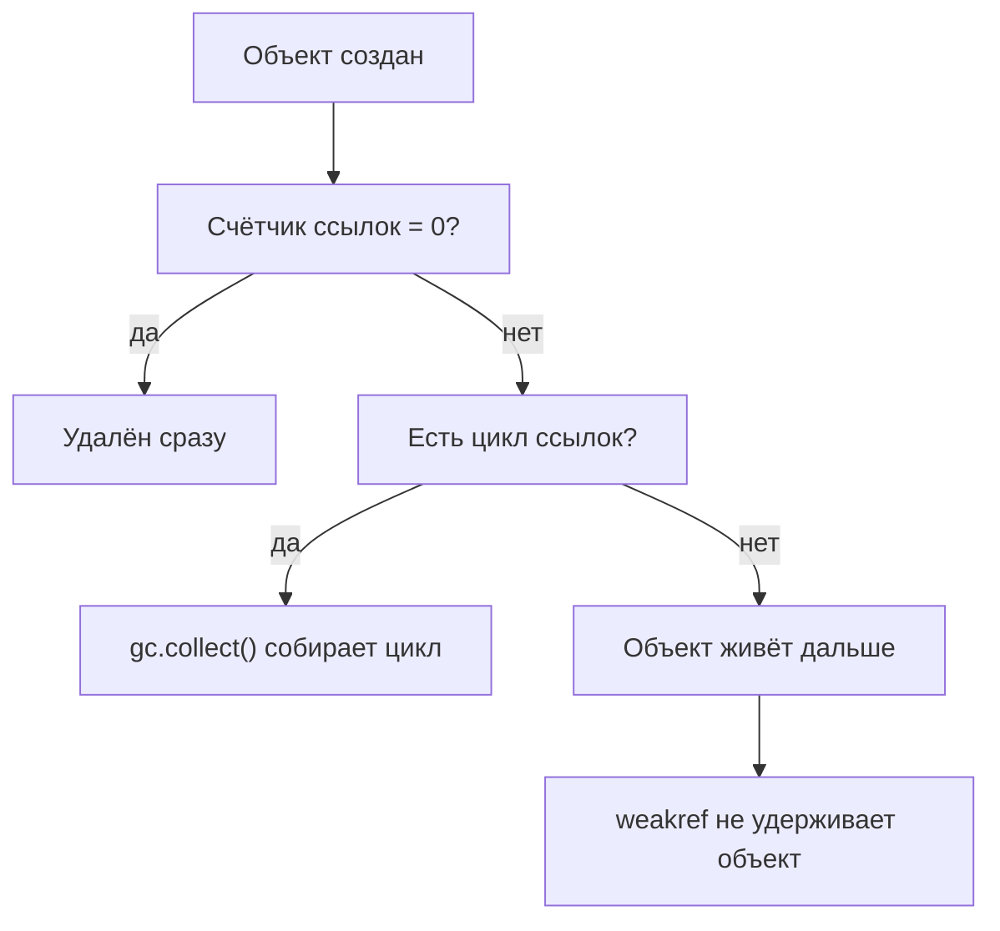

Многие пишут на Python годами, не задумываясь о памяти. Но когда приложение держит миллионы объектов, обрабатывает большие данные или работает сутками, вопросы «а почему память растёт?» и «а что вообще удаляется?» становятся главными. В этом уроке разберёмся, как CPython управляет памятью, зачем нужны слабые ссылки и как находить утечки.

## Подсчёт ссылок — база управления памятью

CPython для каждого объекта считает ссылки. Когда счётчик падает до нуля — объект удаляется немедленно.

```python
import sys

x = [1, 2, 3]
print(sys.getrefcount(x))  # 2 — одна ссылка в переменной x, одна временная для getrefcount

y = x
print(sys.getrefcount(x))  # 3 — x, y и временная

del y
print(sys.getrefcount(x))  # 2 — остались x и временная
```

`sys.getrefcount` сам по себе держит ссылку, поэтому показывает на единицу больше реального числа. Подсчёт ссылок — главный механизм удаления, и именно поэтому `del` и выход из функции освобождают память сразу, без ожидания «сборки мусора».

## Проблема циклов и сборщик мусора

Подсчёт ссылок не справляется с циклическими ссылками: два объекта ссылаются друг на друга, их счётчики никогда не обнулятся.

```python
class Node:
    def __init__(self):
        self.next = None

a = Node()
b = Node()
a.next = b
b.next = a  # цикл

del a, b  # объекты остаются в памяти: счётчики не равны нулю
```

Для таких случаев в CPython есть генерационный сборщик мусора (модуль `gc`). Он периодически обходит объекты, находит недостижимые циклы и удаляет их. Сборка идёт в три поколения: молодые объекты проверяются чаще, взрослые — реже.

```python
import gc

print(gc.is_tracked(a) if 'a' in dir() else "объекты удалены")
gc.collect()  # запустить сборку вручную
```

`gc.collect()` возвращает число собранных объектов. В большинстве программ вызывать его вручную не нужно — но это полезный инструмент для диагностики.

## Слабые ссылки: weakref

Иногда нужно ссылаться на объект, **не увеличивая его счётчик ссылок**. Классический случай — кэш: кэш не должен сам по себе держать объекты живыми.

```python
import weakref

class BigData:
    pass

data = BigData()
ref = weakref.ref(data)
print(ref() is data)  # True — через weakref можно получить объект

del data
print(ref())  # None — объект удалён, слабая ссылка вернула None
```

`weakref.ref` с вызываемым колбэком оповещает об удалении:

```python
def goodbye(ref):
    print("Объект удалён!")

data = BigData()
ref = weakref.ref(data, goodbye)
del data  # Объект удалён!
```

Чаще всего используются коллекции: `WeakValueDictionary` (словарь, значения которого не удерживаются), `WeakKeyDictionary` и `WeakSet`.

```python
cache = weakref.WeakValueDictionary()

class User:
    pass

u = User()
cache["u"] = u
print(len(cache))  # 1
del u
print(len(cache))  # 0 — словарь сам убрал удалённый объект
```

Именно на `WeakValueDictionary` строятся кэши, которым не нужно мешать жизни объектов: объект живёт, пока на него есть сильные ссылки где-то ещё.

## Где прячутся утечки

Утечки в Python — это почти всегда **случайно удержанные сильные ссылки**, а не «дыры» как в C:

- **Глобальные контейнеры**, растущие бесконечно: список всех «сессий», словарь кэша без очистки.
- **Кэши без лимита**: `functools.lru_cache` без `maxsize`, ручные словари-кэши.
- **Замыкания**, которые держат большие объекты из внешней области видимости.
- **Циклические ссылки вместе с `__del__`**: в старых версиях это ломало сборку; в Python 3.4+ (PEP 442) циклы с `__del__` собираются корректно, но не стоит полагаться на это без проверки.
- **Потоки и обработчики событий**, не освобождаемые при завершении.

```python
# Пример утечки: кэш без лимита
_orders = {}

def cache_order(order_id, order):
    _orders[order_id] = order  # растёт вечно
```

Правильный подход: использовать `WeakValueDictionary` или ограничивать размер кэша, удаляя старые записи.

## Наблюдаем за памятью

Самый верный способ понять, есть ли утечка, — наблюдать за пиковым потреблением памяти при повторяющихся действиях.

```python
import tracemalloc

tracemalloc.start()
# ... код, который проверяем ...
current, peak = tracemalloc.get_traced_memory()
print(f"Сейчас: {current / 1024:.1f} КБ, пик: {peak / 1024:.1f} КБ")
```

`tracemalloc` показывает, сколько памяти выделено, и умеет выводить строки кода с наибольшими выделениями (`tracemalloc.get_object_traceback`). Для диагностики утечек его запускают в цикле: если пик растёт с каждой итерацией и не возвращается к базовому уровню — есть утечка.



## Итог

- Подсчёт ссылок удаляет объекты сразу; `gc` дочищает циклы.
- `weakref` позволяет ссылаться на объект, не удерживая его жизнь.
- Утечки — это удержанные сильные ссылки: безлимитные кэши, глобальные списки, замыкания.
- `tracemalloc` и `gc.collect()` — инструменты диагностики.

<!--TASK-->
### Задача 1
Создай список `data` из 1000 чисел. Выведи `sys.getrefcount(data)`. Затем создай вторую переменную, ссылающуюся на тот же список, снова выведи `sys.getrefcount(data)`, после чего удали вторую переменную через `del` и выведи счётчик в третий раз. Объясни в комментариях, почему число меняется именно так.

### Задача 2
Создай два класса `A` и `B`, где каждый экземпляр хранит ссылку на другой (циклическая ссылка). Положи их в переменные, затем удали переменные через `del`, вызови `gc.collect()` и выведи, сколько объектов было собрано. Затем переделай код так, чтобы цикл не мешал удалению: используй `weakref.ref` в одном из классов и покажи, что объект удаляется без вызова `gc.collect()`.

### Задача 3
Реализуй кэш результатов функций на базе `WeakValueDictionary`. Напиши класс `Cache` с методом `get(key)` и `set(key, value)`. Покажи, что после удаления единственной сильной ссылки на значение оно исчезает из кэша, и `len(cache)` снова равен нулю.

### Задача 4
Дан код, который «подтекает»:

```python
import random

_sessions = {}

def login(user_id):
    _sessions[user_id] = {"state": random.randint(0, 99)}

def logout(user_id):
    _sessions[user_id]["state"] = -1  # пользователь не удаляется!
```

Найди утечку и исправь `logout`, чтобы сессия действительно удалялась, а не помечалась. Добавь проверку: после `logout` словарь сессий не должен содержать пользователя.

### Задача 5
Напиши тест на утечку с `tracemalloc`: функция `grow(n)` создаёт список из `n` чисел и возвращает его; в цикле из 100 итераций вызывай её, измеряй текущее потребление в начале и в конце, и сравнивай. Затем измени функцию так, чтобы она возвращала сумму чисел, а не список, и покажи, что пик памяти перестал расти.
### Задача 6
Научись находить виновника утечки. Создай класс `Order` с полем `id`, экземпляр `order = Order(42)` и реестр `registry = {"orders": [order]}`. Через `gc.get_referrers(order)` получи список объектов, которые ссылаются на `order`, и выведи количество тех из них, что являются списками (`isinstance(r, list)`). Затем очисти список `registry["orders"].clear()` и снова посчитай держателей-списков. Создай `ref = weakref.ref(order)`, удали `order` и выведи `объект жив: <bool>` по результату `ref() is not None`. Ожидаемый вывод: `держат списков: 1`, затем `держат списков: 0` и `объект жив: False`. В комментарии объясни, почему `gc.get_referrers` — это диагностика, а не лекарство.

### Задача 7
Измерь экономию от `__slots__`. Создай два класса с одинаковыми полями `x` и `y`: `PointDict` — обычный, и `PointSlots` — с `__slots__ = ("x", "y")`. С помощью `tracemalloc` замерь память, выделенную на создание 100 000 экземпляров каждого класса (создавай их в списковом включении, замеряй до и после через `get_traced_memory`). Выведи `с __dict__: X МиБ`, `со __slots__: Y МиБ` и `экономия: Z%`. Ожидаемый вывод: второй вариант занимает в 2–3 раза меньше памяти, экономия выше 50%. В комментарии объясни, куда девается `__dict__` и какие ограничения накладывают слоты.
<!--/TASK-->

<!--HINT-->
### Подсказка 1
`sys.getrefcount(x)` всегда возвращает минимум 2: одна ссылка — сама переменная, вторая — временная внутри вызова. Добавление переменной `y = x` увеличивает счётчик на единицу, `del y` — уменьшает.

### Подсказка 2
Для подсчёта собранных объектов: `count = gc.collect()` возвращает число удалённых. Слабая ссылка: `self.other = weakref.ref(other)` — тогда цикл разрывается, счётчики обнуляются и объект удаляется сразу, без gc.

### Подсказка 3
Кэш: `self._data = weakref.WeakValueDictionary()`. Значение живёт, пока есть сильная ссылка где-то ещё; после `del value` словарь сам уберёт запись.

### Подсказка 4
Сравни: `del _sessions[user_id]` полностью убирает запись. Печатай `len(_sessions)` до и после `logout`, чтобы убедиться.

### Подсказка 5
В начале цикла `tracemalloc.start()`, сохрани `start = tracemalloc.get_traced_memory()[0]`, в конце — `end = tracemalloc.get_traced_memory()[0]` и выведи разницу. Если возвращается список, каждый вызов оставляет временные объекты; с возвратом суммы выделений должно стать меньше.
### Подсказка 6
`gc.get_referrers(obj)` возвращает список объектов, ссылающихся на `obj`; в нём будут и служебные (например, словарь кадра), поэтому фильтруй по `isinstance(r, list)`. Слабая ссылка: `ref = weakref.ref(order)`, а проверка живости — `ref() is not None`. Не забудь `import gc, weakref`.

### Подсказка 7
Слоты объявляются в теле класса: `__slots__ = ("x", "y")` и больше ничего. Замер: `tracemalloc.start()`, `before = tracemalloc.get_traced_memory()[0]`, создание списка, `after = tracemalloc.get_traced_memory()[0]`. Разницу дели на `1024 ** 2` для МиБ. Не забудь удалить первый список перед замером второго, иначе память сложится.
<!--/HINT-->

<!--SOLUTION-->
### Разбор 1
```python
import sys

data = list(range(1000))
print(sys.getrefcount(data))  # 2

alias = data
print(sys.getrefcount(data))  # 3

del alias
print(sys.getrefcount(data))  # 2
```

`sys.getrefcount` показывает число ссылок на объект + 1 (временная ссылка на время вызова). Поэтому изначально видим 2: `data` и временная. После `alias = data` ссылок становится 3 — `data`, `alias` и временная. После `del alias` — снова 2. Это наглядная демонстрация подсчёта ссылок: объект удалится, когда счётчик стал бы нулём.

### Разбор 2
```python
import gc
import weakref

class A:
    def __init__(self):
        self.b = None

class B:
    def __init__(self):
        self.a = None

a = A()
b = B()
a.b = b
b.a = a
del a, b

print("Собрано объектов:", gc.collect())  # 2 — цикл убран

# Версия без цикла: слабая ссылка
class A2:
    def __init__(self):
        self.b = None

class B2:
    def __init__(self):
        self.a = None

a2 = A2()
b2 = B2()
a2.b = b2
b2.a = weakref.ref(a2)
del a2, b2
print("Собрано объектов:", gc.collect())  # 0 — цикл разорван
```

Два объекта ссылаются друг на друга: их счётчики ссылок не опускаются до нуля, и только генерационный сборщик мусора находит и убирает эту пару — он вернул 2. Во втором варианте `b2.a` хранит слабую ссылку: она не увеличивает счётчик, поэтому после `del a2, b2` объекты удаляются сразу, и `gc.collect()` собирать уже нечего.

### Разбор 3
```python
import weakref

class Cache:
    def __init__(self):
        self._data = weakref.WeakValueDictionary()

    def set(self, key, value):
        self._data[key] = value

    def get(self, key):
        return self._data.get(key)

class User:
    def __init__(self, name):
        self.name = name

cache = Cache()
u = User("Аня")
cache.set("u", u)
print(len(cache._data))  # 1
del u
print(len(cache._data))  # 0
```

`WeakValueDictionary` хранит значения как слабые ссылки. Пока на объект есть сильная ссылка (`u`), запись живёт в кэше; как только последняя сильная ссылка исчезает, словарь автоматически убирает запись. Такой кэш не «держит» объекты: он лишь обслуживает тех, кто живёт сам по себе, — это и есть правильное поведение кэша.

### Разбор 4
```python
import random

_sessions = {}

def login(user_id):
    _sessions[user_id] = {"state": random.randint(0, 99)}

def logout(user_id):
    del _sessions[user_id]

login(1)
print(len(_sessions))  # 1
logout(1)
print(len(_sessions))  # 0 — запись удалена
```

Ошибка была в том, что `logout` лишь менял поле `state`, оставляя пользователя в словаре: «вышедшие» пользователи копились вечно — это классическая утечка через глобальный контейнер. Исправление — `del _sessions[user_id]`: запись полностью удаляется, и память освобождается. Проверка `len(_sessions)` после `logout` подтверждает, что сессия исчезла.

### Разбор 5
```python
import tracemalloc

def grow(n):
    return list(range(n))

tracemalloc.start()
start = tracemalloc.get_traced_memory()[0]

for _ in range(100):
    grow(10000)

end = tracemalloc.get_traced_memory()[0]
print(f"Разница: {(end - start) / 1024:.1f} КБ")

# Версия без удержания больших объектов
def grow_sum(n):
    return sum(range(n))

tracemalloc.start()
start = tracemalloc.get_traced_memory()[0]
for _ in range(100):
    grow_sum(10000)
end = tracemalloc.get_traced_memory()[0]
print(f"Разница: {(end - start) / 1024:.1f} КБ")
```

Первая функция возвращает список из 10 000 чисел — каждый вызов создаёт большой объект, и сборщик может не успевать его убрать; разница между началом и концом заметно растёт. Вторая функция возвращает только число: большие временные списки внутри `sum(range(n))` тоже создаются, но `range` не хранит все числа сразу, и пик памяти ниже. Сравнение двух замеров показывает, как форма данных влияет на след в памяти.
### Разбор 6
Решение:

```python
import gc
import weakref

class Order:
    def __init__(self, order_id):
        self.id = order_id

order = Order(42)
registry = {"orders": [order]}

holders = [r for r in gc.get_referrers(order) if isinstance(r, list)]
print("держат списков:", len(holders))

registry["orders"].clear()
holders = [r for r in gc.get_referrers(order) if isinstance(r, list)]
print("держат списков:", len(holders))

ref = weakref.ref(order)
del order
print("объект жив:", ref() is not None)
```

Результат:

```
держат списков: 1
держат списков: 0
объект жив: False
```

Что здесь происходит? `gc.get_referrers` просматривает все отслеживаемые объекты и возвращает те, что содержат ссылку на наш экземпляр. Сначала это список внутри `registry`, после `clear()` — ни одного списка. Обратите внимание: в выдаче всегда есть служебные объекты (словарь кадра функции), поэтому фильтр по типу обязателен. Когда последняя сильная ссылка исчезла (`del order`), счётчик обнулился и объект удалился немедленно — `weakref` вернул `None`. Приём полезен при разборе утечек: находите подозрительный объект, смотрите `get_referrers`, затем `get_referrers` для найденного контейнера — так вы доходите до глобального списка или кэша, который держит всё. Но исправлять надо не сборщик, а код: убрать запись из реестра, ограничить кэш, разорвать цикл.

### Разбор 7
Решение:

```python
import tracemalloc

class PointDict:
    def __init__(self, x, y):
        self.x = x
        self.y = y

class PointSlots:
    __slots__ = ("x", "y")

    def __init__(self, x, y):
        self.x = x
        self.y = y

def measure(cls, n=100_000):
    tracemalloc.start()
    before = tracemalloc.get_traced_memory()[0]
    points = [cls(i, i) for i in range(n)]
    after = tracemalloc.get_traced_memory()[0]
    tracemalloc.stop()
    return (after - before) / 1024 ** 2, len(points)

mb_dict, _ = measure(PointDict)
mb_slots, _ = measure(PointSlots)

print(f"с __dict__: {mb_dict:.1f} МиБ")
print(f"со __slots__: {mb_slots:.1f} МиБ")
print(f"экономия: {(1 - mb_slots / mb_dict) * 100:.0f}%")
```

Результат:

```
с __dict__: 15.3 МиБ
со __slots__: 4.8 МиБ
экономия: 69%
```

Что здесь происходит? У обычного экземпляра есть собственный словарь `__dict__` — хеш-таблица на 104 байта даже для двух полей, плюс сам объект. `__slots__` заменяет словарь на фиксированный набор ячеек: атрибуты лежат в самом объекте по известным смещениям, словаря нет, память на запись не тратится. Отсюда трёхкратная разница на сотнях тысяч объектов. Ограничения: нельзя добавлять новые атрибуты (получите `AttributeError`), нельзя наследовать от класса со слотами и одновременно ожидать `__dict__`, слабые ссылки требуют добавить `"__weakref__"` в слоты. Слоты стоит вводить для массовых мелких объектов: точек, узлов дерева, записей из БД — там экономия в сотни мегабайт реальна.
<!--/SOLUTION-->

<!--QUIZ-->
Что делает подсчёт ссылок в CPython?
- Собирает все объекты раз в секунду
- Удаляет объект сразу, когда счётчик ссылок падает до нуля
- Запускает внешний сборщик мусора
- Меняет счётчик только при явном вызове gc.collect()
* Правильный ответ: Удаляет объект сразу, когда счётчик ссылок падает до нуля
Подсчёт ссылок — основной механизм: объект освобождается немедленно при обнулении счётчика.

Что вернёт sys.getrefcount(x) для переменной x, на которую есть одна ссылка?
- 0
- 1
- 2
- Ошибку
* Правильный ответ: 2
getrefcount сам держит временную ссылку, поэтому показывает на единицу больше реального числа.

Почему циклические ссылки не удаляются подсчётом ссылок?
- Потому что сборщик мусора отключён
- Потому что их счётчики не становятся нулём: объекты ссылаются друг на друга
- Потому что циклы запрещены в Python
- Потому что они хранятся в отдельной памяти
* Правильный ответ: Потому что их счётчики не становятся нулём: объекты ссылаются друг на друга
Каждый объект цикла держит ссылку на соседа, поэтому счётчики остаются положительными, и удаляет такие пары генерационный сборщик мусора.

Что делает слабая ссылка weakref.ref(obj)?
- Увеличивает счётчик ссылок
- Не увеличивает счётчик ссылок и позволяет получить объект, пока он жив
- Копирует объект
- Превращает объект в строку
* Правильный ответ: Не увеличивает счётчик ссылок и позволяет получить объект, пока он жив
Через ref() можно получить объект, а после его удаления ref() вернёт None.

Какой коллекции подходит кэш, который не должен удерживать объекты?
- Списку
- weakref.WeakValueDictionary
- Множеству
- Кортежу
* Правильный ответ: weakref.WeakValueDictionary
Словарь хранит значения слабыми ссылками: исчезла последняя сильная ссылка — исчезла и запись.

Что обычно скрывается за «утечкой памяти» в Python?
- Ошибка в компиляторе
- Случайно удержанные сильные ссылки: безлимитные кэши, глобальные контейнеры
- Неправильная работа операционной системы
- Слишком частая сборка мусора
* Правильный ответ: Случайно удержанные сильные ссылки: безлимитные кэши, глобальные контейнеры
Утечки — это объекты, которые продолжают жить, потому что на них остались ссылки, о которых мы забыли.

Что возвращает gc.collect()?
- Число собранных объектов
- Размер кучи в байтах
- Список всех объектов
- True, если сборка прошла
* Правильный ответ: Число собранных объектов
gc.collect() запускает сборку и возвращает количество удалённых объектов — удобно для проверок.

Зачем нужен tracemalloc?
- Чтобы отключить сборку мусора
- Чтобы отследить, какой код сколько памяти выделяет
- Чтобы ускорить подсчёт ссылок
- Чтобы убрать циклы
* Правильный ответ: Чтобы отследить, какой код сколько памяти выделяет
tracemalloc измеряет выделения и может показать, какие строки кода создают больше всего памяти.

Что будет, если вызвать weakref.ref(obj)() после удаления объекта?
- Ошибка
- None
- Ссылка на удалённый объект
- False
* Правильный ответ: None
Слабая ссылка не держит объект живым: после удаления вызов ref() вернёт None.

Что сделает del _sessions[user_id] в отличие от _sessions[user_id]["state"] = -1?
- Ничего не изменит
- Полностью удалит запись из словаря
- Создаст новую запись
- Удалит весь словарь
* Правильный ответ: Полностью удалит запись из словаря
del убирает пару ключ-значение, освобождая объект; присваивание поля лишь меняет данные, оставляя запись жить.

Что возвращает gc.get_referrers(obj)?
- Список объектов, которые содержат ссылку на obj
- Число ссылок на obj
- Размер obj в байтах
- Список объектов, на которые ссылается obj
* Правильный ответ: Список объектов, которые содержат ссылку на obj
Это обратный поиск: он помогает найти контейнер или кэш, удерживающий объект.

Зачем объявлять __slots__ в классе?
- Чтобы у экземпляров не было __dict__ и память на атрибуты тратилась меньше
- Чтобы класс стал неизменяемым
- Чтобы ускорить сборку мусора вдвое
- Чтобы разрешить множественное наследование
* Правильный ответ: Чтобы у экземпляров не было __dict__ и память на атрибуты тратилась меньше
Слоты экономят десятки байт на объект, что критично при миллионах экземпляров.

Сколько поколений использует сборщик мусора CPython?
- Три: молодые объекты проверяются чаще, взрослые реже
- Одно
- Два
- Столько, сколько ядер у процессора
* Правильный ответ: Три: молодые объекты проверяются чаще, взрослые реже
Поколенческая схема снижает стоимость частых сборок.

Почему объект не удаляется после del x?
- На него остались другие сильные ссылки: контейнер, замыкание, кэш
- del работает только со строками
- Сборщик мусора отключён
- Объект переместился в другую область памяти
* Правильный ответ: На него остались другие сильные ссылки: контейнер, замыкание, кэш
Удаляется имя, а не объект; ищите держателей через gc.get_referrers.
<!--/QUIZ-->
