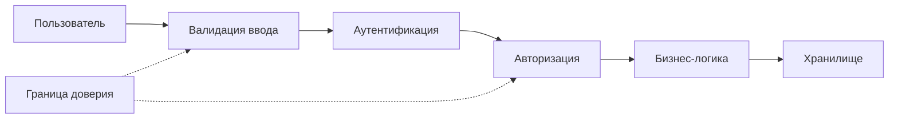

Безопасность — это не отдельная фича, а свойство всего процесса разработки. Чтобы говорить с командой на одном языке и понимать, куда вкладывать силы, индустрия использует **OWASP Top 10** — список десяти самых распространённых и опасных классов рисков веб-приложений. Разберём эти классы и посмотрим, как каждый из них выглядит в Python-коде.

## Что такое OWASP Top 10

OWASP (Open Worldwide Application Security Project) — некоммерческая организация, которая публикует открытые методики и инструменты безопасности. Top 10 — это не рейтинг конкретных уязвимостей, а категории рисков, составленные из данных реальных атак. Знать их нужно, чтобы:

- проектировать систему с учётом угроз ещё до написания кода;
- грамотно формулировать задачи для аудита;
- понимать отчёты сканеров безопасности (bandit, Semgrep, SAST-инструменты).

## Категории и их следы в Python

- **A01 — Сломанный контроль доступа.** Пользователь видит или изменяет чужие данные. Классика — объектные ссылки (IDOR), когда приложение доверяет `id` из запроса:

```python
# Плохо: любой может подставить чужой id
profile = Profile.objects.get(pk=request.GET["id"])

# Хорошо: права берём из аутентифицированного пользователя
profile = request.user.profile
```

- **A02 — Криптографические сбои.** Слабые алгоритмы, отсутствие шифрования, плохое хранение паролей. В Python это md5 для паролей, секреты в коде, HTTP вместо HTTPS.
- **A03 — Инъекции.** SQL, команды ОС, шаблоны. SQL-инъекция живёт там, где запрос склеивается вручную. Защита — параметризованные запросы и строгая валидация:

```python
import re
print(re.sub(r"[^0-9]", "", "2024; DROP TABLE users"))  # 2024
```

- **A04 — Небезопасный дизайн.** Недостатки архитектуры: нет лимитов, нет модели угроз, не контролируются ошибки.
- **A05 — Небезопасная конфигурация.** `DEBUG = True` в проде, стандартные пароли, лишние заголовки:

```python
import os
if os.environ.get("APP_DEBUG", "").lower() == "true":
    print("Предупреждение: режим отладки включён!")
```

- **A06 — Уязвимые и устаревшие компоненты.** Библиотеки с известными CVE. Лечится аудитом зависимостей (`pip-audit`, `safety`) — подробно в уроке 2.
- **A07 — Сбои идентификации и аутентификации.** Слабые пароли, отсутствие блокировок, предсказуемые сессии.
- **A08 — Сбои целостности ПО и данных.** Неподписанные обновления, десериализация недоверенных данных (`pickle` — урок 4).
- **A09 — Сбои логирования и мониторинга.** Атаки остаются незамеченными (урок 6).
- **A10 — SSRF.** Сервер по указанию злоумышленника обращается к внутренним адресам (урок 3).

## Принципы, которые работают всегда

1. **Доверяй только тому, что прошло проверку.** Входные данные — враг.
2. **По умолчанию — отказ (default deny).** Разрешено явно — иначе запрещено.
3. **Границы доверия.** Разделяй код на зоны: публичный вход, бизнес-логика, хранилище.
4. **Наименьшие привилегии.** Каждый модуль и пользователь получают ровно столько прав, сколько нужно.



## Итог урока

Безопасность начинается с архитектуры и валидации, а не с «антивируса». Теперь закрепим практикой: реализуем контроль доступа, валидацию ввода, аудит конфигурации, оценку рисков и защиту от открытого редиректа.

<!--TASK-->
### Задача 1
Напиши функцию `can_access(user_id, current_user_id, is_admin)`, которая возвращает `True`, если `current_user_id == user_id` или `is_admin is True`, иначе — `False`. Затем вызови её с тремя парами аргументов: `(10, 10, False)`, `(10, 5, False)`, `(10, 5, True)` и выведи результат каждой проверки в формате `доступ для user_id=10: True` или `доступ для user_id=10: False`. Программа должна напечатать ровно три строки: первую и третью со значением `True`, вторую — с `False`. Так выглядит защита от IDOR: права определяются не по входному `id`, а по проверенным данным о текущем пользователе.

### Задача 2
Напиши функцию `is_valid_email(email)`, которая использует `re.fullmatch` с шаблоном `^[\w.+-]+@[\w-]+\.[\w.]{2,}$` и возвращает `True` или `False`. Проверь список адресов: `user@example.com`, `bad@@mail.ru`, `это-не-почта`, `a@b.co`. Для каждого элемента выведи строку вида `'user@example.com' -> True`. Это пример валидации ввода (A03): жёсткое соответствие whitelist-шаблону лучше, чем наивная проверка `"@" in email`.

### Задача 3
Напиши функцию `check_config(debug, ssl_redirect, http_only)`, которая возвращает список предупреждений в виде строк:
- если `debug is True` — `DEBUG включён — выключи в проде!`;
- если `ssl_redirect is False` — `Отсутствует принудительный HTTPS!`;
- если `http_only is False` — `Session cookie не помечена HttpOnly!`.
Вызови её с аргументами `(True, False, True)` и напечатай каждое предупреждение с новой строки. Должно появиться ровно два предупреждения. Это аудит конфигурации по классу A05: программа сама сигнализирует об опасных настройках.

### Задача 4
Напиши функцию `severity(score)`, которая классифицирует уязвимость по шкале CVSS v3: если `score >= 9.0` — вернуть `CRITICAL`, при `score >= 7.0` — `HIGH`, при `score >= 4.0` — `MEDIUM`, иначе — `LOW`. Вызови её для списка оценок `[9.8, 7.5, 5.3, 2.0]` и выведи пары `оценка -> уровень`, например `9.8 -> CRITICAL`. Это часть модели угроз (A04): одинаковые предупреждения должны ранжироваться по серьёзности.

### Задача 5
Напиши функцию `safe_redirect_target(url, allowed_hosts)`, которая защищает от открытого редиректа. Используй `urllib.parse.urlparse`. Правила: если схема в URL отсутствует (относительный путь) — верни исходный `url`; если `netloc` (хост) входит в `allowed_hosts` — верни исходный `url`; иначе верни `None`. Проверь со списком `["https://mysite.ru/go", "https://evil.com/x", "/local/path", "https://mysite.ru/ok"]` и `allowed_hosts = {"mysite.ru"}`. Для каждого адреса выведи строку вида `'https://evil.com/x' -> None`. Так нельзя позволить пользователю увести других на поддельный сайт.
### Задача 6
Реализуй ролевую модель доступа (RBAC) с отказом по умолчанию. Заведи словарь `PERMISSIONS`: роль `"admin"` — `{"read", "write", "delete"}`, `"editor"` — `{"read", "write"}`, `"viewer"` — `{"read"}`. Напиши `has_permission(role, action)`, которая возвращает `True`, только если действие входит в набор прав роли, а для неизвестной роли — `False`. Проверь четыре случая: `("admin", "delete")`, `("editor", "delete")`, `("viewer", "read")`, `("guest", "write")` и выведи строки вида `admin/delete: True`. Ожидаемый вывод — три `True`–`False` в указанном порядке: `True`, `False`, `True`, `False`. В комментарии объясни, почему такой словарь прав лучше цепочки `if role == "admin"` и как он реализует принцип default deny.

### Задача 7
Напиши аудит защитных заголовков ответа. Задай эталонный словарь `SECURITY_HEADERS` с четырьмя ключами: `Content-Security-Policy`, `X-Frame-Options`, `X-Content-Type-Options`, `Strict-Transport-Security`. Напиши `audit_headers(headers)`, которая возвращает кортеж: список отсутствующих заголовков из эталона и число найденных. Проверь на словаре, где есть только `X-Frame-Options` и `Content-Type`, и выведи `отсутствуют: ...` (через запятую) и `найдено: N из 4`. Ожидаемый вывод: найден один заголовок из четырёх, в списке отсутствующих — три. В комментарии объясни, от какого класса атак защищает каждый из этих заголовков и почему проверка должна быть автоматической.
<!--/TASK-->

<!--HINT-->
### Подсказка 1
Используй логическое `or`: условие доступа записывается в одну строку. Третья проверка возвращает `True` только из-за `is_admin`, а вторая — `False`, потому что ни `id` не совпадают, ни админ не передан.
### Подсказка 2
Шаблон — это строка-регэксп. Передай его в `re.fullmatch` вместе с проверяемой строкой. Важно: `re.fullmatch` требует совпадения всей строки, в отличие от `re.search`, который ищет подстроку.
### Подсказка 3
Составь список `warnings = []` и добавляй строку через `append`, если условие нарушено. Верни список. В цикле `for w in ...: print(w)` выведи предупреждения по одному. Третий аргумент `True` не должен порождать предупреждение.
### Подсказка 4
Используй цепочку `if/elif/else` в порядке убывания порогов: сначала `>= 9.0`, потом `>= 7.0`, потом `>= 4.0`. Проверь граничные значения: 9.0 — CRITICAL, 7.0 — HIGH, 4.0 — MEDIUM.
### Подсказка 5
`urlparse` возвращает объект с полями `scheme`, `netloc`, `path`. Для относительного адреса `scheme` пустой. Сравнивай `parsed.netloc` с множеством `allowed_hosts`. Не забудь вернуть `None` в конце функции.
### Подсказка 6
Словарь прав объяви на уровне модуля, а в функции используй `PERMISSIONS.get(role, set())` — тогда неизвестная роль автоматически получит пустой набор и `False`. Проверка — `action in ...`. Не пиши отдельные ветки под каждую роль: матрица должна быть данными, а не кодом.

### Подсказка 7
`missing = [h for h in SECURITY_HEADERS if h not in headers]` — список отсутствующих. Число найденных — `len(SECURITY_HEADERS) - len(missing)`. Вывод через `", ".join(missing)`, пустой список даст пустую строку — обработай это отдельно, например словом `нет`.
<!--/HINT-->

<!--SOLUTION-->
### Разбор 1
Решение:

```python
def can_access(user_id, current_user_id, is_admin):
    return current_user_id == user_id or is_admin

print("доступ для user_id=10:", can_access(10, 10, False))
print("доступ для user_id=10:", can_access(10, 5, False))
print("доступ для user_id=10:", can_access(10, 5, True))
```

Результат:

```
доступ для user_id=10: True
доступ для user_id=10: False
доступ для user_id=10: True
```

Что здесь происходит? Функция возвращает истину, если идентификатор текущего пользователя совпадает с идентификатором владельца ресурса, либо если текущий пользователь — администратор. Первая проверка проходит по равенству `id`, вторая отклоняется (чужой профиль), третья проходит благодаря флагу `is_admin`. Это и есть суть защиты от IDOR (A01): авторизация никогда не должна опираться на данные, которые клиент может подделать — id в URL, параметры формы, заголовки. В реальном приложении `current_user_id` берётся из сессии или JWT, а не из запроса. Привычка писать подобные проверки одной строкой и покрывать их тестами избавляет от целого класса уязвимостей.

### Разбор 2
Решение:

```python
import re

EMAIL_RE = re.compile(r"^[\w.+-]+@[\w-]+\.[\w.]{2,}$")

def is_valid_email(email):
    return bool(EMAIL_RE.fullmatch(email))

for email in ["user@example.com", "bad@@mail.ru", "это-не-почта", "a@b.co"]:
    print(f"{email!r} -> {is_valid_email(email)}")
```

Результат:

```
'user@example.com' -> True
'bad@@mail.ru' -> False
'это-не-почта' -> False
'a@b.co' -> True
```

Что здесь происходит? Шаблон описывает допустимую структуру адреса: имя (буквы, цифры, точка, плюс, минус, подчёркивание), затем `@`, затем домен и доменная зона. `re.fullmatch` требует, чтобы шаблон покрывал строку целиком, поэтому `bad@@mail.ru` отклоняется — двойная собачка не подходит под `[\w-]+`. Такая валидация «на входе» — первый рубеж защиты от инъекций и спама. Однако помни: валидация формата не заменяет экранирование при выводе и параметризованные запросы. Это принцип многослойной защиты: каждый слой решает свою задачу.

### Разбор 3
Решение:

```python
def check_config(debug, ssl_redirect, http_only):
    warnings = []
    if debug:
        warnings.append("DEBUG включён — выключи в проде!")
    if not ssl_redirect:
        warnings.append("Отсутствует принудительный HTTPS!")
    if not http_only:
        warnings.append("Session cookie не помечена HttpOnly!")
    return warnings

for w in check_config(True, False, True):
    print(w)
```

Результат:

```
DEBUG включён — выключи в проде!
Отсутствует принудительный HTTPS!
```

Что здесь происходит? Функция собирает список нарушений, а не падает при первом же. Это важно для аудита: мы хотим увидеть все проблемы сразу. Третий аргумент `True` не порождает предупреждения, поэтому строк ровно две. В реальном Django-проекте аналогичная проверка выглядела бы как `if settings.DEBUG: warnings.append(...)`, а флаги `SECURE_SSL_REDIRECT` и `SESSION_COOKIE_HTTPONLY` задаются в настройках. Подобные проверки удобно запускать в CI на каждом PR — тогда опасная конфигурация не доедет до прода.

### Разбор 4
Решение:

```python
def severity(score):
    if score >= 9.0:
        return "CRITICAL"
    if score >= 7.0:
        return "HIGH"
    if score >= 4.0:
        return "MEDIUM"
    return "LOW"

for s in [9.8, 7.5, 5.3, 2.0]:
    print(f"{s} -> {severity(s)}")
```

Результат:

```
9.8 -> CRITICAL
7.5 -> HIGH
5.3 -> MEDIUM
2.0 -> LOW
```

Что здесь происходит? Пороги взяты из шкалы CVSS v3, по которой оценивается серьёзность уязвимостей (Critical ≥ 9.0, High ≥ 7.0, Medium ≥ 4.0). Проверки идут в порядке убывания, поэтому 7.5 попадает в `HIGH`, а не в `MEDIUM`: первое же истинное условие срабатывает. Такая классификация — база модели угроз (A04): она помогает команде решать, что чинить в первую очередь. В реальности оценку даёт калькулятор CVSS, но умение переводить число в категорию пригодится при чтении отчётов сканеров.

### Разбор 5
Решение:

```python
from urllib.parse import urlparse

def safe_redirect_target(url, allowed_hosts):
    parsed = urlparse(url)
    if not parsed.scheme:
        return url
    if parsed.netloc in allowed_hosts:
        return url
    return None

allowed = {"mysite.ru"}
for u in ["https://mysite.ru/go", "https://evil.com/x", "/local/path", "https://mysite.ru/ok"]:
    print(f"{u!r} -> {safe_redirect_target(u, allowed)}")
```

Результат:

```
'https://mysite.ru/go' -> 'https://mysite.ru/go'
'https://evil.com/x' -> None
'/local/path' -> '/local/path'
'https://mysite.ru/ok' -> 'https://mysite.ru/ok'
```

Что здесь происходит? `urlparse` разбирает адрес на части, и мы проверяем только хост (`netloc`). Относительные пути без схемы безопасны — они не уводят на другой сайт, поэтому возвращаются как есть. Внешние адреса, не входящие в `allowed_hosts`, превращаются в `None`, и приложение должно показать обычную страницу, а не цепочку редиректов. Это защита от открытого редиректа — атаки, при которой злоумышленник подсовывает жертве ссылку вида `https://mysite.ru/?next=https://evil.com`, и доверчивый пользователь попадает на фишинговый сайт.
### Разбор 6
Решение:

```python
PERMISSIONS = {
    "admin": {"read", "write", "delete"},
    "editor": {"read", "write"},
    "viewer": {"read"},
}

def has_permission(role, action):
    return action in PERMISSIONS.get(role, set())

for role, action in [
    ("admin", "delete"),
    ("editor", "delete"),
    ("viewer", "read"),
    ("guest", "write"),
]:
    print(f"{role}/{action}: {has_permission(role, action)}")
```

Результат:

```
admin/delete: True
editor/delete: False
viewer/read: True
guest/write: False
```

Что здесь происходит? Права описаны данными: множество действий на каждую роль. `PERMISSIONS.get(role, set())` возвращает пустое множество для неизвестной роли, поэтому `guest` не получает ничего — это и есть default deny: разрешено только то, что явно перечислено. Такая матрица легко расширяется (новая роль — одна строка) и легко проверяется тестами: можно пройтись по всем парам «роль × действие» и сверить с ожидаемой таблицей. Цепочка `if role == "admin"` плоха тем, что при добавлении роли нужно помнить о каждом месте проверки, а забытая ветка обычно означает «разрешить». В реальном приложении роль берётся из проверенного токена или сессии, а не из тела запроса, иначе пользователь просто напишет `role: admin`.

### Разбор 7
Решение:

```python
SECURITY_HEADERS = {
    "Content-Security-Policy": "default-src 'self'",
    "X-Frame-Options": "DENY",
    "X-Content-Type-Options": "nosniff",
    "Strict-Transport-Security": "max-age=31536000",
}

def audit_headers(headers):
    missing = [h for h in SECURITY_HEADERS if h not in headers]
    found = len(SECURITY_HEADERS) - len(missing)
    return missing, found

response_headers = {
    "X-Frame-Options": "DENY",
    "Content-Type": "text/html; charset=utf-8",
}

missing, found = audit_headers(response_headers)
print("отсутствуют:", ", ".join(missing) if missing else "нет")
print(f"найдено: {found} из {len(SECURITY_HEADERS)}")
```

Результат:

```
отсутствуют: Content-Security-Policy, X-Content-Type-Options, Strict-Transport-Security
найдено: 1 из 4
```

Что здесь происходит? Функция сверяет фактические заголовки ответа с эталоном и возвращает то, чего не хватает; `Content-Type` в эталон не входит и на результат не влияет. За каждым заголовком стоит конкретная угроза: `Content-Security-Policy` ограничивает источники скриптов и смягчает XSS, `X-Frame-Options: DENY` запрещает встраивать страницу в iframe (кликджекинг), `X-Content-Type-Options: nosniff` не даёт браузеру «угадать» тип и исполнить картинку как скрипт, `Strict-Transport-Security` заставляет браузер ходить только по HTTPS. Проверять это руками бессмысленно — заголовки легко теряются при добавлении прокси или CDN, поэтому такой аудит ставят в CI или в синтетический мониторинг, который дергает прод и сравнивает ответ с эталоном.
<!--/SOLUTION-->

<!--QUIZ-->
Что означает аббревиатура OWASP?
- Open Worldwide Application Security Project
- Only Web Application Security Protocol
- Open Web Attack Security Platform
* Правильный ответ: Open Worldwide Application Security Project
OWASP — некоммерческая организация, выпускающая открытые методики безопасности, включая Top 10.

Что такое OWASP Top 10?
- Десять самых опасных языков программирования
- Список десяти самых распространённых классов рисков веб-приложений
- Топ-10 библиотек для шифрования
* Правильный ответ: Список десяти самых распространённых классов рисков веб-приложений
Это категории рисков из данных реальных атак, а не рейтинг конкретных программ.

Какой класс рисков описывает ситуацию, когда пользователь обращается к чужим данным через подменённый id в URL?
- A01 — Сломанный контроль доступа
- A03 — Инъекции
- A10 — SSRF
* Правильный ответ: A01 — Сломанный контроль доступа
Сценарий с подменой id называется IDOR — разновидность сломанного контроля доступа.

Какая рекомендация корректна для защиты от SQL-инъекций?
- Склеивать строку запроса через f-строки
- Использовать параметризованные запросы
- Скрывать ошибки базы данных
* Правильный ответ: Использовать параметризованные запросы
Параметризация отделяет данные от кода SQL; скрытие ошибок помогает, но не лечит саму инъекцию.

Какой признак характерен для небезопасной конфигурации (A05)?
- DEBUG = True в production
- Наличие тестов
- Использование HTTPS
* Правильный ответ: DEBUG = True в production
Режим отладки раскрывает стектрейсы и конфигурацию; он должен быть выключен в проде.

К какому классу OWASP относится использование необновлённых библиотек с известными уязвимостями?
- A06 — Уязвимые и устаревшие компоненты
- A04 — Небезопасный дизайн
- A02 — Криптографические сбои
* Правильный ответ: A06 — Уязвимые и устаревшие компоненты
Этот класс лечится аудитом зависимостей: pip-audit, safety.

Какой принцип формулируется как «разрешено явно — иначе запрещено»?
- Default deny (отказ по умолчанию)
- Least surprise
- Fail fast
* Правильный ответ: Default deny (отказ по умолчанию)
Политика по умолчанию запрещает всё, что не разрешено явно.

Что такое IDOR?
- Атака, когда приложение доверяет идентификатору объекта из запроса
- Способ обфускации кода
- Тип вируса в пакетах pip
* Правильный ответ: Атака, когда приложение доверяет идентификатору объекта из запроса
Insecure Direct Object Reference — прямое обращение к объекту по подменённому id без проверки прав.

Какой инструмент помогает аудировать конфигурацию Python-приложения?
- Собственная функция проверки настроек (пример check_config)
- Компилятор gcc
- Утилита curl
* Правильный ответ: Собственная функция проверки настроек (пример check_config)
Проверки флагов вроде DEBUG, HTTPS и HttpOnly запускают в CI.

Для чего нужна классификация серьёзности CVSS?
- Чтобы ранжировать уязвимости и назначать приоритеты исправления
- Чтобы ускорить выполнение кода
- Чтобы шифровать логи
* Правильный ответ: Чтобы ранжировать уязвимости и назначать приоритеты исправления
Шкала CVSS переводит сложную оценку в уровень CRITICAL/HIGH/MEDIUM/LOW.

Что описывает категория A04 «Небезопасный дизайн»?
- Недостатки архитектуры: нет модели угроз, лимитов и контроля ошибок
- Опечатки в коде
- Ошибки в библиотеке шифрования
- Отсутствие тестов на скорость
* Правильный ответ: Недостатки архитектуры: нет модели угроз, лимитов и контроля ошибок
Такие проблемы нельзя исправить патчем — нужна переработка решения.

Какой заголовок запрещает встраивать страницу в iframe?
- X-Frame-Options: DENY
- Content-Type: text/html
- Accept-Encoding: gzip
- Cache-Control: no-store
* Правильный ответ: X-Frame-Options: DENY
Он защищает от кликджекинга; современная альтернатива — CSP frame-ancestors.

Почему валидация формы на клиенте не заменяет серверную?
- Клиент под контролем пользователя: запрос можно отправить напрямую, минуя форму
- Браузерная валидация всегда ошибается
- Сервер не умеет читать JSON
- Клиентская валидация работает только в Chrome
* Правильный ответ: Клиент под контролем пользователя: запрос можно отправить напрямую, минуя форму
Клиентская проверка — удобство для пользователя, серверная — защита.

Что означает принцип «границы доверия»?
- Разделение системы на зоны с разным уровнем доверия и проверками на переходах
- Запрет на использование внешних библиотек
- Шифрование всех файлов проекта
- Отказ от аутентификации внутри сети
* Правильный ответ: Разделение системы на зоны с разным уровнем доверия и проверками на переходах
Данные из недоверенной зоны обязаны пройти проверку, прежде чем попасть в доверенную.
<!--/QUIZ-->
