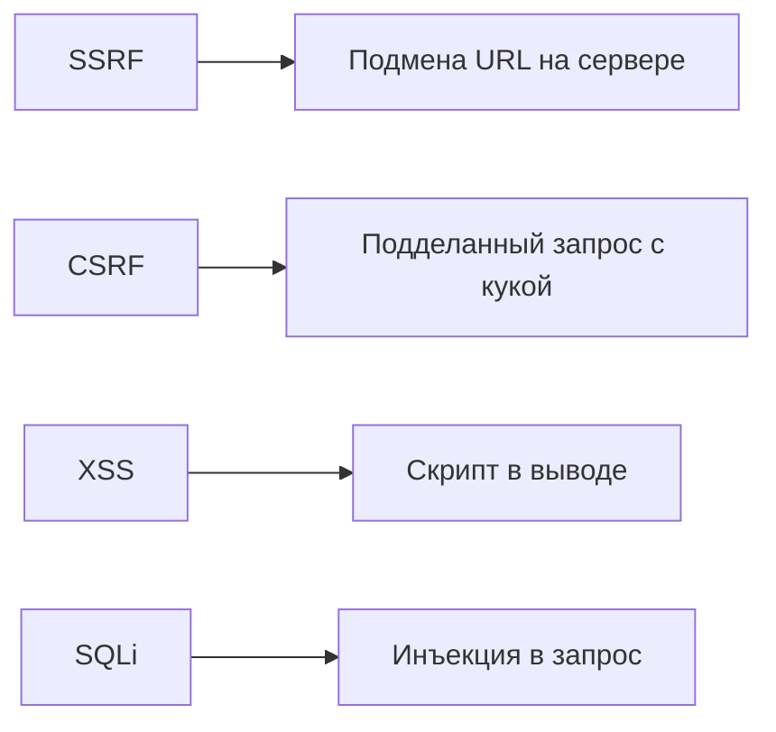

Веб-приложения уязвимы по одному и тому же сценарию: код доверяет данным, которые приходят от пользователя. Разберём четыре классические атаки и их защиту на Python.

## SSRF — поддельный запрос со стороны сервера

**SSRF (Server-Side Request Forgery)** — атака, при которой злоумышленник заставляет сервер обратиться к адресу, который серверу трогать не положено: внутренней сети, метаданным облака (`169.254.169.254`), локальным сервисам. Классический уязвимый код:

```python
import urllib.request

def fetch_image(url):
    with urllib.request.urlopen(url) as resp:
        return resp.read(1024)
```

Если `url` приходит из запроса, атакующий может передать `http://169.254.169.254/latest/meta-data/` и вытащить креды облачного инстанса. Защита — валидация перед запросом:

```python
import ipaddress
import urllib.request
from urllib.parse import urlparse

def safe_fetch(url):
    parsed = urlparse(url)
    if parsed.scheme not in ("http", "https"):
        raise ValueError("Разрешены только http/https")
    host = parsed.hostname
    try:
        ip = ipaddress.ip_address(host)  # если хост — уже IP
    except ValueError:
        return host  # домен — нужен DNS-резолв с проверкой
    if ip.is_private or ip.is_loopback or ip.is_link_local:
        raise ValueError("Внутренние адреса запрещены")
    return url
```

Блокировка приватных диапазонов (`10.x`, `172.16–31.x`, `192.168.x`), loopback (`127.0.0.1`) и link-local — минимум защиты. Для доменов резолвят IP и проверяют их точно так же.

## CSRF — подделка запроса от имени пользователя

**CSRF (Cross-Site Request Forgery)** — когда сайт злоумышленника незаметно отправляет запрос от имени авторизованного пользователя. Например, картинка `` — браузер подтянет её с куками жертвы. Борьба — **токены CSRF**: секретная случайная метка, которую сервер вставляет в форму и проверяет при отправке. В Django защита включена по умолчанию (`CsrfViewMiddleware` и `` в шаблонах). Как это работает вручную:

```python
import hmac
import secrets

def generate_csrf_token():
    return secrets.token_urlsafe(32)

def verify_csrf_token(provided, stored):
    return hmac.compare_digest(provided, stored)
```

`secrets.token_urlsafe` даёт криптографически стойкую случайность, а `hmac.compare_digest` сравнивает строки за постоянное время — без утечки по таймингу.

## XSS — внедрение скриптов в страницу

**XSS (Cross-Site Scripting)** — злоумышленник внедряет скрипт в контент, который потом показывается другим пользователям. Если ты выводишь комментарий напрямую, `<script>alert(document.cookie)</script>` выполнится в браузере жертвы. В Django нельзя использовать `mark_safe` на недоверенных данных, а в шаблонах по умолчанию работает экранирование. На низком уровне — `html.escape`:

```python
import html

def render_comment(text):
    return html.escape(text)
```

`html.escape` превращает `<` в `&lt;`, `>` в `&gt;` и так далее — браузер покажет текст, а не выполнит код.

## SQL-инъекции — подмена запроса

**SQL-инъекция** — когда пользовательский ввод попадает в текст SQL-запроса. Уязвимый вариант:

```python
# Плохо: f-строка в запросе
query = f"SELECT * FROM users WHERE name = '{name}'"
```

При `name = "' OR '1'='1"` запрос вернёт всех пользователей. Лечение — параметризованные запросы:

```python
import sqlite3

conn = sqlite3.connect(":memory:")
conn.execute("CREATE TABLE users (name TEXT)")
conn.execute("INSERT INTO users VALUES (?)", ("admin",))

def find_user(name):
    cur = conn.execute("SELECT * FROM users WHERE name = ?", (name,))
    return cur.fetchall()

print(find_user("admin"))
print(find_user("' OR '1'='1"))  # безопасно: параметр, не код
```

Знак вопроса — это плейсхолдер: драйвер экранирует значение сам, и инъекция становится невозможной. Django ORM так и делает, когда ты передаёшь параметры фильтра, а не собираешь строку.



## Итог урока

Любая из четырёх атак лечится одним принципом: **никогда не смей доверять входным данным**. SSRF — валидация URL и блокировка внутренних адресов, CSRF — токены с `compare_digest`, XSS — экранирование, SQL — параметризация. Django из коробки закрывает многие из этих дыр, но понимать механику нужно, чтобы не открыть их заново.

<!--TASK-->
### Задача 1
Напиши функцию `is_internal(host)`, которая определяет, является ли хост внутренним адресом. Используй `ipaddress.ip_address(host)` и проверяй флаги `is_private`, `is_loopback`, `is_link_local`. Если `host` — не IP (домен), верни `False`. Затем вызови её для списка `["10.0.0.5", "127.0.0.1", "169.254.169.254", "8.8.8.8", "example.com"]` и выведи строки вида `10.0.0.5 -> True`. На экране должно быть пять строк: три со значением `True` и две с `False`. Это ядро защиты от SSRF.

### Задача 2
Напиши функции `generate_csrf_token()` и `verify_csrf_token(provided, stored)` для защиты от CSRF. Первая возвращает `secrets.token_urlsafe(32)`, вторая сравнивает строки через `hmac.compare_digest`. Сгенерируй токен `token`, затем проверь три случая: `verify_csrf_token(token, token)` — должно быть `True`, `verify_csrf_token("123", token)` — `False`, и `verify_csrf_token(token, "456")` — `False`. Выведи результаты трёх проверок в формате `проверка 1: True` и так далее.

### Задача 3
Напиши функцию `find_user(name)`, которая ищет пользователя в таблице `users` через **параметризованный запрос** `sqlite3`: `SELECT * FROM users WHERE name = ?`. Создай базу в памяти, создай таблицу `users (name TEXT)`, добавь строки `admin` и `guest`. Затем вызови `find_user("admin")` (должен вернуть `[('admin',)]`) и `find_user("' OR '1'='1")` (должен вернуть пустой список `[]`). Выведи оба результата. Так параметризация заставляет инъекцию «не сработать».

### Задача 4
Напиши функцию `render_comment(text)`, которая экранирует пользовательский ввод через `html.escape` перед показом на странице. Примени её к строке `'<script>alert("xss")</script> поверь <b>жирным</b>'` и выведи результат. На экране должны появиться `&lt;` и `&gt;` вместо угловых скобок — то есть текст станет безопасным для браузера.

### Задача 5
Создай функцию `validate_comment(text)`, которая возвращает `None` (отклоняет комментарий), если выполняется хотя бы одно условие: длина после `strip()` больше 200 символов; строка содержит `javascript:` (без учёта регистра); строка содержит `<script` или `</script`. Иначе возвращает `html.escape(text.strip())`. Проверь на трёх примерах: короткий обычный комментарий `"Привет, мир!"`, длинная строка из 300 символов `"a" * 300` и строка `"<script>alert(1)</script>"`. Выведи результаты в формате `'Привет, мир!' -> 'Привет, мир!'`, `'длинный' -> None`, `'скрипт' -> None`. Это комбинированная защита: лимит длины плюс блокировка скриптов плюс экранирование.
### Задача 6 — CSRF-защита в Django
Включи `CsrfViewMiddleware` (по умолчанию) и покажи: форма без `` отклоняется (403). Ожидаемый результат: при отсутствии токена Django возвращает 403 CSRF verification failed.
### Задача 7 — XSS: экранирование в шаблоне
Создай страницу, выводящую пользовательский ввод через `{{ value }}` (автоэкранирование Django) и через `{{ value|safe }}`. Передай `<script>alert(1)</script>` и покажи, что только второй вариант исполняет скрипт. Ожидаемый результат: safe-вариант уязвим.

<!--/TASK-->

<!--HINT-->
### Подсказка 1
`ipaddress.ip_address` выбрасывает `ValueError` для не-IP строк — оберни вызов в `try/except ValueError: return False`. Для проверки используй `ip.is_private or ip.is_loopback or ip.is_link_local`. Заметь: `169.254.169.254` — link-local, `10.0.0.5` — private, `127.0.0.1` — loopback.
### Подсказка 2
`secrets.token_urlsafe(32)` возвращает строку безопасной случайности. `hmac.compare_digest(provided, stored)` сравнивает строки за постоянное время — используй её вместо `==`. Возвращаемое значение — `bool`.
### Подсказка 3
В `sqlite3` параметры передаются кортежем вторым аргументом: `conn.execute("SELECT * FROM users WHERE name = ?", (name,))`. Не забудь `conn.execute` для создания таблицы и вставки. `fetchall()` вернёт `[]`, если строк нет.
### Подсказка 4
`html.escape(text)` преобразует `&`, `<`, `>`, `"`, `'` в HTML-сущности. Печатай результат сразу — увидишь `&lt;` и `&gt;` вместо скобок.
### Подсказка 5
Сначала проверяй `len(text.strip()) > 200`, затем `"javascript:" in text.lower()`, затем `<script` в `text.lower()`. Порядок важен: `strip()` и `lower()` — до проверок. Если все проверки прошли — верни `html.escape(text.strip())`.
### Подсказка 6
Отключи токен, убрав `` из формы — middleware вернёт 403 при POST.
### Подсказка 7
Обычный `{{ value }}` экранирует HTML; `|safe` — выводит как есть.

<!--/HINT-->

<!--SOLUTION-->
### Разбор 1
Решение:

```python
import ipaddress

def is_internal(host):
    try:
        ip = ipaddress.ip_address(host)
    except ValueError:
        return False
    return ip.is_private or ip.is_loopback or ip.is_link_local

hosts = ["10.0.0.5", "127.0.0.1", "169.254.169.254", "8.8.8.8", "example.com"]
for h in hosts:
    print(f"{h} -> {is_internal(h)}")
```

Результат:

```
10.0.0.5 -> True
127.0.0.1 -> True
169.254.169.254 -> True
8.8.8.8 -> False
example.com -> False
```

Что здесь происходит? `ipaddress.ip_address` разбирает строку в объект IP; для доменных имён он бросает `ValueError`, который мы ловим и возвращаем `False` (домен не является внутренним адресом напрямую). Три первых адреса относятся к резервированным диапазонам: `10.0.0.5` — приватная сеть, `127.0.0.1` — loopback, `169.254.169.254` — link-local (именно через него получают метаданные в AWS). `8.8.8.8` — публичный DNS, `example.com` — домен, оба возвращают `False`. В реальной защите SSRF эту функцию применяют и к IP после DNS-резолва домена: иначе атакующий может указать `http://internal.corp/`, который резолвится во внутренний адрес.

### Разбор 2
Решение:

```python
import hmac
import secrets

def generate_csrf_token():
    return secrets.token_urlsafe(32)

def verify_csrf_token(provided, stored):
    return hmac.compare_digest(provided, stored)

token = generate_csrf_token()
print("проверка 1:", verify_csrf_token(token, token))
print("проверка 2:", verify_csrf_token("123", token))
print("проверка 3:", verify_csrf_token(token, "456"))
```

Результат:

```
проверка 1: True
проверка 2: False
проверка 3: False
```

Что здесь происходит? `secrets.token_urlsafe(32)` генерирует 32 случайных байта в URL-safe кодировке — предсказать такой токен невозможно. `hmac.compare_digest` сравнивает строки за постоянное время: даже если токены не совпадают, сервер тратит одинаковое время на ответ, и у атакующего нет способа «подобрать» токен по таймингу. Первая проверка сравнивает токен с самим собой — `True`; вторая и третья — разные строки — `False`. Именно так работает встроенная защита Django: токен кладётся в скрытое поле формы (или cookie), а при POST проверяется. Если он не совпал — запрос отклоняется.

### Разбор 3
Решение:

```python
import sqlite3

conn = sqlite3.connect(":memory:")
conn.execute("CREATE TABLE users (name TEXT)")
conn.execute("INSERT INTO users VALUES (?)", ("admin",))
conn.execute("INSERT INTO users VALUES (?)", ("guest",))

def find_user(name):
    cur = conn.execute("SELECT * FROM users WHERE name = ?", (name,))
    return cur.fetchall()

print(find_user("admin"))
print(find_user("' OR '1'='1"))
```

Результат:

```
[('admin',)]
[]
```

Что здесь происходит? В `sqlite3` параметры передаются вторым аргументом `execute` — кортежем; плейсхолдер `?` в тексте запроса заменяется на значение, которое драйвер экранирует как данные, а не как код SQL. Поэтому `find_user("admin")` находит строку, а попытка инъекции `' OR '1'='1` ищет пользователя с буквальным именем `' OR '1'='1` — его нет, результат пустой. Если бы мы собрали запрос f-строкой, `' OR '1'='1` превратился бы в `WHERE name = '' OR '1'='1'` и вернул все строки. Django ORM работает по тому же принципу: `User.objects.filter(name=name)` никогда не подставляет имя в текст SQL.

### Разбор 4
Решение:

```python
import html

def render_comment(text):
    return html.escape(text)

print(render_comment('<script>alert("xss")</script> поверь <b>жирным</b>'))
```

Результат:

```
&lt;script&gt;alert(&quot;xss&quot;)&lt;/script&gt; поверь &lt;b&gt;жирным&lt;/b&gt;
```

Что здесь происходит? `html.escape` заменяет опасные символы на HTML-сущности: `<` → `&lt;`, `>` → `&gt;`, `"` → `&quot;`. Браузер, получив такой текст, не выполнит `<script>`, а покажет его как обычный текст — угловые скобки потеряют своё «магическое» значение. Это и есть защита от XSS на уровне данных. Важно: экранирование нужно применять именно в момент вывода, а не при хранении, и не использовать `mark_safe` в Django без крайней необходимости — оно отключает экранирование и возвращает уязвимость.

### Разбор 5
Решение:

```python
import html

def validate_comment(text):
    stripped = text.strip()
    if len(stripped) > 200:
        return None
    low = stripped.lower()
    if "javascript:" in low or "<script" in low:
        return None
    return html.escape(stripped)

print("'Привет, мир!' ->", validate_comment("Привет, мир!"))
print("'длинный' ->", validate_comment("a" * 300))
print("'скрипт' ->", validate_comment('<script>alert(1)</script>'))
```

Результат:

```
'Привет, мир!' -> 'Привет, мир!'
'длинный' -> None
'скрипт' -> None
```

Что здесь происходит? Функция последовательно применяет три барьера: лимит длины (после `strip()`), чёрный список опасных подстрок (`javascript:`, `<script`) и экранирование перед возвратом. Длинный комментарий из 300 символов отклоняется — `None`. Строка со скриптом отклоняется на этапе проверки `<script` — `None`. Обычный комментарий проходит все проверки и возвращается экранированным. Это пример «защиты в глубину»: даже если один барьер даст сбой — например, злоумышленник изобретёт вариант `javascript:`, который пройдёт фильтр, — экранирование всё равно обезвредит вывод.
### Разбор 6
```html
<form method="post" action="/submit">
      <!-- обязателен -->
    <input name="q">
    <button>Отправить</button>
</form>
```
Без `` POST-запрос получит 403: Django сверяет скрытый токен с кукой сессии. Это базовый барьер против CSRF.
### Разбор 7
```html
<p>{{ user_input }}</p>        <!-- экранировано -->
<p>{{ user_input|safe }}</p>  <!-- опасно -->
```
При вводе `<script>alert(1)</script>` первый вариант покажет текст, второй — исполнит скрипт. Поэтому `|safe` применяют только к доверенным данным.

<!--/SOLUTION-->

<!--QUIZ-->
Что такое SSRF?
- Атака, при которой сервер по указанию злоумышленника обращается к внутренним адресам
- Подмена cookie сессии
- Атака на пароль администратора
* Правильный ответ: Атака, при которой сервер по указанию злоумышленника обращается к внутренним адресам
Сервер сам идёт к метаданным облака или локальным сервисам.

По чему проверяют IP-адрес при защите от SSRF?
- is_private / is_loopback / is_link_local
- По длине строки
- По наличию букв в адресе
* Правильный ответ: is_private / is_loopback / is_link_local
Эти флаги модуля ipaddress скрывают внутренние диапазоны.

Какой адрес отдаёт метаданные в AWS?
- 169.254.169.254
- 8.8.8.8
- 192.0.2.1
* Правильный ответ: 169.254.169.254
Это link-local адрес; к нему нельзя разрешать обращения из SSRF.

Зачем нужны токены CSRF?
- Чтобы браузер не отправлял запросы от имени авторизованного пользователя без его ведома
- Чтобы скрыть версию Django
- Чтобы ускорить загрузку страниц
* Правильный ответ: Чтобы браузер не отправлял запросы от имени авторизованного пользователя без его ведома
Токен проверяется при отправке формы — чужая форма его не знает.

Как сравнивать токены безопасно?
- hmac.compare_digest
- Обычное ==
- Через len()
* Правильный ответ: hmac.compare_digest
Сравнение за постоянное время не выдаёт информацию о длине и содержимом.

Что делает html.escape?
- Превращает опасные символы в HTML-сущности
- Удаляет все теги из строки
- Шифрует строку
* Правильный ответ: Превращает опасные символы в HTML-сущности
< становится &lt;, > — &gt;, и браузер не выполняет код.

Какая строка является примером SQL-инъекции?
- ' OR '1'='1
- SELECT * FROM users
- admin123
* Правильный ответ: ' OR '1'='1
Подстановка такой строки в запрос без параметризации вернёт всех пользователей.

Как защититься от SQL-инъекций?
- Параметризованные запросы с плейсхолдерами
- Удаление одинарных кавычек из ввода
- Скрытие ошибок БД
* Правильный ответ: Параметризованные запросы с плейсхолдерами
Данные передаются отдельно от кода SQL — экранирование выполняет драйвер.

Что означает защита «в глубину»?
- Несколько независимых слоёв защиты
- Использование одного мощного пароля
- Глубокое логирование
* Правильный ответ: Несколько независимых слоёв защиты
Если один барьер обойдён, сработает следующий.

Как Django защищает от CSRF?
- Встроенным middleware и токеном csrf_token
- Отключением всех форм
- Шифрованием GET-запросов
* Правильный ответ: Встроенным middleware и токеном csrf_token
CsrfViewMiddleware проверяет токен при POST-запросах.
Что такое CSRF?
- Подделка межсайтового запроса с использованием куки пользователя
- Ошибка сервера
- Тип базы данных
- Сеть
* Правильный ответ: Подделка межсайтового запроса с использованием куки пользователя
Атака заставляет браузер жертвы отправить запрос с её куками.

Как Django защищается от CSRF?
- Токеном в форме, сверяемым с сессией
- Паролем
- Файрволом
- Логированием
* Правильный ответ: Токеном в форме, сверяемым с сессией
CsrfViewMiddleware проверяет токен в POST.

Что такое XSS?
- Внедрение скриптов в вывод страницы
- Ошибка авторизации
- SQL-инъекция
- DDoS
* Правильный ответ: Внедрение скриптов в вывод страницы
Скрипт исполняется в браузере жертвы.

Как защититься от XSS в шаблонах?
- Автоэкранирование и отказ от |safe для ввода
- Убрать все данные
- Использовать print
- Выключить JS
* Правильный ответ: Автоэкранирование и отказ от |safe для ввода
Django экранирует {{ }} по умолчанию.

# 
<!--/QUIZ-->
