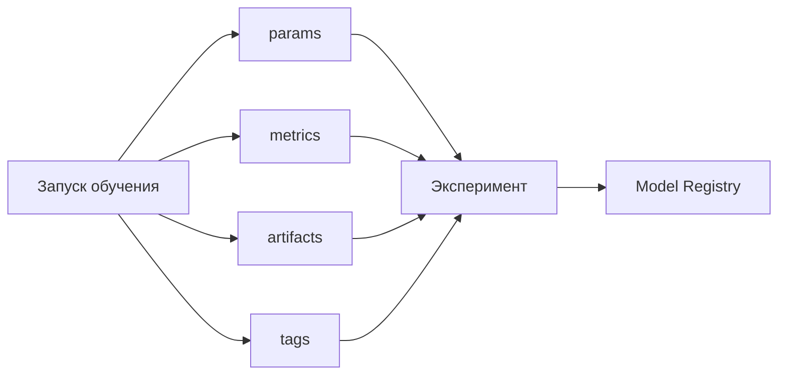

Когда ты обучаешь модели «на коленке» в ноутбуке, ты, скорее всего, запоминаешь результаты в голове или в комментариях. Но как только проектов становится несколько, а экспериментов — десятки, начинает твориться хаос: какая модель дала r2 = 0.78? С какими параметрами? Где лежит её весовой файл? Именно эту проблему решает **трекинг экспериментов** — систематическая запись всего, что происходит при обучении.

## Что такое MLflow

MLflow — это открытая платформа для управления жизненным циклом ML-моделей. Нам сейчас важна её первая часть — **MLflow Tracking**. Ключевые понятия:

- **Эксперимент** (experiment) — логическая группа запусков под одну задачу. Например, «диабет: регрессия».
- **Run** — один запуск обучения. В него записываются:
  - **параметры** (params) — настройки, заданные до обучения: `max_depth`, `alpha`, `n_estimators`;
  - **метрики** (metrics) — результаты, вычисленные после: `r2`, `accuracy`, `loss`;
  - **артефакты** (artifacts) — файлы: веса модели, графики, срезы данных;
  - **теги** (tags) — произвольные пометки.

Вся история хранится в **tracking URI** — месте, куда MLflow пишет данные. Это может быть локальная папка `mlruns`, SQLite-база или полноценный сервер.

## Трекинг на практике

Ставим MLflow и запускаем первый трекинг:

```bash
pip install mlflow scikit-learn
```

Теперь обучим пару моделей и всё залогируем:

```python
import mlflow
from sklearn.datasets import load_diabetes
from sklearn.ensemble import RandomForestRegressor
from sklearn.model_selection import train_test_split

X, y = load_diabetes(return_X_y=True)
X_train, X_test, y_train, y_test = train_test_split(
    X, y, test_size=0.2, random_state=42
)

mlflow.set_tracking_uri("sqlite:///mlruns.db")  # сохраняем в SQLite
mlflow.set_experiment("diabetes-baseline")

with mlflow.start_run(run_name="rf-depth-6"):
    mlflow.log_param("model", "RandomForestRegressor")
    mlflow.log_param("max_depth", 6)
    model = RandomForestRegressor(max_depth=6, n_estimators=100, random_state=42)
    model.fit(X_train, y_train)
    r2 = model.score(X_test, y_test)
    mlflow.log_metric("r2", r2)
    print("r2 =", r2)
```

Что здесь произошло? `mlflow.set_tracking_uri` определил, куда писать историю, `set_experiment` создал эксперимент, а `start_run` открыл контекст запуска. Внутри `log_param` записал параметр, `log_metric` — метрику. Всё, что внутри `with` — это один run.

Читаем историю экспериментов:

```python
runs = mlflow.search_runs(experiment_names=["diabetes-baseline"])
print(runs[["run_id", "params.max_depth", "metrics.r2"]])
```

Появится таблица со всеми запусками и их метриками — именно так ты сравниваешь эксперименты, а не по памяти. Посмотреть историю глазами можно командой `mlflow ui` (в браузере откроется интерфейс на `http://localhost:5000`).

## Хранение модели и артефактов

Модель и любые файлы тоже нужно сохранять вместе с запуском:

```python
with mlflow.start_run(run_name="rf-depth-6"):
    mlflow.sklearn.log_model(model, artifact_path="model")
    with open("feature_importance.txt", "w") as f:
        f.write("max_depth=6, n_estimators=100\n")
    mlflow.log_artifact("feature_importance.txt")
```

`log_model` кладёт модель (позже её можно загрузить обратно через `mlflow.pyfunc.load_model`), `log_artifact` — любой файл. Если хочешь, чтобы модель была доступна команде и попадала в **Model Registry** (реестр моделей с версиями), добавь имя:

```python
mlflow.sklearn.log_model(model, "model", registered_model_name="diabetes-rf")
```

Теперь модель зарегистрирована, и её можно продвигать по стадиям (Staging → Production) и сравнивать версии. Мир MLOps строится именно на этом: каждый эксперимент воспроизводим, каждая модель имеет свою версию и историю.

## Как избавиться от ручного логирования

Для популярных библиотек MLflow умеет делать всё сам — через **autolog**:

```python
mlflow.sklearn.autolog()

model = RandomForestRegressor(max_depth=9, random_state=42)
model.fit(X_train, y_train)
# параметры, метрики и модель залогируются автоматически
```

Один вызов — и каждый запуск сам пишет параметры, метрики, модель и даже пример данных. Идеально для быстрых экспериментов: ничего не забываешь.

## Как устроен запуск: схема

Схема показывает, куда попадают данные одного запуска и как они связаны с экспериментом и реестром:



## Итог

MLflow Tracking даёт тебе воспроизводимость: запустил эксперимент — вся информация о нём в одном месте, сравниваемая и доступная команде. В следующем уроке мы научимся выносить модели за пределы Python-фреймворков с помощью ONNX.

<!--TASK-->
### Задача 1
Создай эксперимент `ridge-baseline` и обучи три модели `Ridge` (импортируй из `sklearn.linear_model`) на датасете `load_diabetes` с разными `alpha` — 0.1, 1.0 и 10.0. Для каждого запуска залогируй параметр `alpha` и метрику `r2` (считай на тестовой выборке). После цикла через `mlflow.search_runs` выведи таблицу с колонками `run_id`, `params.alpha`, `metrics.r2` и напечатай строку «Лучший alpha: ...» по максимальному r2. Ожидаемый результат: таблица из трёх строк и имя лучшего параметра.

### Задача 2
Подключи `mlflow.sklearn.autolog()` и обучи `RandomForestRegressor` на датасете `load_diabetes`. После обучения используй `mlflow.search_runs` и выведи: `run_id` последнего запуска, его `params.max_depth` и `metrics.r2`. Обрати внимание: с `autolog` тебе не нужно вручную вызывать `log_param` и `log_metric`. Ожидаемый результат: выведены три значения, причём `max_depth` совпадает с тем, что ты передал в модель.

### Задача 3
Научись сохранять артефакты. Создай временный текстовый файл с помощью `tempfile.NamedTemporaryFile(delete=False, mode="w", suffix=".txt")`, запиши в него строку `feature_importance: [0.31, 0.24, 0.18]`, закрой его и залогируй через `mlflow.log_artifact(путь_к_файлу)` внутри запуска. Затем через `mlflow.artifacts.list_artifacts(run_id=run.info.run_id)` выведи список имён артефактов и напечатай их количество. Ожидаемый результат: список содержит `feature_importance.txt`, а количество равно 1.

### Задача 4
Зарегистрируй модель в Model Registry. Обучи `RandomForestRegressor` на диабете, залогируй её через `mlflow.sklearn.log_model(model, "model", registered_model_name="diabetes-rf")` внутри запуска. Затем через `mlflow.search_registered_models()` найди запись о модели `diabetes-rf` и выведи количество её версий (`versions`). Ожидаемый результат: количество версий ≥ 1, имя модели — `diabetes-rf`.

### Задача 5
Используя данные из задачи 1 (или повторив обучение), напиши код, который через `mlflow.search_runs` находит лучший run по метрике `r2` и печатает его `run_id` и параметры в виде словаря (ключ `params.alpha`, значение — число). Используй сортировку `sort_values("metrics.r2", ascending=False)` и `.iloc[0]`. Ожидаемый результат: выведен `run_id` и `alpha` лучшего запуска — тот, что дал максимальный r2.
### Задача 6
Создай эксперимент `diabetes-tags` и обучи две модели `Ridge` — с `alpha=0.5` и `alpha=5.0` — на `load_diabetes`. В каждом запуске задай `run_name` и тег через `mlflow.set_tag("stage", ...)`: первому — `baseline`, второму — `candidate`; параметр `alpha` и метрику `r2` логируй как обычно. После цикла вызови `mlflow.search_runs(experiment_names=["diabetes-tags"], filter_string="tags.stage = 'candidate'")` и напечатай число строк и `run_id` найденного запуска. Ожидаемый результат: одна строка и один `run_id`, при этом в эксперименте по-прежнему два запуска.

### Задача 7
Обучи `RandomForestRegressor(max_depth=4, random_state=42)` на `load_diabetes` и залогируй её внутри запуска через `mlflow.sklearn.log_model(model, artifact_path="model")`, сохранив `run.info.run_id` в переменную. После выхода из `with` загрузи модель обратно по URI `f"runs:/{run_id}/model"` через `mlflow.sklearn.load_model` и посчитай предсказания на `X_test`. Сравни их с предсказаниями исходного объекта и напечатай максимальную абсолютную разницу. Дополнительно выведи `type(loaded).__name__` — имя класса загруженного объекта должно совпадать с исходной моделью. Ожидаемый результат: разница равна 0.0 (допустимо меньше 1e-9) — сохранённая модель полностью воспроизводит предсказания.

<!--/TASK-->

<!--HINT-->
### Подсказка 1
Цикл по `alphas` внутри `with mlflow.start_run():` — каждый проход цикла создаёт отдельный run. `search_runs` вернёт DataFrame; для поиска лучшего значения `alpha` отсортируй по `metrics.r2` и возьми первую строку. Не забудь `mlflow.set_tracking_uri` до первого запуска.

### Подсказка 2
`mlflow.sklearn.autolog()` надо вызвать до обучения. После обучения иди `mlflow.search_runs(experiment_names=["Default"])` — без явного эксперимента autolog пишет в `Default`. Колонки называются `params.max_depth` и `metrics.r2`.

### Подсказка 3
`NamedTemporaryFile` вернёт объект с атрибутом `.name` — это путь к файлу. После записи и закрытия передай `.name` в `mlflow.log_artifact`. `list_artifacts` вернёт список объектов; у каждого есть поле `.path`.

### Подсказка 4
Параметр `registered_model_name` в `log_model` автоматически создаёт запись в реестре. `mlflow.search_registered_models()` возвращает итератор; найди объект, где `name == "diabetes-rf"`, и посчитай `len(obj.versions)`. Если запись не появилась — проверь, что трекинг включён и `log_model` выполнился без ошибки.

### Подсказка 5
Помни: `search_runs` возвращает DataFrame, значит можно использовать `df.sort_values("metrics.r2", ascending=False)`. Строка с best-раном — `.iloc[0]`. Преврати параметры в dict через `.to_dict()` или выбери нужную колонку напрямую.
### Подсказка 6
`mlflow.set_tag("stage", "baseline")` вызывай внутри `with mlflow.start_run():` — тег привяжется к текущему запуску. В `filter_string` синтаксис обращается к тегам как `tags.stage = 'candidate'`, кавычки вокруг значения обязательны. В полученном DataFrame колонка называется `tags.stage`, а число строк — `len(df)`.

### Подсказка 7
`run_id` бери внутри `with mlflow.start_run() as run:` — `run.info.run_id`. Путь `model` в URI тот же, что `artifact_path` в `log_model`. `load_model` вернёт обычный sklearn-объект с `.predict`, поэтому сравнение делается через `np.max(np.abs(pred_loaded - pred_original))`. И не забудь `set_tracking_uri` до запуска: иначе загрузка не найдёт артефакт.
<!--/HINT-->

<!--SOLUTION-->
### Разбор 1
Решение:

```python
import mlflow
from sklearn.datasets import load_diabetes
from sklearn.linear_model import Ridge
from sklearn.model_selection import train_test_split

X, y = load_diabetes(return_X_y=True)
X_train, X_test, y_train, y_test = train_test_split(X, y, test_size=0.2, random_state=42)

mlflow.set_tracking_uri("sqlite:///mlruns.db")
mlflow.set_experiment("ridge-baseline")

for alpha in [0.1, 1.0, 10.0]:
    with mlflow.start_run():
        mlflow.log_param("alpha", alpha)
        model = Ridge(alpha=alpha)
        model.fit(X_train, y_train)
        r2 = model.score(X_test, y_test)
        mlflow.log_metric("r2", r2)

runs = mlflow.search_runs(experiment_names=["ridge-baseline"])
print(runs[["run_id", "params.alpha", "metrics.r2"]])

best = runs.sort_values("metrics.r2", ascending=False).iloc[0]
print("Лучший alpha:", best["params.alpha"])
```

Разбор шагов. `for alpha in [...]` создаёт три отдельных run — для каждого значения `alpha`, а `with mlflow.start_run()` открывает и закрывает их по очереди. `log_param` и `log_metric` записывают пары ключ-значение. После цикла `search_runs` читает всю историю эксперимента и возвращает DataFrame, где колонки с точкой соответствуют вложенным именам: `params.alpha`, `metrics.r2`. `sort_values("metrics.r2", ascending=False).iloc[0]` берёт первую строку после сортировки по убыванию — это лучший запуск. Такой способ сравнения работает даже при сотнях запусков: ты всегда видишь, какой параметр дал лучший результат, и не полагаешься на память.

### Разбор 2
Решение:

```python
import mlflow
from sklearn.datasets import load_diabetes
from sklearn.ensemble import RandomForestRegressor
from sklearn.model_selection import train_test_split

mlflow.sklearn.autolog()

X, y = load_diabetes(return_X_y=True)
X_train, X_test, y_train, y_test = train_test_split(X, y, test_size=0.2, random_state=42)

model = RandomForestRegressor(max_depth=9, random_state=42)
model.fit(X_train, y_train)

runs = mlflow.search_runs(experiment_names=["Default"])
last = runs.iloc[-1]
print(last["run_id"])
print(last["params.max_depth"])
print(last["metrics.r2"])
```

Разбор шагов. `mlflow.sklearn.autolog()` регистрирует хуки: до обучения — запись параметров, после — метрик, модели и артефактов. Поэтому вручную `log_param` вызывать не нужно. Так как явный эксперимент не задан, всё попадает в эксперимент по умолчанию `Default`. `runs.iloc[-1]` — последний (самый свежий) запуск. Мы видим: `params.max_depth` равен 9 — ровно тому числу, что мы передали в конструктор; MLflow взял его автоматически. autolog экономит время и исключает человеческие ошибки: забыл залогировать метрику — не проблема, она уже там.

### Разбор 3
Решение:

```python
import mlflow
import tempfile

mlflow.set_tracking_uri("sqlite:///mlruns.db")

with tempfile.NamedTemporaryFile(delete=False, mode="w", suffix=".txt") as f:
    f.write("feature_importance: [0.31, 0.24, 0.18]\n")
    artifact_path = f.name

with mlflow.start_run() as run:
    mlflow.log_artifact(artifact_path)

artifacts = mlflow.artifacts.list_artifacts(run_id=run.info.run_id)
names = [a.path for a in artifacts]
print(names)
print("Количество артефактов:", len(names))
```

Разбор шагов. `NamedTemporaryFile` создаёт настоящий файл во временной папке; мы записываем в него строку и закрываем (важно: `delete=False`, чтобы файл не удалился сразу). `f.name` — путь к файлу, его мы передаём в `mlflow.log_artifact`. После завершения запуска `list_artifacts` перечисляет всё, что лежит в `mlartifacts`-директории этого run. Каждый объект имеет атрибут `.path` — имя файла. Мы видим `['feature_importance.txt']` и число 1. Артефакты делают эксперимент самодостаточным: рядом с метриками лежат графики, срезы данных, файлы моделей — всё, что нужно, чтобы понять и воспроизвести результат.

### Разбор 4
Решение:

```python
import mlflow
from sklearn.datasets import load_diabetes
from sklearn.ensemble import RandomForestRegressor
from sklearn.model_selection import train_test_split

X, y = load_diabetes(return_X_y=True)
X_train, X_test, y_train, y_test = train_test_split(X, y, test_size=0.2, random_state=42)

with mlflow.start_run():
    model = RandomForestRegressor(max_depth=6, random_state=42)
    model.fit(X_train, y_train)
    mlflow.sklearn.log_model(model, "model", registered_model_name="diabetes-rf")

registered = mlflow.search_registered_models()
for m in registered:
    if m.name == "diabetes-rf":
        print("Имя:", m.name)
        print("Версий:", len(m.versions))
```

Разбор шагов. `registered_model_name` в `log_model` делает сразу две вещи: сохраняет модель как артефакт run (путь `model`) и регистрирует её в Model Registry под заданным именем. `search_registered_models()` возвращает итератор по зарегистрированным моделям; находим нужную по имени и считаем версии: `len(m.versions)`. При повторных запусках каждая новая модель добавит ещё одну версию — так в реестре появляется история (v1, v2, ...), которую можно продвигать по стадиям Staging/Production. Model Registry — это «полка с моделями»: команда видит все версии, выбирает лучшую и переиспользует её в сервисах, не думая, где лежит файл весов.

### Разбор 5
Решение:

```python
import mlflow

runs = mlflow.search_runs(experiment_names=["ridge-baseline"])
best = runs.sort_values("metrics.r2", ascending=False).iloc[0]
print("run_id:", best["run_id"])
print("Параметры лучшего рана:", {"alpha": best["params.alpha"]})
```

Разбор шагов. Тот же приём, что в задаче 1: `sort_values` по колонке `metrics.r2` в порядке убывания, затем `.iloc[0]` — первая строка. Из неё достаём `run_id` (уникальный идентификатор запуска) и параметры. Если бы запусков было сто, лучший находился бы точно так же — код не меняется. Обрати внимание: колонки DataFrame называются `params.alpha` и `metrics.r2`; если бы мы забыли залогировать `alpha`, тут было бы `NaN`. Именно поэтому важно логировать всё: постраничный анализ истории возвращает лишь то, что было записано. Такой подход — фундамент MLOps: любой эксперимент можно воспроизвести, сравнить и выбрать лучший по объективным числам.
### Разбор 6
Решение:

```python
import mlflow
from sklearn.datasets import load_diabetes
from sklearn.linear_model import Ridge
from sklearn.model_selection import train_test_split

X, y = load_diabetes(return_X_y=True)
X_train, X_test, y_train, y_test = train_test_split(X, y, test_size=0.2, random_state=42)

mlflow.set_tracking_uri("sqlite:///mlruns.db")
mlflow.set_experiment("diabetes-tags")

for alpha, stage in [(0.5, "baseline"), (5.0, "candidate")]:
    with mlflow.start_run(run_name=f"ridge-{stage}"):
        mlflow.set_tag("stage", stage)
        mlflow.log_param("alpha", alpha)
        model = Ridge(alpha=alpha).fit(X_train, y_train)
        mlflow.log_metric("r2", model.score(X_test, y_test))

candidates = mlflow.search_runs(
    experiment_names=["diabetes-tags"],
    filter_string="tags.stage = 'candidate'",
)
print("Строк:", len(candidates))
print("run_id:", candidates.iloc[0]["run_id"])
```

Разбор шагов. Тег — это пара «ключ-значение», которую MLflow хранит рядом с параметрами и метриками, но не включает в сравнение чисел. Здесь тег `stage` играет роль бизнес-пометки: `baseline` — то, что уже в проде, `candidate` — претендент на выкатку. `filter_string` транслируется в SQL-подобное условие по хранилищу, поэтому фильтрация не требует выгружать всю историю в память: при тысячах запусков это принципиально. Обрати внимание, что `search_runs` вернул ровно одну строку, хотя в эксперименте два запуска — фильтр отработал по тегу, а не по имени. Такой приём позволяет размечать запуски по спринту, владельцу или гипотезе и затем поднимать нужный срез истории одной строкой кода.

### Разбор 7
Решение:

```python
import mlflow
import numpy as np
from sklearn.datasets import load_diabetes
from sklearn.ensemble import RandomForestRegressor
from sklearn.model_selection import train_test_split

X, y = load_diabetes(return_X_y=True)
X_train, X_test, y_train, y_test = train_test_split(X, y, test_size=0.2, random_state=42)

mlflow.set_tracking_uri("sqlite:///mlruns.db")

with mlflow.start_run() as run:
    model = RandomForestRegressor(max_depth=4, random_state=42).fit(X_train, y_train)
    mlflow.sklearn.log_model(model, artifact_path="model")

run_id = run.info.run_id
loaded = mlflow.sklearn.load_model(f"runs:/{run_id}/model")

diff = np.max(np.abs(loaded.predict(X_test) - model.predict(X_test)))
print("run_id:", run_id)
print("Макс. разница:", diff)
```

Разбор шагов. `log_model` сериализует модель в артефакт запуска и записывает метаданные: версии библиотек, сигнатуру входа, формат сериализации. URI `runs:/<run_id>/model` — это способ адресовать артефакт именно того запуска, а не «последнюю модель в папке». `load_model` читает метаданные, поднимает нужный flavor (sklearn) и возвращает объект, готовый к `.predict`. Разница 0.0 означает, что мы получили побайтово то же дерево решений, а не приблизительную копию — это и есть воспроизводимость в терминах MLOps. Практический смысл: обучив модель ночью, утром можно поднять ровно её версию для разбора инцидента, не переобучая заново и не надеясь на сохранённый локально файл.
<!--/SOLUTION-->

<!--QUIZ-->
Что такое run в MLflow?
- Один запуск обучения с логированием параметров, метрик и артефактов
- Хранилище данных
- Фунция предобработки
* Правильный ответ: Один запуск обучения с логированием параметров, метрик и артефактов
Run — это отдельный запуск, в который пишется вся информация об одном обучении.

Чем параметры отличаются от метрик?
- Параметры задаются до обучения, метрики вычисляются после
- Параметры — это строки, метрики — числа
- Ничем
* Правильный ответ: Параметры задаются до обучения, метрики вычисляются после
Параметры описывают настройки эксперимента, метрики — его результат.

Что делает mlflow.set_tracking_uri("sqlite:///mlruns.db")?
- Указывает, куда MLflow будет сохранять историю экспериментов
- Запускает веб-интерфейс
- Устанавливает название модели
* Правильный ответ: Указывает, куда MLflow будет сохранять историю экспериментов
Tracking URI определяет хранилище: папка, SQLite или сервер.

Как просмотреть интерфейс MLflow в браузере?
- Выполнить команду mlflow ui
- Открыть файл mlruns.db
- Выполнить команду mlflow serve
* Правильный ответ: Выполнить команду mlflow ui
Команда mlflow ui поднимает локальный веб-сервер на localhost:5000.

Что делает mlflow.sklearn.autolog()?
- Автоматически логирует параметры, метрики, модель и артефакты при обучении sklearn-моделей
- Заменяет scikit-learn
- Отключает логирование
* Правильный ответ: Автоматически логирует параметры, метрики, модель и артефакты при обучении sklearn-моделей
autolog берёт на себя весь ручной трекинг для sklearn-моделей.

Что такое артефакт в MLflow?
- Любой файл, связанный с запуском: модель, график, данные
- Метрика качества
- Параметр модели
* Правильный ответ: Любой файл, связанный с запуском: модель, график, данные
Артефакты — это бинарные и текстовые файлы, которые логируются вместе с запуском.

Как зарегистрировать модель в Model Registry?
- Передать registered_model_name в mlflow.<framework>.log_model
- Вызвать mlflow.save_model
- Создать файл model.onnx
* Правильный ответ: Передать registered_model_name в mlflow.<framework>.log_model
Этот параметр автоматически регистрирует модель и создаёт её первую версию.

Что возвращает mlflow.search_runs()?
- DataFrame с историей запусков и их параметрами/метриками
- Список файлов модели
- JSON-ответ сервера
* Правильный ответ: DataFrame с историей запусков и их параметрами/метриками
search_runs возвращает pandas DataFrame, где каждая строка — run, а колонки — его атрибуты.

Зачем в MLflow нужны теги (tags)?
- Для произвольных меток, по которым можно фильтровать и группировать запуски
- Для хранения весов модели
- Для ускорения обучения
* Правильный ответ: Для произвольных меток, по которым можно фильтровать и группировать запуски
Теги не участвуют в сравнении метрик, но дают бизнес-разметку: стадия, владелец, гипотеза.

Что делает filter_string в mlflow.search_runs()?
- Отбирает запуски по условию, например tags.stage = 'candidate'
- Удаляет неудачные запуски
- Переименовывает колонки таблицы
* Правильный ответ: Отбирает запуски по условию, например tags.stage = 'candidate'
Условие проверяется на стороне хранилища, поэтому в память попадают только нужные строки.

Как загрузить модель, сохранённую в конкретном запуске?
- mlflow.sklearn.load_model("runs:/<run_id>/model")
- mlflow.load_model("model.pkl")
- mlflow.ui()
* Правильный ответ: mlflow.sklearn.load_model("runs:/<run_id>/model")
URI runs:/ адресует артефакт именно этого запуска, а не последнюю модель в каталоге.

Что произойдёт при повторном log_model с тем же registered_model_name?
- В реестре появится новая версия модели
- Вторая запись молча перезапишет первую
- MLflow выбросит ошибку
* Правильный ответ: В реестре появится новая версия модели
Model Registry хранит историю версий: каждая регистрация добавляет v2, v3 и так далее.
<!--/QUIZ-->
