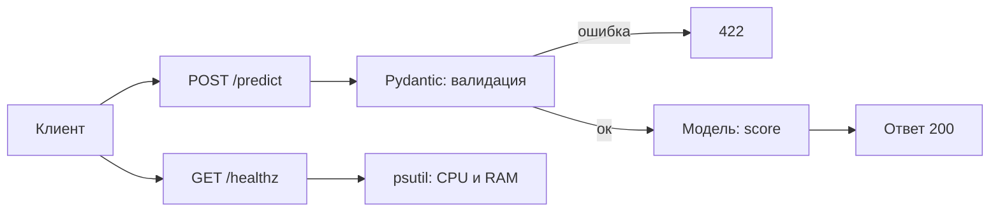

Обученная модель — это ещё не продукт. Чтобы ей могли пользоваться другие сервисы и приложения, модель нужно **обернуть в API**: веб-сервис, который принимает запросы, считает предсказание и возвращает ответ. В Python стандарт де-факто — **FastAPI**: быстрый, с автоматической документацией и первоклассной валидацией через Pydantic.

## Ставим и поднимаем сервис

```bash
pip install fastapi uvicorn pydantic psutil requests
```

Что мы получим:

- **FastAPI** — веб-фреймворк. Декораторы `@app.post(...)` создают эндпоинты.
- **Pydantic** — библиотека валидации: из тела запроса строит Python-объект, проверяя типы и ограничения.
- **uvicorn** — ASGI-сервер, который запускает приложение.
- **psutil** — системные метрики (CPU, память) для проверки здоровья.

Создадим сервис кредитного скоринга (условная модель). Файл `app.py`:

```python
from fastapi import FastAPI
from pydantic import BaseModel, Field
import numpy as np
import psutil

app = FastAPI(title="Credit Scoring API")

class CreditRequest(BaseModel):
    age: int = Field(ge=18, le=100)
    amount: float = Field(gt=0)

class CreditResponse(BaseModel):
    approved: bool
    prob: float

def score(req: CreditRequest) -> float:
    # Упрощённая «модель»: логистическая функция от возраста и суммы
    z = 0.05 * req.age - 0.01 * req.amount + 0.5
    return float(1.0 / (1.0 + np.exp(-z)))

@app.post("/predict", response_model=CreditResponse)
def predict(req: CreditRequest):
    prob = score(req)
    return CreditResponse(approved=prob > 0.5, prob=round(prob, 4))

@app.get("/healthz")
def healthz():
    return {
        "cpu_percent": psutil.cpu_percent(interval=0.1),
        "mem_percent": psutil.virtual_memory().percent,
    }
```

Запуск:

```bash
uvicorn app:app --reload --port 8000
```

Эндпоинт `/predict` принимает POST-запрос с JSON-телом `{"age": 30, "amount": 5000}`, Pydantic превращает его в объект `CreditRequest`. `response_model` описывает формат ответа. Ты можешь открыть `http://127.0.0.1:8000/docs` — FastAPI сам сгенерировал интерактивную документацию Swagger.

## Валидация бесплатно

Pydantic проверяет данные ещё **до** попадания в наш код:

- `age: int` — если придёт строка `"30"`, она будет приведена к int (или вернётся ошибка 422, если привести нельзя);
- `Field(ge=18, le=100)` — возраст вне диапазона → ошибка 422.

Проверим с клиента:

```python
import requests

r = requests.post("http://127.0.0.1:8000/predict", json={"age": 30, "amount": 5000})
print(r.status_code, r.json())  # 200 {'approved': False, 'prob': 0.5}

bad = requests.post("http://127.0.0.1:8000/predict", json={"age": 15, "amount": 5000})
print(bad.status_code)  # 422 — невалидный возраст
print(bad.json()["detail"][0]["msg"])
```

При 422 в ответе — список проблем: `loc` (где ошибка) и `msg` (что не так). Сервис не упал — он корректно ответил, что запрос невалиден.

## Батчинг: обрабатываем сразу много запросов

В продакшене сервис получает не один, а тысячи запросов в секунду. Один эффективный приём — **батчинг**: клиент отправляет пачку объектов, сервис считает их одним вызовом.

```python
from pydantic import BaseModel

class BatchRequest(BaseModel):
    items: list[CreditRequest]

@app.post("/predict_batch", response_model=dict)
def predict_batch(req: BatchRequest):
    results = []
    for item in req.items:
        prob = score(item)
        results.append({"approved": prob > 0.5, "prob": round(prob, 4)})
    return {"count": len(results), "results": results}
```

Запрос: `{"items": [{"age": 30, "amount": 5000}, {"age": 45, "amount": 1000}]}`. Ответ вернёт `count` и список результатов. Настоящие ML-сервисы делают то же самое: батч для GPU или для onnxruntime в разы быстрее потока одиночных запросов.

## Мониторинг здоровья

`/healthz` — стандарт для оркестраторов (Kubernetes и другие): они регулярно опрашивают этот эндпоинт. Если сервис жив и отвечает 200 — он получает трафик. `psutil.cpu_percent()` и `psutil.virtual_memory().percent` дают нагрузку на машину в реальном времени. В продакшене сюда добавляют время ответа, число запросов и процент ошибок — и эти метрики складывают в систему мониторинга (о дрейфе и метриках — в уроке 4).

## Путь запроса: схема

Схема показывает, что происходит с запросом от клиента до ответа:



## Итог

FastAPI + Pydantic дают чистый, документированный и безопасный сервис за несколько десятков строк. Валидация защищает твою модель от мусорных входов, батчинг ускоряет её, а `/healthz` помогает следить за жизнью сервиса.

<!--TASK-->
### Задача 1
Создай минимальный FastAPI-сервис с эндпоинтом `POST /temperature` — перевод градусов Цельсия в Фаренгейты. Используй Pydantic-модель `TempRequest` с полем `celsius: float` и модель `TempResponse` с полем `fahrenheit: float`. Формула: `f = c * 9 / 5 + 32`. Запусти сервис через `uvicorn` и отправь тестовый запрос через `requests.post`. Ожидаемый результат: для `celsius=100` ответ `{"fahrenheit": 212.0}` со статусом 200.

### Задача 2
Добавь в сервис из задачи 1 валидацию: поле `celsius` должно быть в диапазоне от -100 до 100 (`Field(ge=-100, le=100)`). Отправь запрос с `celsius=500` и напечатай статус-код и текст ошибки из ответа. Ожидаемый результат: статус 422 и сообщение о том, что значение больше допустимого.

### Задача 3
Добавь эндпоинт `GET /healthz`: он должен возвращать JSON с `cpu_percent` и `mem_percent` из `psutil` (CPU — `psutil.cpu_percent(interval=0.1)`, память — `psutil.virtual_memory().percent`). Отправь GET-запрос и выведи статус-код и ответ. Ожидаемый результат: статус 200, в ответе оба ключа с числами от 0 до 100.

### Задача 4
Добавь батч-эндпоинт `POST /batch_temperature`: принимает `{"items": [{"celsius": 0}, {"celsius": 100}]}` и возвращает `{"count": 2, "results": [{"fahrenheit": 32.0}, {"fahrenheit": 212.0}]}`. Опиши модели `BatchRequest` (поле `items: list[TempRequest]`) и `BatchResponse`. Отправь запрос из примера и убедись, что `count` совпадает с числом элементов. Ожидаемый результат: ответ со `count=2` и двумя результатами.

### Задача 5
Напиши клиентский скрипт, который отправляет 3 запроса: валидный (`celsius=25`), невалидный (`celsius=500`) и GET `/healthz`; для каждого печатает статус-код. В конце напечатай итоговую строку вида `Валидных: 2, ошибок: 1`. Ожидаемый результат: два ответа 200 и один 422.
### Задача 6
Добавь в сервис температуры middleware, который считает все входящие запросы. Используй `@app.middleware("http")` и глобальный словарь `stats = {"requests": 0}`: увеличивай счётчик до вызова `call_next`, затем возвращай ответ. Заведи эндпоинт `GET /stats`, отдающий `{"requests": stats["requests"]}`. Проверь через `fastapi.testclient.TestClient` без запуска uvicorn: сделай `GET /healthz`, `POST /temperature` с `celsius=0` и дважды `GET /stats`. Ожидаемый результат: первый вызов `/stats` вернёт 3, второй — 4, то есть счётчик растёт на каждом запросе.

### Задача 7
Ограничь размер пачки в батч-эндпоинте: опиши поле `items: list[TempRequest] = Field(min_length=1, max_length=3)`. Через `TestClient` отправь два запроса на `/batch_temperature`: с четырьмя элементами и с двумя. Для первого напечатай статус-код и текст ошибки из `detail[0]["msg"]`, для второго — `count` из ответа и список температур. Ожидаемый результат: первый запрос — 422 с сообщением о максимальной длине списка, второй — 200 и `count=2`.

<!--/TASK-->

<!--HINT-->
### Подсказка 1
Определи `TempRequest` и `TempResponse` как классы, наследующие `BaseModel`. Эндпоинт: `@app.post("/temperature", response_model=TempResponse)`. Внутри — `return TempResponse(fahrenheit=req.celsius * 9 / 5 + 32)`. Запуск: `uvicorn app:app --reload --port 8000`; клиент — `requests.post("http://127.0.0.1:8000/temperature", json={"celsius": 100})`.

### Подсказка 2
Pydantic вернёт 422 с массивом `detail`; текст ошибки — `bad.json()["detail"][0]["msg"]`. Ограничение вида: `celsius: float = Field(ge=-100, le=100)`.

### Подсказка 3
`psutil.cpu_percent(interval=0.1)` блокирует на 0.1 с и возвращает загрузку CPU. `psutil.virtual_memory().percent` — процент занятой оперативной памяти. GET-запрос: `requests.get("http://127.0.0.1:8000/healthz")`.

### Подсказка 4
Вложенная модель: `class BatchRequest(BaseModel): items: list[TempRequest]`. Ответ собери как dict: `{"count": len(req.items), "results": results}`. Используй `response_model=dict` или определи `BatchResponse` с `results: list[TempResponse]`.

### Подсказка 5
Оберни отправку в `try/except` или просто сохраняй статусы: `st = requests.post(...).status_code`. Посчитай по итогам, сколько раз встретился 200 и сколько — 422.
### Подсказка 6
Middleware объявляется как `async def count_requests(request, call_next):` над ним — `@app.middleware("http")`. Внутри: `stats["requests"] += 1`, затем `response = await call_next(request)` и `return response`. `TestClient(app)` вызывается как обычный клиент: `client.get("/healthz")`, `client.post("/temperature", json={"celsius": 0})`. Счётчик общий на процесс, поэтому цифры предсказуемы.

### Подсказка 7
Ограничения списка задаются так же, как у чисел: `Field(min_length=1, max_length=3)`. При нарушении Pydantic вернёт 422, а текст лежит в `resp.json()["detail"][0]["msg"]` — в Pydantic v2 это что-то вроде `List should have at most 3 items`.
<!--/HINT-->

<!--SOLUTION-->
### Разбор 1
Решение:

`app.py`:

```python
from fastapi import FastAPI
from pydantic import BaseModel

app = FastAPI()

class TempRequest(BaseModel):
    celsius: float

class TempResponse(BaseModel):
    fahrenheit: float

@app.post("/temperature", response_model=TempResponse)
def temperature(req: TempRequest):
    return TempResponse(fahrenheit=req.celsius * 9 / 5 + 32)
```

Клиент:

```python
import requests

r = requests.post("http://127.0.0.1:8000/temperature", json={"celsius": 100})
print(r.status_code, r.json())
```

Разбор шагов. `TempRequest` описывает тело запроса: одно поле `celsius` типа `float`. «API передаёт JSON, FastAPI+Pydantic сами собирают из него объект. `response_model=TempResponse` гарантирует, что ответ будет провалидирован по схеме. Внутри функции мы просто считаем формулу и возвращаем объект ответа. `requests.post` передаёт JSON через `json=...`; ответ приходит со статусом 200 и `{"fahrenheit": 212.0}`. Уже здесь видно главное преимущество FastAPI: ни одной строчки ручного разбора JSON — всё делает Pydantic.

### Разбор 2
Решение:

```python
from pydantic import BaseModel, Field

class TempRequest(BaseModel):
    celsius: float = Field(ge=-100, le=100)
```

Клиент:

```python
bad = requests.post("http://127.0.0.1:8000/temperature", json={"celsius": 500})
print("Статус:", bad.status_code)
print("Ошибка:", bad.json()["detail"][0]["msg"])
```

Разбор шагов. `Field(ge=-100, le=100)` добавляет ограничения «больше или равно -100» и «меньше или равно 100». Когда `celsius=500` нарушает их, Pydantic не даёт функции вообще выполниться — FastAPI сразу отвечает `422 Unprocessable Entity`. В теле ответа `detail` — список проблем; мы берём первый элемент и его `msg`: что-то вроде `ensure this value is less than or equal to 100`. Это критически важно для ML: модель, обученная на данных в диапазоне [-100, 100], получив 500, может выдать бессмысленный результат. Валидация — первый рубеж защиты.

### Разбор 3
Решение:

```python
import psutil

@app.get("/healthz")
def healthz():
    return {
        "cpu_percent": psutil.cpu_percent(interval=0.1),
        "mem_percent": psutil.virtual_memory().percent,
    }
```

Клиент:

```python
h = requests.get("http://127.0.0.1:8000/healthz")
print(h.status_code, h.json())
```

Разбор шагов. `psutil.cpu_percent(interval=0.1)` меряет загрузку CPU за последние 0.1 секунды. `virtual_memory().percent` — процент занятой оперативной памяти. Оба значения — числа от 0 до 100. Такой эндпоинт опрашивают оркестраторы: если сервис не отвечает за N секунд, контейнер перезапускается. В реальном MLOps тут же добавляют uptime, RPS (запросов в секунду), время ответа p95 и счётчик ошибок. Health-check — это «пульс» сервиса: облачный продакшен без него не бывает.

### Разбор 4
Решение:

```python
class BatchRequest(BaseModel):
    items: list[TempRequest]

class BatchResponse(BaseModel):
    count: int
    results: list[TempResponse]

@app.post("/batch_temperature", response_model=BatchResponse)
def batch_temperature(req: BatchRequest):
    results = [TempResponse(fahrenheit=item.celsius * 9 / 5 + 32) for item in req.items]
    return BatchResponse(count=len(results), results=results)
```

Клиент:

```python
r = requests.post(
    "http://127.0.0.1:8000/batch_temperature",
    json={"items": [{"celsius": 0}, {"celsius": 100}]},
)
print(r.json())
```

Разбор шагов. `items: list[TempRequest]` — вложенная Pydantic-модель: каждый элемент списка валидируется по `TempRequest`. Списочное включение считает все элементы одним проходом. Ответ: `{"count": 2, "results": [{"fahrenheit": 32.0}, {"fahrenheit": 212.0}]}`. Батчинг — ключевой приём для ML: onnxruntime и GPU при обработке пачки из 1000 элементов работают в разы быстрее, чем 1000 отдельных запросов. Поэтому в промышленных сервисах эндпоинты почти всегда батчовые, а внутри они ещё и объединяют данные в один массив для модели.

### Разбор 5
Решение:

```python
import requests

BASE = "http://127.0.0.1:8000"

ok = requests.post(f"{BASE}/temperature", json={"celsius": 25}).status_code
bad = requests.post(f"{BASE}/temperature", json={"celsius": 500}).status_code
health = requests.get(f"{BASE}/healthz").status_code

print("валидный:", ok)
print("невалидный:", bad)
print("healthz:", health)

valid = sum(1 for s in (ok, health) if s == 200)
errors = sum(1 for s in (ok, bad, health) if s == 422)
print(f"Валидных: {valid}, ошибок: {errors}")
```

Разбор шагов. Каждый запрос возвращает статус-код. `ok` и `health` должны быть 200, `bad` — 422. Мы считаем суммы: `valid` учитывает 200, `errors` — 422. Итог: `Валидных: 2, ошибок: 1`. Такой «контрактный» тест — первый шаг к автоматическому тестированию API: если в будущем кто-то сломает валидацию, тест это заметит. В реальном проекте эти проверки превращаются в pytest-тесты, которые гоняются в CI при каждом изменении кода.
### Разбор 6
Решение:

`app.py`:

```python
from fastapi import FastAPI, Request
from pydantic import BaseModel

app = FastAPI()
stats = {"requests": 0}

class TempRequest(BaseModel):
    celsius: float

class TempResponse(BaseModel):
    fahrenheit: float

@app.middleware("http")
async def count_requests(request: Request, call_next):
    stats["requests"] += 1
    response = await call_next(request)
    response.headers["X-Request-Number"] = str(stats["requests"])
    return response

@app.post("/temperature", response_model=TempResponse)
def temperature(req: TempRequest):
    return TempResponse(fahrenheit=req.celsius * 9 / 5 + 32)

@app.get("/healthz")
def healthz():
    return {"status": "ok"}

@app.get("/stats")
def get_stats():
    return stats
```

Клиент без сети:

```python
from fastapi.testclient import TestClient

client = TestClient(app)
client.get("/healthz")
client.post("/temperature", json={"celsius": 0})
print(client.get("/stats").json())  # {'requests': 3}
print(client.get("/stats").json())  # {'requests': 4}
```

Разбор шагов. Middleware — это обёртка вокруг всего приложения: код до `await call_next(request)` выполняется на входе, после — на выходе, когда ответ уже готов. Счётчик увеличивается до обработки, поэтому запрос к `/stats` тоже попадает в статистику: первый такой вызов видит себя третьим. Заголовок `X-Request-Number` показывает, что в middleware можно не только считать, но и обогащать ответ — так же добавляют request-id для трассировки. `TestClient` поднимает приложение в том же процессе через ASGI-транспорт: ни портов, ни сети, ни `uvicorn` — поэтому такие проверки удобно гонять в pytest и CI. В продакшене такой счётчик отправляют в Prometheus, а не держат в памяти процесса, потому что при нескольких репликах каждый считает только свои запросы.

### Разбор 7
Решение:

```python
from fastapi import FastAPI
from pydantic import BaseModel, Field
from fastapi.testclient import TestClient

app = FastAPI()

class TempRequest(BaseModel):
    celsius: float = Field(ge=-100, le=100)

class TempResponse(BaseModel):
    fahrenheit: float

class BatchRequest(BaseModel):
    items: list[TempRequest] = Field(min_length=1, max_length=3)

class BatchResponse(BaseModel):
    count: int
    results: list[TempResponse]

@app.post("/batch_temperature", response_model=BatchResponse)
def batch_temperature(req: BatchRequest):
    results = [TempResponse(fahrenheit=i.celsius * 9 / 5 + 32) for i in req.items]
    return BatchResponse(count=len(results), results=results)

client = TestClient(app)

big = client.post("/batch_temperature", json={"items": [{"celsius": 0}] * 4})
print("Статус:", big.status_code)
print("Ошибка:", big.json()["detail"][0]["msg"])

ok = client.post("/batch_temperature", json={"items": [{"celsius": 0}, {"celsius": 100}]})
print("Статус:", ok.status_code, "count:", ok.json()["count"])
print(ok.json()["results"])
```

Разбор шагов. `Field(min_length=1, max_length=3)` — ограничение на длину списка, а не на значение элемента: Pydantic проверяет его после того, как разобрал каждый `TempRequest`, поэтому ошибка внутри элемента тоже даст 422, но с другим текстом. Верхняя граница здесь не бюрократия: батч на тысячу объектов может уронить сервис по памяти или таймауту, а клиент получит 500 вместо понятной ошибки. Ограничение превращает такую атаку в аккуратный отказ 422 ещё до вызова модели. `[{"celsius": 0}] * 4` — короткая запись четырёх одинаковых элементов; Pydantic v2 отвечает сообщением вида `List should have at most 3 items after validation, not 4`. Второй запрос показывает, что валидная пачка проходит и возвращает `count=2` и обе температуры — 32.0 и 212.0.
<!--/SOLUTION-->

<!--QUIZ-->
Зачем FastAPI нужна Pydantic-модель запроса?
- Для автоматической валидации и превращения JSON в объект
- Для ускорения модели
- Чтобы не использовать SQL
* Правильный ответ: Для автоматической валидации и превращения JSON в объект
Pydantic проверяет типы и ограничения до входа в твой код.

Какой статус-код вернёт FastAPI при невалидном теле запроса?
- 422 Unprocessable Entity
- 500 Internal Server Error
- 404 Not Found
* Правильный ответ: 422 Unprocessable Entity
Это стандартный ответ при провале валидации Pydantic.

Для чего используется uvicorn?
- Это ASGI-сервер, который запускает FastAPI-приложение
- Это библиотека для валидации
- Это фреймворк для обучения моделей
* Правильный ответ: Это ASGI-сервер, который запускает FastAPI-приложение
uvicorn исполняет приложение и обслуживает HTTP-запросы.

Что делает psutil.cpu_percent()?
- Возвращает процент загрузки процессора
- Возвращает число ядер CPU
- Ускоряет вычисления
* Правильный ответ: Возвращает процент загрузки процессора
psutil даёт системные метрики для health-check.

Что такое батчинг?
- Обработка пачки запросов одним вызовом
- Отправка запросов по одному
- Кэширование ответов
* Правильный ответ: Обработка пачки запросов одним вызовом
Батч позволяет моделям (особенно GPU/onnxruntime) считать быстрее.

Какой метод HTTP использует эндпоинт, меняющий состояние сервера?
- POST
- GET
- DELETE
* Правильный ответ: POST
POST — для отправки данных; GET — для чтения без побочных эффектов.

Что произойдёт, если клиент отправит поле с неверным типом (например, строку в int-поле)?
- FastAPI вернёт 422 с описанием ошибки
- Сервер упадёт
- Поле молча проигнорируется
* Правильный ответ: FastAPI вернёт 422 с описанием ошибки
Pydantic попробует привести тип; если это невозможно — ошибка валидации.

Зачем заводить эндпоинт /healthz?
- Оркестраторы и мониторинг проверяют живость сервиса
- Для красоты документации
- Для загрузки модели
* Правильный ответ: Оркестраторы и мониторинг проверяют живость сервиса
Health-check — стандартный способ понять, что сервис работает.

Что делает декоратор @app.middleware("http")?
- Оборачивает каждый HTTP-запрос кодом до и после обработчика
- Создаёт новый эндпоинт
- Запускает uvicorn
* Правильный ответ: Оборачивает каждый HTTP-запрос кодом до и после обработчика
Middleware выполняется на входе и на выходе, поэтому годится для счётчиков, логов и request-id.

Зачем в тестах использовать TestClient?
- Чтобы вызывать приложение напрямую, без запуска сервера и сети
- Чтобы ускорить обучение модели
- Чтобы включить Swagger
* Правильный ответ: Чтобы вызывать приложение напрямую, без запуска сервера и сети
TestClient общается с приложением по ASGI в том же процессе — быстро и без портов.

Что вернёт FastAPI, если список в теле короче min_length?
- 422 с описанием ошибки валидации
- 200 с пустым списком
- 500 Internal Server Error
* Правильный ответ: 422 с описанием ошибки валидации
Ограничения списка проверяет Pydantic, поэтому ответ — стандартная ошибка валидации.

Что делает response_model у эндпоинта?
- Валидирует и документирует структуру ответа
- Меняет HTTP-метод
- Кэширует ответ
* Правильный ответ: Валидирует и документирует структуру ответа
FastAPI сверяет ответ со схемой и отбрасывает поля, которых в ней нет.
<!--/QUIZ-->
