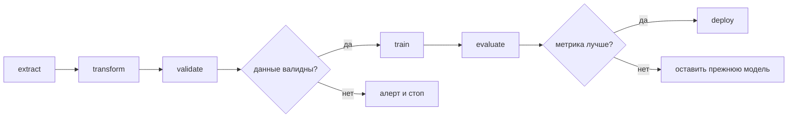

Обучить модель один раз — просто. Но данные приходят каждый день, и модель нужно **регулярно переобучать**, а перед этим — собрать, почистить и проверить данные. Это цепочка шагов: `extract → transform → validate → train → evaluate → deploy`. Запускать её вручную нельзя: что-то забудешь. Здесь появляется **оркестрация** — автоматическое выполнение зависимых задач по расписанию.

## Что такое DAG

DAG (Directed Acyclic Graph) — ориентированный ациклический граф: задачи — узлы, а стрелки показывают порядок. «Ациклический» значит без циклов: пайплайн всегда завершается. Понятие DAG — центральное для всех оркестраторов.

## Airflow

**Apache Airflow** — самый известный оркестратор. Его DAG описываются на Python:

```bash
pip install apache-airflow
```

```python
from airflow import DAG
from airflow.operators.python import PythonOperator
from datetime import datetime, timedelta

default_args = {
    "retries": 2,
    "retry_delay": timedelta(minutes=1),
}

def extract(**context):
    data = {"rows": 10, "source": "clickhouse"}
    context["ti"].xcom_pull(task_ids="extract")  # наглядно: читаем свои же данные
    return data

def transform(**context):
    data = context["ti"].xcom_pull(task_ids="extract")
    print("transform:", data)

def load():
    print("load: таблица готова")

with DAG(
    dag_id="etl_demo",
    default_args=default_args,
    schedule="@daily",
    start_date=datetime(2025, 1, 1),
    catchup=False,
) as dag:
    t_extract = PythonOperator(task_id="extract", python_callable=extract)
    t_transform = PythonOperator(task_id="transform", python_callable=transform)
    t_load = PythonOperator(task_id="load", python_callable=load)

    t_extract >> t_transform >> t_load
```

Оператор `>>` строит зависимости; `schedule="@daily"` — расписание; `catchup=False` — не дообучать пропущенные дни. Airflow запускается как инфраструктура: `airflow scheduler` и `airflow webserver`. Задачи общаются через **XCom** (обмен данными между задачами).

Можно проверить структуру DAG без запуска сервера:

```python
print(dag.topological_sort())  # порядок задач
```

Такой DAG-файл можно редактировать и запускать проверку структуры.

## Prefect

**Prefect** — «код-first» оркестратор нового поколения: без отдельного сервера можно запускать из обычного скрипта.

```bash
pip install prefect
```

```python
from prefect import flow, task

@task(retries=2)
def extract():
    return {"rows": 10, "source": "clickhouse"}

@task
def transform(data):
    print("transform:", data)

@task
def load():
    print("load: таблица готова")

@flow
def etl_flow():
    data = extract()
    transform(data)
    load()

if __name__ == "__main__":
    etl_flow()
```

Prefect не требует отдельного DAG-объекта: обычные Python-функции с декораторами `@flow` и `@task`. Зависимости — через вызовы функций. Запуск — `python etl_flow.py`. Гибко и просто.

## Расписания и ретраи

**Airflow:**

```python
with DAG(..., schedule="0 4 * * *", catchup=False) as dag:
    ...
```

`schedule` принимает cron-выражение. `default_args["retries"] = 2` — если задача упала, Airflow повторит её (по умолчанию — 2 раза с задержкой).

**Prefect:**

```python
@task(retries=2, retry_delay_seconds=30)
def extract():
    ...
```

`@flow` может иметь `schedule` — но в простейшем случае флоу запускается вызовом. Prefect ближе к обычному коду: логика ветвления — обычные `if/else`.

## Ветвление

**Airflow** — специальный оператор `BranchPythonOperator`, который возвращает имя следующей задачи:

```python
from airflow.operators.python import BranchPythonOperator

def decide():
    return "load" if condition else "skip_load"

branch = BranchPythonOperator(task_id="branch", python_callable=decide)
t_extract >> branch >> [t_load, skip_load]
```

**Prefect** — просто условие внутри флоу:

```python
@flow
def etl_flow():
    data = extract()
    if data["rows"] > 0:
        transform(data)
        load()
    else:
        print("нет данных — пропускаем")
```

## Что выбрать

- **Airflow** — зрелый, богатый экосистемой, но тяжёлый: нужен scheduler + webserver + база. Хорош для больших команд и сложных батч-пайплайнов.
- **Prefect** — лёгкий, запускается из кода, проще в локальной разработке. Отличный выбор для стартапов и ML-команд, которые не хотят строить инфраструктуру.

Оба инструмента решают одну задачу: пайплайн работает по расписанию, не забывает шаги, сам чинит падения ретраями и даёт наблюдаемость — историю выполнения каждой задачи.

## Схема пайплайна

Типичный цикл переобучения с точками контроля показан на схеме:



## Итог

Оркестрация — это «дирижёр» MLOps: регулярное переобучение, валидация данных, выкатка моделей. Начав с простого скрипта, ты быстро упрёшься в необходимость повторяемости — и здесь Airflow/Prefect станут твоими помощниками.

<!--TASK-->
### Задача 1
Напиши Airflow-файл с DAG `etl_demo` из трёх задач `extract` → `transform` → `load` (PythonOperator), как в теории. Добавь в конец файла `print(dag.topological_sort())` и запусти его. Ожидаемый результат: выведен список `['extract', 'transform', 'load']` — порядок выполнения задач.

### Задача 2
Напиши эквивалентный пайплайн на Prefect: три функции с декораторами `@task` и одна `@flow`, которая вызывает их по порядку. Преврати `extract` в задачу, которая возвращает словарь `{"rows": 10}`, а `transform` — печатает полученный словарь. Запусти флоу. Ожидаемый результат: в консоли строка `transform: {'rows': 10}` — данные из extract дошли до transform.

### Задача 3
Добавь в Airflow-DAG из задачи 1 параметры: `schedule="0 6 * * *"` (каждый день в 6:00), `catchup=False`, `start_date=datetime(2025, 1, 1)`, а в `default_args` — `retries: 1`. После описания DAG выведи `dag.schedule_interval` и `dag.default_args["retries"]`. Ожидаемый результат: выведены `0 6 * * *` и `1`.

### Задача 4
Смоделируй отказ задачи и ретрай на Prefect: сделай `@task(retries=1, retry_delay_seconds=1)` и внутри функции счётчик `attempts` (глобальная переменная): первый вызов поднимает `ValueError("временная ошибка")`, второй — успешно возвращает данные. Запусти флоу и убедись, что в консоли есть сообщение о повторе и итоговый успех. Ожидаемый результат: флоу завершился успешно, в логе Prefect видны 2 попытки задачи.

### Задача 5
Напиши ветвление на Prefect: флоу, где `extract` возвращает `{"rows": 0}`; если `rows > 0` — вызови `transform` и `load`, иначе — напечатай «нет данных — пропускаем». Запусти флоу дважды: с `rows = 0` и с `rows = 10` (порождяй оба варианта отдельными вызовами функции). Ожидаемый результат: при `rows=0` — только сообщение о пропуске; при `rows=10` — вызовы transform и load.
### Задача 6
Собери Prefect-флоу с динамическим числом задач. `extract` возвращает список из трёх батчей: `[{"id": "b1", "rows": 10}, {"id": "b2", "rows": 0}, {"id": "b3", "rows": 7}]`. Задача `clean(batch)` возвращает строку `f"{batch['id']}:ok"`. Во флоу вызови `clean.map(batches)` — это создаст по экземпляру задачи на каждый элемент списка. Собери результаты, напечатай их и выведи суммарное число строк, посчитанное отдельной задачей `total`. Ожидаемый результат: `['b1:ok', 'b2:ok', 'b3:ok']` и `Всего строк: 17`.

### Задача 7
Построй Airflow-DAG `etl_params` с задачами `extract → transform → load`. В `transform` передай параметр через `op_kwargs={"multiplier": 2}`, а сама функция принимает `multiplier` и печатает `f"transform x{multiplier}"`. После описания DAG выведи `len(dag.tasks)`, `dag.get_task("transform").upstream_task_ids` и `dag.get_task("transform").op_kwargs["multiplier"]`. Файл должен импортироваться без ошибок при установленном `apache-airflow`, а зависимости задавай цепочкой операторов `>>`. Дополнительно проверь, что `dag.dag_id` равен `etl_params`. Ожидаемый результат: `3`, `{'extract'}` и `2` — так проверяют структуру DAG без запуска планировщика.

<!--/TASK-->

<!--HINT-->
### Подсказка 1
Для запуска файла без полного окружения Airflow нужно установить `apache-airflow` (это займёт время, но все импорты будут работать). Структура: `with DAG(...) as dag:` и внутри — операторы и `>>`. `topological_sort()` вернёт список имён задач.

### Подсказка 2
`@task` над функцией делает её задачей Prefect. В `@flow` просто вызывай функции по порядку: `data = extract(); transform(data); load()`. Запуск — `etl_flow()` в `if __name__ == "__main__":`.

### Подсказка 3
`dag.schedule_interval` вернёт строку расписания, `dag.default_args` — словарь параметров. Проверь `dag.catchup` — должно быть `False`.

### Подсказка 4
Глобальный счётчик: `attempts = {"n": 0}`; внутри задачи инкрементируй, и если `n == 1` — `raise ValueError(...)`. Второй вызов сработает. В логе Prefect появится `Retrying task...` или подобное.

### Подсказка 5
Параметризуй флоу: `@flow def etl_flow(rows: int):` и внутри `if rows > 0: ... else: print("нет данных — пропускаем")`. Вызови `etl_flow(0)` и `etl_flow(10)`.
### Подсказка 6
`.map` есть у объекта задачи: `results = clean.map(batches)`, где `clean` — функция с `@task`. Prefect сам создаст по запуску на элемент и вернёт список результатов в исходном порядке. Для суммы передай батчи в отдельную задачу: `total(batches)` с `sum(b["rows"] for b in batches)`. Печатай `list(results)` — иначе увидишь Future, а не строки.

### Подсказка 7
`PythonOperator(task_id="transform", python_callable=transform, op_kwargs={"multiplier": 2})`. Функция должна принимать этот аргумент: `def transform(multiplier, **context):`. `upstream_task_ids` — множество, поэтому в выводе будет `{'extract'}`, а не список. `dag` доступен только после выхода из блока `with DAG(...) as dag`.
<!--/HINT-->

<!--SOLUTION-->
### Разбор 1
Решение:

```python
from airflow import DAG
from airflow.operators.python import PythonOperator
from datetime import datetime

def extract():
    return {"rows": 10}

def transform(**context):
    print("transform:", context["ti"].xcom_pull(task_ids="extract"))

def load():
    print("load")

with DAG(
    dag_id="etl_demo",
    start_date=datetime(2025, 1, 1),
    schedule=None,
    catchup=False,
) as dag:
    t_extract = PythonOperator(task_id="extract", python_callable=extract)
    t_transform = PythonOperator(task_id="transform", python_callable=transform)
    t_load = PythonOperator(task_id="load", python_callable=load)
    t_extract >> t_transform >> t_load

print(dag.topological_sort())
```

Разбор шагов. `PythonOperator` оборачивает обычную функцию в задачу. `>>` — оператор зависимости: `t_extract >> t_transform` значит «transform начнётся после завершения extract». `topological_sort()` возвращает порядок, в котором система развернёт граф: `['extract', 'transform', 'load']`. Даже если бы мы написали зависимости в другом порядке, топосортировка всегда даст корректную последовательность. `context["ti"].xcom_pull(...)` — чтение данных, которые extract положил в XCom: это механизм обмена между задачами. В реальном пайплайне здесь читались бы данные из базы, а не словарь.

### Разбор 2
Решение:

```python
from prefect import flow, task

@task
def extract():
    return {"rows": 10}

@task
def transform(data):
    print("transform:", data)

@task
def load():
    print("load: таблица готова")

@flow
def etl_flow():
    data = extract()
    transform(data)
    load()

if __name__ == "__main__":
    etl_flow()
```

Разбор шагов. В Prefect зависимость — это обычный вызов функции: `extract()` возвращает результат, который передаётся в `transform(data)`. Никаких операторов `>>` — просто Python. Декоратор `@flow` отмечает оркестрируемую функцию, `@task` — отдельные шаги. При запуске Prefect построит граф автоматически, анализируя вызовы. Это главное отличие от Airflow: порог входа ниже, код выглядит как обычный скрипт, но при этом ты получаешь историю запусков, ретраи и наблюдаемость. В консоли увидим `transform: {'rows': 10}` — значит, данные действительно прошли между задачами.

### Разбор 3
Решение:

```python
default_args = {"retries": 1}

with DAG(
    dag_id="etl_demo",
    default_args=default_args,
    schedule="0 6 * * *",
    start_date=datetime(2025, 1, 1),
    catchup=False,
) as dag:
    t_extract = PythonOperator(task_id="extract", python_callable=extract)
    t_transform = PythonOperator(task_id="transform", python_callable=transform)
    t_load = PythonOperator(task_id="load", python_callable=load)
    t_extract >> t_transform >> t_load

print("schedule:", dag.schedule_interval)
print("retries:", dag.default_args["retries"])
print("catchup:", dag.catchup)
```

Разбор шагов. `schedule="0 6 * * *"` — cron-выражение: минута 0, час 6, каждый день. Airflow будет создавать запуск DAG каждый день в 6:00. `catchup=False` запрещает «догонять» пропущенные дни — например, если DAG добавили в среду, он не будет выполнять понедельник и вторник. `retries: 1` в `default_args` распространяется на все задачи: если какая-то упадёт, Airflow повторит её один раз. `dag.schedule_interval` вернёт строку `0 6 * * *` — так легко проверить, что расписание применилось.

### Разбор 4
Решение:

```python
from prefect import flow, task

attempts = {"n": 0}

@task(retries=1, retry_delay_seconds=1)
def extract():
    attempts["n"] += 1
    if attempts["n"] == 1:
        raise ValueError("временная ошибка")
    return {"rows": 10}

@flow
def etl_flow():
    data = extract()
    print("extract успешно:", data)

if __name__ == "__main__":
    etl_flow()
```

Разбор шагов. `retries=1` — задача может быть выполнена повторно один раз. Первый вызов поднимает `ValueError`; Prefect видит исключение, ждёт `retry_delay_seconds=1` и перезапускает задачу. Второй вызов проходит успешно. В логе появится запись о ретрае, а итог — успешное завершение флоу. Это критически важное свойство продакшена: сеть сегодня моргнула, база на секунду стала недоступна — пайплайн не падает, а аккуратно повторяет попытку. Без ретраев любая случайная ошибка разваливала бы всё расписание.

### Разбор 5
Решение:

```python
from prefect import flow, task

@task
def extract(rows):
    return {"rows": rows}

@task
def transform(data):
    print("transform:", data)

@task
def load():
    print("load")

@flow
def etl_flow(rows: int):
    data = extract(rows)
    if data["rows"] > 0:
        transform(data)
        load()
    else:
        print("нет данных — пропускаем")

if __name__ == "__main__":
    print("=== rows=0 ===")
    etl_flow(0)
    print("=== rows=10 ===")
    etl_flow(10)
```

Разбор шагов. В Prefect ветвление — это обычный `if/else` внутри флоу: никаких специальных операторов. При `rows=0` вызовы `transform` и `load` не происходят вовсе — в графе их просто не будет, печатается сообщение о пропуске. При `rows=10` выполняются обе задачи. Сравни с Airflow, где для этого нужен `BranchPythonOperator`: Prefect ближе к обычному коду, и это его ключевое преимущество для ML-команд. Такое ветвление используется повсеместно: например, «если новых данных нет — переобучение не запускаем, спим до следующего дня».
### Разбор 6
Решение:

```python
from prefect import flow, task

@task
def extract():
    return [
        {"id": "b1", "rows": 10},
        {"id": "b2", "rows": 0},
        {"id": "b3", "rows": 7},
    ]

@task
def clean(batch):
    return f"{batch['id']}:ok"

@task
def total(batches):
    return sum(b["rows"] for b in batches)

@flow
def etl_flow():
    batches = extract()
    results = clean.map(batches)
    print(list(results))
    print("Всего строк:", total(batches))

if __name__ == "__main__":
    etl_flow()
```

Разбор шагов. `.map` — это динамическое распараллеливание: число задач определяется не при написании кода, а во время запуска, по длине списка. Здесь `clean` получит три независимых запуска, и Prefect сможет выполнить их параллельно, а результаты вернутся в том же порядке, что и входные батчи. Это принципиально отличается от цикла `for batch in batches: clean(batch)`, где задачи выполнялись бы последовательно и не были видны в графе как отдельные шаги. Печать через `list(results)` нужна потому, что результат маппинга — ленивая коллекция, а не обычный список строк. Итог `Всего строк: 17` считается отдельной задачей, то есть суммирование тоже становится наблюдаемым шагом с своим статусом и логом. В реальном пайплайне так обрабатывают партиции данных: число партиций меняется каждый день, а код остаётся неизменным.

### Разбор 7
Решение:

```python
from airflow import DAG
from airflow.operators.python import PythonOperator
from datetime import datetime

def extract():
    print("extract")

def transform(multiplier, **context):
    print(f"transform x{multiplier}")

def load():
    print("load")

with DAG(
    dag_id="etl_params",
    start_date=datetime(2025, 1, 1),
    schedule="@daily",
    catchup=False,
) as dag:
    t_extract = PythonOperator(task_id="extract", python_callable=extract)
    t_transform = PythonOperator(
        task_id="transform",
        python_callable=transform,
        op_kwargs={"multiplier": 2},
    )
    t_load = PythonOperator(task_id="load", python_callable=load)
    t_extract >> t_transform >> t_load

print("Задач:", len(dag.tasks))
print("Выше по графу:", dag.get_task("transform").upstream_task_ids)
print("Множитель:", dag.get_task("transform").op_kwargs["multiplier"])
```

Разбор шагов. `op_kwargs` — штатный способ передать задаче фиксированные аргументы: Airflow добавит их к вызову `python_callable` вместе с контекстом, поэтому в сигнатуре нужно `**context`. Так в один и тот же DAG можно завести несколько задач с разной конфигурацией, не дублируя код. `dag.get_task("transform")` возвращает объект задачи с его связями; `upstream_task_ids` — множество идентификаторов тех, кто должен завершиться раньше, отсюда `{'extract'}`. `len(dag.tasks)` даёт 3 — быстрый способ убедиться, что все операторы попали в граф. Такая интроспекция — обычная практика в CI: тест проверяет, что зависимости и параметры не потерялись при рефакторинге, и падает до выкатки, а не после ночного запуска. В `def transform(multiplier, **context)` важен порядок: обязательные аргументы из `op_kwargs` идут явно, контекст собирается в `**context`.
<!--/SOLUTION-->

<!--QUIZ-->
Что такое DAG?
- Ориентированный ациклический граф задач пайплайна
- Реляционная база данных
- Тренировочный цикл модели
* Правильный ответ: Ориентированный ациклический граф задач пайплайна
DAG описывает порядок и зависимости задач; циклов в нём нет.

Как в Airflow задаётся зависимость между задачами?
- Оператором >>
- Ключевым словом next
- Вызовом функции
* Правильный ответ: Оператором >>
`t1 >> t2` означает: t2 считается после завершения t1.

Чем Prefect отличается от Airflow?
- Prefect — код-first: пайплайн описывается обычными функциями с декораторами
- Prefect работает только на Java
- Airflow не поддерживает расписания
* Правильный ответ: Prefect — код-first: пайплайн описывается обычными функциями с декораторами
В Prefect зависимости — обычные вызовы функций; Airflow требует отдельного DAG-объекта и инфраструктуры.

Что делает schedule="0 6 * * *" в Airflow?
- Запускает DAG каждый день в 6:00
- Запускает DAG каждый час
- Запускает DAG один раз
* Правильный ответ: Запускает DAG каждый день в 6:00
Это cron-выражение: минута 0, час 6, ежедневно.

Зачем нужны ретраи (retries)?
- Чтобы автоматически повторить упавшую задачу
- Чтобы ускорить задачи
- Чтобы исключить повторное выполнение
* Правильный ответ: Чтобы автоматически повторить упавшую задачу
Случайные сбои сети/базы не должны ронять пайплайн.

Что делает catchup=False?
- Не выполняет пропущенные запуски DAG за прошлые периоды
- Выполняет всё с начала времён
- Отключает расписание
* Правильный ответ: Не выполняет пропущенные запуски DAG за прошлые периоды
catchup=False защищает от лавины «догоняющих» запусков после долгого простоя.

Как в Prefect организовать ветвление?
- Обычным оператором if/else внутри флоу
- Оператором BranchPythonOperator
- Нельзя
* Правильный ответ: Обычным оператором if/else внутри флоу
Prefect наследует обычный Python-код, ветвление — просто условие.

Что такое XCom в Airflow?
- Механизм обмена данными между задачами DAG
- Язык запросов
- Тип оператора
* Правильный ответ: Механизм обмена данными между задачами DAG
Задачи кладут данные в XCom, а другие задачи читают их через xcom_pull.

Что делает clean.map(batches) в Prefect?
- Запускает задачу отдельно для каждого элемента списка
- Сортирует список по ключу
- Создаёт новый flow
* Правильный ответ: Запускает задачу отдельно для каждого элемента списка
.map — динамическое распараллеливание: число задач определяется длиной списка во время запуска.

Что вернёт dag.get_task("transform").upstream_task_ids?
- Множество id задач, от которых зависит transform
- Список всех задач DAG
- Расписание DAG
* Правильный ответ: Множество id задач, от которых зависит transform
Это прямой способ проверить зависимости без запуска планировщика.

Зачем пайплайну идемпотентность?
- Чтобы повторный запуск за тот же период не дублировал данные
- Чтобы задачи выполнялись быстрее
- Чтобы отключить ретраи
* Правильный ответ: Чтобы повторный запуск за тот же период не дублировал данные
Ретраи и ручные перезапуски неизбежны, поэтому шаги должны быть безопасны к повтору.

Что произойдёт, если задача исчерпала retries и упала?
- DAG помечается failed, зависимые задачи не запускаются
- Airflow запустит её бесконечно
- Данные запишутся частично
* Правильный ответ: DAG помечается failed, зависимые задачи не запускаются
Именно поэтому важны алерты: сбой должен быть замечен, а не проглочен.
<!--/QUIZ-->
