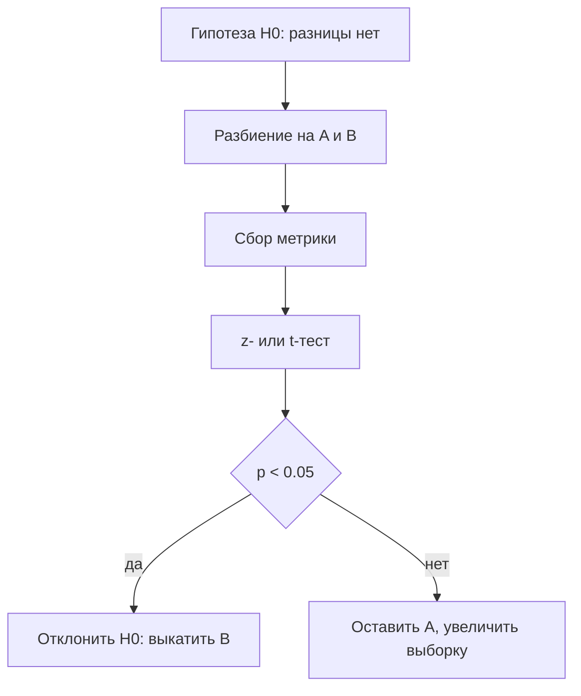

Ты выпустил новую модель — но как понять, что она действительно лучше старой? Просто «посмотреть на метрики» нельзя: реальный мир шумит, и любая разница может оказаться случайной. Для честного ответа нужен **A/B-тест**: разделить пользователей на две группы, показать одной старую модель, другой — новую, и сравнить результаты статистически.

## Как устроен A/B-тест

1. **Гипотеза**: новая модель повысит конверсию с 12% до 14%.
2. **Нулевая гипотеза (H₀)**: разницы нет, обе модели работают одинаково.
3. **Группы**: контрольная (A, старая модель) и экспериментальная (B, новая).
4. **Метрика**: e.g., конверсия (доля успешных исходов), средний чек, время сессии.
5. **Статистический тест**: вычисляем p-value — вероятность получить такую разницу случайно, если H₀ верна.
6. **Вывод**: если `p < α` (обычно 0.05), отклоняем H₀ и говорим «разница значима».

## z-тест для пропорций

Для бинарных метрик (конверсия, клики) используется сравнение долей:

```python
import math

def two_prop_ztest(c1, n1, c2, n2):
    p1, p2 = c1 / n1, c2 / n2
    p = (c1 + c2) / (n1 + n2)          # общая доля
    se = math.sqrt(p * (1 - p) * (1 / n1 + 1 / n2))
    z = (p1 - p2) / se
    p_value = 2 * (1 - 0.5 * (1 + math.erf(abs(z) / math.sqrt(2))))
    return z, p_value

# контроль: 120 успехов из 1000, эксперимент: 150 из 1000
z, p = two_prop_ztest(120, 1000, 150, 1000)
print("z =", round(z, 3), "| p-value =", round(p, 4))
# z ≈ 1.96, p ≈ 0.05 — на грани значимости
```

`math.erf` — функция ошибок, через неё вычисляется нормальное распределение без внешних зависимостей. Если `p < 0.05` — эффект значим.

## t-тест для средних

Если метрика числовая (средний чек, время), используем t-тест. В `scipy` он уже есть:

```bash
pip install scipy
```

```python
from scipy import stats
import numpy as np

rng = np.random.default_rng(42)
a = rng.normal(100, 15, size=300)  # контроль
b = rng.normal(108, 15, size=300)  # эксперимент

t_stat, p_value = stats.ttest_ind(a, b)
print("t =", round(t_stat, 3), "| p-value =", round(p_value, 4))
# p < 0.05 → разница значима
```

`ttest_ind` — независимый t-тест двух выборок. Маленький p-value — «разница вряд ли случайна».

## Размер выборки

Прежде чем запускать тест, нужно понять, сколько пользователей потребуется. Для пропорций:

```python
def sample_size(p1, p2, alpha=0.05, power=0.8):
    z_alpha = 1.96    # для alpha=0.05 (двусторонний)
    z_beta = 0.84     # для power=0.8
    delta = p1 - p2
    n = (z_alpha + z_beta) ** 2 * (p1 * (1 - p1) + p2 * (1 - p2)) / delta ** 2
    return math.ceil(n)

print(sample_size(0.12, 0.14))  # ~ 2700 на группу
```

## Ошибки первого и второго рода

- **Ошибка I рода (α)**: объявили эффект, которого нет (ложная тревога). Контролируется уровнем значимости — обычно 0.05.
- **Ошибка II рода (β)**: не заметили реальный эффект. Контролируется мощностью (power = 1 − β) — обычно 0.8.

## Feature store

Современные ML-системы отделяют **вычисление признаков** от модели: признаки считаются один раз и хранятся в **feature store** — хранилище фич с временем. Зачем?

- **Однообразие**: модель на обучении и в проде получает одни и те же фичи (одна и та же логика).
- **Point-in-time корректность**: фича возвращается *на момент запроса*, а не из будущего. Иначе модель «подсмотрит» будущее и метрики будут завышены.
- **Переиспользование**: фича, посчитанная один раз, доступна всем сервисам.

Реализуем мини-feature store на `sqlite3` (из стандартной библиотеки):

```python
import sqlite3

conn = sqlite3.connect("feature_store.db")
cur = conn.cursor()
cur.execute("""
    CREATE TABLE IF NOT EXISTS features (
        entity_id TEXT,
        ts REAL,
        name TEXT,
        value REAL,
        PRIMARY KEY (entity_id, name, ts)
    )
""")

cur.execute("INSERT INTO features VALUES (?, ?, ?, ?)", ("user_1", 1000.0, "days_active", 17.0))
cur.execute("INSERT INTO features VALUES (?, ?, ?, ?)", ("user_1", 2000.0, "days_active", 22.0))
conn.commit()

# последнее значение на момент 1500: вернётся 17.0
cur.execute(
    "SELECT value FROM features WHERE entity_id=? AND name=? AND ts<=? "
    "ORDER BY ts DESC LIMIT 1",
    ("user_1", "days_active", 1500.0),
)
print("days_active на момент 1500:", cur.fetchone()[0])
```

Запрос с `ts <= ?` и `ORDER BY ts DESC LIMIT 1` — и есть point-in-time: мы берём состояние фичи на конкретный момент, не заглядывая в будущее.

## Схема A/B-теста

Схема показывает путь от гипотезы до решения о выкатке:



## Собираем вместе

A/B-тесты говорят, *какая* модель лучше; feature store гарантирует, что сравнение честное (обе модели видят одинаковые, корректные во времени фичи). Это две стороны одной монеты — «экспериментальная культура» в MLOps.

<!--TASK-->
### Задача 1
Реализуй функцию `two_prop_ztest(c1, n1, c2, n2)` из теории. Проверь её на данных: контроль — 120 успехов из 1000, эксперимент — 150 из 1000. Выведи z и p-value. Затем реши: значима ли разница при α = 0.05 (напечатай «значимо» или «не значимо»). Ожидаемый результат: p-value ≈ 0.05 или чуть меньше, вердикт — «значимо» (или «на грани»), z ≈ 1.96.

### Задача 2
Используя `scipy.stats.ttest_ind`, сравни две выборки: `a = rng.normal(100, 15, size=300)` и `b = rng.normal(108, 15, size=300)`. Выведи t-статистику и p-value, сделай вывод при α = 0.05. Если `scipy` недоступен, посчитай t-статистику вручную через формулу `(mean_a - mean_b) / sqrt(var_a/n_a + var_b/n_b)` и выведи её. Ожидаемый результат: p-value < 0.05, вердикт «значимо».

### Задача 3
Создай мини-feature store на sqlite3: таблицу `features` с полями `entity_id`, `ts`, `name`, `value`. Запиши для `user_1` фичу `days_active` со значениями 17.0 (ts=1000), 22.0 (ts=2000) и для `user_2` — 5.0 (ts=1500). Затем выведи все строки таблицы. Ожидаемый результат: выведены 3 строки с корректными значениями.

### Задача 4
Напиши функцию `get_feature(entity_id, name, ts)`, которая возвращает значение фичи на момент времени `ts` (ключевой SQL: `WHERE entity_id=? AND name=? AND ts<=? ORDER BY ts DESC LIMIT 1`). Проверь: для `user_1`, `days_active`, ts=1500 должно вернуться 17.0, а для ts=2500 — 22.0. Выведи оба результата. Ожидаемый результат: первое значение 17.0, второе — 22.0.

### Задача 5
Напиши функцию `sample_size(p1, p2, alpha=0.05, power=0.8)` из теории (используй `z_alpha=1.96`, `z_beta=0.84`) и посчитай размер выборки на группу для конверсий 0.10 и 0.12. Выведи результат и обрати внимание: чем меньше эффект (разница p1 и p2), тем больше нужна выборка. Ожидаемый результат: число в диапазоне 2500–3500 на группу.
### Задача 6
Напиши функцию `power_prop(p1, p2, n, alpha=0.05)`, которая считает мощность теста для двух пропорций. Стандартная ошибка: `se = sqrt(p * (1 - p) * (2 / n))`, где `p = (p1 + p2) / 2`; эффект `z = abs(p2 - p1) / se`; мощность — `0.5 * (1 + erf((z - 1.96) / sqrt(2)))`. Посчитай мощность для конверсий 0.12 и 0.15 при `n=1000` и `n=2700` на группу. Выведи оба значения с тремя знаками и вывод, хватает ли тысячи наблюдений. Ожидаемый результат: около 0.50 при n=1000 и около 0.90 при n=2700 — тысяча наблюдений даёт лишь 50% шанс заметить эффект.

### Задача 7
Напиши функцию `diff_ci(c1, n1, c2, n2, z=1.96)`, которая возвращает разницу конверсий и её 95% доверительный интервал. Используй необъединённую ошибку: `se = sqrt(p1*(1-p1)/n1 + p2*(1-p2)/n2)`, границы — `diff ± z*se`. Посчитай для контроля 120 из 1000 и эксперимента 150 из 1000, выведи `diff`, `lo`, `hi` с четырьмя знаками. Затем напечатай вывод: содержит ли интервал ноль и что это значит для выкатки. Ожидаемый результат: `diff ≈ -0.03`, `lo ≈ -0.0599`, `hi ≈ -0.0001` — ноль почти касается границы, эффект на грани значимости.

<!--/TASK-->

<!--HINT-->
### Подсказка 1
Используй `math.erf` для p-value: `2 * (1 - 0.5 * (1 + math.erf(abs(z) / math.sqrt(2))))`. Условие значимости: `if p < 0.05: print("значимо")`.

### Подсказка 2
`stats.ttest_ind(a, b)` возвращает кортеж `(t_stat, p_value)`. Если scipy нет, считай вручную: `t = (a.mean() - b.mean()) / np.sqrt(a.var(ddof=1)/len(a) + b.var(ddof=1)/len(b))`.

### Подсказка 3
`cur.execute("INSERT INTO features VALUES (?, ?, ?, ?)", (...))` — плейсхолдеры. После записи — `conn.commit()`. Чтение — `cur.execute("SELECT * FROM features").fetchall()`.

### Подсказка 4
SQL с `ts <= ?` и `ORDER BY ts DESC LIMIT 1` отдаст максимальное значение, не превышающее переданный момент. Проверь оба вызова.

### Подсказка 5
Формула: `n = (z_alpha + z_beta)**2 * (p1*(1-p1) + p2*(1-p2)) / (p1-p2)**2`. `math.ceil` — округление вверх. Проверь: при маленькой разнице n должно расти.
### Подсказка 6
Импортируй `from math import erf, sqrt`. Сначала `p = (p1 + p2) / 2`, потом `se = sqrt(p * (1 - p) * (1 / n + 1 / n))` — это то же самое, что `2 / n`. Эффект `z = abs(p2 - p1) / se`, мощность `0.5 * (1 + erf((z - 1.96) / sqrt(2)))`. При n=1000 z выходит почти ровно 1.96, поэтому мощность около 0.5 — это не баг, а свойство формулы.

### Подсказка 7
`diff = c1 / n1 - c2 / n2` даст отрицательное число, потому что контроль хуже. Ошибка необъединённая: складываются две дисперсии долей. Границы — `diff - z * se` и `diff + z * se`. Проверка «ноль внутри»: `lo < 0 < hi`. Если ноль вне интервала — разница значима на уровне 5%.
<!--/HINT-->

<!--SOLUTION-->
### Разбор 1
Решение:

```python
import math

def two_prop_ztest(c1, n1, c2, n2):
    p1, p2 = c1 / n1, c2 / n2
    p = (c1 + c2) / (n1 + n2)
    se = math.sqrt(p * (1 - p) * (1 / n1 + 1 / n2))
    z = (p1 - p2) / se
    p_value = 2 * (1 - 0.5 * (1 + math.erf(abs(z) / math.sqrt(2))))
    return z, p_value

z, p = two_prop_ztest(120, 1000, 150, 1000)
print("z =", round(z, 3))
print("p-value =", round(p, 4))

if p < 0.05:
    print("Вердикт: значимо")
else:
    print("Вердикт: не значимо")
```

Разбор шагов. Доли: 12% против 15%. Общая доля `p` считает по всем данным — она используется в стандартной ошибке `se`. `z` — количество стандартных отклонений, на которые разошлись доли: `(0.15 - 0.12) / se` ≈ 1.96. Через `math.erf` мы получаем двусторонний p-value: вероятность увидеть такую разницу (или больше) случайно. При p ≈ 0.05 мы стоим ровно на границе — в реальном эксперименте это повод увеличить выборку, а не праздновать победу. Код самодостаточен — только `math`, без внешних библиотек, поэтому его легко встроить в любой пайплайн.

### Разбор 2
Решение:

```python
from scipy import stats
import numpy as np

rng = np.random.default_rng(42)
a = rng.normal(100, 15, size=300)
b = rng.normal(108, 15, size=300)

t_stat, p_value = stats.ttest_ind(a, b)
print("t =", round(t_stat, 3))
print("p-value =", round(p_value, 4))
print("Значимо" if p_value < 0.05 else "Не значимо")
```

Разбор шагов. `stats.ttest_ind` сравнивает средние двух независимых выборок: t-статистика учитывает и разницу средних, и разброс внутри групп (дисперсии), и объёмы. Средние отличаются на 8 при разбросе 15 — при 300 наблюдениях на группу это значимая разница. `p < 0.05` → отклоняем H₀: разница статистически значима, и мы можем обоснованно выкатывать новую модель. Формула t-статистики — `(mean_a - mean_b) / sqrt(var_a/n_a + var_b/n_b)`; в задаче она приведена как запасной вариант, если scipy недоступен. Понимание формулы полезно: видно, что разница средних «взвешивается» неопределённостью обеих выборок.

### Разбор 3
Решение:

```python
import sqlite3

conn = sqlite3.connect("feature_store.db")
cur = conn.cursor()

cur.execute("""
    CREATE TABLE IF NOT EXISTS features (
        entity_id TEXT,
        ts REAL,
        name TEXT,
        value REAL,
        PRIMARY KEY (entity_id, name, ts)
    )
""")

cur.execute("INSERT INTO features VALUES (?, ?, ?, ?)", ("user_1", 1000.0, "days_active", 17.0))
cur.execute("INSERT INTO features VALUES (?, ?, ?, ?)", ("user_1", 2000.0, "days_active", 22.0))
cur.execute("INSERT INTO features VALUES (?, ?, ?, ?)", ("user_2", 1500.0, "days_active", 5.0))
conn.commit()

for row in cur.execute("SELECT * FROM features ORDER BY entity_id, ts"):
    print(row)
```

Разбор шагов. Мы создали настоящую таблицу с первичным ключом `(entity_id, name, ts)` — это гарантирует уникальность тройки и не даёт записать «два значения на один момент». Параметризованные запросы `INSERT ... VALUES (?, ?, ?, ?)` защищают от SQL-инъекций — привычка, обязательная даже в учебном коде. `commit()` фиксирует транзакцию (без него данные могут не сохраниться). Чтение через `SELECT *` показывает все 3 строки. Это заготовка полноценного feature store: каждый признак имеет временную метку, и это позволяет восстанавливать состояние системы на любой момент — фундамент point-in-time корректности.

### Разбор 4
Решение:

```python
def get_feature(entity_id, name, ts):
    cur.execute(
        "SELECT value FROM features WHERE entity_id=? AND name=? AND ts<=? "
        "ORDER BY ts DESC LIMIT 1",
        (entity_id, name, ts),
    )
    row = cur.fetchone()
    return row[0] if row else None

print(get_feature("user_1", "days_active", 1500.0))  # 17.0
print(get_feature("user_1", "days_active", 2500.0))  # 22.0
```

Разбор шагов. Ключевая часть — условие `ts <= ?` вместе с `ORDER BY ts DESC LIMIT 1`: мы берём последнее значение, *не превышающее* запрошенный момент. Для `ts=1500` это 17.0 (записанное на 1000), а не 22.0 (которое появится только в 2000 — в «будущем» относительно точки запроса). Именно это и есть point-in-time корректность: во время обучения на данных до даты D и во время инференса в момент D модель получит одно и то же значение. Если бы мы написали просто `LIMIT 1` без `ts <= ?`, модель «подсмотрела» бы будущее — и метрики на обучении оказались бы фальшиво высокими, а в проде модель бы разочаровала. Возврат `None` при отсутствии значения — аккуратная обработка пропусков.

### Разбор 5
Решение:

```python
import math

def sample_size(p1, p2, alpha=0.05, power=0.8):
    z_alpha = 1.96
    z_beta = 0.84
    delta = p1 - p2
    n = (z_alpha + z_beta) ** 2 * (p1 * (1 - p1) + p2 * (1 - p2)) / delta ** 2
    return math.ceil(n)

print("Размер выборки на группу:", sample_size(0.10, 0.12))
```

Разбор шагов. Формула оценивает, сколько наблюдений нужно на каждую группу, чтобы зафиксировать эффект `delta = p2 - p1` с заданными α и мощностью. `z_alpha=1.96` соответствует двустороннему уровню 0.05, `z_beta=0.84` — мощности 0.8. Для конверсий 10% против 12% получается ≈ 2700–2900 на группу (в диапазоне 2500–3500 в зависимости от точности). Заметь важный эффект: если бы мы хотели заметить разницу 10% против 10.5% (delta = 0.005), знаменатель стал бы вчетверо меньше — и выборка выросла бы до десятков тысяч. «Чем меньше эффект, тем больше выборка» — самый частый практический вывод для планирования экспериментов.
### Разбор 6
Решение:

```python
from math import erf, sqrt

def power_prop(p1, p2, n, alpha=0.05):
    p = (p1 + p2) / 2
    se = sqrt(p * (1 - p) * (1 / n + 1 / n))
    z = abs(p2 - p1) / se
    return 0.5 * (1 + erf((z - 1.96) / sqrt(2)))

for n in (1000, 2700):
    power = power_prop(0.12, 0.15, n)
    print(f"n={n}: мощность = {power:.3f}")

print("Вывод: 1000 наблюдений хватает?", "нет" if power_prop(0.12, 0.15, 1000) < 0.8 else "да")
```

Разбор шагов. Мощность — это вероятность заметить эффект, если он реально есть; она обратна ошибке II рода (`power = 1 - β`). Формула собирает три вещи: величину эффекта, шум и порог значимости. Числитель `abs(p2 - p1)` — сигнал, `se` — шум, их отношение показывает, на сколько стандартных ошибок разошлись доли. Вычитание 1.96 сдвигает распределение в мир, где решение принимается по двустороннему критерию: тест «сработает», только если наблюдаемый z превысит критическое значение. При n=1000 получаем 0.501: это ровно тот случай, когда p-value из задачи 1 балансирует около 0.05 — половина похожих экспериментов не увидит эффект вообще. При n=2700 мощность 0.896, и это уже приемлемо для решения о выкатке. Практический вывод: маленький p-value в недостаточно большом тесте — не победа, а везение; мощность считается до запуска, вместе с размером выборки.

### Разбор 7
Решение:

```python
from math import sqrt

def diff_ci(c1, n1, c2, n2, z=1.96):
    p1, p2 = c1 / n1, c2 / n2
    diff = p1 - p2
    se = sqrt(p1 * (1 - p1) / n1 + p2 * (1 - p2) / n2)
    return diff, diff - z * se, diff + z * se

diff, lo, hi = diff_ci(120, 1000, 150, 1000)
print(f"diff = {diff:.4f}, 95% ДИ = [{lo:.4f}; {hi:.4f}]")

if lo < 0 < hi:
    print("Ноль внутри интервала: эффект не значим")
else:
    print("Ноль вне интервала: разница значима, но оцени величину эффекта")
```

Разбор шагов. Доверительный интервал полезнее одного p-value: он показывает и направление, и размер эффекта, и неопределённость. `diff = -0.03` читается как «экспериментальная модель хуже на 3 процентных пункта», а интервал `[-0.0599; -0.0001]` говорит, что истинная разница где-то между 0.01 и 6 п.п. в пользу контроля. Верхняя граница почти касается нуля — формально ноль вне интервала, то есть разница значима, но запас крошечный: ещё немного шума, и вывод перевернётся. Здесь уместно не выкатывать модель, а продлить тест. Обрати внимание на необъединённую ошибку: для интервала она корректнее, чем общая доля из z-теста, хотя числа различаются в третьем знаке. Такой расчёт — стандартный аргумент в разговоре с продуктом: не «p = 0.048, победа», а «эффект от -6 до 0 п.п., данных мало».
<!--/SOLUTION-->

<!--QUIZ-->
Что такое нулевая гипотеза в A/B-тесте?
- Утверждение, что разницы между группами нет
- Утверждение, что новая модель лучше
- Утверждение, что выборка большая
* Правильный ответ: Утверждение, что разницы между группами нет
По ней считают p-value; отклоняем её, если p < α.

Что означает p-value?
- Вероятность получить такую разницу случайно, если на самом деле её нет
- Вероятность того, что новая модель лучше
- Вероятность ошибки в коде
* Правильный ответ: Вероятность получить такую разницу случайно, если на самом деле её нет
Маленький p-value — аргумент против нулевой гипотезы.

Когда результат A/B-теста считается значимым?
- Когда p-value < α (обычно 0.05)
- Когда p-value > α
- Когда выборка больше 1000
* Правильный ответ: Когда p-value < α (обычно 0.05)
Порог α задаём заранее; p < α означает отклонение H₀.

Что такое ошибка I рода?
- Объявление эффекта, которого на самом деле нет
- Пропуск реального эффекта
- Ошибка в данных
* Правильный ответ: Объявление эффекта, которого на самом деле нет
Это ложная тревога; её вероятность контролируется α.

Что такое мощность теста (power)?
- Вероятность обнаружить реальный эффект (1 − β)
- Размер выборки
- Уровень значимости
* Правильный ответ: Вероятность обнаружить реальный эффект (1 − β)
Мощность 0.8 — стандарт: 80% шансов заметить эффект, если он есть.

Зачем нужен feature store?
- Чтобы признаки считались один раз и были одинаковыми в обучении и в проде
- Чтобы хранить веса модели
- Чтобы заменить базу данных
* Правильный ответ: Чтобы признаки считались один раз и были одинаковыми в обучении и в проде
Feature store — единый источник фич для обучения, инференса и других сервисов.

Что такое point-in-time корректность?
- Фича возвращается строго на момент запроса, без данных из будущего
- Хранение фич только в памяти
- Отключение фич на время обучения
* Правильный ответ: Фича возвращается строго на момент запроса, без данных из будущего
Иначе модель «увидит» будущее и метрики будут завышены.

Какой запрос возвращает последнее значение фичи на момент времени ts?
- SELECT value ... WHERE ts<=? ORDER BY ts DESC LIMIT 1
- SELECT value ... LIMIT 1
- SELECT MAX(value) ...
* Правильный ответ: SELECT value ... WHERE ts<=? ORDER BY ts DESC LIMIT 1
Это и есть point-in-time запрос: максимальное ts, не превышающее заданный момент.

Что случится, если в A/B-тесте взять слишком маленькую выборку?
- Тест не заметит реальный эффект (низкая мощность)
- Тест всегда покажет значимость
- Ничего страшного
* Правильный ответ: Тест не заметит реальный эффект (низкая мощность)
Шум перекроет сигнал — p-value останется большим даже при реальном эффекте.

Что означает 95% доверительный интервал разницы конверсий?
- Диапазон, в который с вероятностью 95% попадает истинная разница
- Гарантию, что новая модель лучше
- Разброс конверсии внутри одной группы
* Правильный ответ: Диапазон, в который с вероятностью 95% попадает истинная разница
Он показывает и направление, и величину эффекта, и его неопределённость.

Зачем нужна поправка Бонферрони при нескольких одновременных тестах?
- Она делит α на число тестов, снижая риск ложноположительного результата
- Она увеличивает мощность каждого теста
- Она убирает необходимость в контрольной группе
* Правильный ответ: Она делит α на число тестов, снижая риск ложноположительного результата
При 20 сравнениях с α = 0.05 хотя бы одно ложное срабатывание почти гарантировано.

Что такое A/A-тест?
- Тест, где обе группы получают одинаковую модель — проверка инфраструктуры
- Тест двух разных метрик
- Тест без гипотезы
* Правильный ответ: Тест, где обе группы получают одинаковую модель — проверка инфраструктуры
Если A/A регулярно даёт p < 0.05, то сломан сплиттер или сбор метрик, а не модель.

Почему опасно останавливать тест сразу при p < 0.05?
- При постоянном «подглядывании» растёт вероятность ошибки I рода
- p-value перестаёт считаться
- Выборка становится больше
* Правильный ответ: При постоянном «подглядывании» растёт вероятность ошибки I рода
Размер выборки и правило остановки фиксируют до старта — иначе значимость почти гарантирована.
<!--/QUIZ-->
