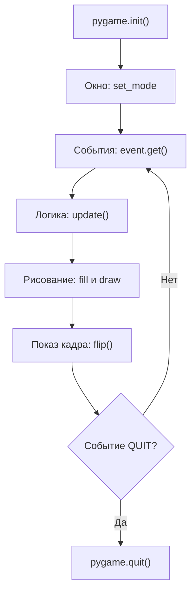

Поздравляю — ты дошёл до самого интересного раздела! Здесь мы научимся писать настоящие игры на Python. Не нужно писать движок с нуля: библиотека `pygame` берёт на себя окно, обработку событий мыши и клавиатуры, звук и отрисовку. Твоя задача — управлять всем этим через простые команды.

## Что такое pygame

`pygame` — это набор модулей для создания 2D-игр. Он умеет:

- создавать окно игры и рисовать в нём,
- обрабатывать события: нажатия клавиш, движения мыши, закрытие окна,
- работать со спрайтами — объектами, которые двигаются по экрану,
- воспроизводить звуки и музыку.

Установка простая — достаточно выполнить в терминале:

```bash
pip install pygame
```

Перед запуском любого кода убедись, что импорт работает: `import pygame` не должен выдавать ошибку. Обрати внимание: pygame работает только в локальном окружении с графическим дисплеем — в некоторых облачных песочницах окно не откроется, но код останется корректным.

## Окно игры

Игра начинается с инициализации и создания окна:

```python
import pygame

pygame.init()
screen = pygame.display.set_mode((800, 600))  # ширина, высота
pygame.display.set_caption("Моя первая игра")

running = True
while running:
    for event in pygame.event.get():
        if event.type == pygame.QUIT:
            running = False

pygame.quit()
```

Разберём по частям. `pygame.init()` подготавливает все подсистемы. `pygame.display.set_mode((800, 600))` создаёт окно размером 800×600 пикселей и возвращает **поверхность** (surface) — «холст», на котором мы будем рисовать. `set_caption` задаёт заголовок окна. Дальше идёт главный секрет любой игры — **игровой цикл**.

## Игровой цикл

Игра — это бесконечный цикл, который повторяется десятки раз в секунду. На каждом «кадре» (шаге цикла) игра:

1. проверяет события — `for event in pygame.event.get()`,
2. обновляет состояние мира: позиции объектов, счёт, здоровье,
3. рисует всё на экране.

Цикл должен как-то завершиться — иначе окно не закроется. Событие `pygame.QUIT` возникает при нажатии на крестик окна: мы ловим его и меняем `running` на `False`, после чего цикл заканчивается. Запомни эту схему — она будет в каждой игре, которую ты напишешь.

## Частота кадров: Clock

Если просто крутить цикл, игра будет работать с разной скоростью на разных компьютерах — одни будут играть быстро, другие медленно. Чтобы скорость была одинаковой, используют `pygame.time.Clock`:

```python
clock = pygame.time.Clock()

while running:
    # ... события и логика ...
    clock.tick(60)  # не быстрее 60 кадров в секунду
```

Метод `tick(60)` делает паузу такой длины, чтобы цикл выполнялся ровно 60 раз в секунду. Так игра станет предсказуемой на любом «железе».

## Рисование фигур

Сначала экран нужно очистить — залить цветом (например, белым). Затем рисовать фигуры. Цвета задаются в модели RGB: три числа от 0 до 255.

```python
WHITE = (255, 255, 255)
BLUE = (0, 0, 255)
RED = (255, 0, 0)

screen.fill(WHITE)
pygame.draw.rect(screen, BLUE, (50, 50, 100, 60))    # прямоугольник
pygame.draw.circle(screen, RED, (300, 200), 40)       # круг
pygame.draw.line(screen, (0, 255, 0), (0, 0), (400, 300), 5)  # линия
pygame.display.flip()
```

Обрати внимание: `pygame.draw.*` рисует на поверхности, но экран обновляется только после `pygame.display.flip()` — эта команда показывает нарисованное в окне. Прямоугольник задаётся кортежем `(x, y, ширина, высота)`, где `x, y` — координаты левого верхнего угла. Круг задаётся центром и радиусом. Важно: в pygame координата `y` растёт **вниз** — это не математическая система координат, а экранная.

## Спрайты

Когда объектов становится много, удобно оформлять каждый в виде класса. pygame предлагает готовый базовый класс `pygame.sprite.Sprite`:

```python
class Player(pygame.sprite.Sprite):
    def __init__(self):
        super().__init__()
        self.image = pygame.Surface((40, 40))
        self.image.fill((0, 255, 0))
        self.rect = self.image.get_rect()
        self.rect.center = (400, 300)

    def update(self):
        self.rect.x += 1  # движение вправо на 1 пиксель за кадр
```

У каждого спрайта есть два важных атрибута: `image` (картинка, которую рисуем) и `rect` (прямоугольник, описывающий его положение и размер). Спрайты объединяют в группы:

```python
all_sprites = pygame.sprite.Group()
player = Player()
all_sprites.add(player)

# внутри цикла:
all_sprites.update()       # обновить всех
all_sprites.draw(screen)   # нарисовать всех
```

Метод `update()` вызывается для каждого спрайта каждый кадр — именно там меняются позиции, анимации, состояние. Метод `draw()` сам рисует всех на поверхности. Это очень удобно: новую сущность в игре ты добавляешь созданием класса и добавлением его в группу.

## Схема игрового цикла

Порядок шагов внутри цикла всегда одинаковый: сначала события, потом логика, потом рисование и показ кадра. Схема помогает не перепутать порядок:



## Итог урока

Мы узнали, как:

- устанавливать и подключать pygame;
- создавать окно и задавать ему заголовок;
- писать игровой цикл и обрабатывать событие закрытия окна;
- управлять скоростью игры через `Clock.tick`;
- рисовать прямоугольники, круги и линии;
- создавать спрайты и объединять их в группы.

Дальше — практика, в которой ты соберёшь из этих кирпичиков свою первую анимированную сцену.

<!--TASK-->
### Задача 1
Создай программу, которая открывает окно pygame размером 800×600 с заголовком «Моя игра». Окно должно быть залито тёмно-синим цветом `(20, 30, 80)`. Внутри должен быть игровой цикл, который завершается только при нажатии на крестик окна. Запусти программу и убедись, что окно открывается, имеет нужный цвет и закрывается без ошибок.

### Задача 2
Добавь к задаче 1 отрисовку нескольких фигур: красный круг радиусом 50 с центром в точке (200, 150), зелёный прямоугольник 120×60 с левым верхним углом в (400, 300) и жёлтую линию от точки (0, 550) до точки (800, 550) толщиной 4. Не забудь после рисования вызвать `pygame.display.flip()`, иначе фигуры не появятся.

### Задача 3
Сделай анимированный шарик: круг радиусом 25, который движется по экрану и «отскакивает» от стен. Заведи переменные скорости `speed_x = 3` и `speed_y = 2`. Каждый кадр прибавляй их к координатам центра; когда круг достигает края окна — меняй знак соответствующей скорости. Используй `Clock.tick(60)`.

### Задача 4
Создай класс спрайта `Ball` на основе `pygame.sprite.Sprite`: белый круг радиусом 20 на чёрной поверхности. Помести спрайт в группу `all_sprites` и сделай так, чтобы он двигался вправо со скоростью 4 пикселя за кадр, а дойдя до правого края — появлялся слева (обнуляя координату `x`). В цикле обновляй группу (`.update()`) и рисуй её (`.draw(screen)`).

### Задача 5
Собери всё вместе: класс спрайта `Ball`, который двигается с постоянной скоростью `(3, 2)` и отражается от всех четырёх стен. Спрайт должен быть жёлтым кругом радиусом 25 на синем фоне. Подключи `Clock` с 60 кадрами. Запусти и убедись, что шарик «прыгает» по экрану бесконечно, не выходя за границы, а окно закрывается по крестику.

### Задача 6
Сделай «светофор»: нарисуй тёмный прямоугольник-корпус размером 80×220 с левым верхним углом в точке (360, 190) и три круга радиусом 28 с центрами (400, 230), (400, 300) и (400, 370). Заведи счётчик кадров `frames` и каждую секунду (при 60 кадрах в секунду) переключай активный сигнал по кругу: красный → жёлтый → зелёный. Активный круг рисуй ярким цветом, остальные — серым `(70, 70, 70)`. При смене сигнала печатай его название в консоль. Ожидаемый вывод: окно с корпусом светофора и строки в консоли по одной в секунду — `Сигнал: красный`, `Сигнал: жёлтый`, `Сигнал: зелёный`, затем снова красный.

### Задача 7
Напиши «снегопад»: создай список из 60 снежинок, каждая — список `[x, y, speed]` со случайными `x` от 0 до 800, `y` от 0 до 600 и скоростью от 1 до 4. Каждый кадр увеличивай `y` на `speed`; если снежинка ушла ниже 600, верни её наверх (`y = 0`) и задай новую случайную `x`. Рисуй каждую снежинку белым кругом радиусом 3 на тёмно-синем фоне. Не забудь `Clock.tick(60)` и очистку экрана. Ожидаемый вывод: в консоль один раз печатается `Снежинок: 60`, а в окне непрерывно падает снег, и ни одна точка не «застревает» внизу.
<!--/TASK-->

<!--HINT-->
### Подсказка 1
Схема такая: `pygame.init()`, `pygame.display.set_mode((800, 600))`, `pygame.display.set_caption("Моя игра")`, цикл `while running:` с перебором `pygame.event.get()` и проверкой `pygame.QUIT`, в начале цикла — `screen.fill((20, 30, 80))`, в конце — `pygame.display.flip()`. Завершение — `pygame.quit()`.

### Подсказка 2
Резование идёт между `fill` и `flip`: `pygame.draw.circle(screen, (255, 0, 0), (200, 150), 50)`, `pygame.draw.rect(screen, (0, 255, 0), (400, 300, 120, 60))`, `pygame.draw.line(screen, (255, 255, 0), (0, 550), (800, 550), 4)`. Координаты — кортежи, цвет — тоже кортеж из трёх чисел.

### Подсказка 3
Заведи переменные `x, y = 400, 300` и `speed_x, speed_y = 3, 2` до цикла. В цикле: `x += speed_x; y += speed_y`, затем проверки: если `x - 25 <= 0` или `x + 25 >= 800` — `speed_x = -speed_x` (аналогично для `y` и 600). Рисуй круг с центром `(x, y)`.

### Подсказка 4
В `__init__` создай `self.image = pygame.Surface((40, 40))`, залей чёрным, нарисуй круг через `pygame.draw.circle(self.image, (255, 255, 255), (20, 20), 20)`, затем `self.rect = self.image.get_rect()` и `self.rect.center = (400, 300)`. В `update()`: `self.rect.x += 4; if self.rect.x > 800: self.rect.x = -40`.

### Подсказка 5
Совмести задачи 3 и 4: в `__init__` заведи `self.speed_x = 3`, `self.speed_y = 2`. В `update()` сдвигай `self.rect.x` и `self.rect.y`, а при выходе за края меняй знак соответствующей скорости. Не забудь `tick(60)` и очистку экрана через `fill` перед `draw`.

### Подсказка 6
Держи три цвета в списке `COLORS = [(255, 0, 0), (255, 220, 0), (0, 220, 80)]`, а индекс активного считай как `(frames // 60) % 3` — целочисленное деление даёт «секунды», остаток зацикливает выбор. Чтобы печатать название только при смене, храни `current = -1` и сравнивай с новым индексом. Круги удобно рисовать в цикле `for i in range(3)` с центром `(400, 230 + i * 70)`.

### Подсказка 7
Список снежинок собери генератором: `flakes = [[random.randint(0, 800), random.randint(0, 600), random.randint(1, 4)] for _ in range(60)]`. В цикле обходи `for flake in flakes:` и меняй `flake[1] += flake[2]`. Условие возврата — `if flake[1] > 600:`; после него обнуляй `y` и заново выбирай `x`. Для рисования распакуй `for x, y, speed in flakes:` — так код читается лучше.
<!--/HINT-->

<!--SOLUTION-->
### Разбор 1
Решение:

```python
import pygame

pygame.init()
screen = pygame.display.set_mode((800, 600))
pygame.display.set_caption("Моя игра")

running = True
while running:
    for event in pygame.event.get():
        if event.type == pygame.QUIT:
            running = False
    screen.fill((20, 30, 80))
    pygame.display.flip()

pygame.quit()
```

Что здесь происходит? `pygame.init()` готовит модули pygame. `set_mode` возвращает поверхность окна. Цикл `while running` крутится, пока `running == True`. Внутри мы перебираем все события, накопленные с прошлого кадра: если среди них есть `pygame.QUIT` — значит, пользователь нажал на крестик, и мы останавливаем цикл. Команда `screen.fill` заливает экран цветом, а `flip` показывает результат в окне. В конце `pygame.quit()` корректно закрывает pygame. Обрати внимание: без `fill` каждое следующее «отражение» рисовалось бы поверх предыдущего, поэтому очистка каждого кадра обязательна.

### Разбор 2
Решение:

```python
import pygame

pygame.init()
screen = pygame.display.set_mode((800, 600))
pygame.display.set_caption("Моя игра")

running = True
while running:
    for event in pygame.event.get():
        if event.type == pygame.QUIT:
            running = False

    screen.fill((20, 30, 80))
    pygame.draw.circle(screen, (255, 0, 0), (200, 150), 50)
    pygame.draw.rect(screen, (0, 255, 0), (400, 300, 120, 60))
    pygame.draw.line(screen, (255, 255, 0), (0, 550), (800, 550), 4)
    pygame.display.flip()

pygame.quit()
```

Что здесь происходит? Каждый вызов `pygame.draw.*` рисует фигуру на поверхности `screen`, но экран покажет её только после `pygame.display.flip()`. Порядок важен: то, что нарисовано позже, окажется поверх. `draw.circle` принимает цвет, центр и радиус; `draw.rect` — цвет и кортеж `(x, y, ширина, высота)`; `draw.line` — цвет, две точки и толщину. Мы используем именованный аргумент, чтобы не запутаться. Если ты не увидишь фигуры — скорее всего забыл `flip()` или рисуешь до очистки (тогда fill закрасит фигуры).

### Разбор 3
Решение:

```python
import pygame

pygame.init()
screen = pygame.display.set_mode((800, 600))
clock = pygame.time.Clock()

x, y = 400, 300
speed_x, speed_y = 3, 2

running = True
while running:
    for event in pygame.event.get():
        if event.type == pygame.QUIT:
            running = False

    x += speed_x
    y += speed_y
    if x - 25 <= 0 or x + 25 >= 800:
        speed_x = -speed_x
    if y - 25 <= 0 or y + 25 >= 600:
        speed_y = -speed_y

    screen.fill((20, 30, 80))
    pygame.draw.circle(screen, (255, 0, 0), (x, y), 25)
    pygame.display.flip()
    clock.tick(60)

pygame.quit()
```

Что здесь происходит? Координаты центра хранятся в переменных `x, y` и каждый кадр увеличиваются на скорость. Когда круг касается стены (`x - 25 <= 0` — левая грань, `x + 25 >= 800` — правая), знак скорости меняется на противоположный — шарик «отскакивает». Аналогично для вертикальной оси, только границы — 0 и 600. `clock.tick(60)` выравнивает скорость анимации. Обрати внимание на условие: мы учитываем радиус, чтобы круг не «врезался» в стену до половины.

### Разбор 4
Решение:

```python
import pygame

class Ball(pygame.sprite.Sprite):
    def __init__(self):
        super().__init__()
        self.image = pygame.Surface((40, 40))
        self.image.fill((0, 0, 0))
        pygame.draw.circle(self.image, (255, 255, 255), (20, 20), 20)
        self.rect = self.image.get_rect()
        self.rect.center = (400, 300)

    def update(self):
        self.rect.x += 4
        if self.rect.x > 800:
            self.rect.x = -40

pygame.init()
screen = pygame.display.set_mode((800, 600))
all_sprites = pygame.sprite.Group()
all_sprites.add(Ball())

running = True
while running:
    for event in pygame.event.get():
        if event.type == pygame.QUIT:
            running = False
    all_sprites.update()
    screen.fill((30, 30, 50))
    all_sprites.draw(screen)
    pygame.display.flip()
    pygame.time.Clock().tick(60)

pygame.quit()
```

Что здесь происходит? Спрайт — это класс, наследующий `pygame.sprite.Sprite`. В `__init__` мы создаём поверхность 40×40, заливаем её чёрным и рисуем белый круг. Атрибут `rect` — прямоугольник, который задаёт позицию спрайта на экране. В `update()` мы двигаем спрайт вправо, а когда он полностью уходит за правый край (`x > 800`), возвращаем его слева. Группа `all_sprites` вызывает `update()` для каждого спрайта и сама рисует их в `draw(screen)`. Это удобно: с добавлением новых объектов код цикла не разрастается.

### Разбор 5
Решение:

```python
import pygame

class Ball(pygame.sprite.Sprite):
    def __init__(self):
        super().__init__()
        self.image = pygame.Surface((50, 50))
        self.image.fill((0, 0, 0))
        pygame.draw.circle(self.image, (255, 255, 0), (25, 25), 25)
        self.rect = self.image.get_rect()
        self.rect.center = (400, 300)
        self.speed_x = 3
        self.speed_y = 2

    def update(self):
        self.rect.x += self.speed_x
        self.rect.y += self.speed_y
        if self.rect.left <= 0 or self.rect.right >= 800:
            self.speed_x = -self.speed_x
        if self.rect.top <= 0 or self.rect.bottom >= 600:
            self.speed_y = -self.speed_y

pygame.init()
screen = pygame.display.set_mode((800, 600))
clock = pygame.time.Clock()
all_sprites = pygame.sprite.Group()
all_sprites.add(Ball())

running = True
while running:
    for event in pygame.event.get():
        if event.type == pygame.QUIT:
            running = False
    all_sprites.update()
    screen.fill((20, 30, 80))
    all_sprites.draw(screen)
    pygame.display.flip()
    clock.tick(60)

pygame.quit()
```

Что здесь происходит? Мы объединили движение из задачи 3 и класс спрайта из задачи 4. Скорости теперь — атрибуты объекта, поэтому каждый спрайт может двигаться по-своему. Проверки отражения используют готовые свойства `rect`: `left`, `right`, `top`, `bottom` — удобнее, чем считать радиус вручную. Обрати внимание, что поверхность спрайта теперь 50×50, а круг радиусом 25 — ровно по центру. Такую схему — класс спрайта + группа + цикл с `Clock` — ты будешь использовать во всех следующих играх.

### Разбор 6
Решение:

```python
import pygame

pygame.init()
screen = pygame.display.set_mode((800, 600))
pygame.display.set_caption("Светофор")
clock = pygame.time.Clock()

COLORS = [(255, 0, 0), (255, 220, 0), (0, 220, 80)]
NAMES = ["красный", "жёлтый", "зелёный"]
frames = 0
current = -1

running = True
while running:
    for event in pygame.event.get():
        if event.type == pygame.QUIT:
            running = False

    index = (frames // 60) % 3
    if index != current:
        current = index
        print("Сигнал:", NAMES[current])

    screen.fill((15, 20, 40))
    pygame.draw.rect(screen, (45, 45, 50), (360, 190, 80, 220), border_radius=12)
    for i in range(3):
        color = COLORS[i] if i == index else (70, 70, 70)
        pygame.draw.circle(screen, color, (400, 230 + i * 70), 28)

    pygame.display.flip()
    frames += 1
    clock.tick(60)

pygame.quit()
```

Что здесь происходит? Счётчик `frames` увеличивается на единицу каждый кадр, поэтому выражение `frames // 60` даёт номер текущей «секунды», а `% 3` зацикливает его значениями 0, 1, 2. Сравнение с `current` нужно, чтобы печать и переключение происходили один раз за секунду, а не на каждом кадре. В цикле отрисовки `i == index` выбирает яркий цвет из `COLORS`, иначе берётся серый — так горят ровно один огонь. `border_radius=12` в `draw.rect` скругляет корпус. Обрати внимание: вся анимация построена на счётчике кадров, а не на реальном времени, поэтому при 60 кадрах в секунду переключение происходит примерно раз в секунду.

### Разбор 7
Решение:

```python
import random
import pygame

pygame.init()
screen = pygame.display.set_mode((800, 600))
pygame.display.set_caption("Снегопад")
clock = pygame.time.Clock()

flakes = [[random.randint(0, 800), random.randint(0, 600),
           random.randint(1, 4)] for _ in range(60)]
print("Снежинок:", len(flakes))

running = True
while running:
    for event in pygame.event.get():
        if event.type == pygame.QUIT:
            running = False

    for flake in flakes:
        flake[1] += flake[2]
        if flake[1] > 600:
            flake[1] = 0
            flake[0] = random.randint(0, 800)

    screen.fill((15, 20, 40))
    for x, y, speed in flakes:
        pygame.draw.circle(screen, (255, 255, 255), (int(x), int(y)), 3)

    pygame.display.flip()
    clock.tick(60)

pygame.quit()
```

Что здесь происходит? Каждая снежинка — изменяемый список из трёх чисел, поэтому мы можем менять её поля по индексу прямо в цикле. `flake[1] += flake[2]` сдвигает точку вниз на её собственную скорость: быстрые снежинки падают стремительнее медленных, и картинка выглядит живой. Когда `y` превышает 600, снежинка «телепортируется» наверх и получает новую случайную координату `x` — так список остаётся постоянного размера, без создания и удаления объектов. `print` до цикла печатает количество один раз. Обрати внимание: координаты в `draw.circle` приводим к `int`, потому что после сложений они могут стать нецелыми, а функция ждёт целые числа.
<!--/SOLUTION-->

<!--QUIZ-->
Что возвращает pygame.display.set_mode((800, 600))?
- Число 800
- Поверхность окна
- Кортеж координат
* Правильный ответ: Поверхность окна
set_mode создаёт окно и возвращает поверхность (surface), на которой мы рисуем.

Что нужно вызвать, чтобы показать нарисованное на экране?
- pygame.display.flip()
- pygame.display.show()
- pygame.draw.flip()
* Правильный ответ: pygame.display.flip()
Фигуры рисуются на поверхности, но становятся видны только после flip().

Какое событие возникает при нажатии на крестик окна?
- pygame.KEYDOWN
- pygame.QUIT
- pygame.MOUSEBUTTONDOWN
* Правильный ответ: pygame.QUIT
Событие pygame.QUIT означает, что пользователь хочет закрыть окно.

Зачем нужен Clock.tick(60)?
- Чтобы окно было ровно 60 пикселей в ширину
- Чтобы цикл выполнялся примерно 60 раз в секунду
- Чтобы игра занимала меньше памяти
* Правильный ответ: Чтобы цикл выполнялся примерно 60 раз в секунду
tick ограничивает частоту кадров, делая скорость игры одинаковой на разных компьютерах.

В какой системе координат работает pygame?
- Начало в левом верхнем углу, y растёт вниз
- Начало в центре экрана, y растёт вверх
- Начало в правом нижнем углу
* Правильный ответ: Начало в левом верхнем углу, y растёт вниз
Это экранная система координат: y растёт вниз, начало — верхний левый угол.

Как называется класс, от которого наследуют игровые объекты в pygame?
- pygame.sprite.Sprite
- pygame.object.GameObject
- pygame.actor.Actor
* Правильный ответ: pygame.sprite.Sprite
Спрайты наследуют pygame.sprite.Sprite и имеют атрибуты image и rect.

Какой метод группы рисует все спрайты на поверхности?
- update()
- draw(screen)
- render(screen)
* Правильный ответ: draw(screen)
group.draw(screen) рисует все спрайты группы на переданной поверхности.

Что хранится в атрибуте rect спрайта?
- Текст-подпись спрайта
- Прямоугольник с координатами и размерами
- Список спрайтов группы
* Правильный ответ: Прямоугольник с координатами и размерами
rect — это pygame.Rect, описывающий положение (x, y) и размер (ширина, высота) спрайта.

Что делает screen.fill((20, 30, 80))?
- Заливает всю поверхность указанным цветом
- Рисует рамку вокруг окна
- Удаляет все спрайты из групп
* Правильный ответ: Заливает всю поверхность указанным цветом
fill закрашивает поверхность целиком — это стандартный способ очистить кадр перед новой отрисовкой.

Что произойдёт, если убрать pygame.display.flip() из цикла?
- Окно останется пустым: нарисованное не попадёт на экран
- Игра будет работать вдвое быстрее
- Появится ошибка AttributeError
* Правильный ответ: Окно останется пустым: нарисованное не попадёт на экран
Рисование идёт на скрытой поверхности, а flip показывает готовый кадр в окне.

Как получить прямоугольник поверхности, чтобы задать позицию спрайта?
- image.get_rect()
- image.rect()
- image.to_rect()
* Правильный ответ: image.get_rect()
get_rect() возвращает pygame.Rect с размерами поверхности, его удобно центрировать и двигать.

Что означают аргументы в pygame.draw.circle(screen, RED, (300, 200), 40)?
- Центр круга (300, 200) и радиус 40
- Левый верхний угол (300, 200) и диаметр 40
- Ширину 300 и высоту 200
* Правильный ответ: Центр круга (300, 200) и радиус 40
У круга задаётся центр и радиус, в отличие от прямоугольника с координатами угла.
<!--/QUIZ-->
