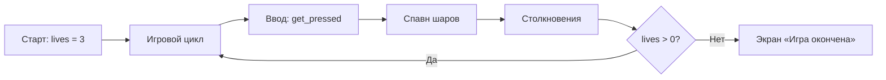

В прошлом уроке мы освоили каркас: окно, цикл, спрайты. Теперь соберём из этого настоящую игру. Наш проект — «Ловец шаров»: внизу экрана — ракетка, которой ты управляешь стрелками, сверху падают шары. Поймал шар — получил очко; пропустил — потерял жизнь. Именно на этом примере мы разберём четыре главных кита любой аркады: ввод с клавиатуры, столкновения, текст и состояние игры.

## Управление с клавиатуры

У pygame есть два способа узнавать о клавишах. Первый — события `pygame.KEYDOWN` и `pygame.KEYUP`: они приходят один раз в момент нажатия/отпускания и удобны для действий «по одному разу» (например, выстрел):

```python
for event in pygame.event.get():
    if event.type == pygame.KEYDOWN and event.key == pygame.K_SPACE:
        print("Пробел нажат!")
```

Второй способ — `pygame.key.get_pressed()`: он возвращает состояние **всех** клавиш в данный момент и идеально подходит для непрерывного движения:

```python
keys = pygame.key.get_pressed()
if keys[pygame.K_LEFT]:
    player.rect.x -= 5
if keys[pygame.K_RIGHT]:
    player.rect.x += 5
```

Разница принципиальна: событие приходит только в момент нажатия, а `get_pressed()` — «живёт» весь кадр, пока клавиша зажата. Для игры вроде нашей нужен именно второй способ.

## Столкновения

Главная механика — проверка, коснулся ли шар ракетки. У спрайтов есть готовый метод `colliderect`:

```python
if ball.rect.colliderect(player.rect):
    score += 1
    ball.kill()
```

А если объектов много — используй `pygame.sprite.spritecollide`: он возвращает список спрайтов из группы, которые пересеклись с данным:

```python
caught = pygame.sprite.spritecollide(player, balls, True)
score += len(caught)
```

Третий аргумент `True` означает, что пойманные шары удаляются из группы. Одно выражение — и вся логика подбора готова. Работает это просто: для каждого спрайта группы проверяется пересечение `rect`-ов.

## Текст и шрифты

Чтобы показать счёт, нужен текст. В pygame текст — это тоже картинка: шрифт создаёт поверхность с текстом, а она «приклеивается» к экрану через `blit`:

```python
font = pygame.font.Font(None, 36)  # системный шрифт, размер 36
score_surface = font.render(f"Счёт: {score}", True, (255, 255, 255))
screen.blit(score_surface, (10, 10))
```

`pygame.font.Font(None, 36)` берёт стандартный системный шрифт нужного размера; второй аргумент `render` — сглаживание, третий — цвет. Если хочешь свой шрифт, передай путь к файлу `.ttf` вместо `None`.

## Звук

`pygame.mixer` умеет проигрывать звуки. Загрузи звуковой файл и вызови `play()`:

```python
pygame.mixer.init()
catch_sound = pygame.mixer.Sound("catch.wav")
catch_sound.play()
```

Если файла нет, код сломается — поэтому в уроках мы пропускаем звук или оборачиваем в `try`. Звук — приятное дополнение, но механика игры от него не зависит.

## Состояние игры и конец

Логику игры удобно описывать переменными: `score` (счёт) и `lives` (жизни). Когда жизни заканчиваются, игра должна остановиться. Простейший вариант — флаг состояния:

```python
if lives <= 0:
    game_over = True
```

А в цикле — ветвление: пока `game_over` ложно, играем; когда станет истинным — рисуем надпись «Игра окончена» и ждём закрытия окна. Это грубая, но рабочая схема; для настоящего проекта состояние удобнее выносить в отдельный класс или enum (перечисление), но для нашей аркады переменных достаточно.

## Схема состояний игры

Игра «Ловец шаров» — это конечный автомат с двумя состояниями. Пока жизни не кончились, крутится полный цикл; когда они на нуле — остаётся только отрисовка финального экрана:



## Итог урока

Мы научились:

- управлять спрайтом с клавиатуры через `get_pressed()`;
- проверять столкновения через `colliderect` и `spritecollide`;
- выводить текст через `Font.render` и `blit`;
- играть звуки через `pygame.mixer`;
- организовывать конец игры через переменную состояния.

Теперь собери всё это в одну работающую игру — по шагам.

<!--TASK-->
### Задача 1
Создай спрайт `Player` — ракетку: зелёный прямоугольник 80×15. Размести его внизу экрана (центр по `x`, координата `y = 570`). В цикле считывай `pygame.key.get_pressed()`: стрелка влево двигает ракетку на 5 пикселей влево, стрелка вправо — вправо. Позаботься, чтобы ракетка не выходила за левый и правый края окна (800×600). Запусти и проверь управление.

### Задача 2
Добавь к «е 1 вывод счёта. Заведи переменную `score = 0` и шрифт `font = pygame.font.Font(None, 36)`. Каждый кадр создавай поверхность с текстом `Счёт: {score}` белого цвета и рисуй её через `screen.blit` в левом верхнем углу (10, 10). Пока что счёт не будет меняться — главное, чтобы текст отображался и не искажался.

### Задача 3
Создай класс спрайта `Ball` — красный круг радиусом 12 на прозрачной поверхности (используй `pygame.Surface((24, 24), pygame.SRCALPHA)`, чтобы фон не был чёрным квадратом). В отдельной группе `balls` каждый 40-й кадр (считай `frames += 1`) создавай новый шар со случайной координатой `x` в пределах окна и случайной скоростью падения от 2 до 5. Шар должен двигаться вниз, а выйдя за нижний край — удаляться (`kill()`).

### Задача 4
Добавь столкновения: если шар коснулся ракетки (`pygame.sprite.spritecollide(player, balls, True)`), увеличивай счёт на число пойманных шаров. Также добавь жизни: переменную `lives = 3`; если шар упал мимо ракетки (вышел за нижний край), уменьшай жизни на 1 и удаляй шар. Выводи и счёт, и жизни в верхней части экрана.

### Задача 5
Доведи игру до конца: когда `lives` становится 0, переставай создавать шары и выводи по центру экрана крупным шрифтом (размер 72) красную надпись «Игра окончена». Игра должна ждать нажатия крестика, а код — корректно завершаться через `pygame.quit()`.

### Задача 6
Добавь в игру паузу. По нажатию клавиши `P` игра должна замирать: шары не двигаются, новые не создаются, ракетка не реагирует на стрелки, а по центру экрана появляется надпись «Пауза» размером 48. Повторное нажатие `P` возвращает игру к жизни. Используй событие `pygame.KEYDOWN` и флаг `paused`; лови клавишу через `event.key == pygame.K_p`. Ожидаемый вывод: при нажатии `P` в консоль печатается `Пауза`, при повторном — `Продолжаем`, а шары в это время стоят на месте.

### Задача 7
Добавь рекорд: при старте читай лучший счёт из файла `highscore.txt` (если файла нет — считай рекорд равным 0). Когда игра заканчивается, сравнивай `score` с рекордом, при превышении перезаписывай файл и выводи в консоль `Новый рекорд: <число>`. На экране «Игра окончена» показывай две строки: счёт и рекорд. Ожидаемый вывод после удачной игры: файл `highscore.txt` содержит число, а в консоли появляется строка `Новый рекорд: 12`.
<!--/TASK-->

<!--HINT-->
### Подсказка 1
В `update()` спрайта `Player`: `keys = pygame.key.get_pressed()`, затем `if keys[pygame.K_LEFT]: self.rect.x -= 5` и аналогично для правой. Ограничение: `self.rect.x = max(0, min(800 - self.rect.width, self.rect.x))` — или обычные `if`-проверки.

### Подсказка 2
Создай шрифт один раз — до цикла: `font = pygame.font.Font(None, 36)`. Внутри цикла после очистки экрана: `text = font.render(f"Счёт: {score}", True, (255, 255, 255))` и `screen.blit(text, (10, 10))`. Рисуй текст после `fill`, но до `flip`.

### Подсказка 3
В `Ball.__init__` задай `self.rect.centerx = random.randint(12, 788)` и `self.speed = random.randint(2, 5)`. В `update()`: `self.rect.y += self.speed`; если `self.rect.top > 600` — `self.kill()`. Создание: `if frames % 40 == 0: balls.add(Ball())`, где `frames` увеличивается на 1 каждый кадр.

### Подсказка 4
Проверяй столкновения каждый кадр: `caught = pygame.sprite.spritecollide(player, balls, True)` и `score += len(caught)`. Про потерянные шары проще всего узнать в самом `Ball.update()`: `if self.rect.top > 600: self.kill(); lives -= 1` — но `lives` должна быть доступна классу; варианты — глобальная переменная или передача счётчика.

### Подсказка 5
Заведи `game_over = False` до цикла. В цикле: `if lives <= 0: game_over = True`. Создание шаров — только `if not game_over`. Когда `game_over` истинно, рисуй `font_big.render("Игра окончена", True, (255, 0, 0))` и центрируй через `text.get_rect(center=(400, 300))` и `blit` в эту точку.

### Подсказка 6
Добавь `paused = False` рядом с `game_over`. В переборе событий: `if event.type == pygame.KEYDOWN and event.key == pygame.K_p:` — меняй флаг `paused = not paused` и печатай сообщение. Весь блок обновления логики оберни в `if not game_over and not paused:`. Надпись «Пауза» рисуй после всего, как и «Игра окончена», через `font_big.render("Пауза", True, (255, 255, 255))` и `get_rect(center=(400, 300))`.

### Подсказка 7
Чтение рекорда оформи функцией с `try/except (FileNotFoundError, ValueError): return 0`. Запись — `with open("highscore.txt", "w", encoding="utf-8") as f: f.write(str(score))`. Проверяй рекорд в момент, когда `game_over` только что стал истинным, а не каждый кадр, иначе файл будет перезаписываться десятки раз в секунду.
<!--/HINT-->

<!--SOLUTION-->
### Разбор 1
Решение:

```python
import pygame

class Player(pygame.sprite.Sprite):
    def __init__(self):
        super().__init__()
        self.image = pygame.Surface((80, 15))
        self.image.fill((0, 255, 0))
        self.rect = self.image.get_rect()
        self.rect.center = (400, 570)

    def update(self):
        keys = pygame.key.get_pressed()
        if keys[pygame.K_LEFT]:
            self.rect.x -= 5
        if keys[pygame.K_RIGHT]:
            self.rect.x += 5
        if self.rect.left < 0:
            self.rect.left = 0
        if self.rect.right > 800:
            self.rect.right = 800

pygame.init()
screen = pygame.display.set_mode((800, 600))
player = Player()
clock = pygame.time.Clock()

running = True
while running:
    for event in pygame.event.get():
        if event.type == pygame.QUIT:
            running = False
    player.update()
    screen.fill((20, 30, 80))
    screen.blit(player.image, player.rect)
    pygame.display.flip()
    clock.tick(60)

pygame.quit()
```

Что здесь происходит? В методе `update` мы спрашиваем состояние клавиатуры каждый кадр. `keys[pygame.K_LEFT]` — истинно, пока зажата стрелка влево. Так как `get_pressed()` возвращает «живое» состояние, движение получается плавным и непрерывным. Ограничения играют роль «стен»: `rect.left` и `rect.right` — края ракетки, их нельзя выпустить за границы окна. Вместо `screen.blit(player.image, player.rect)` можно было добавить игрока в группу и рисовать через `group.draw(screen)` — оба способа верны.

### Разбор 2
Решение:

```python
import pygame

class Player(pygame.sprite.Sprite):
    def __init__(self):
        super().__init__()
        self.image = pygame.Surface((80, 15))
        self.image.fill((0, 255, 0))
        self.rect = self.image.get_rect()
        self.rect.center = (400, 570)

    def update(self):
        keys = pygame.key.get_pressed()
        if keys[pygame.K_LEFT]:
            self.rect.x -= 5
        if keys[pygame.K_RIGHT]:
            self.rect.x += 5
        if self.rect.left < 0:
            self.rect.left = 0
        if self.rect.right > 800:
            self.rect.right = 800

pygame.init()
screen = pygame.display.set_mode((800, 600))
player = Player()
font = pygame.font.Font(None, 36)
score = 0
clock = pygame.time.Clock()

running = True
while running:
    for event in pygame.event.get():
        if event.type == pygame.QUIT:
            running = False
    player.update()
    screen.fill((20, 30, 80))
    screen.blit(player.image, player.rect)
    score_text = font.render(f"Счёт: {score}", True, (255, 255, 255))
    screen.blit(score_text, (10, 10))
    pygame.display.flip()
    clock.tick(60)

pygame.quit()
```

Что здесь происходит? Шрифт создаётся один раз до цикла — это дёшево и правильно. Каждый кадр `font.render` создаёт новую поверхность с текстом, а `blit` рисует её в указанной точке. Важно рисовать текст **после** `fill`, иначе очистка экрана его затрёт. `True` во втором аргументе `render` включает сглаживание — текст выглядит ровнее. F-строка `f"Счёт: {score}"` подставляет текущее значение переменной. Пока счёт не меняется — это нормально, в следующей задаче он оживёт.

### Разбор 3
Решение:

```python
import pygame
import random

class Ball(pygame.sprite.Sprite):
    def __init__(self):
        super().__init__()
        self.image = pygame.Surface((24, 24), pygame.SRCALPHA)
        pygame.draw.circle(self.image, (255, 0, 0), (12, 12), 12)
        self.rect = self.image.get_rect()
        self.rect.centerx = random.randint(12, 788)
        self.rect.y = 0
        self.speed = random.randint(2, 5)

    def update(self):
        self.rect.y += self.speed
        if self.rect.top > 600:
            self.kill()

pygame.init()
screen = pygame.display.set_mode((800, 600))
balls = pygame.sprite.Group()
frames = 0
clock = pygame.time.Clock()

running = True
while running:
    for event in pygame.event.get():
        if event.type == pygame.QUIT:
            running = False
    frames += 1
    if frames % 40 == 0:
        balls.add(Ball())
    balls.update()
    screen.fill((20, 30, 80))
    balls.draw(screen)
    pygame.display.flip()
    clock.tick(60)

pygame.quit()
```

Что здесь происходит? Ключевая деталь — `pygame.Surface((24, 24), pygame.SRCALPHA)`: такая поверхность поддерживает прозрачность, поэтому круг не окажется внутри чёрного квадрата. Случайности задаём через модуль `random`: координата `x` — в пределах окна с учётом радиуса, скорость — от 2 до 5. Кадры считает переменная `frames`; каждые 40 кадров рождается новый шар. `self.kill()` удаляет спрайт из всех групп — упавшие шары не копятся в памяти и не рисуются.

### Разбор 4
Решение:

```python
import pygame
import random

class Ball(pygame.sprite.Sprite):
    def __init__(self):
        super().__init__()
        self.image = pygame.Surface((24, 24), pygame.SRCALPHA)
        pygame.draw.circle(self.image, (255, 0, 0), (12, 12), 12)
        self.rect = self.image.get_rect()
        self.rect.centerx = random.randint(12, 788)
        self.rect.y = 0
        self.speed = random.randint(2, 5)

    def update(self):
        self.rect.y += self.speed
        if self.rect.top > 600:
            self.kill()
            global lives
            lives -= 1

class Player(pygame.sprite.Sprite):
    def __init__(self):
        super().__init__()
        self.image = pygame.Surface((80, 15))
        self.image.fill((0, 255, 0))
        self.rect = self.image.get_rect()
        self.rect.center = (400, 570)

    def update(self):
        keys = pygame.key.get_pressed()
        if keys[pygame.K_LEFT]:
            self.rect.x -= 5
        if keys[pygame.K_RIGHT]:
            self.rect.x += 5
        if self.rect.left < 0:
            self.rect.left = 0
        if self.rect.right > 800:
            self.rect.right = 800

pygame.init()
screen = pygame.display.set_mode((800, 600))
player = Player()
balls = pygame.sprite.Group()
font = pygame.font.Font(None, 36)
score = 0
lives = 3
frames = 0
clock = pygame.time.Clock()

running = True
while running:
    for event in pygame.event.get():
        if event.type == pygame.QUIT:
            running = False
    frames += 1
    if frames % 40 == 0:
        balls.add(Ball())
    balls.update()
    player.update()
    caught = pygame.sprite.spritecollide(player, balls, True)
    score += len(caught)

    screen.fill((20, 30, 80))
    balls.draw(screen)
    screen.blit(player.image, player.rect)
    score_text = font.render(f"Счёт: {score}", True, (255, 255, 255))
    lives_text = font.render(f"Жизни: {lives}", True, (255, 255, 255))
    screen.blit(score_text, (10, 10))
    screen.blit(lives_text, (10, 50))
    pygame.display.flip()
    clock.tick(60)

pygame.quit()
```

Что здесь происходит? Столкновение проверяется один раз за кадр: `spritecollide` возвращает список шаров, пересекшихся с ракеткой, а `True` сразу удаляет их из группы. Счёт растёт на количество пойманных. Потерянную жизнь мы фиксируем прямо в `Ball.update()`: если шар ушёл ниже экрана — `kill()` и `lives -= 1`. Глобальная переменная внутри класса — не самый элегантный приём, но для учебной игры допустим; в больших проектах счётчик жизней передают объекту или хранят в состоянии игры. Внимание: `global lives` обязательна, иначе Python создаст локальную переменную и изменений не увидит.

### Разбор 5
Решение:

```python
import pygame
import random

class Ball(pygame.sprite.Sprite):
    def __init__(self):
        super().__init__()
        self.image = pygame.Surface((24, 24), pygame.SRCALPHA)
        pygame.draw.circle(self.image, (255, 0, 0), (12, 12), 12)
        self.rect = self.image.get_rect()
        self.rect.centerx = random.randint(12, 788)
        self.rect.y = 0
        self.speed = random.randint(2, 5)

    def update(self):
        self.rect.y += self.speed
        if self.rect.top > 600:
            self.kill()
            global lives
            lives -= 1

class Player(pygame.sprite.Sprite):
    def __init__(self):
        super().__init__()
        self.image = pygame.Surface((80, 15))
        self.image.fill((0, 255, 0))
        self.rect = self.image.get_rect()
        self.rect.center = (400, 570)

    def update(self):
        keys = pygame.key.get_pressed()
        if keys[pygame.K_LEFT]:
            self.rect.x -= 5
        if keys[pygame.K_RIGHT]:
            self.rect.x += 5
        if self.rect.left < 0:
            self.rect.left = 0
        if self.rect.right > 800:
            self.rect.right = 800

pygame.init()
screen = pygame.display.set_mode((800, 600))
player = Player()
balls = pygame.sprite.Group()
font = pygame.font.Font(None, 36)
font_big = pygame.font.Font(None, 72)
score = 0
lives = 3
frames = 0
game_over = False
clock = pygame.time.Clock()

running = True
while running:
    for event in pygame.event.get():
        if event.type == pygame.QUIT:
            running = False
    if lives <= 0:
        game_over = True

    if not game_over:
        frames += 1
        if frames % 40 == 0:
            balls.add(Ball())
        balls.update()
        player.update()
        caught = pygame.sprite.spritecollide(player, balls, True)
        score += len(caught)

    screen.fill((20, 30, 80))
    balls.draw(screen)
    screen.blit(player.image, player.rect)
    score_text = font.render(f"Счёт: {score}", True, (255, 255, 255))
    lives_text = font.render(f"Жизни: {lives}", True, (255, 255, 255))
    screen.blit(score_text, (10, 10))
    screen.blit(lives_text, (10, 50))
    if game_over:
        over_text = font_big.render("Игра окончена", True, (255, 0, 0))
        screen.blit(over_text, over_text.get_rect(center=(400, 300)))
    pygame.display.flip()
    clock.tick(60)

pygame.quit()
```

Что здесь происходит? Флаг `game_over` переключается, когда жизни кончились. Пока игра идёт, мы обновляем шары, игрока и проверяем столкновения — как только игра окончена, эти действия блокируются (`if not game_over`), поэтому новые шары не создаются, а старые просто доживают свой путь. Надпись «Игра окончена» рисуется поверх всего и центрируется: `get_rect(center=(400, 300))` возвращает прямоугольник размером с текст, центрированный в нужной точке. Такая схема состояния — простая и прозрачная, а для более сложных игр состояние выносят в класс или enum.

### Разбор 6
Решение:

```python
import pygame

pygame.init()
screen = pygame.display.set_mode((800, 600))
pygame.display.set_caption("Пауза")
clock = pygame.time.Clock()
font = pygame.font.Font(None, 36)
font_big = pygame.font.Font(None, 48)
paused = False

running = True
while running:
    for event in pygame.event.get():
        if event.type == pygame.QUIT:
            running = False
        elif event.type == pygame.KEYDOWN and event.key == pygame.K_p:
            paused = not paused
            print("Пауза" if paused else "Продолжаем")

    if not paused:
        pass  # здесь обновление шаров, ракетки и столкновений

    screen.fill((20, 30, 80))
    if paused:
        text = font_big.render("Пауза", True, (255, 255, 255))
        screen.blit(text, text.get_rect(center=(400, 300)))
    pygame.display.flip()
    clock.tick(60)

pygame.quit()
```

Что здесь происходит? Флаг `paused` — это ещё одно состояние игры, наравне с `game_over`. Событие `KEYDOWN` приходит ровно один раз в момент нажатия, поэтому `paused = not paused` переключает режим, а не мигает каждый кадр: для паузы нужен именно событийный подход, а не `get_pressed()`. Блок обновления логики пропускается, пока флаг истинен, но отрисовка продолжается — иначе окно «замёрзло» бы и не показало надпись. Надпись рисуется последней, поверх сцены, и центрируется через `get_rect(center=...)`. Обрати внимание: ракетка тоже должна стоять, поэтому её `update()` входит в тот же заблокированный блок.

### Разбор 7
Решение:

```python
import pygame

HIGHSCORE_FILE = "highscore.txt"

def load_highscore():
    try:
        with open(HIGHSCORE_FILE, encoding="utf-8") as f:
            return int(f.read().strip())
    except (FileNotFoundError, ValueError):
        return 0

def save_highscore(value):
    with open(HIGHSCORE_FILE, "w", encoding="utf-8") as f:
        f.write(str(value))

pygame.init()
screen = pygame.display.set_mode((800, 600))
pygame.display.set_caption("Рекорд")
font = pygame.font.Font(None, 36)
font_big = pygame.font.Font(None, 48)
clock = pygame.time.Clock()

score = 7
highscore = load_highscore()
game_over = True
record_saved = False

running = True
while running:
    for event in pygame.event.get():
        if event.type == pygame.QUIT:
            running = False

    if game_over and not record_saved:
        record_saved = True
        if score > highscore:
            highscore = score
            save_highscore(highscore)
            print(f"Новый рекорд: {highscore}")

    screen.fill((20, 30, 80))
    if game_over:
        over = font_big.render("Игра окончена", True, (255, 0, 0))
        screen.blit(over, over.get_rect(center=(400, 260)))
        line = font.render(f"Счёт: {score}   Рекорд: {highscore}", True, (255, 255, 255))
        screen.blit(line, line.get_rect(center=(400, 320)))
    pygame.display.flip()
    clock.tick(60)

pygame.quit()
```

Что здесь происходит? Рекорд живёт вне игры — в текстовом файле, поэтому переживает перезапуск программы. `load_highscore` возвращает 0, если файла нет или в нём мусор: два исключения покрывают оба случая, и приложение стартует без падения. Флаг `record_saved` — важная деталь: без него блок сравнения выполнялся бы каждый кадр, файл перезаписывался бы десятки раз в секунду, а строка про рекорд печаталась бесконечно. Сравнение `score > highscore` строгое, так что повторение прежнего результата не считается новым рекордом. Обрати внимание на `encoding="utf-8"` — он защищает от проблем с кодировкой на Windows.
<!--/SOLUTION-->

<!--QUIZ-->
Какой способ лучше подходит для непрерывного движения спрайта стрелками?
- pygame.event.get() с KEYDOWN
- pygame.key.get_pressed()
- pygame.mouse.get_pos()
* Правильный ответ: pygame.key.get_pressed()
get_pressed() показывает состояние всех клавиш в текущий кадр — движение получается плавным.

Что возвращает pygame.sprite.spritecollide(player, balls, True)?
- Число пойманных шаров
- Список спрайтов из balls, пересекшихся с player
- Список всех спрайтов группы balls
* Правильный ответ: Список спрайтов из balls, пересекшихся с player
Функция возвращает список пересекшихся спрайтов; True означает, что они удаляются из группы.

Что делает метод kill() у спрайта?
- Меняет цвет спрайта
- Удаляет спрайт из всех групп
- Останавливает игровой цикл
* Правильный ответ: Удаляет спрайт из всех групп
kill() убирает спрайт из групп, и он перестаёт обновляться и рисоваться.

Зачем нужен pygame.SRCALPHA при создании поверхности?
- Чтобы поверхность была больше
- Чтобы поддерживалась прозрачность
- Чтобы ускорить отрисовку
* Правильный ответ: Чтобы поддерживалась прозрачность
SRCALPHA включает альфа-канал — поверхность поддерживает прозрачные пиксели.

Какой метод рисует одну поверхность на другой?
- blit()
- flip()
- render()
* Правильный ответ: blit()
screen.blit(surface, (x, y)) копирует поверхность на экран в указанную точку.

Что делает pygame.font.Font(None, 36)?
- Создаёт окно размером 36x36
- Создаёт шрифт размером 36 из системного шрифта
- Возвращает список доступных шрифтов
* Правильный ответ: Создаёт шрифт размером 36 из системного шрифта
None означает системный шрифт по умолчанию, 36 — размер в пикселях.

Что нужно написать, чтобы изменить глобальную переменную внутри метода класса?
- global имя_переменной
- self.имя_переменной
- ничего не нужно
* Правильный ответ: global имя_переменной
Без global Python создаст локальную переменную и исходное значение не изменится.

Для чего используется флаг game_over в цикле?
- Чтобы менять цвет фона
- Чтобы остановить обновление игровой логики
- Чтобы увеличить FPS
* Правильный ответ: Чтобы остановить обновление игровой логики
Когда игра окончена, блокируется создание шаров и проверки — остаётся только отрисовка финального экрана.

Зачем в игре нужен отдельный флаг paused?
- Чтобы пропускать обновление логики, но продолжать отрисовку
- Чтобы ускорить подсчёт столкновений
- Чтобы изменить размер окна
* Правильный ответ: Чтобы пропускать обновление логики, но продолжать отрисовку
Пауза останавливает движение и спавн, но цикл продолжает рисовать кадры и надпись.

Почему для паузы используют событие KEYDOWN, а не get_pressed()?
- Событие срабатывает один раз на нажатие, а get_pressed() было бы истинно всё время
- Событие работает только с мышью
- get_pressed() не существует в pygame
* Правильный ответ: Событие срабатывает один раз на нажатие, а get_pressed() было бы истинно всё время
Если проверять зажатую клавишу каждый кадр, флаг будет переключаться десятки раз в секунду.

Что вернёт load_highscore(), если файла highscore.txt нет?
- Ошибку FileNotFoundError наружу
- Значение по умолчанию 0 благодаря try/except
- Пустую строку
* Правильный ответ: Значение по умолчанию 0 благодаря try/except
Перехват FileNotFoundError позволяет начать игру с нулевым рекордом.

Зачем нужен флаг record_saved при сохранении рекорда?
- Чтобы записать файл один раз, а не каждый кадр
- Чтобы увеличить счёт
- Чтобы закрыть окно
* Правильный ответ: Чтобы записать файл один раз, а не каждый кадр
Без флага условие game_over выполнялось бы на каждом кадре и файл перезаписывался бы постоянно.
<!--/QUIZ-->
