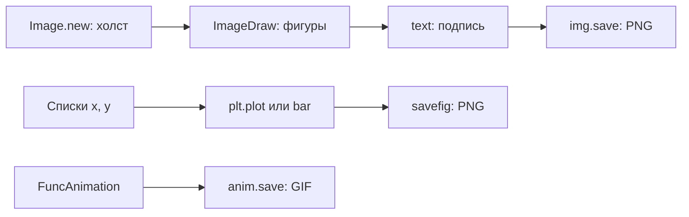

Не только игры рисуют на экране. Программы обрабатывают фотографии, строят графики, генерируют картинки для отчётов и мемов. Сегодня познакомимся с двумя библиотеками: **Pillow** — для работы с растровыми изображениями, и **matplotlib** — для графиков и анимаций. Обе ставятся одной командой:

```bash
pip install Pillow matplotlib
```

## Pillow: создаём изображения

Pillow (модуль `PIL`) умеет открывать, создавать, редактировать и сохранять картинки в десятках форматов. Начнём с чистого холста:

```python
from PIL import Image, ImageDraw

img = Image.new("RGB", (400, 300), "skyblue")
draw = ImageDraw.Draw(img)
```

`Image.new("RGB", (400, 300), "skyblue")` создаёт изображение 400×300 пикселей, залитое голубым. `"RGB"` — цветовая модель. `ImageDraw.Draw(img)` возвращает объект, на котором мы будем рисовать фигуры. Дальше — как в pygame:

```python
draw.rectangle([50, 100, 200, 250], fill="brown")        # дом
draw.ellipse([60, 60, 140, 140], fill="yellow")          # солнце
draw.polygon([(40, 100), (210, 100), (125, 40)], fill="red")  # крыша
img.save("house.png")
```

Координаты Pillow — кортежи или списки из четырёх чисел: `(левый, верхний, правый, нижний)`. `rectangle` рисует прямоугольник, `ellipse` — овал (вписанный в прямоугольник), `polygon` — многоугольник по списку точек. `img.save("house.png")` сохраняет результат в файл — и у тебя готовая картинка.

## Текст и изменение размера

Текст добавляется методом `text`. Шрифт по умолчанию часто мал, поэтому загрузим системный:

```python
from PIL import ImageFont

font = ImageFont.truetype("arial.ttf", 36)
draw.text((20, 20), "Привет!", fill="black", font=font)
```

`ImageFont.truetype("arial.ttf", 36)` грузит шрифт из файла. На разных системах шрифты лежат в разных местах; если `arial.ttf` не найдётся, попробуй `"DejaVuSans.ttf"` (Linux) или путь к шрифту системы. Изменить размер готовой картинки просто:

```python
small = img.resize((200, 150))
small.save("house_small.png")
```

Есть и более умный метод — `thumbnail`, который сохраняет пропорции и не увеличивает изображение.

## matplotlib: графики

matplotlib — стандарт визуализации в Python. Простейший график линии:

```python
import matplotlib.pyplot as plt

x = [0, 1, 2, 3, 4]
y = [0, 1, 4, 9, 16]
plt.plot(x, y, marker="o")
plt.xlabel("x")
plt.ylabel("y")
plt.title("Квадраты чисел")
plt.savefig("squares.png")
plt.close()
```

`plt.plot` строит линию по точкам, `xlabel`/`ylabel` подписывают оси, `title` задаёт заголовок, `savefig` сохраняет рисунок в файл, а `close` освобождает память — без него картинки копятся. Для новых графиков полезно строить точки через списки или `numpy`, но в этом уроке хватит обычных списков.

Гистограммы — тоже частый гость:

```python
plt.bar(["Янв", "Фев", "Мар"], [10, 15, 8])
plt.savefig("bars.png")
```

## Анимации: FuncAnimation

Настоящее волшебство — анимированные графики. `matplotlib.animation.FuncAnimation` вызывает функцию для каждого кадра:

```python
import matplotlib.pyplot as plt
from matplotlib.animation import FuncAnimation

fig, ax = plt.subplots()
x = []
y = []

def animate(frame):
    x.append(frame / 10)
    y.append(int(frame / 10) ** 2)
    ax.clear()
    ax.plot(x, y, color="blue")
    ax.set_title(f"Кадр {frame}")

anim = FuncAnimation(fig, animate, frames=50, interval=50)
anim.save("parabola.gif", writer="pillow")
```

Функция `animate(frame)` получает номер кадра; в каждом кадре мы добавляем точку, очищаем оси (`ax.clear()`) и рисуем заново. `interval=50` — пауза между кадрами в миллисекундах. Сохранить анимацию можно в GIF через `writer="pillow"` — как раз с помощью нашей первой библиотеки.

## Схема: два инструмента — два результата

Pillow и matplotlib решают разные задачи, но работают по одной схеме «создал объект → нарисовал → сохранил файл»:



## Итог урока

Мы научились:

- создавать изображения и рисовать на них фигуры и текст в Pillow;
- менять размер картинок и сохранять их;
- строить графики и гистограммы в matplotlib;
- делать анимации через `FuncAnimation` и сохранять их в GIF.

Эти навыки пригодятся в отчётах, в ботах и в автоматической генерации картинок.

<!--TASK-->
### Задача 1
Создай в Pillow изображение 500×400 с голубым фоном (указывай цвет строкой `"skyblue"`). Нарисуй зелёный прямоугольник — «лужайку» внизу, коричневый прямоугольник-дом, красную треугольную крышу (`polygon`) и жёлтое солнце (`ellipse`) в углу. Сохрани результат в файл `scene.png`.

### Задача 2
Открой созданный ранее файл `scene.png`, уменьши его до ширины 250 пикселей (с сохранением пропорций — посчитай высоту) и нарисуй в левом верхнем углу подпись «Мой пейзаж» шрифтом 24. Сохрани в `scene_small.png`. Проверь, что файл существует и имеет размер 250×200.

### Задача 3
Построй в matplotlib график функции `y = x ** 2 - 2 * x + 1` на отрезке от -3 до 5. Для этого сформируй списки `x` (точки через 0.5) и `y`. Подпиши оси, задай заголовок и сохрани в `parabola.png` через `savefig`.

### Задача 4
Сделай в matplotlib столбчатую диаграмму: по горизонтали — месяцы «Январь», «Февраль», «Март», «Апрель»; по вертикали — значения продаж 120, 150, 90, 170. Добавь подписи осей, заголовок «Продажи по месяцам» и сохрани в `sales.png`. Воспользуйся `plt.bar`.

### Задача 5
Создай анимацию падающего объекта: функция `animate(frame)` должна рисовать круг (`plt.Circle`), координата `y` которого уменьшается с каждым кадром (объект падает). Ось `y` ограничь от 0 до 10 (`set_ylim`). Сохрани анимацию в `falling.gif` с помощью `FuncAnimation` и `writer="pillow"`.

### Задача 6
Открой готовый файл `scene.png` и добавь к нему рамку и подпись. Рамка — четыре тонких прямоугольника (или один `rectangle` с параметром `width=6`) по краю изображения цветом `"black"`. Подпись «Мой пейзаж» нарисуй в правом нижнем углу шрифтом 20, предварительно вычтя ширину и высоту текста из размеров картинки, чтобы он не вылез за край. Сохрани результат в `scene_framed.png`. Ожидаемый вывод: в консоль печатается `Сохранено: (500, 400)`, а открытый файл показывает ту же картинку в чёрной рамке с подписью в углу.

### Задача 7
Построй в matplotlib два графика на одном рисунке: `y = x` и `y = x ** 2` для `x` от 0 до 5 с шагом 0.5. Первую линию сделай синей с маркерами-кружками, вторую — красной с маркерами-квадратами, каждой задай `label` и выведи легенду через `plt.legend()`. Подпиши оси, задай заголовок «Линейная и квадратичная функции», включи сетку и сохрани в `compare.png` через `savefig`, после чего вызови `plt.close()`. Ожидаемый вывод: в консоль печатается `Точек: 11`, а на картинке видны две линии и легенда в углу.
<!--/TASK-->

<!--HINT-->
### Подсказка 1
`img = Image.new("RGB", (500, 400), "skyblue")`, затем `draw = ImageDraw.Draw(img)`. Прямоугольники — `draw.rectangle([x1, y1, x2, y2], fill="...")`, крыша — `draw.polygon([(50, 200), (250, 200), (150, 120)], fill="red")`. Сохранение — `img.save("scene.png")`.

### Подсказка 2
Открой через `Image.open("scene.png")`, вычисли высоту пропорционально: `new_height = int(img.height * 250 / img.width)`, затем `img.resize((250, new_height))`. Текст — `draw.text((10, 10), "Мой пейзаж", fill="black", font=ImageFont.truetype("arial.ttf", 24))`

### Подсказка 3
Сформируй `x = [i / 2 for i in range(-6, 11)]` (это -3.0, -2.5, ..., 5.0) и `y = [v ** 2 - 2 * v + 1 for v in x]`. Затем `plt.plot(x, y)`, `plt.xlabel("x")`, `plt.ylabel("y")`, `plt.title("Парабола")`, `plt.savefig("parabola.png")`.

### Подсказка 4
`plt.bar(["Январь", "Февраль", "Март", "Апрель"], [120, 150, 90, 170])`. Затем подписи: `plt.xlabel("Месяц")`, `plt.ylabel("Продажи")`, `plt.title("Продажи по месяцам")`, `plt.savefig("sales.png")`.

### Подсказка 5
Создай фигуру `fig, ax = plt.subplots()`, задай `ax.set_xlim(0, 10); ax.set_ylim(0, 10)`. В `animate(frame)`: `ax.clear()`, снова `set_xlim/set_ylim`, затем `ax.add_patch(plt.Circle((5, 10 - frame * 0.2), 0.5))`. `FuncAnimation(fig, animate, frames=50, interval=50)` и `anim.save("falling.gif", writer="pillow")`.

### Подсказка 6
Открой картинку `img = Image.open("scene.png")`, создай `draw = ImageDraw.Draw(img)`. Рамка: `draw.rectangle([0, 0, img.width - 1, img.height - 1], outline="black", width=6)`. Для подписи загрузи шрифт через `ImageFont.truetype("arial.ttf", 20)` в `try/except OSError`. Позицию вычисли так: `text_w = draw.textlength("Мой пейзаж", font=font)`, затем `x = img.width - text_w - 20`, `y = img.height - 40`.

### Подсказка 7
Сформируй один список `x = [i / 2 for i in range(11)]` и два производных: `y1 = [v for v in x]`, `y2 = [v ** 2 for v in x]`. Затем два вызова: `plt.plot(x, y1, color="blue", marker="o", label="y = x")` и `plt.plot(x, y2, color="red", marker="s", label="y = x^2")`. Легенда — `plt.legend()`, сетка — `plt.grid(True)`, сохранение — `plt.savefig("compare.png")`.
<!--/HINT-->

<!--SOLUTION-->
### Разбор 1
Решение:

```python
from PIL import Image, ImageDraw

img = Image.new("RGB", (500, 400), "skyblue")
draw = ImageDraw.Draw(img)

# Лужайка
draw.rectangle([0, 300, 500, 400], fill="green")
# Дом
draw.rectangle([150, 180, 350, 320], fill="brown")
# Крыша
draw.polygon([(130, 180), (370, 180), (250, 90)], fill="red")
# Солнце
draw.ellipse([30, 30, 130, 130], fill="yellow")

img.save("scene.png")
```

Что здесь происходит? `Image.new` создаёт холст, `ImageDraw.Draw(img)` — инструмент рисования. Порядок важен: сначала рисуем фон (лужайку), потом объекты поверх. Крыша — треугольник из трёх точек, причём его основание слегка шире дома, чтобы нависать над ним. `ellipse` с равными шириной и высотой — это круг: прямоугольник [30, 30, 130, 130] — квадрат со стороной 100, значит, овал получится круглым. `img.save("scene.png")` записывает картинку на диск.

### Разбор 2
Решение:

```python
from PIL import Image, ImageDraw, ImageFont

img = Image.open("scene.png")
new_height = int(img.height * 250 / img.width)
small = img.resize((250, new_height))

draw = ImageDraw.Draw(small)
try:
    font = ImageFont.truetype("arial.ttf", 24)
except OSError:
    font = ImageFont.load_default()
draw.text((10, 10), "Мой пейзаж", fill="black", font=font)

small.save("scene_small.png")
print(small.size)  # (250, 200)
```

Что здесь происходит? `Image.open` читает файл. Пропорция сохраняется расчётом высоты: исходный размер 500×400, новый — 250×200, потому что `400 * 250 / 500 = 200`. Текст рисуется уже на уменьшенном изображении. `try/except` вокруг загрузки шрифта — защита от отсутствия `arial.ttf` на некоторых системах: если файла нет, используется встроенный шрифт. `print(small.size)` покажет `(250, 200)` — ожидаемый размер.

### Разбор 3
Решение:

```python
import matplotlib.pyplot as plt

x = [i / 2 for i in range(-6, 11)]  # -3.0 ... 5.0
y = [v ** 2 - 2 * v + 1 for v in x]

plt.plot(x, y, color="blue", marker="o")
plt.xlabel("x")
plt.ylabel("y")
plt.title("Парабола y = x^2 - 2x + 1")
plt.grid(True)
plt.savefig("parabola.png")
plt.close()
```

Что здесь происходит? Список `x` строится генератором: `i / 2` для `i` от -6 до 10 даёт шаг 0.5. Второй генератор вычисляет `y` для каждой точки. `plt.plot` соединяет точки линией (и ставит маркеры `o`). `grid(True)` добавляет сетку — так читать график удобнее. `savefig` пишет PNG, `close` закрывает фигуру: если этого не сделать, следующая картинка в той же программе может наложиться на текущую.

### Разбор 4
Решение:

```python
import matplotlib.pyplot as plt

months = ["Январь", "Февраль", "Март", "Апрель"]
sales = [120, 150, 90, 170]

plt.bar(months, sales, color=["red", "blue", "green", "orange"])
plt.xlabel("Месяц")
plt.ylabel("Продажи")
plt.title("Продажи по месяцам")
plt.savefig("sales.png")
plt.close()
```

Что здесь происходит? `plt.bar` принимает два списка одинаковой длины: подписи столбцов и их высоты. Список цветов задаёт цвет каждого столбца — необязательно, но наглядно. Подписи осей и заголовок делают диаграмму самодостаточной: её можно вставить в отчёт без пояснений. `savefig` сохраняет результат. Обрати внимание: сегменты длиннее подписей на краях, поэтому matplotlib сам добавляет отступы — с этим ничего делать не нужно.

### Разбор 5
Решение:

```python
import matplotlib.pyplot as plt
from matplotlib.animation import FuncAnimation

fig, ax = plt.subplots()

def animate(frame):
    ax.clear()
    ax.set_xlim(0, 10)
    ax.set_ylim(0, 10)
    y = 10 - frame * 0.2
    ax.add_patch(plt.Circle((5, y), 0.5, color="red"))
    ax.set_title(f"Высота: {y:.1f}")

anim = FuncAnimation(fig, animate, frames=50, interval=50)
anim.save("falling.gif", writer="pillow")
```

Что здесь происходит? `FuncAnimation` вызывает `animate` 50 раз — по разу на каждый кадр. В каждом кадре мы очищаем оси, заново ставим пределы и добавляем круг с уменьшающейся координатой `y`: объект «падает» с высоты 10 до нуля. `interval=50` — 50 мс между кадрами, то есть примерно 20 кадров в секунду. `anim.save("falling.gif", writer="pillow")` записывает анимацию в GIF, используя Pillow как кодировщик — библиотеки работают в связке. Если кажется, что круг двигается рывками, уменьши `interval` или шаг координаты.

### Разбор 6
Решение:

```python
from PIL import Image, ImageDraw, ImageFont

img = Image.open("scene.png")
draw = ImageDraw.Draw(img)

draw.rectangle([0, 0, img.width - 1, img.height - 1],
               outline="black", width=6)

try:
    font = ImageFont.truetype("arial.ttf", 20)
except OSError:
    font = ImageFont.load_default()

text = "Мой пейзаж"
text_w = draw.textlength(text, font=font)
draw.text((img.width - text_w - 20, img.height - 40), text,
          fill="black", font=font)

img.save("scene_framed.png")
print("Сохранено:", img.size)
```

Что здесь происходит? `Image.open` читает файл, а `ImageDraw.Draw(img)` даёт инструмент для рисования прямо по нему — исходный файл не меняется, пока мы не вызовем `save`. Рамка рисуется одним `rectangle` с `outline` и `width`: координаты `(0, 0, width - 1, height - 1)` покрывают пиксели от первого до последнего, и вычитание единицы здесь обязательно, иначе правый и нижний края выйдут за границы. `draw.textlength` возвращает ширину строки в пикселях для конкретного шрифта — без него подпись уехала бы за край. `try/except OSError` подстраховывает от отсутствия `arial.ttf` на Linux или macOS.

### Разбор 7
Решение:

```python
import matplotlib.pyplot as plt

x = [i / 2 for i in range(11)]     # 0.0 ... 5.0
y1 = [v for v in x]
y2 = [v ** 2 for v in x]

print("Точек:", len(x))

plt.plot(x, y1, color="blue", marker="o", label="y = x")
plt.plot(x, y2, color="red", marker="s", label="y = x^2")
plt.xlabel("x")
plt.ylabel("y")
plt.title("Линейная и квадратичная функции")
plt.grid(True)
plt.legend()
plt.savefig("compare.png")
plt.close()
```

Что здесь происходит? Один и тот же список `x` используется двумя сериями, и matplotlib сам рисует обе линии на одних осях — порядок вызовов `plot` задаёт порядок слоёв. Параметр `label` — это не подпись на рисунке, а имя серии для легенды, которую выводит `legend()`; без `label` легенда осталась бы пустой. Маркеры `o` и `s` (круг и квадрат) помогают различать линии даже в чёрно-белой печати. `range(11)` даёт 11 точек, поэтому в консоли `Точек: 11`. `plt.close()` в конце освобождает фигуру — если строить несколько графиков подряд в одном скрипте, без него картинки наложатся друг на друга.
<!--/SOLUTION-->

<!--QUIZ-->
Какой модуль Pillow используется для рисования фигур?
- PIL.ImageDraw
- PIL.Image
- PIL.Shapes
* Правильный ответ: PIL.ImageDraw
ImageDraw.Draw(img) возвращает объект для рисования прямоугольников, кругов, текста и т. д.

Что создаёт Image.new("RGB", (400, 300), "skyblue")?
- Открывает файл skyblue.png
- Создаёт изображение 400×300, залитое голубым
- Возвращает список пикселей
* Правильный ответ: Создаёт изображение 400×300, залитое голубым
Image.new создаёт пустой холст заданного размера и цвета.

Что делает метод resize((250, 200))?
- Кадрирует изображение
- Изменяет размер изображения до 250×200
- Поворачивает изображение
* Правильный ответ: Изменяет размер изображения до 250×200
resize растягивает или сжимает картинку до нового размера.

Какой метод сохраняет текущий рисунок matplotlib в файл?
- plt.savefig("name.png")
- plt.export("name.png")
- plt.write("name.png")
* Правильный ответ: plt.savefig("name.png")
savefig записывает текущую фигуру в файл указанного формата.

Что делает plt.close() после savefig?
- Закрывает окно программы
- Закрывает текущую фигуру, освобождая память
- Удаляет созданный файл
* Правильный ответ: Закрывает текущую фигуру, освобождая память
close освобождает ресурсы фигуры, чтобы следующие графики не накладывались.

Какой метод рисует столбчатую диаграмму?
- plt.bar(...)
- plt.plot(...)
- plt.pie(...)
* Правильный ответ: plt.bar(...)
bar строит столбцы по подписям и значениям.

Что делает FuncAnimation(fig, animate, frames=50)?
- Строит статичный график
- Вызывает функцию animate 50 раз, создавая кадры анимации
- Сохраняет анимацию в файл
* Правильный ответ: Вызывает функцию animate 50 раз, создавая кадры анимации
FuncAnimation генерирует кадры, вызывая переданную функцию для каждого номера кадра.

В какой формат можно сохранить анимацию с writer="pillow"?
- Только PNG
- GIF
- Только JPG
* Правильный ответ: GIF
writer="pillow" позволяет кодировать анимацию в GIF с помощью библиотеки Pillow.

Что означают числа в draw.rectangle([50, 100, 200, 250], fill="brown")?
- Левый, верхний, правый и нижний края
- Ширину, высоту, отступ и цвет
- Центр, радиус и толщину
* Правильный ответ: Левый, верхний, правый и нижний края
Pillow задаёт прямоугольник двумя углами: (x1, y1, x2, y2).

Что делает Image.open("scene.png")?
- Читает файл с диска в объект изображения
- Создаёт новую пустую картинку
- Удаляет файл
* Правильный ответ: Читает файл с диска в объект изображения
После open картинку можно менять и сохранять под новым именем.

Зачем в plt.plot передают label="y = x"?
- Чтобы эта подпись появилась в легенде
- Чтобы задать заголовок графика
- Чтобы изменить цвет линии
* Правильный ответ: Чтобы эта подпись появилась в легенде
legend() собирает подписи всех серий, у которых задан label.

Что делает plt.close() после savefig?
- Освобождает текущую фигуру, чтобы следующий график начался с чистого листа
- Закрывает окно терминала
- Удаляет сохранённый файл
* Правильный ответ: Освобождает текущую фигуру, чтобы следующий график начался с чистого листа
Без close фигуры копятся в памяти и могут накладываться друг на друга.
<!--/QUIZ-->
