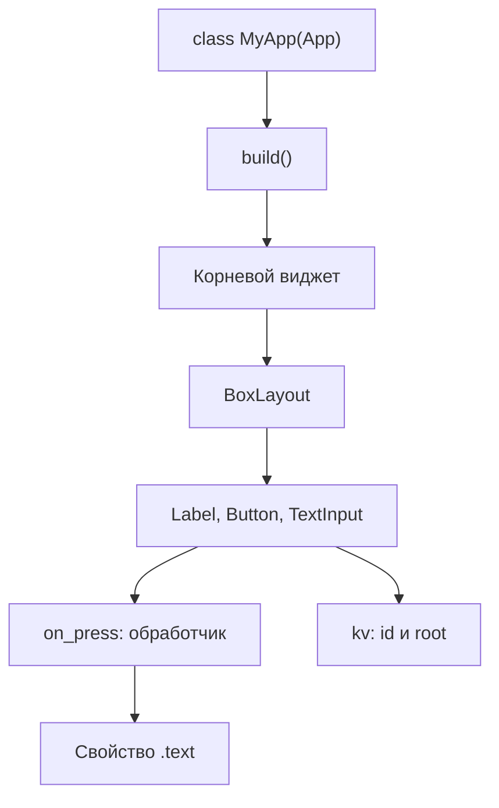

До сих пор наши программы жили на компьютере. Но Python может работать и на телефоне. Есть два главных пути: **Kivy** — библиотека, которая рисует интерфейс сама и может собираться в APK для Android, и **BeeWare** — проект, который транслирует Python-код в нативные приложения через инструмент **Toga**. Оба подхода открывают возможность писать приложения один раз и запускать их на разных платформах.

## Kivy: первые шаги

Установка:

```bash
pip install kivy
```

Минимальное приложение на Kivy:

```python
from kivy.app import App
from kivy.uix.label import Label

class HelloApp(App):
    def build(self):
        return Label(text="Привет, Kivy!")

if __name__ == "__main__":
    HelloApp().run()
```

Структура простая: класс приложения наследует `App`, метод `build` возвращает корневой виджет — всё, что вернётся, покажется на экране. `HelloApp().run()` запускает приложение. Обрати внимание: имя класса обязательно должно заканчиваться на `App` — Kivy использует это соглашение, чтобы находить конфигурацию по имени.

## Виджеты и события

Kivy использует сенсорные события вместо кликов мыши. Кнопка реагирует на `on_press`:

```python
from kivy.uix.button import Button

def on_press(instance):
    print("Нажато!")

btn = Button(text="Нажми", on_press=on_press)
```

`on_press` получает экземпляр кнопки — как и в других фреймворках, функция передаётся без скобок. Основные виджеты: `Label` (текст), `Button`, `TextInput` (поле ввода), `Slider`, `Image`.

## Раскладки: BoxLayout

Элементы раскладываются контейнерами. `BoxLayout` ставит их в ряд или колонку:

```python
from kivy.uix.boxlayout import BoxLayout

layout = BoxLayout(orientation="vertical")
layout.add_widget(Button(text="Первая"))
layout.add_widget(Button(text="Вторая"))
```

`orientation="vertical"` — сверху вниз, `"horizontal"` — слева направо. Вложенные контейнеры позволяют строить сложные интерфейсы: например, вертикальная колонка, внутри которой — горизонтальный ряд кнопок.

## kv-язык: декларативный интерфейс

У Kivy есть собственный **kv-язык** — декларативное описание интерфейса, похожее на CSS. Так код становится чище: Python отвечает за логику, kv — за вид:

```python
from kivy.app import App
from kivy.uix.boxlayout import BoxLayout

class CounterLayout(BoxLayout):
    def increment(self):
        self.ids.label.text = "Увеличено!"

class CounterApp(App):
    def build(self):
        return CounterLayout()
```

А в файле `counter.kv`:

```
<CounterLayout>:
    orientation: "vertical"
    Label:
        id: label
        text: "0"
    Button:
        text: "+1"
        on_press: root.increment()
```

`id` даёт виджету имя, по которому к нему обращаются через `self.ids.label`. Квадратные скобки `<CounterLayout>` связывают правила со классом. Если файл kv лежит рядом с файлом Python и называется как класс приложения (без `App`), Kivy подхватит его автоматически.

## TextInput и работа с полем ввода

Чтение текста из поля ввода выглядит так:

```python
from kivy.uix.textinput import TextInput

text_input = TextInput(hint_text="Введите имя")
name = text_input.text  # текущее содержимое
```

`hint_text` — подсказка, которая исчезает при вводе.

## BeeWare и Toga: нативные приложения

BeeWare — это экосистема, которая «транслирует» Python в нативный код для каждой платформы. Основной инструмент — Toga, библиотека виджетов с единым API:

```python
import toga

def button_handler(widget):
    print("Привет!")

def build(app):
    box = toga.Box()
    button = toga.Button("Нажми", on_press=button_handler)
    box.add(button)
    return box

app = toga.App("Моё приложение", "org.example.myapp", startup=build)
app.main_loop()
```

Toga использует настоящие нативные виджеты: на Android они будут выглядеть как обычные Android-элементы, на Windows — как элементы Windows. Это отличается от Kivy, где интерфейс рисуется самостоятельно (и выглядит одинаково везде). Для сборки Android-приложения BeeWare предоставляет инструмент `briefcase` — но это отдельная большая тема.

## Схема: от класса App до виджета

В Kivy приложение — это класс, а интерфейс — дерево виджетов, которое возвращает `build()`. Схема показывает, куда попадает каждое нажатие:



## Итог урока

Мы узнали, как:

- писать приложения на Kivy через класс `App` и метод `build`;
- обрабатывать сенсорные события через `on_press`;
- раскладывать виджеты через `BoxLayout`;
- описывать интерфейс на kv-языке и обращаться к виджетам по `id`;
- использовать `TextInput` для ввода;
- отличать подход Kivy от нативной разработки через BeeWare/Toga.

Мобильная разработка на Python — реальная область, и теперь у тебя есть фундамент для экспериментов.

<!--TASK-->
### Задача 1
Создай минимальное приложение Kivy: класс `HelloApp(App)` с методом `build`, который возвращает `Label` с текстом «Привет, Kivy!» и размером шрифта 36 (свойство `font_size`). Запусти через `HelloApp().run()` под защитой `if __name__ == "__main__":`.

### Задача 2
Добавь кнопку: по нажатию текст надписи должен меняться на «Ты нажал кнопку!». Используй `Button(text="Нажми", on_press=...)`. Обработчик получает экземпляр кнопки и меняет свойство `text` у надписи. Начальный текст надписи — «Пока ничего не нажато».

### Задача 3
Создай приложение «Приветствие»: `BoxLayout` вертикальной ориентации с `TextInput` (подсказка «Введите имя»), кнопкой «Поздороваться» и надписью результата. По нажатию надпись становится «Привет, <имя>!», а если поле пустое — «Введите имя!».

### Задача 4
Сделай приложение-счётчик на `BoxLayout`: надпись (начальное значение 0), кнопка «+1», кнопка «Сброс». Кнопка «+1» увеличивает число в надписи на 1, «Сброс» возвращает к 0. Число храни в атрибуте класса раскладки (например, `self.count`).

### Задача 5
Перепиши счётчик из задачи 4 с использованием kv-языка: вынеси описание интерфейса в строку `Builder.load_string` (или файл `counter.kv`), используй `id` для надписи и `root.increment()` / `root.reset()` как обработчики. Проверь, что приложение работает так же.

### Задача 6
Сделай «регулятор громкости»: вертикальный `BoxLayout` с ярлыком «Громкость: 50» и виджетом `Slider` в диапазоне от 0 до 100 с шагом 1 и начальным значением 50. Подпишись на изменение значения через `slider.bind(value=...)` и обновляй текст ярлыка на `Громкость: <целое число>`. Значение приходит дробным, поэтому его нужно приводить к `int`. Ожидаемый вывод: при перетаскивании ползунка ярлык мгновенно меняется — `Громкость: 0`, `Громкость: 37`, `Громкость: 100`, — а само приложение не перезапускается.

### Задача 7
Собери секундомер на Kivy: ярлык с показаниями, кнопки «Старт», «Стоп» и «Сброс». Для отсчёта используй `Clock.schedule_interval(self.tick, 0.1)` — функция `tick` получает `dt` (время с прошлого вызова) и добавляет его к `self.seconds`. «Стоп» отменяет событие через `event.cancel()`, «Сброс» останавливает отсчёт и возвращает `0.0`. Показывай время с одним знаком после запятой. Ожидаемый вывод: после трёх секунд работы ярлык показывает примерно `3.0 с`, после «Сброса» — `0.0 с`.
<!--/TASK-->

<!--HINT-->
### Подсказка 1
Класс: `class HelloApp(App):` с `def build(self): return Label(text="Привет, Kivy!", font_size=36)`. Внизу: `if __name__ == "__main__": HelloApp().run()`. Импорты: `from kivy.app import App`, `from kivy.uix.label import Label`.

### Подсказка 2
Создай `label = Label(text="Пока ничего не нажато")`. Обработчик: `def on_press(instance): label.text = "Ты нажал кнопку!"`. Кнопка: `Button(text="Нажми", on_press=on_press)`. В `build` верни вертикальный `BoxLayout` с надписью и кнопкой.

### Подсказка 3
В обработчике читай `text_input.text.strip()`: если пусто — `label.text = "Введите имя!"`, иначе — `label.text = f"Привет, {text}!"`. Собери `BoxLayout(orientation="vertical")` из трёх виджетов и верни его из `build`.

### Подсказка 4
Создай класс `CounterLayout(BoxLayout)` с `__init__`, где `self.count = 0`, и методами `increment` и `reset`. В `increment`: `self.count += 1; self.ids.label.text = str(self.count)`. Создай метки через `id` (или храни ссылку на надпись в `self`).

### Подсказка 5
Используй `from kivy.lang import Builder` и `Builder.load_string("""<CounterLayout>: ...""")` в начале файла. В kv: `Label: id: label; text: "0"`, кнопки `Button: text: "+1"; on_press: root.increment()` и `Button: text: "Сброс"; on_press: root.reset()`.

### Подсказка 6
Импортируй `Slider` из `kivy.uix.slider`. Создай его с параметрами `Slider(min=0, max=100, value=50, step=1)`. Метод-обработчик должен принимать два аргумента: `def on_value(self, instance, value):` — Kivy передаёт и сам виджет, и новое значение. Внутри — `self.label.text = f"Громкость: {int(value)}"`. Подписка: `slider.bind(value=self.on_value)`.

### Подсказка 7
Храни событие в `self.event = None`: это одновременно и «часы», и признак «идёт отсчёт». Старт: `if self.event is None: self.event = Clock.schedule_interval(self.tick, 0.1)`. Стоп: `if self.event is not None: self.event.cancel(); self.event = None`. В `tick(self, dt)` не забудь про `dt` — именно он даёт реальное время, а не номер кадра.
<!--/HINT-->

<!--SOLUTION-->
### Разбор 1
Решение:

```python
from kivy.app import App
from kivy.uix.label import Label

class HelloApp(App):
    def build(self):
        return Label(text="Привет, Kivy!", font_size=36)

if __name__ == "__main__":
    HelloApp().run()
```

Что здесь происходит? `App` — базовый класс любого приложения Kivy. Метод `build` — единственный обязательный: он возвращает корневой виджет, который и станет содержанием экрана. `Label` получает текст и размер шрифта; остальные свойства (цвет, выравнивание) имеют значения по умолчанию. `run()` поднимает окно и запускает цикл событий — как `mainloop` в tkinter. Обёртка `if __name__ == "__main__":` защищает от запуска при импорте модуля. Обрати внимание: без символа «App» в конце имени класса Kivy не найдёт kv-файл — это соглашение по имени.

### Разбор 2
Решение:

```python
from kivy.app import App
from kivy.uix.label import Label
from kivy.uix.button import Button
from kivy.uix.boxlayout import BoxLayout

class ClickApp(App):
    def build(self):
        self.label = Label(text="Пока ничего не нажато")

        def on_press(instance):
            self.label.text = "Ты нажал кнопку!"

        btn = Button(text="Нажми", on_press=on_press)
        layout = BoxLayout(orientation="vertical")
        layout.add_widget(self.label)
        layout.add_widget(btn)
        return layout

if __name__ == "__main__":
    ClickApp().run()
```

Что здесь происходит? Надпись сохраняется в `self.label` — так обработчик может до неё добраться. Кнопка получает обработчик `on_press`: Kivy вызовет его при касании и передаст экземпляр кнопки. Внутри мы меняем текст надписи через `self.label.text = ...`. Контейнер `BoxLayout` с `orientation="vertical"` ставит надпись над кнопкой. Обрати внимание на вложенную функцию — она видит `self` благодаря замыканию, и нам не нужны глобальные переменные.

### Разбор 3
Решение:

```python
from kivy.app import App
from kivy.uix.label import Label
from kivy.uix.button import Button
from kivy.uix.textinput import TextInput
from kivy.uix.boxlayout import BoxLayout

class GreetApp(App):
    def build(self):
        self.label = Label(text="")
        self.text_input = TextInput(hint_text="Введите имя")

        def greet(instance):
            name = self.text_input.text.strip()
            if name == "":
                self.label.text = "Введите имя!"
            else:
                self.label.text = f"Привет, {name}!"

        layout = BoxLayout(orientation="vertical")
        layout.add_widget(self.text_input)
        layout.add_widget(Button(text="Поздороваться", on_press=greet))
        layout.add_widget(self.label)
        return layout

if __name__ == "__main__":
    GreetApp().run()
```

Что здесь происходит? `TextInput` с `hint_text` показывает подсказку до начала ввода. Обработчик `greet` выполняется при нажатии: читает содержимое поля через `.text`, отрезает пробелы `.strip()` и проверяет пустоту. Так мы обрабатываем типичный сценарий ошибки пользователя. Важный нюанс: `hint_text` — это подсказка, а не значение, поэтому пустое поле корректно определяется как `""`. Эта тройка «поле → кнопка → результат» — базовая схема любого приложения с вводом.

### Разбор 4
Решение:

```python
from kivy.app import App
from kivy.uix.label import Label
from kivy.uix.button import Button
from kivy.uix.boxlayout import BoxLayout

class CounterLayout(BoxLayout):
    def __init__(self, **kwargs):
        super().__init__(**kwargs)
        self.count = 0
        self.label = Label(text="0")
        self.add_widget(self.label)
        self.add_widget(Button(text="+1", on_press=self.increment))
        self.add_widget(Button(text="Сброс", on_press=self.reset))

    def increment(self, instance):
        self.count += 1
        self.label.text = str(self.count)

    def reset(self, instance):
        self.count = 0
        self.label.text = "0"

class CounterApp(App):
    def build(self):
        return CounterLayout()

if __name__ == "__main__":
    CounterApp().run()
```

Что здесь происходит? Теперь логика живёт в отдельном классе-раскладке `CounterLayout(BoxLayout)`. В `__init__` мы создаём состояние (`self.count`) и виджеты. Обработчики стали методами: `increment` и `reset` получают экземпляр кнопки и меняют счётчик и надпись. Это уже приближение к архитектуре настоящего приложения: состояние и поведение инкапсулированы в классе, а не болтаются в глобальной области. Кнопки с `+1` и «Сброс» → надпись — вертикальная колонка, потому что раскладка создана с дефолтной ориентацией, которую можно задать явно.

### Разбор 5
Решение:

```python
from kivy.app import App
from kivy.lang import Builder
from kivy.uix.boxlayout import BoxLayout

Builder.load_string("""
<CounterLayout>:
    orientation: "vertical"
    Label:
        id: label
        text: "0"
    Button:
        text: "+1"
        on_press: root.increment()
    Button:
        text: "Сброс"
        on_press: root.reset()
""")

class CounterLayout(BoxLayout):
    def increment(self, instance):
        self.ids.label.text = str(int(self.ids.label.text) + 1)

    def reset(self, instance):
        self.ids.label.text = "0"

class CounterApp(App):
    def build(self):
        return CounterLayout()

if __name__ == "__main__":
    CounterApp().run()
```

Что здесь происходит? Интерфейс описан декларативно на kv-языке. `Builder.load_string` загружает правила прямо из строки (можно вынести в файл `counter.kv` — тогда загрузка не нужна). Правило `<CounterLayout>` связывает описание с классом: `orientation`, виджеты и их обработчики. Через `id: label` мы даём надписи имя, а `self.ids.label` обращается к ней из Python — это главный способ связи kv и кода. Обработчики ссылаются на методы класса через `root.increment()`. Такой код разделяет «вид» и «логику»: менять дизайн можно, не трогая Python.

### Разбор 6
Решение:

```python
from kivy.app import App
from kivy.uix.boxlayout import BoxLayout
from kivy.uix.label import Label
from kivy.uix.slider import Slider

class VolumeApp(App):
    def build(self):
        self.label = Label(text="Громкость: 50")
        slider = Slider(min=0, max=100, value=50, step=1)
        slider.bind(value=self.on_value)

        layout = BoxLayout(orientation="vertical", padding=20, spacing=20)
        layout.add_widget(self.label)
        layout.add_widget(slider)
        return layout

    def on_value(self, instance, value):
        self.label.text = f"Громкость: {int(value)}"

if __name__ == "__main__":
    VolumeApp().run()
```

Что здесь происходит? `Slider` — виджет с числовым значением, и его свойство `value` испускает событие при каждом изменении. `bind(value=self.on_value)` подписывает метод на это событие. Обработчик получает два аргумента: `instance` — сам ползунок, `value` — новое значение; первый почти всегда не нужен, но обязателен по сигнатуре Kivy. Значение приходит типом `float`, поэтому `int(value)` убирает дробную часть в подписи. Ярлык сохранён в `self.label`, иначе обработчик не смог бы к нему обратиться. Обрати внимание на `step=1`: без него ползунок давал бы произвольные дробные значения.

### Разбор 7
Решение:

```python
from kivy.app import App
from kivy.clock import Clock
from kivy.uix.boxlayout import BoxLayout
from kivy.uix.button import Button
from kivy.uix.label import Label

class TimerApp(App):
    def build(self):
        self.seconds = 0.0
        self.event = None

        self.label = Label(text="0.0 с", font_size=40)
        start = Button(text="Старт", on_press=self.start)
        stop = Button(text="Стоп", on_press=self.stop)
        reset = Button(text="Сброс", on_press=self.reset)

        layout = BoxLayout(orientation="vertical", padding=20, spacing=10)
        for widget in (self.label, start, stop, reset):
            layout.add_widget(widget)
        return layout

    def start(self, instance):
        if self.event is None:
            self.event = Clock.schedule_interval(self.tick, 0.1)

    def stop(self, instance):
        if self.event is not None:
            self.event.cancel()
            self.event = None

    def tick(self, dt):
        self.seconds += dt
        self.label.text = f"{self.seconds:.1f} с"

    def reset(self, instance):
        self.stop(instance)
        self.seconds = 0.0
        self.label.text = "0.0 с"

if __name__ == "__main__":
    TimerApp().run()
```

Что здесь происходит? `Clock.schedule_interval` планирует вызов `tick` каждые 0,1 секунды и возвращает объект-событие, который нужно сохранить, чтобы потом отменить. `dt` — реальное время между вызовами (около 0,1), поэтому сумма `dt` даёт честные секунды даже если система подтормаживает; складывать единицу на каждый вызов было бы неправильно. Проверки `if self.event is None` и `if self.event is not None` защищают от двойного запуска и от отмены несуществующего события. `self.stop(instance)` внутри `reset` переиспользует логику остановки. Обрати внимание на формат `{self.seconds:.1f}` — он всегда показывает один знак после запятой.
<!--/SOLUTION-->

<!--QUIZ-->
Какой метод класса App должен вернуть корневой виджет?
- build()
- start()
- create()
* Правильный ответ: build()
Kivy вызывает build() при запуске, и возвращённый виджет становится экраном приложения.

Какое соглашение нужно соблюдать в имени класса приложения Kivy?
- Имя должно оканчиваться на App
- Имя должно быть написано заглавными буквами
- Имя должно начинаться с Kivy
* Правильный ответ: Имя должно оканчиваться на App
Kivy ищет kv-файл по имени класса без суффикса App.

Какой параметр кнопки задаёт обработчик нажатия?
- on_press
- on_click
- command
* Правильный ответ: on_press
on_press принимает функцию и вызывает её при касании кнопки.

Какая раскладка ставит элементы сверху вниз?
- BoxLayout(orientation="vertical")
- BoxLayout(orientation="horizontal")
- GridLayout(rows=2)
* Правильный ответ: BoxLayout(orientation="vertical")
Вертикальная ориентация укладывает виджеты в колонку.

Как обратиться к виджету с id: label из Python-кода?
- self.ids.label
- self.label
- self.id("label")
* Правильный ответ: self.ids.label
self.ids — словарь виджетов по id, поэтому self.ids.label возвращает нужный объект.

Что делает TextInput(hint_text="Введите имя")?
- Ставит текст поля по умолчанию
- Показывает подсказку, пока поле пустое
- Делает поле неактивным
* Правильный ответ: Показывает подсказку, пока поле пустое
hint_text исчезает, как только пользователь начинает печатать; это не значение поля.

Чем BeeWare/Toga отличается от Kivy?
- Toga использует нативные виджеты платформы
- Toga не умеет работать на Android
- Toga — это игровой движок
* Правильный ответ: Toga использует нативные виджеты платформы
Toga собирает интерфейс из настоящих элементов ОС, тогда как Kivy рисует свои.

Для чего нужен класс CounterLayout(BoxLayout) в примере со счётчиком?
- Чтобы сделать кнопки круглыми
- Чтобы хранить состояние и логику вместе с раскладкой
- Чтобы ускорить выполнение
* Правильный ответ: Чтобы хранить состояние и логику вместе с раскладкой
Класс-раскладка инкапсулирует счётчик и обработчики — это шаг к чистой архитектуре.

Какие аргументы получает обработчик, подписанный через slider.bind(value=...)?
- instance и новое значение
- только новое значение
- только сам виджет
* Правильный ответ: instance и новое значение
Kivy передаёт и объект-источник, и изменённое значение.

Что делает Clock.schedule_interval(self.tick, 0.1)?
- Вызывает tick каждые 0,1 секунды и возвращает объект-событие
- Вызывает tick один раз через 0,1 секунды
- Останавливает приложение
* Правильный ответ: Вызывает tick каждые 0,1 секунды и возвращает объект-событие
Возвращённый объект потом отменяют через cancel().

Что приходит в tick вторым аргументом dt?
- Время, прошедшее с предыдущего вызова
- Номер кадра
- Значение виджета
* Правильный ответ: Время, прошедшее с предыдущего вызова
Поэтому сумму dt используют как честное прошедшее время.

Зачем хранить событие в self.event и проверять его на None?
- Чтобы не запускать второй таймер и не отменять несуществующий
- Чтобы ускорить отрисовку
- Чтобы сохранить окно при закрытии
* Правильный ответ: Чтобы не запускать второй таймер и не отменять несуществующий
None означает «отсчёт не идёт» — это одновременно флаг и ссылка на событие.
<!--/QUIZ-->
