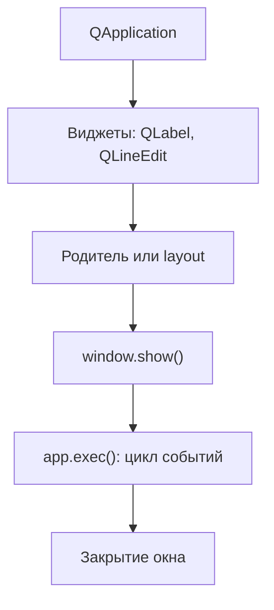

До сих пор твои программы работали в терминале: ввод и вывод — текстом. Но настоящие программы, которыми пользуются люди, почти всегда имеют графический интерфейс — GUI (от англ. *Graphical User Interface*). В этом модуле ты научишься делать окна, кнопки, поля ввода и полноценные приложения на Python. Самый популярный инструмент для этого — библиотека Qt.

## Две библиотеки-близнеца: PyQt6 и PySide6

Qt — это огромный фреймворк на C++ с виджетами, диалогами, сетью, базами данных и графикой. Для Python есть две официальные обвязки:

- **PyQt6** — от компании Riverbank, лицензия GPL (для проприетарных проектов нужна платная лицензия);
- **PySide6** — от Qt Company, лицензия LGPL, то есть свободно используется даже в закрытых коммерческих проектах.

С точки зрения кода они почти неотличимы. Одни и те же классы: `QApplication`, `QWidget`, `QLabel`. Один и тот же синтаксис. Отличия встречаются в мелочах: например, свой сигнал в PyQt6 объявляется через `pyqtSignal`, а в PySide6 — через `Signal`. В этом уроке примеры написаны на PyQt6, но абсолютно всё работает и на PySide6 — разница только в строке импорта.

## Установка

Установи одну из библиотек (или обе — они не конфликтуют):

```bash
pip install PyQt6
# или
pip install PySide6
```

Проверь, что всё встало:

```bash
python -c "from PyQt6.QtWidgets import QApplication; print('OK')"
```

## Анатомия GUI-приложения

Любая программа на Qt строится одинаково:

1. создаётся объект `QApplication` — он управляет всем приложением;
2. создаются виджеты (окна, кнопки, поля);
3. виджеты показываются методом `show()`;
4. вызывается `app.exec()` — запускается **цикл событий**.

Вот минимальная рабочая программа — окно с заголовком:

```python
import sys
from PyQt6.QtWidgets import QApplication, QWidget

app = QApplication(sys.argv)      # 1. приложение

window = QWidget()                # 2. виджет-окно
window.setWindowTitle("Привет, PyQt6!")
window.resize(400, 300)           # размер окна: ширина, высота

window.show()                     # 3. показать окно
sys.exit(app.exec())              # 4. цикл событий
```

Запусти и попробуй закрыть окно — программа завершится, когда ты это сделаешь.

## QApplication и цикл событий

`QApplication` — это сердце приложения. Он держит цикл событий: ждёт действия пользователя (клики, клавиши, движение мыши) и рассылает их виджетам. Пока работает `exec()`, программа «живёт»: реагирует на события. Как только цикл заканчивается, `exec()` возвращает код завершения, и программа выходит.

Почему `QApplication(sys.argv)`? Приложение получает аргументы командной строки — так Qt может разобрать свои собственные аргументы, например `-style`. Передавать `sys.argv` — стандарт, но можно и `QApplication([])`, если аргументы не нужны.

Важно: `QApplication` в программе должен быть один. Создавать его дважды — ошибка.

## QWidget — фундамент всех виджетов

`QWidget` — базовый класс всех виджетов Qt: кнопки, поля, ярлыки — всё это наследники `QWidget`. В одиночку `QWidget` — пустое окно, но у него есть масса полезных методов:

```python
window.setWindowTitle("Заголовок")   # заголовок окна
window.resize(800, 600)              # размер
window.setFixedSize(300, 200)        # запретить изменение размера
window.setMinimumSize(200, 100)      # минимальный размер
window.move(100, 50)                 # позиция на экране
window.setWindowOpacity(0.9)         # полупрозрачность (0–1)
```

## QLabel — текст на экране

`QLabel` показывает текст или изображение. Текст можно менять в любой момент через `setText()`:

```python
label = QLabel("Я — ярлык!")
label.setText("А теперь текст поменялся")
label.setWordWrap(True)          # переносить длинный текст по словам
```

`QLabel` понимает упрощённый HTML-формат — можно делать жирный шрифт прямо в тексте:

```python
label = QLabel("<b>Жирный текст</b> и обычный")
```

## QPushButton — кнопка

Кнопка — самый узнаваемый виджет. Создаётся с текстом, а поведение настраивается методами:

```python
button = QPushButton("Нажми меня")
button.setToolTip("Это всплывающая подсказка")
button.setEnabled(False)   # выключить кнопку (нельзя нажать)
button.setDefault(True)    # кнопка «по умолчанию»: сработает по Enter
button.setText("Новый текст")
```

Заметь: пока что кнопка ничего не делает при нажатии — как заставить её реагировать, ты узнаешь в следующем уроке про сигналы и слоты.

## QLineEdit — поле ввода

`QLineEdit` — однострочное поле для текста:

```python
edit = QLineEdit()
edit.setPlaceholderText("Введи имя…")   # подсказка, пока поле пустое
edit.setText("Предзаполненный текст")
edit.clear()                            # очистить
edit.setEchoMode(QLineEdit.EchoMode.Password)  # пароль: точки вместо букв
edit.setMaxLength(20)                   # максимум 20 символов
text = edit.text()                      # прочитать, что ввёл пользователь
```

`EchoMode.Password` — одна из констант перечисления `EchoMode`: `Normal`, `Password`, `NoEcho`, `PasswordEchoOnEdit`.

## Собираем всё вместе

Пока наши виджеты остаются без «дома», они не будут видны. Простейший способ — сделать их **дочерними** окну, передав окно первым аргументом, и задать координаты:

```python
import sys
from PyQt6.QtWidgets import QApplication, QWidget, QLabel, QPushButton, QLineEdit

app = QApplication(sys.argv)

window = QWidget()
window.setWindowTitle("Моя форма")
window.resize(400, 200)

label = QLabel("Как тебя зовут?", window)
label.move(20, 20)

edit = QLineEdit(window)
edit.setPlaceholderText("Введи имя")
edit.move(20, 50)
edit.resize(300, 30)

button = QPushButton("Приветствовать", window)
button.move(20, 100)

window.show()
sys.exit(app.exec())
```

Виджеты просто «накладываются» на окно по координатам. Это работает, но позиционировать вручную неудобно — в уроке 3 ты узнаешь про layout-ы, которые делают это автоматически.

## Схема: анатомия Qt-приложения

Любая программа на Qt проходит один и тот же путь: приложение → виджеты → показ → цикл событий.



## Итог урока

Теперь ты знаешь:

- чем отличаются PyQt6 и PySide6 и как их установить;
- из чего состоит любое Qt-приложение: `QApplication` → виджеты → `show()` → `exec()`;
- что такое цикл событий и зачем он нужен;
- базовые виджеты: `QWidget`, `QLabel`, `QPushButton`, `QLineEdit`.

Закрепим всё на практике.

<!--TASK-->
### Задача 1
Создай файл `my_window.py` и напиши программу, которая показывает пустое окно размером 400×300 пикселей с заголовком «Мой первый GUI». Окно должно быть *нельзя* изменить размер — используй `setFixedSize`. Запусти программу и убедись, что окно появляется, у него правильный заголовок и его нельзя растянуть.

### Задача 2
Создай окно с ярлыком `QLabel` по центру. Текст ярлыка — две строки: первая строка жирная («Добро пожаловать!»), вторая обычная («Это PyQt6»). Используй HTML-разметку внутри текста и `setWordWrap(True)`. Если текст не виден целиком, увеличь размер окна.

### Задача 3
Создай окно с полем ввода `QLineEdit`: ширина 300 пикселей, подсказка-плейсхолдер «Введи email…», максимальная длина 30 символов. Сразу после создания заполни поле текстом `student@example.com`, затем очисти его и напечатай в консоль, что получилось после очистки (пустую строку). Окно покажи.

### Задача 4
Создай окно с двумя кнопками. Первая: текст «Сохранить», подсказка «Ctrl+S», она должна быть кнопкой по умолчанию (`setDefault`). Вторая: текст «Удалить», подсказка «Необратимо», должна быть выключена (`setEnabled(False)`). Покажи окно и убедись, что вторая кнопка серая и не нажимается.

### Задача 5
Собери «форму обратной связи»: окно с ярлыком «Ваш отзыв», полем ввода и кнопкой «Отправить». Каждому виджету задай уникальное имя через `setObjectName` (`window`, `label`, `edit`, `button`), а затем распечатай в консоль имена всех трёх виджетов и текст кнопки. Покажи окно.

### Задача 6
Собери окно «Карточка товара» 600×400 с заголовком «Витрина». Размести в нём четыре виджета: ярлык с HTML-заголовком `<b>Наушники</b>`, ярлык с ценой «2 990 ₽», поле ввода промокода с плейсхолдером «Промокод» и кнопку «Купить» с подсказкой «Оформить заказ». Каждому виджету задай уникальное имя через `setObjectName`. В консоль выведи ширину и высоту окна через `window.width()` и `window.height()`, а также список имён всех четырёх виджетов. Ожидаемый вывод:

```
Окно: 600x400
Имена: ['title', 'price', 'promo', 'buy']
```

### Задача 7
Собери окно «Анкета» 420×260 с тремя полями `QLineEdit`: имя (максимум 20 символов), email (плейсхолдер `you@example.com`), пароль в режиме `EchoMode.Password`. Программно заполни поля: имя «Аня», email «anya@mail.ru», пароль «secret123». Прочитай все три значения через `text()` и напечатай их в формате `Имя: Аня`, `Email: anya@mail.ru`, `Пароль: secret123`, затем очисти все поля через `clear()` и выведи суммарное количество оставшихся символов. Ожидаемый вывод: три строки со значениями и строка `После очистки: 0`.
<!--/TASK-->

<!--HINT-->
### Подсказка 1
Начни с минимальной программы: `QApplication`, `QWidget`, `setWindowTitle`, `resize`. Чтобы запретить изменение размера, используй `setFixedSize(400, 300)` вместо `resize` — он задаёт и размер, и запрет на его изменение.

### Подсказка 2
Ярлык создаётся как `QLabel("<b>Добро пожаловать!</b>\nЭто PyQt6", window)`. Символ `\n` — перенос строки. Чтобы выровнять текст по центру, не забудь увеличить окно, например `resize(400, 200)`, и включить `setWordWrap(True)`.

### Подсказка 3
Поле создаётся как `QLineEdit(window)`, затем идут `setPlaceholderText`, `setMaxLength(30)`, `resize(300, 30)`. Заполни через `setText("student@example.com")`, очисти через `clear()` и выведи `edit.text()` в `print`. Пустой текст печатается как пустая строка.

### Подсказка 4
Две кнопки — два объекта `QPushButton(window)` с разными текстами, но одинаковым позиционированием по вертикали (`move(20, 20)` и `move(20, 60)`). У первой добавь `setDefault(True)` и `setToolTip("Ctrl+S")`, у второй — `setEnabled(False)` и `setToolTip("Необратимо")`.

### Подсказка 5
Создай три виджета и передай `window` первым аргументом каждому. Перед показом окна каждому задай `setObjectName("...")` и собери их имена в список, например `names = [label.objectName(), edit.objectName(), button.objectName()]`. Распечатай список и текст кнопки через `button.text()`.

### Подсказка 6
Создай виджеты с родителем `window`: `QLabel("<b>Наушники</b>", window)` и так далее, затем расставь их через `move` и `resize`. Имена задаются методом `setObjectName("title")`. Для вывода размера окна используй `window.width()` и `window.height()` — они возвращают числа после `resize`. Список имён собери так: `[title.objectName(), price.objectName(), promo.objectName(), buy.objectName()]`.

### Подсказка 7
Для пароля сохрани объект поля в переменную и вызови `setEchoMode(QLineEdit.EchoMode.Password)`. Заполнение — `setText(...)` для каждого поля. Длины после очистки считай как `len(name_edit.text()) + len(email_edit.text()) + len(password_edit.text())` — после трёх `clear()` получится ноль.
<!--/HINT-->

<!--SOLUTION-->
### Разбор 1
Решение:

```python
import sys
from PyQt6.QtWidgets import QApplication, QWidget

app = QApplication(sys.argv)

window = QWidget()
window.setWindowTitle("Мой первый GUI")
window.setFixedSize(400, 300)

window.show()
sys.exit(app.exec())
```

Запускаем `python my_window.py` и видим окно 400×300 с заголовком, которое невозможно растянуть. Что здесь происходит? `QWidget` — базовый класс окна. `setWindowTitle` задаёт текст в строке заголовка. `setFixedSize(400, 300)` делает две вещи сразу: устанавливает размер и запрещает его изменение — попытки растянуть окно за края просто не дадут результата. `show()` делает окно видимым, а `app.exec()` запускает цикл событий: программа не завершается, пока окно не закроют. Обрати внимание на порядок: сначала настройка, потом `show()` — если показать окно до настройки размеров, пользователь увидит «мигание» с неправильным размером.

### Разбор 2
Решение:

```python
import sys
from PyQt6.QtWidgets import QApplication, QWidget, QLabel

app = QApplication(sys.argv)

window = QWidget()
window.setWindowTitle("Ярлык")
window.resize(400, 200)

label = QLabel(window)
label.setText("<b>Добро пожаловать!</b>\nЭто PyQt6")
label.setWordWrap(True)
label.move(20, 40)
label.resize(360, 100)

window.show()
sys.exit(app.exec())
```

Результат: в окне отображаются две строки, первая — жирная. Что здесь происходит? Текст `QLabel` интерпретируется как упрощённый HTML: тег `<b>...</b>` делает текст жирным, а `\n` переносит строку. `setWordWrap(True)` разрешает переносить длинные слова, если они не помещаются в ширину ярлыка. `resize(360, 100)` задаёт область ярлыка, а `move(20, 40)` — его позицию в окне. Без явных `move`/`resize` ярлык имел бы размер по умолчанию и стоял в углу — поэтому мы задали их вручную.

### Разбор 3
Решение:

```python
import sys
from PyQt6.QtWidgets import QApplication, QWidget, QLineEdit

app = QApplication(sys.argv)

window = QWidget()
window.setWindowTitle("Поле ввода")
window.resize(400, 120)

edit = QLineEdit(window)
edit.setPlaceholderText("Введи email…")
edit.setMaxLength(30)
edit.resize(300, 30)
edit.move(20, 40)

edit.setText("student@example.com")
edit.clear()
print("После очистки:", repr(edit.text()))

window.show()
sys.exit(app.exec())
```

В консоли появится:

```
После очистки: ''
```

Что здесь происходит? `setPlaceholderText` задаёт серую подсказку, которая исчезает, как только пользователь начинает печатать. `setMaxLength(30)` ограничивает длину — 31-й символ просто не введётся. `setText` заполняет поле, `clear()` очищает его. Так как после очистки поле пустое, `edit.text()` возвращает пустую строку `''` — мы печатаем её через `repr()`, чтобы было видно, что это именно пустая строка, а не пробелы.

### Разбор 4
Решение:

```python
import sys
from PyQt6.QtWidgets import QApplication, QWidget, QPushButton

app = QApplication(sys.argv)

window = QWidget()
window.setWindowTitle("Кнопки")
window.resize(300, 120)

save_btn = QPushButton("Сохранить", window)
save_btn.move(20, 20)
save_btn.setToolTip("Ctrl+S")
save_btn.setDefault(True)

delete_btn = QPushButton("Удалить", window)
delete_btn.move(20, 60)
delete_btn.setToolTip("Необратимо")
delete_btn.setEnabled(False)

window.show()
sys.exit(app.exec())
```

Что здесь происходит? `setToolTip` вешает всплывающую подсказку — она появится, если задержать курсор над кнопкой. `setDefault(True)` делает кнопку «по умолчанию»: нажатие Enter в окне сработает именно на ней. `setEnabled(False)` отключает кнопку — она отрисовывается серой и не реагирует на клики, пока её не включат обратно `setEnabled(True)`. Такой приём часто используют, чтобы запретить действие до выполнения условия (например, «Удалить» нельзя нажать, пока ничего не выбрано).

### Разбор 5
Решение:

```python
import sys
from PyQt6.QtWidgets import QApplication, QWidget, QLabel, QLineEdit, QPushButton

app = QApplication(sys.argv)

window = QWidget()
window.setWindowTitle("Форма обратной связи")
window.setObjectName("window")
window.resize(400, 180)

label = QLabel("Ваш отзыв", window)
label.setObjectName("label")
label.move(20, 20)

edit = QLineEdit(window)
edit.setObjectName("edit")
edit.setPlaceholderText("Напишите пару слов…")
edit.resize(360, 30)
edit.move(20, 50)

button = QPushButton("Отправить", window)
button.setObjectName("button")
button.move(20, 100)

print("Имена виджетов:", [label.objectName(), edit.objectName(), button.objectName()])
print("Текст кнопки:", button.text())

window.show()
sys.exit(app.exec())
```

Консоль:

```
Имена виджетов: ['label', 'edit', 'button']
Текст кнопки: Отправить
```

Что здесь происходит? `setObjectName` даёт виджету строковое имя. Оно нужно не для красоты: по имени виджет можно находить (`window.findChild(QLineEdit, "edit")`) и — главное — обращаться к нему в стилях QSS (урок 6), например `#button { background: green; }`. `objectName()` возвращает имя, `text()` — текст кнопки. Имена виджетов одной и той же программы могут повторяться, но по правилам Qt лучше, чтобы они были уникальными.

### Разбор 6
Решение:

```python
import sys
from PyQt6.QtWidgets import (QApplication, QWidget, QLabel,
                             QLineEdit, QPushButton)

app = QApplication(sys.argv)

window = QWidget()
window.setWindowTitle("Витрина")
window.resize(600, 400)

title = QLabel("<b>Наушники</b>", window)
title.setObjectName("title")
title.move(30, 30)
title.resize(400, 40)

price = QLabel("2 990 ₽", window)
price.setObjectName("price")
price.move(30, 90)

promo = QLineEdit(window)
promo.setObjectName("promo")
promo.setPlaceholderText("Промокод")
promo.move(30, 150)
promo.resize(220, 32)

buy = QPushButton("Купить", window)
buy.setObjectName("buy")
buy.setToolTip("Оформить заказ")
buy.move(30, 210)

print(f"Окно: {window.width()}x{window.height()}")
print("Имена:", [title.objectName(), price.objectName(),
                promo.objectName(), buy.objectName()])

window.show()
sys.exit(app.exec())
```

Что здесь происходит? Все четыре виджета созданы с родителем `window`, поэтому они принадлежат окну и рисуются внутри него. `setObjectName` даёт каждому строковый идентификатор — по нему потом находят виджеты и стилизуют их через QSS. `width()` и `height()` возвращают текущие размеры окна — после `resize(600, 400)` это ровно 600 и 400, но подожди с печатью до `show()`: до показа размеры уже заданы, однако окончательная геометрия может подстроиться под экран. Обрати внимание, что HTML-тег `<b>` в `QLabel` включает жирный шрифт без всяких стилей — Qt понимает упрощённую разметку.

### Разбор 7
Решение:

```python
import sys
from PyQt6.QtWidgets import (QApplication, QWidget, QLabel,
                             QLineEdit, QVBoxLayout)

app = QApplication(sys.argv)

window = QWidget()
window.setWindowTitle("Анкета")
window.resize(420, 260)

layout = QVBoxLayout(window)

name_edit = QLineEdit()
name_edit.setMaxLength(20)
name_edit.setPlaceholderText("Имя")

email_edit = QLineEdit()
email_edit.setPlaceholderText("you@example.com")

password_edit = QLineEdit()
password_edit.setEchoMode(QLineEdit.EchoMode.Password)
password_edit.setPlaceholderText("Пароль")

for widget in (QLabel("Имя:"), name_edit, QLabel("Email:"), email_edit,
               QLabel("Пароль:"), password_edit):
    layout.addWidget(widget)

name_edit.setText("Аня")
email_edit.setText("anya@mail.ru")
password_edit.setText("secret123")

print("Имя:", name_edit.text())
print("Email:", email_edit.text())
print("Пароль:", password_edit.text())

name_edit.clear()
email_edit.clear()
password_edit.clear()

total = len(name_edit.text()) + len(email_edit.text()) + len(password_edit.text())
print("После очистки:", total)

window.show()
sys.exit(app.exec())
```

Что здесь происходит? Три поля ввода отличаются только настройками: `setMaxLength(20)` не даст ввести двадцать первый символ, `EchoMode.Password` заменяет буквы точками, но `text()` всё равно возвращает настоящий текст — режим влияет только на отображение. `setText` заполняет поле программно, а `clear` опустошает его. Сумма длин после очистки равна нулю — это проверка, что `clear()` действительно сработал на всех трёх полях. Обрати внимание: `QVBoxLayout(window)` сразу назначает раскладку окну, поэтому `setCentralWidget` здесь не нужен — это разные способы компоновки, и для `QWidget` хватает первого.
<!--/SOLUTION-->

<!--QUIZ-->
Что обязательно нужно создать перед любыми виджетами в PyQt6?
- QApplication
- QWidget
- QLabel
* Правильный ответ: QApplication
QApplication управляет всем приложением и запускает цикл событий; виджеты создаются после него.

Что делает метод app.exec()?
- Показывает окно
- Запускает цикл событий и блокирует выполнение до закрытия приложения
- Завершает программу сразу
* Правильный ответ: Запускает цикл событий и блокирует выполнение до закрытия приложения
exec() начинает обработку событий (клики, клавиши) и возвращает код завершения только после выхода из приложения.

Какой класс является базовым для всех виджетов Qt?
- QObject
- QWidget
- QMainWindow
* Правильный ответ: QWidget
Все виджеты — кнопки, ярлыки, поля ввода — наследники QWidget.

Как установить PyQt6 из терминала?
- pip install PyQt6
- apt install pyqt
- npm install pyqt6
* Правильный ответ: pip install PyQt6
PyQt6 ставится как обычный пакет Python через pip.

Чем PySide6 отличается от PyQt6?
- Это одна и та же библиотека, отличий нет
- PySide6 — от Qt Company под лицензией LGPL, PyQt6 — от Riverbank; API почти совместимы
- PySide6 работает только на Linux
* Правильный ответ: PySide6 — от Qt Company под лицензией LGPL, PyQt6 — от Riverbank; API почти совместимы
Обе библиотеки — обвязки Qt для Python с почти идентичным API, но разными лицензиями и разработчиками.

Какой метод делает окно видимым?
- open()
- show()
- display()
* Правильный ответ: show()
Без show() окно существует в памяти, но не отображается.

Каким методом задаётся заголовок окна?
- setCaption()
- setWindowTitle()
- setText()
* Правильный ответ: setWindowTitle()
setWindowTitle("...") устанавливает текст в строке заголовка окна.

Что произойдёт, если забыть вызвать app.exec()?
- Программа покажет окно и будет работать вечно
- Программа завершится почти сразу, окно может не успеть отрисоваться
- Будет ошибка компиляции
* Правильный ответ: Программа завершится почти сразу, окно может не успеть отрисоваться
Без цикла событий программе нечего делать: после show() код завершается, и окно закрывается.

Что делает setPlaceholderText у QLineEdit?
- Вставляет текст в поле навсегда
- Показывает серую подсказку, пока поле пустое
- Запрещает ввод
* Правильный ответ: Показывает серую подсказку, пока поле пустое
Плейсхолдер исчезает, как только пользователь начинает печатать.

Что делает setEnabled(False) у кнопки?
- Убирает кнопку с экрана
- Отключает кнопку: она серая и не реагирует на клики
- Добавляет кнопке второй текст
* Правильный ответ: Отключает кнопку: она серая и не реагирует на клики
Выключенные виджеты не принимают события мыши и клавиатуры.

Как скрыть вводимый пароль точками в QLineEdit?
- setEchoMode(QLineEdit.EchoMode.Password)
- setPlaceholderText("***")
- setMaxLength(0)
* Правильный ответ: setEchoMode(QLineEdit.EchoMode.Password)
EchoMode.Password заменяет символы на точки, не меняя реальный текст.

Что делает setMaxLength(20)?
- Ограничивает ввод двадцатью символами
- Задаёт ширину поля в 20 пикселей
- Запрещает вставлять текст
* Правильный ответ: Ограничивает ввод двадцатью символами
Двадцать первый символ просто не введётся.

Зачем виджету задают setObjectName?
- Чтобы находить его по имени и стилизовать через QSS
- Чтобы изменить его размер
- Чтобы перевести его на другой язык
* Правильный ответ: Чтобы находить его по имени и стилизовать через QSS
objectName — строковый идентификатор для поиска и стилей.

Что возвращает password_edit.text() при включённом EchoMode.Password?
- Настоящий введённый текст, а не точки
- Строку из звёздочек
- Пустую строку
* Правильный ответ: Настоящий введённый текст, а не точки
Режим влияет только на отображение, данные остаются прежними.
<!--/QUIZ-->
