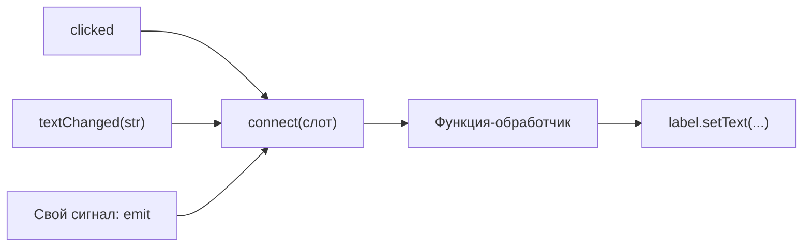

В прошлом уроке кнопка «Нажми меня» ничего не делала. Пришло время её оживить. Механизм, который связывает действия пользователя с кодом, называется **сигналами и слотами** — это, пожалуй, самая важная концепция Qt.

## Что такое сигнал и слот

**Сигнал** — это сообщение «что-то произошло». Например, `QPushButton` испускает сигнал `clicked`, когда по нему кликнули. **Слот** — это функция, которая вызывается в ответ на сигнал.

Связь устанавливается методом `connect`:

```python
button.clicked.connect(handle_click)
```

Читается как «когда кнопка будет нажата, вызови функцию `handle_click`». Имя функции передаётся без скобок — мы передаём сам объект функции, а не результат её вызова.

Вот полноценный пример: считаем нажатия на кнопку.

```python
import sys
from PyQt6.QtWidgets import QApplication, QWidget, QPushButton, QLabel

count = 0

def handle_click():
    global count
    count += 1
    label.setText(f"Нажатий: {count}")

app = QApplication(sys.argv)

window = QWidget()
window.setWindowTitle("Счётчик")
window.resize(300, 150)

label = QLabel("Нажатий: 0", window)
label.move(20, 20)

button = QPushButton("Нажми меня", window)
button.move(20, 60)
button.clicked.connect(handle_click)

window.show()
sys.exit(app.exec())
```

Заметь: функция `handle_click` определена **до** создания виджетов, потому что она использует `label`, который должен существовать к моменту вызова. Когда функция вызывается? Не сразу — а каждый раз, когда кликнут по кнопке.

## Сигналы есть у всех виджетов

У каждого виджета свой набор сигналов. Самые полезные:

```python
edit.textChanged.connect(handler)        # текст изменился (передаёт str)
edit.returnPressed.connect(handler)      # нажат Enter в поле
button.clicked.connect(handler)          # кнопка нажата
button.toggled.connect(handler)          # переключатель изменил состояние
spin.valueChanged.connect(handler)       # значение спиннера изменилось
```

Многие сигналы передают слоту полезные данные. Например, `textChanged` передаёт новый текст, `valueChanged` — новое число. Слот может принять их как аргументы:

```python
def show_text(new_text):
    print("Новый текст:", new_text)

edit.textChanged.connect(show_text)
```

## Лямбда-функции

Когда нужно вызвать функцию с собственными аргументами, удобны лямбды:

```python
button.clicked.connect(lambda: print("Кнопка нажата"))
button.clicked.connect(lambda checked: print("Состояние:", checked))
```

`clicked` передаёт булево значение `checked` (у обычных кнопок — всегда `False`, у переключателей — новое состояние). Лямбда может поймать его, а может его игнорировать, не принимая аргументов.

⚠️ Частая ошибка новичков — передать результат вызова:

```python
button.clicked.connect(print("Нажата"))   # ❌ вызовется сразу!
button.clicked.connect(lambda: print("Нажата"))  # ✅ только по клику
```

## Собственные сигналы

Приложение может объявлять свои сигналы. В PyQt6 это делается через `pyqtSignal`, в PySide6 — через `Signal`. Сигнал объявляется как атрибут класса, наследуемого от `QObject`:

```python
from PyQt6.QtCore import QObject, pyqtSignal

class Counter(QObject):
    reached = pyqtSignal(int)      # сигнал передаёт число

    def tick(self):
        self.reached.emit(10)      # испустить сигнал с числом 10
```

Порядок такой: объявить сигнал как атрибут класса, затем вызвать `emit` для испускания. Любой объект может подключиться к этому сигналу через `connect`.

Частый сценарий — класс-«модель», который живёт отдельно от интерфейса и сообщает о своих изменениях:

```python
import sys
from PyQt6.QtCore import QObject, pyqtSignal
from PyQt6.QtWidgets import QApplication, QWidget, QPushButton, QLabel

class Counter(QObject):
    reached = pyqtSignal(int)

    def __init__(self):
        super().__init__()
        self.value = 0

    def increment(self):
        self.value += 1
        self.reached.emit(self.value)

app = QApplication(sys.argv)

window = QWidget()
window.setWindowTitle("Свой сигнал")
window.resize(300, 150)

label = QLabel("0", window)
label.move(20, 20)

counter = Counter()
counter.reached.connect(label.setText)   # слот = метод label.setText

button = QPushButton("+1", window)
button.move(20, 60)
button.clicked.connect(counter.increment)

window.show()
sys.exit(app.exec())
```

Здесь `counter.reached.connect(label.setText)` — соединение сигнала прямо с методом виджета: это тоже слот, и он принимает число.

## Управление соединениями

```python
button.clicked.connect(handler1)
button.clicked.connect(handler2)   # можно несколько слотов на один сигнал
button.clicked.disconnect(handler1)  # разорвать одно соединение
button.clicked.disconnect()          # разорвать все соединения
```

Если вызвать `disconnect` без аргументов, а соединений несколько — Qt сорвёт все. Если передать конкретную функцию — только её.

## Схема: как сигнал доходит до слота

Все связи в Qt идут через `connect`, а данные передаются аргументами сигнала:



## Итог урока

- Сигнал — событие виджета, слот — функция-обработчик;
- `connect` связывает их; на один сигнал можно повесить несколько слотов;
- сигналы передают данные (текст, числа, булевы значения);
- лямбды позволяют передавать свои аргументы;
- собственный сигнал: `pyqtSignal` (PyQt6) / `Signal` (PySide6) + `emit`.

Теперь практика.

<!--TASK-->
### Задача 1
Допиши программу с кнопкой «Нажми меня» так, чтобы при каждом нажатии в консоль печаталась строка `Кнопка нажата!`. Используй `clicked.connect`. Убедись, что сообщение печатается ровно по одному разу на каждый клик.

### Задача 2
Создай окно с полем ввода и ярлыком. Как только пользователь печатает в поле, ярлык должен мгновенно показывать тот же текст. Подсказка: используй сигнал `textChanged` QLineEdit, который передаёт новый текст.

### Задача 3
Создай окно с кнопкой и ярлыком. Запомни число нажатий и выводи его в ярлык, но не каждое нажатие, а только те, что кратны 5: «Нажато: 5», «Нажато: 10» и так далее. Для остальных нажатий просто увеличивай счётчик молча. Используй `clicked` и проверку `if count % 5 == 0`.

### Задача 4
Создай класс `Greeter` (наследник `QObject`) с собственным сигналом `greeted = pyqtSignal(str)`. Кнопка при нажатии должна вызывать метод класса, который испускает сигнал со строкой `Привет, мир!`. В главном окне подключи этот сигнал к функции, которая печатает принятую строку в консоль.

### Задача 5
Создай окно с кнопкой и двумя функциями-слотами: `one` печатает `1`, `two` печатает `2`. Сначала подключи обе к `clicked` и убедись, что при одном нажатии печатаются обе строки. Затем отключи первую функцию через `disconnect(one)` и проверь, что теперь печатается только `2`.

### Задача 6
Сделай переключатель видимости пароля: поле `QLineEdit` в режиме `EchoMode.Password` и флажок `QCheckBox` с текстом «Показывать пароль». Когда флажок отмечен, поле должно переходить в режим `Normal` и показывать настоящие символы, когда снят — обратно в `Password`. Рядом добавь ярлык, который через сигнал `textChanged` показывает количество введённых символов. Ожидаемый вывод: при вводе `secret` ярлык показывает `Символов: 6`, а при установке флажка текст в поле становится видимым, но ярлык не меняется.

### Задача 7
Создай класс `Validator(QObject)` с собственным сигналом `checked = pyqtSignal(bool, str)` — он несёт два аргумента: успех проверки и сообщение. Метод `check(text)` считает пароль надёжным, если в нём не меньше 8 символов, и испускает сигнал с результатом. В окне размести поле пароля и кнопку «Проверить»; подключи сигнал к слоту, который пишет сообщение в ярлык и красит его в зелёный или красный цвет. Ожидаемый вывод: для `qwerty` ярлык показывает `Слишком короткий пароль` красным, для `qwerty123` — `Пароль надёжный` зелёным.
<!--/TASK-->

<!--HINT-->
### Подсказка 1
Определи функцию `on_click` с `print("Кнопка нажата!")` и после создания кнопки вызови `button.clicked.connect(on_click)`. Не вызывай функцию со скобками внутри `connect` — иначе она выполнится сразу при запуске.

### Подсказка 2
Сигнал `textChanged` передаёт новый текст аргументом. Поэтому слот должен принимать один параметр, например `def update_label(text): label.setText(text)`. Внимание: `label` должна быть доступна внутри функции — определи функцию после создания ярлыка.

### Подсказка 3
Заведи счётчик через `global count` внутри слота. После увеличения проверяй `if count % 5 == 0:` и только тогда вызывай `label.setText(...)`. Для форматирования удобен f-строки: `f"Нажато: {count}"`.

### Подсказка 4
Создай класс `Greeter(QObject)` с `greeted = pyqtSignal(str)` и методом `greet(self)`, который вызывает `self.greeted.emit("Привет, мир!")`. В главной части программы создай объект `greeter` и свяжи `greeter.greeted.connect(print)` — `print` принимает строку и выведет её.

### Подсказка 5
Определи `def one(): print("1")` и `def two(): print("2")`. Подключи обе: `button.clicked.connect(one)` и `button.clicked.connect(two)`. Затем `button.clicked.disconnect(one)` — и нажимай кнопку снова. Проверь, что второй раз печатается только `2`.

### Подсказка 6
В обработчике флажка выбери режим: `mode = QLineEdit.EchoMode.Normal if checked else QLineEdit.EchoMode.Password`, затем `password.setEchoMode(mode)`. Подключи `show_box.toggled.connect(toggle_echo)`. Счётчик символов — отдельный слот с параметром: `def update_len(text): hint.setText(f"Символов: {len(text)}")`, подключённый к `password.textChanged`.

### Подсказка 7
Объяви сигнал атрибутом класса: `checked = pyqtSignal(bool, str)`, а класс унаследуй от `QObject`. В `check` используй `self.checked.emit(True, "...")` и `self.checked.emit(False, "...")` — количество аргументов должно совпадать с объявлением. Слот-получатель принимает два параметра: `def on_result(ok, message):`. Цвет задавай через `label.setStyleSheet("color: green;")`.
<!--/HINT-->

<!--SOLUTION-->
### Разбор 1
Решение:

```python
import sys
from PyQt6.QtWidgets import QApplication, QWidget, QPushButton

def on_click():
    print("Кнопка нажата!")

app = QApplication(sys.argv)

window = QWidget()
window.setWindowTitle("Клик")
window.resize(200, 100)

button = QPushButton("Нажми меня", window)
button.move(20, 20)
button.clicked.connect(on_click)

window.show()
sys.exit(app.exec())
```

Каждое нажатие выводит:

```
Кнопка нажата!
```

Что здесь происходит? `clicked` — сигнал кнопки, который испускается при каждом клике. `connect(on_click)` регистрирует функцию `on_click` как слот. Важно, что в `connect` передаётся имя функции без скобок: скобки означали бы *вызов* — функция выполнилась бы при запуске, а не по клику (а её результат, `None`, Qt попытался бы вызвать как слот, что вызвало бы ошибку). Связь «сигнал → слот» — основа всей интерактивности в Qt.

### Разбор 2
Решение:

```python
import sys
from PyQt6.QtWidgets import QApplication, QWidget, QLineEdit, QLabel

app = QApplication(sys.argv)

window = QWidget()
window.setWindowTitle("Эхо")
window.resize(400, 120)

label = QLabel("", window)
label.move(20, 60)

edit = QLineEdit(window)
edit.move(20, 20)
edit.resize(300, 30)
edit.textChanged.connect(label.setText)

window.show()
sys.exit(app.exec())
```

Ярлык повторяет всё, что ты печатаешь. Что здесь происходит? Сигнал `textChanged` испускается при каждом изменении текста и передаёт слоту новый текст строкой. Слот — метод `label.setText`, который принимает ровно один строковый аргумент. Таким образом, каждый введённый символ тут же отображается в ярлыке. Обрати внимание, что подключить метод видажета можно напрямую — не обязательно писать отдельную функцию-обёртку.

### Разбор 3
Решение:

```python
import sys
from PyQt6.QtWidgets import QApplication, QWidget, QPushButton, QLabel

count = 0

def on_click():
    global count
    count += 1
    if count % 5 == 0:
        label.setText(f"Нажато: {count}")

app = QApplication(sys.argv)

window = QWidget()
window.setWindowTitle("Кратные 5")
window.resize(300, 120)

label = QLabel("Нажато: 0", window)
label.move(20, 20)

button = QPushButton("Нажми", window)
button.move(20, 60)
button.clicked.connect(on_click)

window.show()
sys.exit(app.exec())
```

Через 5 нажатий:

```
Нажато: 5
```

Что здесь происходит? Переменная `count` живёт вне функции, поэтому внутри слота нужен оператор `global count` — иначе Python создаст новую локальную переменную. После увеличения проверяется `count % 5 == 0` — остаток от деления на 5. Если он равен нулю, число кратно пяти, и ярлык обновляется. Такой паттерн (счётчик + условное обновление) постоянно встречается в реальных приложениях — например, для периодического сохранения прогресса.

### Разбор 4
Решение:

```python
import sys
from PyQt6.QtCore import QObject, pyqtSignal
from PyQt6.QtWidgets import QApplication, QWidget, QPushButton

class Greeter(QObject):
    greeted = pyqtSignal(str)

    def greet(self):
        self.greeted.emit("Привет, мир!")

app = QApplication(sys.argv)

greeter = Greeter()
greeter.greeted.connect(print)

window = QWidget()
window.setWindowTitle("Свой сигнал")
window.resize(200, 100)

button = QPushButton("Поздороваться", window)
button.move(20, 20)
button.clicked.connect(greeter.greet)

window.show()
sys.exit(app.exec())
```

При нажатии в консоли:

```
Привет, мир!
```

Что здесь происходит? Класс `Greeter` наследуется от `QObject` — это обязательное условие для объявления сигналов. `greeted = pyqtSignal(str)` описывает сигнал, который передаёт строку. Метод `greet()` испускает его через `emit`. Кнопка вызывает `greeter.greet` (без скобок!), а сигнал, в свою очередь, будит `print`. Такая схема разделяет логику и интерфейс: `Greeter` ничего не знает об окне, а окно не знает, как устроен `Greeter`.

### Разбор 5
Решение:

```python
import sys
from PyQt6.QtWidgets import QApplication, QWidget, QPushButton

def one():
    print("1")

def two():
    print("2")

app = QApplication(sys.argv)

window = QWidget()
window.setWindowTitle("Два слота")
window.resize(200, 100)

button = QPushButton("Нажми", window)
button.move(20, 20)
button.clicked.connect(one)
button.clicked.connect(two)

window.show()
sys.exit(app.exec())
```

Первое нажатие выдаёт:

```
1
2
```

Теперь добавь перед `window.show()` строку `button.clicked.disconnect(one)`. После этого нажатия печатают только `2`. Что здесь происходит? Qt позволяет вешать несколько слотов на один сигнал: они вызываются в порядке подключения. `disconnect(one)` разрывает только соединение с функцией `one`, не трогая `two`. Попробуй также `button.clicked.disconnect()` без аргументов — он сорвёт все соединения, и кнопка перестанет что-либо печатать.

### Разбор 6
Решение:

```python
import sys
from PyQt6.QtWidgets import (QApplication, QWidget, QLineEdit, QCheckBox,
                             QLabel, QVBoxLayout)

app = QApplication(sys.argv)
window = QWidget()
window.setWindowTitle("Показать пароль")
window.resize(320, 170)

layout = QVBoxLayout(window)
password = QLineEdit()
password.setEchoMode(QLineEdit.EchoMode.Password)
password.setPlaceholderText("Пароль")
show_box = QCheckBox("Показывать пароль")
hint = QLabel("Символов: 0")

def toggle_echo(checked):
    mode = QLineEdit.EchoMode.Normal if checked else QLineEdit.EchoMode.Password
    password.setEchoMode(mode)

def update_len(text):
    hint.setText(f"Символов: {len(text)}")

show_box.toggled.connect(toggle_echo)
password.textChanged.connect(update_len)

for widget in (password, show_box, hint):
    layout.addWidget(widget)

window.show()
sys.exit(app.exec())
```

Что здесь происходит? Сигнал `toggled` передаёт булево состояние флажка, поэтому слот `toggle_echo` принимает один параметр `checked`. Внутри выбирается нужный режим `EchoMode`, и поле мгновенно перерисовывается. Второй сигнал — `textChanged` — передаёт новый текст строкой, и `update_len` считает его длину. Обрати внимание: смена режима не испускает `textChanged`, поэтому счётчик символов не дёргается при переключении видимости — это ровно то поведение, которое требуется. Тернарное выражение в `mode = ...` — компактная альтернатива `if/else` с присваиванием.

### Разбор 7
Решение:

```python
import sys
from PyQt6.QtCore import QObject, pyqtSignal
from PyQt6.QtWidgets import (QApplication, QWidget, QLineEdit, QPushButton,
                             QLabel, QVBoxLayout)

class Validator(QObject):
    checked = pyqtSignal(bool, str)

    def check(self, text):
        if len(text) < 8:
            self.checked.emit(False, "Слишком короткий пароль")
        else:
            self.checked.emit(True, "Пароль надёжный")

app = QApplication(sys.argv)
window = QWidget()
window.setWindowTitle("Проверка пароля")
window.resize(320, 170)

layout = QVBoxLayout(window)
password = QLineEdit()
password.setEchoMode(QLineEdit.EchoMode.Password)
password.setPlaceholderText("Пароль")
button = QPushButton("Проверить")
result = QLabel("Введите пароль")

validator = Validator()

def on_result(ok, message):
    result.setText(message)
    result.setStyleSheet("color: green;" if ok else "color: red;")

def on_click():
    validator.check(password.text())

validator.checked.connect(on_result)
button.clicked.connect(on_click)

for widget in (password, button, result):
    layout.addWidget(widget)

window.show()
sys.exit(app.exec())
```

Что здесь происходит? `Validator` наследуется от `QObject` — без этого сигнал объявить нельзя. `pyqtSignal(bool, str)` описывает сигнал с двумя аргументами, и `emit` обязан передать ровно два значения, иначе Qt выбросит ошибку. Кнопка вызывает `on_click`, тот передаёт текст в `check`, а `check` решает, какой результат испустить. Слот `on_result` принимает `ok` и `message` и одновременно меняет текст и цвет ярлыка — один сигнал управляет двумя свойствами. Такая схема отделяет правило проверки от интерфейса: `Validator` можно переиспользовать в любом окне.
<!--/SOLUTION-->

<!--QUIZ-->
Что делает метод connect у сигнала?
- Вызывает сигнал
- Связывает сигнал с функцией-слоtom
- Создаёт новый сигнал
* Правильный ответ: Связывает сигнал с функцией-слоtom
connect(обработчик) регистрирует функцию, которая будет вызываться при испускании сигнала.

Как правильно подключить функцию handle_click к кнопке?
- button.clicked.connect(handle_click())
- button.clicked.connect(handle_click)
- button.clicked = handle_click
* Правильный ответ: button.clicked.connect(handle_click)
В connect передаётся функция без скобок — иначе она выполнится сразу.

Какой сигнал QLineEdit сообщает об изменении текста?
- clicked
- textChanged
- valueChanged
* Правильный ответ: textChanged
textChanged испускается при каждом изменении текста и передаёт новый текст.

Что передаёт сигнал clicked обычной кнопки?
- Ничего
- Булево значение (часто False)
- Текст кнопки
* Правильный ответ: Булево значение (часто False)
У обычной кнопки clicked передаёт False, у переключателей — состояние.

Как объявить собственный сигнал в PyQt6?
- signal = Signal(str)
- greeted = pyqtSignal(str)
- self.signal = str()
* Правильный ответ: greeted = pyqtSignal(str)
В PyQt6 сигналы объявляются атрибутом класса через pyqtSignal; в PySide6 — через Signal.

От какого класса должен наследоваться класс с собственным сигналом?
- QWidget
- QObject
- QApplication
* Правильный ответ: QObject
Сигналы доступны только классам на базе QObject.

Как испустить сигнал greeted со значением "привет"?
- greeted("привет")
- greeted.emit("привет")
- emit(greeted, "привет")
* Правильный ответ: greeted.emit("привет")
Испускание сигнала — вызов метода emit с аргументами.

Сколько слотов можно подключить к одному сигналу?
- Только один
- Несколько
- Ни одного
* Правильный ответ: Несколько
Qt позволяет вешать любое число слотов; они вызываются по порядку.

Что делает disconnect(one) без дополнительных аргументов (кроме функции)?
- Разрывает соединение с функцией one
- Разрывает все соединения сигнала
- Убирает функцию из кода
* Правильный ответ: Разрывает соединение с функцией one
Если передать функцию, отключается только она; без аргументов отключаются все слоты.

Почему нельзя писать button.clicked.connect(print("Нажата"))?
- print не является функцией
- Вызов print("Нажата") выполнится сразу при подключении, а не по клику
- Такой синтаксис вообще не скомпилируется
* Правильный ответ: Вызов print("Нажата") выполнится сразу при подключении, а не по клику
Скобки означают вызов. Нужен lambda: print("Нажата") или имя функции.

Что делает вызов signal.emit(True, "Готово")?
- Испускает сигнал с двумя аргументами
- Подключает новый слот
- Создаёт второй сигнал
* Правильный ответ: Испускает сигнал с двумя аргументами
Аргументы emit должны совпадать с объявлением pyqtSignal(bool, str).

Сколько аргументов может нести собственный сигнал?
- Столько, сколько указано при объявлении через pyqtSignal
- Ровно один
- Не больше двух
* Правильный ответ: Столько, сколько указано при объявлении через pyqtSignal
Типы и количество задаются в объявлении, emit должен им соответствовать.

Почему слот, подключённый к textChanged, должен принимать параметр?
- Сигнал передаёт новый текст аргументом
- Иначе Qt выдаст ошибку синтаксиса
- Чтобы вернуть текст обратно в поле
* Правильный ответ: Сигнал передаёт новый текст аргументом
Слот без параметров не примет строку, которую несёт textChanged.

Что произойдёт при переключении QCheckBox в режим «показать пароль»?
- Изменится только режим отображения, значение text() останется прежним
- Поле очистится
- Пароль будет удалён из памяти
* Правильный ответ: Изменится только режим отображения, значение text() останется прежним
EchoMode влияет на отрисовку, а не на данные.
<!--/QUIZ-->
