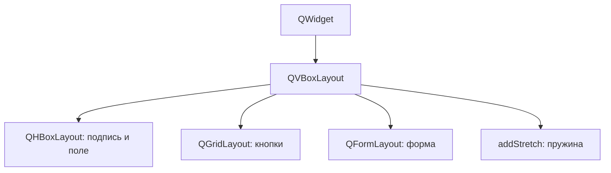

В уроке 1 мы расставляли виджеты вручную через `move` и `resize`. Это работает, но при изменении размера окна всё «разъезжается», а при добавлении нового виджета приходится пересчитывать координаты. Решение — **layout-ы** (раскладки): менеджеры, которые автоматически расставляют дочерние виджеты.

## QVBoxLayout и QHBoxLayout

`QVBoxLayout` ставит виджеты друг под другом по вертикали, `QHBoxLayout` — в ряд по горизонтали:

```python
import sys
from PyQt6.QtWidgets import (QApplication, QWidget, QPushButton,
                             QVBoxLayout, QHBoxLayout)

app = QApplication(sys.argv)

window = QWidget()
window.setWindowTitle("Layout-ы")

# вертикальная раскладка внутри окна
vbox = QVBoxLayout(window)
vbox.addWidget(QPushButton("Кнопка 1"))
vbox.addWidget(QPushButton("Кнопка 2"))
vbox.addWidget(QPushButton("Кнопка 3"))

# горизонтальная — отдельное «окно» с раскладкой
h_window = QWidget()
h_window.setWindowTitle("Горизонтальный")
hbox = QHBoxLayout(h_window)
hbox.addWidget(QPushButton("Кнопка 1"))
hbox.addWidget(QPushButton("Кнопка 2"))
hbox.addWidget(QPushButton("Кнопка 3"))

window.show()
h_window.show()
sys.exit(app.exec())
```

Раскладка «забирает» себе виджеты: их больше не нужно позиционировать вручную, а при растягивании окна они равномерно перераспределяются.

## Вложенные layout-ы

Layout-ы можно вкладывать друг в друга через `addLayout`. Это главный приём построения сложных интерфейсов:

```python
main_layout = QVBoxLayout(window)

header = QHBoxLayout()
header.addWidget(QLabel("Имя:"))
header.addWidget(QLineEdit())
main_layout.addLayout(header)
main_layout.addWidget(QPushButton("OK"))
```

Здесь горизонтальный ряд (подпись + поле) вложен в вертикальную раскладку окна.

## QGridLayout — сетка

`QGridLayout` расставляет виджеты по строкам и столбцам. Это идеальный инструмент для клавиатур и форм:

```python
grid = QGridLayout(window)
grid.addWidget(QPushButton("7"), 0, 0)   # строка 0, столбец 0
grid.addWidget(QPushButton("8"), 0, 1)
grid.addWidget(QPushButton("9"), 0, 2)
grid.addWidget(QPushButton("4"), 1, 0)
grid.addWidget(QPushButton("5"), 1, 1)
grid.addWidget(QPushButton("6"), 1, 2)
grid.addWidget(QPushButton("1"), 2, 0)
grid.addWidget(QPushButton("2"), 2, 1)
grid.addWidget(QPushButton("3"), 2, 2)
```

Позиция задаётся парой (строка, столбец). Можно растягивать виджет на несколько ячеек: `addWidget(widget, row, col, rowSpan, colSpan)`.

## QFormLayout — форма

`QFormLayout` создан для форм «подпись → поле»: он сам выравнивает подписи и поля:

```python
from PyQt6.QtWidgets import QFormLayout, QLineEdit, QSpinBox

form = QFormLayout(window)
form.addRow("Имя:", QLineEdit())
form.addRow("Возраст:", QSpinBox())
form.addRow("Email:", QLineEdit())
```

## Отступы и растяжение

Настройки раскладок:

```python
vbox.setSpacing(10)          # расстояние между виджетами
vbox.setContentsMargins(20, 20, 20, 20)   # отступы от краёв windowна
vbox.addStretch(1)           # «пружина»: толкает виджеты вверх
```

`addStretch` добавляет пустое пространство, которое растёт при увеличении окна. С его помощью можно прижать кнопку к низу: сначала виджеты, потом `addStretch()`.

## QListWidget — список

`QListWidget` — готовый список строк:

```python
from PyQt6.QtWidgets import QListWidget

list_widget = QListWidget(window)
list_widget.addItem("Python")
list_widget.addItem("PyQt6")
list_widget.addItems(["Java", "C++", "Go"])
```

Управление выделением:

```python
list_widget.currentItemChanged.connect(on_item_changed)  # сигнал
item = list_widget.currentItem()   # текущий выбранный элемент
if item:
    print(item.text())              # его текст
list_widget.clear()                 # очистить список
```

## QTableWidget — таблица

`QTableWidget` показывает данные в виде таблицы:

```python
from PyQt6.QtWidgets import QTableWidget, QTableWidgetItem

table = QTableWidget(3, 2, window)   # 3 строки, 2 столбца
table.setHorizontalHeaderLabels(["Имя", "Оценка"])
table.setItem(0, 0, QTableWidgetItem("Аня"))
table.setItem(0, 1, QTableWidgetItem("5"))
table.setItem(1, 0, QTableWidgetItem("Петя"))
table.setItem(1, 1, QTableWidgetItem("4"))
```

Размеры и поведение:

```python
table.resizeColumnsToContents()   # подогнать ширину столбцов
table.setRowCount(5)              # изменить число строк
table.setEditTriggers(QAbstractItemView.EditTrigger.DoubleClicked)
table.currentCellChanged.connect(on_cell_changed)  # сигнал смены ячейки
```

## QComboBox — выпадающий список

`QComboBox` экономит место: показывает один элемент, остальные открываются списком:

```python
from PyQt6.QtWidgets import QComboBox

combo = QComboBox(window)
combo.addItems(["Python", "PyQt6", "Java", "C++"])
current = combo.currentText()      # текущий текст
combo.currentTextChanged.connect(on_changed)   # сигнал смены выбора
```

## QSpinBox — числовое поле

`QSpinBox` — поле для целых чисел со стрелочками:

```python
from PyQt6.QtWidgets import QSpinBox

spin = QSpinBox(window)
spin.setRange(0, 100)        # допустимый диапазон
spin.setValue(50)            # текущее значение
spin.setSingleStep(5)        # шаг стрелочек
value = spin.value()         # прочитать значение
spin.valueChanged.connect(on_value_changed)   # сигнал
```

## Схема: иерархия раскладок

Сложный интерфейс — это дерево: окно, в нём основная раскладка, внутри неё — вложенные раскладки и виджеты.



## Итог урока

- Layout-ы автоматически расставляют виджеты и не дают им «разъезжаться»;
- `QVBoxLayout`/`QHBoxLayout` — вертикаль/горизонталь, вкладываются друг в друга;
- `QGridLayout` — табличная сетка, `QFormLayout` — формы «подпись → поле»;
- `QListWidget`, `QTableWidget`, `QComboBox`, `QSpinBox` — готовые виджеты для данных;
- у всех есть сигналы для отслеживания изменений.

Теперь задачи.

<!--TASK-->
### Задача 1
Создай окно с вертикальной раскладкой: ярлык «Добро пожаловать!», поле ввода и кнопка «Войти». Кнопка должна растягиваться на всю ширину окна, а между виджетами должен быть отступ 10 пикселей. Проверь, что при растягивании окна виджеты перераспределяются автоматически.

### Задача 2
Собери цифровой «калькулятор»-раскладку из 12 кнопок с цифрами 0–9, точкой и знаком «=». Используй `QGridLayout` (4 строки по 3 столбца). Верхняя строка — 7 8 9, затем 4 5 6, 1 2 3, внизу 0 . =. Убедись, что при растягивании окна кнопки растут равномерно.

### Задача 3
Создай форму входа через `QFormLayout`: поле «Логин», поле «Пароль» (с `EchoMode.Password`) и кнопку «Войти». Кнопку помести в отдельную строку формы (`addRow` с пустой подписью) или добавь в вертикальную раскладку под формой. Размер окна — 300×150.

### Задача 4
Создай окно с `QListWidget` и ярлыком под ним. Заполни список пятью городами (Москва, Санкт-Петербург, Казань, Новосибирск, Сочи). При смене выделения ярлык должен показывать `Выбрано: <город>`. Если выделение снято — ярлык показывает «Ничего не выбрано».

### Задача 5
Создай окно с `QTableWidget` 4×3. Заполни первые два столбца данными: имя и город (любые 4 строки). Третий столбец заполни числами 1–4 в виде строк. Задай заголовки столбцов: Имя, Город, Баллы. Подгони ширину столбцов под содержимое и сделай так, чтобы редактирование включалось только двойным кликом.

### Задача 6
Собери «заказ пиццы» на `QFormLayout`: выпадающий список `QComboBox` с размерами «Маленькая», «Средняя», «Большая» и числовое поле `QSpinBox` для количества от 1 до 10 с начальным значением 1. Ниже — ярлык с итоговой суммой. Цены задай словарём: 400, 550 и 700 рублей. Пересчитывай итог при любом изменении выбора или количества, подписавшись на `currentTextChanged` и `valueChanged`, и выводи его в формате `Итого: 1100 ₽`. Ожидаемый вывод: при размере «Средняя» и количестве 2 ярлык показывает `Итого: 1100 ₽`, а при смене на «Большая» — `Итого: 1400 ₽` без нажатия кнопок.

### Задача 7
Сделай таблицу оценок на `QTableWidget` с тремя столбцами «Имя», «Город», «Баллы». Над таблицей размести три поля `QLineEdit` и кнопку «Добавить строку», которая вставляет новую запись через `insertRow(rowCount())` и заполняет ячейки `QTableWidgetItem`. Кнопка «Удалить выбранное» убирает строку с `currentRow()`, а ярлык под таблицей показывает сумму баллов по всем строкам. Ожидаемый вывод: после двух строк с баллами 40 и 60 ярлык показывает `Сумма баллов: 100`, после удаления одной — `Сумма баллов: 40`.
<!--/TASK-->

<!--HINT-->
### Подсказка 1
Создай `QVBoxLayout(window)`, затем `addWidget` для каждого виджета по порядку. Отступ между элементами — `setSpacing(10)`. Виджеты в вертикальной раскладке по умолчанию занимают всю ширину — ничего дополнительно делать не нужно.

### Подсказка 2
Создай `QGridLayout(window)` и добавь кнопки через `grid.addWidget(QPushButton("7"), 0, 0)` и так далее. Строки: 0, 1, 2, 3; столбцы: 0, 1, 2. Для «=» можно занять последнюю ячейку (3, 2).

### Подсказка 3
Создай `QFormLayout(window)`, затем `form.addRow("Логин:", QLineEdit())` и `form.addRow("Пароль:", QLineEdit())`. Для пароля сохрани объект поля в переменную и вызови у него `setEchoMode(QLineEdit.EchoMode.Password)`. Кнопку добавь через `form.addRow(QPushButton("Войти"))` — она займёт новую строку.

### Подсказка 4
Создай `QListWidget` и добавь города через `addItems([...])`. Ярлык — обычный `QLabel`. Подключи `list_widget.currentItemChanged.connect(...)`; слот принимает текущий элемент (или `None`, если выделения нет). Внутри слота проверяй `if item:` и читай `item.text()`.

### Подсказка 5
Создай `QTableWidget(4, 3, window)`. Заполняй `setItem(row, col, QTableWidgetItem(str(value)))`. Заголовки — `setHorizontalHeaderLabels(["Имя", "Город", "Баллы"])`. Ширина — `resizeColumnsToContents()`. Редактирование: подключи константу `QAbstractItemView.EditTrigger.DoubleClicked` через `table.setEditTriggers(...)`.

### Подсказка 6
`QComboBox.currentTextChanged` передаёт строку, а `QSpinBox.valueChanged` — число, но слот можно сделать универсальным: `def recalc(*args):`. Цену бери из словаря по ключу `size_combo.currentText()`, количество — через `qty_spin.value()`. Чтобы итог был верным сразу при запуске, вызови `recalc()` один раз после создания виджетов.

### Подсказка 7
Для добавления: `row = table.rowCount()`, затем `table.insertRow(row)` и три `setItem(row, col, QTableWidgetItem(text))`. Не забудь, что `setItem` принимает строку, а не число. Для суммы пройди по строкам и сложи `int(table.item(r, 2).text())`, пропуская пустые ячейки. После каждого изменения вызывай одну функцию `update_sum()`, чтобы ярлык не расходился с таблицей.
<!--/HINT-->

<!--SOLUTION-->
### Разбор 1
Решение:

```python
import sys
from PyQt6.QtWidgets import (QApplication, QWidget, QLabel, QLineEdit,
                             QPushButton, QVBoxLayout)

app = QApplication(sys.argv)

window = QWidget()
window.setWindowTitle("Вход")
window.resize(400, 200)

layout = QVBoxLayout(window)
layout.setSpacing(10)

layout.addWidget(QLabel("Добро пожаловать!"))
layout.addWidget(QLineEdit())
layout.addWidget(QPushButton("Войти"))

window.show()
sys.exit(app.exec())
```

Что здесь происходит? `QVBoxLayout(window)` привязывает раскладку к окну. Каждый `addWidget` добавляет виджет в конец списка — сверху вниз. `setSpacing(10)` задаёт промежуток в 10 пикселей между соседними виджетами. Кнопка растягивается на всю ширину, потому что в вертикальной раскладке виджеты заполняют доступную ширину. При изменении размера окна раскладка пересчитывает позиции автоматически — никакого `move` вручную.

### Разбор 2
Решение:

```python
import sys
from PyQt6.QtWidgets import QApplication, QWidget, QPushButton, QGridLayout

app = QApplication(sys.argv)

window = QWidget()
window.setWindowTitle("Цифровая панель")
window.resize(300, 300)

grid = QGridLayout(window)

digits = ["7", "8", "9", "4", "5", "6", "1", "2", "3", "0", ".", "="]
for i, text in enumerate(digits):
    row, col = i // 3, i % 3
    grid.addWidget(QPushButton(text), row, col)

window.show()
sys.exit(app.exec())
```

Что здесь происходит? Список `digits` из 12 элементов проходит `enumerate`, который даёт индекс `i`. Строка — `i // 3` (целочисленное деление), столбец — `i % 3` (остаток): элементы 0–2 попадают в строку 0, 3–5 — в строку 1 и так далее. Получается сетка 4×3. `QGridLayout` распределяет доступное пространство поровну между ячейками, поэтому при растягивании окна кнопки растут равномерно.

### Разбор 3
Решение:

```python
import sys
from PyQt6.QtWidgets import (QApplication, QWidget, QLineEdit,
                             QPushButton, QFormLayout)

app = QApplication(sys.argv)

window = QWidget()
window.setWindowTitle("Вход")
window.resize(300, 150)

form = QFormLayout(window)

login = QLineEdit()
password = QLineEdit()
password.setEchoMode(QLineEdit.EchoMode.Password)

form.addRow("Логин:", login)
form.addRow("Пароль:", password)
form.addRow(QPushButton("Войти"))

window.show()
sys.exit(app.exec())
```

Что здесь происходит? `QFormLayout` выравнивает подписи по правому краю, а поля — по левому, создавая аккуратную форму из двух колонок. `addRow("Логин:", login)` добавляет строку из подписи и поля. `addRow(QPushButton("Войти"))` — без подписи, поэтому кнопка занимает всю вторую колонку. `setEchoMode(QLineEdit.EchoMode.Password)` скрывает вводимые символы точками. Формы — самый частый сценарий использования `QFormLayout`.

### Разбор 4
Решение:

```python
import sys
from PyQt6.QtWidgets import (QApplication, QWidget, QListWidget,
                             QLabel, QVBoxLayout)

app = QApplication(sys.argv)

window = QWidget()
window.setWindowTitle("Города")
window.resize(300, 250)

layout = QVBoxLayout(window)

list_widget = QListWidget()
list_widget.addItems(["Москва", "Санкт-Петербург", "Казань",
                      "Новосибирск", "Сочи"])
layout.addWidget(list_widget)

label = QLabel("Ничего не выбрано")
layout.addWidget(label)

def on_item_changed(item):
    if item:
        label.setText(f"Выбрано: {item.text()}")
    else:
        label.setText("Ничего не выбрано")

list_widget.currentItemChanged.connect(on_item_changed)

window.show()
sys.exit(app.exec())
```

Что здесь происходит? `QListWidget` хранит элементы и сам управляет выделением. Сигнал `currentItemChanged` испускается при смене текущего элемента и передаёт новый элемент (или `None`, если выделение снято). Слот проверяет `if item:` — если элемент существует, берёт его текст через `item.text()`. Так список и ярлык всегда синхронизированы без ручных проверок.

### Разбор 5
Решение:

```python
import sys
from PyQt6.QtCore import Qt
from PyQt6.QtWidgets import (QApplication, QWidget, QTableWidget,
                             QTableWidgetItem, QAbstractItemView)

app = QApplication(sys.argv)

window = QWidget()
window.setWindowTitle("Таблица")
window.resize(400, 200)

table = QTableWidget(4, 3, window)
table.setHorizontalHeaderLabels(["Имя", "Город", "Баллы"])

data = [
    ("Аня", "Москва", "1"),
    ("Петя", "Казань", "2"),
    ("Оля", "Сочи", "3"),
    ("Игорь", "Псков", "4"),
]
for row, (name, city, score) in enumerate(data):
    table.setItem(row, 0, QTableWidgetItem(name))
    table.setItem(row, 1, QTableWidgetItem(city))
    table.setItem(row, 2, QTableWidgetItem(score))

table.resizeColumnsToContents()
table.setEditTriggers(QAbstractItemView.EditTrigger.DoubleClicked)

window.show()
sys.exit(app.exec())
```

Что здесь происходит? `QTableWidget(4, 3, window)` создаёт таблицу,4 строки × 3 столбца. `setHorizontalHeaderLabels` задаёт заголовки. Цикл `enumerate(data)` проходит по списку кортежей: `(row, (name, city, score))` распаковывается в три переменные, и каждая ячейка заполняется `QTableWidgetItem`. `resizeColumnsToContents()` подгоняет ширину столбцов под содержимое. `setEditTriggers(QAbstractItemView.EditTrigger.DoubleClicked)` разрешает редактирование только двойным кликом — при одиночном клике ячейка просто выделяется.

### Разбор 6
Решение:

```python
import sys
from PyQt6.QtWidgets import (QApplication, QWidget, QLabel, QComboBox,
                             QSpinBox, QVBoxLayout, QFormLayout)

app = QApplication(sys.argv)
window = QWidget()
window.setWindowTitle("Заказ пиццы")
window.resize(360, 220)

layout = QVBoxLayout(window)
form = QFormLayout()

size_combo = QComboBox()
size_combo.addItems(["Маленькая", "Средняя", "Большая"])

qty_spin = QSpinBox()
qty_spin.setRange(1, 10)
qty_spin.setValue(1)

form.addRow("Размер:", size_combo)
form.addRow("Количество:", qty_spin)
layout.addLayout(form)

PRICES = {"Маленькая": 400, "Средняя": 550, "Большая": 700}
total_label = QLabel("Итого: 0 ₽")
layout.addWidget(total_label)

def recalc(*args):
    price = PRICES[size_combo.currentText()]
    total = price * qty_spin.value()
    total_label.setText(f"Итого: {total} ₽")

size_combo.currentTextChanged.connect(recalc)
qty_spin.valueChanged.connect(recalc)
recalc()

window.show()
sys.exit(app.exec())
```

Что здесь происходит? `QComboBox.currentTextChanged` и `QSpinBox.valueChanged` несут разные типы — строку и число, — но слот с `*args` принимает любое количество аргументов и просто игнорирует их: все данные он берёт из самих виджетов. Это удобный приём, когда сигналов несколько, а логика одна. Словарь `PRICES` связывает отображаемый текст с ценой — если добавить новый размер, достаточно расширить словарь и список элементов. Вызов `recalc()` после подписок нужен, чтобы ярлык сразу показывал 400 рублей, а не 0. Обрати внимание: `QFormLayout.addRow` сам выравнивает подписи и поля в две колонки.

### Разбор 7
Решение:

```python
import sys
from PyQt6.QtWidgets import (QApplication, QWidget, QLabel, QLineEdit,
                             QPushButton, QTableWidget, QTableWidgetItem,
                             QVBoxLayout, QHBoxLayout)

app = QApplication(sys.argv)
window = QWidget()
window.setWindowTitle("Оценки")
window.resize(480, 320)

layout = QVBoxLayout(window)
inputs = QHBoxLayout()
name_edit = QLineEdit()
name_edit.setPlaceholderText("Имя")
city_edit = QLineEdit()
city_edit.setPlaceholderText("Город")
score_edit = QLineEdit()
score_edit.setPlaceholderText("Баллы")
for widget in (name_edit, city_edit, score_edit):
    inputs.addWidget(widget)
layout.addLayout(inputs)

table = QTableWidget(0, 3)
table.setHorizontalHeaderLabels(["Имя", "Город", "Баллы"])
layout.addWidget(table)

add_button = QPushButton("Добавить строку")
remove_button = QPushButton("Удалить выбранное")
sum_label = QLabel("Сумма баллов: 0")
for widget in (add_button, remove_button, sum_label):
    layout.addWidget(widget)

def update_sum():
    total = 0
    for row in range(table.rowCount()):
        item = table.item(row, 2)
        if item and item.text().isdigit():
            total += int(item.text())
    sum_label.setText(f"Сумма баллов: {total}")

def add_row():
    row = table.rowCount()
    table.insertRow(row)
    table.setItem(row, 0, QTableWidgetItem(name_edit.text().strip()))
    table.setItem(row, 1, QTableWidgetItem(city_edit.text().strip()))
    table.setItem(row, 2, QTableWidgetItem(score_edit.text().strip()))
    for widget in (name_edit, city_edit, score_edit):
        widget.clear()
    update_sum()

def remove_row():
    row = table.currentRow()
    if row >= 0:
        table.removeRow(row)
        update_sum()

add_button.clicked.connect(add_row)
remove_button.clicked.connect(remove_row)

window.show()
sys.exit(app.exec())
```

Что здесь происходит? `QTableWidget(0, 3)` создаёт пустую таблицу с тремя столбцами, а `insertRow(rowCount())` добавляет строку в конец — это правильный способ для таблиц, в отличие от списков. Каждая ячейка обёрнута в `QTableWidgetItem`: таблица хранит не строки, а объекты элементов. `update_sum` перебирает все строки и проверяет `item.text().isdigit()`, потому что в третьем столбце могло оказаться не число или пустая ячейка — без проверки программа упала бы на `int("")`. `currentRow()` возвращает `-1`, если ничего не выбрано, поэтому удаление защищено условием. После каждого изменения сумма пересчитывается заново, а не инкрементируется — так она не расходится с реальным содержимым.
<!--/SOLUTION-->

<!--QUIZ-->
Какой layout расставляет виджеты друг под другом?
- QHBoxLayout
- QVBoxLayout
- QGridLayout
* Правильный ответ: QVBoxLayout
QVBoxLayout — вертикальная раскладка: виджеты идут сверху вниз.

Как вложить одну раскладку в другую?
- addLayout(layout)
- addWidget(layout)
- insert(layout)
* Правильный ответ: addLayout(layout)
Вложенные раскладки добавляются через addLayout, виджеты — через addWidget.

В каком layout кнопка «7» попадёт в строку 0, столбец 0?
- QVBoxLayout
- QGridLayout
- QFormLayout
* Правильный ответ: QGridLayout
QGridLayout.addWidget(widget, row, col) задаёт позицию по строке и столбцу.

Какой layout оптимизирован для форм «подпись → поле»?
- QHBoxLayout
- QFormLayout
- QGridLayout
* Правильный ответ: QFormLayout
QFormLayout сам выравнивает подписи и поля, образуя две колонки.

Что делает addStretch() в раскладке?
- Добавляет кнопку
- Добавляет растягивающееся пустое пространство
- Убирает все отступы
* Правильный ответ: Добавляет растягивающееся пустое пространство
addStretch добавляет «пружину», которая занимает лишнее место и прижимает виджеты к нужной стороне.

Как прочитать текст текущего выбранного элемента QListWidget?
- list_widget.text()
- list_widget.currentItem().text()
- list_widget.getText()
* Правильный ответ: list_widget.currentItem().text()
currentItem() возвращает объект текущего элемента, у которого есть метод text().

Какой сигнал QComboBox сообщает о смене выбора?
- selectionChanged
- currentTextChanged
- indexChanged
* Правильный ответ: currentTextChanged
currentTextChanged передаёт текст нового выбранного элемента.

Что делает QSpinBox.setRange(0, 100)?
- Устанавливает размер спиннера
- Ограничивает допустимые значения от 0 до 100
- Задаёт шаг изменения
* Правильный ответ: Ограничивает допустимые значения от 0 до 100
setRange задаёт минимальное и максимальное значение.

Сколько строк и столбцов создаёт QTableWidget(3, 2)?
- 3 строки и 2 столбца
- 2 строки и 3 столбца
- 6 строк и 6 столбцов
* Правильный ответ: 3 строки и 2 столбца
Первый аргумент — число строк, второй — число столбцов.

Что делает resizeColumnsToContents() у таблицы?
- Делает таблицу невидимой
- Подгоняет ширину столбцов под содержимое
- Сортирует столбцы
* Правильный ответ: Подгоняет ширину столбцов под содержимое
Метод вычисляет ширину каждого столбца по самым широким ячейкам.

Как добавить строку «подпись — поле» в QFormLayout?
- form.addRow("Логин:", QLineEdit())
- form.addWidget("Логин:")
- form.addRow(QLineEdit())
* Правильный ответ: form.addRow("Логин:", QLineEdit())
addRow принимает подпись и виджет и строит две колонки.

Каким сигналом QComboBox сообщает о смене выбранного текста?
- currentTextChanged
- textEdited
- clicked
* Правильный ответ: currentTextChanged
Сигнал передаёт строку нового выбранного пункта.

Что вернёт QSpinBox.value() при значении 3?
- Число 3
- Строку "3"
- Ничего, нужен text()
* Правильный ответ: Число 3
QSpinBox работает с целыми числами, value() возвращает int.

Как добавить пустую строку в конец QTableWidget?
- table.insertRow(table.rowCount())
- table.addRow()
- table.append(row)
* Правильный ответ: table.insertRow(table.rowCount())
insertRow принимает индекс, а rowCount() даёт позицию после последней строки.
<!--/QUIZ-->
