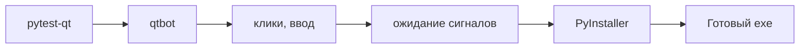

Современные Qt-приложения невозможно выпускать без автоматических тестов. В этом уроке используем `pytest-qt`, чтобы тестировать виджеты, сигналы и даже визуальное поведение.

## Зачем тестировать GUI

Виджеты — это тоже код: логика кнопок, валидация ввода, обновление моделей. Автотесты ловят регрессии до того, как их заметит пользователь.

## Настройка pytest-qt

```bash
pip install pytest-qt
```

Фикстура `qtbot` предоставляет `addWidget()` (регистрация виджета) и `waitSignal()` (ожидание сигнала).

## Тест сигналов

```python
def test_button_click(qtbot):
    widget = MyWidget()
    qtbot.addWidget(widget)
    qtbot.mouseClick(widget.button, Qt.MouseButton.LeftButton)
    assert widget.counter == 1
```

## QTest: имитация ввода

`QTest.keyClicks`, `QTest.mouseClick` позволяют симулировать действия пользователя без ручного запуска окна.

## Тестирование без ожидания

`qtbot.waitSignal(sig, timeout=1000)` полезно для асинхронных операций.

## Сборка с PyInstaller

```bash
pyinstaller --windowed --onefile --name myapp main.py
```

Флаг `--windowed` убирает консоль; `--onefile` собирает в один исполняемый файл.

## Профилирование запуска

Если приложение стартует медленно, используйте `python -m cProfile main.py` и смотрите самые дорогие вызовы при инициализации.

## Итог урока

Мы научились тестировать UI через pytest-qt, проверять сигналы и ввод, а затем собирать готовый исполняемый файл. Это превращает прототип в продукт.




## Практические рекомендации

Тестирование UI вылавливает те баги, которые не видны в unit-тестах: состояние кнопок, порядок сигналов, валидация полей. Сделайте правило: каждый обработчик кнопки имеет тест. При сборке PyInstaller добавляйте ресурсы (иконки, шрифты) через `--add-data`; а для проверки финального exe всегда запускайте его в чистой папке вне проекта.


<!--TASK-->
### Задача 1 — Первый pytest-qt тест
Создай виджет с кнопкой и счётчиком. Напиши тест: клик `qtbot.mouseClick` увеличивает счётчик. Убедись, что тест проходит.

### Задача 2 — Проверка поля ввода
Создай QLineEdit и QLabel, который дублирует текст. Напиши тест, который вводит текст через QTest.keyClicks и проверяет, что label обновился.

### Задача 3 — Валидация через тест
Добавь в виджет проверку: при пустом поле кнопка disabled. Напиши тест: кнопка недоступна при пустом вводе и доступна после ввода.

### Задача 4 — Ожидание сигнала
Создай виджет, который через 0.5 с после нажатия испускает сигнал done. Напиши тест с qtbot.waitSignal, проверяющий, что сигнал дошёл.

### Задача 5 — Тест модели QAbstractTableModel
Реализуй простую модель (две колонки). Напиши тест rowCount/columnCount/data после изменения.

### Задача 6 — Профилирование запуска
Создай приложение и запусти `python -m cProfile main.py`. Найди две функции с наибольшим cumtime и укажи их в ответе.

### Задача 7 — Сборка exe
Собери приложение через PyInstaller с флагами --windowed --onefile. Убедись, что exe появился в dist/, запусти его (при возможности) и опиши вывод/поведение.
<!--/TASK-->

<!--HINT-->
### Подсказка 1
qtbot.addWidget(widget); qtbot.mouseClick(widget.button, Qt.MouseButton.LeftButton).

### Подсказка 2
from PyQt6.QtTest import QTest; QTest.keyClicks(widget.line, "привет").

### Подсказка 3
В обработчике textChanged обновляй setEnabled(bool(text)).

### Подсказка 4
with qtbot.waitSignal(widget.done, timeout=2000): widget.start().

### Подсказка 5
Модель: rowCount возвращает len(data); data — через role DisplayRole.

### Подсказка 6
python -m cProfile -s cumulative main.py | head -20.

### Подсказка 7
pyinstaller --windowed --onefile --name myapp main.py; готовый файл в dist/.
<!--/HINT-->

<!--SOLUTION-->
### Разбор 1
```python
from PyQt6.QtWidgets import QPushButton, QWidget, QVBoxLayout
from PyQt6.QtCore import Qt

class CounterWidget(QWidget):
    def __init__(self):
        super().__init__()
        self.counter = 0
        self.button = QPushButton("+1")
        self.button.clicked.connect(self._inc)
        lay = QVBoxLayout(self); lay.addWidget(self.button)
    def _inc(self):
        self.counter += 1

def test_counter(qtbot):
    w = CounterWidget()
    qtbot.addWidget(w)
    qtbot.mouseClick(w.button, Qt.MouseButton.LeftButton)
    assert w.counter == 1
```
qtbot управляет временем жизни виджета.

### Разбор 2
```python
def test_line_echo(qtbot):
    from PyQt6.QtWidgets import QLineEdit, QLabel
    line = QLineEdit()
    label = QLabel()
    line.textChanged.connect(label.setText)
    qtbot.addWidget(line)
    from PyQt6.QtTest import QTest
    QTest.keyClicks(line, "привет")
    assert label.text() == "привет"
```
QTest.keyClicks симулирует ввод с клавиатуры.

### Разбор 3
```python
class Form(QWidget):
    def __init__(self):
        super().__init__()
        self.line = QLineEdit()
        self.button = QPushButton("OK")
        self.button.setEnabled(False)
        self.line.textChanged.connect(self._on_text)
        lay = QVBoxLayout(self); lay.addWidget(self.line); lay.addWidget(self.button)
    def _on_text(self, text):
        self.button.setEnabled(bool(text))

def test_disabled_empty(qtbot):
    f = Form(); qtbot.addWidget(f)
    assert not f.button.isEnabled()
    f.line.setText("x")
    assert f.button.isEnabled()
```
Состояние кнопки зависит от ввода — это тестируется без запуска окна.

### Разбор 4
```python
from PyQt6.QtCore import QTimer, pyqtSignal

class DelayedWidget(QWidget):
    done = pyqtSignal()
    def __init__(self):
        super().__init__()
        self.button = QPushButton("go")
        self.button.clicked.connect(self._start)
    def _start(self):
        QTimer.singleShot(500, self.done.emit)

def test_wait_signal(qtbot):
    w = DelayedWidget(); qtbot.addWidget(w)
    with qtbot.waitSignal(w.done, timeout=2000):
        w.button.click()
```
waitSignal блокирует тест до прихода сигнала.

### Разбор 5
```python
from PyQt6.QtCore import QAbstractTableModel, QModelIndex, Qt

class SimpleModel(QAbstractTableModel):
    def __init__(self, data):
        super().__init__()
        self._data = data
    def rowCount(self, parent=QModelIndex()):
        return len(self._data)
    def columnCount(self, parent=QModelIndex()):
        return 2
    def data(self, index, role=Qt.ItemDataRole.DisplayRole):
        if role == Qt.ItemDataRole.DisplayRole:
            return self._data[index.row()][index.column()]

def test_model(qtbot):
    model = SimpleModel([["a", 1], ["b", 2]])
    assert model.rowCount() == 2
    assert model.columnCount() == 2
    assert model.data(model.index(0, 0)) == "a"
```
Модель тестируется как обычный класс, без окна.

### Разбор 6
```bash
python -m cProfile -s cumulative main.py
```
В выводе ищите функции с высоким cumtime (например, создание шрифтов, загрузка ресурсов). Оптимизация запуска начинается с этих мест.

### Разбор 7
```bash
pyinstaller --windowed --onefile --name myapp main.py
ls dist/
```
В dist/ появится myapp.exe. `--windowed` скрывает консоль, `--onefile` упаковывает всё в один файл.
<!--/SOLUTION-->

<!--QUIZ-->
Что делает qtbot.addWidget()?
- Регистрирует виджет для корректного завершения теста
- Открывает окно
- Удаляет виджет
- Проверяет стили
* Правильный ответ: Регистрирует виджет для корректного завершения теста
qtbot управляет жизненным циклом.

Что делает QTest.keyClicks?
- Имитирует ввод с клавиатуры
- Кликает мышью
- Закрывает окно
- Ждёт сигнал
* Правильный ответ: Имитирует ввод с клавиатуры
Строка «печатается» в поле.

Что делает qtbot.waitSignal?
- Блокирует тест до прихода сигнала
- Нажимает кнопку
- Завершает тест
- Читает модель
* Правильный ответ: Блокирует тест до прихода сигнала
Удобно для асинхронных действий.

Чем модель (QAbstractTableModel) удобна для тестов?
- Её можно тестировать без отображения
- Она рисует сама
- Она не имеет данных
- Она не поддерживает data()
* Правильный ответ: Её можно тестировать без отображения
Модель отделена от вида.

Какой флаг PyInstaller убирает консоль?
- --windowed
- --console
- --debug
- --clean
* Правильный ответ: --windowed
Окно приложения без консоли.

Что делает --onefile?
- Собирает всё в один исполняемый файл
- Создаёт папку
- Добавляет иконку
- Сжимает код
* Правильный ответ: Собирает всё в один исполняемый файл
Проще распространять.

Зачем тестировать сигналы?
- Чтобы убедиться, что события вызывают нужные обработчики
- Чтобы ускорить UI
- Чтобы менять стили
- Не нужно
* Правильный ответ: Чтобы убедиться, что события вызывают нужные обработчики
Сигналы — контракт UI.

Как найти медленную инициализацию?
- Через cProfile
- Через наблюдение
- Через отключение кода
- Через PyInstaller
* Правильный ответ: Через cProfile
Профилировщик показывает дорогие вызовы.
Для чего используется --add-data?
- Для добавления ресурсов (иконки, шрифты)
- Для отладки
- Для ускорения
- Для отключения консоли
* Правильный ответ: Для добавления ресурсов (иконки, шрифты)
Внешние файлы включаются в сборку.

Почему нужно запускать собранный exe вне проекта?
- Чтобы проверить независимость от исходников
- Так быстрее
- Это требование Windows
- Иначе не запустится
* Правильный ответ: Чтобы проверить независимость от исходников
Собранное приложение не должно требовать папки проекта.


Какой инструмент проверяет медленный запуск UI?
- cProfile
- PyInstaller
- QTest
- ruff
* Правильный ответ: cProfile
Профилировщик покажет дорогие вызовы.

Что делает фикстура qtbot?
- Предоставляет инструменты для тестов Qt-виджетов
- Собирает exe
- Рисует окно
- Останавливает события
* Правильный ответ: Предоставляет инструменты для тестов Qt-виджетов
qtbot управляет виджетами и ожиданиями.


<!--/QUIZ-->
