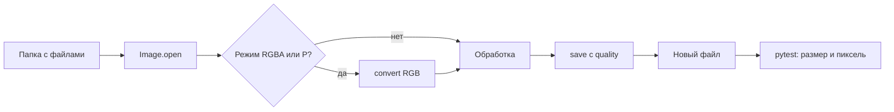

Pillow — это главная библиотека Python для работы с изображениями. В этом уроке мы выйдем за пределы «открыл — сохранил» и разберём реальные приёмы: обрезку, пакетную конвертацию, водяные знаки и, главное, тестирование кода обработки изображений с pytest. Всё это пригодится для ботов, генераторов превью и скриптов автоматизации.

## Установка и основной объект — PIL.Image

Установи библиотеку:

```bash
pip install pillow
```

Импорт и открытие файла:

```python
from PIL import Image

img = Image.open("photo.jpg")
print(img.size)    # (4032, 3024) — ширина, высота
print(img.mode)    # RGB
print(img.format)  # JPEG
```

Объект `Image` — центральный класс библиотеки. Метод `Image.open()` открывает файл «лениво»: данные читаются из файла по мере необходимости, поэтому после открытия файл не должен удаляться, пока ты работаешь с объектом. Атрибут `size` возвращает кортеж `(ширина, высота)`, `mode` — цветовую модель (`RGB`, `RGBA`, `L` — градации серого), `format` — исходный формат.

## Геометрия: resize, thumbnail и crop

`resize((w, h))` задаёт точные размеры, не заботясь о пропорциях. `thumbnail((w, h))` сохраняет пропорции и только уменьшает изображение (не увеличивает). Важная деталь: `thumbnail()` изменяет объект **на месте** и возвращает `None`:

```python
img = Image.open("photo.jpg")

preview = img.copy()          # работаем с копией
preview.thumbnail((800, 600)) # пропорции сохраняются
preview.save("preview.jpg", quality=85, optimize=True)
```

`crop(box)` вырезает прямоугольную область. `box` — кортеж из четырёх чисел: `(left, top, right, bottom)`:

```python
w, h = img.size
left = (w - 400) // 2
top = (h - 300) // 2
center = img.crop((left, top, left + 400, top + 300))
```

Есть ещё `rotate(angle, expand=True)`, `transpose()`, `convert(mode)` — последний нужен, например, чтобы перевести RGBA в RGB перед сохранением в JPEG.

## Фильтры и рисование

Модуль `ImageFilter` даёт готовые фильтры:

```python
from PIL import ImageFilter

blurred = img.filter(ImageFilter.GaussianBlur(radius=2))
sharp = img.filter(ImageFilter.SHARPEN)
```

Рисование текста и фигур — через `ImageDraw`. Текст: нужен шрифт. `ImageFont.load_default()` даёт встроенный растровый шрифт (в новых версиях принимает `size`), а `ImageFont.truetype(path, size)` — системный TTF-шрифт:

```python
from PIL import Image, ImageDraw, ImageFont

overlay = Image.new("RGBA", img.size, (0, 0, 0, 0))
draw = ImageDraw.Draw(overlay)
font = ImageFont.truetype("DejaVuSans.ttf", 48)
draw.text((img.width // 2, img.height // 2), "© 2026",
          fill=(255, 255, 255, 180), font=font, anchor="mm")
watermarked = Image.alpha_composite(img.convert("RGBA"), overlay)
```

`anchor="mm"` означает «середина по горизонтали и вертикали» — текст центрируется в точке. `Image.alpha_composite()` накладывает прозрачный слой.

## Сохранение: формат и качество

Формат определяется расширением файла. Для JPEG и WebP важен параметр `quality` (1–100, чем выше — тем лучше и тяжелее), для PNG — сжатие без потерь:

```python
img.convert("RGB").save("photo_small.jpg", quality=80, optimize=True, progressive=True)
img.save("photo.webp", quality=85, method=6)
```

`progressive=True` включает прогрессивный JPEG, `optimize=True` — оптимизацию размера. Помни: JPEG не поддерживает альфа-канал, поэтому RGBA перед сохранением конвертируют в RGB.

## Пакетная обработка

Настоящая польза — обработка целых папок. Скелет скрипта:

```python
from pathlib import Path
from PIL import Image

def convert_folder(src_dir: Path, dst_dir: Path,
                  fmt: str = "WEBP", quality: int = 85):
    dst_dir.mkdir(parents=True, exist_ok=True)
    results = []
    for path in sorted(Path(src_dir).glob("*.png")) + \
               sorted(Path(src_dir).glob("*.jpg")):
        img = Image.open(path)
        out = dst_dir / f"{path.stem}.webp"
        if img.mode in ("RGBA", "P"):
            img = img.convert("RGB")
        img.save(out, format=fmt, quality=quality)
        results.append(str(out))
    return results
```

## Схема пакетной обработки



На схеме видно, где именно в конвейере появляются две типичные ошибки: пропущенная конвертация режима и забытый `quality`. Тест проверяет результат на выходе, а не намерения кода.

## Зачем тестировать обработку изображений

Обработка изображений — идеальный кандидат на тесты: функции чистые, входные данные легко создать в памяти (`Image.new("RGB", (100, 60), "red")`), а результат проверяется по размерам, формату и пикселям. Тесты защищают от регрессий при смене версий Pillow. Давай попрактикуемся.

<!--TASK-->
### Задача 1
Напиши функцию `center_crop(image, width, height)`, которая принимает объект `PIL.Image.Image` и целые `width`, `height`, а возвращает **новый** объект изображения — центральный фрагмент заданного размера. Центрирование делается так: `left = (image.width - width) // 2`, `top = (image.height - height) // 2`, затем `crop((left, top, left + width, top + height))`. Если `width` или `height` больше соответствующего размера исходного изображения — подними `ValueError` с понятным сообщением. Проверь вручную: создай изображение 100×60, обрежь до 40×40 и убедись, что результат имеет размер `(40, 40)`, а исходный объект не изменился. Ожидаемый результат: вызов `center_crop(img, 40, 40).size` возвращает `(40, 40)`.

### Задача 2
Напиши функцию `convert_folder(src_dir, dst_dir, fmt="WEBP", quality=85)`, которая обрабатывает все файлы `.png`, `.jpg` и `.jpeg` из `src_dir`: открывает каждый, конвертирует в RGB, если режим `RGBA` или `P`, и сохраняет в `dst_dir` с тем же именем, но расширением по формату (например, `photo.png` → `photo.webp`). Папку `dst_dir` создай через `mkdir(parents=True, exist_ok=True)`. Функция возвращает список путей к созданным файлам, отсортированный по имени. Если подходящих файлов нет — верни пустой список. Ожидаемый результат: для трёх PNG в `src_dir` функция возвращает список из трёх путей в `dst_dir`, и каждый файл открывается через `Image.open`.

### Задача 3
Напиши функцию `add_watermark(image, text, font_size=48)`, которая возвращает новое изображение с полупрозрачным текстом по центру. Используй приём из теории: создай слой `RGBA` с нулевой прозрачностью, нарисуй текст через `ImageDraw.Draw` и `ImageFont.truetype("DejaVuSans.ttf", font_size)` с `anchor="mm"` по центру, потом наложи через `Image.alpha_composite`. Если системный шрифт не найден — используй `ImageFont.load_default(size=font_size)`. Водяной знак должен быть видим: цвет текста `(255, 255, 255, 180)`. Ожидаемый результат: функция возвращает объект `Image` с режимом `RGBA` и тем же размером, что у исходника.

### Задача 4
Напиши pytest-тесты для функции `center_crop`. Создай тестовое изображение `Image.new("RGB", (100, 60), "red")` и проверь: (1) результат обрезки до 40×40 имеет размер `(40, 40)`; (2) возвращается новый объект — исходное изображение не мутировало (его `size` остался `(100, 60)`); (3) пиксель в центре результата равен `(255, 0, 0)` (красный); (4) при `center_crop(img, 200, 40)` поднимается `ValueError`. Запусти тесты командой `python -m pytest test_crop.py -v`. Ожидаемый результат: все 4 теста проходят.

### Задача 5
Напиши pytest-тесты для функции `convert_folder`. Используй фикстуру `tmp_path`: создай в ней папку `src` с тремя тестовыми PNG (через `Image.new` + `save`), вызови `convert_folder(src, dst)`, затем проверь: (1) возвращён список из трёх путей; (2) в `dst` появились три файла `*.webp`; (3) каждый открывается через `Image.open` и имеет `format == "WEBP"`; (4) размер каждого совпадает с исходным PNG; (5) вызов `convert_folder` для пустой папки возвращает `[]`. Запусти тесты. Ожидаемый результат: все проверки проходят.
### Задача 6
Напиши функцию `make_contact_sheet(paths, cell=(160, 120), cols=3, gap=8, bg=(255, 255, 255))`, которая собирает одно изображение-сетку из превью: открывает каждый файл из `paths`, уменьшает копию через `thumbnail(cell)` и вставляет её по центру своей ячейки методом `paste`. Размер холста посчитай заранее: ширина — `cols * cell[0] + (cols + 1) * gap`, высота — `rows * cell[1] + (rows + 1) * gap`, где `rows` — округлённое вверх частное от деления числа файлов на `cols`. Холст создай через `Image.new("RGB", size, bg)`. Если список пуст — подними `ValueError`. Ожидаемый результат: для пяти картинок 160×120 при `cols=3` и `gap=8` функция возвращает изображение размером `(512, 264)`, а пиксель `(4, 4)` равен `(255, 255, 255)`.

### Задача 7
Напиши функцию `prepare_for_web(image, max_side=1200)`, которая готовит фотографию к публикации: применяет `ImageOps.exif_transpose` (чтобы кадр с телефона не оказался повёрнутым), конвертирует режимы `RGBA` и `P` в `RGB` и вписывает результат в квадрат `max_side × max_side` через `ImageOps.contain`, сохраняя пропорции. Затем напиши `save_prepared(image, path, max_side=1200, quality=82)`, которая вызывает подготовку и сохраняет JPEG с `optimize=True`, возвращая путь. Ожидаемый результат: изображение 4000×3000 после подготовки имеет размер `(1200, 900)`, а созданный файл открывается через `Image.open` и имеет `format == "JPEG"`.
<!--/TASK-->

<!--HINT-->
### Подсказка 1
Формула центрирования: `left = (image.width - width) // 2`; `top = (image.height - height) // 2`. `crop` принимает кортеж `(left, top, right, bottom)`. Проверку «больше исходного» делай до вычисления координат: `if width > image.width or height > image.height: raise ValueError(...)`.

### Подсказка 2
Для перебора используй `Path(src_dir).glob(...)`. Список форматов: `("*.png", "*.jpg", "*.jpeg")`. Имя на выходе — `f"{path.stem}.webp"` (или по `fmt.lower()`). Список результатов собирай в переменную и возвращай после цикла. Не забудь `sorted()`.

### Подсказка 3
Сначала подготовь слой: `overlay = Image.new("RGBA", image.size, (0, 0, 0, 0))`. Затем `draw = ImageDraw.Draw(overlay)` и `draw.text((image.width // 2, image.height // 2), text, fill=(255, 255, 255, 180), font=font, anchor="mm")`. Накладывай: `Image.alpha_composite(image.convert("RGBA"), overlay)`. Шрифт ищи через `ImageFont.truetype` в блоке `try/except OSError`.

### Подсказка 4
Тест на мутацию: сохрани `original_size = img.size` до вызова и проверь `assert img.size == original_size` после. Пиксель: `center_crop(img, 40, 40).getpixel((20, 20)) == (255, 0, 0)`. Для ValueError — `pytest.raises(ValueError)`. Импортируй `pytest` и свою функцию.

### Подсказка 5
Фикстуру `tmp_path` pytest передаёт сама. Создай PNG: `Image.new("RGB", (40, 30), "blue").save(tmp_path / "src" / "a.png")`. Не забудь `mkdir` для `src`. `format` читай так: `Image.open(f).format`. Для пустой папки создай отдельный `empty` и вызови `convert_folder` с ним.
### Подсказка 6
Число строк: `rows = math.ceil(len(paths) / cols)`. Координаты ячейки: `row, col = divmod(index, cols)`, затем `x = gap + col * (cell_w + gap)` и `y = gap + row * (cell_h + gap)`. Внутри ячейки центрируй вставку: `x + (cell_w - thumb.width) // 2`. Открывай файл в `with Image.open(path) as source:` и сразу делай `convert("RGB")`, иначе `paste` из палитрового режима даст странные цвета.

### Подсказка 7
`ImageOps.exif_transpose` возвращает новый объект — не забудь присвоить результат. Вписывание: `ImageOps.contain(img, (max_side, max_side))` — это копия, уменьшенная с сохранением пропорций. При сохранении в JPEG обязательно `format="JPEG"`, иначе расширение `.jpg` может быть проигнорировано при нестандартном суффиксе.
<!--/HINT-->

<!--SOLUTION-->
### Разбор 1
Полное решение:

```python
from PIL import Image

def center_crop(image: Image.Image, width: int, height: int) -> Image.Image:
    if width > image.width or height > image.height:
        raise ValueError("Фрагмент больше исходного изображения")
    left = (image.width - width) // 2
    top = (image.height - height) // 2
    return image.crop((left, top, left + width, top + height))


img = Image.new("RGB", (100, 60), "red")
cropped = center_crop(img, 40, 40)
print(cropped.size)  # (40, 40)
print(img.size)      # (100, 60) — оригинал не изменился
```

Разбор. Сначала проверяем, что запрошенный фрагмент вообще помещается: если `width` больше ширины исходника, координата `left` стала бы отрицательной, и `crop` вёл бы себя непредсказуемо — поэтому поднимаем `ValueError`. Затем вычисляем координаты левого верхнего угла: вычитаем целевой размер из исходного и делим на два — так фрагмент окажется ровно по центру. Дальше `crop` возвращает новый объект требуемого размера. Важно, что `crop` не меняет исходное изображение — это чистая функция, что и проверяется в тестах из задачи 4. Проверка вручную показывает: `(40, 40)` на выходе, оригинал остался `(100, 60)`.

### Разбор 2
Полное решение:

```python
from pathlib import Path
from PIL import Image

def convert_folder(src_dir, dst_dir, fmt="WEBP", quality=85):
    dst_path = Path(dst_dir)
    dst_path.mkdir(parents=True, exist_ok=True)
    patterns = ("*.png", "*.jpg", "*.jpeg")
    results = []
    for ext in patterns:
        for path in sorted(Path(src_dir).glob(ext)):
            img = Image.open(path)
            if img.mode in ("RGBA", "P"):
                img = img.convert("RGB")
            out = dst_path / f"{path.stem}.{fmt.lower()}"
            img.save(out, format=fmt, quality=quality)
            results.append(str(out))
    return results
```

Разбор. Функция перебирает все три шаблона через `glob`, каждый список сортируется — поэтому результат детерминирован. Для каждого файла открываем изображение и, если режим содержит альфа-канал (`RGBA`) или палитру (`P`), конвертируем в `RGB` — иначе сохранение в WebP было бы некорректным для некоторых форматов. Выходной путь строится из имени без расширения (`stem`) и нового расширения по формату. `mkdir(parents=True, exist_ok=True)` создаёт целевую папку, если её нет. Возвращаем список строк-путей, собранный в цикле. Отметим: `Image.open` — «ленивый», но данные читаются внутри `save`, поэтому всё работает корректно, а `close()` вызывать не обязательно в коротких скриптах (Pillow сам освобождает файл после `save` при выходе из области видимости).

### Разбор 3
Полное решение:

```python
from PIL import Image, ImageDraw, ImageFont

def add_watermark(image, text, font_size=48):
    try:
        font = ImageFont.truetype("DejaVuSans.ttf", font_size)
    except OSError:
        font = ImageFont.load_default(size=font_size)

    overlay = Image.new("RGBA", image.size, (0, 0, 0, 0))
    draw = ImageDraw.Draw(overlay)
    x, y = image.width // 2, image.height // 2
    draw.text((x, y), text, fill=(255, 255, 255, 180),
              font=font, anchor="mm")

    base = image.convert("RGBA")
    return Image.alpha_composite(base, overlay)
```

Разбор. Мы не рисуем прямо на исходнике — это позволило бы сохранить оригинал нетронутым. Вместо этого создаём пустой слой `RGBA` с полной прозрачностью: `(0, 0, 0, 0)`. На нём рисуем текст: `anchor="mm"` центрирует текст по точке `(x, y)`, которая находится в середине изображения, а альфа-канал 180 из 255 делает текст полупрозрачным. Шрифт берём из системных `DejaVuSans.ttf` (есть почти во всех Linux и macOS; на Windows путь иной — например, `C:/Windows/Fonts/arial.ttf`, поэтому используем `try/except OSError` с запасным `load_default`). Наконец `Image.alpha_composite` объединяет базовое изображение (сконвертированное в `RGBA`) со слоем текста. Итог — новое изображение с водяным знаком.

### Разбор 4
Полное решение:

```python
import pytest
from PIL import Image
from pillow_utils import center_crop  # или из твоего модуля

def make_image():
    return Image.new("RGB", (100, 60), "red")

def test_crop_size():
    cropped = center_crop(make_image(), 40, 40)
    assert cropped.size == (40, 40)

def test_crop_returns_new_object():
    img = make_image()
    center_crop(img, 40, 40)
    assert img.size == (100, 60)

def test_crop_keeps_center_pixel():
    cropped = center_crop(make_image(), 40, 40)
    assert cropped.getpixel((20, 20)) == (255, 0, 0)

def test_crop_too_large_raises():
    with pytest.raises(ValueError):
        center_crop(make_image(), 200, 40)
```

Разбор. Первый тест проверяет главный контракт — размер результата. Второй — чистоту функции: после вызова исходник остался прежним размера. Третий тест проверяет геометрию: при обрезке 100×60 до 40×40 координаты левого верхнего угла — `(30, 10)`, значит пиксель `(20, 20)` результата соответствует пикселю `(50, 30)` исходника — это центр красного изображения, поэтому `getpixel` возвращает `(255, 0, 0)`. Четвёртый тест убеждается, что слишком большой фрагмент не даёт молчаливого искажения, а падает с `ValueError`. Запуск: `python -m pytest test_crop.py -v` — все четыре теста зелёные.

### Разбор 5
Полное решение:

```python
from PIL import Image
from pillow_utils import convert_folder  # или из твоего модуля

def make_png(directory, name, size=(40, 30), color="blue"):
    directory.mkdir(parents=True, exist_ok=True)
    Image.new("RGB", size, color).save(directory / f"{name}.png")

def test_convert_folder_creates_webp(tmp_path):
    src = tmp_path / "src"
    for name in ("a", "b", "c"):
        make_png(src, name)

    dst = tmp_path / "dst"
    result = convert_folder(src, dst)

    assert len(result) == 3
    webp_paths = sorted(dst.glob("*.webp"))
    assert len(webp_paths) == 3
    for webp in webp_paths:
        with Image.open(webp) as img:
            assert img.format == "WEBP"
            assert img.size == (40, 30)

def test_convert_folder_empty_dir_returns_empty(tmp_path):
    empty = tmp_path / "empty"
    empty.mkdir()
    assert convert_folder(empty, tmp_path / "dst2") == []
```

Разбор. Фикстура `tmp_path` создаёт временную папку для каждого теста — после прогона pytest убирает её сам. В первом тесте мы генерируем три PNG прямо в памяти: `Image.new(...).save(...)` — без внешних файлов-фикстур. Затем вызываем `convert_folder` и проверяем: список результатов из трёх элементов, в `dst` появились три `*.webp`, каждый открывается через `Image.open` (контекстный менеджер `with` закрывает файл), формат `WEBP`, размеры совпадают с исходными `(40, 30)`. Второй тест покрывает граничный случай — пустая входная папка даёт пустой список. Оба теста быстрые, не зависят от сети и не оставляют мусора.
### Разбор 6
Полное решение:

```python
import math
from PIL import Image

def make_contact_sheet(paths, cell=(160, 120), cols=3, gap=8, bg=(255, 255, 255)):
    if not paths:
        raise ValueError("Нужен хотя бы один файл")

    cell_w, cell_h = cell
    rows = math.ceil(len(paths) / cols)
    width = cols * cell_w + (cols + 1) * gap
    height = rows * cell_h + (rows + 1) * gap
    sheet = Image.new("RGB", (width, height), bg)

    for index, path in enumerate(paths):
        with Image.open(path) as source:
            thumb = source.convert("RGB")
        thumb.thumbnail(cell)

        row, col = divmod(index, cols)
        x = gap + col * (cell_w + gap) + (cell_w - thumb.width) // 2
        y = gap + row * (cell_h + gap) + (cell_h - thumb.height) // 2
        sheet.paste(thumb, (x, y))

    return sheet

sheet = make_contact_sheet(["a.png", "b.png", "c.png", "d.png", "e.png"])
print(sheet.size)          # (512, 264)
print(sheet.getpixel((4, 4)))  # (255, 255, 255)
```

Разбор. Сначала считаем геометрию холста: `cols` ячеек в ряд, между ними и по краям — отступы `gap`, поэтому к ширине добавляется `cols + 1` отступ. Высота считается так же, но по числу строк, которое округляется вверх: пять картинок при трёх колонках дают две строки. Дальше цикл: файл открывается в контекстном менеджере, копия конвертируется в `RGB` — это важно, потому что палитровые PNG при вставке в `RGB`-холст без конвертации могут потерять цвета. `thumbnail(cell)` уменьшает копию, сохраняя пропорции, поэтому превью может быть уже ячейки; координаты центрируют его по обоим осям. `divmod(index, cols)` элегантно превращает порядковый номер в пару «строка, колонка». Метод `paste` не смешивает пиксели, а заменяет область — для непрозрачных превью это именно то, что нужно. Итог — одно изображение, которое удобно отдать в отчёт или превью галереи.

### Разбор 7
Полное решение:

```python
from PIL import Image, ImageOps

def prepare_for_web(image, max_side=1200):
    img = ImageOps.exif_transpose(image)
    if img.mode in ("RGBA", "P"):
        img = img.convert("RGB")
    return ImageOps.contain(img, (max_side, max_side))

def save_prepared(image, path, max_side=1200, quality=82):
    prepared = prepare_for_web(image, max_side)
    prepared.save(path, format="JPEG", quality=quality, optimize=True)
    return path

img = Image.new("RGB", (4000, 3000), "steelblue")
print(prepare_for_web(img).size)   # (1200, 900)
```

Разбор. Порядок шагов здесь принципиален. `ImageOps.exif_transpose` читает тег Orientation и физически поворачивает пиксели: без него вертикальный снимок с телефона останется «лежащим», а после любого ресайза исправить это уже нельзя без потери качества. Затем убираем альфа-канал: JPEG его не поддерживает, и попытка сохранить `RGBA` приведёт к ошибке `cannot write mode RGBA as JPEG`. Только после этого выполняется `ImageOps.contain` — он уменьшает копию так, чтобы обе стороны помещались в `1200`, сохраняя соотношение сторон: 4000×3000 превращается в 1200×900, а не в квадрат 1200×1200. `save` с `format="JPEG"` фиксирует формат независимо от расширения, `quality=82` даёт заметно меньший файл при почти неотличимом качестве, а `optimize=True` подбирает таблицы сжатия. Функция возвращает путь — это удобно для цепочек и тестов.
<!--/SOLUTION-->

<!--QUIZ-->
Какой метод открывает изображение в Pillow?
- Image.load()
- Image.open()
- Image.read()
- Image.frombytes()
* Правильный ответ: Image.open()
Image.open() возвращает объект Image, читая файл лениво.

В чём разница между resize() и thumbnail()?
- resize() сохраняет пропорции, thumbnail() нет
- thumbnail() сохраняет пропорции и только уменьшает, resize() задаёт точные размеры
- Они полностью идентичны
- thumbnail() работает только с PNG
* Правильный ответ: thumbnail() сохраняет пропорции и только уменьшает, resize() задаёт точные размеры
thumbnail() не увеличивает изображение и не искажает пропорции.

Что возвращает вызов img.thumbnail((100, 100))?
- Новый объект Image
- None — объект изменяется на месте
- Кортеж (100, 100)
- Ошибку
* Правильный ответ: None — объект изменяется на месте
thumbnail() модифицирует существующий объект и возвращает None.

Какой метод вырезает прямоугольную область изображения?
- crop(box)
- resize(box)
- slice(box)
- cut(box)
* Правильный ответ: crop(box)
crop() принимает кортеж (left, top, right, bottom).

Что нужно сделать перед сохранением RGBA-изображения в JPEG?
- Ничего, JPEG поддерживает альфа-канал
- Вызвать convert("RGB")
- Вызвать add_alpha_channel()
- Переименовать файл в .png
* Правильный ответ: Вызвать convert("RGB")
JPEG не поддерживает прозрачность, поэтому альфа-канал убирают конвертацией.

Что возвращает атрибут img.size?
- Количество пикселей
- Кортеж (ширина, высота)
- Строку вида "4032x3024"
- Размер файла в байтах
* Правильный ответ: Кортеж (ширина, высота)
size — это кортеж (width, height).

Какой параметр управляет сжатием при сохранении в JPEG или WebP?
- quality
- compression
- level
- dpi
* Правильный ответ: quality
quality (1–100) задаёт степень сжатия: чем выше, тем лучше качество и больше размер.

Что делает ImageFilter.GaussianBlur(radius=2)?
- Увеличивает резкость
- Размывает изображение с радиусом 2
- Уменьшает изображение в 2 раза
- Меняет цветовой режим
* Правильный ответ: Размывает изображение с радиусом 2
GaussianBlur применяет гауссово размытие заданного радиуса.

Для чего нужен ImageFont.truetype()?
- Для загрузки шрифта из TTF-файла
- Для конвертации изображения в текст
- Для ускорения работы с PNG
- Для смены размера изображения
* Правильный ответ: Для загрузки шрифта из TTF-файла
truetype() загружает масштабируемый шрифт для рисования текста.

Что делает anchor="mm" в draw.text()?
- Выравнивает текст по левому краю
- Центрирует текст по заданной точке
- Делает текст полупрозрачным
- Поворачивает текст
* Правильный ответ: Центрирует текст по заданной точке
anchor="mm" — середина по горизонтали и вертикали, текст центрируется.
Что делает ImageOps.contain(image, (800, 800))?
- Растягивает изображение ровно до 800×800
- Вписывает изображение в 800×800, сохраняя пропорции
- Обрезает изображение до квадрата
- Увеличивает изображение в 8 раз
* Правильный ответ: Вписывает изображение в 800×800, сохраняя пропорции
contain уменьшает копию так, чтобы она целиком помещалась в заданный прямоугольник.

Зачем нужен ImageOps.exif_transpose?
- Чтобы повернуть кадр согласно данным EXIF камеры
- Чтобы удалить все метаданные
- Чтобы повысить резкость
- Чтобы уменьшить размер файла
* Правильный ответ: Чтобы повернуть кадр согласно данным EXIF камеры
Снимки с телефонов часто хранят поворот в EXIF, и без этой операции фото выглядит боком.

Как вставить одно изображение в другое в точке (x, y)?
- base.paste(other, (x, y))
- base.insert(other, x, y)
- base.merge(other, (x, y))
- base.blit(other, (x, y))
* Правильный ответ: base.paste(other, (x, y))
paste копирует пиксели в указанную позицию; вставляемый фрагмент должен помещаться в холст.

Что создаёт Image.new("RGB", (100, 50), "white")?
- Пустое белое изображение 100×50
- Копию существующего файла
- Маску прозрачности
- Палитру из 100 цветов
* Правильный ответ: Пустое белое изображение 100×50
Image.new принимает режим, размер и цвет заливки — удобно для тестовых картинок в памяти.
<!--/QUIZ-->
