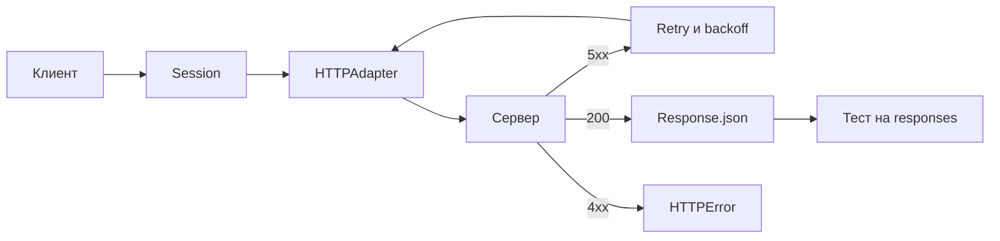

`requests` — стандарт для HTTP-запросов в Python. В этом уроке разберём не «как сделать GET», а инженерные приёмы: переиспользование соединений через сессии, автоматические повторы при временных ошибках, скачивание больших файлов по частям и — главное — как тестировать весь этот код без реального сервера.

## Сессии: зачем они нужны

Простой запрос `requests.get(url)` создаёт новое соединение на каждый вызов. Для десятков запросов это медленно: каждый раз заново выполняется TCP-handshake и TLS-согласование. Решение — `Session`:

```python
import requests

session = requests.Session()
session.headers.update({"User-Agent": "my-app/1.0"})
session.get("https://api.example.com/users")
session.get("https://api.example.com/users/42")
```

Сессия хранит cookies, применяет заданные заголовки ко всем запросам и, главное, держит пул TCP-соединений (connection pooling): повторные запросы к тому же хосту идут по уже установленным соединениям. Основные методы — `get`, `post`, `put`, `delete`, `patch`. У запросов есть полезные параметры:

```python
r = session.get(
    "https://api.example.com/search",
    params={"q": "python", "page": 2},  # query-параметры
    timeout=(3, 10),                      # (connect, read) секунд
)
print(r.status_code)      # 200
print(r.headers["Content-Type"])
data = r.json()           # парсинг JSON-ответа
```

Параметр `timeout` обязателен в продакшене: без него запрос может висеть минуты. Кортеж задаёт раздельные таймауты на соединение и чтение.

## Ответ и обработка ошибок

У объекта `Response`: `status_code`, `headers`, `text` (текст), `content` (байты), `json()`. Метод `raise_for_status()` бросает `requests.exceptions.HTTPError`, если код 4xx/5xx:

```python
def get_json(session, url, **params):
    r = session.get(url, params=params, timeout=5)
    r.raise_for_status()      # исключение при 404, 500 и т.п.
    return r.json()
```

## Адаптеры и ретраи

`requests.adapters.HTTPAdapter` управляет пулом соединений сессии. Через него же настраиваются автоматические повторы — класс `urllib3.util.retry.Retry`:

```python
from requests.adapters import HTTPAdapter
from urllib3.util.retry import Retry

retry = Retry(
    total=3,                    # всего попыток (включая первую)
    connect=3,
    read=3,
    backoff_factor=0.5,         # пауза: 0.5, 1, 2, 4... секунд
    status_forcelist=(500, 502, 503, 504),
    allowed_methods=frozenset(["GET", "POST"]),
)
adapter = HTTPAdapter(max_retries=retry, pool_connections=10, pool_maxsize=10)
session = requests.Session()
session.mount("https://", adapter)
session.mount("http://", adapter)
```

`mount("https://", adapter)` назначает адаптер всем HTTPS-запросам. При `status_forcelist` повторы срабатывают и на коды 5xx, а `backoff_factor` растягивает паузы, чтобы не долбить сервер.

## Загрузка больших файлов

`stream=True` не читает тело ответа целиком, а даёт поток. Читаем кусками через `iter_content`:

```python
def download(session, url, path, chunk_size=8192):
    with session.get(url, stream=True, timeout=(5, 60)) as r:
        r.raise_for_status()
        with open(path, "wb") as f:
            for chunk in r.iter_content(chunk_size=chunk_size):
                if chunk:
                    f.write(chunk)
```

## Тестирование без сети: библиотека responses

HTTP-код нельзя проверять на реальных серверах — тесты стали бы медленными и хрупкими. Библиотека `responses` перехватывает запросы `requests` и возвращает заранее заданные ответы:

```bash
pip install responses
```

```python
import responses
import requests

@responses.activate
def test_get_json():
    responses.add(
        responses.GET,
        "https://api.example.com/users/42",
        json={"id": 42, "name": "Аня"},
        status=200,
    )
    r = requests.get("https://api.example.com/users/42")
    assert r.json()["name"] == "Аня"
```

`responses.add()` регистрирует мок: метод, URL, тело (`json=`, `body=`, `text=`), статус. Все не-зарегистрированные URL при активной записи `responses` вызовут ошибку — это полезно: тест сразу видит, что код ходит не туда.

## Схема запроса с ретраями



Схема показывает, что повтор — это не отдельный код клиента, а поведение адаптера: клиент видит только финальный ответ или исключение.

## План на практику

Мы построим маленький HTTP-клиент на сессии, добавим ретраи, стриминг — и покроем всё тестами на `responses` + `pytest`. Поехали.

<!--TASK-->
### Задача 1
Напиши класс `APIClient`, который оборачивает `requests.Session`. Конструктор принимает `base_url`, `timeout=5` и создаёт сессию (`self.session = requests.Session()`). Реализуй метод `get_json(path, **params)`: выполняет `self.session.get(self.base_url + path, params=params, timeout=self.timeout)`, затем `raise_for_status()` и возвращает `r.json()`. Также реализуй `post_json(path, payload)`: `session.post(url, json=payload, timeout=self.timeout)`, `raise_for_status()`, возвращает `r.json()`. Проверь вручную на мок-сервере не нужно — просто убедись, что код импортируется и класс создаётся. Ожидаемый результат: `APIClient("https://api.example.com")` создаёт объект с атрибутами `session` и `timeout`.

### Задача 2
Напиши функцию `build_session_with_retries(retries=3, backoff_factor=0.5)`, которая создаёт `requests.Session` с настроенным `HTTPAdapter` и `Retry` (total=retries, status_forcelist=(500, 502, 503, 504), backoff_factor=backoff_factor, allowed_methods=frozenset(["GET", "POST"])) и монтирует адаптер и для `http://`, и для `https://`. Функция возвращает сессию. Проверь вручную: `session = build_session_with_retries()`; `print(session.get_adapter("https://api.example.com"))` должен показать твой адаптер. Ожидаемый результат: вызов возвращает `Session`, у которой адаптер для HTTPS содержит `max_retries` с `total == 3`.

### Задача 3
Напиши функцию `download_to_file(session, url, path, chunk_size=8192)`, которая скачивает файл по частям. Используй `session.get(url, stream=True, timeout=(5, 60))` внутри `with` (чтобы соединение закрылось), затем `raise_for_status()` и запись в файл через `iter_content(chunk_size=chunk_size)`, пропуская пустые куски (`if chunk:`). Верни число записанных байт. Проверь вручную на маленьком файле (например, `https://httpbin.org/bytes/1000`) — сохрани в `sample.bin` и выведи его размер. Ожидаемый результат: файл создан, функция возвращает размер, равный размеру файла.

### Задача 4
Напиши pytest-тесты для класса `APIClient`, используя `responses` (фикстура `@responses.activate`). Проверь: (1) `get_json` при статусе 200 возвращает распарсенный JSON-словарь; (2) `get_json` при 404 поднимает `requests.exceptions.HTTPError` (через `pytest.raises`); (3) query-параметры реально уходят: после вызова проверь `responses.calls[0].request.url` содержит `q=python`; (4) `post_json` отправляет JSON-тело: `responses.calls[0].request.body` содержит `"key"`. Запусти `python -m pytest test_api_client.py -v`. Ожидаемый результат: все 4 теста проходят.

### Задача 5
Напиши pytest-тесты для `build_session_with_retries` с `responses`: зарегистрируй один и тот же URL трижды — дважды со статусом 503 и один раз с 200 и телом `{"ok": true}`. Затем выполни `session.get(url)` и проверь: (1) итоговый статус 200; (2) `len(responses.calls) == 3` — то есть сработали два повтора; (3) сессия действительно содержит адаптер с `max_retries.total == 3`. Используй `backoff_factor=0` для быстроты. Запусти тесты. Ожидаемый результат: все проверки проходят, `responses.calls` насчитывает 3 запроса.
### Задача 6
Напиши функцию `fetch_all_pages(session, url, page_param="page", max_pages=10)`, которая собирает данные постраничного API. На каждой итерации выполняй `session.get(url, params={page_param: page}, timeout=5)`, вызывай `raise_for_status()` и читай `r.json()` — список элементов. Цикл продолжается, пока очередная страница не вернёт пустой список или пока не будет достигнут предел `max_pages`; все элементы склеиваются в один общий список, который функция возвращает. Ожидаемый результат: если API отдаёт по два элемента на страницах 1 и 2, а на странице 3 — пустой список, функция возвращает четыре элемента, а `responses.calls` содержит ровно три запроса.

### Задача 7
Напиши функцию `check_urls(session, urls, timeout=3)`, которая проверяет доступность ссылок без скачивания тела: для каждого URL выполняет `session.head(url, timeout=timeout, allow_redirects=True)` и записывает в словарь пару `{url: status_code}`. Любое исключение из семейства `requests.exceptions.RequestException` (таймаут, обрыв соединения, неверный адрес) не должно ронять программу — в этом случае в словарь попадает `None`. Ожидаемый результат: для трёх адресов со статусами 200, 404 и таймаутом функция возвращает `{url1: 200, url2: 404, url3: None}` и не поднимает ни одного исключения.
<!--/TASK-->

<!--HINT-->
### Подсказка 1
Склейка URL: `f"{self.base_url.rstrip('/')}/{path.lstrip('/')}"` — избежишь двойных слэшей. Не забудь в конструкторе записать `self.session = requests.Session()` и `self.timeout = timeout`. Метод `get_json` должен возвращать именно `r.json()` — словарь.

### Подсказка 2
Параметры `Retry`: `total=retries`, `connect=retries`, `read=retries`, `backoff_factor=backoff_factor`, `status_forcelist=(500, 502, 503, 504)`, `allowed_methods=frozenset(["GET", "POST"])`. Адаптер: `HTTPAdapter(max_retries=retry)`. Монтируй оба префикса: `session.mount("http://", adapter)` и `session.mount("https://", adapter)`.

### Подсказка 3
Не забудь `with session.get(url, stream=True, timeout=(5, 60)) as r:` — так соединение закроется автоматически. Внутри: `with open(path, "wb") as f:` и цикл `for chunk in r.iter_content(chunk_size=chunk_size): if chunk: f.write(chunk); total += len(chunk)`. Возвращай `total`.

### Подсказка 4
Регистрируй моки строго с теми URL, которые строит клиент: `https://api.example.com/users/42`. Для проверки параметров: `responses.calls[0].request.url` — это строка, в ней ищи `"q=python"`. Для POST: `responses.calls[0].request.body` — строка JSON, проверяй `'"key"' in body`. Не забудь `import requests` и `pytest.raises(requests.exceptions.HTTPError)`.

### Подсказка 5
Три регистрации одного URL: `responses.add(responses.GET, url, json={"ok": True}, status=503)` дважды и один раз со `status=200`. `Retry` с `total=2` сделает максимум 2 повтора — итого 3 запроса. В тесте сверь `len(responses.calls) == 3` и `result.status_code == 200`. `backoff_factor=0` уберёт паузы из теста.
### Подсказка 6
Номер страницы удобно брать из `range(1, max_pages + 1)`. После `chunk = r.json()` проверь `if not chunk: break` — пустой список означает конец пагинации. Накапливай через `items.extend(chunk)`, а не `append`, иначе получишь список списков. В тесте на `responses` регистрируй каждый URL с query-строкой отдельно: `responses.add(responses.GET, "https://api.example.com/items?page=1", json=[...])`.

### Подсказка 7
`allow_redirects=True` важен: без него `head` вернёт 301/302 вместо финального кода. Ловить нужно именно `requests.exceptions.RequestException` — это базовый класс для `Timeout`, `ConnectionError` и `HTTPError`. В тесте таймаут моделируется так: `responses.add(responses.HEAD, url, body=requests.exceptions.ConnectTimeout())`.
<!--/HINT-->

<!--SOLUTION-->
### Разбор 1
Полное решение:

```python
import requests

class APIClient:
    def __init__(self, base_url, timeout=5):
        self.base_url = base_url.rstrip("/")
        self.timeout = timeout
        self.session = requests.Session()

    def get_json(self, path, **params):
        url = f"{self.base_url}/{path.lstrip('/')}"
        r = self.session.get(url, params=params, timeout=self.timeout)
        r.raise_for_status()
        return r.json()

    def post_json(self, path, payload):
        url = f"{self.base_url}/{path.lstrip('/')}"
        r = self.session.post(url, json=payload, timeout=self.timeout)
        r.raise_for_status()
        return r.json()
```

Разбор. Класс инкапсулирует всю работу с HTTP: хост, таймаут и сессию. `base_url.rstrip("/")` убирает хвостовой слэш, а `path.lstrip("/")` — ведущий, поэтому склейка всегда корректна: `"https://api.example.com" + "/users/42"`. Метод `get_json` делегирует запрос сессии, передаёт `params` (query-параметры) и `timeout`. `raise_for_status()` превращает 4xx/5xx в исключение — вызывающий код не получит «тихую» ошибку. В случае успеха возвращается распарсенный JSON. `post_json` устроен так же, но отправляет тело через `json=payload` — requests сам сериализует словарь в JSON и выставит `Content-Type: application/json`. Такой клиент легко тестировать, потому что наружу торчит только `session`, который можно мокать.

### Разбор 2
Полное решение:

```python
import requests
from requests.adapters import HTTPAdapter
from urllib3.util.retry import Retry

def build_session_with_retries(retries=3, backoff_factor=0.5):
    retry = Retry(
        total=retries,
        connect=retries,
        read=retries,
        backoff_factor=backoff_factor,
        status_forcelist=(500, 502, 503, 504),
        allowed_methods=frozenset(["GET", "POST"]),
    )
    adapter = HTTPAdapter(max_retries=retry)
    session = requests.Session()
    session.mount("http://", adapter)
    session.mount("https://", adapter)
    return session
```

Разбор. `Retry` описывает политику повторов: `total` — максимум попыток (первая + повторы); `status_forcelist` перечисляет коды, при которых надо повторить (временные ошибки сервера); `backoff_factor` задаёт паузы по формуле `0.5 * 2**(n-1)` секунд. Ограничение `allowed_methods` важно: повторять POST можно, но лучше явно решить, какие методы безопасны. Адаптер `HTTPAdapter` связывает эту политику с пулом соединений, а `mount` назначает его и HTTP, и HTTPS. Возвращённая сессия теперь сама переживает короткие сбои сети — код вызывающей стороны остаётся простым.

### Разбор 3
Полное решение:

```python
def download_to_file(session, url, path, chunk_size=8192):
    total = 0
    with session.get(url, stream=True, timeout=(5, 60)) as r:
        r.raise_for_status()
        with open(path, "wb") as f:
            for chunk in r.iter_content(chunk_size=chunk_size):
                if chunk:
                    f.write(chunk)
                    total += len(chunk)
    return total
```

Разбор. `stream=True` — ключевой момент: без него requests сразу выкачает всё тело в память, что убийственно для больших файлов. Контекстный менеджер `with session.get(...) as r` гарантирует закрытие соединения даже при исключении. Цикл `iter_content` отдаёт байтовые куски; `if chunk` отбрасывает служебные пустые куски, которые могут приходить на границе буфера. Каждый записанный кусок суммируется в `total` — это и есть размер файла. Такой способ загрузки позволяет показывать прогресс и прерывать загрузку без потери всей работы.

### Разбор 4
Полное решение:

```python
import pytest
import requests
import responses
from api_client import APIClient

@responses.activate
def test_get_json_returns_parsed():
    responses.add(responses.GET, "https://api.example.com/users/42",
                  json={"id": 42, "name": "Аня"}, status=200)
    client = APIClient("https://api.example.com")
    data = client.get_json("/users/42")
    assert data["name"] == "Аня"

@responses.activate
def test_get_json_404_raises():
    responses.add(responses.GET, "https://api.example.com/users/999",
                  json={"error": "not found"}, status=404)
    client = APIClient("https://api.example.com")
    with pytest.raises(requests.exceptions.HTTPError):
        client.get_json("/users/999")

@responses.activate
def test_get_json_sends_params():
    responses.add(responses.GET, "https://api.example.com/search", json=[])
    client = APIClient("https://api.example.com")
    client.get_json("/search", q="python")
    assert "q=python" in responses.calls[0].request.url

@responses.activate
def test_post_json_sends_body():
    responses.add(responses.POST, "https://api.example.com/users", json={"ok": True})
    client = APIClient("https://api.example.com")
    client.post_json("/users", {"key": "value"})
    assert '"key"' in responses.calls[0].request.body
```

Разбор. `responses.activate` включает перехват на время теста; каждый `responses.add` регистрирует ожидаемый ответ — если код запросит незарегистрированный URL, тест упадёт с ошибкой, что помогает находить «лишние» запросы. Второй тест проверяет контракт на ошибки: `raise_for_status()` обязана бросить `HTTPError`. Третий тест смотрит в служебный список `responses.calls` — там доступны реальные запросы, которые сделал `requests`, поэтому можно проверить, что `q=python` попал в URL. Четвёртый — что тело POST содержит наш JSON. Именно так тестируется сетевой код: без сети, быстро и детерминированно.

### Разбор 5
Полное решение:

```python
import responses
from retry_session import build_session_with_retries

URL = "https://api.example.com/status"

@responses.activate
def test_retries_then_success():
    responses.add(responses.GET, URL, json={"ok": False}, status=503)
    responses.add(responses.GET, URL, json={"ok": False}, status=503)
    responses.add(responses.GET, URL, json={"ok": True}, status=200)

    session = build_session_with_retries(retries=2, backoff_factor=0)
    r = session.get(URL)

    assert r.status_code == 200
    assert r.json() == {"ok": True}
    assert len(responses.calls) == 3

@responses.activate
def test_adapter_has_retry_config():
    session = build_session_with_retries(retries=3)
    adapter = session.get_adapter("https://api.example.com")
    assert adapter.max_retries.total == 3
```

Разбор. Первый тест моделирует типичный сценарий: сервер дважды ответил 503, потом заработал. `Retry(total=2)` разрешает максимум два повтора — значит, `requests` сделает ровно три попытки, и `responses.calls` будет содержать три запроса. Поскольку `backoff_factor=0`, паузы между повторами нулевые, и тест не тормозит. Второй тест проверяет конфигурацию: `session.get_adapter(...)` возвращает адаптер для схемы, и его `max_retries.total` должен совпасть с переданным значением. Так мы убеждаемся, что сессия действительно настроена, а не «просто создана». Важно: в тестах не должно быть реальных пауз и реальных серверов — всё заменено моками.
### Разбор 6
Полное решение:

```python
def fetch_all_pages(session, url, page_param="page", max_pages=10):
    items = []
    for page in range(1, max_pages + 1):
        r = session.get(url, params={page_param: page}, timeout=5)
        r.raise_for_status()
        chunk = r.json()
        if not chunk:
            break
        items.extend(chunk)
    return items
```

Разбор. Пагинация — это цикл с условием остановки, и самое надёжное условие — пустой ответ сервера, а не предположение о числе страниц. Мы начинаем с первой страницы и идём вверх до `max_pages`; параметр `page_param` позволяет подстроиться под API, где страница называется `page`, `offset` или `p`. На каждом шаге `raise_for_status()` отсекает ошибочные ответы: иначе при 500 `r.json()` упадёт с невнятной ошибкой парсинга вместо понятной HTTP-ошибки. `if not chunk: break` завершает цикл, когда сервер вернул пустой список, — так мы не делаем лишних запросов и не зависим от того, знает ли клиент общее число страниц. `extend` добавляет элементы по одному, сохраняя плоский список. `max_pages` — предохранитель от бесконечного цикла, если сервер вместо пустого списка возвращает одну и ту же страницу.

### Разбор 7
Полное решение:

```python
import requests

def check_urls(session, urls, timeout=3):
    result = {}
    for url in urls:
        try:
            r = session.head(url, timeout=timeout, allow_redirects=True)
            result[url] = r.status_code
        except requests.exceptions.RequestException:
            result[url] = None
    return result
```

Разбор. `HEAD` запрашивает только заголовки: сервер не отдаёт тело, поэтому проверка сотни ссылок стоит копейки по трафику. `allow_redirects=True` обязателен, иначе вместо финального адреса мы увидим 301 и решим, что страница «сломана», хотя она просто переехала. `requests.exceptions.RequestException` — корень иерархии ошибок библиотеки: в него входят `Timeout`, `ConnectionError`, `TooManyRedirects` и другие, поэтому один `except` покрывает все сетевые сбои. Мы не даём исключению всплыть, потому что функция проверки должна вернуть отчёт по всем адресам, а не упасть на первом же недоступном. `None` в словаре — явный маркер «проверить не удалось», его легко отличить от честного 404. Такой отчёт удобно выводить в таблицу или CSV.
<!--/SOLUTION-->

<!--QUIZ-->
Зачем нужен requests.Session?
- Чтобы отправлять только GET-запросы
- Чтобы переиспользовать пул TCP-соединений, cookies и заголовки
- Чтобы ускорить парсинг JSON
- Сессии не нужны для HTTP
* Правильный ответ: Чтобы переиспользовать пул TCP-соединений, cookies и заголовки
Сессия держит соединения открытыми и хранит состояние между запросами.

Как задать таймаут на соединение и чтение раздельно?
- timeout=(3, 10)
- timeout=[3, 10]
- timeout=3, timeout=10
- Это невозможно
* Правильный ответ: timeout=(3, 10)
Кортеж (connect, read) задаёт оба таймаута.

Что делает метод raise_for_status()?
- Возвращает статус-код
- Бросает HTTPError при кодах 4xx/5xx
- Меняет статус запроса
- Игнорирует ошибки сети
* Правильный ответ: Бросает HTTPError при кодах 4xx/5xx
raise_for_status() превращает ошибки HTTP в исключения.

Через какой класс настраиваются ретраи в requests?
- RetryPolicy
- HTTPAdapter и urllib3 Retry
- Timeout
- BackoffAdapter
* Правильный ответ: HTTPAdapter и urllib3 Retry
HTTPAdapter управляет пулом, Retry — политикой повторов.

Что означает status_forcelist=(500, 502, 503, 504)?
- Эти коды запрещены
- При этих кодах запрос повторяется автоматически
- Эти коды считаются успешными
- На эти коды ставится таймаут
* Правильный ответ: При этих кодах запрос повторяется автоматически
Повторы срабатывают на перечисленные временные ошибки сервера.

Для чего нужен stream=True в запросе?
- Чтобы быстрее отправить запрос
- Чтобы не грузить всё тело ответа в память сразу
- Чтобы разрешить потоковую передачу данных на сервер
- Чтобы получить ответ в виде потока байт без парсинга
* Правильный ответ: Чтобы не грузить всё тело ответа в память сразу
stream=True позволяет читать ответ кусками через iter_content.

Что делает библиотека responses?
- Отправляет запросы быстрее
- Перехватывает запросы requests и возвращает заранее заданные ответы
- Шифрует HTTP-трафик
- Кэширует ответы реальных серверов
* Правильный ответ: Перехватывает запросы requests и возвращает заранее заданные ответы
responses позволяет тестировать HTTP-код без сети.

Сколько запросов выполнится при Retry(total=2) и постоянных ошибках?
- 2
- 3
- 1
- 4
* Правильный ответ: 3
total включает первую попытку плюс до двух повторов.

Что возвращает r.json()?
- Строку с JSON
- Распарсенный объект Python (словарь/список)
- Статус-код
- Кортеж из статуса и тела
* Правильный ответ: Распарсенный объект Python (словарь/список)
json() разбирает тело ответа в объекты Python.

Какой параметр передаёт JSON-тело в session.post()?
- data=json.dumps(...)
- json={...}
- body={...}
- payload={...}
* Правильный ответ: json={...}
json= сам сериализует словарь и выставляет Content-Type: application/json.
Что делает session.head(url)?
- Запрашивает только заголовки ответа без тела
- Скачивает файл целиком
- Отправляет данные формы
- Удаляет ресурс на сервере
* Правильный ответ: Запрашивает только заголовки ответа без тела
HEAD — тот же GET, но без тела ответа: удобно проверять доступность и метаданные.

Какое исключение ловит ошибку таймаута в requests?
- requests.exceptions.Timeout
- TimeoutError из встроенных
- requests.TimeoutError
- socket.timeout в любом случае
* Правильный ответ: requests.exceptions.Timeout
Это базовый класс для ConnectTimeout и ReadTimeout внутри requests.

Что произойдёт, если при активном responses код обратится к незарегистрированному URL?
- Тест упадёт с ConnectionError
- Вернётся пустой ответ 200
- Запрос уйдёт в реальную сеть
- Ничего не произойдёт
* Правильный ответ: Тест упадёт с ConnectionError
responses перехватывает все запросы и не пропускает незарегистрированные адреса.

Зачем в HTTPAdapter параметры pool_connections и pool_maxsize?
- Чтобы задать размер пула переиспользуемых соединений
- Чтобы ограничить число ретраев
- Чтобы включить сжатие ответов
- Чтобы задать таймаут по умолчанию
* Правильный ответ: Чтобы задать размер пула переиспользуемых соединений
Пул держит открытые TCP-соединения; его размер влияет на параллельные запросы к одному хосту.
<!--/QUIZ-->
