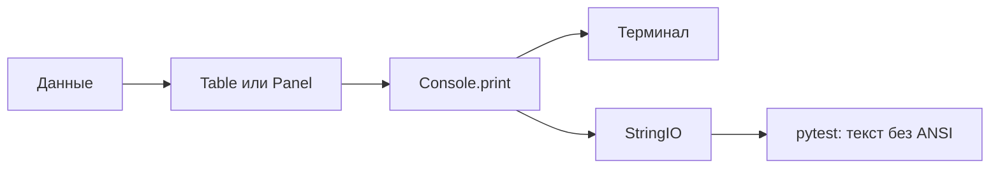

`rich` превращает скучный чёрно-белый вывод консоли в красивые интерфейсы: цвета, стили, таблицы, прогресс-бары и анимацию. При этом всё остаётся обычным текстом в терминале — никакого GUI. В этом уроке разберём основные кирпичики rich и покажем, как их тестировать.

## Установка и первый вывод

```bash
pip install rich
```

Базовый объект — `Console`. Через него печатают с форматированием, причём rich сам определяет, подключён ли терминал: если вывода нет (например, тесты или перенаправление в файл), цветовые коды ANSI автоматически отключаются.

```python
from rich.console import Console

console = Console()
console.print("Привет, мир!", style="bold cyan")
console.print(42, style="green")
console.print("[bold red]Ошибка![/bold red] — что-то пошло не так")
```

У `console.print()` есть параметр `style` для целиком окрашенной строки. Внутри текста работает **разметка** `[bold]...[/bold]`, `[red]...[/red]`, `[underline]...[/underline]` — это удобнее, чем вручную склеивать ANSI-коды. Чтобы rich не интерпретировал разметку, передают `markup=False`.

## Таблицы: Table

Класс `Table` — главный инструмент для вывода данных в виде сетки:

```python
from rich.table import Table

table = Table(title="Пользователи")
table.add_column("ID", justify="right", style="cyan")
table.add_column("Имя", style="bold")
table.add_column("Город")

table.add_row("1", "Аня", "Москва")
table.add_row("2", "Борис", "Казань")
table.add_row("3", "Вера", "Екатеринбург")

console.print(table)
```

`add_column` задаёт заголовок и настройки колонки (выравнивание, стиль), `add_row` — строку данных. Таблица сама вычислит ширины колонок. Если строк много, задают `table.add_row(*values)`, а для отступа — `table.add_column(...)` с `overflow="fold"`.

## Панели: Panel

`Panel` — рамка вокруг произвольного контента:

```python
from rich.panel import Panel

console.print(Panel("Скрипт завершён за 2.4 с", title="Итог", border_style="green"))
```

Панель можно вложить в таблицу или наоборот — rich позволяет строить сложные композиции.

## Live-обновление: Live

`Live` перерисовывает контент в реальном времени. Это удобно для дашбордов, прогресса и «бегущих» статусов:

```python
from time import sleep
from rich.live import Live
from rich.panel import Panel

with Live(refresh_per_second=10) as live:
    for i in range(1, 11):
        live.update(Panel(f"Шаг {i}/10 [{ '#' * i}{'.' * (10 - i)}]"))
        sleep(0.3)
```

Контекстный менеджер `Live` принимает объект для отображения; каждый вызов `live.update(...)` мгновенно перерисовывает строку. После выхода из блока финальное состояние остаётся на экране.

## Вывод в строку: зачем это для тестов

Rich умеет писать не только в терминал, но и в любой файловый объект — например, в `io.StringIO`:

```python
import io
from rich.console import Console

buf = io.StringIO()
console = Console(file=buf)
console.print("Постой, [bold]друг[/bold red]!")
text = buf.getvalue()
print(text)  # "Постой, друг!"
```

Это основа тестирования: можно проверить точный текст вывода, не обращаясь к настоящему терминалу. Методы `console.export_text()` и `console.export_html()` отдают весь накопленный вывод как строку.

## Схема вывода rich



Один и тот же объект `Table` рендерится по-разному в зависимости от приёмника — именно поэтому логику построения таблицы можно проверить без терминала.

## Чистые функции против грязных

Чтобы код было легко тестировать, отделяй «чистую» логику (создание таблицы, подготовка данных) от «грязной» (печать). Например, функция, которая строит `Table`, не печатает сама — и её можно проверить без консоли вообще. Посмотрим на практике.

<!--TASK-->
### Задача 1
Напиши функцию `greet(name, console=None)`, которая создаёт консоль (`console = console or Console()`) и печатает приветствие в панели: текст `Привет, {name}!` с `style="bold green"`, заголовок панели — `Добро пожаловать`, цвет рамки — `green`. Затем вызови `greet("Аня")` — в терминале должна появиться зелёная рамка с текстом. Ожидаемый результат: функция печатает через `console.print(Panel(...))` и ничего не возвращает.

### Задача 2
Напиши функцию `build_users_table(rows)`, которая принимает список словарей с ключами `id`, `name`, `city` и возвращает объект `rich.table.Table`. Добавь три колонки: `ID` (выравнивание справа, стиль `cyan`), `Имя` (жирный), `Город`. Для каждого словаря добавь строку. Не печатай таблицу внутри функции — она должна только строить объект. Проверь вручную: `print(build_users_table([...]))` не должен падать, а строк `table.row_count` должно быть столько же, сколько элементов в списке. Ожидаемый результат: функция возвращает `Table` с тремя колонками и `row_count == len(rows)`.

### Задача 3
Напиши функцию `render_dashboard(steps=8, console=None)`, которая с помощью `Live` показывает обновляющуюся панель: на шаге `i` выводит `Шаг {i}/{steps}` и строку прогресса из `#` и `.` (например, `#####...`). Между шагами — `sleep(0.2)`. После завершения выведи финальное сообщение `Готово!` через `console.print`. Проверь вручную: запусти и увидь анимацию. Ожидаемый результат: функция работает без ошибок и по завершении печатает `Готово!`.

### Задача 4
Напиши pytest-тесты для `greet`: передай консоль с `file=io.StringIO()`, вызови `greet("Аня", console)`, затем проверь, что текст из буфера содержит `Привет, Аня!` и не содержит ни одного ANSI-кода (символа `\x1b`). Подсказка: rich сам отключает цвета при выводе в не-терминал, но для надёжности проверь, что `"\x1b" not in buf.getvalue()`. Запусти `python -m pytest test_greet.py -v`. Ожидаемый результат: оба теста проходят.

### Задача 5
Напиши pytest-тесты для `build_users_table`: (1) для трёх строк `row_count == 3`; (2) количество колонок равно 3; (3) печать таблицы в `StringIO`-консоль содержит заголовки `ID`, `Имя`, `Город` и первое имя (`Аня`); (4) пустой список даёт таблицу с `row_count == 0`. Используй `console.print(table)` и `buf.getvalue()`. Запусти тесты. Ожидаемый результат: все проверки проходят.
### Задача 6
Напиши функцию `status_panel(name, value, limit)`, которая возвращает объект `rich.panel.Panel` для мониторинга: заголовок `Мониторинг`, тело `f"[bold]{name}[/bold]: {value} из {limit}"`, а цвет рамки зависит от нагрузки — `green`, если `value <= limit`, `yellow`, если `value <= limit * 1.2`, иначе `red`. Функция ничего не печатает: она только собирает панель, поэтому её легко проверить в тесте. Ожидаемый результат: `status_panel("CPU", 5, 10).border_style == "green"`, а `status_panel("CPU", 13, 10).border_style == "red"`; при печати в терминале видна цветная рамка с жирным именем метрики.

### Задача 7
Напиши функцию `export_report_html(rows, path)`, которая строит таблицу пользователей (`ID`, `Имя`, `Город`) и сохраняет её как HTML-файл. Используй `Console(record=True, width=100)`, напечатай таблицу и получи разметку через `console.export_html(inline_styles=True)`. Запиши результат в `path` с `encoding="utf-8"` и верни путь. Ожидаемый результат: файл существует, содержит подстроку `<table` и имя первого пользователя, а в терминал при работе функции не выводится ни одной строки.
<!--/TASK-->

<!--HINT-->
### Подсказка 1
Сигнатура: `def greet(name, console=None):`; внутри `console = console or Console()`. Панель: `Panel(f"Привет, {name}!", title="Добро пожаловать", border_style="green")`. Печать: `console.print(panel)`. Не забудь импорт `Console` и `Panel`.

### Подсказка 2
`Table(title="Пользователи")`; `add_column("ID", justify="right", style="cyan")`, `add_column("Имя", style="bold")`, `add_column("Город")`. В цикле: `table.add_row(str(row["id"]), row["name"], row["city"])`. Возвращай `table`.

### Подсказка 3
Используй `with Live(refresh_per_second=10) as live:` и внутри цикла `live.update(Panel(f"Шаг {i}/{steps} [...]"))`. Строку прогресса строй так: `"#" * i + "." * (steps - i)`. После цикла, вне блока `with`, — `console.print("Готово!")`.

### Подсказка 4
В тесте создай `buf = io.StringIO()`, `console = Console(file=buf)`, затем `greet("Аня", console)`. Проверки: `assert "Привет, Аня!" in buf.getvalue()` и `assert "\x1b" not in buf.getvalue()`. Импорты: `io`, `Console`, `greet`.

### Подсказка 5
Для печати таблицы: `buf = io.StringIO()`, `Console(file=buf).print(table)`, затем ищи подстроки в `buf.getvalue()`. Колонки: `len(table.columns) == 3`. Для пустого списка просто передай `[]` в `build_users_table`.
### Подсказка 6
Собери `Panel(...)` и вычисли цвет в обычном `if/elif/else` перед созданием объекта: `color = "green" if value <= limit else ...`. Параметр называется `border_style`, а не `style`. Возвращай именно `Panel`, не печатай его — тест будет проверять `panel.border_style`, а не содержимое буфера.

### Подсказка 7
`Console(record=True)` нужно создать до печати: `console = Console(record=True, width=100)`. HTML берётся из того же объекта: `html = console.export_html(inline_styles=True)`. Запись файла — `Path(path).write_text(html, encoding="utf-8")`. Таблицу строй через `Table()` и `add_row`, как в теории.
<!--/HINT-->

<!--SOLUTION-->
### Разбор 1
Полное решение:

```python
from rich.console import Console
from rich.panel import Panel

def greet(name, console=None):
    console = console or Console()
    panel = Panel(
        f"Привет, {name}!",
        title="Добро пожаловать",
        border_style="green",
    )
    console.print(panel)
```

Разбор. Параметр `console=None` — осознанный дизайн: по умолчанию функция печатает в настоящий терминал, а в тестах туда подставляется консоль, пишущая в `StringIO`. Это стандартный приём «внедрения зависимости» (dependency injection): функция не создаёт консоль сама, если ей уже дали. `Panel` берёт текст, заголовок и цвет рамки; `console.print(panel)` рисует рамку. Обрати внимание: rich понимает стили и в `border_style`, и в обычных строках. Вывод в терминале — зелёная рамка с приветствием, и никаких ручных ANSI-кодов.

### Разбор 2
Полное решение:

```python
from rich.table import Table

def build_users_table(rows):
    table = Table(title="Пользователи")
    table.add_column("ID", justify="right", style="cyan")
    table.add_column("Имя", style="bold")
    table.add_column("Город")
    for row in rows:
        table.add_row(str(row["id"]), row["name"], row["city"])
    return table
```

Разбор. Функция строит «чистый» объект `Table` и не печатает его — это разделение ответственности: логика структуры отделена от ввода-вывода. Колонка `ID` выравнивается вправо (`justify="right"`) и красится в циановый, `Имя` — жирным. `add_row` принимает столько аргументов, сколько колонок. Такую таблицу можно и распечатать (`console.print(table)`), и превратить в HTML (`table.export_html()`), и проверить в тестах — она не «привязана» к консоли. В этом и ценность чистой функции: она предсказуема.

### Разбор 3
Полное решение:

```python
from time import sleep
from rich.console import Console
from rich.live import Live
from rich.panel import Panel

def render_dashboard(steps=8, console=None):
    console = console or Console()
    with Live(refresh_per_second=10) as live:
        for i in range(1, steps + 1):
            bar = "#" * i + "." * (steps - i)
            live.update(Panel(f"Шаг {i}/{steps} [{bar}]"))
            sleep(0.2)
    console.print("Готово!")
```

Разбор. `Live` перерисовывает содержимое при каждом `update`: мы строим строку прогресса из `#` (сделанные шаги) и `.` (оставшиеся). Символы повторяются умножением строки на число — `"#" * 3` даёт `"###"`. `refresh_per_second=10` ограничивает частоту перерисовки, чтобы не тратить ресурсы. Важный нюанс: финальный вывод `Готово!` идёт уже **после** контекстного менеджера — иначе он перерисовывался бы вместе с Live. Такой дашборд легко встроить в реальный скрипт: достаточно заменить `sleep` на настоящую работу.

### Разбор 4
Полное решение:

```python
import io
import pytest
from rich.console import Console
from greet import greet

def test_greet_prints_name():
    buf = io.StringIO()
    console = Console(file=buf)
    greet("Аня", console)
    assert "Привет, Аня!" in buf.getvalue()

def test_greet_no_ansi_codes():
    buf = io.StringIO()
    console = Console(file=buf)
    greet("Аня", console)
    assert "\x1b" not in buf.getvalue()
```

Разбор. `Console(file=buf)` направляет вывод в память. Первый тест проверяет содержание: в буфере обязана быть строка `Привет, Аня!`. Второй тест убеждается, что вывод «чистый»: ANSI-коды начинаются с символа `\x1b` (escape), и если в тексте его нет — значит, в файл ушли только настоящие символы. Это важно и для сохранения вывода в логи, и для сравнения с ожидаемым текстом. rich сам определяет, что `StringIO` — не терминал, и отключает цвета; наш тест подстраховывается и проверяет это явно. Тест быстрый, без сети и без реального терминала.

### Разбор 5
Полное решение:

```python
import io
from rich.console import Console
from users_table import build_users_table

ROWS = [
    {"id": 1, "name": "Аня", "city": "Москва"},
    {"id": 2, "name": "Борис", "city": "Казань"},
    {"id": 3, "name": "Вера", "city": "Екатеринбург"},
]

def test_row_count_and_columns():
    table = build_users_table(ROWS)
    assert table.row_count == 3
    assert len(table.columns) == 3

def test_rendered_text_contains_headers_and_row():
    table = build_users_table(ROWS)
    buf = io.StringIO()
    Console(file=buf).print(table)
    text = buf.getvalue()
    assert "ID" in text and "Имя" in text and "Город" in text
    assert "Аня" in text

def test_empty_rows():
    table = build_users_table([])
    assert table.row_count == 0
```

Разбор. Первый тест проверяет структуру таблицы без печати: `row_count` — число строк, `columns` — список объектов колонок. Второй тест делает полный «рендер»: печатает таблицу в `StringIO` и ищет в получившемся тексте заголовки и данные. Это точная проверка того, что увидит пользователь в терминале. Третий тест покрывает граничный случай — пустой список не должен ломаться и даёт ноль строк. Такой набор тестов позволяет смело менять стили и структуру, не боясь сломать вывод.
### Разбор 6
Полное решение:

```python
from rich.panel import Panel

def status_panel(name, value, limit):
    if value <= limit:
        color = "green"
    elif value <= limit * 1.2:
        color = "yellow"
    else:
        color = "red"

    return Panel(
        f"[bold]{name}[/bold]: {value} из {limit}",
        title="Мониторинг",
        border_style=color,
    )
```

Разбор. Функция возвращает готовый объект, а не печатает его — это то самое разделение «чистой» и «грязной» части, о котором говорит теория. Цвет выбирается тремя ветками: до лимита — зелёный, до 120% лимита — жёлтый, дальше — красный; такая шкала типична для мониторинга, потому что ровно на границе ещё нет аварии, но уже стоит присмотреться. Внутри текста работает rich-разметка `[bold]...[/bold]`, поэтому имя метрики выделяется без ручных ANSI-кодов. `border_style` принимает имя цвета или полноценный стиль. Проверять такую функцию можно без консоли вообще: `border_style` — обычный атрибут объекта. В реальном скрипте остаётся вызвать `console.print(status_panel(...))` — и панель появится в терминале.

### Разбор 7
Полное решение:

```python
from pathlib import Path
from rich.console import Console
from rich.table import Table

def export_report_html(rows, path):
    table = Table(title="Пользователи")
    table.add_column("ID", justify="right")
    table.add_column("Имя", style="bold")
    table.add_column("Город")
    for row in rows:
        table.add_row(str(row["id"]), row["name"], row["city"])

    console = Console(record=True, width=100)
    console.print(table)
    html = console.export_html(inline_styles=True)

    Path(path).write_text(html, encoding="utf-8")
    return path
```

Разбор. `record=True` включает запись всего, что проходит через консоль: rich хранит сегменты и умеет отдавать их как текст или HTML. Мы печатаем таблицу в такую консоль — вывод уйдёт в настоящий терминал, но одновременно сохранится в памяти. Метод `export_html(inline_styles=True)` превращает записанные сегменты в полноценный HTML-документ, подставляя цвета прямо в атрибуты `style`, а не в отдельный CSS: такой файл можно открыть где угодно без дополнительных ресурсов. `width=100` фиксирует ширину рендера, чтобы таблица не зависела от размера окна и результат был детерминированным — это важно для тестов и для рассылок. Запись идёт в UTF-8, иначе кириллица в имени пользователя превратится в мусор на некоторых системах. Функция возвращает путь — единый контракт с остальными генераторами.
<!--/SOLUTION-->

<!--QUIZ-->
Какой класс в rich отвечает за вывод в терминал?
- Printer
- Console
- Output
- Renderer
* Правильный ответ: Console
Console — центральный объект для печати и рендеринга.

Что делает разметка [bold]текст[/bold]?
- Печатает текст дважды
- Делает текст полужирным
- Выравнивает текст
- Добавляет рамку
* Правильный ответ: Делает текст полужирным
Разметка rich управляет стилями внутри строки.

Как вывести таблицу в rich?
- Создать объект Table и передать его в console.print()
- Вызвать print_table()
- Использовать класс Grid
- Вызвать console.table()
* Правильный ответ: Создать объект Table и передать его в console.print()
Table строит сетку, console.print рендерит её.

Что делает Live?
- Печатает логи в файл
- Перерисовывает контент на экране в реальном времени
- Блокирует вывод
- Ускоряет печать
* Правильный ответ: Перерисовывает контент на экране в реальном времени
live.update() обновляет текущую строку без накопления.

Как направить вывод Console в строку?
- Console(file=io.StringIO())
- console.to_string()
- Console(stream=True)
- print(console)
* Правильный ответ: Console(file=io.StringIO())
Указав file, вы получаете вывод в памяти.

Что делает метод console.export_text()?
- Печатает текст на экран
- Отдаёт накопленный вывод как обычную строку
- Сохраняет вывод в файл
- Очищает буфер
* Правильный ответ: Отдаёт накопленный вывод как обычную строку
export_text() возвращает весь вывод без ANSI-кодов.

Зачем rich отключает цвета при выводе в файл?
- Чтобы файл был меньше
- Потому что цвета поддерживаются только в терминалах
- Это баг библиотеки
- Чтобы ускорить вывод
* Правильный ответ: Потому что цвета поддерживаются только в терминалах
В не-терминал rich не пишет ANSI-коды, чтобы вывод оставался чистым текстом.

Как добавить заголовок колонки таблицы?
- table.add_column("Имя")
- table.set_header("Имя")
- table.column("Имя")
- table.title = "Имя"
* Правильный ответ: table.add_column("Имя")
add_column задаёт заголовок и настройки колонки.

Что выведет console.print("[red]Тест[/red]") при file=StringIO?
- Строку с ANSI-кодами красного цвета
- Текст «Тест» без цветовых кодов
- Ничего
- Ошибку
* Правильный ответ: Текст «Тест» без цветовых кодов
В не-терминал rich отдаёт чистый текст.

Что возвращает math.add_row(...)?
- Число строк
- None — строка добавляется в таблицу
- Объект строки
- Кортеж значений
* Правильный ответ: None — строка добавляется в таблицу
add_row модифицирует таблицу и возвращает None.
Что делает Console(record=True)?
- Сохраняет весь вывод для export_text и export_html
- Ускоряет печать в терминал
- Отключает цвета
- Записывает вывод в файл автоматически
* Правильный ответ: Сохраняет весь вывод для export_text и export_html
В режиме записи rich накапливает сегменты, которые потом можно отдать как текст или HTML.

Как задать цвет рамки панели?
- Panel("текст", border_style="green")
- Panel("текст", color="green")
- Panel("текст", style_border=True)
- Panel("текст", frame="green")
* Правильный ответ: Panel("текст", border_style="green")
border_style принимает имя цвета или стиль rich и красит именно рамку.

Что возвращает свойство table.row_count?
- Число добавленных строк
- Число колонок
- Ширину таблицы
- Список заголовков
* Правильный ответ: Число добавленных строк
row_count растёт с каждым add_row и удобен для проверок в тестах.

Что делает console.export_html(inline_styles=True)?
- Возвращает HTML со встроенными в теги стилями
- Сохраняет вывод в PDF
- Печатает таблицу в браузер
- Очищает записанный вывод
* Правильный ответ: Возвращает HTML со встроенными в теги стилями
inline_styles подставляет цвета прямо в атрибуты, и файл не зависит от внешнего CSS.
<!--/QUIZ-->
