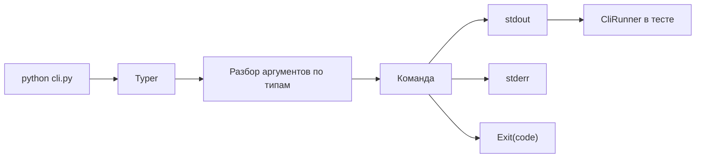

`typer` — библиотека для создания интерфейсов командной строки (CLI). Она построена на `click`, но объявляет команды через аннотации типов Python: меньше кода, автозаполнение, `--help` из коробки. В этом уроке мы напишем утилиту с несколькими командами и покроем её тестами.

## Установка и первая команда

```bash
pip install typer
```

Минимальное приложение:

```python
import typer

app = typer.Typer()

@app.command()
def hello(name: str):
    """Поздороваться с пользователем."""
    typer.echo(f"Привет, {name}!")

if __name__ == "__main__":
    app()
```

Запуск:

```bash
python cli.py hello Аня
# Привет, Аня!
```

Декоратор `@app.command()` превращает функцию в команду. Аргумент `name: str` становится позиционным аргументом CLI: если его не передать, typer сам выведет понятную ошибку. Docstring функции автоматически становится текстом помощи в `--help`.

## Аргументы и опции

Позиционные аргументы — `name: str`. Опции объявляются `typer.Option(...)` с дефолтом:

```python
@app.command()
def hello(name: str, greeting: str = typer.Option("Привет", help="Слово приветствия")):
    typer.echo(f"{greeting}, {name}!")
```

Теперь `python cli.py hello Аня --greeting Здравствуйте` выведет `Здравствуйте, Аня!`. Булевы флаги — это `bool` с `typer.Option(False, "--verbose")` или просто `verbose: bool = False` (появится флаг `--verbose/--no-verbose`).

Множественные значения — через `List[int]`:

```python
from typing import List

@app.command()
def total(numbers: List[int]):
    typer.echo(sum(numbers))
```

Вызов: `python cli.py total 1 2 3` → `6`.

## Ошибки и коды возврата

Чтобы завершить команду с ошибкой, используют `typer.Exit(code=1)`:

```python
from pathlib import Path

@app.command()
def file_info(path: Path):
    if not path.exists():
        typer.echo(f"Файл не найден: {path}", err=True)
        raise typer.Exit(code=1)
    typer.echo(f"{path.name}: {path.stat().st_size} байт")
```

`err=True` отправляет сообщение в stderr, а `Exit(code=1)` задаёт код возврата процесса — скрипты и CI смогут его поймать.

## Тестирование: CliRunner

Тестировать CLI можно через `typer.testing.CliRunner`. Он вызывает команды внутри процесса теста, без запуска отдельного процесса:

```python
from typer.testing import CliRunner
from cli import app

runner = CliRunner()

def test_hello():
    result = runner.invoke(app, ["hello", "Аня"])
    assert result.exit_code == 0
    assert "Привет, Аня!" in result.stdout
```

`runner.invoke(app, args)` возвращает `Result` с `exit_code` и `stdout`. Внутри `runner.isolated_filesystem()` можно создавать временные файлы — это идеально для команд, работающих с файлами.

## Схема работы CLI



Схема объясняет, почему тест почти не отличается от реального запуска: `CliRunner` проходит тот же путь, только перехватывает потоки и код возврата.

## Почему typer, а не argparse

У `argparse` больше шаблонного кода, типы приходится указывать вручную, help тоже. Typer берёт всё на себя: типы из аннотаций, генерация `--help`, подсказки при ошибках. Для маленьких и средних утилит это заметно быстрее и чище. Поехали практиковаться.

<!--TASK-->
### Задача 1
Создай файл `cli.py` с приложением `app = typer.Typer()`. Добавь команду `hello`: позиционный аргумент `name: str` и опцию `greeting: str = typer.Option("Привет", help="Слово приветствия")`. Команда печатает `f"{greeting}, {name}!"` через `typer.echo`. Проверь: `python cli.py hello Аня` печатает `Привет, Аня!`, а `python cli.py hello Аня --greeting Здравствуйте` — `Здравствуйте, Аня!`. Ожидаемый результат: обе команды работают, `--help` показывает описание опции.

### Задача 2
Добавь в `cli.py` команду `total`, которая принимает `numbers: List[int]` и печатает их сумму. Проверь: `python cli.py total 1 2 3` выводит `6`, а `python cli.py total` — `0`. Ожидаемый результат: сумма печатается корректно, в том числе для пустого списка.

### Задача 3
Добавь в `cli.py` команду `file-info` с аргументом `path: Path`. Если файл не существует — выведи `Файл не найден: {path}` в stderr (`err=True`) и подними `typer.Exit(code=1)`. Если существует — выведи `{path.name}: {size} байт`. Проверь на реальном файле и на несуществующем: во втором случае команда должна завершиться с кодом 1. Ожидаемый результат: для существующего файла код возврата 0 и вывод размера, для отсутствующего — код 1 и сообщение в stderr.

### Задача 4
Напиши pytest-тесты для команд `hello` и `total` через `CliRunner`: (1) `runner.invoke(app, ["hello", "Аня"])` — `exit_code == 0` и `"Привет, Аня!" in result.stdout`; (2) с опцией `--greeting` — другой текст; (3) `total` для `["1", "2", "3"]` — `exit_code == 0`, вывод `6`; (4) `total` без чисел — вывод `0`. Запусти `python -m pytest test_cli.py -v`. Ожидаемый результат: все 4 теста проходят.

### Задача 5
Напиши pytest-тесты для `file-info`: (1) внутри `runner.isolated_filesystem()` создай файл `data.txt` с текстом, затем `runner.invoke(app, ["file-info", "data.txt"])` — `exit_code == 0` и в `result.stdout` есть `data.txt` и размер файла; (2) для `runner.invoke(app, ["file-info", "missing.txt"])` — `exit_code == 1` и `"не найден" in result.stderr`. Запусти тесты. Ожидаемый результат: все проверки проходят.
### Задача 6
Добавь в `cli.py` команду `stats` с аргументом `path: Path` и опцией `top: int = typer.Option(3, "--top", "-n", help="Сколько слов показать")`. Команда читает файл в UTF-8, считает число строк, слов и уникальных слов и печатает три строки: `Строк: N`, `Слов: N`, `Уникальных: N`, а после них — `Топ-N:` и самые частые слова в формате `слово — 3`. Если файла нет, выведи сообщение в stderr и заверши с кодом 1. Ожидаемый результат: для файла из двух строк `привет мир` и `мир труда` команда печатает `Слов: 4`, а первой в топе идёт строка `мир — 2`.

### Задача 7
Создай подприложение `users_app = typer.Typer(help="Операции с пользователями")` с двумя командами: `list` (печатает `Аня`, `Борис`, `Вера` — по одному в строке) и `add` с аргументом `name: str` (печатает `Добавлен: {name}`). Подключи его к основному приложению через `app.add_typer(users_app, name="users")`. Ожидаемый результат: `python cli.py users list` выводит три имени, `python cli.py users add Даша` печатает `Добавлен: Даша`, а `python cli.py --help` показывает группу `users` в списке команд.
<!--/TASK-->

<!--HINT-->
### Подсказка 1
Тип опции: `greeting: str = typer.Option("Привет", help="Слово приветствия")`. Имя опции typer выведет из имени переменной: `--greeting`. Не забудь `if __name__ == "__main__": app()` для запуска из файла.

### Подсказка 2
Импортируй `from typing import List`. Сигнатура: `def total(numbers: List[int])`. Сумма — `sum(numbers)`. Typer преобразует строки из командной строки в int автоматически.

### Подсказка 3
Используй `from pathlib import Path`. Проверка: `if not path.exists():`. Для stderr: `typer.echo(..., err=True)`. Завершение: `raise typer.Exit(code=1)`. Размер: `path.stat().st_size`.

### Подсказка 4
Один `runner` на модуль: `runner = CliRunner()`. Каждый тест — отдельная функция с `result = runner.invoke(app, [...])`. Проверяй `result.exit_code` и `result.stdout`. Импортируй `app` из `cli.py`.

### Подсказка 5
Используй `with runner.isolated_filesystem():` — внутри текущая директория временная. Создавай файл: `Path("data.txt").write_text("привет", encoding="utf-8")`. Для проверки размера сравни `"data.txt" in result.stdout` и не сравнивай точное число: оно зависит от текста. stderr: `result.stderr`.
### Подсказка 6
Частоты считай через `Counter(w.lower() for w in text.split())`, а топ — `counts.most_common(top)`. Строки: `len(text.splitlines())`, слова: `len(text.split())`, уникальные: `len(counts)`. Проверку файла делай до чтения: `if not path.exists(): typer.echo(..., err=True); raise typer.Exit(code=1)`. Тире в выводе — обычный символ `—` в f-строке.

### Подсказка 7
Функцию нельзя назвать `list` — она затрёт встроенную; назови `list_users` и повесь декоратор с явным именем: `@users_app.command("list")`. Подключение: `app.add_typer(users_app, name="users")` — именно `add_typer`, а не `add_command`. Проверка в тесте: `runner.invoke(app, ["users", "list"])`.
<!--/HINT-->

<!--SOLUTION-->
### Разбор 1
Полное решение (файл `cli.py`):

```python
import typer

app = typer.Typer()

@app.command()
def hello(name: str, greeting: str = typer.Option("Привет", help="Слово приветствия")):
    """Поздороваться с пользователем."""
    typer.echo(f"{greeting}, {name}!")

if __name__ == "__main__":
    app()
```

Разбор. Typer читает аннотации типов: `name: str` становится обязательным позиционным аргументом, `greeting: str = typer.Option(...)` — опцией с дефолтом `Привет`. Имя опции `--greeting` генерируется из имени переменной. `typer.echo` — аналог `print`, но с правильной обработкой юникода и кодировок. Запуск `python cli.py hello Аня` выводит `Привет, Аня!`; передача `--greeting Здравствуйте` меняет слово. Флаг `--help` сгенерирован автоматически: typer задействует docstring функции как описание. Обрати внимание: ничего вручную парсить не нужно — весь синтаксический разбор делает библиотека.

### Разбор 2
Полное решение (добавляем в `cli.py`):

```python
from typing import List

@app.command()
def total(numbers: List[int]):
    """Сумма переданных чисел."""
    typer.echo(sum(numbers))
```

Разбор. Аннотация `List[int]` означает, что команда принимает произвольное число чисел. Typer преобразует каждую строку CLI в `int` (а если это невозможно — выведет понятную ошибку с подсказкой). Если чисел не передано, `numbers` — пустой список, и `sum([])` возвращает `0`, поэтому `python cli.py total` корректно выводит `0`. Такой вариант изящнее, чем вручную парсить `sys.argv` и конвертировать типы с проверками.

### Разбор 3
Полное решение (добавляем в `cli.py`):

```python
from pathlib import Path

@app.command()
def file_info(path: Path):
    """Показать размер файла."""
    if not path.exists():
        typer.echo(f"Файл не найден: {path}", err=True)
        raise typer.Exit(code=1)
    typer.echo(f"{path.name}: {path.stat().st_size} байт")
```

Разбор. `path: Path` заставляет typer преобразовать строку CLI в объект `pathlib.Path`. Если файл отсутствует — сообщение об ошибке уходит в stderr (`err=True`), а `typer.Exit(code=1)` завершает процесс с кодом 1: так оболочка и CI поймут, что команда провалилась. В успешном случае печатается имя файла и размер из `stat().st_size`. Это минимальный, но «правильный» CLI: с понятными ошибками и кодами возврата.

### Разбор 4
Полное решение (файл `test_cli.py`):

```python
from typer.testing import CliRunner
from cli import app

runner = CliRunner()

def test_hello_default_greeting():
    result = runner.invoke(app, ["hello", "Аня"])
    assert result.exit_code == 0
    assert "Привет, Аня!" in result.stdout

def test_hello_custom_greeting():
    result = runner.invoke(app, ["hello", "Аня", "--greeting", "Здравствуйте"])
    assert result.exit_code == 0
    assert "Здравствуйте, Аня!" in result.stdout

def test_total_three_numbers():
    result = runner.invoke(app, ["total", "1", "2", "3"])
    assert result.exit_code == 0
    assert "6" in result.stdout

def test_total_empty():
    result = runner.invoke(app, ["total"])
    assert result.exit_code == 0
    assert "0" in result.stdout
```

Разбор. `CliRunner` запускает приложение in-process: без поднятия процесса, быстро и безопасно. `runner.invoke(app, ["hello", "Аня"])` — ровно то же, что `python cli.py hello Аня`. Результат проверяется по `exit_code` (0 — успех) и содержанию `stdout`. Тесты покрывают и дефолтное приветствие, и опцию, и сумму, и граничный случай пустого списка. Это «золотая» привычка: каждая команда и каждая ветка — в тестах.

### Разбор 5
Полное решение (добавляем в `test_cli.py`):

```python
from pathlib import Path

def test_file_info_existing_file():
    with runner.isolated_filesystem():
        Path("data.txt").write_text("Привет, мир!", encoding="utf-8")
        result = runner.invoke(app, ["file-info", "data.txt"])
        assert result.exit_code == 0
        assert "data.txt" in result.stdout
        assert "байт" in result.stdout

def test_file_info_missing_file():
    result = runner.invoke(app, ["file-info", "missing.txt"])
    assert result.exit_code == 1
    assert "не найден" in result.stderr
```

Разбор. `runner.isolated_filesystem()` создаёт временную рабочую директорию на время блока — файлы, созданные внутри, существуют только там и удаляются после теста. Первый тест пишет `data.txt` и проверяет успешный сценарий: код 0, имя файла и слово «байт» в выводе (точный размер не сравниваем — он зависит от кодировки, поэтому проверяем форму вывода). Второй тест — «счастливый путь» отсутствия файла: код 1 и сообщение в `stderr`. Именно так тестируются утилиты командной строки: через реальный вызов, с временными файлами и без ручного запуска терминала.
### Разбор 6
Полное решение:

```python
from collections import Counter
from pathlib import Path

@app.command()
def stats(path: Path, top: int = typer.Option(3, "--top", "-n", help="Сколько слов показать")):
    """Статистика по текстовому файлу."""
    if not path.exists():
        typer.echo(f"Файл не найден: {path}", err=True)
        raise typer.Exit(code=1)

    text = path.read_text(encoding="utf-8")
    words = text.split()
    counts = Counter(word.lower() for word in words)

    typer.echo(f"Строк: {len(text.splitlines())}")
    typer.echo(f"Слов: {len(words)}")
    typer.echo(f"Уникальных: {len(counts)}")
    typer.echo(f"Топ-{top}:")
    for word, count in counts.most_common(top):
        typer.echo(f"{word} — {count}")
```

Разбор. `path: Path` заставляет typer привести строку к `pathlib.Path`, поэтому дальше работают обычные методы: `exists()` и `read_text()`. Ошибка обрабатывается до чтения — иначе `read_text` бросил бы `FileNotFoundError` с техническим трейсбеком вместо человеческого сообщения. `Counter` решает задачу частот в одну строку: он принимает генератор и сразу строит словарь «слово → количество»; `lower()` приводит регистр, чтобы «Мир» и «мир» считались одним словом. `most_common(top)` сортирует по убыванию частоты и обрезает список. Опция объявлена с двумя именами: длинным `--top` и коротким `-n`, а `help` попадёт в автоматическую справку. Вывод строится отдельными `echo`, поэтому тест может проверять любую строку по отдельности.

### Разбор 7
Полное решение:

```python
users_app = typer.Typer(help="Операции с пользователями")

@users_app.command("list")
def list_users():
    """Показать всех пользователей."""
    for name in ("Аня", "Борис", "Вера"):
        typer.echo(name)

@users_app.command("add")
def add_user(name: str):
    """Добавить пользователя."""
    typer.echo(f"Добавлен: {name}")

app.add_typer(users_app, name="users")
```

Разбор. Подприложение — это обычный `typer.Typer()`, только подключённый к родителю через `add_typer`. Так большие CLI разбиваются на группы: `users`, `orders`, `reports`, и каждая живёт в своём модуле. Важная деталь — имя команды: функцию пришлось назвать `list_users`, потому что `list` затирает встроенный тип, а декоратор `@users_app.command("list")` задаёт внешнее имя явно. `help="..."` в конструкторе группы выводится в `--help` рядом с именем. В тестах путь повторяет реальный вызов: `runner.invoke(app, ["users", "list"])` — сначала имя группы, потом имя команды. Такой структурой удобно наращивать CLI без риска сломать существующие команды.
<!--/SOLUTION-->

<!--QUIZ-->
Что используется для создания команды в typer?
- @app.command() над функцией
- typer.cmd()
- @command
- class Command
* Правильный ответ: @app.command() над функцией
Декоратор регистрирует функцию как команду CLI.

Как объявить позиционный аргумент?
- name: str
- name = typer.Argument()
- @arg("name")
- typer.positional("name")
* Правильный ответ: name: str
Аннотация типа делает параметр позиционным аргументом.

Как объявить опцию с дефолтом?
- greeting: str = typer.Option("Привет")
- greeting = "Привет"
- @option(greeting)
- typer.flag(greeting)
* Правильный ответ: greeting: str = typer.Option("Привет")
typer.Option создаёт опцию --greeting с заданным значением по умолчанию.

Что делает typer.echo()?
- Выводит текст (аналог print) с правильной кодировкой
- Возвращает текст
- Читает ввод пользователя
- Подсвечивает текст
* Правильный ответ: Выводит текст (аналог print) с правильной кодировкой
typer.echo печатает в stdout, корректно обрабатывая юникод.

Как завершить команду с кодом ошибки?
- raise typer.Exit(code=1)
- return 1
- sys.exit(1) в любом месте
- typer.error()
* Правильный ответ: raise typer.Exit(code=1)
Exit немедленно останавливает выполнение и задаёт код возврата.

Как тестировать команды typer?
- Через CliRunner из typer.testing
- Только запуском процесса
- Через unittest.mock
- Тестировать CLI нельзя
* Правильный ответ: Через CliRunner из typer.testing
CliRunner.invoke(app, args) запускает команду in-process.

Что содержит result.exit_code при успехе?
- 0
- 1
- Текст вывода
- None
* Правильный ответ: 0
Код 0 означает успешное завершение.

Что делает runner.isolated_filesystem()?
- Создаёт временную папку на время блока
- Изолирует сеть
- Останавливает другие команды
- Сохраняет вывод в файл
* Правильный ответ: Создаёт временную папку на время блока
Файлы внутри блока существуют только во временной директории.

Как принять несколько чисел в команде?
- numbers: List[int]
- numbers: int[]
- numbers: str
- Невозможно
* Правильный ответ: numbers: List[int]
Typer принимает произвольное число значений и преобразует их в int.

Зачем typer нужен docstring функции?
- Он выводится в --help
- Он ускоряет выполнение
- Он не нужен
- Он заменяет код
* Правильный ответ: Он выводится в --help
Docstring становится описанием команды в справке.
Как подключить группу команд к приложению?
- app.add_typer(users_app, name="users")
- app.add_command(users_app)
- app.include(users_app)
- @app.group(users_app)
* Правильный ответ: app.add_typer(users_app, name="users")
add_typer регистрирует вложенное приложение под указанным именем.

Что задаёт typer.Option(3, "--top", "-n")?
- Значение по умолчанию и два имени флага
- Три обязательных аргумента
- Тип значения
- Код возврата
* Правильный ответ: Значение по умолчанию и два имени флага
Первый аргумент — дефолт, дальше перечисляются длинное и короткое имена.

Куда попадёт текст при typer.echo("Ошибка", err=True)?
- В stderr
- В stdout
- В файл лога
- Никуда
* Правильный ответ: В stderr
err=True переключает поток, и сообщение можно отделить от полезного вывода.

Как назвать команду иначе, чем функция?
- @app.command("list") над функцией list_users
- Переименовать функцию в list
- app.rename("list")
- Это невозможно
* Правильный ответ: @app.command("list") над функцией list_users
Декоратор принимает явное имя, а функция может называться как угодно.
<!--/QUIZ-->
