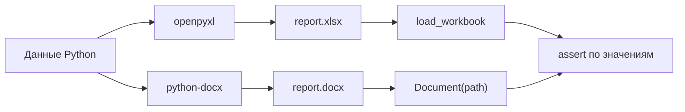

Бизнес-отчёты почти всегда живут в Excel и Word. `openpyxl` читает и пишет `.xlsx`, а `python-docx` — `.docx`. В этом уроке научимся генерировать настоящие отчёты: со стилями, формулами, заголовками и таблицами — и, главное, тестировать их, перечитывая созданные файлы.

## Установка

```bash
pip install openpyxl python-docx
```

## openpyxl: книга, лист, ячейки

Книга — `Workbook`, лист — `Worksheet`, ячейка — значение по адресу:

```python
from openpyxl import Workbook

wb = Workbook()
ws = wb.active            # первый лист
ws.title = "Продажи"       # переименуем

ws["A1"] = "Товар"
ws["B1"] = "Количество"
ws.append(["Ноутбук", 5])  # добавить строку в конец
ws.append(["Монитор", 3])

wb.save("sales.xlsx")
```

`ws.append(list)` добавляет строку вниз листа; `ws["A1"] = value` пишет в конкретную ячейку. Адрес можно получить и в числовом виде: `ws.cell(row=2, column=1)`.

## Стили и формулы

Стили задаются объектами `Font`, `PatternFill`, `Alignment`:

```python
from openpyxl.styles import Font, PatternFill, Alignment

header_font = Font(bold=True, color="FFFFFF")
header_fill = PatternFill(start_color="4472C4", end_color="4472C4", fill_type="solid")

ws["A1"].font = header_font
ws["A1"].fill = header_fill
ws["A1"].alignment = Alignment(horizontal="center")

ws.column_dimensions["A"].width = 20
```

Формулы записываются как строки со знаком `=`:

```python
ws["B8"] = "=SUM(B2:B7)"
```

`openpyxl` не вычисляет формулы — он просто сохраняет их. Чтобы прочитать вычисленное значение, Excel должен открыть файл, а при чтении используют `load_workbook(path, data_only=True)`.

## Чтение существующих книг

```python
from openpyxl import load_workbook

wb = load_workbook("sales.xlsx")
ws = wb["Продажи"]
for row in ws.iter_rows(min_row=1, max_row=3, values_only=True):
    print(row)   # кортеж значений
```

`iter_rows(values_only=True)` отдаёт строки кортежами — удобно для проверок и подсчётов.

## python-docx: документ Word

Документ — `Document`. Добавляем заголовки, абзацы и таблицы:

```python
from docx import Document

doc = Document()
doc.add_heading("Отчёт по продажам", level=1)
doc.add_paragraph("Составлен автоматически.")

table = doc.add_table(rows=2, cols=2)
table.style = "Light Grid Accent 1"
table.cell(0, 0).text = "Товар"
table.cell(0, 1).text = "Количество"
table.cell(1, 0).text = "Ноутбук"
table.cell(1, 1).text = "5"

doc.save("report.docx")
```

`add_heading(text, level=1)` создаёт заголовок (level 1 — самый крупный), `add_paragraph` — обычный текст, `add_table(rows, cols)` — таблицу, ячейки которой заполняются через `table.cell(r, c).text`.

## Схема отчёта в двух форматах



Обе ветки сходятся в одной точке — проверке: тест всегда перечитывает файл, а не доверяет объекту в памяти.

## Как тестировать документы

`openpyxl` и `python-docx` — не «рисование», а XML-структуры. Поэтому тесты простые: создай отчёт в `tmp_path`, перечитай его и проверь значения, стили и структуру. Давай сделаем именно так.

<!--TASK-->
### Задача 1
Напиши функцию `write_sales_report(rows, path)`, где `rows` — список кортежей `(товар, количество)`. Функция создаёт книгу, лист `Продажи`, пишет заголовки `Товар` и `Количество` (жирный белый шрифт, заливка `4472C4`, выравнивание по центру), затем строки из `rows`. После данных добавь строку `Итого` и формулу `=SUM(B2:B{конец})` в колонке `B` (нумерация: заголовок — строка 1, данные начинаются со строки 2). Сохрани книгу в `path` и верни `path`. Проверь вручную: после запуска открой файл в Excel или перечитай через `load_workbook`. Ожидаемый результат: файл создан, в A1 и B1 заголовки, в последней строке формула `=SUM(...)`.

### Задача 2
Напиши функцию `read_sales_summary(path)`, которая через `load_workbook(path)` читает лист `Продажи` и возвращает кортеж `(rows, total_row)`: `rows` — список всех строк (как кортежи значений, включая заголовок), `total_row` — строка «Итого» в виде кортежа. Используй `ws.iter_rows(values_only=True)`. Проверь на файле из задачи 1. Ожидаемый результат: `rows` содержит заголовок и данные, `total_row[0] == "Итого"`, а `total_row[1]` — строка с формулой.

### Задача 3
Напиши функцию `make_word_report(title, items, path)`, где `items` — список кортежей `(название, количество)`. Функция создаёт документ, добавляет заголовок level 1 (`title`), абзац `Составлен автоматически.` и таблицу с шапкой `Название` / `Количество` и строками из `items`. Стиль таблицы — `Light Grid Accent 1`. Сохрани в `path` и верни `path`. Проверь вручную: открой файл в Word. Ожидаемый результат: документ содержит заголовок, абзац и таблицу с `len(items) + 1` строками.

### Задача 4
Напиши pytest-тесты для `write_sales_report` и `read_sales_summary`. Используй `tmp_path`: (1) `write_sales_report([("Ноутбук", 5), ("Монитор", 3)], path)` создаёт файл, `path.exists()` — истина; (2) `read_sales_summary(path)` возвращает `rows` с заголовком и двумя данными; (3) в `total_row` первым элементом `Итого`, а вторым — строка, начинающаяся с `=SUM(`; (4) заголовок в ячейке A1 имеет жирный шрифт (`ws["A1"].font.bold is True`) и заливку. Запусти `python -m pytest test_excel.py -v`. Ожидаемый результат: все тесты проходят.

### Задача 5
Напиши pytest-тесты для `make_word_report`: (1) файл создан; (2) после `Document(path)` первый абзац-заголовок содержит `title` (проверь `doc.paragraphs[0].text`); (3) количество таблиц равно 1; (4) таблица имеет `len(items) + 1` строк и 2 колонки; (5) ячейка `(1, 0)` содержит первое название из `items`. Запусти тесты. Ожидаемый результат: все проверки проходят.
### Задача 6
Напиши функцию `write_multi_sheet_report(data, path)`, где `data` — словарь `{"Москва": [("Ноутбук", 5, 79990)], "Казань": [...]}`. Для каждого города создай отдельный лист с его именем: шапка `Товар`, `Кол-во`, `Цена`, `Сумма`, строки данных и формула `=B{r}*C{r}` в колонке D, а в конце — строка `Итого` с формулой `=SUM(D2:D{n})`. Стандартный пустой лист удали через `wb.remove(wb.active)`. Функция возвращает список имён листов. Ожидаемый результат: для двух городов возвращается `["Москва", "Казань"]`, а после `load_workbook` значение `ws["D2"].value` начинается с `=`.

### Задача 7
Напиши функцию `make_checklist_doc(title, items, path)`, которая создаёт документ Word: заголовок уровня 1 с текстом `title`, вводный абзац `Чек-лист задач.`, затем по одному абзацу на каждый пункт со стилем `List Bullet`, а в конце — таблицу с шапкой `Пункт` и `Статус` и строкой `Не начато` для каждого пункта. Сохрани документ по пути и верни путь. Ожидаемый результат: после `Document(path)` стиль параграфа `paragraphs[2]` — `List Bullet`, в документе одна таблица с `len(items) + 1` строками, а ячейка `(0, 0)` содержит `Пункт`.
<!--/TASK-->

<!--HINT-->
### Подсказка 1
Нумерация строк: заголовок — строка 1, данные — со строки 2. Итог пиши после цикла по `rows`: `ws.append(["Итого", "=SUM(B2:B{1 + len(rows)})"])`. Стили — через `Font(bold=True, color="FFFFFF")`, `PatternFill(start_color="4472C4", end_color="4472C4", fill_type="solid")`, `Alignment(horizontal="center")`.

### Подсказка 2
Читай так: `ws = load_workbook(path)["Продажи"]`, затем `rows = list(ws.iter_rows(values_only=True))`, последняя строка — `rows[-1]`. Верни `(rows, rows[-1])`.

### Подсказка 3
Таблица: `table = doc.add_table(rows=len(items) + 1, cols=2)`; `table.style = "Light Grid Accent 1"`. Шапку и данные заполняй через `table.cell(r, c).text`.

### Подсказка 4
После `write_sales_report` перечитай: `wb = load_workbook(path)`, `ws = wb["Продажи"]`. Проверки: `ws["A1"].font.bold is True`, `ws["A1"].fill.start_color.rgb` содержит `4472C4`, `ws.cell(row=4, column=2).value` начинается с `=SUM(`.

### Подсказка 5
Открывай документ: `doc = Document(path)`. Для заголовка используй `doc.paragraphs[0].text == title`. Таблицы: `doc.tables` — список; `len(doc.tables) == 1`; `table = doc.tables[0]`; `len(table.rows)`, `len(table.columns)`; ячейка — `table.rows[1].cells[0].text`.
### Подсказка 6
После `wb = Workbook()` сразу сделай `wb.remove(wb.active)`, иначе останется лишний «Sheet». Новый лист создавай так: `ws = wb.create_sheet(city)`. Номер строки для формулы — из `enumerate(rows, start=2)`. Итог: `last = 1 + len(rows)`, затем `ws.append(["Итого", None, None, f"=SUM(D2:D{last})"])`. Верни `wb.sheetnames` после сохранения.

### Подсказка 7
Маркированный абзац: `doc.add_paragraph(item, style="List Bullet")` — стиль передаётся вторым аргументом. Таблица создаётся сразу нужного размера: `doc.add_table(rows=len(items) + 1, cols=2)`, дальше заполнение через `table.cell(r, c).text`. Стиль таблицы `Table Grid` даёт видимые границы.
<!--/HINT-->

<!--SOLUTION-->
### Разбор 1
Полное решение:

```python
from openpyxl import Workbook
from openpyxl.styles import Font, PatternFill, Alignment

def write_sales_report(rows, path):
    wb = Workbook()
    ws = wb.active
    ws.title = "Продажи"

    header_font = Font(bold=True, color="FFFFFF")
    header_fill = PatternFill(start_color="4472C4", end_color="4472C4",
                              fill_type="solid")
    center = Alignment(horizontal="center")

    ws["A1"] = "Товар"
    ws["B1"] = "Количество"
    for cell in (ws["A1"], ws["B1"]):
        cell.font = header_font
        cell.fill = header_fill
        cell.alignment = center

    for product, qty in rows:
        ws.append([product, qty])

    last = 1 + len(rows)
    ws.append(["Итого", f"=SUM(B2:B{last})"])
    wb.save(path)
    return path
```

Разбор. Книга создаётся через `Workbook()`, активный лист переименовывается. Заголовки заполняются адресно, затем каждому из них назначаются шрифт, заливка и выравнивание. Данные добавляются через `ws.append` — так они идут сразу после строки 1. После данных пишется итог: в колонке A — текст `Итого`, в B — строка-формула. `last = 1 + len(rows)` — это номер последней строки данных, и формула покрывает их все. Важно: `openpyxl` хранит формулу как строку и не вычисляет её; расчёт произойдёт, когда файл откроет Excel. `wb.save(path)` пишет диск; возврат `path` удобен для цепочек и тестов.

### Разбор 2
Полное решение:

```python
from openpyxl import load_workbook

def read_sales_summary(path):
    ws = load_workbook(path)["Продажи"]
    rows = list(ws.iter_rows(values_only=True))
    return rows, rows[-1]
```

Разбор. `load_workbook(path)` открывает книгу, `["Продажи"]` выбирает лист. `iter_rows(values_only=True)` возвращает итератор строк — каждая строка это кортеж значений ячеек. Мы превращаем итератор в список: так удобно индексироваться и считать. Последний элемент списка — строка «Итого» с формулой во второй ячейке. Обрати внимание: `data_only=True` здесь не нужен — мы специально хотим увидеть строку формулы, а не вычисленное значение.

### Разбор 3
Полное решение:

```python
from docx import Document

def make_word_report(title, items, path):
    doc = Document()
    doc.add_heading(title, level=1)
    doc.add_paragraph("Составлен автоматически.")

    table = doc.add_table(rows=len(items) + 1, cols=2)
    table.style = "Light Grid Accent 1"
    table.cell(0, 0).text = "Название"
    table.cell(0, 1).text = "Количество"
    for i, (name, qty) in enumerate(items, start=1):
        table.cell(i, 0).text = name
        table.cell(i, 1).text = str(qty)

    doc.save(path)
    return path
```

Разбор. `Document()` создаёт пустой документ. `add_heading(title, level=1)` добавляет главный заголовок; `add_paragraph` — абзац с пояснением. Таблица создаётся с числом строк `len(items) + 1` (шапка + данные) и двумя колонками. Стиль `Light Grid Accent 1` из стандартного набора Word придаёт таблице сетку. Заполнение идёт через `cell(r, c).text`; `enumerate(items, start=1)` даёт номера строк данных, начиная с 1 (0 — шапка). `doc.save(path)` закрывает документ. Такой способ позволяет легко менять состав отчёта, не трогая оформление.

### Разбор 4
Полное решение:

```python
import pytest
from openpyxl import load_workbook
from excel_report import write_sales_report, read_sales_summary

def test_report_file_created_and_read(tmp_path):
    path = tmp_path / "sales.xlsx"
    result = write_sales_report([("Ноутбук", 5), ("Монитор", 3)], path)
    assert path.exists()
    assert result == path

    rows, total = read_sales_summary(path)
    assert rows[0] == ("Товар", "Количество")
    assert len(rows) == 4
    assert total[0] == "Итого"
    assert str(total[1]).startswith("=SUM(")

def test_header_styles(tmp_path):
    path = tmp_path / "sales.xlsx"
    write_sales_report([("Ноутбук", 5)], path)
    ws = load_workbook(path)["Продажи"]
    assert ws["A1"].font.bold is True
    assert "4472C4" in str(ws["A1"].fill.start_color.rgb)
```

Разбор. Первый тест вызывает генерацию в `tmp_path`, проверяет существование файла и возврат пути, затем перечитывает книгу функцией из задачи 2. Проверяются: заголовок (кортеж значений), количество строк (1 заголовок + 2 данные + 1 итог = 4), содержание итоговой строки и наличие формулы (значение начинается с `=SUM(`). Второй тест читает файл напрямую через `load_workbook` и проверяет стили: жирность шрифта и цвет заливки (строка RGB содержит `4472C4`). Это и есть «перечитывание файла»: мы проверяем не то, что функция думает, что записала, а реальное содержимое документа.

### Разбор 5
Полное решение:

```python
from docx import Document
from word_report import make_word_report

ITEMS = [("Ноутбук", 5), ("Монитор", 3)]

def test_word_report_structure(tmp_path):
    path = tmp_path / "report.docx"
    make_word_report("Отчёт", ITEMS, path)

    assert path.exists()
    doc = Document(path)
    assert doc.paragraphs[0].text == "Отчёт"
    assert len(doc.tables) == 1

    table = doc.tables[0]
    assert len(table.rows) == 3
    assert len(table.columns) == 2
    assert table.rows[0].cells[0].text == "Название"
    assert table.rows[1].cells[0].text == "Ноутбук"
```

Разбор. После генерации открываем документ заново через `Document(path)` — это честная проверка: мы читаем то, что реально лежит в файле. `doc.paragraphs[0]` — первый абзац, и это должен быть заголовок с нашим текстом. `doc.tables` — список таблиц документа; проверяем, что она одна. Затем — структура: `len(table.rows)` — число строк (3: шапка + 2 товара), `len(table.columns)` — число колонок, а через `rows[i].cells[j].text` читаем конкретные ячейки. Такие тесты защищают и от случайного изменения структуры отчёта, и от потери данных при рефакторинге.
### Разбор 6
Полное решение:

```python
from openpyxl import Workbook

def write_multi_sheet_report(data, path):
    wb = Workbook()
    wb.remove(wb.active)

    for city, rows in data.items():
        ws = wb.create_sheet(city)
        ws.append(["Товар", "Кол-во", "Цена", "Сумма"])
        for r, (product, qty, price) in enumerate(rows, start=2):
            ws.append([product, qty, price, f"=B{r}*C{r}"])
        last = 1 + len(rows)
        ws.append(["Итого", None, None, f"=SUM(D2:D{last})"])

    wb.save(path)
    return wb.sheetnames
```

Разбор. `Workbook()` всегда создаёт один лист, и в отчёте с именованными листами он лишний — поэтому мы его удаляем: `wb.remove(wb.active)`. Дальше цикл по словарю создаёт листы в порядке ключей, и `sheetnames` возвращает именно этот порядок, что удобно проверять тестом. Каждый лист получает шапку и строки; `enumerate(rows, start=2)` даёт номер строки для формулы, потому что строка 1 занята шапкой. Формула собирается как f-строка с фигурными скобками вокруг `r` — сам знак `=` остаётся текстом для Excel. Итоговая строка использует `SUM` по фактическому диапазону данных, а не по «щедрому» запасу. `None` в середине кортежа оставляет ячейки пустыми. Важно: `openpyxl` не вычисляет ни `B*C`, ни `SUM`, но структура файла корректна, и Excel посчитает всё при открытии.

### Разбор 7
Полное решение:

```python
from docx import Document

def make_checklist_doc(title, items, path):
    doc = Document()
    doc.add_heading(title, level=1)
    doc.add_paragraph("Чек-лист задач.")

    for item in items:
        doc.add_paragraph(item, style="List Bullet")

    table = doc.add_table(rows=len(items) + 1, cols=2)
    table.style = "Table Grid"
    table.cell(0, 0).text = "Пункт"
    table.cell(0, 1).text = "Статус"
    for r, item in enumerate(items, start=1):
        table.cell(r, 0).text = item
        table.cell(r, 1).text = "Не начато"

    doc.save(path)
    return path
```

Разбор. Стиль `List Bullet` — встроенный стиль Word, и `add_paragraph(text, style=...)` применяет его сразу, без ручных символов «•»: так список остаётся настоящим списком, его можно переформатировать одним движением. Заголовок и вводный абзац занимают индексы 0 и 1, поэтому первый пункт списка — это `paragraphs[2]`; на этом основана проверка в задаче. Таблица создаётся сразу на нужное число строк: шапка плюс пункты, — а `enumerate(..., start=1)` пропускает строку заголовков. Стиль `Table Grid` даёт рамки, которые видны и в Word, и в тесте по структуре. Функция возвращает путь, поэтому её удобно вызывать в цепочке генераторов и в `tmp_path`-тестах.
<!--/SOLUTION-->

<!--QUIZ-->
Как создать новую книгу openpyxl?
- Workbook()
- Excel()
- Spreadsheet()
- NewWorkbook()
* Правильный ответ: Workbook()
Workbook() создаёт пустую книгу с одним листом.

Что делает ws.append([...])?
- Добавляет строку вниз листа
- Добавляет колонку
- Перезаписывает первую строку
- Создаёт новый лист
* Правильный ответ: Добавляет строку вниз листа
append добавляет строку в конец существующих данных.

Как записать формулу в ячейку?
- ws["B8"] = "=SUM(B2:B7)"
- ws["B8"] = SUM(B2:B7)
- ws.formula("B8", "SUM")
- ws["B8"] = lambda: sum(...)
* Правильный ответ: ws["B8"] = "=SUM(B2:B7)"
Формула хранится как строка, начинающаяся со знака =.

Чем опасна запись формулы в openpyxl?
- Она стирает данные
- Библиотека не вычисляет её — значение появится только в Excel
- Она ломает файл
- Формулы не поддерживаются
* Правильный ответ: Библиотека не вычисляет её — значение появится только в Excel
openpyxl лишь сохраняет текст формулы.

Как прочитать существующую книгу?
- load_workbook(path)
- open(path)
- Workbook(path)
- read_excel(path)
* Правильный ответ: load_workbook(path)
load_workbook открывает .xlsx для чтения и изменения.

Как получить все значения строк листа?
- ws.iter_rows(values_only=True)
- ws.rows()
- ws.to_list()
- ws.values
* Правильный ответ: ws.iter_rows(values_only=True)
iter_rows отдаёт кортежи значений ячеек по строкам.

Как добавить заголовок в документ python-docx?
- doc.add_heading("Текст", level=1)
- doc.title = "Текст"
- doc.add_title("Текст")
- doc.heading("Текст")
* Правильный ответ: doc.add_heading("Текст", level=1)
add_heading создаёт заголовок заданного уровня.

Как заполнить ячейку таблицы Word?
- table.cell(r, c).text = "значение"
- table[r][c] = "значение"
- table.set_cell(r, c, "значение")
- table.write(r, c, "значение")
* Правильный ответ: table.cell(r, c).text = "значение"
cell(r, c) возвращает ячейку, у которой есть свойство text.

Как добавить таблицу в документ Word?
- doc.add_table(rows=n, cols=m)
- doc.create_table(n, m)
- table = Table(n, m)
- doc.insert_table(n, m)
* Правильный ответ: doc.add_table(rows=n, cols=m)
add_table создаёт таблицу нужного размера.

Сколько строк у таблицы, созданной с rows=len(items) + 1?
- len(items)
- len(items) + 1
- len(items) * 2
- 1
* Правильный ответ: len(items) + 1
Плюс одна строка нужна для шапки таблицы.
Как создать лист с заданным именем и сразу получить его объект?
- ws = wb.create_sheet("Имя")
- wb.add_sheet("Имя")
- ws = wb.sheet("Имя")
- wb.new("Имя")
* Правильный ответ: ws = wb.create_sheet("Имя")
create_sheet возвращает созданный Worksheet, и с ним сразу можно работать.

Что вернёт wb.sheetnames?
- Список имён листов в порядке их следования
- Число листов
- Имя активного листа
- Словарь листов
* Правильный ответ: Список имён листов в порядке их следования
Именно этот список удобно сравнивать с ожидаемым в тестах.

Как добавить абзац с маркером в Word?
- doc.add_paragraph("текст", style="List Bullet")
- doc.add_bullet("текст")
- doc.add_paragraph("- текст")
- doc.list("текст")
* Правильный ответ: doc.add_paragraph("текст", style="List Bullet")
Стиль List Bullet превращает абзац в настоящий элемент списка.

Какой стиль таблицы даёт видимые границы?
- "Table Grid"
- "Normal"
- "Heading 1"
- "Body Text"
* Правильный ответ: "Table Grid"
Table Grid — базовый стиль с сеткой по всем ячейкам.
<!--/QUIZ-->
