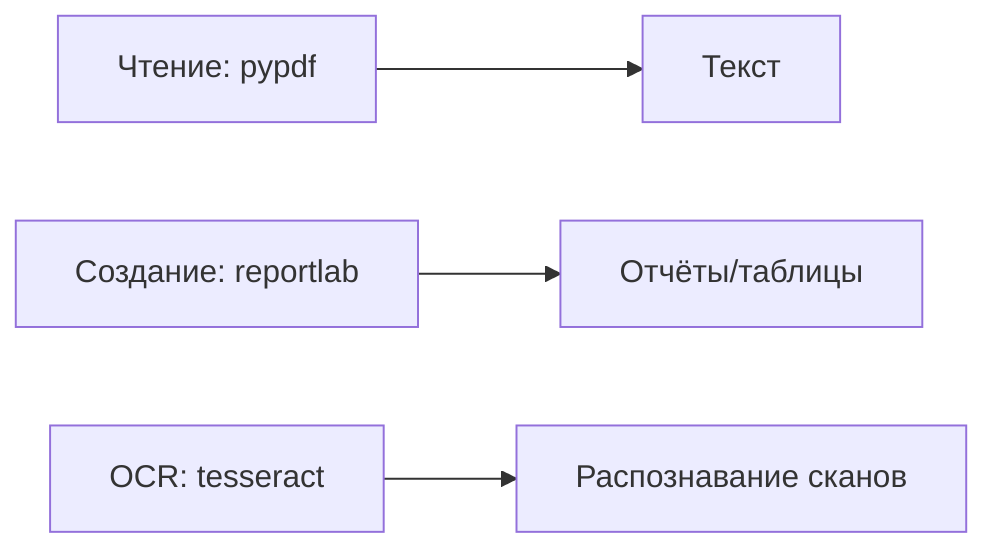

PDF — один из самых распространённых форматов документов. В Python есть библиотеки для чтения (pypdf), создания (reportlab) и распознавания текста (OCR).

## Чтение с pypdf

```python
from pypdf import PdfReader

reader = PdfReader("doc.pdf")
page = reader.pages[0]
print(page.extract_text())
```

Если текст не извлекается — документ может быть сканом (картинкой); нужен OCR.

## Создание отчётов с reportlab

```python
from reportlab.pdfgen import canvas

c = canvas.Canvas("report.pdf")
c.drawString(100, 750, "Привет, PDF!")
c.save()
```

Для многостраничных отчётов удобен `platypus` (Paragraph, Table, SimpleDocTemplate).

## Объединение и разбиение

`PdfWriter` из pypdf позволяет добавлять страницы в произвольном порядке.

## OCR: Tesseract

```python
import pytesseract
from PIL import Image

text = pytesseract.image_to_string(Image.open("scan.png"), lang="rus")
```

Утилита tesseract должна быть установлена в системе.

## Подпись и метаданные

pypdf умеет читать/писать метаданные; криптографическую подпись обычно делают через сторонние средства.

## Итог урока

PDF-задачи решаемы: читаем, создаём, склеиваем и распознаём. Главное выбрать инструмент под тип документа.




## Почему PDF-навыки полезны

PDF — универсальный формат обмена документами: счета, отчёты, договоры. Автоматизация их создания и чтения экономит часы ручной работы, а OCR превращает архив сканов в полноценную базу текста. Комбинируя pypdf и reportlab, можно построить целые конвейеры документооборота: выгрузку данных, генерацию отчётов и их архивацию в одном сервисе.


## Практический пример конвейера

Представьте сервис, который ежедневно формирует отчёт: данные из БД → таблица в reportlab → сохранение в PDF → извлечение текста проверенно pypdf → отправка по почте. Все шаги автоматизируются Python-скриптом, а OCR подключается для старых сканов с архивом. Такие конвейеры используются в бухгалтерии, логистике и юриспруденции.


<!--TASK-->
### Задача 1 — Извлечение текста
Создай простой PDF через reportlab (три строки). Открой его через pypdf и проверь, что извлечённый текст содержит эти строки.

### Задача 2 — Метаданные
Задай метаданные (title, author) через canvas.setTitle / setAuthor, затем прочитай их через reader.metadata.

### Задача 3 — Объединение PDF
Создай два PDF и склей их в один через PdfWriter (добавь все страницы). Проверь, что итоговая длина страниц — сумма длин исходных.

### Задача 4 — Разбиение
Разбей многостраничный PDF на отдельные файлы по одной странице (например, 3 страницы → 3 файла). Покажи имена созданных файлов.

### Задача 5 — Таблица в отчёте
Через platypus (Table, SimpleDocTemplate) создай PDF с таблицей 3×3 и заголовком. Убедись, что файл создался и содержит 1 страницу.

### Задача 6 — OCR (проверка окружения)
Если tesseract установлен: создай картинку с текстом (через Pillow) и распознай её pytesseract. Если недоступен — опиши команду установки и код вызова.

### Задача 7 — Сводный отчёт с числами
Создай PDF-отчёт: заголовок, абзац и таблица с 5 строками данных (например, продажи). Добавь номер страницы через canvas.drawString (или простой колонтитул).
<!--/TASK-->

<!--HINT-->
### Подсказка 1
pip install pypdf reportlab; canvas.drawString(x, y, text) — координаты от нижнего левого угла.

### Подсказка 2
c.setTitle("..."), c.setAuthor("..."); после save() читай reader.metadata.title.

### Подсказка 3
writer.add_page(page); writer.write(out) — читай страницы из reader.pages.

### Подсказка 4
Для i, page в enumerate(reader.pages): создать нового writer и добавить page.

### Подсказка 5
from reportlab.platypus import SimpleDocTemplate, Paragraph, Table.

### Подсказка 6
pytesseract.image_to_string(Image.open(...), lang="rus") — нужен tesseract.exe (apt/Win установка).

### Подсказка 7
Таблица: Table(data); стиль через TableStyle.
<!--/HINT-->

<!--SOLUTION-->
### Разбор 1
```python
from reportlab.pdfgen import canvas
from pypdf import PdfReader

c = canvas.Canvas("hello.pdf")
c.drawString(100, 750, "Строка один")
c.drawString(100, 730, "Строка два")
c.save()

reader = PdfReader("hello.pdf")
text = reader.pages[0].extract_text()
assert "Строка один" in text
```
Отчёт создан и прочитан.

### Разбор 2
```python
c = canvas.Canvas("meta.pdf")
c.setTitle("Отчёт 2026")
c.setAuthor("Аня")
c.save()

reader = PdfReader("meta.pdf")
print(reader.metadata.title, reader.metadata.author)
```
Метаданные доступны после сохранения.

### Разбор 3
```python
from pypdf import PdfReader, PdfWriter

def make_pdf(name, lines):
    c = canvas.Canvas(name)
    for i, line in enumerate(lines):
        c.drawString(72, 750 - i * 20, line)
    c.save()

make_pdf("a.pdf", ["A1", "A2"])
make_pdf("b.pdf", ["B1"])

out = PdfWriter()
for name in ("a.pdf", "b.pdf"):
    for page in PdfReader(name).pages:
        out.add_page(page)

with open("merged.pdf", "wb") as f:
    out.write(f)

print(len(PdfReader("merged.pdf").pages))  # 3
```
Страницы из обоих файлов добавлены.

### Разбор 4
```python
reader = PdfReader("merged.pdf")
for i, page in enumerate(reader.pages):
    w = PdfWriter()
    w.add_page(page)
    with open(f"page_{i+1}.pdf", "wb") as f:
        w.write(f)
```
Файлы page_1.pdf, page_2.pdf, page_3.pdf созданы.

### Разбор 5
```python
from reportlab.platypus import SimpleDocTemplate, Table

doc = SimpleDocTemplate("table.pdf")
data = [["Кол1", "Кол2", "Кол3"],
        ["1", "2", "3"],
        ["4", "5", "6"]]
doc.build([Table(data)])
```
Таблица 3×3 в PDF.

### Разбор 6
```python
from PIL import Image
import pytesseract

img = Image.new("RGB", (400, 100), "white")
# ... нарисовать текст через ImageDraw ...
text = pytesseract.image_to_string(img, lang="rus")
print(text)
```
Если tesseract не найден — установи (apt-get install tesseract-ocr или Windows-installer) и пропиши путь.

### Разбор 7
```python
from reportlab.platypus import SimpleDocTemplate, Paragraph, Table, Spacer
from reportlab.lib.styles import getSampleStyleSheet

styles = getSampleStyleSheet()
doc = SimpleDocTemplate("report.pdf")
story = [
    Paragraph("Отчёт о продажах", styles["Title"]),
    Spacer(1, 12),
    Table([["Товар", "Сумма"],
           ["Книга", 1000],
           ["Ручка", 200]]),
]
doc.build(story)
```
Полноценный отчёт с заголовком и таблицей.
<!--/SOLUTION-->

<!--QUIZ-->
Какая библиотека читает PDF?
- pypdf
- reportlab
- openpyxl
- requests
* Правильный ответ: pypdf
PdfReader извлекает страницы.

Какая библиотека создаёт PDF?
- reportlab
- pypdf
- pillow
- csv
* Правильный ответ: reportlab
canvas и platypus генерируют документы.

Что делать, если extract_text() пуст?
- Документ может быть сканом — нужен OCR
- Ошибка pypdf
- Нужно больше памяти
- Ничего
* Правильный ответ: Документ может быть сканом — нужен OCR
Изображения требуют распознавания.

Что делает pytesseract?
- Распознаёт текст с изображений
- Создаёт PDF
- Читает PDF
- Сжимает файлы
* Правильный ответ: Распознаёт текст с изображений
OCR превращает картинку в текст.

Что такое platypus?
- Высокоуровневый инструмент сборки PDF-документов
- Модуль pypdf
- Расширение tesseract
- Формат данных
* Правильный ответ: Высокоуровневый инструмент сборки PDF-документов
Paragraph/Table/SimpleDocTemplate.

Как объединить PDF?
- Через PdfWriter.add_page
- Через canvas
- Через файловый конкатенатор
- Через OCR
* Правильный ответ: Через PdfWriter.add_page
Страницы добавляются по одной.

Что задаёт canvas.setTitle?
- Метаданные документа
- Текст на странице
- Размер шрифта
- Цвет
* Правильный ответ: Метаданные документа
Заголовок в свойствах PDF.

Какой параметр задаёт язык OCR?
- lang="rus"
- type="pdf"
- mode="text"
- scale=2
* Правильный ответ: lang="rus"
Пакеты языков отдельно устанавливаются.

Что вернёт reader.metadata.title?
- Заголовок документа
- Номер страницы
- Размер файла
- Список страниц
* Правильный ответ: Заголовок документа
Метаданные из файла.

Как добавить таблицу в отчёт?
- Через Table из platypus
- Через canvas только
- Через drawString
- Через image
* Правильный ответ: Через Table из platypus
Table принимает список строк.
Какой метод объединяет страницы в один файл?
- writer.add_page(page)
- writer.merge()
- canvas.join()
- reader.add()
* Правильный ответ: writer.add_page(page)
Добавляет страницу в выходной PDF.

Что такое OCR?
- Распознавание текста с изображений
- Оптимизация цвета
- Сжатие PDF
- Шифрование
* Правильный ответ: Распознавание текста с изображений
OCR переводит картинку в текст.


<!--/QUIZ-->
