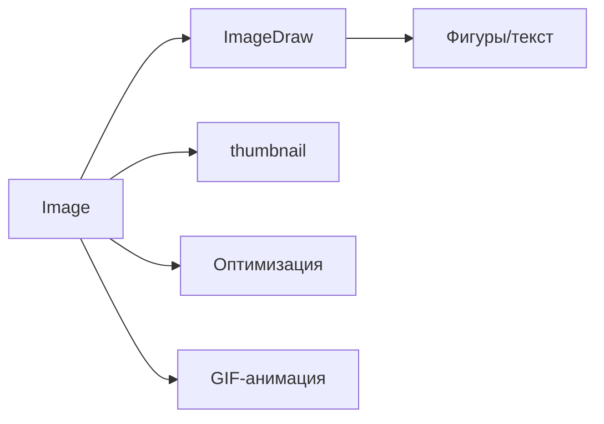

Pillow — стандартная библиотека работы с изображениями в Python. На этом уроке поднимемся от базовых операций к рисованию, анимации и оптимизации.

## Рисование: ImageDraw

```python
from PIL import Image, ImageDraw

img = Image.new("RGB", (400, 300), "white")
draw = ImageDraw.Draw(img)
draw.rectangle([50, 50, 200, 150], fill="blue", outline="black")
draw.ellipse([250, 50, 350, 150], fill="red")
draw.line([0, 0, 399, 299], fill="green", width=3)
img.save("shapes.png")
```

## Текст и шрифты

`ImageDraw.text` принимает позицию, текст и шрифт `ImageFont.truetype`:

```python
font = ImageFont.truetype("DejaVuSans.ttf", 32)
draw.text((20, 20), "Привет!", fill="black", font=font)
```

## Миниатюры и ресайз

`img.thumbnail((300, 300))` меняет размер пропорционально и не увеличивает.

## Анимация: сохранение GIF

```python
frames = []
for i in range(6):
    frame = Image.new("RGB", (200, 200), (i * 40, 100, 200))
    frames.append(frame)
frames[0].save("anim.gif", save_all=True, append_images=frames[1:],
               duration=100, loop=0)
```

## Оптимизация

- JPEG: `img.save("a.jpg", quality=85, optimize=True)`.
- PNG: `pngquant` или режим P/палитра.
- Проверка: сравнение размера файла.

## Итог урока

Pillow закрывает широкий круг задач: от простых миниатюр до генерации мемов и GIF-анимаций с контролем качества.




## Практическое применение

Pillow закрывает повседневные задачи: ресайз и миниатюры для сайтов, создание открыток и мемов, обработку артефактов фото, генерацию баннеров. Вместе с OCR и упаковкой в архивы из неё получаются целые конвейеры обработки изображений. Понимание форматов (JPEG/PNG/GIF) помогает сознательно выбирать качество и размер файла.


Для массовой обработки помните про память: большие изображения стоит открывать лениво и уменьшать до нужного размера. При пакетной работе используйте многопоточность (CPU-задачи — потоки, тяжёлые фильтры — процессы). Также полезно проверять формат и режим до сохранения, чтобы не терять качество при конвертации.


<!--TASK-->
### Задача 1 — Открыть и посмотреть
Создай изображение 300×200 градиентом (через генерацию пикселей Image.new и putpixel) и сохрани. Выведи размер и mode.

### Задача 2 — Геометрические фигуры
Нарисуй изображение с прямоугольником, эллипсом и линией; сохрани. Проверь, что файл существует и его размер больше нуля.

### Задача 3 — Мем с текстом
Создай изображение 600×400, нарисуй овал/прямоугольник и по центру надпись крупным шрифтом. Сохрани. (Если нет TTF — используй ImageFont.load_default(size=...)).

### Задача 4 — Миниатюра
Возьми любое изображение 800×600 (создай), примени thumbnail((200, 200)). Убедись, что размеры ≤ 200 и пропорции сохранены.

### Задача 5 — Конвертация и оптимизация
Сохрани одно и то же изображение в PNG и JPEG quality=60, optimize=True. Сравни размеры и выведи их.

### Задача 6 — GIF-анимация
Создай 8 кадров (меняющийся цвет/позиция круга) и сохрани анимацию. Проверь количество кадров через Image.open + n_frames.

### Задача 7 — Пакетная обработка
Напиши функцию, которая для всех PNG в папке создаёт миниатюры 300×300 в подпапку thumbs/. Выведи список созданных файлов.
<!--/TASK-->

<!--HINT-->
### Подсказка 1
putpixel((x, y), (r, g, b)) — попиксельная отрисовка; используй двойной цикл.

### Подсказка 2
ImageDraw.Draw(img) — один объект для всех фигур.

### Подсказка 3
ImageFont.truetype("DejaVuSans.ttf", 40); координаты центра — через textlength() или getbbox().

### Подсказка 4
thumbnail уменьшает, но не увеличивает; aspect ratio сохраняется.

### Подсказка 5
os.path.getsize("a.png") и getsize("a.jpg").

### Подсказка 6
save_all=True, append_images=..., duration=100, loop=0.

### Подсказка 7
glob.glob("*.png"); create thumbs/; сохранить с тем же именем.
<!--/HINT-->

<!--SOLUTION-->
### Разбор 1
```python
from PIL import Image

img = Image.new("RGB", (300, 200))
for x in range(300):
    for y in range(200):
        img.putpixel((x, y), (x * 255 // 299, y * 255 // 199, 100))
img.save("gradient.png")
print(img.size, img.mode)
```
Простой градиент по горизонтали и вертикали.

### Разбор 2
```python
from PIL import Image, ImageDraw

img = Image.new("RGB", (400, 300), "white")
d = ImageDraw.Draw(img)
d.rectangle([20, 20, 180, 150], fill="blue")
d.ellipse([220, 40, 360, 160], fill="red")
d.line([0, 0, 399, 299], fill="green", width=5)
img.save("shapes.png")
```
Все примитивы на одном холсте.

### Разбор 3
```python
from PIL import Image, ImageDraw, ImageFont

img = Image.new("RGB", (600, 400), "white")
d = ImageDraw.Draw(img)
d.rectangle([50, 100, 550, 300], fill="yellow", outline="black", width=5)
font = ImageFont.truetype("DejaVuSans.ttf", 48)
text = "Hello, Python!"
bbox = d.textbbox((0, 0), text, font=font)
w = bbox[2] - bbox[0]
h = bbox[3] - bbox[1]
d.text(((600 - w) // 2, (400 - h) // 2), text, fill="black", font=font)
img.save("meme.png")
```
Текст центрируется по размерам изображения; если TTF отсутствует — ImageFont.load_default(48).

### Разбор 4
```python
from PIL import Image

img = Image.new("RGB", (800, 600), "gray")
img.thumbnail((200, 200))
print(img.size)  # ≤ 200 в обеих осях
```
Пропорции сохраняются; 800×600 → ~200×150.

### Разбор 5
```python
from PIL import Image
import os

img = Image.new("RGB", (400, 400))
img.save("a.png")
img.save("a.jpg", quality=60, optimize=True)
print(os.path.getsize("a.png"), os.path.getsize("a.jpg"))
```
JPEG с оптимизацией почти всегда меньше PNG (для фото).

### Разбор 6
```python
from PIL import Image

frames = []
for i in range(8):
    f = Image.new("RGB", (200, 200), (i * 30, 100, 255 - i * 20))
    frames.append(f)
frames[0].save("anim.gif", save_all=True, append_images=frames[1:],
               duration=100, loop=0)

im = Image.open("anim.gif")
print(im.n_frames)  # 8
```
Многостраничный GIF открывается с n_frames кадрами.

### Разбор 7
```python
from PIL import Image
from pathlib import Path

src = Path(".")
thumbs = src / "thumbs"
thumbs.mkdir(exist_ok=True)

for p in src.glob("*.png"):
    im = Image.open(p)
    im.thumbnail((300, 300))
    im.save(thumbs / p.name)
    print(thumbs / p.name)
```
Все PNG превращаются в миниатюры в подпапке.
<!--/SOLUTION-->

<!--QUIZ-->
Какой класс рисует фигуры?
- ImageDraw
- ImageFont
- ImageFilter
- ImageOps
* Правильный ответ: ImageDraw
Draw(img) добавляет примитивы.

Как загрузить шрифт?
- ImageFont.truetype("...ttf", size)
- Image.open
- Image.new
- ImageDraw.textFont
* Правильный ответ: ImageFont.truetype("...ttf", size)
Существует стандартный шрифт.

Что делает thumbnail?
- Уменьшает, сохраняя пропорции
- Обрезает
- Увеличивает всегда
- Меняет формат
* Правильный ответ: Уменьшает, сохраняя пропорции
Не увеличивает и не искажает.

Как сохранить анимацию?
- save_all=True, append_images=...
- save(..., gif=True)
- export_animation
- add_frame
* Правильный ответ: save_all=True, append_images=...
Первый кадр+остальные.

Что оптимизирует JPEG?
- Параметр quality и optimize=True
- Только PNG
- Скорость загрузки
- Прозрачность
* Правильный ответ: Параметр quality и optimize=True
Меньший размер при допустимом качестве.

Как узнать число кадров GIF?
- im.n_frames
- len(im)
- im.size
- im.mode
* Правильный ответ: im.n_frames
Свойство открытого многостраничного файла.

Какая функция создаёт пустое изображение?
- Image.new
- Image.open
- ImageDraw
- ImageFont
* Правильный ответ: Image.new
Указываются size и mode.

Что делает putpixel?
- Задаёт цвет одного пикселя
- Сохраняет изображение
- Создаёт цвет
- Удаляет пиксель
* Правильный ответ: Задаёт цвет одного пикселя
Полезно для генерации.

Как получить ширину текста?
- Через bbox или textlength
- Длина строки
- Через size
- Через font.height
* Правильный ответ: Через bbox или textlength
Для центрирования текста.

Какой метод меняет размер с сохранением пропорций?
- thumbnail
- resize
- crop
- rotate
* Правильный ответ: thumbnail
resize искажает при произвольных размерах.
Что делает getbbox?
- Возвращает границы текста для центрирования
- Меняет цвет
- Сохраняет
- Удаляет
* Правильный ответ: Возвращает границы текста для центрирования
Координаты для позиционирования.

Какой параметр задаёт прозрачность PNG?
- RGBA mode
- JPG
- L
- 1
* Правильный ответ: RGBA mode
Четвёртый канал — alpha.


<!--/QUIZ-->
