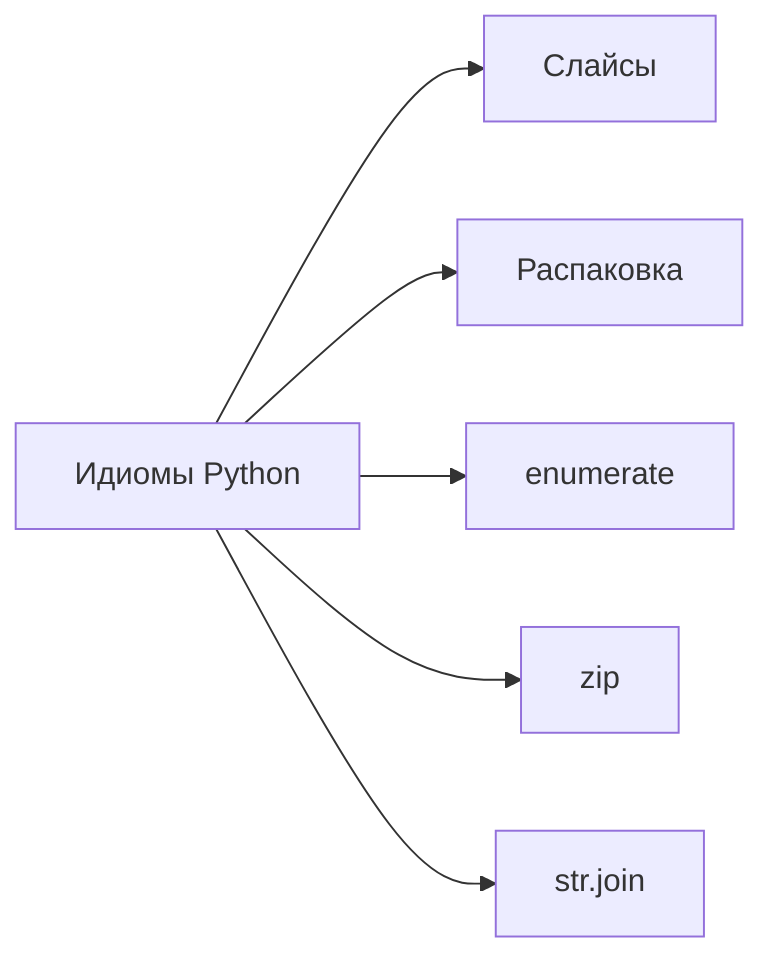

Есть два способа решить задачу на Python: просто решить и решить красиво. Питонический код — это не навороченный код, а наоборот: минимальный, ясный и такой, который читается как предложение на английском. Сегодня мы разберём идиомы — устойчивые выразительные приёмы, на которые сразу реагирует глаз опытного разработчика.

## Слайсы: гитара языка

Слайс (срез) позволяет взять часть последовательности: списка, строки, кортежа. Формат: `последовательность[начало:конец:шаг]`:

```python
digits = [0, 1, 2, 3, 4, 5, 6, 7, 8, 9]
print(digits[2:5])    # [2, 3, 4] — от индекса 2 до 5 (не включая)
print(digits[:4])     # [0, 1, 2, 3] — от начала
print(digits[7:])     # [7, 8, 9] — до конца
print(digits[::2])    # [0, 2, 4, 6, 8] — каждый второй
print(digits[::-1])   # [9, 8, ..., 0] — переворот!
```

Строка — тоже последовательность, поэтому слайсы работают и с ней:

```python
word = "палиндром"
print(word[::-1])  # "морднилап"
```

## Распаковка: магия знака равно

Если слева от `=` стоит несколько имён через запятую, Python «распакует» последовательность:

```python
x, y = 3, 4
print(x, y)  # 3 4

a, b = b, a  # обмен значениями без третьей переменной
```

Особенно приятно распаковывать пары из списков кортежей:

```python
points = [(1, 2), (3, 4), (5, 6)]
for x, y in points:
    print("Точка:", x, y)
```

А звёздочка `*` собирает «остаток»:

```python
first, *rest = [10, 20, 30, 40]
print(first)  # 10
print(rest)   # [20, 30, 40]
```

## enumerate и zip: друзья циклов

Частая боль: нужен не только элемент, но и его номер. `enumerate` решает это в одну строку:

```python
fruits = ["яблоко", "банан", "вишня"]
for index, fruit in enumerate(fruits, start=1):
    print(index, fruit)
# 1 яблоко
# 2 банан
# 3 вишня
```

А `zip` склеивает несколько последовательностей в пары (или тройки):

```python
names = ["Аня", "Боря", "Вера"]
scores = [92, 87, 95]
for name, score in zip(names, scores):
    print(name, score)
# Аня 92
# Боря 87
# Вера 95
```

Если списки разной длины — `zip` останавливается на самом коротком. Это часто ровно то, что нужно.

## Собираем строки правильно

Сложение строк в цикле — антипаттерн. Питонический способ — `str.join`:

```python
words = ["красота", "кода", "в", "простоте"]
sentence = " ".join(words)
print(sentence)  # красота кода в простоте
```

## Остальные маленькие радости

- `text.strip()` убирает лишние пробелы по краям;
- `list.index(x)` находит индекс элемента;
- `"a" in text` проверяет вхождение — читается как предложение;
- `dict.get(key, default)` безопасно достаёт значение из словаря.

Схема показывает, какие идиомы закрывают какие задачи:



Весь этот набор — не украшательство. Когда ты пишешь «как принято», твой код понимают другие Python-разработчики с первого взгляда, а сам ты при возвращении к проекту через полгода тратишь втрое меньше времени на реконструкцию своих же мыслей. Красота здесь — синоним ясности.

Теперь попробуй сам применить идиомы — каждая задача ниже решается в несколько строк.

<!--TASK-->
### Задача 1
Дан список чисел `numbers = [10, 20, 30, 40, 50, 60]`. С помощью слайсов выведи: 1) первые три элемента; 2) последние два элемента; 3) элементы с чётными индексами (0-й, 2-й, 4-й); 4) весь список в обратном порядке. Для каждого результата используй отдельный вызов `print()`. Ожидаемый вывод: четыре строки — `[10, 20, 30]`, `[50, 60]`, `[10, 30, 50]` и `[60, 50, 40, 30, 20, 10]`. Не используй циклы — только слайсы.
### Задача 2
Напиши программу, которая меняет местами значения двух переменных `a` и `b` без третьей переменной. Сначала присвой им любые числа (например, `a = 5`, `b = 7`), выведи их до обмена, затем выполни обмен и выведи после. Ожидаемый вывод: `До: a = 5, b = 7` и `После: a = 7, b = 5`. Используй распаковку кортежа в одну строку.
### Задача 3
Дан список учеников `students = ["Аня", "Боря", "Вера", "Гоша"]`. Выведи каждого ученика с номером по списку, начиная с 1, в формате `1. Аня`. Используй `enumerate` с параметром `start`. Ожидаемый вывод: четыре строки вида `1. Аня`, `2. Боря`, и так далее. Никаких ручных счётчиков!
### Задача 4
Даны два списка: `names = ["Аня", "Боря", "Вера"]` и `scores = [92, 87, 95]`. Склей их с помощью `zip` и выведи каждую пару в формате `Аня — 92 балла`. Ожидаемый вывод: три строки, по одной на ученика. После этого отправь `zip` в `list()` и убедись, что получился список кортежей, — выведи и его.
### Задача 5
Дан «школьный» код, который собирает строку из слов в цикле:

```python
words = ["Python", "это", "красиво"]
result = ""
for word in words:
    result = result + word + " "
print(result)
```

Убедись, что он работает (в конце останется лишний пробел). Перепиши его с помощью `str.join` так, чтобы результат был `Python это красиво` без лишнего пробела. Выведи результат. Затем добавь ещё одну строку: уберри с конца текста лишние пробелы методом `strip()` и выведи длину итоговой строки.
### Задача 6
Напиши программу-«детектор палиндромов». Функция `is_palindrome(text)` должна приводить строку к нижнему регистру (`lower()`), убирать из неё пробелы (`replace(" ", "")`) и сравнивать результат с его перевёрнутой копией, полученной слайсом `[::-1]`. Проверь функцию на трёх фразах: `"А роза упала на лапу Азора"`, `"Python"` и `"шалаш"`. Ожидаемый вывод:

```text
А роза упала на лапу Азора — палиндром
Python — не палиндром
шалаш — палиндром
```

Ответ выбирай тернарным выражением прямо внутри `print()`, без отдельных `if/else`. Объясни комментарием, зачем нужны `lower()` и `replace()`.
### Задача 7
Дан список имён `names = ["Аня", "Боря", "Вера", "Гоша"]` и список баллов `scores = [92, 87, 95, 78]`. Собери из них пары через `zip`, отсортируй результат по убыванию баллов функцией `sorted(..., key=lambda pair: pair[1], reverse=True)` и выведи рейтинг с номерами мест через `enumerate(..., start=1)`. Ожидаемый вывод:

```text
1. Вера — 95
2. Аня — 92
3. Боря — 87
4. Гоша — 78
Победитель: Вера — 95 баллов
```

Последнюю строку собери, взяв первый элемент отсортированного списка и распаковав его в две переменные. Никаких ручных счётчиков и циклов `while`.
<!--/TASK-->

<!--HINT-->
### Подсказка 1
Формат слайса — `spисок[начало:конец:шаг]`. Начало, конец или шаг можно опускать. Для первых трёх элементов: `numbers[:3]`, для последних двух: `numbers[-2:]`, для чётных индексов: `numbers[::2]`, для переворота: `numbers[::-1]`.
### Подсказка 2
Распаковка работает и справа, и слева от знака `=`. Строка `a, b = b, a` вычисляет правую часть `(b, a)`, а затем присваивает значения слева. Это и есть весь обмен.
### Подсказка 3
`enumerate(students, start=1)` возвращает пары `(номер, элемент)`. Разложи их в цикле: `for number, student in enumerate(students, start=1):` и внутри напечатай через `f-string` или несколько значений.
### Подсказка 4
`zip(names, scores)` отдаст пары `("Аня", 92)` и так далее. В цикле распакуй пару: `for name, score in zip(names, scores):`. Для второго вывода оберни `zip` в `list()`: `list(zip(names, scores))` — получится список кортежей.
### Подсказка 5
`" ".join(words)` склеивает элементы списка через пробел — пробел указывается один раз до `join`, а не в каждом слове. Лишний пробел в конце требовать не нужно: join его не создаёт. Длину строки можно узнать через `len(result)`.
### Подсказка 6
Слайс `[::-1]` возвращает перевёрнутую копию строки, а `lower()` и `replace(" ", "")` приводят текст к сравнимому виду: регистр и пробелы не должны мешать. Сравнивай две строки через `==`. Ответ удобно выбрать тернарным выражением прямо в `print()`: `"палиндром" if is_palindrome(phrase) else "не палиндром"`.
### Подсказка 7
`zip(names, scores)` даёт пары, а `sorted(..., key=lambda pair: pair[1], reverse=True)` сортирует их по второму элементу — по баллам — от большего к меньшему. В цикле пиши `for place, (name, score) in enumerate(ranking, start=1):` — скобки вокруг пары обязательны, так распаковывается вложенный кортеж.
<!--/HINT-->

<!--SOLUTION-->
### Разбор 1
Решение:

```python
numbers = [10, 20, 30, 40, 50, 60]

print(numbers[:3])
print(numbers[-2:])
print(numbers[::2])
print(numbers[::-1])
```

Результат:

```
[10, 20, 30]
[50, 60]
[10, 30, 50]
[60, 50, 40, 30, 20, 10]
```

Что здесь происходит? Слайс `numbers[:3]` берёт элементы от начала до индекса 3 (не включая его) — получаются первые три числа. `numbers[-2:]` использует отрицательные индексы: `-2` — второй элемент с конца, от него до конца — последние два. `numbers[::2]` — шаг 2, поэтому берём каждый второй элемент. `numbers[::-1]` — отрицательный шаг, список обходится с конца, и мы получаем переворот. Обрати внимание: ни один из слайсов не меняет сам список — он создаёт новый. Это безопасно и предсказуемо.

### Разбор 2
Решение:

```python
a, b = 5, 7
print("До: a =", a, ", b =", b)

a, b = b, a
print("После: a =", a, ", b =", b)
```

Результат:

```
До: a = 5 , b = 7
После: a = 7 , b = 5
```

Что здесь происходит? Строка `a, b = b, a` — классика Python, настоящее волшебство кортежей. Python сначала вычисляет правую часть: собирает кортеж `(b, a)` со старыми значениями, то есть `(7, 5)`. Затем распаковывает его в переменные слева: `a` получает `7`, а `b` — `5`. Никакой третьей переменной, никакого временного значения! В других языках для такого обмена нужна вспомогательная переменная и три строки кода — а здесь одна строка, которая читается как уравнение.

### Разбор 3
Решение:

```python
students = ["Аня", "Боря", "Вера", "Гоша"]

for number, student in enumerate(students, start=1):
    print(f"{number}. {student}")
```

Результат:

```
1. Аня
2. Боря
3. Вера
4. Гоша
```

Что здесь происходит? `enumerate` возвращает пары «номер, элемент». Без параметра `start` нумерация начиналась бы с нуля, но мы сказали начать с единицы. В цикле мы сразу распаковываем пару в `number` и `student`. Это заменяет ручной счётчик `i = 0` с последующим `i += 1` — классическую ошибку, где легко забыть увеличить счётчик. f-string `f"{number}. {student}"` красиво подставляет значения в строку — о нём подробнее в следующих уроках, но почувствовать его удобство можно уже сейчас.

### Разбор 4
Решение:

```python
names = ["Аня", "Боря", "Вера"]
scores = [92, 87, 95]

for name, score in zip(names, scores):
    print(f"{name} — {score} балла")

paired = list(zip(names, scores))
print(paired)
```

Результат:

```
Аня — 92 балла
Боря — 87 балла
Вера — 95 балла
[("Аня", 92), ("Боря", 87), ("Вера", 95)]
```

Что здесь происходит? `zip` склеивает элементы двух списков попарно: сначала первые элементы, затем вторые, и так далее. В цикле мы распаковываем каждую пару в `name` и `score`. Вторая часть задачи показывает ещё один приём: если обернуть `zip` в `list()`, мы получим список кортежей — пары можно сохранить и использовать позже. `zip` — идеальный инструмент, когда данные разложены по параллельным спискам и их нужно свести воедино.

### Разбор 5
Решение:

```python
words = ["Python", "это", "красиво"]
result = " ".join(words)
print(result)

print(len(result))
```

Результат:

```
Python это красиво
18
```

Что здесь происходит? Исходный код работал, но собирал строку в цикле через `+`, добавляя пробел после каждого слова, — из-за этого в конце оставался лишний пробел. Метод `" ".join(words)` делает всё за один шаг: берёт разделитель (пробел) и вставляет его между элементами списка, не добавляя ничего в конец. Строка получается ровно такой, какой задумана. `len(result)` показывает длину — 18 символов. `join` — не только красивее, но и быстрее: он не создаёт десятки промежуточных строк, как это делает `+` в цикле. Это тот случай, когда красота и производительность идут рука об руку.
### Разбор 6
Решение:

```python
def is_palindrome(text):
    clean = text.lower().replace(" ", "")
    return clean == clean[::-1]

for phrase in ["А роза упала на лапу Азора", "Python", "шалаш"]:
    print(phrase, "—", "палиндром" if is_palindrome(phrase) else "не палиндром")
```

Результат:

```
А роза упала на лапу Азора — палиндром
Python — не палиндром
шалаш — палиндром
```

Что здесь происходит? Функция сначала нормализует строку: `lower()` уравнивает «А» и «а», а `replace(" ", "")` убирает пробелы, из-за которых сравнение сломалось бы. Затем `clean[::-1]` создаёт перевёрнутую копию — тот же приём, что и в теории. Сравнение `==` возвращает `True` или `False`, а тернарное выражение в `print()` превращает его в человеческий ответ без лишних ветвлений. Обрати внимание: исходная строка не меняется — строки в Python неизменяемы, каждый метод возвращает новую. Если бы мы забыли `lower()`, фраза с большой «А» не считалась бы палиндромом, хотя буквы совпадают.

### Разбор 7
Решение:

```python
names = ["Аня", "Боря", "Вера", "Гоша"]
scores = [92, 87, 95, 78]

pairs = list(zip(names, scores))
ranking = sorted(pairs, key=lambda pair: pair[1], reverse=True)

for place, (name, score) in enumerate(ranking, start=1):
    print(f"{place}. {name} — {score}")

winner, best = ranking[0]
print("Победитель:", winner, "—", best, "баллов")
```

Результат:

```
1. Вера — 95
2. Аня — 92
3. Боря — 87
4. Гоша — 78
Победитель: Вера — 95 баллов
```

Что здесь происходит? `zip` сводит два параллельных списка в пары «имя — балл», а `list()` сохраняет их, чтобы можно было сортировать несколько раз. `sorted` не меняет исходный список, а возвращает новый; `key=lambda pair: pair[1]` говорит, что сравнивать нужно вторые элементы пар, то есть баллы, а `reverse=True` ставит лучших вперёд. В цикле `enumerate` даёт номер места, а скобки `(name, score)` распаковывают саму пару — без них Python попытался бы присвоить кортеж одному имени. Наконец, `winner, best = ranking[0]` — обычная распаковка первого элемента. Такой рейтинг — база для таблиц лидеров, турниров и дашбордов.
<!--/SOLUTION-->

<!--QUIZ-->
Какой слайс перевернёт список numbers?
- numbers[::-1]
- numbers[::1]
- numbers[1::]
* Правильный ответ: numbers[::-1]
Отрицательный шаг -1 обходит список с конца.

Что выведет print(digits[2:5]) для digits = [0, 1, 2, 3, 4, 5]?
- [2, 3, 4]
- [1, 2]
- [2, 3, 4, 5]
* Правильный ответ: [2, 3, 4]
Срез берёт элементы с индекса 2 по индекс 5, не включая его.

Что делает строка a, b = b, a?
- Меняет местами значения a и b
- Копирует a в b
- Вызывает ошибку
* Правильный ответ: Меняет местами значения a и b
Правая часть собирает кортеж (b, a), который распаковывается обратно в a и b.

Что вернёт enumerate(data, start=1)?
- Пары (номер, элемент), начиная с номера 1
- Только элементы, без номеров
- Номера, начиная с 0
* Правильный ответ: Пары (номер, элемент), начиная с номера 1
enumerate выдаёт пары «номер, элемент», а start=1 задаёт начальный номер.

Что делает zip(list1, list2)?
- Склеивает элементы двух списков в пары
- Объединяет списки в один
- Сортирует списки
* Правильный ответ: Склеивает элементы двух списков в пары
zip идёт по параллельным спискам и формирует кортежи из элементов с одинаковыми индексами.

Что выведет print(" ".join(["a", "b", "c"]))?
- a b c
- abc
- a,b,c
* Правильный ответ: a b c
join вставляет строку-разделитель (пробел) между элементами списка.

Что произойдёт, если zip получит списки разной длины?
- Остановится на длине самого короткого списка
- Выдаст ошибку
- Дополнит списки пустыми значениями
* Правильный ответ: Остановится на длине самого короткого списка
zip завершается, как только заканчивается короткий список.

Как называется приём, когда несколько значений присваиваются переменным из одной последовательности?
- Распаковка
- Упаковка
- Проксирование
* Правильный ответ: Распаковка
Распаковка — присваивание значений последовательности нескольким переменным слева от знака равенства.

Что выведет print([10, 20, 30, 40][1:3])?
- [20, 30]
- [10, 20, 30]
- [10, 20]
* Правильный ответ: [20, 30]
Срез с 1 по 3 (не включая 3) даёт элементы под индексами 1 и 2.

Какой способ собрать строку из списка слов является питоническим?
- " ".join(words)
- Цикл со сложением result += word + " "
- Конкатенация через +
* Правильный ответ: " ".join(words)
join — идиоматичный и быстрый способ собрать строку из частей.
Что вернёт выражение "Python"[::-1]?
- nohtyP
- Python
- Ошибку
* Правильный ответ: nohtyP
Отрицательный шаг перебирает строку с конца, поэтому получается перевёрнутая копия.

Что произойдёт при выполнении first, *rest = [10, 20, 30]?
- first = 10, rest = [20, 30]
- first = [10], rest = [20, 30]
- Ошибка распаковки
* Правильный ответ: first = 10, rest = [20, 30]
Звёздочка собирает все оставшиеся элементы в список, а first получает первый.

Что вернёт list(zip([1, 2], ["a", "b"]))?
- [(1, 'a'), (2, 'b')]
- [1, 2, 'a', 'b']
- [[1, 'a'], [2, 'b']]
* Правильный ответ: [(1, 'a'), (2, 'b')]
zip собирает кортежи из элементов с одинаковыми индексами.

Что делает key=lambda pair: pair[1] в вызове sorted()?
- Сортирует пары по второму элементу
- Сортирует пары по первому элементу
- Удаляет второй элемент пары
* Правильный ответ: Сортирует пары по второму элементу
key возвращает значение, по которому сравниваются элементы; pair[1] — второй элемент пары.
<!--/QUIZ-->
