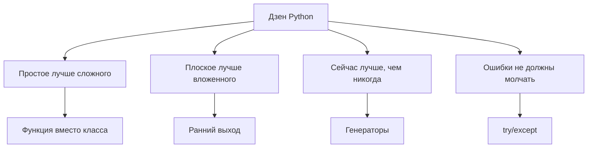

В Python есть удивительная традиция: если ввести `import this`, интерпретатор напечатает «Дзен Python» — поэму из 19 принципов, написанную Тимом Питерсом. Это не закон, а философия языка: свод того, каким должен быть код, чтобы его было приятно писать и читать.

```python
import this
```

Ты увидишь текст, который начинается со слов «Красивое лучше уродливого». Давай разберём несколько строк дзена на деле.

## «Явное лучше неявного»

Скрытая магия усложняет жизнь. Лучше писать прямо, даже если это на один символ длиннее:

```python
# Неявно: непонятно, что происходит
result = data.get("key", [])

# Явно: читается как предложение
if "key" in data:
    result = data["key"]
else:
    result = []
```

## «Простое лучше сложного»

Простейшее решение почти всегда лучше. Легко нагородить класс, где хватает функции, — не делай так. Сравни: простая функция `sum` против десятка строк ручного цикла. Простота не значит «примитивно» — она значит «минимально достаточно».

## «Плоское лучше вложенного»

Глубокая вложенность `if` внутри `if` внутри цикла — боль для читателя. Дзен призывает распрямлять структуру. Любимый приём — ранний выход:

```python
def greet(user, admin_list):
    if user not in admin_list:
        return "Привет, гость!"   # ранний выход из функции
    # дальше код живёт без лишней вложенности
    return "Привет, админ!"
```

## Генераторы: ленивое мышление

Генератор — функция с `yield`, которая отдаёт значения по одному, не храня весь список в памяти:

```python
def countdown(n):
    while n > 0:
        yield n
        n -= 1

for x in countdown(3):
    print(x)  # 3, 2, 1
```

Разница с обычной функцией: обычная возвращает всё сразу и забывает, а генератор «замирает» после каждого `yield` и продолжает по требованию. Это и есть воплощение строки «Сейчас лучше, чем никогда» — значения создаются ровно тогда, когда нужны.

## Списочные выражения

Вместо цикла с `append` — одна строка:

```python
squares = [x * x for x in range(10)]
print(squares)  # [0, 1, 4, 9, 16, 25, 36, 49, 64, 81]
```

С условием:

```python
even_squares = [x * x for x in range(10) if x % 2 == 0]
print(even_squares)  # [0, 4, 16, 36, 64]
```

А если список не нужен целиком — используй генераторное выражение (круглые скобки), оно ленивое:

```python
total = sum(x * x for x in range(10))
print(total)  # 285
```

## «Ошибки никогда не должны проходить молча»

Дзен требует: не прячь исключения. Обрабатывай их явно и осознанно:

```python
try:
    number = int(input("Введи число: "))
except ValueError:
    print("Это не число!")
else:
    print("Твоё число:", number)
```

## Ещё несколько жемчужин

- «Читаемость имеет значение» — код пишут один раз, а читают много раз;
- «Должен существовать один — и желательно только один — очевидный способ сделать это» — поэтому у Python единый стиль, PEP 8;
- «Если реализацию сложно объяснить — идея плохая» — если ты не можешь объяснить свой код другу, вероятно, он слишком сложный;
- «Пространства имён — отличная штука! Давайте делать их больше!» — модули и пакеты помогают не сталкиваться именам.

Схема связывает принципы Дзена с конкретными приёмами кода:



Дзен — не догма, а компас. Когда сомневаешься между двумя решениями, спроси себя: что сказал бы Дзен? Чаще всего ответ совпадёт с самым чистым и коротким решением. Давай проверим это на практике.

<!--TASK-->
### Задача 1
Напиши функцию `explain_zen()`, которая создаёт словарь: ключ — строка из Дзена (например, «Явное лучше неявного»), значение — твоё объяснение своими словами, почему этот принцип важен. Выбери минимум три принципа из `import this`. Функция должна выводить каждый принцип и его объяснение на отдельной строке в формате `Принцип: объяснение`. Вызови функцию. Ожидаемый результат: как минимум три строки с принципами. Запусти `import this` в своей среде и выбери принципы из реального текста.
### Задача 2
Напиши генератор `fibonacci(n)`, который через `yield` отдаёт первые `n` чисел Фибоначчи (0, 1, 1, 2, 3, 5, ...). Затем выведи первые 10 чисел, перебирая генератор в цикле `for`. Ожидаемый вывод: `0 1 1 2 3 5 8 13 21 34` (можно через пробел или по одному в строке). Покажи, что генератор можно «потратить» только один раз: после полного прохода второй цикл `for` по тому же генератору не выведет ничего.
### Задача 3
Дан список чисел `numbers = [3, 8, 1, 6, 12, 7, 4]`. С помощью списочного выражения создай список квадратов только нечётных чисел. Выведи его. Затем с помощью генераторного выражения и `sum()` посчитай сумму квадратов всех чисел списка и выведи её. Ожидаемый результат: первая строка — `[9, 1, 49]` (квадраты нечётных 3, 1, 7), вторая строка — число `379`.
### Задача 4
Дан код с глубокой вложенностью:

```python
def check(number):
    if number > 0:
        if number % 2 == 0:
            return "положительное чётное"
        else:
            return "положительное нечётное"
    else:
        return "не положительное"
```

Перепиши его в «плоском» стиле с ранним выходом: без вложенных `if`, с `return`-стражниками. Поведение должно остаться прежним. Вызови функцию для чисел `4`, `7` и `-2` и выведи результаты.
### Задача 5
Напиши функцию `safe_divide(a, b)`, которая делит `a` на `b` и явно обрабатывает ошибки: если `b` равен нулю — верни строку `Деление на ноль!` вместо исключения; если `a` или `b` — не числа (например, строки) — верни строку `Нужны числа!`. Используй `try/except` с конкретными типами исключений `ZeroDivisionError` и `TypeError`. Проверь функцию на трёх парах: `(10, 2)`, `(10, 0)`, `(10, "x")`. Ожидаемый вывод: `5.0`, `Деление на ноль!`, `Нужны числа!`.
### Задача 6
Напиши генератор `running_total(numbers)`, который отдаёт накопленную сумму элементов по одному: для `[3, 1, 4, 2]` — сначала `3`, затем `4`, затем `8`, затем `10`. Внутри держи переменную `total = 0`, в цикле прибавляй к ней очередное число и отдавай результат через `yield`. Затем выведи все значения для списка `[3, 1, 4, 2]` в одну строку через пробел, используя `print(value, end=" ")`. Ожидаемый вывод:

```text
3 4 8 10
```

После цикла не забудь пустой `print()`, чтобы следующий вывод начался с новой строки. В комментарии объясни, почему генератор не хранит весь список сумм в памяти.
### Задача 7
Напиши функцию `describe_score(score)`, которая по числу от 0 до 100 возвращает текстовую оценку. Сделай её «плоской»: сначала проверка типа — `if not isinstance(score, int): return "Нужно целое число"`, затем диапазон — `if score < 0 or score > 100: return "Вне диапазона"`, затем три возврата для `90+` — «отлично», `70–89` — «хорошо», остальное — «нужно повторить». Никаких вложенных `if`. Проверь функцию на значениях `95`, `75`, `40`, `150` и `"сто"`. Ожидаемый вывод:

```text
отлично
хорошо
нужно повторить
Вне диапазона
Нужно целое число
```
<!--/TASK-->

<!--HINT-->
### Подсказка 1
Запусти `import this` и выбери понравившиеся строки. Словарь можно создать так: `zen = {"Явное лучше неявного": "Понятный код проще поддерживать"}`. Для вывода используй цикл `for principle, explanation in zen.items():` и печатай `f"{principle}: {explanation}"`.
### Подсказка 2
Генератор записывается как обычная функция, но с `yield` вместо `return`. Держи две переменные: `a, b = 0, 1` и в цикле отдавай `a`, затем обновляй: `a, b = b, a + b`. После первого цикла `for` тот же генератор исчерпан: он не «перезапускается».
### Подсказка 3
Списочное выражение с условием: `[x * x for x in numbers if x % 2 == 1]`. Сумма квадратов через генераторное выражение: `sum(x * x for x in numbers)` — обрати внимание на круглые скобки: их можно даже не ставить внутри `sum()`.
### Подсказка 4
Ранний выход: сначала проверь самое общее условие и сразу верни ответ: `if number <= 0: return "не положительное"`. Затем разберись с чётностью `if number % 2 == 0 ` — и так, чтобы внутри не было вложенных `if`.
### Подсказка 5
`try:` оборачивает опасное действие, `except ZeroDivisionError:` ловит деление на ноль, `except TypeError:` ловит передачу неподходящих типов (например, строки при делении). Порядок исключений важен: сначала более конкретное, потом общее.
### Подсказка 6
Генератор — это функция с `yield`. Заведи `total = 0` перед циклом, внутри прибавляй число к `total` и отдавай новое значение через `yield total`. Вывод без перевода строки делается так: `print(value, end=" ")`, а после цикла добавь пустой `print()`, иначе следующая строка приклеится к числам.
### Подсказка 7
Стражники идут сверху вниз: сначала тип `if not isinstance(score, int)`, потом диапазон, потом пороги. Каждый `return` сразу завершает функцию, поэтому вложенные `if` не нужны. Порядок порогов важен: сначала `score >= 90`, затем `score >= 70`, иначе ветка «хорошо» перехватит отличников.
<!--/HINT-->

<!--SOLUTION-->
### Разбор 1
Решение:

```python
def explain_zen():
    zen = {
        "Явное лучше неявного": "Код должен говорить сам за себя, без скрытой магии.",
        "Простое лучше сложного": "Минимально достаточное решение надёжнее навороченного.",
        "Читаемость имеет значение": "Код читают чаще, чем пишут, — береги читателя.",
    }
    for principle, explanation in zen.items():
        print(f"{principle}: {explanation}")

explain_zen()
```

Результат:

```
Явное лучше неявного: Код должен говорить сам за себя, без скрытой магии.
Простое лучше сложного: Минимально достаточное решение надёжнее навороченного.
Читаемость имеет значение: Код читают чаще, чем пишут, — береги читателя.
```

Что здесь происходит? Мы создали словарь, где ключ — цитата из Дзена, а значение — наше объяснение. Цикл `for principle, explanation in zen.items()` распаковывает каждую пару «ключ-значение». f-string `f"{principle}: {explanation}"` собирает строку вывода. Такой формат легко расширять: добавил принцип в словарь — и он появится в выводе. Это тот случай, когда данные (словарь) и логика (цикл) красиво разделены.

### Разбор 2
Решение:

```python
def fibonacci(n):
    a, b = 0, 1
    for _ in range(n):
        yield a
        a, b = b, a + b

fib = fibonacci(10)
for number in fib:
    print(number, end=" ")
print()

print("Второй проход:")
for number in fib:
    print(number, end=" ")
```

Результат:

```
0 1 1 2 3 5 8 13 21 34
Второй проход:
```

Что здесь происходит? Функция с `yield` становится генератором. При каждом обращении она выполняет код до `yield`, отдаёт значение и «замирает» до следующего запроса. Числа Фибоначчи считаются без хранения всего ряда в памяти. Второй цикл `for` ничего не печатает, потому что генератор уже исчерпан: после полного прохода от него не осталось значений. Это важное отличие генератора от списка: список можно перебирать сколько угодно раз, а генератор — только один.

### Разбор 3
Решение:

```python
numbers = [3, 8, 1, 6, 12, 7, 4]

odd_squares = [x * x for x in numbers if x % 2 == 1]
print(odd_squares)

total = sum(x * x for x in numbers)
print(total)
```

Результат:

```
[9, 1, 49]
379
```

Что здесь происходит? Списочное выражение `[x * x for x in numbers if x % 2 == 1]` проходит по списку, оставляет только нечётные числа (3, 1, 7) и возводит их в квадрат — получается `[9, 1, 49]`. Генераторное выражение `sum(x * x for x in numbers)` суммирует квадраты всех чисел, не создавая промежуточный список: 9 + 64 + 1 + 36 + 144 + 49 + 16 = 379. Для большого объёма данных ленивое генераторное выражение экономит память — и это ровно то, о чём говорит Дзен: «Сейчас лучше, чем никогда», значения создаются в момент необходимости.

### Разбор 4
Решение:

```python
def check(number):
    if number <= 0:
        return "не положительное"
    if number % 2 == 0:
        return "положительное чётное"
    return "положительное нечётное"

print(check(4))
print(check(7))
print(check(-2))
```

Результат:

```
положительное чётное
положительное нечётное
не положительное
```

Что здесь происходит? Мы «распрямили» вложенные условия. Каждый `return` — стражник: как только условие выполняется, функция сразу возвращает ответ и выходит. Логика стала линейной: читается сверху вниз без прыжков между блоками. Разница с исходным кодом видна невооружённым глазом: вложенность исчезла, а поведение осталось тем же. Это и есть «Плоское лучше вложенного» в действии.

### Разбор 5
Решение:

```python
def safe_divide(a, b):
    try:
        return a / b
    except ZeroDivisionError:
        return "Деление на ноль!"
    except TypeError:
        return "Нужны числа!"

print(safe_divide(10, 2))
print(safe_divide(10, 0))
print(safe_divide(10, "x"))
```

Результат:

```
5.0
Деление на ноль!
Нужны числа!
```

Что здесь происходит? `try` пытается выполнить деление. Если `b` равен нулю, Python возбуждает `ZeroDivisionError`, и мы перехватываем его, возвращая понятное сообщение вместо падения программы. Если `a` или `b` имеет неподходящий тип (например, строка), возникает `TypeError` — и срабатывает второй `except`. Обрати внимание: исключения перечислены от более конкретного к более общему — это правильный порядок. Так мы следуем принципу «Ошибки никогда не должны проходить молча»: мы не прячем проблему, а аккуратно и явно её обрабатываем.
### Разбор 6
Решение:

```python
def running_total(numbers):
    total = 0
    for number in numbers:
        total += number
        yield total

for value in running_total([3, 1, 4, 2]):
    print(value, end=" ")
print()
```

Результат:

```
3 4 8 10
```

Что здесь происходит? `running_total` — генератор: он не считает всё сразу, а при каждом запросе выполняет тело до `yield`, отдаёт очередную сумму и замирает. Переменная `total` живёт между этими пробуждениями — это и есть состояние генератора. Проверим шаги: `3`, затем `3 + 1 = 4`, затем `4 + 4 = 8`, затем `8 + 2 = 10`. В памяти держится одно число `total`, а не список из четырёх сумм, — поэтому генератор хорош для длинных потоков данных. `end=" "` заменяет перевод строки на пробел, а последний пустой `print()` его возвращает. Если бы функция возвращала список, пришлось бы сначала пройти все данные, а потом отдавать их — генератор же начинает отдавать результат с первого элемента.

### Разбор 7
Решение:

```python
def describe_score(score):
    if not isinstance(score, int):
        return "Нужно целое число"
    if score < 0 or score > 100:
        return "Вне диапазона"
    if score >= 90:
        return "отлично"
    if score >= 70:
        return "хорошо"
    return "нужно повторить"

for value in [95, 75, 40, 150, "сто"]:
    print(describe_score(value))
```

Результат:

```
отлично
хорошо
нужно повторить
Вне диапазона
Нужно целое число
```

Что здесь происходит? Вместо лестницы вложенных условий мы выстроили цепочку стражников: каждый `return` срабатывает при своём условии и сразу выходит из функции. Порядок неслучаен. Сначала отсекаем неправильный тип — иначе сравнение строки с числом упадёт с `TypeError`. Потом проверяем диапазон — отрицательные и слишком большие числа бессмысленны. И только затем идём по порогам от высокого к низкому: если написать `>= 70` раньше `>= 90`, студент с 95 баллами получил бы «хорошо». Последняя строка без условия — это «иначе»: всё, что дошло до неё, меньше 70. Такая структура читается сверху вниз и не требует держать в голове вложенность.
<!--/SOLUTION-->

<!--QUIZ-->
Что выведет команда import this?
- Дзен Python — свод принципов языка
- Ошибку, потому что модуля нет
- Ничего
* Правильный ответ: Дзен Python — свод принципов языка
import this печатает «Дзен Python» — поэму из принципов разработки.

Что означает принцип «Явное лучше неявного»?
- Код должен быть понятным и прямым, без скрытой магии
- Нужно прятать логику в магии
- Чем короче, тем лучше независимо от понятности
* Правильный ответ: Код должен быть понятным и прямым, без скрытой магии
Явные конструкции говорят сами за себя, их легче читать и поддерживать.

Что делает ключевое слово yield в функции?
- Превращает функцию в генератор, отдающий значения по одному
- Возвращает одно значение и завершает функцию
- Печатает значение
* Правильный ответ: Превращает функцию в генератор, отдающий значения по одному
yield приостанавливает выполнение и возвращает значение, а при следующем обращении продолжает с того же места.

Сколько раз можно перебрать один и тот же генератор?
- Один раз: после полного прохода он исчерпан
- Сколько угодно раз
- Ни разу
* Правильный ответ: Один раз: после полного прохода он исчерпан
Генератор ленив: после того как отдал все значения, он больше не может их повторить.

Какой результат у выражения [x * x for x in range(4)]?
- [0, 1, 4, 9]
- [0, 1, 2, 3]
- [1, 4, 9]
* Правильный ответ: [0, 1, 4, 9]
Списочное выражение возводит в квадрат числа 0, 1, 2, 3.

Что делает sum(x * x for x in numbers)?
- Считает сумму квадратов всех чисел, не создавая список
- Создаёт список квадратов
- Возвращает список чисел
* Правильный ответ: Считает сумму квадратов всех чисел, не создавая список
Генераторное выражение в sum() вычисляет значения на лету.

Что такое «ранний выход» из функции?
- Возврат ответа сразу при выполнении условия, без вложенных конструкций
- Выход из программы
- Печать результата
* Правильный ответ: Возврат ответа сразу при выполнении условия, без вложенных конструкций
Стражники-return делают код плоским и читаемым.

Какой блок перехватит деление на ноль?
- except ZeroDivisionError
- except TypeError
- except ImportError
* Правильный ответ: except ZeroDivisionError
ZeroDivisionError возникает при делении на ноль и ловится одноимённым блоком.

Какой тип исключения возникнет при попытке разделить число на строку?
- TypeError
- ZeroDivisionError
- ValueError
* Правильный ответ: TypeError
TypeError поднимается, когда операция применяется к значениям неподходящих типов.

Что означает строка «Читаемость имеет значение»?
- Код пишут один раз, а читают много раз, поэтому он должен быть ясным
- Читать код необязательно
- Только комментарии делают код читаемым
* Правильный ответ: Код пишут один раз, а читают много раз, поэтому он должен быть ясным
Читаемость — главное качество кода, ведь его обслуживают многие люди.
Во что превращает функцию ключевое слово yield?
- В генератор, который отдаёт значения по одному
- В обычную функцию с возвратом результата
- В класс
* Правильный ответ: В генератор, который отдаёт значения по одному
yield пристанавливает функцию, сохраняя её состояние до следующего запроса.

Какой принцип Дзена призывает избегать глубокой вложенности?
- «Плоское лучше вложенного»
- «Явное лучше неявного»
- «Простое лучше сложного»
* Правильный ответ: «Плоское лучше вложенного»
Этот принцип советует распрямлять структуру и использовать ранний выход.

Что выведет sum(x * x for x in [1, 2, 3])?
- 14
- 9
- 6
* Правильный ответ: 14
Генераторное выражение считает 1 + 4 + 9 = 14, не создавая список.

Почему опасно писать except: без указания типа исключения?
- Он перехватывает все ошибки, включая опечатки и системные сбои
- Он работает медленнее
- Он не работает в Python 3
* Правильный ответ: Он перехватывает все ошибки, включая опечатки и системные сбои
Голый except прячет настоящую причину сбоя и мешает отладке — лучше ловить конкретные типы.
<!--/QUIZ-->
