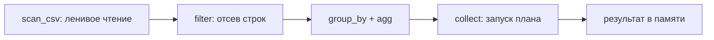

## Почему нам нужен ещё один DataFrame

Ты уже знаешь pandas: удобно, привычно, но у него есть фундаментальные ограничения. Во-первых, pandas почти полностью однопоточный — он использует одно ядро процессора, даже если у тебя их восемь. Во-вторых, pandas хранит данные поверх объектов Python, из-за чего каждый элемент строки или числа живёт в отдельном объекте со своими накладными расходами: типичная колонка целых чисел занимает в несколько раз больше памяти, чем «сырые» числа. В-третьих, pandas выполняет операции жадно (eager): каждое действие сразу выполняется, даже если следующий шаг отбросит большую часть результата. Когда ты работаешь с таблицами на сотни миллионов строк, всё это превращается в проблемы.

Polars решает эти проблемы на уровне архитектуры:

- написан на Rust и использует многопоточность из коробки;
- хранит данные в columnar-формате Apache Arrow — сплошные массивы, а не объекты Python;
- строит план запроса и оптимизирует его целиком, прежде чем выполнять;
- поддерживает lazy-режим, в котором можно собрать конвейер и выполнить его одним коллективным вызовом `collect()`.

Установка одной командой:

```bash
pip install polars
```

## Создание DataFrame

Как и pandas, Polars умеет создавать DataFrame из словаря:

```python
import polars as pl

df = pl.DataFrame({
    "город": ["Москва", "Питер", "Москва", "Новосибирск"],
    "продажи": [100, 200, 150, 300],
    "количество": [2, 5, 3, 7],
})
print(df)
```

Посмотрим тип каждой колонки и первые строки:

```python
print(df.schema)
print(df.head(2))
```

В отличие от pandas, `df.schema` — это упорядоченный словарь имя → тип, причём типы строго типизированы (`Int64`, `Utf8` и так далее). Это не просто украшение: благодаря строгой типизации Polars может генерировать очень быстрый машинный код под конкретные типы.

## Выражения вместо методов

Главная идея Polars — выражения (expressions). Метод `select` выбирает колонки и тут же может создавать новые на лету:

```python
df.select(
    pl.col("город"),
    (pl.col("продажи") / pl.col("количество")).alias("средний_чек"),
)
```

`with_columns` добавляет новые колонки к существующей таблице, `filter` отбирает строки, `sort` сортирует:

```python
df.with_columns(
    (pl.col("продажи") * 1.2).alias("продажи_с_наценкой"),
).filter(pl.col("продажи") > 120).sort("продажи", descending=True)
```

Обрати внимание: внутри выражений мы описываем преобразования декларативно. Polars транслирует их в векторные операции, оптимизированные под конкретные типы, не создавая лишних промежуточных копий.

## Агрегации

Группировка делается методом `group_by` и агрегирующими выражениями:

```python
df.group_by("город").agg(
    pl.col("продажи").sum().alias("сумма"),
    pl.col("продажи").mean().alias("среднее"),
    pl.len().alias("кол_во_заказов"),
).sort("сумма", descending=True)
```

Заметь `pl.len()` — счётчик строк в группе; в pandas для этого был бы `size()`.

## Ленивый режим: план вместо действия

Если данных много, начинай с `scan_*` вместо `read_*`: они строят ленивый план и не читают файл целиком:

```python
q = (
    pl.scan_csv("sales/*.csv")
    .filter(pl.col("дата") >= "2024-01-01")
    .group_by("город")
    .agg(pl.col("продажи").sum())
)
```

Пока ты не вызвал `collect()`, ничего не читалось. При выполнении Polars перенесёт фильтр внутрь чтения (predicate pushdown) и будет обрабатывать файлы параллельно:

```python
result = q.collect()
print(result)
```

А для конвейеров, которые не помещаются в память, есть потоковый режим:

```python
result = q.collect(streaming=True)
```

Собранный конвейер удобно держать в голове как схему: источник → фильтр → агрегат → выполнение.



Polars не заменяет pandas во всех сценариях: некоторые нишевые инструменты и библиотеки визуализации до сих пор заточены под pandas. Но для тяжёлых ETL-конвейеров и аналитики это сегодня стандарт де-факто. Теперь закрепим всё практикой.

<!--TASK-->
### Задача 1
Создай файл `sales.py`. Внутри сделай DataFrame `orders` с колонками `product_id` (целые), `qty` (целые) и `price` (дробные) — минимум пять строк. Добавь новую колонку `revenue = qty * price` через `with_columns`, затем отфильтруй строки, где `revenue > 200`, и отсортируй по убыванию `revenue`. В конце выведи на экран итоговый DataFrame и проверь, что в нём остались только подходящие строки. Ожидаемый вывод — отсортированная таблица с колонками `product_id`, `qty`, `price`, `revenue`.

### Задача 2
Возьми тот же `orders`. Сгруппируй данные по `product_id` и для каждой группы посчитай: сумму `revenue` (alias `total_revenue`), среднее `price` (alias `avg_price`) и количество заказов через `pl.len()`. Отсортируй результат по `total_revenue` по убыванию и выведи на экран. Проверь, что сумма всех `total_revenue` равна общей сумме `revenue` исходной таблицы — это хорошая проверка корректности агрегации.

### Задача 3
Напиши ленивый конвейер. Имитируй «большие данные»: сгенерируй три CSV-файла в папке `sales/` (можно в цикле записать одинаковую структуру: `дата`, `город`, `сумма` — по 100 строк в каждом, даты в январе 2024). Затем через `pl.scan_csv("sales/*.csv")` отфильтруй строки с `сумма > 500`, сгруппируй по `город` и посчитай сумму `сумма`. Вызови `collect()` и выведи результат. В комментарии объясни, почему `scan_csv` выгоднее, чем `read_csv`, для такого сценария.

### Задача 4
Напиши pytest-тесты. Сначала создай в `sales.py` функцию:

```python
def top_categories(df: pl.DataFrame, n: int = 3) -> pl.DataFrame:
    return (
        df.group_by("category")
        .agg(pl.col("revenue").sum().alias("total"))
        .sort("total", descending=True)
        .head(n)
    )
```

Теперь напиши файл `test_sales.py` с тестами: (1) для небольшого DataFrame с известными суммами по категориям проверь, что результат содержит ровно `n` строк; (2) что колонки называются `category` и `total`; (3) что строки отсортированы по убыванию `total`; (4) что при `n` больше числа категорий возвращаются все категории без ошибки. Запусти `pytest test_sales.py -v` и добейся зелёного прогона.

### Задача 5
Напиши pytest-тесты для функции объединения таблиц. Добавь в `sales.py`:

```python
def revenue_by_category(orders: pl.DataFrame, products: pl.DataFrame) -> pl.DataFrame:
    merged = orders.join(products, on="product_id")
    return (
        merged.group_by("category")
        .agg((pl.col("price") * pl.col("qty")).sum().alias("revenue"))
    )
```

В `test_sales.py` напиши тест: создай `orders` (product_id, qty) и `products` (product_id, category, price), вычисли ожидаемую выручку по категориям вручную и сравни с результатом функции. Добавь ещё один тест с `tmp_path`: запиши таблицу `products` в Parquet через `pl.write_parquet`, прочитай её обратно и убедись, что `revenue_by_category` даёт тот же ответ. Запусти pytest и убедись, что все тесты проходят.

### Задача 6
В файле `sales.py` добавь функцию `rank_by_city(df)`, которая для каждой строки считает место товара по выручке внутри его города. Используй оконное выражение `pl.col("revenue").rank("dense", descending=True).over("город")` и сохрани результат в колонке `место`. Отсортируй итог по `город` и `место` и выведи таблицу. Проверь, что в каждом городе места начинаются с 1 и идут без пропусков, а строк столько же, сколько в исходной таблице. Ожидаемый вывод — таблица с колонками `город`, `product_id`, `revenue`, `место`, где у самого прибыльного товара каждого города стоит 1.

### Задача 7
Собери сводную таблицу. В `sales.py` напиши функцию `city_month_matrix(df)`, которая через `pivot` строит матрицу «город × месяц» со суммой выручки: `df.pivot(index="город", columns="месяц", values="revenue", aggregate_function="sum")`. Пропуски заполни нулями через `fill_null(0)`, добавь колонку `итого` как сумму по всем месяцам и отсортируй строки по ней по убыванию. Выведи матрицу на экран. Ожидаемый вывод — таблица, где строки — города, столбцы — месяцы, а последняя колонка `итого` равна сумме значений своей строки.

<!--/TASK-->

<!--HINT-->
### Подсказка 1
`with_columns` принимает выражение: `df.with_columns((pl.col("qty") * pl.col("price")).alias("revenue"))`. Фильтр — `df.filter(pl.col("revenue") > 200)`, сортировка — `df.sort("revenue", descending=True)`. Можно chaining'ить методы в одну цепочку без промежуточных переменных.

### Подсказка 2
Шаблон группировки: `df.group_by("product_id").agg(...)`. Внутри `agg` перечисли выражения: `pl.col("revenue").sum().alias("total_revenue")`, `pl.col("price").mean().alias("avg_price")`, `pl.len()`. Для проверки суммы сравни `df["revenue"].sum()` и `result["total_revenue"].sum()` — они должны совпасть.

### Подсказка 3
Файлы проще всего создать в цикле через `pl.DataFrame(...).write_csv(f"sales/file_{i}.csv")`. Глоб в Polars — обычная строка: `pl.scan_csv("sales/*.csv")`. Не забудь в конце `.collect()` — без этого результат не будет вычислен и распечатан.

### Подсказка 4
Используй `@pytest.fixture` для DataFrame с категориями `A`, `B`, `C` и известными выручками. Для проверки сортировки сравни `result["total"].to_list()` с его же отсортированной копией. Все тесты — обычные функции с `assert`, импортирующие `top_categories`.

### Подсказка 5
Соединение в Polars: `orders.join(products, on="product_id")`. В тесте считай ожидаемую выручку напрямую из исходных списков. Для Parquet-части: `products.write_parquet(path)` — метод DataFrame Polars, затем `pl.read_parquet(path)`. Не забудь `import pytest` для `tmp_path`-фикстуры.

### Подсказка 6
Оконные операции в Polars делаются через `over`: `df.with_columns(pl.col("revenue").rank("dense", descending=True).over("город").alias("место"))`. Метод `rank` принимает стратегию (`"dense"` — нумерация без пропусков) и `descending=True`. `over("город")` говорит считать выражение отдельно внутри каждого города, не сворачивая таблицу. Сортировка в конце — `sort(["город", "место"])`.

### Подсказка 7
`pivot` вызывается на DataFrame: `df.pivot(index="город", columns="месяц", values="revenue", aggregate_function="sum")`. Значения колонки `месяц` станут названиями столбцов. `fill_null(0)` заменит пропуски. Колонку `итого` добавь через `with_columns(pl.sum_horizontal(pl.exclude("город")).alias("итого"))` и отсортируй по ней по убыванию.

<!--/HINT-->

<!--SOLUTION-->
### Разбор 1
Решение:

```python
import polars as pl

orders = pl.DataFrame({
    "product_id": [1, 1, 2, 3, 3, 4],
    "qty": [2, 3, 1, 5, 2, 10],
    "price": [150.0, 80.0, 300.0, 60.0, 150.0, 25.0],
})

result = (
    orders.with_columns(
        (pl.col("qty") * pl.col("price")).alias("revenue")
    )
    .filter(pl.col("revenue") > 200)
    .sort("revenue", descending=True)
)
print(result)
```

Вывод:

```
shape: (3, 4)
┌────────────┬─────┬───────┬─────────┐
│ product_id ┆ qty ┆ price  ┆ revenue │
╞════════════╪═════╪═══════╪═════════╡
│ 2          ┆ 1   ┆ 300.0 ┆ 300.0  │
│ 3          ┆ 5   ┆ 60.0  ┆ 300.0  │
│ 4          ┆ 10  ┆ 25.0  ┆ 250.0  │
└────────────┴─────┴───────┴─────────┘
```

Что здесь происходит? `with_columns` добавляет колонку `revenue`, не меняя исходную таблицу (Polars иммутабелен — каждая операция возвращает новый DataFrame). `filter` оставляет только строки, где выручка больше 200, а `sort(..., descending=True)` упорядочивает по убыванию. Иммутабельность — важное отличие от pandas: ты всегда можешь быть уверен, что исходный `orders` не изменился, и строить цепочки без побочных эффектов.

### Разбор 2
Решение:

```python
import polars as pl

orders = pl.DataFrame({
    "product_id": [1, 1, 2, 3, 3, 4],
    "qty": [2, 3, 1, 5, 2, 10],
    "price": [150.0, 80.0, 300.0, 60.0, 150.0, 25.0],
}).with_columns((pl.col("qty") * pl.col("price")).alias("revenue"))

stats = (
    orders.group_by("product_id")
    .agg(
        pl.col("revenue").sum().alias("total_revenue"),
        pl.col("price").mean().alias("avg_price"),
        pl.len().alias("orders_count"),
    )
    .sort("total_revenue", descending=True)
)
print(stats)
print("Проверка:", stats["total_revenue"].sum() == orders["revenue"].sum())
```

Вывод: в `stats` три колонки плюс `product_id`, строки упорядочены по убыванию `total_revenue`, а `Проверка: True` подтверждает, что сумма по группам равна общей выручке. Здесь `pl.len()` — аналог `size()` в pandas. Обрати внимание: `alias` переименовывает результат выражения — без него колонка называлась бы `revenue_sum` или `revenue_mean` по умолчанию.

### Разбор 3
Решение:

```python
import polars as pl

# Генерируем «большие» данные: три CSV-файла
for i in range(3):
    df = pl.DataFrame({
        "дата": [f"2024-01-{d:02d}" for d in range(1, 101)],
        "город": ["Москва"] * 50 + ["Питер"] * 50,
        "сумма": [100 + (j * 37) % 900 for j in range(100)],
    })
    df.write_csv(f"sales/file_{i}.csv")

q = (
    pl.scan_csv("sales/*.csv")
    .filter(pl.col("сумма") > 500)
    .group_by("город")
    .agg(pl.col("сумма").sum().alias("итого"))
)
print(q.collect())
```

Вывод — две строки (`Москва`, `Питер`) с суммой по каждому городу. `scan_csv` не читает файлы при построении плана: он лишь запоминает источники и трансформации. Метаданные (схема, статистики) читаются лениво, а при `collect()` фильтр продавливается внутрь чтения — Polars может пропустить целые блоки данных, которые не проходят условие. Для сценария «много файлов, читаем только часть» это даёт выигрыш и по времени, и по памяти.

### Разбор 4
Решение:

```python
import polars as pl
import pytest
from sales import top_categories

@pytest.fixture
def df():
    return pl.DataFrame({
        "category": ["A", "B", "A", "C", "B", "C"],
        "revenue": [100.0, 200.0, 50.0, 300.0, 150.0, 100.0],
    })

def test_returns_n_rows(df):
    result = top_categories(df, n=2)
    assert result.height == 2

def test_columns(df):
    result = top_categories(df)
    assert result.columns == ["category", "total"]

def test_sorted_descending(df):
    result = top_categories(df, n=3)
    totals = result["total"].to_list()
    assert totals == sorted(totals, reverse=True)

def test_n_larger_than_categories(df):
    result = top_categories(df, n=10)
    assert result.height == 3
```

Что здесь происходит? Фикстура `df` создаёт свежую таблицу для каждого теста — тесты изолированы. Проверки: количество строк (`height`), состав колонок, отсортированность (сравниваем список с его отсортированной копией) и поведение при `n` больше числа категорий. `top_categories` корректно возвращает все три категории, потому что `head(n)` не падает, когда строк меньше `n`. Запуск: `pytest test_sales.py -v`.

### Разбор 5
Решение:

```python
import polars as pl
import pytest
from sales import revenue_by_category

def make_orders():
    return pl.DataFrame({
        "product_id": [1, 2, 3, 1, 2],
        "qty": [2, 1, 5, 3, 4],
    })

def make_products():
    return pl.DataFrame({
        "product_id": [1, 2, 3],
        "category": ["tech", "food", "tech"],
        "price": [100.0, 50.0, 20.0],
    })

def test_revenue_by_category():
    result = revenue_by_category(make_orders(), make_products())
    expected = {"tech": 2 * 100 + 3 * 100 + 5 * 20, "food": 1 * 50 + 4 * 50}
    assert dict(zip(result["category"], result["revenue"])) == expected

def test_revenue_parquet_roundtrip(tmp_path):
    path = tmp_path / "products.parquet"
    make_products().write_parquet(path)
    products = pl.read_parquet(path)
    result = revenue_by_category(make_orders(), products)
    assert result["revenue"].sum() == 2 * 100 + 3 * 100 + 5 * 20 + 1 * 50 + 4 * 50
```

Что здесь происходит? В первом тесте мы вычисляем ожидаемую выручку вручную: товар 1 — tech (2 и 3 штуки по 100), товар 2 — food (1 и 4 по 50), товар 3 — tech (5 по 20). Преобразуем результат функции в словарь и сравниваем с ожиданием — так проверка остаётся читаемой. Второй тест использует `tmp_path` — специальную временную папку pytest, которая автоматически удаляется после теста: мы пишем таблицу в Parquet, читаем обратно и убеждаемся, что конвейер работает и после сериализации. Это важная проверка, ведь в реальном проекте данные часто приходят именно из Parquet.

### Разбор 6
Решение:

```python
import polars as pl

orders = pl.DataFrame({
    "город": ["Москва", "Москва", "Питер", "Питер", "Москва"],
    "product_id": [1, 2, 3, 4, 5],
    "revenue": [300.0, 150.0, 400.0, 400.0, 200.0],
})

def rank_by_city(df: pl.DataFrame) -> pl.DataFrame:
    return (
        df.with_columns(
            pl.col("revenue")
            .rank("dense", descending=True)
            .over("город")
            .alias("место")
        )
        .sort(["город", "место"])
    )

result = rank_by_city(orders)
print(result)
print("Строк не изменилось:", result.height == orders.height)
```

Вывод:

```
shape: (5, 4)
┌─────────┬────────────┬─────────┬───────┐
│ город   ┆ product_id ┆ revenue ┆ место │
╞═════════╪════════════╪═════════╪═══════╡
│ Москва  ┆ 1          ┆ 300.0   ┆ 1     │
│ Москва  ┆ 5          ┆ 200.0   ┆ 2     │
│ Москва  ┆ 2          ┆ 150.0   ┆ 3     │
│ Питер   ┆ 3          ┆ 400.0   ┆ 1     │
│ Питер   ┆ 4          ┆ 400.0   ┆ 1     │
└─────────┴────────────┴─────────┴───────┘
Строк не изменилось: True
```

Что здесь происходит? `over("город")` — это оконная операция: выражение считается внутри каждой группы, но результат возвращается в исходные строки, поэтому таблица не сворачивается и `height` не меняется. Стратегия `"dense"` нумерует места без пропусков, а равные значения получают одинаковый ранг — оба товара в Питере с выручкой 400 делят первое место, и следующее значение получило бы 2, а не 3. Это ключевое отличие от `group_by().agg()`, который вернул бы по одной строке на город: здесь нам нужны все заказы с их местом внутри города, например чтобы отобрать топ-3 по каждому городу через `filter(pl.col("место") <= 3)`.

### Разбор 7
Решение:

```python
import polars as pl

df = pl.DataFrame({
    "город": ["Москва", "Москва", "Питер", "Питер", "Питер"],
    "месяц": ["2024-01", "2024-02", "2024-01", "2024-01", "2024-02"],
    "revenue": [100.0, 50.0, 300.0, 200.0, 400.0],
})

def city_month_matrix(df: pl.DataFrame) -> pl.DataFrame:
    wide = df.pivot(
        index="город",
        columns="месяц",
        values="revenue",
        aggregate_function="sum",
    ).fill_null(0)
    return (
        wide.with_columns(
            pl.sum_horizontal(pl.exclude("город")).alias("итого")
        )
        .sort("итого", descending=True)
    )

print(city_month_matrix(df))
```

Вывод:

```
shape: (2, 4)
┌─────────┬──────────┬──────────┬───────┐
│ город   ┆ 2024-01  ┆ 2024-02  ┆ итого │
╞═════════╪══════════╪══════════╪═══════╡
│ Питер   ┆ 500.0    ┆ 400.0    ┆ 900.0 │
│ Москва  ┆ 100.0    ┆ 50.0     ┆ 150.0 │
└─────────┴──────────┴──────────┴───────┘
```

Что здесь происходит? `pivot` — обратная операция к `unpivot`: уникальные значения колонки `месяц` превращаются в столбцы, а ячейки заполняются агрегатом `sum`. Обрати внимание на `aggregate_function="sum"`: в Питере два заказа в январе (300 и 200), и без агрегата `pivot` не смог бы выбрать одно значение. `fill_null(0)` важен, потому что у Москвы нет данных за март и без заполнения там был бы `null`, который отравил бы сумму. `pl.sum_horizontal(pl.exclude("город"))` складывает все числовые колонки в каждой строке — это горизонтальная агрегация, не путать с `pl.col(...).sum()`, который сворачивает колонку в одно число. Сортировка по `итого` делает отчёт читаемым: сверху самый крупный город.

<!--/SOLUTION-->

<!--QUIZ-->
Какая библиотека лежит в основе памяти Polars?
- Apache Arrow
- NumPy
- SQLite
* Правильный ответ: Apache Arrow
Polars хранит данные в columnar-формате Apache Arrow — сплошные массивы вместо объектов Python.

Что такое lazy-режим в Polars?
- Запрос собирается в план и выполняется только при collect()
- Запрос выполняется сразу после каждого метода
- Режим отладки с печатью SQL
* Правильный ответ: Запрос собирается в план и выполняется только при collect()
scan_* создают ленивый план; вычисление запускает только collect().

Каким методом добавляют новые колонки в Polars?
- with_columns
- assign
- insert_column
* Правильный ответ: with_columns
with_columns принимает выражения и возвращает новый DataFrame с добавленными колонками.

Какое выражение считает количество строк в группе?
- pl.len()
- pl.count()
- pl.size()
* Правильный ответ: pl.len()
pl.len() внутри agg возвращает число строк группы — аналог size() в pandas.

Что делает метод collect(streaming=True)?
- Обрабатывает конвейер частями, не загружая всё в память
- Ускоряет за счёт GPU
- Отключает проверку типов
* Правильный ответ: Обрабатывает конвейер частями, не загружая всё в память
Потоковый режим позволяет обрабатывать данные, большие, чем память.

Зачем нужен alias() в выражении?
- Чтобы переименовать колонку результата
- Чтобы задать тип данных
- Чтобы отсортировать результат
* Правильный ответ: Чтобы переименовать колонку результата
alias задаёт имя результирующей колонки выражения.

Что означает predicate pushdown?
- Фильтр выполняется как можно раньше, ещё на этапе чтения
- Фильтр выполняется в самом конце
- Фильтр отключается оптимизатором
* Правильный ответ: Фильтр выполняется как можно раньше, ещё на этапе чтения
Оптимизатор переносит условия внутрь чтения, чтобы пропускать ненужные блоки данных.

Чем Polars отличается от pandas по памяти?
- Хранит данные в сплошных типизированных массивах, а не в объектах Python
- Хранит копию данных для каждой операции
- Не хранит данные в памяти вообще
* Правильный ответ: Хранит данные в сплошных типизированных массивах, а не в объектах Python
Это снижает накладные расходы и ускоряет векторные операции.

Что вернёт df.group_by("a").agg(pl.col("b").sum())?
- DataFrame с колонками a и b_sum
- Series
- Словарь
* Правильный ответ: DataFrame с колонками a и b_sum
Результат группировки в Polars — всегда DataFrame, где колонка агрегата называется по имени выражения.

Какой метод читает CSV лениво?
- pl.scan_csv
- pl.read_csv
- pl.load_csv
* Правильный ответ: pl.scan_csv
scan_csv возвращает LazyFrame; read_csv читает файл сразу.

Что делает `over("город")` в выражении Polars?
- Считает выражение внутри каждой группы, сохраняя число строк
- Сворачивает таблицу до одной строки на город
- Сортирует таблицу по городу
* Правильный ответ: Считает выражение внутри каждой группы, сохраняя число строк
`over` — оконная операция: результат попадает в те же строки, таблица не сворачивается.

Какая стратегия `rank` нумерует места без пропусков?
- "dense"
- "ordinal"
- "average"
* Правильный ответ: "dense"
Стратегия `"dense"` даёт 1, 2, 3 без пропусков даже при равных значениях.

Что делает `pivot`?
- Разворачивает уникальные значения колонки в столбцы
- Удаляет дубликаты строк
- Меняет типы колонок
* Правильный ответ: Разворачивает уникальные значения колонки в столбцы
`pivot` строит сводную таблицу: строки задаёт `index`, столбцы — значения `columns`.

Чем `pl.sum_horizontal` отличается от `pl.col("a").sum()`?
- Складывает значения колонок внутри каждой строки
- Складывает все значения одной колонки
- Считает среднее по строкам
* Правильный ответ: Складывает значения колонок внутри каждой строки
`sum_horizontal` работает по горизонтали — по колонкам в пределах строки.

<!--/QUIZ-->
