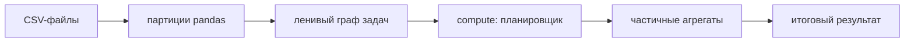

## Проблема: pandas упирается в память и одно ядро

Ты уже знаешь, что pandas держит весь DataFrame в оперативной памяти и выполняет операции в одном потоке. Если таблица занимает 40 ГБ, а у машины 16 ГБ — pandas просто не запустится. Можно ужаться, переписать на Polars, но что делать, когда данных больше, чем памяти, а код уже написан на pandas и менять всё не хочется?

Dask решает эту задачу иначе: он **не переписывает** pandas, а имитирует его API поверх кусочков. Идея простая: Dask режет большую таблицу на части — **партиции** (partitions), каждая из которых — обычный маленький pandas DataFrame. Операции применяются к партициям параллельно, а Dask лениво собирает граф вычислений и выполняет его по мере необходимости.

## Первое знакомство: dask.dataframe

Установка:

```bash
pip install dask[dataframe]
```

Импорт выглядит почти как pandas:

```python
import dask.dataframe as dd

ddf = dd.read_csv("sales/sales_*.csv")
print(ddf.npartitions)   # сколько частей
print(ddf.columns)       # колонки
```

В отличие от pandas, `ddf` — это **ленивый** объект: при чтении Dask ещё ничего не загрузил, он только описал план. Чтобы получить реальные данные, нужно вызвать `compute()`:

```python
df = ddf.compute()   # объединяет все партиции в один pandas DataFrame
```

Осторожно: `compute()` собирает всё в память — для огромных данных так делать нельзя. Вместо этого считают агрегаты, которые Dask умеет складывать по партициям:

```python
print(ddf["сумма"].sum().compute())
print(ddf["сумма"].mean().compute())
```

Каждая партиция считает свою частичную сумму, а Dask складывает их в дереве.

## Знакомый API

Почти все методы pandas есть в Dask: `ddf[ddf["город"] == "Москва"]`, `ddf.groupby("город")["сумма"].sum()`, `ddf.sort_values(...)`, `ddf.merge(other)`. Они возвращают ленивые Dask-DataFrame'ы, а `compute()` в конце запускает вычисление:

```python
result = (
    ddf[ddf["сумма"] > 500]
    .groupby("город")["сумма"]
    .sum()
    .compute()
)
print(result)
```

Dask автоматически определит, какие операции можно выполнять параллельно на разных партициях, а какие требуют перетасовки (shuffle) данных между ними — например, `groupby` по произвольной колонке.

## map_partitions: своя функция на каждой партиции

Иногда нужной операции нет в API. Тогда применяют `map_partitions` — она вызывает твою функцию на каждой партиции отдельно:

```python
def add_tax(df, rate=0.2):
    df = df.copy()
    df["налог"] = df["сумма"] * rate
    return df

ddf2 = ddf.map_partitions(add_tax, rate=0.2)
print(ddf2.head(3).compute())
```

Помни: функция должна принимать и возвращать pandas DataFrame.

## Dask Delayed: параллелим любой код

`dask.dataframe` покрывает табличные задачи. Для произвольных вычислений есть более низкоуровневый механизм — `dask.delayed`:

```python
import dask

@dask.delayed
def square(x):
    return x * x

@dask.delayed
def total(xs):
    return sum(xs)

parts = [square(i) for i in range(10)]
print(total(parts).compute())   # 285
```

`delayed` оборачивает обычную функцию: она не выполняется сразу, а добавляет узел в граф. Когда ты вызываешь `compute()` на корневом узле, Dask выполняет граф, распараллеливая независимые ветви.

## Планировщики и диагностика

Dask умеет работать в трёх режимах: потоки (threads, по умолчанию), процессы (processes) и распределённый кластер (`dask.distributed`). У распределённого режима есть веб-дашборд:

```python
from dask.distributed import Client
client = Client()          # запускает локальный кластер
```

После этого `client` автоматически используется Dask. Дашборд (по умолчанию `http://localhost:8787`) показывает граф задач, загрузку воркеров и память.

Схема работы Dask: большой набор данных режется на партиции, из операций строится граф, и только `compute()` запускает его исполнение.



## Когда Dask, а когда Polars или Ray

Dask лучший, когда код уже написан на pandas и его надо масштабировать без переписывания, или когда данные влезают в память кластера по частям. Polars быстрее на одной машине для табличных операций. Ray (следующий урок) — для произвольных распределённых задач, не только табличных. Нередко их комбинируют: Polars внутри одной партиции, Dask снаружи. Теперь практика.

<!--TASK-->
### Задача 1
Создай папку `sales_parts/` и сгенерируй четыре CSV-файла (например, `part_0.csv` ... `part_3.csv`) с колонками `дата`, `город`, `сумма` и 200 случайными строками в каждом. Затем в файле `dask_intro.py` прочитай их через `dd.read_csv("sales_parts/part_*.csv")`, выведи `npartitions`, общее число строк (подсказка: `len(ddf)` требует `compute()`), сумму и среднее `сумма`. Убедись, что сумма всех партиций соответствует сумме всех строк всех файлов.

### Задача 2
На том же `ddf` построй аналитический конвейер: отфильтруй строки с `сумма > 150`, сгруппируй по `город`, посчитай среднюю `сумма` и количество заказов, отсортируй результаты по средней сумме по убыванию и выведи итоговый pandas DataFrame после `compute()`. Сравни результат с тем, что получилось бы на pandas, если бы ты прочитал все файлы через `pd.concat` — числа должны совпасть.

### Задача 3
Напиши функцию `add_discount(ddf, percent)`, которая через `map_partitions` уменьшает `сумма` на заданный процент и добавляет колонку `со_скидкой`. Проверь её работу: примени к `ddf`, вызови `head(3).compute()` и убедись, что новая колонка есть, а значения соответствуют формуле. Также выведи `npartitions` до и после — он не должен измениться.

### Задача 4
Напиши pytest-тесты. В файле `dask_stats.py` реализуй функцию:

```python
import dask.dataframe as dd

def summarize_sales(pattern: str) -> tuple:
    ddf = dd.read_csv(pattern)
    total = int(ddf["сумма"].sum().compute())
    mean = float(ddf["сумма"].mean().compute())
    rows = int(ddf.shape[0].compute())
    return total, mean, rows
```

В `test_dask_stats.py` с помощью `tmp_path` создай два CSV-файла с известными суммами (например, 10 и 20) и проверь, что возвращается правильная сумма, количество строк и что среднее лежит между минимальным и максимальным значениями. Запусти pytest.

### Задача 5
Напиши pytest-тесты для `map_partitions`. Добавь в `dask_stats.py` функцию `add_tax(ddf, rate)`, которая добавляет колонку `налог = суммамка * rate` через `map_partitions`. В `test_dask_stats.py` напиши тест: сгенерируй временные CSV, прочитай через Dask, примени `add_tax` со ставкой 0.2 и убедись, что `(налог == суммамка * 0.2).all().compute()` истинно и что количество партиций не изменилось. Запусти все тесты и добейся зелёного прогона.

### Задача 6
Напиши конвейер на `dask.delayed`. В `dask_stats.py` добавь функцию `delayed_totals(files)`: для каждого пути создай отложенный вызов `read_and_sum(path)`, который читает CSV через `pandas.read_csv` и возвращает сумму колонки `сумма`; собери части в список и верни `dask.delayed(sum)(parts)`. В скрипте вызови `.compute()` и сравни результат с прямым подсчётом `sum(pd.read_csv(f)["сумма"].sum() for f in files)`. Ожидаемый вывод — два одинаковых числа и `True` в конце.

### Задача 7
Напиши функцию `to_parquet_parts(ddf, out_dir, npartitions=2)`, которая переразбивает данные через `repartition(npartitions=npartitions)`, записывает их через `ddf.to_parquet(out_dir, write_index=False)` и читает обратно через `dd.read_parquet(out_dir)`. Выведи число партиций до и после, число строк до и после (`shape[0].compute()`) и сумму колонки `сумма`. Ожидаемый вывод: партиций стало 2, число строк и сумма не изменились, а в папке появилось два parquet-файла.

<!--/TASK-->

<!--HINT-->
### Подсказка 1
Генерация: `pl.DataFrame` или `pd.DataFrame` в цикле по `range(4)`, `df.to_csv(f"sales_parts/part_{i}.csv", index=False)`. Для суммы всех партиций просто `ddf["сумма"].sum().compute()` — Dask сам сложит частичные суммы. Число строк: `ddf.shape[0].compute()` (это ленивый атрибут, поэтому нужен `compute()`).

### Подсказка 2
Конвейер из методов, которые ты уже знаешь: фильтр, `groupby("город")["сумма"].agg(["mean", "count"])` или два отдельных вызова, затем `sort_values(by="mean", ascending=False)` и `.compute()`. Для сверки с pandas используй `pd.concat([pd.read_csv(f) for f in files])` и повтори те же операции.

### Подсказка 3
`map_partitions` передаёт каждой партиции pandas DataFrame: `def add_discount(df, percent): df = df.copy(); df["со_скидкой"] = df["сумма"] * (1 - percent / 100); return df`. Обязательно копируй входной DataFrame, чтобы не менять партиции внутри Dask. `npartitions` после `map_partitions` совпадает с исходным.

### Подсказка 4
Фикстура `tmp_path` даёт папку для файлов: пиши туда CSV через `pd.DataFrame(...).to_csv(tmp_path / "a.csv", index=False)`. Проверки: `total == 30`, `rows == 4` и `min_val < mean < max_val`. Помни, что `summarize_sales` принимает глоб-паттерн, например `str(tmp_path / "*.csv")`.

### Подсказка 5
Создай CSV с колонкой `сумма` и числами. После `add_tax` сравни колонки поэлементно: `((res["налог"] - res["сумма"] * 0.2).abs() < 1e-9).all().compute()`. `npartitions` проверяй через `res.npartitions == ddf.npartitions`.

### Подсказка 6
Декоратор `@dask.delayed` вешают на обычную функцию — например, на `read_and_sum(path)`, которая читает CSV и возвращает сумму колонки. Вызов `read_and_sum(f)` возвращает ленивый объект, а не число. Сложить части можно так: `dask.delayed(sum)(parts)` — сама `sum` тоже становится узлом графа. Один `compute()` в конце вычисляет всё дерево, а независимые чтения файлов идут параллельно.

### Подсказка 7
Переразбиение: `ddf.repartition(npartitions=2)`. Запись датасета в папку — `ddf.to_parquet(out_dir, write_index=False)`; Dask создаст по файлу на партицию. Чтение обратно — `dd.read_parquet(out_dir)`. Число файлов проверяй через `len(list(Path(out_dir).glob("*.parquet")))`, а не через список из `os.listdir` — там могут оказаться служебные файлы.

<!--/HINT-->

<!--SOLUTION-->
### Разбор 1
Решение:

```python
import dask.dataframe as dd
import pandas as pd

for i in range(4):
    df = pd.DataFrame({
        "дата": pd.date_range("2024-01-01", periods=200, freq="h"),
        "город": ["Москва"] * 100 + ["Питер"] * 100,
        "сумма": [100 + (j * 53) % 900 for j in range(200)],
    })
    df.to_csv(f"sales_parts/part_{i}.csv", index=False)

ddf = dd.read_csv("sales_parts/part_*.csv")
print("Партиций:", ddf.npartitions)
print("Строк:", ddf.shape[0].compute())
print("Сумма:", ddf["сумма"].sum().compute())
print("Среднее:", round(float(ddf["сумма"].mean().compute()), 2))
```

Вывод: `Партиций: 4`, `Строк: 800`, далее сумма и среднее. Что здесь происходит? `dd.read_csv` не читает файлы — он создаёт ленивый объект из четырёх партиций. `shape[0]`, `sum()`, `mean()` тоже ленивые: каждый возвращает скаляр или серию, которые материализуются только при `compute()`. Ключевой момент: сумма считается как сумма частичных сумм партиций, поэтому в память не загружается ни один полный файл. Для контроля можно сложить суммы всех файлов вручную — результат будет тот же.

### Разбор 2
Решение:

```python
result = (
    ddf[ddf["сумма"] > 150]
    .groupby("город")["сумма"]
    .agg(["mean", "count"])
    .sort_values(by="mean", ascending=False)
    .compute()
)
print(result)
```

Вывод — таблица с городами, средними суммами и количеством заказов, отсортированная по убыванию среднего. Что здесь происходит? Фильтр применяется к каждой партиции независимо — это дешёвая операция без обмена данными. А вот `groupby` по `город` может потребовать перетасовки: Dask должен собрать строки одного города из разных партиций. Dask делает это автоматически: сначала частичные агрегаты по партициям, потом объединение. Именно поэтому результат `groupby` на Dask не всегда совпадает с pandas по порядку строк — но по значениям совпадает всегда. Проверка на pandas через `pd.concat` даст те же числа.

### Разбор 3
Решение:

```python
def add_discount(df, percent):
    df = df.copy()
    df["со_скидкой"] = df["сумма"] * (1 - percent / 100)
    return df

ddf2 = ddf.map_partitions(add_discount, percent=10)
print(ddf2.head(3).compute())
print("Было партиций:", ddf.npartitions, "→ стало:", ddf2.npartitions)
```

Вывод — первые три строки с новой колонкой `со_скидкой`, где значения равны `сумма * 0.9`, и одинаковое число партиций. Что здесь происходит? `map_partitions` берёт функцию, которая работает с одним pandas DataFrame, и вызывает её на каждой партиции. Это идеальный способ переиспользовать pandas-код в параллельном конвейере. Важно: мы копируем DataFrame внутри функции, потому что партиции могут переиспользоваться в графе, и мутировать их нельзя. `head(3).compute()` вычисляет только первые партиции — Dask умеет прекращать работу раньше, если результат этого не требует.

### Разбор 4
Решение:

```python
import pandas as pd
import pytest
from dask_stats import summarize_sales

def test_summarize_sales(tmp_path):
    pd.DataFrame({"сумма": [10, 20, 30]}).to_csv(tmp_path / "a.csv", index=False)
    pd.DataFrame({"сумма": [40, 50]}).to_csv(tmp_path / "b.csv", index=False)

    total, mean, rows = summarize_sales(str(tmp_path / "*.csv"))

    assert total == 150
    assert rows == 5
    assert 10 <= mean <= 50
```

Что здесь происходит? Мы создаём два CSV-файла с суммами 10, 20, 30 и 40, 50. Ожидаемое: `total = 150`, `rows = 5`, `mean = 30`. Проверка `10 <= mean <= 50` — «санитарная»: даже если округления чуть отличаются, тест ловит явные ошибки. Функция `summarize_sales` работает с глоб-паттерном, поэтому передаём `str(tmp_path / "*.csv")`. Запуск: `pytest test_dask_stats.py -v`. Обрати внимание: Dask читает CSV параллельно и сам определяет партиции, поэтому тест не зависит от того, сколько файлов мы создали.

### Разбор 5
Решение:

```python
import pandas as pd
import pytest
import dask.dataframe as dd
from dask_stats import add_tax

def test_add_tax(tmp_path):
    pd.DataFrame({"сумма": [100, 200, 300]}).to_csv(tmp_path / "c.csv", index=False)

    ddf = dd.read_csv(str(tmp_path / "c.csv"))
    res = add_tax(ddf, rate=0.2)

    assert res.npartitions == ddf.npartitions
    assert ((res["налог"] - res["сумма"] * 0.2).abs() < 1e-9).all().compute()
```

Что здесь происходит? `add_tax` применяет `map_partitions` с функцией, которая добавляет колонку `налог`. Проверки: (1) количество партиций не изменилось — `map_partitions` сохраняет структуру; (2) поэлементно все значения `налог` равны `сумма * 0.2` (используем `.abs() < 1e-9` из-за плавающей точности и обязательно `.compute()` — без этого сравнение ленивое и ничего не проверяет). Это типовая проверка для любых трансформаций на Dask: убедись, что функция применилась к каждому элементу и не сломала структуру данных.

### Разбор 6
Решение:

```python
import glob
import pandas as pd
import dask

def read_and_sum(path):
    df = pd.read_csv(path)
    return float(df["сумма"].sum())

def delayed_totals(files):
    parts = [read_and_sum(f) for f in files]
    return dask.delayed(sum)(parts)

files = sorted(glob.glob("sales_parts/part_*.csv"))
total = delayed_totals(files).compute()
direct = sum(pd.read_csv(f)["сумма"].sum() for f in files)
print(total, direct)
print("Совпадает:", abs(total - direct) < 1e-9)
```

Вывод: два одинаковых числа и `Совпадает: True`. Что здесь происходит? `@dask.delayed` превращает `read_and_sum` в фабрику узлов графа: вызов не читает файл, а записывает в граф операцию «прочитать файл и сложить колонку». Список `parts` — это четыре независимых узла, между которыми нет рёбер, поэтому планировщик выполнит их параллельно. `dask.delayed(sum)(parts)` добавляет корневой узел, который дождётся всех четырёх и сложит результаты. Один `compute()` запускает весь граф; прямой подсчёт нужен как контрольная сумма — он читает те же файлы последовательно и доказывает, что параллельная версия ничего не потеряла. Главное отличие от `dask.dataframe`: здесь мы сами решаем, что считать за единицу работы, поэтому `delayed` подходит для любых функций, а не только табличных.

### Разбор 7
Решение:

```python
from pathlib import Path
import dask.dataframe as dd

def to_parquet_parts(ddf, out_dir, npartitions=2):
    before = ddf.npartitions
    rows_before = int(ddf.shape[0].compute())
    total_before = float(ddf["сумма"].sum().compute())

    reduced = ddf.repartition(npartitions=npartitions)
    reduced.to_parquet(out_dir, write_index=False)

    loaded = dd.read_parquet(out_dir)
    print("Партиций:", before, "→", loaded.npartitions)
    print("Строк:", rows_before, "→", int(loaded.shape[0].compute()))
    print("Сумма:", total_before, "→", float(loaded["сумма"].sum().compute()))
    print("Файлов:", len(list(Path(out_dir).glob("*.parquet"))))
    return loaded
```

Вывод: `Партиций: 4 → 2`, одинаковое число строк, одинаковая сумма и `Файлов: 2`. Что здесь происходит? `repartition(npartitions=2)` меняет границу разбиения: Dask перераспределяет строки между двумя партициями, не загружая весь набор в память. `to_parquet` пишет по файлу на партицию — отсюда два файла в папке и `npartitions=2` при чтении. `write_index=False` не записывает индекс pandas: он не нужен для аналитики, занимает место и может конфликтовать со схемой при чтении другими движками, например Polars. Сравнение сумм до и после — главная проверка: сериализация не должна терять строки, а количество строк и сумма — самые чувствительные к потере индикаторы.

<!--/SOLUTION-->

<!--QUIZ-->
Что такое партиция в Dask?
- Маленький pandas DataFrame — часть большого набора данных
- Отдельный процесс на сервере
- Файл с настройками
* Правильный ответ: Маленький pandas DataFrame — часть большого набора данных
Dask режет данные на партиции, каждая из которых — обычный pandas DataFrame.

Что делает метод compute()?
- Запускает выполнение ленивого графа и возвращает реальные данные
- Печатает план запроса
- Сохраняет результат в файл
* Правильный ответ: Запускает выполнение ленивого графа и возвращает реальные данные
До compute() Dask только описывает вычисления, а сам вызов выполняет их.

Какой метод вызывает функцию на каждой партиции отдельно?
- map_partitions
- apply
- transform
* Правильный ответ: map_partitions
map_partitions передаёт каждой партиции pandas DataFrame и собирает результаты обратно.

Что вернёт ddf["сумма"].sum() без compute()?
- Ленивый объект, который можно вычислить позже
- Число
- Серию pandas
* Правильный ответ: Ленивый объект, который можно вычислить позже
Dask строит граф, и только compute() материализует результат.

Зачем нужен dask.delayed?
- Чтобы параллелить произвольные Python-функции
- Чтобы читать CSV быстрее
- Чтобы строить дашборды
* Правильный ответ: Чтобы параллелить произвольные Python-функции
delayed оборачивает функцию в узел графа, и независимые вызовы выполняются параллельно.

Что произойдёт, если вызвать compute() на огромном наборе данных?
- Обычно нехватка памяти: всё соберётся в один pandas DataFrame
- Ничего, Dask сам решит
- Файлы удалятся
* Правильный ответ: Обычно нехватка памяти: всё соберётся в один pandas DataFrame
compute() материализует все партиции, поэтому для больших данных считают агрегаты.

Какой планировщик Dask показывает веб-дашборд?
- dask.distributed.Client
- dask.threads
- dask.backend
* Правильный ответ: dask.distributed.Client
Client запускает локальный кластер с дашбордом на порту 8787.

Можно ли менять исходный DataFrame внутри map_partitions?
- Нет, нужно работать с копией
- Да, это безопасно
- Только в процессах
* Правильный ответ: Нет, нужно работать с копией
Партиции могут переиспользоваться; мутация сломала бы граф.

Сколько партиций будет после map_partitions?
- Столько же, сколько было
- Вдвое больше
- Одна
* Правильный ответ: Столько же, сколько было
map_partitions сохраняет структуру партиций.

Что делает groupby в Dask с данными из разных партиций?
- Выполняет перетасовку (shuffle) и объединяет частичные агрегаты
- Падает с ошибкой
- Игнорирует часть данных
* Правильный ответ: Выполняет перетасовку (shuffle) и объединяет частичные агрегаты
Сначала частичные агрегаты по партициям, затем их объединение.

Как переразбить Dask DataFrame на две партиции?
- ddf.repartition(npartitions=2)
- ddf.split(2)
- ddf.npartitions = 2
* Правильный ответ: ddf.repartition(npartitions=2)
`repartition` перераспределяет строки между заданным числом партиций.

Что создаёт вызов `dask.delayed(sum)(parts)`?
- Ленивый узел графа, который выполнится при compute()
- Сразу число
- Новый DataFrame
* Правильный ответ: Ленивый узел графа, который выполнится при compute()
`delayed` оборачивает вызов в узел; вычисление запускает только `compute()`.

Зачем указывать `write_index=False` при записи в Parquet?
- Чтобы не писать индекс pandas, который не нужен для аналитики
- Чтобы сжать файлы
- Чтобы ускорить compute()
* Правильный ответ: Чтобы не писать индекс pandas, который не нужен для аналитики
Лишний индекс занимает место и может мешать чтению другими движками.

Что возвращает `dd.read_parquet("sales_parts/")`?
- Ленивый DataFrame с партициями по файлам папки
- Список файлов
- Один pandas DataFrame
* Правильный ответ: Ленивый DataFrame с партициями по файлам папки
Dask читает датасет из папки и строит по партиции на файл.

<!--/QUIZ-->
