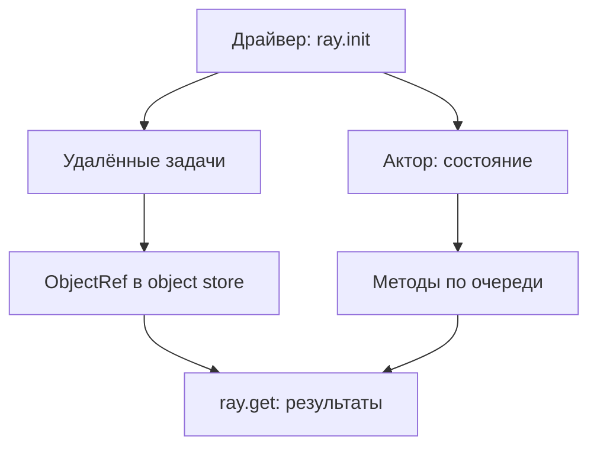

## Почему Ray

Dask отлично масштабирует табличные операции, но что делать, если тебе нужно распараллелить произвольный код: обработку изображений, симуляции, обучение моделей, веб-сервисы? Ray — это система распределённого исполнения общего назначения. Она берёт обычные Python-функции и классы и учит их работать параллельно — на одном компьютере или на целом кластере, почти без изменения кода.

Ray уже стал стандартом в индустрии: на нём построены библиотеки параллельного обучения (Ray Train), обработки данных (Ray Data), тюнинга гиперпараметров (Ray Tune) и распределённого RL (RLlib). При этом низкоуровневый API — задачи (tasks) и акторы (actors) — простой и понятный.

Установка:

```bash
pip install "ray[default]"
```

## Запуск Ray

Перед использованием Ray нужно инициализировать рантайм:

```python
import ray

ray.init(ignore_reinit_error=True, num_cpus=4)
```

`num_cpus` ограничивает число ядер, которые может использовать Ray. `ignore_reinit_error=True` позволяет безопасно вызывать `ray.init()` несколько раз, например в ноутбуке. Когда Ray больше не нужен, его останавливают: `ray.shutdown()`.

## Удалённые функции

Обычную функцию превращают в «удалённую» одним декоратором:

```python
@ray.remote
def double(x):
    return x * 2
```

Вызов такой функции не выполняет её сразу — вместо этого возвращается **ObjectRef** (фьючерс):

```python
futures = [double.remote(i) for i in range(10)]
print(futures)          # [ObjectRef(...), ...]
```

Чтобы получить значения, вызывают `ray.get()`:

```python
results = ray.get(futures)
print(results)          # [0, 2, 4, ..., 18]
```

Каждый `double.remote(i)` — независимая задача. Ray сам распределяет их по воркерам и собирает результаты. Создание 1000 задач и выполнение их на 4 ядрах — стандартный паттерн.

## Параллельный reduce

Популярный приём — «разделяй и властвуй»: разбить данные на куски, посчитать частичные суммы параллельно, а затем сложить их:

```python
@ray.remote
def partial_sum(chunk):
    return sum(chunk)

data = list(range(1_000_000))
chunks = [data[i::4] for i in range(4)]

futures = [partial_sum.remote(c) for c in chunks]
total = sum(ray.get(futures))
print(total)   # 499999500000
```

В отличие от наивного цикла, четыре куска считаются одновременно, а финальное сложение занимает микросекунды.

## Акторы: состояние между вызовами

Функции без состояния хороши для «чистых» вычислений. Но часто нужно долгоживущее состояние: счётчик, пул соединений, модель. Для этого Ray предлагает **акторов** — удалённые объекты с методами:

```python
@ray.remote
class Counter:
    def __init__(self):
        self.value = 0

    def increment(self, step=1):
        self.value += step
        return self.value

    def get(self):
        return self.value

counter = Counter.remote()        # создание актора
counter.increment.remote(5)
counter.increment.remote(3)
print(ray.get(counter.get.remote()))   # 8
```

Методы актора вызываются удалённо и выполняются по очереди, поэтому состояние не портится при параллельных вызовах. Классический пример — параллельный счётчик: 100 задач вызывают `increment.remote(1)`, и в итоге значение всегда ровно 100.

## Ray в кластере

Тот же код работает и на кластере: на головной машине запускают `ray start --head`, на воркерах — `ray start --address=<head>:6379`, а в коде просто передают адрес:

```python
ray.init(address="auto")
```

API не меняется: `@ray.remote`, `ObjectRef`, `ray.get`. Переход от ноутбука к кластеру — это смена одной строки.

Схема исполнения в Ray: драйвер отправляет задачи воркерам, результаты живут в object store, а актор хранит состояние между вызовами.



## Когда Ray, а когда Dask или Polars

- Polars — максимальная скорость на одной машине внутри одной таблицы;
- Dask — масштабирование pandas-кода и табличных конвейеров;
- Ray — произвольные распределённые задачи, сервисы и ML-конвейеры.

Они не конкуренты: часто в одном проекте Polars считает внутри воркера, Dask раздаёт задачи, а Ray оркестрирует всё. Теперь практика.

<!--TASK-->
### Задача 1
Создай файл `ray_intro.py`. Инициализируй Ray с `num_cpus=4` и `ignore_reinit_error=True`. Определи удалённую функцию `square_remote(x)`, которая возвращает `x * x`. Запусти её на числах от 0 до 9 с помощью `square_remote.remote(i)`, собери результаты через `ray.get()` и выведи список. В конце вызови `ray.shutdown()`. Убедись, что вывод — список квадратов чисел от 0 до 81.

### Задача 2
Реализуй параллельное суммирование. Создай список `data = list(range(1_000_000))`. Напиши удалённую функцию `partial_sum(chunk)`. Разбей `data` на 4 части (например, срезом `data[i::4]`), запусти `partial_sum.remote()` для каждой части и сложи результаты. Сравни с `sum(data)` и выведи `True`, если значения совпали. Объясни в комментарии, почему сумма считается быстрее, чем обычный `sum()`, на многоядерной машине.

### Задача 3
Напиши актора `BankAccount` с полем `balance`, изначально равным 0, и методами `deposit(amount)`, `withdraw(amount)` (не даёт уйти в минус: если `amount > balance`, возвращает `False` и ничего не меняет) и `get_balance()`. Создай актора, выполни 10 параллельных `deposit.remote(100)`, затем проверь, что баланс равен 1000. Потом вызови `withdraw.remote(500)` и выведи итоговый баланс.

### Задача 4
Напиши pytest-тесты для удалённых функций. В файле `ray_utils.py` определи:

```python
import ray

ray.init(ignore_reinit_error=True, num_cpus=2)

@ray.remote
def square(x):
    return x * x

def parallel_squares(numbers):
    return ray.get([square.remote(n) for n in numbers])
```

В `test_ray_utils.py` напиши тесты: (1) `parallel_squares([1, 2, 3]) == [1, 4, 9]`; (2) для пустого списка возвращается `[]`; (3) для отрицательных чисел квадраты корректны; (4) результат не меняется при повторном вызове. Запусти pytest и убедись, что всё зелёное.

### Задача 5
Напиши pytest-тесты для актора. В `ray_utils.py` добавь:

```python
@ray.remote
class Counter:
    def __init__(self):
        self.value = 0

    def increment(self):
        self.value += 1
        return self.value

    def get(self):
        return self.value
```

В `test_ray_utils.py` напиши тест: создай актора, запусти 50 задач `increment.remote()` (собери их через `ray.get`), затем проверь, что финальный `get()` равен 50. Добавь второй тест: два независимых актора не влияют друг на друга (у каждого свой баланс). Вызови `ray.shutdown()` в финальной фикстуре после всех тестов.

### Задача 6
Напиши скрипт `ray_wait.py`: создай удалённую функцию `sleep_and_return(i)`, которая спит `0.1 * i` секунд и возвращает `i`. Запусти 8 задач, затем в цикле вызывай `ray.wait(futures, num_returns=2)` и обрабатывай готовые результаты через `ray.get`, пока список незавершённых не опустеет. Для каждой пары выведи значения по возрастанию. Ожидаемый вывод — четыре строки с парами чисел, причём в первых парах числа меньше, так как эти задачи завершились раньше.

### Задача 7
Реализуй разделяемую передачу данных. Создай список из миллиона чисел, положи его в object store через `ray.put(data)` и передай полученную ссылку в четыре удалённые задачи `chunk_sum(ref, start, end)`, которые внутри вызывают `ray.get(ref)` и суммируют срез. Сложи результаты и сравни с `sum(data)`. Выведи число задач и `True`. Объясни в комментарии, почему `ray.put` выгоднее, чем передавать список аргументом в каждую задачу.

<!--/TASK-->

<!--HINT-->
### Подсказка 1
Декоратор: `@ray.remote` над функцией. Вызов: `square_remote.remote(i)` — не путай с обычным вызовом. `ray.get()` принимает список фьючерсов и возвращает список результатов. Не забудь `ray.init()` до и `ray.shutdown()` после.

### Подсказка 2
Разбиение: `chunks = [data[i::4] for i in range(4)]` — шаг 4 даёт четыре примерно равные части. Запуск: `futures = [partial_sum.remote(chunk) for chunk in chunks]`, затем `total = sum(ray.get(futures))`. Сравнение: `print(total == sum(data))`.

### Подсказка 3
Актор: класс с декоратором `@ray.remote`. Создание: `acc = BankAccount.remote()`. Вызовы: `acc.deposit.remote(100)`. Для параллельного депозита запусти 10 задач в цикле и собери их через `ray.get()`. В `withdraw` проверяй `if amount > self.balance: return False`.

### Подсказка 4
Тесты — обычные функции из `test_ray_utils.py`, импортирующие `parallel_squares`. Для пустого списка: `ray.get([])` возвращает `[]`. Повторный вызов не должен менять глобальное состояние — это свойство чистых функций. Не забудь `import ray` в тестовом файле для явной инициализации.

### Подсказка 5
Для 50 параллельных инкрементов собери результаты: `ray.get([counter.increment.remote() for _ in range(50)])` — выполняться они будут по очереди внутри актора, поэтому итог ровно 50. Для независимости создай два актора и инкременть один из них; второй должен остаться на 0. Завершение: фикстура с `yield` и `ray.shutdown()` после.

### Подсказка 6
`ray.wait(refs, num_returns=2)` возвращает два списка: готовые ссылки и оставшиеся. В цикле: `ready, pending = ray.wait(pending, num_returns=2)`, затем `print(sorted(ray.get(ready)))`, а `pending` заменяй на новый список. Цикл `while pending:`. Спящая задача — `time.sleep(0.1 * i)`.

### Подсказка 7
`ref = ray.put(data)` кладёт список в object store один раз и возвращает `ObjectRef`. В задаче принимай именно ссылку: `def chunk_sum(ref, start, end): data = ray.get(ref)`. Разбиение — `n = len(data) // 4`, границы `i * n` и `(i + 1) * n` для `i` от 0 до 3. Сравнение: `abs(total - sum(data)) < 1e-6`.

<!--/HINT-->

<!--SOLUTION-->
### Разбор 1
Решение:

```python
import ray

ray.init(ignore_reinit_error=True, num_cpus=4)

@ray.remote
def square_remote(x):
    return x * x

futures = [square_remote.remote(i) for i in range(10)]
print(ray.get(futures))

ray.shutdown()
```

Вывод: `[0, 1, 4, 9, 16, 25, 36, 49, 64, 81]`. Что здесь происходит? `ray.init` запускает рантайм с четырьмя воркерами. Декоратор `@ray.remote` превращает функцию в удалённую: вместо выполнения она возвращает `ObjectRef`. Десять фьючерсов создаются мгновенно, а Ray выполняет функции на воркерах параллельно. `ray.get(futures)` блокирует выполнение до получения всех результатов и возвращает список. Это паттерн «fire-and-forget»: мы не ждём каждую задачу по отдельности, а отправляем все сразу и забираем результаты разом. `ray.shutdown()` корректно освобождает ресурсы.

### Разбор 2
Решение:

```python
import ray

ray.init(ignore_reinit_error=True, num_cpus=4)

@ray.remote
def partial_sum(chunk):
    return sum(chunk)

data = list(range(1_000_000))
chunks = [data[i::4] for i in range(4)]

futures = [partial_sum.remote(c) for c in chunks]
total = sum(ray.get(futures))

print("Совпадает:", total == sum(data))
ray.shutdown()
```

Вывод: `Совпадает: True`. Что здесь происходит? Срез `data[i::4]` разбивает список на четыре интерливированных куска примерно по 250 тысяч элементов. Четыре задачи `partial_sum` выполняются одновременно — каждая на своём ядре. Затем `sum(ray.get(futures))` складывает четыре частичные суммы. На четырёхядерной машине это даёт ускорение, близкое к 4× для чистого суммирования, потому что задачи независимы и не конкурируют за данные. Проверка `total == sum(data)` гарантирует, что параллельная версия не потеряла значения.

### Разбор 3
Решение:

```python
import ray

ray.init(ignore_reinit_error=True, num_cpus=4)

@ray.remote
class BankAccount:
    def __init__(self):
        self.balance = 0

    def deposit(self, amount):
        self.balance += amount
        return self.balance

    def withdraw(self, amount):
        if amount > self.balance:
            return False
        self.balance -= amount
        return self.balance

    def get_balance(self):
        return self.balance

acc = BankAccount.remote()
ray.get([acc.deposit.remote(100) for _ in range(10)])
print("Баланс после депозитов:", ray.get(acc.get_balance.remote()))
print("После снятия:", ray.get(acc.withdraw.remote(500)))
ray.shutdown()
```

Вывод: `Баланс после депозитов: 1000`, `После снятия: 500`. Что здесь происходит? Методы актора вызываются удалённо и выполняются последовательно внутри актора, поэтому 10 параллельных депозитов в сумме дают ровно 1000 — нет гонок. `withdraw` защищает от отрицательного баланса, возвращая `False` при попытке снять больше, чем есть. Акторы — это способ хранить состояние, которое должно пережить несколько удалённых вызовов, например пул соединений или модель.

### Разбор 4
Решение:

```python
import pytest
from ray_utils import parallel_squares

def test_squares_basic():
    assert parallel_squares([1, 2, 3]) == [1, 4, 9]

def test_empty_list():
    assert parallel_squares([]) == []

def test_negative_numbers():
    assert parallel_squares([-2, -1, 0]) == [4, 1, 0]

def test_repeatable():
    first = parallel_squares([5, 6])
    second = parallel_squares([5, 6])
    assert first == second == [25, 36]
```

Что здесь происходит? Тесты проверяют чистую функцию без побочных эффектов: базовые квадраты, пустой список (важный краевой случай — `ray.get([])` корректно возвращает `[]`), отрицательные числа и идемпотентность. Так как `parallel_squares` каждый раз создаёт новые задачи, тесты независимы друг от друга. Запуск: `pytest test_ray_utils.py -v`. Инициализация происходит при импорте `ray_utils` — `ray.init(ignore_reinit_error=True)` переживает повторные вызовы.

### Разбор 5
Решение:

```python
import pytest
import ray
from ray_utils import Counter

def test_counter_parallel_increments():
    counter = Counter.remote()
    ray.get([counter.increment.remote() for _ in range(50)])
    assert ray.get(counter.get.remote()) == 50

def test_counters_are_independent():
    a = Counter.remote()
    b = Counter.remote()
    ray.get(a.increment.remote())
    assert ray.get(a.get.remote()) == 1
    assert ray.get(b.get.remote()) == 0

@pytest.fixture(scope="session", autouse=True)
def shutdown_ray():
    yield
    ray.shutdown()
```

Что здесь происходит? Первый тест запускает 50 задач `increment` — внутри актора они выполняются по очереди, поэтому итоговое значение ровно 50. Второй тест проверяет изоляцию: каждый актор — отдельный объект со своим состоянием. Фикстура `shutdown_ray` со `scope="session"` гарантирует, что `ray.shutdown()` выполнится один раз после всех тестов сессии. Если бы мы не выключили Ray, вокеры остались бы висеть до конца процесса — это частая ошибка в тестах с Ray.

### Разбор 6
Решение:

```python
import time
import ray

ray.init(ignore_reinit_error=True, num_cpus=4)

@ray.remote
def sleep_and_return(i):
    time.sleep(0.1 * i)
    return i

futures = [sleep_and_return.remote(i) for i in range(8)]
pending = futures
while pending:
    ready, pending = ray.wait(pending, num_returns=2)
    print(sorted(ray.get(ready)))

ray.shutdown()
```

Вывод (порядок пар зависит от машины):

```
[0, 1]
[2, 3]
[4, 5]
[6, 7]
```

Что здесь происходит? Все восемь задач отправлены сразу, но `ray.get(futures)` заставил бы ждать самую медленную. `ray.wait` возвращает управление, как только готовы `num_returns` задач, поэтому мы обрабатываем результаты по мере поступления — это основа потоковой обработки длинных пачек. Списки `ready` и `pending` не пересекаются: `ready` содержит завершённые ссылки, `pending` — всё остальное, и цикл продолжается по `pending`. Функция `sorted` нужна только для читаемого вывода: внутри пары порядок не гарантирован. На практике такой паттерн применяют, чтобы начинать постобработку, не дожидаясь всего пакета.

### Разбор 7
Решение:

```python
import ray

ray.init(ignore_reinit_error=True, num_cpus=4)

@ray.remote
def chunk_sum(ref, start, end):
    data = ray.get(ref)
    return sum(data[start:end])

data = list(range(1_000_000))
ref = ray.put(data)
step = len(data) // 4

futures = [chunk_sum.remote(ref, i * step, (i + 1) * step) for i in range(4)]
total = sum(ray.get(futures))

print("Задач:", len(futures))
print("Совпадает:", total == sum(data))
ray.shutdown()
```

Вывод: `Задач: 4` и `Совпадает: True`. Что здесь происходит? `ray.put` один раз сериализует список в object store и возвращает ссылку. Когда ссылка передаётся аргументом в удалённую функцию, Ray не копирует миллион чисел в каждую задачу: воркер получает `ObjectRef` и читает объект из общего хранилища по месту, а `ray.get(ref)` внутри задачи материализует его локально. Без `ray.put` каждый вызов `chunk_sum.remote(data, ...)` сериализовал бы весь список четыре раза — это лишний трафик и память. Обрати внимание: срез `data[start:end]` создаёт копию куска, поэтому пиковая память воркера — около четверти списка плюс исходный объект в хранилище. Проверка суммы гарантирует, что границы срезов покрывают весь диапазон без пропусков и пересечений.

<!--/SOLUTION-->

<!--QUIZ-->
Что возвращает вызов удалённой функции ray-функции?
- ObjectRef — фьючерс на результат
- Сразу результат
- Список всех результатов
* Правильный ответ: ObjectRef — фьючерс на результат
@ray.remote возвращает ObjectRef, а значение получают через ray.get().

Как получить значения из списка фьючерсов?
- ray.get(futures)
- futures.values()
- compute(futures)
* Правильный ответ: ray.get(futures)
ray.get принимает список ObjectRef и возвращает список результатов.

Что такое актор в Ray?
- Удалённый объект с состоянием и методами
- Функция без состояния
- Пул потоков
* Правильный ответ: Удалённый объект с состоянием и методами
Актор хранит состояние, а его методы вызываются удалённо и последовательно.

Что делает ray.init(num_cpus=4)?
- Запускает рантайм Ray с четырьмя воркерами
- Создаёт четыре процесса
- Устанавливает кластер из четырёх машин
* Правильный ответ: Запускает рантайм Ray с четырьмя воркерами
num_cpus ограничивает число ядер для локального запуска.

Зачем нужен ray.shutdown()?
- Чтобы освободить ресурсы рантайма
- Чтобы сохранить результаты
- Чтобы перезапустить компьютер
* Правильный ответ: Чтобы освободить ресурсы рантайма
После работы с Ray его останавливают, иначе воркеры продолжают работать.

Как запустить Ray на кластере?
- ray.init(address="auto")
- ray.start_cluster()
- ray.connect_remote()
* Правильный ответ: ray.init(address="auto")
Тот же код работает и на кластере, меняется только строка инициализации.

Что произойдёт, если вызвать метод актора 50 раз параллельно?
- Методы выполнятся последовательно внутри актора, состояние не перемешается
- Будет гонка данных
- Упадёт исключение
* Правильный ответ: Методы выполтся последовательно внутри актора, состояние не перемешается
Актор сериализует вызовы методов, поэтому счётчик всегда корректен.

Что обычно быстрее: sum(ray.get(futures)) или обычный sum() на большом списке?
- Параллельная версия на многоядерной машине
- Обычный sum() всегда
- Они всегда равны по времени
* Правильный ответ: Параллельная версия на многоядерной машине
Независимые задачи распределяются по ядрам, что даёт ускорение.

Какой декоратор превращает класс в актора?
- @ray.remote
- @ray.actor
- @ray.task
* Правильный ответ: @ray.remote
Тот же декоратор, что и для функций, но применяется к классу.

Что нужно сделать, чтобы запустить Ray повторно в одном процессе?
- Передать ignore_reinit_error=True в ray.init
- Перезапустить процесс
- Ничего, Ray сам справится
* Правильный ответ: Передать ignore_reinit_error=True в ray.init
Это подавляет ошибку повторной инициализации.

Что возвращает `ray.wait(refs, num_returns=2)`?
- Два списка: готовые и оставшиеся ссылки
- Два готовых значения
- Одно значение и ошибку
* Правильный ответ: Два списка: готовые и оставшиеся ссылки
Первый список — завершённые задачи, второй — те, что ещё выполняются.

Что делает `ray.put(data)`?
- Кладёт объект в object store и возвращает ObjectRef
- Записывает данные в файл
- Создаёт актора
* Правильный ответ: Кладёт объект в object store и возвращает ObjectRef
Ссылку потом можно передавать в задачи без повторной сериализации.

Что происходит, когда ObjectRef передают аргументом в удалённую функцию?
- Ray подставляет значение из object store на стороне воркера
- Передаётся только число
- Задача падает с ошибкой
* Правильный ответ: Ray подставляет значение из object store на стороне воркера
Ссылка — это лёгкий указатель, данные не копируются в каждый вызов.

Почему методы одного актора не выполняются параллельно?
- Актор сериализует вызовы, чтобы защитить своё состояние
- У актора только один метод
- Ray не умеет параллелить методы
* Правильный ответ: Актор сериализует вызовы, чтобы защитить своё состояние
Последовательное выполнение исключает гонки за поля объекта.

<!--/QUIZ-->
